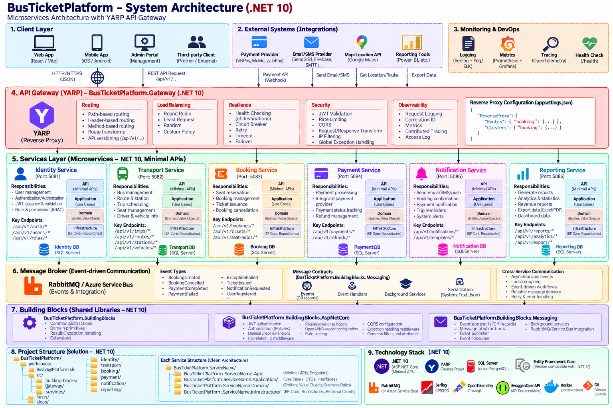

# PBL6 — Hệ thống đặt vé xe khách trực tuyến

Repository dùng SRS 2.1.0 làm baseline hiện hành để triển khai hệ thống bằng C# ASP.NET Core, React và React Native. Các SRS cũ và file Word được giữ lại như lịch sử/snapshot; không ghi đè để bảo toàn log thay đổi.

## Điểm bắt đầu

Trên Windows có Docker Desktop, chạy từ thư mục gốc để build và khởi động cả ba cổng với dữ liệu vận hành.

```powershell
powershell.exe -NoProfile -ExecutionPolicy Bypass -File .\Setup-PBL6.ps1
```

Máy local chạy bộ dữ liệu vận hành giả lập của 16 nhà xe. Các tài khoản dưới đây dùng chung mật khẩu local `CustomerPass1`.

| Cổng | Tài khoản |
|---|---|
| [Khách hàng](http://localhost:5173/login) | `customer.00001@demo.blue.example.test` |
| [Nhà xe](http://localhost:5174/login) · Hải Vân Lam | `operator.01@demo.blue.example.test` |
| [Nhà xe](http://localhost:5174/login) · Cánh Buồm Sông Hàn | `operator.02@demo.blue.example.test` |
| [Nhà xe](http://localhost:5174/login) · Đường Mây Kinh Bắc | `operator.03@demo.blue.example.test` |
| [Quản trị](http://localhost:5175/login) | `admin@demo.blue.example.test` |

- [Build Docker và nạp dữ liệu sau khi clone](./workspace/src/data-backup/README.md)
- [Mục lục tài liệu](./docs/README.md)
- [SRS 2.1.0 — active baseline](./docs/srs/v2/README.md)
- [Kết luận sẵn sàng triển khai](./docs/implementation/06-document-readiness-report.md)
- [Kế hoạch triển khai MVP](./docs/implementation/02-mvp-delivery-plan.md)
- [Roadmap, phân công và Kanban Markdown](./task-tracking/README.md)
- [Workspace mã nguồn và cấu hình build](./workspace/README.md)
- [OpenAPI/AsyncAPI/JSON Schema](./docs/contracts/README.md)
- [PostgreSQL migration baseline](./docs/database/README.md)

## Trạng thái

Baseline tài liệu MVP đã đủ để bắt đầu Slice 0 với mọi project backend target `.NET 10 / net10.0`. Identity Service đã được scaffold trong `workspace/src/`; các service còn lại tiếp tục theo cùng dependency rule. Docker Compose vẫn cần trước khi chạy full local stack và integration test; xem [development prerequisites](./docs/implementation/05-development-prerequisites.md).

## System Architecture


