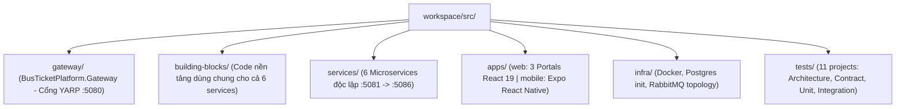
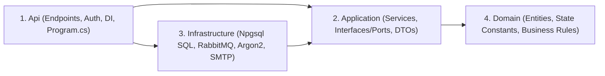

# 01. Cấu Trúc Mã Nguồn, Clean Architecture 4 Tầng & Shared Building Blocks

> **Mục tiêu**: Nắm rõ toàn bộ dự án được chia thư mục thế nào, 4 tầng Clean Architecture trong mỗi Microservice đóng vai trò gì, và các khối dùng chung (`BuildingBlocks`) giải quyết bài toán kỹ thuật nào.

---

## 1. Cấu Trúc Tổng Thể Của `workspace/src/`

Dự án được tổ chức theo mô hình **Microservices trên 1 Monorepo** (`.NET 10` cho Backend, `React 19` cho Web, `Expo` cho Mobile):



| Khu Vực | Thành Phần Cụ Thể | Vai Trò Kỹ Thuật Trong Hệ Thống |
|---|---|---|
| **`gateway/`** | `BusTicketPlatform.Gateway (:5080)` | Điểm vào HTTP duy nhất cho Web/Mobile/Webhook; dùng **YARP** định tuyến request về đúng service đích. |
| **`building-blocks/`** | `BuildingBlocks`, `BuildingBlocks.AspNetCore`, `BuildingBlocks.Messaging` | Thư viện nội bộ chứa `Result<T>`, chuẩn lỗi `ErrorEnvelope`, `CorrelationMiddleware`, `Idempotency`, và bộ khung `RabbitMQ` (chứa zero logic nghiệp vụ). |
| **`services/`** | `identity (:5081)`, `transport (:5082)`, `booking (:5083)`, `payment (:5084)`, `notification (:5085)`, `reporting (:5086)` | 6 dịch vụ tách rời hoàn toàn: **không `<ProjectReference>` chéo nhau**, **không `JOIN` chéo DB**, chỉ giao tiếp qua sự kiện RabbitMQ. |
| **`apps/` & `packages/`** | `apps/web`, `apps/mobile`, `packages/api-client` | Giao diện người dùng và SDK gọi API dùng chung qua Gateway `:5080`. |

---

## 2. Cách Áp Dụng Clean Architecture 4 Tầng Trong Mỗi Service

Mỗi một Microservice (ví dụ `booking/`) đều được tách thành **4 C# Projects (`.csproj`) riêng biệt** với chiều phụ thuộc một chiều từ ngoài hướng vào tâm:



1. **`Domain` (`*.Domain`) — Lõi quy tắc bất biến**:
   - Chỉ chứa các thực thể, trạng thái hợp lệ (`BookingStatuses`, `TripStatuses`), kiểu tiền tệ `Money`, chính sách mật khẩu (`PasswordPolicy`).
   - **Không phụ thuộc bất kỳ thư viện ngoài nào** (không biết tới ASP.NET, Npgsql hay RabbitMQ).
2. **`Application` (`*.Application`) — Điều phối luồng xử lý**:
   - Chứa các lớp điều phối chính (`AuthService`, `TransportService`, `BookingService`, `PaymentService`) và khai báo các **Interface (`IBookingRepository`, `IPasswordHasher`, `IEventPublisher`)**.
   - `Application` gọi `IBookingRepository` mà không cần biết bên dưới câu SQL viết thế nào — đây chính là nguyên lý **Dependency Inversion (Ports & Adapters)**.
3. **`Infrastructure` (`*.Infrastructure`) — Hiện thực hóa công nghệ**:
   - Thực thi các Interface của tầng `Application`: viết câu lệnh SQL bằng **`Npgsql`** (`BookingRepository`), băm mật khẩu bằng **`Argon2id`**, gửi mail **`SMTP`**, đọc/ghi bảng `outbox_messages` & `inbox_messages`, khởi chạy migration SQL (`SqlBaselineMigrator`).
4. **`Api` (`*.Api`) — Tầng giao tiếp HTTP & Khởi tạo (`Composition Root`)**:
   - Dùng **`.NET 10 Minimal APIs`** (`MapGroup`, `MapGet`, `MapPost`) để nhận request, kiểm tra JWT/Role, gọi xuống `Application`, và trả JSON.
   - `Program.cs` là nơi duy nhất nối Interface với Class thật trong Dependency Injection (`AddScoped<IBookingRepository, BookingRepository>()`).

> **Điểm nhấn khi thuyết trình**: Kiến trúc 4 tầng này không chỉ nằm trên giấy mà được **khóa cứng tự động bằng `NetArchTest`** (`LayerDependencyTests.cs`). Nếu ai đó lỡ tay `using Npgsql` ở tầng `Domain` hoặc `Application`, hoặc cho 2 service tham chiếu trực tiếp nhau, lệnh `dotnet test` sẽ báo đỏ ngay lập tức.

---

## 3. 3 Cơ Chế Cốt Lõi Trong `building-blocks/` Áp Dụng Toàn Dự Án

Thay vì lặp lại code kỹ thuật ở cả 6 services, dự án đóng gói 3 cơ chế chuẩn vào `building-blocks/`:

### 3.1. Mô hình `Result<T>` & Chuẩn Hóa Lỗi `ErrorEnvelopeMiddleware`
- **Vấn đề**: Dùng `throw Exception` cho các lỗi thông thường (như hết ghế, sai mật khẩu, trùng lịch) vừa tốn chi phí Stack Trace vừa dễ trả về lỗi mỗi nơi một kiểu JSON.
- **Cách áp dụng**:
  - Mọi hàm ở `Application` đều trả về `Result<T>` (thành công mang dữ liệu `Value`, thất bại mang `AppError(Code, Message)`).
  - Ở tầng `Api`, `ErrorMapper` tự ánh xạ mã lỗi sang đúng HTTP Status (`RESOURCE_NOT_FOUND -> 404`, `VERSION_CONFLICT / SEAT_UNAVAILABLE -> 409`, `ACCESS_DENIED -> 403`).
  - `ErrorEnvelopeMiddleware` bọc ngoài cùng đảm bảo mọi lỗi (kể cả `401/403/429` mặc định rỗng của ASP.NET) đều trả về **1 cấu trúc JSON duy nhất**:
    ```json
    {
      "error": {
        "code": "SEAT_UNAVAILABLE",
        "message": "One or more seats are no longer available.",
        "correlationId": "0195f8a2-..."
      }
    }
    ```

### 3.2. Truy Vết Xuyên Dịch Vụ Bằng `CorrelationMiddleware` (`X-Correlation-Id`)
- Khi 1 request đi vào Gateway `:5080`, nếu client chưa gửi `X-Correlation-Id`, Gateway tự sinh 1 mã định danh mới và truyền tiếp xuống Microservice, ghi vào Log và đóng gói luôn vào sự kiện RabbitMQ (`IntegrationEventEnvelope.CorrelationId`).
- Khi có lỗi ở bất kỳ khâu nào (Gateway $\rightarrow$ Booking $\rightarrow$ RabbitMQ $\rightarrow$ Payment), chỉ cần tìm theo `correlationId` là thấy trọn vẹn hành trình của giao dịch đó.

### 3.3. Chống Gửi Lặp Bằng `Idempotency-Key` (`PlatformHttp.WithIdempotency`)
- **Vấn đề**: Mạng chập chờn khiến khách bấm nút *"Đặt vé"* hoặc *"Thanh toán"* 2 lần liên tiếp $\rightarrow$ nguy cơ tạo 2 đơn hàng hoặc trừ tiền 2 lần.
- **Cách áp dụng**:
  - Các API ghi quan trọng (`POST /seat-holds`, `POST /bookings`, `POST /payments`, `POST /refunds`, `POST /auth/refresh`) bắt buộc gửi kèm header `Idempotency-Key`.
  - Backend băm nội dung request (`SHA-256`) và lưu cặp `(scope, idempotency_key, request_hash, response_json)` vào bảng `idempotency_records`.
  - Nếu cùng `Idempotency-Key` gửi lại với đúng payload cũ $\rightarrow$ trả lại ngay kết quả JSON đã lưu mà không chạy lại logic ghi DB. Nếu cùng key nhưng đổi nội dung body $\rightarrow$ chặn ngay bằng lỗi `409 IDEMPOTENCY_CONFLICT`.

