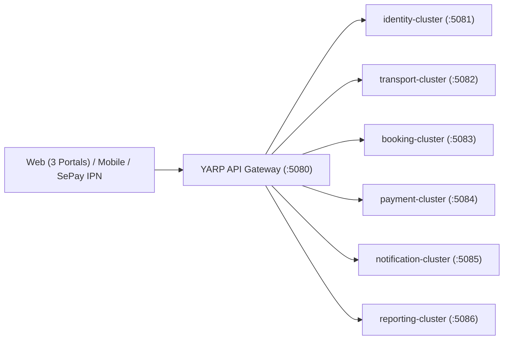

# 02. API Gateway & Cách Áp Dụng YARP Trong Dự Án (`Port 5080`)

> **Mục tiêu**: Hiểu rõ tại sao dự án dùng **YARP (`Yarp.ReverseProxy 2.3.0`)**, cách cấu hình `Clusters` và `Routes` trong `Gateway`, mẹo đánh trọng số `Order` để chia chung 1 đường dẫn REST cho nhiều Microservices, và cách Gateway bảo vệ các API nội bộ.

---

## 1. Vai Trò Của YARP Gateway Trong Kiến Trúc BLUE

Nếu không có API Gateway, trình duyệt Web và ứng dụng Mobile phải nhớ và gọi trực tiếp 6 cổng khác nhau (`:5081` đến `:5086`), phải cấu hình CORS ở cả 6 nơi, và làm lộ cấu trúc dịch vụ bên trong ra ngoài Internet.

Trong dự án, `BusTicketPlatform.Gateway (:5080)` đóng vai trò **Reverse Proxy trung tâm** đứng trước toàn bộ 6 Microservices:



**Tại sao chọn YARP thay vì Ocelot hay Kong/Nginx đơn thuần?**
- YARP là thư viện Reverse Proxy chính chủ của Microsoft chạy trực tiếp trên nhân **Kestrel `.NET 10`**, cho phép dùng chung luôn các Middleware C# của dự án (`CorrelationMiddleware`, `ErrorEnvelopeMiddleware`, CORS, Health Check) ngay tại tầng Gateway với hiệu năng rất cao.
- Trong môi trường Docker (`docker-compose.yml`), Nginx của các container Web chỉ phục vụ file tĩnh React (`.html, .js, .css`) và chuyển tiếp `/api/*` sang YARP Gateway, còn YARP chịu trách nhiệm định tuyến chi tiết tới từng Microservice.

---

## 2. Hai Phần Cấu Hình Cốt Lõi Của YARP (`appsettings.json`)

Toàn bộ bảng định tuyến của YARP nằm tại `workspace/src/gateway/BusTicketPlatform.Gateway/appsettings.json`, gồm 2 khối: **`Clusters`** (đích đến ở đâu?) và **`Routes`** (đường dẫn nào đi về cụm nào?).

### 2.1. Khối `Clusters` — Khai Báo 6 Cụm Dịch Vụ Đích
Mỗi Microservice tương ứng với 1 Cluster. Khi chạy local thì trỏ `localhost:5081..5086`, khi lên Docker Compose thì ghi đè qua biến môi trường thành tên container nội bộ (`http://identity-api:8080`, `http://booking-api:8080`...):
```json
"Clusters": {
  "transport": {
    "Destinations": { "primary": { "Address": "http://localhost:5082" } }
  },
  "booking": {
    "Destinations": { "primary": { "Address": "http://localhost:5083" } }
  }
}
```

### 2.2. Khối `Routes` & Kỹ Thuật Đánh Trọng Số `Order` (Điểm Đắt Giá Nhất Của YARP)
Từ góc nhìn của Frontend RESTful API, các đường dẫn đều bắt đầu bằng `/api/v1/trips/...`, nhưng bên dưới hệ thống lại do **2 Microservices khác nhau** phụ trách:
- `GET /api/v1/trips` (tìm kiếm thông tin chuyến xe, lộ trình) $\rightarrow$ thuộc **`Transport Service (:5082)`**.
- `GET /api/v1/trips/{tripId}/seats` hoặc `POST /api/v1/trips/{tripId}/seat-holds` (xem sơ đồ ghế trống, khóa ghế) $\rightarrow$ thuộc **`Booking Service (:5083)`**.

Để không bắt Frontend phải đổi URL xấu xí kiểu `/booking-service/trips/...`, YARP sử dụng thuộc tính **`Order`** (**số càng nhỏ càng được ưu tiên khớp trước**):

| Nhóm Route Ví Dụ | Mẫu Đường Dẫn (`Match.Path`) | `Order` | Cluster Đích | Giải Thích Cách Hoạt Động |
|---|---|---|---|---|
| Tuyến con cụ thể của Booking | `/api/v1/trips/availability` | **`-30`** | `booking` | Khớp ưu tiên cao nhất để lấy nhanh số ghế trống theo lô. |
| Tuyến ghế & giữ chỗ của Booking | `/api/v1/trips/{tripId}/seats`, `/api/v1/trips/{tripId}/seat-holds`, `/api/v1/trips/{tripId}/coupons` | **`-20`** | `booking` | Ưu tiên khớp trước tuyến tổng quát của Transport. |
| Tuyến nhân sự Admin (Identity) vs Hồ sơ Nhà xe (Transport) | `/api/v1/admin/organizations/{id}/members/{**catch-all}` (`Order: -20` $\rightarrow$ `identity`) vs `/api/v1/admin/organizations/{**catch-all}` (`Order: 0` $\rightarrow$ `transport`) | **`-20` vs `0`** | `identity` / `transport` | Gọt riêng nhánh `/members` về `Identity`, phần còn lại của `/organizations` chảy về `Transport`. |
| Tuyến chuyến xe tổng quát | `/api/v1/trips/{**catch-all}` | **`0` / `10`** | `transport` | Bắt toàn bộ các yêu cầu `/api/v1/trips` còn lại sau khi các route âm đã lọc xong. |
| Tuyến Webhook thanh toán ngoài | `/integrations/payments/sepay/ipn`, `/integrations/payments/{provider}/webhooks` | **`0`** | `payment` | Mở cổng nhận callback trực tiếp từ máy chủ SePay (qua Cloudflare Tunnel) và VNPay. |

---

## 3. Các Xử Lý Kỹ Thuật Trong `Gateway/Program.cs`

Bên cạnh bảng `Routes` tĩnh trong JSON, file `Gateway/Program.cs` cài đặt thêm 5 chốt chặn quan trọng:

1. **Chặn lộ các Endpoint Nội bộ (`/internal/*`)**:
   - Các Microservices có một số endpoint nội bộ phục vụ kiểm thử tích hợp (như `/internal/quotes`, `/api/v1/internal/trips/published`).
   - YARP **cố ý không khai báo bất kỳ route nào cho `/internal/*`**. Do đó, mọi nỗ lực gọi `/internal/*` từ ngoài Internet vào cổng `:5080` đều bị chặn đứng bằng lỗi `404 RESOURCE_NOT_FOUND` (được kiểm chứng tự động trong `GatewayClientSurfaceTests.cs`).
2. **Xử lý CORS Tập trung (`UseCors`)**:
   - Đọc danh sách tên miền được phép từ cấu hình (`http://localhost:5173`, `5174`, `5175` cho 3 cổng Customer, Operator, Admin) và xử lý gói `OPTIONS` preflight ngay tại Gateway, giúp 6 service phía sau không cần bận tâm về CORS.
3. **Chuẩn hóa lỗi sập dịch vụ phía sau (`502/503/504 -> ErrorEnvelope`)**:
   - Nếu 1 container phía sau (ví dụ `Payment`) đang khởi động lại khiến YARP không kết nối được, thay vì trả trang lỗi trống của proxy, middleware trong `Gateway/Program.cs` bắt trạng thái `IForwarderErrorFeature` và trả về đúng chuẩn JSON `ErrorEnvelope` (`503 UPSTREAM_UNAVAILABLE` kèm `correlationId`).
4. **Gom nhóm kiểm tra sức khỏe (`GET /ready`)**:
   - Endpoint `/ready` của Gateway chủ động ping song song `/live` của cả 6 Microservices phía sau để báo cáo tình trạng sống/chết tổng thể của toàn hệ thống cho Docker/Load Balancer.
5. **Gom tài liệu OpenAPI / Swagger Tập trung**:
   - Dùng transform `PathRemovePrefix` chuyển `/openapi/{service}.json` về từng service tương ứng để lập trình viên có thể xem API của toàn sàn ngay trên 1 cổng duy nhất.

> **Điểm nhấn khi thuyết trình**: Dự án viết hẳn bộ test tự động `GatewayClientSurfaceTests.cs` đọc file `platform-mvp.openapi.yaml` (60+ API) rồi chạy đối chiếu với `Gateway/appsettings.json` để đảm bảo **100% API trong thiết kế đều có đường đi đúng trên YARP và 0% API `/internal` bị lọt ra ngoài**.
