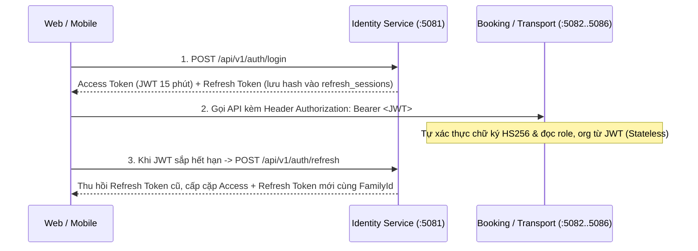

# 03. Bảo Mật Hệ Thống: Identity, Argon2id, JWT, Refresh Token, RBAC & HMAC

> **Mục tiêu**: Hiểu rõ luồng xác thực người dùng, cách phát hành và thu hồi tức thì JWT, cơ chế chống đánh cắp phiên đăng nhập (`Refresh Token Rotation`), cách phân quyền đa nhà xe (`Multi-tenancy`) không cần gọi chéo DB, và cách ký số bảo vệ vé QR / Webhook thanh toán.

---

## 1. Xác Thực Mật Khẩu, OTP & Chống Tấn Công Vét Cạn (`Identity Service :5081`)

1. **Băm mật khẩu bằng `Argon2id` (`Argon2PasswordHasher.cs`)**:
   - Thay vì dùng `MD5/SHA256` hay `BCrypt` đời cũ, dự án dùng thư viện `Konscious.Security.Cryptography.Argon2` (biến thể **`Argon2id`** — chuẩn khuyến nghị số 1 của OWASP hiện nay).
   - Mỗi lần băm mật khẩu tiêu tốn **8 MiB RAM** kèm 16 bytes `salt` ngẫu nhiên riêng biệt $\rightarrow$ kẻ tấn công dù lấy được bảng `users` cũng không thể dùng dàn card đồ họa (GPU) để dò mật khẩu hàng loạt.
   - Khi kiểm tra mật khẩu, dùng hàm so sánh hằng thời gian `CryptographicOperations.FixedTimeEquals` để chống tấn công đo thời gian phản hồi (*Timing Attack*).
2. **Bảo vệ luồng Đăng nhập & OTP (`AuthService.cs`)**:
   - **Khóa tài khoản tạm thời (`Account Lockout`)**: Nhập sai mật khẩu 5 lần liên tiếp $\rightarrow$ tự động chuyển sang `LOCKED` trong **15 phút** (`423 ACCOUNT_LOCKED`), hết 15 phút tự mở lại.
   - **Băm mã OTP có muối**: Mã xác thực 6 số gửi qua email không bao giờ lưu dạng rõ trong DB mà băm `SHA256(challengeId + ":" + code)` vào bảng `auth_challenges`.
   - **Chống dò email tồn tại (`Anti-Enumeration`)**: Các API `/forgot-password` và `/resend-verification` luôn trả về `202 Accepted` với cùng thông báo dù email có trong hệ thống hay không, kết hợp giới hạn tần suất (Rate Limit) dựa trên bảng `security_audits`.

---

## 2. Kiến Trúc JWT Access Token & Xoay Vòng Refresh Token

Dự án kết hợp **Access Token ngắn hạn (15 phút)** để các Microservice xác thực nhanh không cần hỏi DB, và **Refresh Token dài hạn (lưu trong DB)** để kiểm soát phiên đăng nhập chặt chẽ.

### 2.1. Bên Trong JWT Chứa Gì? (`JwtTokenService.cs`)
Mỗi Access Token được ký bằng `HMAC-SHA256` chứa các thông tin cốt lõi (Claims):
- `sub`: ID người dùng (`userId`).
- `role`: Danh sách vai trò (trong hệ thống có 10 roles chia làm 3 nhóm: Khách hàng `CUSTOMER`, Quản trị sàn `PLATFORM_ADMIN` / `FINANCE_ADMIN` / `SUPPORT_ADMIN`, và Nhân sự nhà xe `OPERATOR_ADMIN` / `DISPATCHER` / `DRIVER`...).
- **`org`**: ID của nhà xe (`organizationId`) mà nhân sự đó trực thuộc.
- **`ver`** (`AuthorizationVersion`): Số phiên bản quyền hạn hiện tại của tài khoản. Khi Admin khóa tài khoản hoặc đổi quyền một người, `Identity` tăng `authorization_version + 1` và thu hồi toàn bộ phiên; nhờ sự kiện `OnTokenValidated`, các thao tác nhạy cảm trên `Identity` chặn ngay JWT cũ mà không phải đợi hết 15 phút.

### 2.2. Chống Đánh Cắp Phiên Bằng `Refresh Token Family Reuse Detection`
- Mỗi lần đăng nhập tạo ra một "họ phiên" (`family_id`) trong bảng `refresh_sessions`.
- Mỗi lần gọi `/api/v1/auth/refresh`, token cũ bị đánh dấu `revoked_at` (lí do `ROTATED`) và sinh ra token con mới nối tiếp trong cùng `family_id`.
- **Kịch bản phát hiện kẻ trộm**: Nếu kẻ xấu trộm được một Refresh Token cũ và đem ra dùng (hoặc người dùng thật dùng lại sau khi kẻ xấu đã xoay vòng trước đó), `Identity` thấy `revoked_at IS NOT NULL` $\rightarrow$ lập tức chạy lệnh `RevokeFamilyAsync` **khóa sạch toàn bộ cây phiên của `family_id` đó** và trả lỗi `401 SESSION_REUSE_DETECTED`, buộc đăng nhập lại từ đầu.

---

## 3. Phân Quyền RBAC & Cô Lập Đa Nhà Xe (`Multi-Tenancy` Qua Claim `"org"`)

Đây là câu hỏi rất hay gặp khi bảo vệ: *"Làm sao Nhà xe Phương Trang không sửa/xem trộm được chuyến xe và doanh thu của Nhà xe Thành Bưởi khi cả hai cùng gọi chung một API `/api/v1/operator/trips`?"*

- **Nguyên tắc thiết kế**: Các API của nhà xe (`/api/v1/operator/*`) **tuyệt đối không nhận `organizationId` từ request body hay query string** của trình duyệt (tránh lỗi IDOR / BOLA — người dùng tự sửa ID nhà xe khác gửi lên).
- **Cách áp dụng trong code (`TransportService.TryTenant`, `BookingService`, `ReportingService`)**:
  1. Tầng `Api` đọc trực tiếp claim `"org"` bên trong chữ ký JWT đã xác thực để dựng đối tượng `Actor(UserId, Roles, OrganizationId)`.
  2. Mọi câu lệnh SQL `SELECT / INSERT / UPDATE` ở `Transport`, `Booking`, `Payment`, `Reporting` đều gắn cứng điều kiện `WHERE organization_id = @actorOrgId`.
  3. Riêng với vai trò Tài xế (`DRIVER`), hệ thống kiểm tra thêm lớp thứ 2: tài xế không chỉ phải thuộc đúng nhà xe `org`, mà còn phải được phân công trực tiếp vào chuyến xe đó (`IsDriverAssignedToTripAsync`) mới được bấm chuyển trạng thái chuyến hoặc quét vé khách lên xe.

---

## 4. Ký Số HMAC Bảo Vệ Vé Điện Tử QR & Webhook Thanh Toán

Ở những luồng không có JWT của người dùng đăng nhập, dự án dùng chữ ký mật mã đối xứng **`HMAC`** để chống giả mạo:

| Luồng Nghiệp Vụ | Công Nghệ Áp Dụng | Vị Trí Code & Cơ Chế Chống Giả Mạo |
|---|---|---|
| **Mã QR Vé Điện Tử (`BT1...`)** | `HMAC-SHA256` | `TicketQr.cs` (`Booking`): Chuỗi QR có dạng `BT1.<ticketId>.<chữ_ký_HMAC>`. Nếu khách tự chế mã QR hoặc sửa `ticketId` trên ảnh, chữ ký không khớp $\rightarrow$ máy quét của tài xế từ chối ngay lập tức. |
| **Tra Cứu Vé Khách Vãng Lai** | `HMAC-SHA256` + Giới hạn tốc độ `40 req/phút` | `TicketLookupToken.cs` (`Booking`): Khách nhập đúng `Mã đặt chỗ + Email/SĐT` sẽ được cấp 1 token tạm thời có chữ ký `HMAC` hiệu lực đúng **14 phút** để xem vé mà không lộ vé công khai theo URL đoán được. |
| **Webhook SePay (VietQR thật)** | `SHA-256` + `FixedTimeEquals` + `HMAC-SHA256` | `SePayCheckout.cs` (`Payment`): Ký form thanh toán bằng `HMAC-SHA256`; khi SePay bắn IPN báo tiền vào tài khoản về `/integrations/payments/sepay/ipn`, Server xác thực khóa bí mật `Apikey` bằng so sánh hằng thời gian trước khi gạch nợ đơn hàng. |
| **Webhook VNPay tương thích, tắt mặc định** | `HMAC-SHA512` | `VnPayCheckout.cs` (`Payment`): Sắp xếp toàn bộ tham số `vnp_*` theo bảng chữ cái, mã hóa URL và kiểm tra chữ ký `vnp_SecureHash` bằng `HMAC-SHA512` — tuyệt đối không tin tham số trên thanh địa chỉ trình duyệt của khách. |
