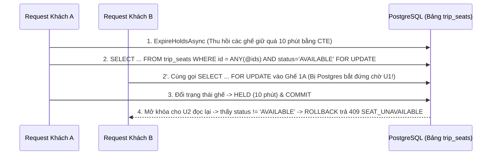

# 04. PostgreSQL (6 CSDL Độc Lập), Xử Lý Đồng Thời Chống Trùng Ghế/Lịch & Vai Trò Của Redis

> **Mục tiêu**: Hiểu cách dự án tổ chức 6 Database riêng biệt với `Npgsql`, 3 cơ chế khóa thực tế ở tầng PostgreSQL (`btree_gist`, `SELECT ... FOR UPDATE`, `pg_advisory_xact_lock`) để giải quyết triệt để bài toán tranh chấp đồng thời, và cách trả lời chính xác về **Redis** khi thuyết trình.

---

## 1. Kiến Trúc Database-Per-Service Trên PostgreSQL 17 & `Npgsql`

1. **Tách biệt 6 CSDL logic độc lập**:
   - Container `postgres:17-alpine` chạy script `00-create-databases.sql` tạo 6 DB hoàn toàn tách rời: `identity`, `transport`, `booking`, `payment`, `notification`, `reporting`.
   - Mỗi Microservice chỉ có chuỗi kết nối (`ConnectionString`) vào đúng DB của riêng mình; bộ test hợp đồng (`ContractGateTests`) quét tự động để cấm tuyệt đối khóa ngoại hay truy vấn chéo giữa 2 DB.
2. **Tại sao viết SQL thuần qua `Npgsql 10` thay vì dùng ORM như Entity Framework Core?**
   - Hệ thống bán vé xe đòi hỏi các tính năng đặc thù sâu của PostgreSQL mà EF Core không hỗ trợ tự nhiên hoặc sinh SQL kém tối ưu: khóa dòng có thứ tự `FOR UPDATE`, khóa tư vấn trên RAM `pg_advisory_xact_lock`, chỉ mục không gian thời gian `btree_gist`, câu lệnh thu hồi ghế gộp bằng `CTE (WITH ... UPDATE ... RETURNING)`, và toán tử `JSONB`.
3. **Kỹ thuật JSONB Snapshot thay cho `JOIN` chéo dịch vụ**:
   - Khi nhà xe bấm *Mở bán chuyến* bên `Transport`, hệ thống đóng băng toàn bộ thông tin lộ trình, danh sách ghế của xe và giá vé thành 3 cột **`JSONB` bất biến** gửi sang `Booking`. Nhờ vậy, kể cả sau này nhà xe có sửa sơ đồ ghế của chiếc xe gốc cho tháng sau, chuyến xe đang bán vẫn giữ nguyên sơ đồ ghế ban đầu và `Booking` tự đọc được ngay trên DB của mình.

---

## 2. Ba Cơ Chế Khóa Xử Lý Đồng Thời Đắt Giá Nhất Trong Dự Án

### 2.1. Chống Trùng Lịch Xe & Tài Xế Bằng Chỉ Mục `btree_gist` (`Transport Service`)
- **Bài toán**: Hai nhân viên điều hành cùng lúc xếp lịch cho **cùng 1 chiếc xe** (hoặc cùng 1 tài xế) vào 2 chuyến có giờ chạy đè lên nhau (`08:00–12:00` và `10:00–14:00`). Nếu chỉ kiểm tra bằng lệnh `SELECT` trong C# rồi mới `INSERT`, cả 2 request chạy song song sẽ cùng thấy "chưa trùng" và ghi lọt cả hai (*lỗi Write Skew*).
- **Cách áp dụng trong DB `transport`**:
  - Bật extension `btree_gist` của PostgreSQL và khai báo ràng buộc loại trừ (`EXCLUDE USING gist`) trực tiếp trên bảng phân công xe/tài xế với kiểu khoảng thời gian `tstzrange(departure - 1h, arrival + 1h, '[)')` (cộng thêm đệm 1 tiếng nghỉ trước/sau chuyến).
  - Nếu 2 khoảng thời gian giao nhau (`&&`), chính nhân PostgreSQL chặn đứng lệnh ghi thứ 2 và ném mã lỗi `SqlState = 23P01`, được `TransportRepository` bắt lại và trả về `409 SCHEDULE_CONFLICT`.

---

### 2.2. Chống Bán Trùng Ghế & Chống Deadlock Bằng `FOR UPDATE` (`Booking Service`)
- **Bài toán**: Hàng chục khách hàng cùng bấm giữ **Ghế 1A** ở giây mở bán đầu tiên.
- **Cách áp dụng trong `BookingRepository.cs`**:

- ** ba chi tiết kỹ thuật quan trọng đi kèm ở `Booking`**:
  1. **Thu hồi ghế hết hạn tức thì (`Lazy CTE Expiration`)**: Trước mỗi thao tác xem ghế hoặc giữ ghế, hệ thống chạy câu lệnh `WITH expired AS (UPDATE seat_holds ... WHERE expires_at <= NOW())` để nhả ngay các ghế quá 10 phút về `AVAILABLE` mà không bị phụ thuộc độ trễ của cronjob chạy nền.
  2. **Chống Deadlock khi khách đổi ghế (`ORDER BY id FOR UPDATE`)**: Trong hàm `ReplaceHoldAsync` (nhả ghế cũ, giữ ghế mới trong 1 lần gọi), nếu người A đổi `1A -> 1B` cùng lúc người B đổi `1B -> 1A` sẽ gây khóa chéo (Deadlock). Dự án giải quyết bằng cách gộp cả ghế cũ và mới rồi **bắt buộc khóa theo thứ tự tăng dần của khóa chính (`ORDER BY id FOR UPDATE`)**, triệt tiêu 100% nguy cơ Deadlock.
  3. **Khóa chia sẻ `FOR SHARE` trên mã giảm giá & Khóa ngoại trì hoãn `DEFERRABLE`**: Khi tạo đơn `CreateBookingAsync`, hệ thống dùng `FOR SHARE` trên bảng `coupons` (cho nhiều khách cùng áp mã song song nhưng chặn Admin sửa cấu hình mã giữa chừng), và dùng `SET CONSTRAINTS ALL DEFERRED` để chuyển giao ghế mượt mà từ `seat_holds` sang `bookings` ở thời điểm `COMMIT`.

---

### 2.3. Chống Đụng Độ Webhook Thanh Toán Bằng `pg_advisory_xact_lock` (`Payment Service`)
- **Bài toán**: Cổng thanh toán SePay/ngân hàng có thể bắn lặp 2 gói tin Webhook cùng lúc cho 1 giao dịch, hoặc bắn trùng lúc người dùng đang thao tác tạo lại lệnh thanh toán cho đơn đó. Lúc này bản ghi kết quả còn chưa tồn tại trong bảng để khóa bằng `FOR UPDATE` thông thường.
- **Cách áp dụng trong `SePayPaymentStore.cs`**:
  - Dùng **Khóa tư vấn cấp giao dịch trên RAM của PostgreSQL**: `SELECT pg_advisory_xact_lock(hashtext(@transactionId))` và `pg_advisory_xact_lock(hashtext(@bookingId))`.
  - Hai yêu cầu mang cùng mã đơn hoặc cùng mã giao dịch ngân hàng bắt buộc xếp hàng tuần tự, kết hợp bảng `webhook_receipts (ON CONFLICT DO NOTHING)` đảm bảo mỗi giao dịch ngân hàng chỉ được gạch nợ đúng 1 lần duy nhất.

---

## 3. Thực Tế Về Redis Trong Dự Án (`ADR-008` — Rất Quan Trọng Khi Bảo Vệ)

Khi đọc `docker-compose.yml`, bạn sẽ thấy container **`redis:7-alpine` chạy ở cổng `6379`**, nhưng trong mã nguồn C# của 6 services hiện **không cài thư viện `StackExchange.Redis`**. Đây là quyết định thiết kế có chủ đích được ghi rõ trong tài liệu kiến trúc **`ADR-008`**:

- **Tại sao hiện tại chưa đưa khóa giữ ghế sang Redis?**
  - Nếu lưu trạng thái giữ ghế trên Redis còn đơn hàng trên PostgreSQL, hệ thống sẽ sinh ra **2 nguồn chân lý (Split-Brain)**: lỡ Redis khởi động lại hoặc mạng rớt đúng lúc chuyển từ Giữ ghế sang Đặt đơn thì dễ lệch trạng thái ghế.
  - Ở quy mô hiện tại, dùng trực tiếp `SELECT ... FOR UPDATE` + `Lazy CTE Expiration` ngay trên PostgreSQL đảm bảo tính nhất quán tuyệt đối **ACID 100%** và đơn giản hóa vận hành.
- **Vậy Redis dựng sẵn trong Docker để làm gì?**
  - Đóng vai trò hạ tầng chờ sẵn cho giai đoạn mở rộng lưu lượng đọc lớn (*Phase 2 Scale-out*): dùng làm **Read-aside Cache** cho kết quả tìm kiếm chuyến xe phổ biến (`GET /api/v1/trips` với TTL ngắn 5–15 giây) và bộ đếm **Distributed Rate Limiting** tập trung tại tầng Gateway khi chạy nhiều replica.
