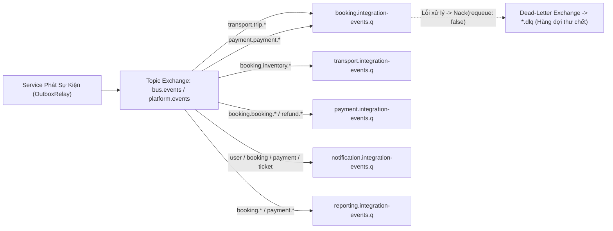
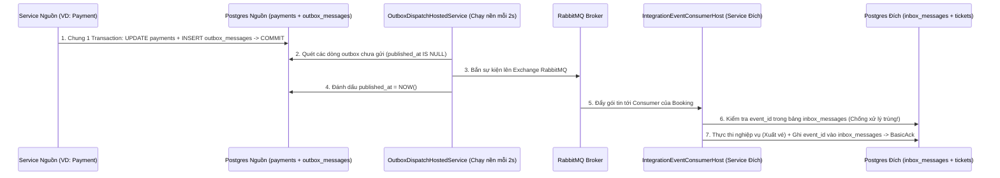

# 05. RabbitMQ, Mô Hình Outbox / Inbox & Phối Hợp Sự Kiện Liên Dịch Vụ (Saga)

> **Mục tiêu**: Nắm rõ cách 6 Microservices giao tiếp bất đồng bộ qua **RabbitMQ** mà không bao giờ bị mất tin nhắn hay xử lý trùng lặp nhờ cặp bài trùng **Transactional Outbox + Inbox**, cùng 3 luồng phối hợp sự kiện (Saga Choreography) xương sống của dự án.

---

## 1. Cấu Trúc Topology RabbitMQ Trong Dự Án (`definitions.json`)

Khi container `rabbitmq:4.1-management-alpine` khởi động, nó nạp sẵn cấu hình từ `workspace/src/infra/rabbitmq/definitions.json` trên không gian ảo (`vhost`) tên là **`bus-ticket`**:

- **Tại sao dùng `Topic Exchange`?** Cho phép định tuyến linh hoạt bằng ký tự đại diện (`*`). Ví dụ: khi `Payment` bắn đi đúng 1 sự kiện `payment.payment.succeeded.v1`, RabbitMQ tự động nhân bản và đẩy đồng thời vào **cả 3 hàng đợi** của `Booking` (để xuất vé), `Notification` (để gửi thông báo cho khách) và `Reporting` (để cộng doanh thu nhà xe), mà `Payment` không cần biết sự tồn tại của 3 service kia.
- **Cơ chế Hàng đợi thư chết (`DLX / *.dlq`)**: Mỗi hàng đợi chính đều gắn cấu hình `x-dead-letter-exchange`. Nếu một tin nhắn bị lỗi dữ liệu không thể đọc được, consumer từ chối (`BasicReject(requeue: false)`) để đẩy tin lỗi sang hàng đợi `*.dlq` kiểm tra sau, không làm kẹt cứng hàng đợi chính.

---

## 2. Cách Giải Quyết Bài Toán Mất/Trùng Tin Nhắn: `Transactional Outbox` + `Inbox`

### 2.1. Vấn Đề Ghi Kép (`Dual-Write Problem`)
Giả sử khách vừa thanh toán xong: nếu `Payment Service` thực hiện `UPDATE payments SET status = 'SUCCEEDED'` vào PostgreSQL xong rồi mới gọi mạng bắn sự kiện lên RabbitMQ — lỡ đúng mili-giây đó RabbitMQ đứt mạng hoặc server sập nguồn thì **tiền khách đã bị trừ nhưng `Booking` không bao giờ nhận được tin để xuất vé!**

### 2.2. Giải Pháp Trong Code (`BuildingBlocks.Messaging` & Các Services)

1. **Ở đầu gửi (`Transactional Outbox`)**:
   - Sự kiện cần phát đi được ghi thẳng vào bảng `outbox_messages` **nằm trong cùng một `NpgsqlTransaction`** với dữ liệu nghiệp vụ (ví dụ trong `SePayPaymentStore.ApplySePayAsync` hoặc `BookingRepository.ApplyPaidAsync`). Hoặc cả hai cùng thành công, hoặc cả hai cùng Rollback!
   - Tiến trình chạy nền `OutboxDispatchHostedService` (`OutboxRelay`) thức dậy mỗi **2 giây**, đọc các bản ghi chưa gửi đẩy lên RabbitMQ cho tới khi thành công (*đảm bảo At-Least-Once Delivery*).
2. **Ở đầu nhận (`Idempotent Inbox`)**:
   - Vì mạng có thể chập chờn khiến `OutboxRelay` gửi 1 sự kiện 2 lần, ở đầu nhận `IntegrationEventConsumerHost` dùng `InboxDeduper` chèn `event_id` vào khóa chính bảng `inbox_messages` trước/cùng lúc xử lý.
   - Nếu `event_id` đã tồn tại $\rightarrow$ bỏ qua ngay lập tức và `Ack` luôn.
   - **Kết quả**: `Ít nhất 1 lần (Outbox) + Khử trùng lặp (Inbox) = Xử lý chuẩn xác đúng 1 lần (Effectively-Once)`.

---

## 3. Ba Luồng Saga Choreography Xương Sống Giữa Các Microservices

Dự án dùng mô hình **Saga Choreography** (các service tự phản ứng theo sự kiện, không có 1 nhạc trưởng trung tâm gây nghẽn cổ chai):

1. **Saga 1 — Mở Bán Chuyến Xe 2 Pha (`Transport` $\leftrightarrow$ `Booking`)**:
   - Nhà xe bấm *Publish chuyến* trên `Transport` $\rightarrow$ chuyến chuyển sang `SCHEDULED` nhưng tạm khóa cờ `sellable = false` (chưa cho khách mua vội vì bên Booking chưa tạo ghế!) và phát sự kiện `TripPublished` mang theo JSONB sơ đồ ghế.
   - `Booking` nhận `TripPublished` $\rightarrow$ sinh toàn bộ ghế vào bảng `trip_seats` $\rightarrow$ bắn ngược sự kiện `TripInventoryInitialized` về `Transport`.
   - `Transport` nhận tin $\rightarrow$ bật `sellable = true`, chính thức hiển thị chuyến lên trang tìm kiếm cho khách hàng!
2. **Saga 2 — Đặt Đơn, Thanh Toán, Xuất Vé & Tự Động Hoàn Tiền Trễ (`Booking` $\leftrightarrow$ `Payment`)**:
   - Khách tạo đơn `PREPAID` trên `Booking` $\rightarrow$ phát `BookingCreated` sang bảng `booking_quotes` của `Payment` (giúp `Payment` biết chính xác số tiền cần thu mà không cần gọi HTTP ngược sang `Booking`).
   - Khi khách quét mã QR chuyển khoản xong $\rightarrow$ `Payment` nhận Webhook, thu tiền, tính sẵn 10% hoa hồng sàn (`booking_settlements`) và phát `PaymentSucceeded`.
   - `Booking` nhận `PaymentSucceeded` $\rightarrow$ chuyển đơn sang `PAID` và sinh vé điện tử QR (`TicketIssued`).
   - **Cơ chế Bù trừ (Compensation) khi thanh toán trễ**: Nếu khách giữ chỗ quá 10 phút khiến đơn đã hết hạn (`EXPIRED`), nhưng ở phút thứ 11 ngân hàng mới báo tiền về $\rightarrow$ hệ thống tự động phát hiện giao dịch đến sau khi đơn đã đóng và xếp hàng lệnh **Hoàn tiền tự động (`RefundRequested / LATE_PROVIDER_SUCCESS`)** trả lại tiền cho khách!
3. **Saga 3 — Đồng Bộ Báo Cáo Doanh Thu CQRS (`Booking / Payment` $\rightarrow$ `Reporting`)**:
   - `Reporting Service (:5086)` lắng nghe mọi sự kiện đặt đơn, thanh toán và hoàn tiền để cập nhật sẵn vào 2 bảng tổng hợp `booking_projections` và `revenue_projections`.
   - Trong câu SQL cập nhật, `ReportingRepository` dùng hàm `GREATEST(...)` để nếu sự kiện trên RabbitMQ vô tình đến ngược thứ tự (tin mới đến trước tin cũ), dữ liệu doanh thu và tiền hoàn vẫn hội tụ chính xác không bị ghi đè lùi.
