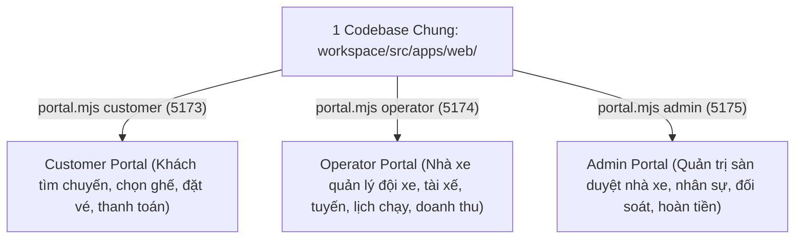

# 06. Kiến Trúc Frontend (3 Portals), Mobile Expo, Docker & Chiến Lược Kiểm Thử

> **Mục tiêu**: Hiểu cách tầng giao diện (`Web` & `Mobile`) kết nối an toàn với YARP Gateway, cách 1 bộ code React tách thành 3 website riêng biệt, cách đóng gói hạ tầng Docker cứng cáp và các tầng kiểm thử tự động của dự án.

---

## 1. Kiến Trúc Web Frontend: 1 Codebase Tách Thành 3 Cổng Độc Lập (`apps/web/`)

Thay vì phải duy trì 3 thư mục dự án React rời rạc gây trùng lặp Component/API client, thư mục `workspace/src/apps/web/` dùng **React 19 + TypeScript + Vite + TanStack Query + Zod** với cơ chế **Cắt tuyến lúc biên dịch (`BLUE_APP_TARGET`)**:

### 4 Kỹ Thuật Trọng Tâm Trên Web Frontend
1. **Cô lập gói build theo `BLUE_APP_TARGET` (`scripts/portal.mjs` & `portalRoutes.ts`)**:
   - Khi build cổng `customer`, Vite chỉ nạp cây route của khách hàng và loại bỏ hoàn toàn (Tree-shake) toàn bộ mã nguồn màn hình `Admin` / `Operator` khỏi file `.js` tải về trình duyệt khách hàng.
2. **Kiến trúc 2 Chế độ Chạy (`MSW Mock` vs `Live Backend`)**:
   - Mỗi tính năng (`trips`, `booking`, `tickets`, `admin`) đều định nghĩa Interface Repository chung với 2 bộ chuyển đổi: chạy giả lập độc lập ngay trên trình duyệt bằng **Mock Service Worker (`msw`)** khi thiết kế UI, hoặc gọi thẳng xuống YARP Gateway `:5080` ở chế độ Live.
   - Ở chế độ Live, `backendTripRepository.ts` ghép dữ liệu thông minh: lấy danh sách chuyến từ `Transport` rồi gom lô 100 chuyến gọi song song (`Promise.all`) sang `/api/v1/trips/availability` của `Booking` để hiển thị số ghế trống thời gian thực mà không bị lỗi $N+1$ requests.
3. **Cơ chế `Single-Flight Token Refresh` chống sập phiên (`shared/api/client.ts`)**:
   - Khi mở 1 trang dashboard gọi 5 API cùng lúc mà JWT vừa hết hạn (cả 5 đều gặp `401`), nếu cả 5 cùng tự gọi `/api/v1/auth/refresh` thì 4 request sau sẽ đụng cơ chế chống dùng lại Refresh Token của Backend và làm văng tài khoản!
   - `client.ts` dùng biến khóa `refreshInFlight`: gom tất cả các request bị `401` chờ chung **đúng 1 lời gọi refresh duy nhất**, lấy được JWT mới xong mới cho cả 5 request tự động chạy lại.
4. **Tự động giữ nguyên `Idempotency-Key` khi rớt mạng (`shared/api/liveRequest.ts`)**:
   - Trước khi gửi lệnh đặt vé/thanh toán, trình duyệt băm `SHA-256` nội dung form để ánh xạ với 1 mã `UUID` tạm trong `sessionStorage`. Nếu mạng chập chờn khách bấm gửi lại đúng form đó, trình duyệt gửi lại đúng `Idempotency-Key` cũ để Backend không tạo đơn trùng; nếu khách đổi ghế khác trên form, mã băm thay đổi nên tự động sinh key mới.

---

## 2. Ứng Dụng Mobile (`apps/mobile/` — React Native + Expo)

- Dùng chung thư viện SDK `@busticket/api-client` (`workspace/src/packages/api-client/`) với kiểu dữ liệu TypeScript đồng bộ 100% với Backend.
- **Lưu trữ phần cứng an toàn & Vé Ngoại Tuyến (`expo-secure-store`)**:
  - Lưu phiên đăng nhập và **bản sao vé điện tử (`busticket.tickets.mobile`)** vào vùng mã hóa phần cứng của điện thoại (Keychain trên iOS / Keystore trên Android).
  - Trong `TicketScreen` (`screens/Main.tsx`), nếu khách ra bến xe bị mất sóng 4G không gọi được API, ứng dụng tự động đọc từ bộ nhớ đệm bảo mật để vẫn hiển thị được mã vé cho tài xế kiểm tra!

---

## 3. Đóng Gói Docker Compose & Tích Hợp Thanh Toán Thực Tế

Hệ thống hạ tầng nằm trong `workspace/` sử dụng **nhiều lớp file Docker Compose chồng lên nhau (Overlays)** tùy mục đích chạy:
- `docker-compose.yml`: Dựng phần lõi hạ tầng (`postgres`, `redis`, `rabbitmq`, `mailpit` xem email OTP local).
- `docker-compose.services.yml` & `docker-compose.apps.yml`: Dựng `gateway`, 6 containers `.NET 10` Microservices và 3 containers Nginx cho 3 cổng Web.
- `docker-compose.sepay.yml`: Chạy thêm **`cloudflared` (Cloudflare Tunnel)** mở đường hầm HTTPS bảo mật từ Internet vào máy local để **nhận Webhook IPN chuyển khoản ngân hàng thật từ SePay (VietQR)** ngay khi demo đồ án!
- `docker-compose.production.yml`: Gia cố bảo mật mức Production — chạy container dưới quyền người dùng thường (`non-root`), khóa hệ thống tệp chỉ đọc (`read_only: true`), gỡ toàn bộ quyền nhân Linux thừa (`cap_drop: [ALL]`) và khóa cổng nội bộ không cho lộ ra ngoài host.

---

## 4. Chiến Lược Kiểm Thử Tự Động Toàn Diện (`workspace/src/tests/`)

Dự án xây dựng 11 dự án test C# kết hợp Vitest & Playwright tạo thành phễu lọc chất lượng nhiều tầng:

| Tầng Kiểm Thử | Công Cụ Áp Dụng | Kiểm Chứng Điều Gì? |
|---|---|---|
| **1. Architecture Tests** | `NetArchTest.Rules` + `XDocument` | Canh gác ranh giới Clean Architecture 4 tầng, cấm 2 service tham chiếu trực tiếp nhau, ép buộc 100% dùng `.NET 10` và quản lý thư viện tập trung. |
| **2. Contract Gate Tests** | `YamlDotNet` + `JsonSchema.Net` | Đảm bảo file thiết kế `OpenAPI` (60+ API), `AsyncAPI` (20 luồng sự kiện), `JSON Schema` và các file SQL migration luôn đồng bộ, không có khóa ngoại chéo DB. |
| **3. Gateway & Unit Tests** | `xUnit` + `WebApplicationFactory` | Kiểm thử `Result<T>`, `ErrorEnvelope`, và kiểm chứng bảng định tuyến YARP khớp 100% với đặc tả OpenAPI. |
| **4. Integration Tests (7 bộ)** | **`Testcontainers`** (`PostgreSQL 17` & `RabbitMQ` thật) | Tự động bật container Postgres & RabbitMQ thật trong lúc chạy test để kiểm chứng khóa ghế `FOR UPDATE`, chống trùng lịch `btree_gist`, xoay vòng JWT, SePay IPN và luồng Outbox/Inbox. |
| **5. Frontend & E2E Tests** | `Vitest` + `Playwright` + `Postman` | Kiểm thử luồng giao diện trên cả 3 cổng Web và kiểm thử toàn trình kịch bản người dùng thật. |
