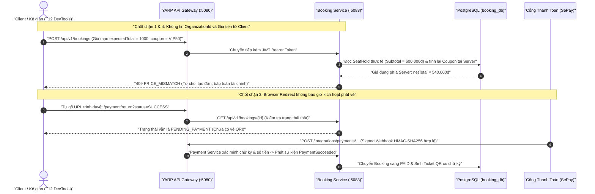
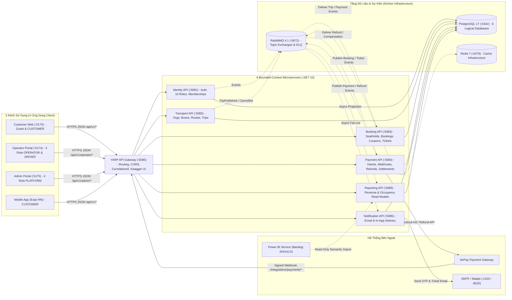

# Chương 01 — Bài Toán Nghiệp Vụ, Hệ Sinh Thái Actors (10 Roles) và Kiến Trúc 3 Kênh Giao Diện

> **Thuộc bộ tài liệu:** Cẩm Nang Thuyết Trình Toàn Diện — Dự án **BLUE Bus Ticket Platform (PBL6)**  
> **Tài liệu nguồn đối chiếu:** [01-gioi-thieu.md](../../../srs/v2/01-gioi-thieu.md) · [02-tong-quan-san-pham.md](../../../srs/v2/02-tong-quan-san-pham.md) · [001_initial.sql (Identity)](../../../database/identity/001_initial.sql) · [Gateway Program.cs](../../../../workspace/src/gateway/BusTicketPlatform.Gateway/Program.cs)

---

## Mở Đầu: Tại Sao Phải Đọc Chương Này Đầu Tiên?

Khi đứng trước hội đồng bảo vệ đồ án hoặc khi một kỹ sư mới tham gia vào dự án **BLUE Bus Ticket Platform**, câu hỏi đầu tiên không bao giờ là *"Hệ thống dùng bao nhiêu container Docker?"* hay *"Viết câu lệnh SQL thế nào?"*, mà luôn là:

1. **Hệ thống này giải quyết nỗi đau thực tế nào ngoài đời thực?** Tại sao không làm một website bán vé đơn giản cho một hãng xe duy nhất mà lại thiết kế mô hình sàn giao dịch đa nhà xe (Multi-tenant Marketplace)?
2. **Ai là người sử dụng hệ thống?** Làm sao phân định rạch ròi quyền hạn giữa hành khách, tài xế, nhân viên điều độ nhà xe, kế toán nhà xe và quản trị viên toàn sàn để không ai "dẫm chân" hay xem trộm dữ liệu doanh thu của đối thủ?
3. **Tại sao phải có nhiều ứng dụng giao diện (Web khách hàng, Portal nhà xe, Portal Admin, Mobile App) nhưng tất cả lại bị cấm tự tính giá vé hay tự quyết định trạng thái ghế?**

Chương này sẽ xây dựng nền móng tư duy từ con số 0. Ngay cả khi bạn chưa từng đọc một dòng code C# hay TypeScript nào của dự án, sau khi đọc xong tài liệu này, bạn sẽ nắm trọn bức tranh tổng thể về mô hình kinh doanh, kiến trúc phân quyền 10 vai trò (Roles) và luồng kết nối từ 3 kênh giao diện về cổng trung tâm API Gateway.

---

## Phần 1: Giải Phẫu Bài Toán Đặt Vé Xe Khách Liên Tỉnh Đa Nhà Xe (B2B2C Multi-tenant Marketplace)

### 1.1. Phân Biệt Hệ Thống Đơn Nhà Xe (Single-Operator B2C) và Sàn Đa Nhà Xe (Multi-Tenant B2B2C)

Để hiểu đúng tầm vóc của **BLUE Bus Ticket Platform**, trước hết chúng ta cần phân biệt hai mô hình phần mềm hoàn toàn khác nhau trong ngành vận tải hành khách:

- **Mô hình Đơn nhà xe (Single-tenant / B2C truyền thống):** Toàn bộ phần mềm chỉ phục vụ duy nhất một doanh nghiệp vận tải (ví dụ: website nội bộ của riêng một hãng xe A). Mọi chiếc xe, tài xế, tuyến đường và doanh thu trong cơ sở dữ liệu đều thuộc về một chủ sở hữu duy nhất. Nếu hãng xe B muốn dùng phần mềm này, đội kỹ thuật phải mang mã nguồn đi cài đặt thành một hệ thống riêng biệt.
- **Mô hình Sàn giao dịch Đa nhà xe (B2B2C Multi-tenant Marketplace — Mô hình của BLUE):** Nền tảng đóng vai trò là **Sàn trung gian thương mại điện tử** (tương tự mô hình của Vexere, Traveloka mảng xe khách, hay Grab/Shopee). Trên cùng một hệ thống phần mềm và hạ tầng duy nhất:
  - **B2B (Business-to-Business):** Hàng chục, hàng trăm pháp nhân vận tải độc lập (gọi là **Operator Organization** hay **Tenant** — ví dụ: Nhà xe Phương Trang, Nhà xe Kumho, Nhà xe Hải Vân...) cùng đăng ký tham gia sàn, tự quản lý đội xe, sơ đồ ghế, tài xế, lịch trình chạy và chính sách giá của riêng mình.
  - **B2C (Business-to-Consumer):** Hàng nghìn **Hành khách (Customer)** truy cập vào một điểm đến duy nhất để tìm kiếm, so sánh giờ chạy/giá vé giữa nhiều nhà xe trên cùng một tuyến đường, chọn chỗ ngồi trực quan trên sơ đồ giường nằm 2 tầng, thanh toán trực tuyến và nhận vé điện tử QR.

> [!IMPORTANT]
> **Thách thức cốt lõi của Multi-tenancy:** Nhiều đối thủ cạnh tranh trực tiếp cùng sống chung trên một cơ sở dữ liệu vật lý. Do đó, **Cô lập dữ liệu theo tổ chức (Tenant Isolation)** không phải là một tính năng phụ mà là yêu cầu sống còn: nhân viên của Nhà xe A tuyệt đối không bao giờ được phép nhìn thấy danh sách hành khách, doanh thu hay can thiệp vào chuyến xe của Nhà xe B.

### 1.2. Bốn Nhóm "Nỗi Đau" (Pain Points) Thực Tế Mà BLUE Giải Quyết

Trước khi có một nền tảng tập trung chuẩn hóa như BLUE, thị trường vận tải xe khách đường dài gặp phải 4 nút thắt nghiêm trọng tương ứng với 4 nhóm đối tượng:

#### 1. Nỗi đau của Hành khách (Guest & Customer)
- **Phân mảnh thông tin và mù mờ chỗ trống:** Muốn đi từ Đà Nẵng vào TP.HCM dịp lễ, hành khách phải gọi điện cho 5–7 tổng đài nhà xe khác nhau. Nhân viên trực tổng đài chỉ trả lời ước chừng *"còn giường anh ơi"*, khách không hề biết giường đó nằm tầng trên hay tầng dưới, đầu xe hay cuối xe gần nhà vệ sinh.
- **Ác mộng bán trùng ghế (Double-booking / Overbooking):** Hai nhân viên phòng vé ở hai đầu bến cùng ghi tên hai khách khác nhau vào chiếc giường `A05` trên cuốn sổ giấy hoặc file Excel dùng chung. Đến giờ xe chạy, hai hành khách cùng cầm phiếu thu lên xe tranh cãi, một người bị ép nằm luồng (ghế phụ dọc lối đi).
- **Rủi ro thanh toán chuyển khoản thủ công:** Khách chuyển khoản vào số tài khoản cá nhân của nhân viên nhà xe, chụp ảnh màn hình gửi qua Zalo chờ xác nhận thủ công. Khi muốn hủy vé trước giờ chạy, nhà xe trừ phí cảm tính hoặc quên hoàn tiền suốt nhiều tuần.

#### 2. Nỗi đau của Nhà xe (Operator Organization & Staff)
- **Thất thoát doanh thu và hỗn loạn vận hành:** Quản lý phơi vé trên bảng trắng hoặc sổ tay khiến chủ nhà xe rất khó đối soát số vé thực bán so với số tiền mặt thu được.
- **Xung đột điều phối tài sản (`Schedule Conflict`):** Khi đội xe lên tới hàng chục đầu xe và tài xế xoay vòng liên tục, nhân viên điều độ rất dễ xếp nhầm một chiếc xe đang bảo dưỡng (`MAINTENANCE`), một tài xế đã hết hạn bằng lái, hoặc phân công cùng một chiếc xe/tài xế chạy hai chuyến chồng lấn thời gian nhau.
- **Thiếu phân tách nhiệm vụ nội bộ (Separation of Duties):** Trong một công ty vận tải thực tế, người xếp lịch xe không được phép tự ý hoàn tiền, và kế toán đối soát không được phép tự ý hủy chuyến xe đang đón khách. Các phần mềm sơ sài chỉ có duy nhất một tài khoản "Chủ nhà xe" dùng chung mật khẩu cho cả văn phòng, dẫn đến khi xảy ra sự cố không thể truy vết ai là người đã bấm hủy chuyến.

#### 3. Nỗi đau của Tài xế và Phụ xe (Driver)
- **Quá tải thao tác tại cửa xe:** Giờ cao điểm tại bến xe, tài xế/phụ xe chỉ có vài giây cho mỗi hành khách bước lên cửa. Họ cần một giao diện tối giản hết mức để xem danh sách hành khách (Manifest) và quét mã QR vé điện tử, thay vì một phần mềm quản trị phức tạp đầy biểu đồ.
- **Gian lận vé và rò rỉ dữ liệu cá nhân (PII Leakage):** Hành khách có thể dùng ảnh chụp màn hình một mã QR hợp lệ gửi cho người khác để lên xe hai lần, hoặc mang vé của chuyến ngày hôm sau đi nhầm lên chuyến hôm nay. Ngược lại, nếu in toàn bộ số CCCD, email và số điện thoại không che mờ của cả chuyến xe đưa cho tài xế, thông tin cá nhân của hành khách dễ bị thu thập và bán cho bên thứ ba.

#### 4. Nỗi đau của Đơn vị Vận hành Sàn (Platform Operator / Admin)
- **Bài toán dòng tiền lai ghép (`PREPAID` vs `PAY_LATER`):** Đặc thù thị trường Việt Nam là nhiều khách thích thanh toán trực tuyến ngay qua cổng SePay VietQR (`PREPAID`), nhưng cũng có tệp khách truyền thống muốn đặt giữ chỗ trước và trả tiền mặt khi lên xe (`PAY_LATER`) nếu nhà xe đó cho phép. Nếu sàn không phân biệt rạch ròi hai luồng hợp đồng này ngay trong lõi kiến trúc, sàn sẽ mắc sai lầm chết người: *hoàn tiền từ túi của sàn cho một chiếc vé mà sàn chưa từng thu tiền*, hoặc *tính nhầm hoa hồng 10% trên khoản tiền mặt khách không hề thanh toán do bỏ chuyến (no-show)*.
- **Kiểm toán và Truy vết sự cố (Auditability & Traceability):** Khi có tranh chấp *"Khách báo đã trừ tiền ngân hàng lúc 09:59 nhưng không nhận được vé"*, đội vận hành sàn cần lần theo một mã định danh xuyên suốt (`correlationId` và `bookingCode`) để biết chính xác giao dịch đang nằm ở bước nào giữa Booking Service và Payment Service, đồng thời lưu vết kiểm toán bất biến (append-only audit log) cho mọi thao tác nhạy cảm.

### 1.3. Bảy Mục Tiêu Sản Phẩm (`GOAL-001`..`GOAL-007`) và Chiến Lược Đóng Băng Phạm Vi MVP

Trong tài liệu đặc tả yêu cầu phần mềm **SRS v2.1.0** ([02-tong-quan-san-pham.md](../../../srs/v2/02-tong-quan-san-pham.md#L11-L22)), dự án cụ thể hóa lời giải cho các nỗi đau trên thành **7 mục tiêu định hướng kiến trúc**:

| Mã Mục Tiêu | Trọng Tâm Cốt Lõi | Ý Nghĩa Thực Thi Trong Hệ Thống BLUE |
|---|---|---|
| `GOAL-001` | **Đầy đủ chuỗi giá trị cốt lõi** | Khép kín vòng đời từ Tài khoản -> Tìm chuyến -> Giữ ghế -> Đặt chỗ -> Thanh toán -> Vé QR -> Hủy/Hoàn tiền -> Vận hành chuyến & Check-in -> Báo cáo đối soát. |
| `GOAL-002` | **Tính chính xác & Nhất quán giao dịch** | Tuyệt đối không bán trùng 1 ghế cho 2 vé hiệu lực; tiền tệ VND chính xác từng đồng (số nguyên `bigint`/`long`, không dùng `float`/`double`). |
| `GOAL-003` | **An toàn, Quyền riêng tư & Multi-tenant** | Khách nào chỉ thấy vé người đó (`OWN`); Nhà xe nào chỉ chạm được dữ liệu của tổ chức mình (`TENANT`); che mờ PII trên màn hình vận hành/hỗ trợ. |
| `GOAL-004` | **Đồng nhất 3 kênh sử dụng** | Web End-user, Mobile App và Back-office Web nói chung một ngôn ngữ hợp đồng API (OpenAPI 3.1), chung mã lỗi và chung máy trạng thái. |
| `GOAL-005` | **Trải nghiệm minh bạch & Dễ dùng** | Hiển thị rõ thời gian đếm ngược giữ ghế 10 phút, xem trước phí hủy vé (`CancellationPreview`) trước khi bấm nút xác nhận cuối cùng. |
| `GOAL-006` | **Hiệu năng, Mở rộng & Chịu lỗi cục bộ** | Đáp ứng ngưỡng tải 100.000 chuyến xe, 300 người dùng đồng thời; lỗi gửi Email hay chậm cập nhật Báo cáo không bao giờ làm hỏng giao dịch đặt vé. |
| `GOAL-007` | **Kiểm toán, Truy vết & Đối soát tin cậy** | Mọi giao dịch đều gắn `correlationId`; sổ cái thanh toán tách bạch rõ doanh thu gộp (`gross`), hoa hồng sàn (`commission`) và công nợ nhà xe (`operator_net`). |

Để đảm bảo dự án không rơi vào bẫy "ôm đồm tính năng dẫn đến không luồng nào chạy đúng" (Scope Creep), kiến trúc áp dụng nguyên tắc phân tầng **MoSCoW** chặt chẽ:
- **`MUST` (Bắt buộc nghiệm thu MVP 2.0):** Toàn bộ luồng xác thực, quản lý đội xe/tuyến/chuyến, giữ ghế nguyên tử 10 phút, đặt vé `PREPAID` & `PAY_LATER`, cổng thanh toán & đối soát hoa hồng 10%, hủy vé theo bậc thời gian, check-in QR online của tài xế, gửi thông báo Email/In-app và báo cáo doanh thu cơ bản. *(Lưu ý thực tế triển khai: Nhóm cũng đã hoàn thiện thêm tính năng Mã giảm giá Coupon và cổng thanh toán VietQR thực tế qua SePay ngay trong mã nguồn hiện hành!)*
- **`SHOULD` (Hậu MVP / Backlog có thiết kế sẵn):** Đổi vé sang chuyến/ghế khác (`BP-03`), Đánh giá chuyến đi (`Review`), Xuất file CSV bất đồng bộ, Dashboard phân tích đa chiều nhúng **Power BI Embedded** với bảo mật dòng dữ liệu (RLS), Push Notification.
- **`COULD` & Ngoài phạm vi MVP:** Định vị GPS xe theo thời gian thực, gợi ý chuyến bằng AI, tích điểm Loyalty, định giá động (Dynamic Pricing), và tuyệt đối **không lưu trữ trực tiếp số thẻ PAN/CVV** (ủy quyền cho cổng thanh toán chuẩn PCI-DSS).

---

## Phần 2: Nguyên Tắc Tối Thượng — "Server Là Nguồn Sự Thật Nghiệp Vụ Duy Nhất" (Server-Authoritative State)

Trong Mục 2.1 và Mục 2.6 của SRS ([02-tong-quan-san-pham.md](../../../srs/v2/02-tong-quan-san-pham.md#L9)), có một câu tuyên ngôn ngắn gọn nhưng chi phối toàn bộ cách viết code của cả Frontend lẫn Backend:

> *"Sản phẩm giải quyết bài toán bằng một nguồn trạng thái nghiệp vụ phía server dùng chung cho ba kênh. Client chỉ hiển thị và gửi command; client không quyết định giá, quyền, trạng thái thanh toán hoặc quyền sở hữu dữ liệu."*

Tại sao nguyên tắc **Server-Authoritative State (Server nắm quyền phán quyết duy nhất)** lại quan trọng đến vậy? Hãy cùng phân tích từ bản chất bảo mật ứng dụng web/mobile.

### 2.1. Bản Chất Môi Trường Client Là "Không Thể Tin Cậy" (Untrusted Environment)

Dù bạn viết giao diện React đẹp đến đâu, ẩn nút bấm kỹ thế nào hay kiểm tra điều kiện `if (price > 0)` chặt chẽ ra sao bằng JavaScript/TypeScript, toàn bộ đoạn mã Frontend đó đều đang chạy trên trình duyệt máy tính hoặc điện thoại nằm trong tay người dùng cuối.

Bất kỳ ai biết cơ bản về công nghệ đều có thể:
1. Nhấn phím **`F12` (Chrome DevTools -> tab Network)**, nhấp chuột phải vào một request API rồi chọn *Copy as cURL* hoặc *Edit and Resend*.
2. Dùng công cụ chặn bắt gói tin như **Burp Suite / Postman / Insomnia** để gửi thẳng HTTP Request tới cổng `:5080` của API Gateway với bất kỳ JSON body nào họ tự bịa ra, bỏ qua hoàn toàn giao diện Web/Mobile của bạn!

Nếu Backend "ngây thơ" tin vào dữ liệu tính toán sẵn từ Client gửi lên, hệ thống bán vé sẽ sập về mặt tài chính chỉ trong vài phút sau khi mở cổng. Dưới đây là **4 kịch bản tấn công kinh điển** và cách kiến trúc thực tế của BLUE chặn đứng từng kịch bản.

### 2.2. Bốn Kịch Bản Tấn Công Thực Tế (F12 / Postman) & Cơ Chế Phòng Thủ Của BLUE

#### Kịch bản 1: Tấn công sửa giá vé về 1.000đ hoặc gian lận mã giảm giá khi đặt chỗ
- **Nếu thiết kế sai (Client-authoritative):** Giao diện React lấy giá ghế `350.000đ`, trừ mã giảm giá `50.000đ`, ra tổng tiền `300.000đ` rồi gửi request `POST /api/v1/bookings` kèm `{"totalAmount": 300000}`. Backend nhận con số `300000` lưu thẳng vào bảng `bookings` và đem đi tạo link thanh toán. Kẻ tấn công chỉ cần mở F12 sửa JSON thành `{"totalAmount": 1000}` là mua được vé giường nằm VIP với giá 1.000đ!
- **Cách BLUE chặn đứng (`BR-BOOK-004`, [BookingService.cs](../../../../workspace/src/services/booking/BusTicketPlatform.Booking.Application/BookingService.cs#L254-L266)):**
  1. Khi tạo Booking, Client chỉ được gửi `holdToken` (mã giữ ghế), danh sách hành khách, `couponCode` (nếu có) và một trường mang tên `expectedTotal` (giá mà khách đang nhìn thấy trên màn hình).
  2. Server tự truy vấn `SeatHold` từ PostgreSQL để lấy tổng tiền gốc `hold.TotalAmount` (được cộng từ giá niêm yết của từng ghế trong snapshot chuyến xe).
  3. Nếu có `couponCode`, Server tự tra bảng `coupons`, kiểm tra hạn dùng/đơn tối thiểu và tự tính lại `discount = CouponDiscount(coupon, hold.TotalAmount)`, suy ra `netTotal = hold.TotalAmount - discount`.
  4. Cuối cùng, Server so sánh: `if (request.ExpectedTotal != netTotal) return Failure(PlatformErrors.PriceMismatch())`! Nghĩa là trường `expectedTotal` từ Client gửi lên **không bao giờ được dùng để ghi vào DB**, mà chỉ đóng vai trò làm chốt chặn an toàn hai chiều: vừa chống hacker sửa giá, vừa bảo vệ khách hàng thật trong trường hợp mã giảm giá vừa hết hạn đúng giây khách bấm nút (tránh thu lố tiền so với con số khách vừa thấy).

#### Kịch bản 2: Nhầm lẫn hoặc cố tình chiếm đoạt trạng thái ghế trên sơ đồ xe
- **Nếu thiết kế sai:** Client lưu trạng thái ghế đang chọn vào LocalStorage hoặc gửi lệnh cập nhật trực tiếp trạng thái ghế sang `BOOKED` mà không qua cơ chế khóa giao dịch nguyên tử.
- **Cách BLUE chặn đứng (`BR-SEAT-002`, `BR-SEAT-004`, [001_initial.sql (Booking)](../../../database/booking/001_initial.sql#L47-L53)):**
  - Trạng thái `SELECTED` (ô ghế đổi sang màu cam/xanh khi người dùng click chuột trên màn hình chọn chỗ) **chỉ tồn tại trong bộ nhớ RAM của React/React Native**, Server hoàn toàn không biết và không công nhận trạng thái `SELECTED`.
  - Chỉ khi khách hàng đã đăng nhập gửi lệnh `POST /api/v1/trips/{tripId}/seat-holds`, Booking Service mới mở Transaction trong PostgreSQL, kiểm tra tất cả các ghế được yêu cầu có đang `AVAILABLE` hay không. Nếu chỉ 1 trong 3 ghế đã bị người khác giữ trước đó 1 mili-giây, toàn bộ thao tác bị từ chối nguyên tử (`409 SEAT_UNAVAILABLE` — được ăn cả, ngã về không, tuyệt đối không giữ lẻ 2 ghế).

#### Kịch bản 3: Giả mạo đường dẫn quay về từ Cổng thanh toán (Fake Browser Return URL)
- **Nếu thiết kế sai:** Sau khi khách thanh toán trên trang SePay, trình duyệt được chuyển hướng (HTTP 302 Redirect) về trang Frontend của sàn kèm tham số trên thanh địa chỉ, ví dụ: `http://localhost:5173/payment/return?bookingId=abc&status=SUCCESS`. Frontend thấy chữ `status=SUCCESS` trên URL liền gọi API bảo Backend *"Phát hành vé đi, khách trả tiền rồi!"*. Kẻ gian chỉ cần tự gõ URL đó lên trình duyệt mà không hề chuyển một đồng nào!
- **Cách BLUE chặn đứng (`BR-PAY-005`, `BR-PAY-010`, [SePayIpn.cs](../../../../workspace/src/services/payment/BusTicketPlatform.Payment.Application/SePayIpn.cs)):**
  - Browser Redirect **không bao giờ là bằng chứng thanh toán**. Khi quay về trang `/payment/return`, Frontend chỉ hiển thị trạng thái *"Đang xác minh kết quả thanh toán với ngân hàng..."* và thực hiện hỏi thăm (polling) trạng thái từ Server.
  - Payment xác minh IPN SePay bằng header `X-Secret-Key`, đối chiếu hóa đơn, số tiền và loại tiền rồi phát sự kiện thanh toán thành công để Booking xác nhận đơn.

#### Kịch bản 4: Vượt rào dữ liệu sang Nhà xe đối thủ (Cross-Tenant IDOR Attack)
- **Nếu thiết kế sai:** Màn hình quản lý chuyến xe của Nhà xe Phương Trang gửi request `GET /api/v1/operator/bookings?organizationId=1111-...`. Nhân viên tò mò đổi `organizationId` trên URL thành mã UUID `2222-...` của Nhà xe Kumho và lấy được toàn bộ danh sách khách hàng của đối thủ!
- **Cách BLUE chặn đứng (`AUTHZ-003`, `BR-TENANT-002`, [BookingService.cs](../../../../workspace/src/services/booking/BusTicketPlatform.Booking.Application/BookingService.cs#L376)):**
  - Các API dành cho nhà xe (`/api/v1/operator/**`) **không nhận `organizationId` từ tham số của Client làm căn cứ phân quyền**.
  - Backend bóc tách trực tiếp đối tượng `Actor(UserId, OrganizationId, Roles)` từ chữ ký số của **JWT Access Token** do `Identity Service` cấp phát. Mọi câu lệnh SQL `WHERE organization_id_external = @org` đều lấy `@org` từ `actor.OrganizationId` trong Token đã xác thực!



---

## Phần 3: Giải Phẫu 5 Nhóm Actor Nghiệp Vụ & Ánh Xạ Sang 10 Role Thực Tế Trong Database

Nếu bạn đọc lướt tài liệu SRS Chương 2 ([02-tong-quan-san-pham.md](../../../srs/v2/02-tong-quan-san-pham.md#L31-L52)), bạn sẽ thấy hệ thống mô tả **5 nhóm tác nhân (Actors) mức khái niệm**: `Guest`, `Customer`, `Operator Staff`, `Driver`, và `Admin`.

Tuy nhiên, trong một hệ thống thương mại điện tử đa nhà xe chuẩn thực tế, nếu gom tất cả nhân viên nhà xe vào chung một cái nhãn `OPERATOR` hay gom tất cả nhân viên quản trị sàn vào chung một nhãn `ADMIN`, hệ thống sẽ vi phạm nghiêm trọng nguyên tắc **Đặc quyền tối thiểu (Principle of Least Privilege — PoLP)**. Vì vậy, khi đi xuống tầng thiết kế cơ sở dữ liệu vật lý tại [001_initial.sql (Identity)](../../../database/identity/001_initial.sql#L144-L186), 5 nhóm Actor nghiệp vụ được tinh chỉnh và ánh xạ thành **Guest + 10 Role chuẩn xác trong bảng `roles`**.

### 3.1. Kiến Trúc Phân Quyền 3 Tầng Phạm Vi (`OWN` · `TENANT` · `PLATFORM`)

Trước khi đi vào từng Role, hãy nhìn vào ràng buộc `ck_roles_scope` tại dòng 34 của file migration [001_initial.sql](../../../database/identity/001_initial.sql#L27-L35):

```sql
constraint ck_roles_scope check (scope in ('PLATFORM', 'TENANT', 'OWN'))
```

Ba từ khóa này chính là "xương sống" của toàn bộ mô hình kiểm soát truy cập trong BLUE:

1. **Phạm vi `OWN` (Tài nguyên sở hữu cá nhân):** Quyền hạn chỉ có hiệu lực trên chính các bản ghi do `userId` đó tạo ra. Trong bảng `user_roles`, các role thuộc nhóm này không gắn với nhà xe nào (`organization_id_external IS NULL`).
2. **Phạm vi `TENANT` (Cô lập trong một Nhà xe cụ thể):** Quyền hạn bắt buộc phải đi kèm một bản ghi thành viên đang hoạt động (`status = 'ACTIVE'`) trong bảng `organization_memberships` và cột `organization_id_external IS NOT NULL` trong bảng `user_roles` (được bảo vệ bởi unique index `uq_user_tenant_role_active`). Một nhân viên có role `TENANT` tại Nhà xe A khi nhìn sang Nhà xe B sẽ giống hệt một người ngoài cuộc không có bất kỳ quyền gì.
3. **Phạm vi `PLATFORM` (Quản trị cấp toàn Sàn):** Dành cho đội ngũ vận hành nền tảng BLUE (`organization_id_external IS NULL`, bảo vệ bởi `uq_user_platform_role_active`). Các role này có tầm nhìn xuyên qua nhiều `Organization`, nhưng mỗi role lại bị khóa chặt vào đúng chuyên môn nghiệp vụ (Quản trị tổ chức, Đối soát tài chính, Chăm sóc khách hàng, hoặc Kiểm toán độc lập).

```mermaid
flowchart TD
    subgraph Actors["5 Nhóm Actor Nghiệp Vụ (SRS Chương 2)"]
        A0["Guest (Chưa đăng nhập)"]
        A1["Customer (Hành khách)"]
        A2["Driver (Tài xế chuyến)"]
        A3["Operator Staff (Nhân sự Nhà xe)"]
        A4["Admin (Đội ngũ Vận hành Sàn)"]
    end

    subgraph RolesDB["Ánh Xạ Thực Tế Trong identity_db.roles (10 System Roles)"]
        R0["Anonymous / Public Lookup Token (14 phút)"]
        R1["1. CUSTOMER (Scope: OWN)"]
        R2["2. DRIVER (Scope: TENANT + Assignment)"]
        
        subgraph TenantRoles["Bộ Tứ Role Nhà Xe (Scope: TENANT)"]
            R3["3. OPERATOR_ADMIN"]
            R4["4. OPERATOR_SCHEDULER"]
            R5["5. OPERATOR_OPERATIONS"]
            R6["6. OPERATOR_FINANCE"]
        end

        subgraph PlatformRoles["Bộ Tứ Role Cấp Sàn (Scope: PLATFORM)"]
            R7["7. PLATFORM_ADMIN"]
            R8["8. PLATFORM_FINANCE"]
            R9["9. PLATFORM_SUPPORT"]
            R10["10. PLATFORM_AUDITOR"]
        end
    end

    A0 --> R0
    A1 --> R1
    A2 --> R2
    A3 --> R3
    A3 --> R4
    A3 --> R5
    A3 --> R6
    A4 --> R7
    A4 --> R8
    A4 --> R9
    A4 --> R10
```



### 3.2. Phân Tích Chi Tiết Từng Nhóm Actor và 10 Role Trong Hệ Thống

#### Nhóm 0: `Guest` — Khách Vãng Lai (Chưa Xác Thực)
- **Bản chất kỹ thuật:** Người dùng truy cập Web/Mobile mà chưa có JWT Access Token (hoặc Token đã hết hạn). Không có bản ghi trong `users` hay `user_roles`.
- **Làm được gì:**
  - Tìm kiếm chuyến xe công khai (`GET /api/v1/trips`), lọc theo điểm đi/đến/ngày chạy, khám phá các tuyến đường phổ biến (`/api/v1/explore/**`), xem chi tiết giờ khởi hành, tiện ích xe, chính sách hủy vé và xem sơ đồ ghế trống (`GET /api/v1/trips/{tripId}/seats`).
  - Đăng ký tài khoản mới, xác minh OTP Email, đăng nhập và khôi phục mật khẩu quên (`/api/v1/auth/**`).
  - **Tính năng thực tế đặc biệt trong code ([BookingService.cs](../../../../workspace/src/services/booking/BusTicketPlatform.Booking.Application/BookingService.cs#L506-L537)):** Tra cứu vé công khai (`LookupTicketsAsync`) bằng cặp thông tin **Mã Booking/Mã Vé + Email hoặc Số điện thoại liên hệ**. Khi xác minh khớp, Server cấp một `TicketLookupToken` có chữ ký HMAC sống đúng **14 phút** để khách xem lại vé mà không lộ dữ liệu cho người lạ dò mã ngẫu nhiên.
- **Bị cấm tuyệt đối:** Không được giữ ghế (`CreateHold`), không được tạo `Booking`, không được thanh toán hay hủy vé (`BR-BOOK-001`).

---

#### Role 1: `CUSTOMER` (`scope = 'OWN'`) — Hành Khách Đã Xác Thực
- **Bản chất nghiệp vụ:** Người dùng cuối đã đăng ký và kích hoạt tài khoản (`users.status = 'ACTIVE'`). Đây là nguồn tạo ra doanh thu cho toàn nền tảng.
- **Làm được gì:**
  - Toàn bộ quyền của `Guest`, cộng thêm quản lý hồ sơ cá nhân (`/api/v1/users/me`) và cấu hình kênh nhận thông báo.
  - Giữ tạm từ 1 đến tối đa 10 ghế trong một thao tác nguyên tử (`SeatHold` 10 phút), thay đổi ghế trong phiên giữ (`ReplaceHold`), chủ động nhả ghế (`ReleaseHold`).
  - Áp dụng và báo giá mã giảm giá (`QuoteCouponAsync`), tạo `Booking` theo hình thức trả trước (`PREPAID`) hoặc trả khi lên xe (`PAY_LATER` nếu nhà xe bật).
  - Thực hiện thanh toán trực tuyến, xem danh sách đơn đặt chỗ và vé QR của chính mình, xem trước biểu phí hủy (`PreviewAsync`) và xác nhận tự hủy vé trước giờ khởi hành từ 2 tiếng trở lên.
- **Bị cấm tuyệt đối (`AUTHZ-004`):** Không bao giờ xem, sửa hoặc hủy được `Booking`/`Ticket` của một `Customer` khác (nếu truyền ID đơn của người khác sẽ nhận ngay `404 RESOURCE_NOT_FOUND` để chống dò quét ID); không thể truy cập bất kỳ API quản trị nào của nhà xe hay sàn.

---

#### Role 2: `DRIVER` (`scope = 'TENANT'`) — Tài Xế Vận Hành Chuyến Xe
- **Bản chất nghiệp vụ:** Tài xế thuộc biên chế một nhà xe (có hồ sơ bằng lái còn hạn trong bảng `driver_profiles` của `transport_db` và có phân công `driver_assignments` cho chuyến xe cụ thể).
- **5 Quyền hạn (Permissions) được cấp trong SQL:** `tenant.trip.read`, `tenant.manifest.read`, `tenant.ticket.validate`, `tenant.ticket.checkin`, `tenant.trip.operate`.
- **Kiểm soát 2 lớp (Double-Lock Scope — `AUTHZ-005`):** Khác với nhân viên văn phòng nhà xe, `DRIVER` không được xem mọi chuyến xe của nhà xe mình! Trong [BookingService.cs](../../../../workspace/src/services/booking/BusTicketPlatform.Booking.Application/BookingService.cs#L665-L670), hệ thống kiểm tra kép: vừa phải đúng `actor.OrganizationId == trip.OrganizationId`, vừa bắt buộc **`trip.DriverUserId == actor.UserId`** (chỉ thấy và thao tác trên đúng chuyến xe mình được phân công cầm lái).
- **Làm được gì:** Xem lịch chạy được giao, tải danh sách hành khách lên xe (Manifest tối giản PII — chỉ gồm tên khách, mã ghế, điểm đón, trạng thái vé), quét mã QR hoặc nhập mã vé để kiểm tra (`Validate`) và xác nhận lên xe (`CheckIn`), cập nhật tiến trình chuyến đi (`SCHEDULED -> BOARDING -> DEPARTED -> IN_TRANSIT -> ARRIVED -> COMPLETED`).
- **Bị cấm tuyệt đối:** Không được tạo/sửa giá chuyến xe, không được hủy chuyến xe, không xem được doanh thu nhà xe, không được hoàn tiền.

---

#### Bộ Tứ Role Nhà Xe (Nhóm Actor `Operator Staff` — `scope = 'TENANT'`)

Để mô phỏng sát thực tế bộ máy nhân sự của một doanh nghiệp vận tải chuyên nghiệp, BLUE chia quyền nhân viên nhà xe thành **4 vai trò chuyên biệt**:

1. **Role 3 — `OPERATOR_ADMIN` (Quản trị viên Nhà xe / Chủ hãng xe):**
   - **Quyền hạn SQL:** Được cấp toàn bộ các quyền bắt đầu bằng `tenant.%` (19 quyền vận hành nhà xe) và toàn bộ quyền đọc báo cáo `report.%.read` (doanh thu, đặt chỗ, tỷ lệ lấp đầy ghế).
   - **Vai trò đặc trưng:** Quản lý hồ sơ pháp nhân nhà xe, **bật/tắt chế độ cho phép trả sau (`allow_pay_later`)** của nhà xe (`BR-TRIP-007`), quản lý danh sách nhân sự nội bộ của nhà xe (`/api/v1/operator/staff`), đồng thời có thể đảm nhận mọi thao tác điều độ, điều hành và tra cứu tài chính trong phạm vi tổ chức của mình.
   - **Giới hạn cứng:** Dù là "Admin" của nhà xe, `OPERATOR_ADMIN` vẫn bị giam chặt trong lồng kính `organizationId` của mình và **không bao giờ tự sửa được tỷ lệ phí hoa hồng sàn `commission_rate`** (`BR-TRIP-007`: tỷ lệ hoa hồng mặc định 10% chỉ cấp Sàn mới có quyền quản lý).

2. **Role 4 — `OPERATOR_SCHEDULER` (Nhân viên Kế hoạch / Điều độ Lịch trình & Đội xe):**
   - **Quyền hạn SQL:** `tenant.bus.read/manage`, `tenant.driver.read/manage`, `tenant.route.read/manage`, `tenant.trip.read/manage/publish`.
   - **Vai trò đặc trưng:** Chuyên trách khâu chuẩn bị nguồn lực trước khi bán vé (`BP-04`): khai báo biển số xe và sơ đồ ghế (`Bus` & `Seat`), quản lý hồ sơ bằng lái tài xế (`DriverProfile`), thiết lập điểm dừng và tuyến đường (`Stop` & `Route`), lên lịch chuyến xe nháp (`DRAFT`), gán xe/tài xế không trùng lịch và bấm nút **Mở bán chuyến xe (`Publish Trip`)**.
   - **Bị cấm:** Không được quét QR check-in khách ở bến, không được hủy chuyến đang có khách (`tenant.trip.cancel` không được cấp), không xem được báo cáo tài chính/doanh thu hay yêu cầu hoàn tiền.

3. **Role 5 — `OPERATOR_OPERATIONS` (Nhân viên Điều hành Bến bãi & Chuyến đi):**
   - **Quyền hạn SQL:** `tenant.trip.read/operate/cancel`, `tenant.booking.read`, `tenant.manifest.read`, `tenant.ticket.validate/checkin`.
   - **Vai trò đặc trưng:** Chuyên trách khâu thực thi tại bến xe (`BP-05` & `BP-06`): tra cứu đơn đặt chỗ của hành khách thuộc nhà xe mình, xuất phơi xe (Manifest) cho mọi chuyến thuộc nhà xe, hỗ trợ tài xế quét vé check-in tại quầy/cửa xe, chuyển trạng thái chuyến xe, và có quyền **Hủy chuyến xe khi gặp sự cố bất khả kháng** (hỏng xe, bão lũ — kèm lý do bắt buộc ghi vào Audit Log).
   - **Bị cấm:** Không được thêm/xóa đầu xe hay sửa cấu trúc tuyến đường cố định, không can thiệp vào sổ cái công nợ kế toán.

4. **Role 6 — `OPERATOR_FINANCE` (Kế toán Nhà xe):**
   - **Quyền hạn SQL:** `tenant.payment.read`, `tenant.refund.read`, `tenant.refund.request`, `report.revenue.read`, `report.booking.read`, `report.occupancy.read`.
   - **Vai trò đặc trưng:** Đối soát tiền bán vé của nhà xe với Sàn BLUE: xem danh sách giao dịch thanh toán, tra cứu các khoản hoàn tiền, gửi yêu cầu hoàn tiền hợp lệ trong phạm vi nhà xe, theo dõi bảng quyết toán công nợ (`booking_settlements`: doanh thu gộp, phí sàn 10% bị khấu trừ, số tiền thực nhận `operator_net`) và xem biểu đồ báo cáo doanh thu/tỷ lệ lấp đầy chuyến.
   - **Bị cấm:** Không được đụng vào điều phối xe, mở bán chuyến, hủy chuyến hay check-in hành khách.

---

#### Bộ Tứ Role Cấp Sàn (Nhóm Actor `Admin` — `scope = 'PLATFORM'`)

Tương tự cấp nhà xe, đội ngũ vận hành nền tảng trung tâm của BLUE được phân quyền tách biệt thành **4 vai trò độc lập** để chống lạm quyền nội bộ:

1. **Role 7 — `PLATFORM_ADMIN` (Quản trị viên Hệ thống & Tổ chức Sàn):**
   - **Quyền hạn SQL:** `platform.organization.read/manage`, `platform.user.read/manage`, `platform.role.manage`, `platform.membership.read/manage`, `platform.audit.read`.
   - **Vai trò đặc trưng:** Phê duyệt và khởi tạo pháp nhân nhà xe mới (`Organization`), cấu hình mức hoa hồng sàn cho từng đối tác, khóa/mở khóa tài khoản người dùng vi phạm, gán nhân sự vào nhà xe (`OrganizationMembership`), cấp/thu hồi Role, cấu hình mã khuyến mãi toàn sàn (`SaveCouponAsync`), và tra cứu nhật ký bảo mật.

2. **Role 8 — `PLATFORM_FINANCE` (Chuyên viên Tài chính & Đối soát Sàn):**
   - **Quyền hạn SQL:** `platform.payment.read/manage/reconcile`, `platform.refund.read/request`, `report.revenue/booking/occupancy.read`.
   - **Vai trò đặc trưng:** Nắm giữ mạch máu tài chính toàn nền tảng: xử lý các hồ sơ lệch đối soát với cổng thanh toán (`reconciliation_cases` — ví dụ khách bị trừ tiền trễ sau khi đơn đã hết hạn), thực thi lệnh hoàn tiền bù trừ đặc biệt, chốt kỳ thanh toán và giải ngân công nợ định kỳ cho các nhà xe (`operator_payouts`), xem báo cáo tổng doanh thu và hoa hồng toàn sàn.
   - **Bị cấm:** Không được tự ý tạo nhà xe ảo hay tự cấp quyền `PLATFORM_ADMIN` cho tài khoản khác!

3. **Role 9 — `PLATFORM_SUPPORT` (Chuyên viên Chăm sóc Khách hàng & Giải quyết Khiếu nại):**
   - **Quyền hạn SQL:** `platform.support.read/manage`, `platform.payment.read`, `platform.refund.read`, `platform.audit.read`.
   - **Vai trò đặc trưng:** Khi hành khách gọi lên tổng đài CSKH báo sự cố đặt vé, `PLATFORM_SUPPORT` có quyền tra cứu thông tin `Booking`, `Ticket`, trạng thái `Payment` và `Refund` xuyên suốt các nhà xe (với dữ liệu nhạy cảm như số giấy tờ tùy thân chỉ hiển thị 4 ký tự cuối `document_number_last4`), tạo và cập nhật tiến độ hồ sơ hỗ trợ (`SupportCase`).
   - **Bị cấm:** Chỉ hỗ trợ tra cứu và ghi nhận hồ sơ, không được trực tiếp giải ngân tiền hay sửa lịch trình xe chạy của nhà xe.

4. **Role 10 — `PLATFORM_AUDITOR` (Kiểm toán viên Độc lập — Read-Only):**
   - **Quyền hạn SQL:** `platform.audit.read`, `platform.organization.read`, `platform.user.read`, `platform.payment.read`, `platform.refund.read`, `report.revenue/booking/occupancy.read`.
   - **Vai trò đặc trưng:** Dành cho bộ phận kiểm soát nội bộ, thanh tra bảo mật hoặc kiểm toán tài chính độc lập. Role này sở hữu "con mắt toàn diện" để đọc mọi nhật ký `security_audits`, lịch sử giao dịch và báo cáo toàn sàn, nhưng **100% quyền đều là `.read` — tuyệt đối không có bất kỳ quyền ghi, sửa, xóa hay phê duyệt nào** để đảm bảo tính khách quan kiểm toán.

### 3.3. Bảng Ma Trận Quyền Hạn Tổng Hợp (Guest + 10 Roles Thực Tế)

Bảng dưới đây là "vũ khí" tra cứu nhanh cực kỳ đắc lực khi hội đồng đặt câu hỏi bất kỳ về phân quyền:

| Nhóm Chức Năng Nghiệp Vụ | Guest | `CUSTOMER` | `DRIVER` | `OPERATOR_SCHEDULER` | `OPERATOR_OPERATIONS` | `OPERATOR_FINANCE` | `OPERATOR_ADMIN` | `PLATFORM_SUPPORT` | `PLATFORM_FINANCE` | `PLATFORM_AUDITOR` | `PLATFORM_ADMIN` |
|---|:---:|:---:|:---:|:---:|:---:|:---:|:---:|:---:|:---:|:---:|:---:|
| **Scope dữ liệu trong DB** | Công khai | `OWN` | `TENANT` (Chuyến giao) | `TENANT` | `TENANT` | `TENANT` | `TENANT` | `PLATFORM` | `PLATFORM` | `PLATFORM` | `PLATFORM` |
| Tìm chuyến, xem ghế công khai | Có | Có | Có | Có | Có | Có | Có | Có | Có | Có | Có |
| Tra cứu vé lẻ bằng Mã + SĐT/Email | Có (Token 14p) | Có | — | — | — | — | — | — | — | — | — |
| Giữ ghế, Đặt vé, Thanh toán, Tự hủy vé | **Cấm** | **Đơn của mình** | **Cấm** | **Cấm** | **Cấm** | **Cấm** | **Cấm** | Chỉ đọc tra cứu | Chỉ đọc tra cứu | Chỉ đọc | Chỉ đọc tra cứu |
| Quản lý Xe, Ghế, Tuyến, Lên lịch & Mở bán Trip | **Cấm** | **Cấm** | **Cấm** | **Có (Nhà xe mình)** | Chỉ đọc Trip | **Cấm** | **Có (Nhà xe mình)** | **Cấm** | **Cấm** | **Cấm** | Hỗ trợ cấp sàn |
| Xem Manifest & Quét QR Check-in vé | **Cấm** | **Cấm** | **Chuyến được giao** | **Cấm** | **Mọi chuyến nhà xe** | **Cấm** | **Mọi chuyến nhà xe** | **Cấm** | **Cấm** | **Cấm** | Có (Đặc quyền) |
| Chuyển trạng thái chạy của Chuyến xe | **Cấm** | **Cấm** | **Chuyến được giao** | **Cấm** | **Mọi chuyến nhà xe** | **Cấm** | **Mọi chuyến nhà xe** | **Cấm** | **Cấm** | **Cấm** | Có |
| Hủy Chuyến xe (Hoàn 100% vé `PREPAID`) | **Cấm** | **Cấm** | **Cấm** | **Cấm** | **Có (Cần lý do)** | **Cấm** | **Có (Cần lý do)** | **Cấm** | **Cấm** | **Cấm** | **Có (Cần lý do)** |
| Bật/Tắt cho phép trả sau (`allow_pay_later`) | **Cấm** | **Cấm** | **Cấm** | **Cấm** | **Cấm** | **Cấm** | **Có (Nhà xe mình)** | **Cấm** | **Cấm** | **Cấm** | **Có** |
| Xem Settlement, Doanh thu & Yêu cầu Refund | **Cấm** | Xem đơn mình | **Cấm** | **Cấm** | **Cấm** | **Có (Nhà xe mình)** | **Có (Nhà xe mình)** | Chỉ đọc Payment/Refund | **Toàn sàn + Đối soát** | **Chỉ đọc toàn sàn** | Chỉ đọc Audit |
| Giải ngân Payout nhà xe & Xử lý lệch đối soát | **Cấm** | **Cấm** | **Cấm** | **Cấm** | **Cấm** | **Cấm** | **Cấm** | **Cấm** | **Có (Toàn sàn)** | Chỉ đọc | **Cấm** |
| Tạo Nhà xe mới, Gán Role, Khóa User, Tạo Coupon | **Cấm** | **Cấm** | **Cấm** | **Cấm** | **Cấm** | **Cấm** | Quản lý Staff nhà xe | **Cấm** | **Cấm** | Chỉ đọc User/Org | **Toàn quyền** |
| Đọc Nhật ký Kiểm toán (`security_audits`) | **Cấm** | **Cấm** | **Cấm** | **Cấm** | **Cấm** | **Cấm** | Phạm vi nhà xe | **Có** | — | **Có (Chuyên trách)** | **Có** |

### 3.4. Điểm Sáng Kỹ Thuật: Cơ Chế Thu Hồi Quyền Tức Thì Bằng `authorization_version`

Một lỗ hổng kinh điển của các hệ thống dùng **Stateless JWT** là: Access Token sau khi ký có hạn sống 15–30 phút. Giả sử một nhân viên `OPERATOR_OPERATIONS` vừa bị phát hiện gian lận và bị Admin khóa tài khoản hoặc thu hồi quyền lúc `10:01`, nhưng Access Token trên máy anh ta đến `10:15` mới hết hạn — liệu trong 14 phút đó anh ta có kịp bấm hủy hàng loạt chuyến xe để phá hoại không?

Trong **BLUE Bus Ticket Platform**, hãy nhìn vào bảng `users` ([001_initial.sql](../../../database/identity/001_initial.sql#L15)) và sự kiện `OnTokenValidated` trong [Identity Program.cs](../../../../workspace/src/services/identity/BusTicketPlatform.Identity.Api/Program.cs#L46-L66):
- Mỗi dòng trong bảng `users` có cột `authorization_version bigint not null default 0`. Khi cấp JWT, `Identity Service` nhúng con số này vào claim `"ver"` của Token.
- Bất cứ khi nào tài khoản bị khóa (`LOCKED` / `DISABLED`), đổi mật khẩu, hoặc bị thay đổi Role/Membership, hệ thống lập tức **tăng `authorization_version = authorization_version + 1`** và thu hồi toàn bộ chuỗi `refresh_sessions` (`family_id`) của người dùng đó.
- Khi các endpoint nhạy cảm của Identity kiểm tra `user.AuthorizationVersion != tokenVersion`, chiếc Access Token cũ dù còn hạn về mặt thời gian cũng bị **vô hiệu hóa ngay lập tức (`401 Unauthorized - The access token has been revoked`)**!

---

## Phần 4: Giải Phẫu 3 Kênh Giao Diện (4 Ứng Dụng Client) & Cổng Kết Nối API Gateway `:5080`

Về mặt yêu cầu sản phẩm (`GOAL-004`), hệ thống cung cấp **3 kênh trải nghiệm người dùng** (Web End-user, Back-office Web, và Mobile App). Khi đi vào kiến trúc mã nguồn thực tế tại thư mục [`workspace/src/apps/`](../../../../workspace/src/apps), kênh Back-office Web được tách thành **2 cổng giao diện (Portals) độc lập** để cô lập hoàn toàn không gian làm việc của Nhà xe với Quản trị viên Sàn, nâng tổng số ứng dụng Frontend chạy thực tế lên **4 ứng dụng**.

### 4.1. Bản Đồ Cổng Mạng Toàn Hệ Thống (Port Mapping Reference)

Để dễ hình dung luồng chạy thực tế trên máy local / Docker, dưới đây là sơ đồ quy hoạch toàn bộ các cổng mạng (Ports) của dự án BLUE:

| Phân Lớp | Tên Thành Phần / Ứng Dụng | Cổng (Port) | Công Nghệ Thực Thi Chính | Vai Trò Cốt Lõi |
|---|---|---:|---|---|
| **Kênh 1: Web Khách Hàng** | `@blue/customer-web` | **`:5173`** | React 19.2, React Router v7, TypeScript, Vite | Giao diện đặt vé, chọn ghế, thanh toán, tra cứu/hủy vé cho `Guest` & `CUSTOMER`. |
| **Kênh 2a: Back-office Nhà Xe** | `@blue/operator-web` | **`:5174`** | React 19.2, React Router v7, TypeScript, Vite | Giao diện quản lý đội xe, lịch chuyến, check-in QR, doanh thu cho 4 role `OPERATOR_*` & `DRIVER`. |
| **Kênh 2b: Back-office Sàn** | `@blue/admin-web` | **`:5175`** | React 19.2, React Router v7, TypeScript, Vite | Giao diện quản trị nhà xe, user, role, coupon, đối soát toàn sàn cho 4 role `PLATFORM_*`. |
| **Kênh 3: Mobile App** | `@busticket/mobile` | **Metro / Expo** | Expo ~57, React Native 0.86+, TypeScript | Ứng dụng di động iOS/Android cho `CUSTOMER`, lưu trữ phiên an toàn bằng `expo-secure-store`. |
| **Cổng Điều Phối Biên** | `BusTicketPlatform.Gateway` | **`:5080`** | .NET 10, ASP.NET Core, **YARP 2.3.0** | Điểm vào HTTP duy nhất cho mọi Client & Webhook; gắn Correlation ID, CORS, Swagger tập trung. |
| **Microservice 1** | `Identity.Api` | **`:5081`** | .NET 10 Minimal APIs, Argon2id, JWT, Npgsql | Xác thực, cấp/làm mới Token, quản lý Users, 10 Roles, Memberships (`identity_db`). |
| **Microservice 2** | `Transport.Api` | **`:5082`** | .NET 10 Minimal APIs, Npgsql (`btree_gist`) | Quản lý Nhà xe, Xe, Sơ đồ ghế gốc, Tài xế, Bến dừng, Tuyến và Lịch Chuyến (`transport_db`). |
| **Microservice 3** | `Booking.Api` | **`:5083`** | .NET 10 Minimal APIs, Npgsql, Outbox/Inbox | Trái tim giữ ghế `SeatHold`, `Booking`, `Coupon`, `Ticket` QR, `Check-in` & Hủy vé (`booking_db`). |
| **Microservice 4** | `Payment.Api` | **`:5084`** | .NET 10 Minimal APIs, SePay VietQR | Xử lý thanh toán, xác minh Webhook chữ ký số, Refund, quyết toán phí sàn 10% (`payment_db`). |
| **Microservice 5** | `Notification.Api` | **`:5085`** | .NET 10 Minimal APIs, SMTP / Mailpit | Tiêu thụ sự kiện bất đồng bộ để gửi Email OTP, vé điện tử và thông báo in-app (`notification_db`). |
| **Microservice 6** | `Reporting.Api` | **`:5086`** | .NET 10 Minimal APIs, Read Projection | Xây dựng Read Model doanh thu, lượng vé, độ lấp đầy ghế phục vụ Dashboard & Power BI (`reporting_db`). |
| **Hạ tầng bổ trợ** | Postgres / RabbitMQ / Redis / Mailpit | `:5432` / `:5672` / `:6379` / `:8025` | Docker Compose (`pbl6-local`) | Cơ sở dữ liệu, broker, cache và hộp thư test. |

### 4.2. Giải Phẫu Sâu Từng Kênh Giao Diện

#### 1. Kênh Web End-user (`customer-web` — `http://localhost:5173`)
- **Đối tượng phục vụ:** `Guest` và `CUSTOMER`.
- **Đặc trưng thiết kế:** Tối ưu hóa cho tốc độ tải trang đầu tiên, khả năng tương thích đa kích thước màn hình (Responsive từ màn hình điện thoại `360px` tới màn hình máy tính để bàn rộng) và trải nghiệm phễu chuyển đổi thương mại điện tử mượt mà (Tìm chuyến -> Chọn ghế trực quan 2 tầng -> Nhập hành khách & Áp mã Coupon -> Thanh toán SePay VietQR hoặc Trả sau -> Nhận vé QR).
- **Trạng thái phiên:** Không bao giờ tin vào bộ đếm ngược cục bộ trên trình duyệt để quyết định hết hạn giữ ghế; bộ đếm ngược trên màn hình Checkout được tính từ mốc thời gian chuẩn `expiresAt` và `serverTime` do API `Booking Service` trả về (`SeatHoldDto`), giúp triệt tiêu lỗi lệch đồng hồ trên máy tính cá nhân của người dùng!

#### 2. Kênh Back-office Web (`operator-web` `:5174` & `admin-web` `:5175`) — Kiến Trúc Multi-Portal Tinh Gọn
Hãy quan sát cách tổ chức mã nguồn cực kỳ thông minh tại [`workspace/src/apps/web/scripts/portal.mjs`](../../../../workspace/src/apps/web/scripts/portal.mjs):
- Thay vì copy-paste thành 3 thư mục React rời rạc gây ác mộng khi bảo trì UI Component (sửa một nút bấm hay nâng cấp thư viện phải sửa 3 nơi), dự án xây dựng một lõi chia sẻ tại `workspace/src/apps/web/` kết hợp với trình điều phối `portal.mjs`.
- Khi chạy lệnh `npm run dev:customer`, `npm run dev:operator` hay `npm run dev:admin`, script truyền biến môi trường `BLUE_APP_TARGET` (`customer` | `operator` | `admin`) và gắn cứng cổng tương ứng (`5173` | `5174` | `5175`). Khi chạy lệnh `build`, mỗi cổng được biên dịch và xuất bản ra thư mục tĩnh độc lập (`customer-web/dist/client`, `operator-web/dist/client`, `admin-web/dist/client`).
- **Lợi ích kép khi bảo vệ trước hội đồng:**
  1. **Tái sử dụng mã nguồn kỹ thuật (DRY):** Dùng chung hệ thống UI components, bộ sinh kiểu dữ liệu từ OpenAPI, bộ xử lý HTTP `ErrorEnvelope` và tự động gắn `X-Correlation-Id` / `Idempotency-Key`.
  2. **Cô lập triển khai và bảo mật (Isolation):** Trong môi trường Production, `customer-web` có thể đặt hoàn toàn ngoài Internet công cộng qua CDN, trong khi `admin-web` (`:5175`) có thể giới hạn chỉ cho phép truy cập qua mạng nội bộ VPN của công ty vận hành sàn, giảm thiểu tối đa bề mặt tấn công!

#### 3. Kênh Ứng Dụng Di Động (`mobile` — Expo React Native)
- **Đối tượng phục vụ:** `CUSTOMER` sử dụng điện thoại iOS và Android ([workspace/src/apps/mobile/package.json](../../../../workspace/src/apps/mobile/package.json)).
- **Kiến trúc kỹ thuật:** Xây dựng trên nền **Expo SDK ~57**, **React Native 0.86+**, **React 19.2** và `@react-navigation/native` (Bottom Tabs + Native Stack).
- **Điểm khác biệt quan trọng so với Web:**
  - Trên trình duyệt Web, cơ chế lưu trữ và gửi chứng thực chịu sự chi phối của chính sách CORS và Cookie/Storage trình duyệt. Trên Mobile App, ứng dụng sử dụng thư viện **`expo-secure-store`** (mã hóa phần cứng Keychain trên iOS và Keystore trên Android) để bảo vệ Refresh Token/Access Token an toàn trước nguy cơ đọc trộm file hệ thống.
  - Hỗ trợ xem lại thông tin vé điện tử và mã QR đã lưu đệm (cached) ngay cả khi hành khách đi vào tầng hầm bến xe sóng yếu; tuy nhiên, phía máy quét của `DRIVER` vẫn bắt buộc xác minh trực tuyến với Server để chống vé đã hủy (`SRS 11.5`).
  - Chia sẻ trực tiếp gói thư viện nội bộ `@busticket/api-client` và `@busticket/ui` trong monorepo, đảm bảo Mobile gọi **chính xác 100% các endpoint `/api/v1/*`** qua cổng `:5080` giống hệt Web!

### 4.3. Điểm Hội Tụ Duy Nhất: YARP API Gateway (`:5080`) và Sơ Đồ System Context

Không một ứng dụng nào trong số 4 ứng dụng Client ở trên được phép gọi thẳng vào cổng `:5081`..`:5086` của từng Microservice. Tất cả lưu lượng truy cập công cộng (bao gồm cả Webhook gọi ngược từ SePay) đều đi qua một "cửa khẩu" duy nhất là **`BusTicketPlatform.Gateway` chạy trên nền YARP (Yet Another Reverse Proxy) tại cổng `:5080`**.

Hãy xem cách YARP giải bài toán định tuyến tinh tế trong [Gateway appsettings.json](../../../../workspace/src/gateway/BusTicketPlatform.Gateway/appsettings.json):
- Cùng một tiền tố đường dẫn `/api/v1/trips/...`, nhưng nhờ trọng số ưu tiên `Order`:
  - Nếu Client gọi `GET /api/v1/trips` (tìm kiếm thông tin chuyến xe), route `"transport-trips"` (`Order: 10`) điều hướng request về **`Transport Service (:5082)`**.
  - Nếu Client gọi `GET /api/v1/trips/{tripId}/seats` hoặc `POST /api/v1/trips/{tripId}/seat-holds` (xem ghế trống và giữ ghế), các route `"booking-seats"` và `"booking-holds-create"` có độ ưu tiên cao hơn (`Order: -20`) sẽ bắt lấy request và điều hướng chính xác sang **`Booking Service (:5083)`**!
- Tương tự, với quản trị nhà xe (`ADR-013`):
  - `GET /api/v1/admin/organizations` (`Order: 10`) đi về **`Transport Service (:5082)`** (nơi sở hữu hồ sơ pháp nhân nhà xe).
  - Nhưng `POST /api/v1/admin/organizations/{organizationId}/members` (`Order: -20`) lại được bẻ lái mượt mà về **`Identity Service (:5081)`** (nơi sở hữu quan hệ thành viên và phân quyền)!
- Nhờ lớp trừu tượng của API Gateway, cả 3 kênh giao diện hoàn toàn không cần biết bên dưới Backend đang chia thành 6 hay 16 Microservices — đối với Client, toàn bộ nền tảng BLUE hiện diện như một khối thống nhất, mạch lạc tại `http://localhost:5080/api/v1`.



---

## Phần 5: Góc Phản Biện Hội Đồng — Câu Hỏi Khó & Cách Trả Lời Ghi Điểm Tuyệt Đối

Khi trình bày phần Tổng quan, Actors và Kênh giao diện, giảng viên phản biện thường xoáy sâu vào tính hợp lý của thiết kế. Dưới đây là 4 câu hỏi thực chiến nhất kèm gợi ý trả lời:

### Câu hỏi 1: *"Tại sao một tài xế (`DRIVER`) cũng thuộc về một nhà xe (`scope = TENANT`), nhưng các em không gộp chung tài xế vào role `OPERATOR_OPERATIONS` cho đỡ tốn thêm một Role?"*
- **Cách trả lời chuẩn xác:**
  > *"Thưa thầy/cô, đây là thiết kế cố ý để tuân thủ nguyên tắc **Đặc quyền tối thiểu (Least Privilege)** và **Bảo vệ dữ liệu cá nhân (PII Minimization — `AUTHZ-005`, `AUTHZ-007`)**. Nhân viên điều hành bến (`OPERATOR_OPERATIONS`) cần quản lý toàn bộ các chuyến xe trong ngày của nhà xe và có quyền hủy chuyến khi xe gặp sự cố. Ngược lại, tài xế làm việc ngoài hiện trường trên điện thoại/máy tính bảng; nếu cấp quyền `OPERATOR_OPERATIONS` cho tài xế, một tài xế có thể xem danh sách khách hàng của tất cả các chuyến xe khác mà mình không cầm lái, thậm chí bấm nhầm nút hủy chuyến của đồng nghiệp. Vì vậy, role `DRIVER` bị khóa thêm tầng kiểm tra thứ hai là `trip.DriverUserId == actor.UserId` — tài xế chỉ nhìn thấy và check-in được duy nhất chuyến xe mình được phân công chạy."*

### Câu hỏi 2: *"Tại sao dữ liệu Hồ sơ Nhà xe (`organizations`) lại đặt ở `Transport Service`, trong khi Danh sách thành viên và phân quyền của nhà xe đó (`organization_memberships`, `user_roles`) lại nằm ở `Identity Service`? Tách làm đôi như vậy có tự làm khó mình không?"*
- **Cách trả lời chuẩn xác:**
  > *"Thưa thầy/cô, quyết định này được ghi nhận chính thức tại **`ADR-013`**. Nếu đặt bảng `organizations` (chứa cấu hình vận hành như `allow_pay_later`, `commission_rate`, thông tin hỗ trợ hành khách) vào `Identity Service`, thì mỗi lần khách hàng tìm chuyến xe hoặc `Transport Service` kiểm tra điều kiện mở bán chuyến, `Transport` đều phải gọi sang `Identity` — biến dịch vụ xác thực thành nút thắt cổ chai nghiệp vụ vận tải. Ngược lại, nếu đem `user_roles` sang `Transport`, thì `Transport` lại lấn sân sang bài toán cấp phát JWT của `Identity`. Bằng cách để `Transport` sở hữu thông tin kinh doanh của nhà xe và `Identity` sở hữu quan hệ thành viên thông qua khóa tham chiếu ngoài `organization_id_external` (kết hợp định tuyến YARP theo độ ưu tiên `Order`), mỗi microservice giữ đúng một trách nhiệm duy nhất (Single Responsibility) và không hề phát sinh khóa ngoại xuyên database."*

### Câu hỏi 3: *"Các em có 3 ứng dụng Web (`customer-web`, `operator-web`, `admin-web`). Vậy hai ứng dụng Back-office có chung một codebase hay tách rời? Nếu một `CUSTOMER` biết đường dẫn cổng `:5175` của `admin-web` rồi lấy tài khoản khách hàng đăng nhập vào đó thì sao?"*
- **Cách trả lời chuẩn xác:**
  > *"Thưa thầy/cô, ở tầng xây dựng Frontend, bọn em sử dụng kiến trúc Multi-Portal thông qua trình biên dịch `portal.mjs` với biến định danh `BLUE_APP_TARGET` để dùng chung các UI Component chuẩn hóa nhưng xuất bản ra 3 gói tĩnh hoàn toàn độc lập ở 3 cổng `:5173`, `:5174`, `:5175`. Về mặt bảo mật, ngay cả khi một `CUSTOMER` truy cập vào cổng `:5175` của `admin-web`, có 2 lớp chặn nối tiếp nhau: Thứ nhất, giao diện `admin-web` kiểm tra mảng `roles` trả về và từ chối mở giao diện quản trị nếu không có role `PLATFORM_*`. Quan trọng hơn cả là lớp thứ hai theo nguyên tắc `AUTHZ-002`: **Backend không bao giờ tin vào việc Frontend ẩn màn hình**. Mọi API `/api/v1/admin/**` ở phía `.NET 10` đều tự kiểm tra `actor.Has("PLATFORM_ADMIN", ...)` từ chữ ký JWT. Dù khách hàng có dùng Postman gọi thẳng API Admin cũng sẽ nhận ngay mã lỗi `403 ACCESS_DENIED`."*

### Câu hỏi 4: *"Tại sao trong bảng `bookings` và `trip_seats`, các em lưu tiền Việt Nam Đồng bằng kiểu `bigint` (`long` trong C#) mà không dùng `double` hay `float`?"*
- **Cách trả lời chuẩn xác:**
  > *"Thưa thầy/cô, theo quy tắc `BR-BOOK-006`, các kiểu dấu phẩy động nhị phân như `float` và `double` chuẩn IEEE-754 không thể biểu diễn chính xác nhiều phân số thập phân (ví dụ kinh điển `0.1 + 0.2 = 0.30000000000000004`), dẫn đến sai số làm tròn tích lũy khi chia tiền giảm giá cho nhiều ghế hoặc khi đối soát tổng `commission_amount + operator_net = gross_amount`. Do đơn vị nhỏ nhất thực tế của tiền tệ VND là `1 đồng` (không có xu lẻ thập phân), việc lưu toàn bộ số tiền dưới dạng số nguyên 64-bit (`bigint` trong PostgreSQL / `long` trong C#) vừa tuyệt đối chính xác 100% ở mọi phép cộng trừ, vừa cho tốc độ tính toán và so sánh ở tầng CPU/Database nhanh nhất. Riêng các tỷ lệ phần trăm như `commission_rate` hay `fee_rate` mới dùng kiểu thập phân chính xác `numeric`/`decimal` và quy về `long` qua hàm làm tròn chuẩn."*

---

> **Bước tiếp theo:** Sau khi đã hiểu rõ **Ai** tham gia vào hệ thống và họ tương tác qua **Kênh nào**, mời bạn đọc tiếp [Chương 02 — 7 Quy Trình Nghiệp Vụ Cốt Lõi, Dòng Tiền PREPAID vs PAY_LATER và Các Công Thức Tính Toán](./02-7-quy-trinh-nghiep-vu-va-business-rules.md) để nắm trọn từng đồng tiền luân chuyển bên trong nền tảng BLUE!
