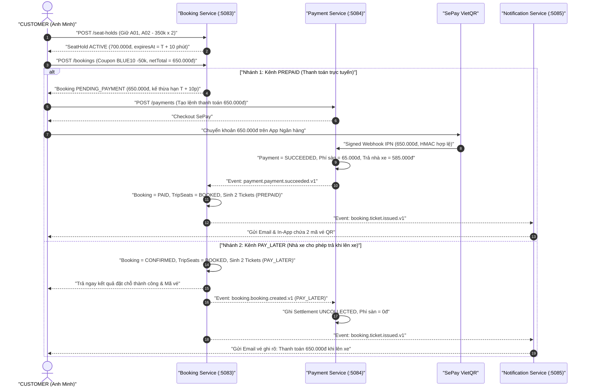
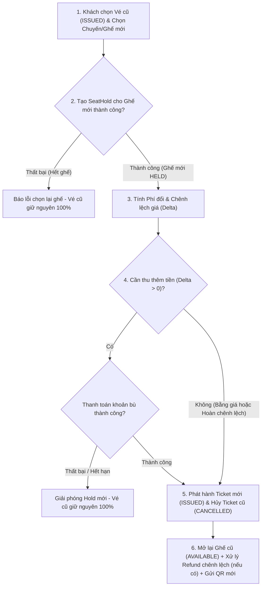
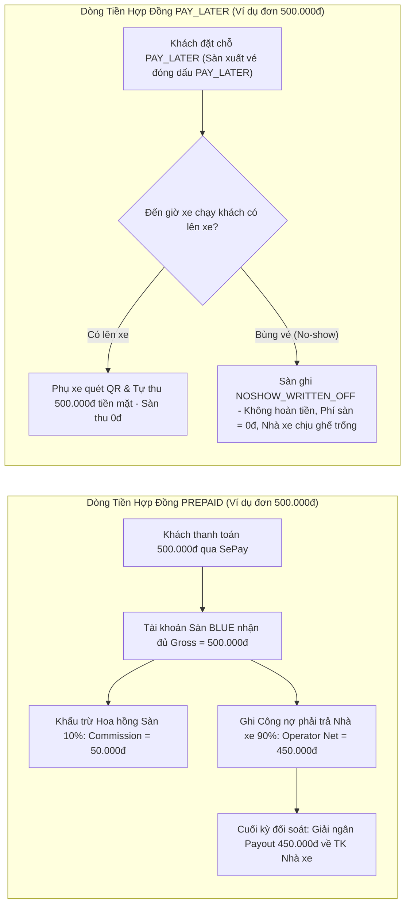

# Chương 02 — Giải Phẫu 7 Quy Trình Nghiệp Vụ Cốt Lõi, Dòng Tiền PREPAID vs PAY_LATER và Các Công Thức Tính Toán

> **Thuộc bộ tài liệu:** Cẩm Nang Thuyết Trình Toàn Diện — Dự án **BLUE Bus Ticket Platform (PBL6)**  
> **Tài liệu nguồn đối chiếu:** [03-quy-trinh-va-quy-tac-nghiep-vu.md](../../../srs/v2/03-quy-trinh-va-quy-tac-nghiep-vu.md) · [11-phu-luc.md](../../../srs/v2/11-phu-luc.md) · [BookingService.cs](../../../../workspace/src/services/booking/BusTicketPlatform.Booking.Application/BookingService.cs) · [001_initial.sql (Payment)](../../../database/payment/001_initial.sql)

---

## Mở Đầu: Trái Tim Nghiệp Vụ Của Một Hệ Thống Thương Mại Điện Tử Vận Tải

Một hệ thống phần mềm dù có kiến trúc Microservices hiện đại đến đâu nhưng tính sai 1 đồng tiền hoàn vé, thu nhầm phí hoa hồng khi khách chưa trả tiền, hay cho phép hai chiếc xe trùng biển số xuất bến cùng một giờ thì hệ thống đó vẫn thất bại hoàn toàn trong thực tế.

Chương này sẽ dẫn dắt bạn đi xuyên qua toàn bộ **7 quy trình nghiệp vụ cốt lõi (`BP-01` đến `BP-07`)** của **BLUE Bus Ticket Platform**, sau đó mổ xẻ đến tận từng dòng công thức toán học và từng bút toán sổ cái kế toán cho 3 bài toán hóc búa nhất dự án:
1. Sự đối lập sâu sắc về dòng tiền và thời điểm phát vé giữa hai kênh hợp đồng **`PREPAID` (Trả trước qua cổng)** và **`PAY_LATER` (Trả khi lên xe)** cùng quy tắc hoa hồng sàn **10%**.
2. Công thức tính **Mã giảm giá (`Coupon`)** và thuật toán **Phân bổ giảm giá lũy kế (`Cumulative Rounding`)** lên từng ghế để không bao giờ lệch dù chỉ 1 đồng VND.
3. Bảng bậc thang **Phí hủy vé 4 mốc thời gian (`24h / 6h / 2h`)** với quy tắc làm tròn **`HALF_UP`** đối chiếu với trường hợp nhà xe chủ động hủy chuyến.

---

## Phần 1: Bức Tranh Tổng Quan & Giải Phẫu Chi Tiết 7 Quy Trình Cốt Lõi (`BP-01`..`BP-07`)

Toàn bộ hoạt động vận hành của nền tảng BLUE xoay quanh 7 quy trình khép kín, kết nối chặt chẽ giữa Nhà xe cung cấp nguồn cung (Supply) và Hành khách tiêu thụ chỗ ngồi (Demand):

| Mã Quy Trình | Tên Quy Trình Nghiệp Vụ | Phạm Vi MVP | Tác Nhân Chính | Đầu Ra Nghiệp Vụ Quan Trọng Nhất |
|---|---|:---:|---|---|
| **`BP-01`** | Tìm chuyến và Đặt vé | `MUST` | `Guest`, `CUSTOMER`, Payment Gateway | Giữ ghế 10 phút, chốt `Booking`, thu tiền (nếu `PREPAID`) và phát hành `Ticket` QR. |
| **`BP-02`** | Hủy vé và Hoàn tiền | `MUST` | `CUSTOMER`, Payment Gateway | Báo giá phí hủy 5 phút, thu hồi vé, mở lại ghế trống và hoàn tiền đúng bậc thời gian. |
| **`BP-03`** | Đổi vé (Đổi chuyến / Đổi ghế) | `SHOULD` | `CUSTOMER`, Payment Gateway | Giữ ghế mới an toàn trước khi hủy vé cũ, thanh toán/hoàn phần chênh lệch giá. |
| **`BP-04`** | Tạo và Mở bán chuyến xe | `MUST` | `OPERATOR_SCHEDULER`, `OPERATOR_ADMIN` | Kiểm tra không trùng lịch xe/tài xế, đóng băng Snapshot và sinh đủ `TripSeat`. |
| **`BP-05`** | Thực hiện chuyến và Check-in QR | `MUST` (`Review` là `SHOULD`) | `DRIVER`, `OPERATOR_OPERATIONS`, `CUSTOMER` | Quét QR chống gian lận vé, cập nhật tiến trình xe lăn bánh đến khi hoàn tất chuyến. |
| **`BP-06`** | Nhà xe / Admin hủy chuyến xe | `MUST` | `OPERATOR_OPERATIONS`, `OPERATOR_ADMIN`, `PLATFORM_ADMIN` | Vô hiệu hóa hàng loạt vé của chuyến bị sự cố, hoàn 100% tiền đã thu `PREPAID`. |
| **`BP-07`** | Quản trị Tài khoản, Nhà xe & Nền tảng | `MUST` | Toàn bộ 10 Roles & `Guest` | Khép kín vòng đời định danh, phân quyền Multi-tenant, danh mục xe/tuyến và báo cáo. |

---

### 1.1. Quy Trình `BP-01` — Tìm Chuyến và Đặt Vé (Luồng Kiếm Tiền Cốt Lõi)

#### Mục tiêu cốt lõi
Giúp hành khách tìm được chuyến xe còn chỗ, khóa tạm thời toàn bộ các ghế mong muốn để yên tâm điền thông tin, thanh toán an toàn và nhận vé điện tử có mã QR mà **tuyệt đối không bao giờ xảy ra hiện tượng hai người mua trùng một ghế**.

#### Ví dụ thực tế xuyên suốt bằng tiền VND
Anh Minh (`CUSTOMER`) tìm xe giường nằm tuyến **Đà Nẵng -> Đà Lạt** khởi hành lúc `20:00 ngày 20/12/2026` của Nhà xe Phương Trang. Giá niêm yết mỗi giường là **`350.000đ`**. Anh Minh đi cùng vợ nên chọn 2 giường tầng dưới `A01` và `A02` (tổng tạm tính `subtotal = 700.000đ`), áp mã giảm giá `BLUE10` (giảm 10%, tối đa `50.000đ` -> được giảm `50.000đ`), còn phải thanh toán **`total = 650.000đ`**.

#### Phân tích từng bước luồng chính & rẽ nhánh hợp đồng

1. **Bước 1 — Tìm kiếm chuyến xe (`Guest` / `CUSTOMER`):**
   - Gửi yêu cầu `GET /api/v1/trips` với điểm đi, điểm đến, ngày khởi hành.
   - `Transport Service` chỉ trả về các chuyến thỏa đồng thời `sellable = true` và `status IN ('SCHEDULED', 'BOARDING')`. Nếu không có chuyến nào khớp, hệ thống trả mảng rỗng `[]` kèm HTTP `200 OK` (không bao giờ coi "hết chuyến" là lỗi hệ thống 500!).
2. **Bước 2 — Xem sơ đồ ghế & Click chọn trên UI (`CUSTOMER`):**
   - `Booking Service` dọn dẹp các phiên giữ ghế đã quá hạn (`ExpireHoldsAsync`) rồi trả danh sách `TripSeat` (`AVAILABLE`, `HELD`, `BOOKED`, `DISABLED`).
   - Anh Minh bấm vào ghế `A01`, `A02`. Trên màn hình React, 2 ghế đổi màu sang trạng thái tạm `SELECTED` (chỉ nằm ở Client).
3. **Bước 3 — Giữ ghế nguyên tử 10 phút (`CreateHold` — `BR-SEAT-004..006`):**
   - Khi anh Minh bấm *"Tiếp tục"*, Client gửi `POST /api/v1/trips/{tripId}/seat-holds` kèm header `Idempotency-Key`.
   - `Booking Service` mở giao dịch PostgreSQL, khóa các dòng ghế `A01` và `A02`. Nếu cả 2 đều `AVAILABLE`, hệ thống tạo bản ghi `SeatHold` (`status = 'ACTIVE'`, `total_amount = 700.000đ`, `expires_at = created_at + 10 phút`), chuyển cả `A01` và `A02` sang `HELD`, rồi trả về `holdToken` bí mật.
   - **Quy tắc nguyên tử (All-or-Nothing):** Nếu đúng mili-giây đó ghế `A02` vừa bị người khác giữ, hệ thống **từ chối toàn bộ yêu cầu (`409 SEAT_UNAVAILABLE`)** và không giữ ghế `A01` lẻ loi!
4. **Bước 4 — Điền hành khách, Áp mã Coupon & Tạo Booking (`CreateBooking`):**
   - Anh Minh nhập họ tên 2 hành khách, chọn điểm đón/trả, áp mã `BLUE10` và chọn kênh thanh toán `PREPAID` hoặc `PAY_LATER`.
   - Hệ thống kiểm tra `holdToken` còn `ACTIVE`, tính lại `discount = 50.000đ`, `netTotal = 650.000đ`, tiêu thụ `SeatHold` (`ACTIVE -> CONSUMED`). Lưu ý cực kỳ quan trọng (`BR-SEAT-006`, `BR-BOOK-007`): **Tạo Booking KHÔNG gia hạn thêm 10 phút mới** — đơn đặt chỗ kế thừa nguyên xi mốc `expiresAt` ban đầu của `SeatHold` để ngăn chặn kẻ xấu liên tục giữ ghế rồi tạo đơn bỏ ngỏ nhằm "ngâm" ghế của nhà xe!
5. **Bước 5..8 — Hai ngả rẽ hoàn toàn khác biệt theo `paymentChannel`:**
   - **Ngả A — Kênh Trả trước (`PREPAID`):**
     - `Booking` khởi tạo ở trạng thái `PENDING_PAYMENT` (`650.000đ`), ghế vẫn đang `HELD`, **chưa có vé `Ticket` nào được sinh ra**.
     - Anh Minh quét mã VietQR qua SePay đúng `650.000đ`.
     - Cổng thanh toán gọi Webhook có chữ ký HMAC về `Payment Service`. `Payment` xác minh chữ ký, khớp đúng `650.000đ VND`, chuyển `Payment -> SUCCEEDED`, ghi sổ quyết toán: doanh thu gộp `650.000đ`, phí sàn 10% = `65.000đ`, công nợ phải trả nhà xe = `585.000đ` (`COLLECTED`), đồng thời ghi sự kiện `PaymentSucceeded` vào bảng Outbox.
     - `Booking Service` nhận sự kiện qua RabbitMQ, chuyển `Booking -> PAID`, chốt ghế `A01, A02 -> BOOKED` và phát hành 2 `Ticket` (`ISSUED`, đóng dấu `PREPAID`). `Notification Service` gửi Email kèm mã QR cho anh Minh.
   - **Ngả B — Kênh Trả sau trên xe (`PAY_LATER` — chỉ khi nhà xe bật `allow_pay_later = true`):**
     - Không tạo giao dịch cổng thanh toán! Ngay trong khoảnh khắc tạo đơn, `Booking` vào thẳng trạng thái `CONFIRMED`, ghế `A01, A02` chuyển thẳng sang `BOOKED`, và 2 `Ticket` được phát hành ngay lập tức (`ISSUED`, đóng dấu rõ dòng chữ **`PAY_LATER` — Thu tiền khi lên xe**).
     - `Payment Service` nhận sự kiện `BookingCreated` và chỉ ghi một bản ghi theo dõi `UNCOLLECTED` với `commission_amount = 0đ`.



#### Tình huống ngoại lệ "đắt giá" nhất trong `BP-01`: Thanh toán thành công trễ (`Late Payment`)
Điều gì xảy ra nếu anh Minh mở mã QR lúc phút thứ `9:55`, ngân hàng bị nghẽn mạng nên đến phút thứ `10:30` tiền `650.000đ` mới trừ xong và bắn Webhook sang BLUE, trong khi lúc phút `10:01` đơn `Booking` đã bị chuyển sang `EXPIRED` và ghế `A01` đã bị chị Lan mua mất?
- Theo quy tắc vàng **`BR-PAY-006`** và code thực tế tại [BookingService.cs](../../../../workspace/src/services/booking/BusTicketPlatform.Booking.Application/BookingService.cs#L496-L502): Hệ thống **tuyệt đối không cướp lại ghế của chị Lan**, mà giữ nguyên sự an toàn của kho ghế, đồng thời tự động phát ngay lệnh hoàn tiền bù trừ `RefundRequestedAsync(..., reason: "PAYMENT_AFTER_BOOKING_CLOSED")` để trả lại đủ `650.000đ` cho anh Minh (hoặc mở `reconciliation_cases` nếu cổng thanh toán cần đối soát thủ công)!

---

### 1.2. Quy Trình `BP-02` — Hủy Vé và Hoàn Tiền Theo Bậc Thời Gian

#### Mục tiêu cốt lõi
Cho phép hành khách tự hủy một phần hoặc toàn bộ các vé đủ điều kiện một cách minh bạch (biết trước chính xác mất bao nhiêu tiền phí, nhận về bao nhiêu tiền hoàn) và chỉ hoàn tiền qua cổng khi sàn thực sự đã cầm tiền của khách.

#### Phân tích từng bước với cơ chế "Khóa báo giá 5 phút" (`CancellationPreview`)
Hãy nhìn vào thiết kế hai pha cực kỳ chặt chẽ trong bảng `cancellation_previews` ([001_initial.sql (Booking)](../../../database/booking/001_initial.sql#L236-L252)) và `BookingService.PreviewAsync` / `CancelAsync`:

1. **Pha 1 — Xem trước chi phí hủy (`PreviewAsync`):**
   - Giả sử anh Minh đã mua vé `PREPAID` giá `350.000đ`, giờ xe chạy là `20:00 tối mai`. Lúc `10:00 sáng nay` (còn `34 tiếng >= 24 tiếng`), anh Minh bấm *"Xem phí hủy"*.
   - Hệ thống kiểm tra: đúng chủ sở hữu đơn, vé đang ở trạng thái `ISSUED` (chưa `CHECKED_IN`), thời gian còn trên 24h -> áp bậc phí **10%** = `35.000đ`, số tiền hoàn lại = **`315.000đ`**.
   - Hệ thống lưu một bản ghi `CancellationPreview` vào DB có hạn sử dụng **đúng 5 phút** (`expiresAt = UtcNow + 5 minutes`) kèm `previewId`.
2. **Pha 2 — Xác nhận hủy chính thức (`CancelAsync`):**
   - Anh Minh nhìn rõ con số `Hoàn lại: 315.000đ` và bấm *"Xác nhận hủy"*, gửi kèm `previewId`, `expectedVersion` (`row_version` chống sửa đồng thời) và `Idempotency-Key`.
   - Tại sao phải có `previewId` sống 5 phút? Vì nếu anh Minh mở màn hình xem phí lúc còn `24 giờ 02 phút` (phí 10%), rồi treo máy đi uống cà phê 30 phút sau quay lại bấm nút (lúc này chỉ còn `23 giờ 32 phút` — lẽ ra phí đã tăng lên **20%**!), hệ thống sẽ phát hiện `preview.ExpiresAt <= UtcNow`, lập tức từ chối với lỗi **`PREVIEW_STALE`** và buộc tính lại biểu phí mới để đảm bảo công bằng!
3. **Pha 3 — Mở lại ghế & Xử lý hoàn tiền bất đồng bộ:**
   - Trong cùng giao dịch tại `Booking Service`: Vé chuyển sang `CANCELLED`; nếu chuyến xe vẫn đang mở bán (`sellable = true`), chiếc ghế `A01` lập tức được giải phóng từ `BOOKED -> AVAILABLE` để hành khách khác có thể mua lại ngay.
   - Nếu là đơn `PREPAID` và `refundAmount = 315.000đ > 0`, `Booking` phát sự kiện `RefundRequested`. `Payment Service` gọi API hoàn tiền của cổng thanh toán, tạo bản ghi `refunds`, và khi thành công sẽ đảo ngược tương ứng phần hoa hồng sàn và công nợ nhà xe. Nếu cổng thanh toán bị lỗi mạng tạm thời, **vé vẫn giữ nguyên trạng thái đã hủy (`CANCELLED`)**, không bao giờ tự hồi sinh lại vé, còn tiến trình hoàn tiền được retry độc lập hoặc đưa vào hàng đợi xử lý tài chính!

---

### 1.3. Quy Trình `BP-03` — Đổi Vé Sang Chuyến Mới Hoặc Ghế Mới (Phạm Vi `SHOULD`)

#### Tại sao Đổi vé là bài toán rủi ro cao và phải tuân thủ "Giữ Mới Trước — Hủy Cũ Sau"?
Trong SRS ([03-quy-trinh-va-quy-tac-nghiep-vu.md](../../../srs/v2/03-quy-trinh-va-quy-tac-nghiep-vu.md#L86-L114)), `BP-03` thuộc nhóm `SHOULD` (được thiết kế hoàn chỉnh kiến trúc Saga nhưng xếp sau MVP `MUST` theo `ADR-015`). Sai lầm sơ đẳng nhất khi thiết kế chức năng Đổi vé là: *Hủy vé cũ của khách trước rồi mới đi đặt ghế mới* — nếu đúng lúc đó ghế mới vừa bị người khác mua mất hoặc thẻ ngân hàng của khách không đủ tiền bù chênh lệch, khách sẽ rơi vào thảm cảnh **"Vé mới không mua được mà vé cũ cũng mất luôn!"**.

Vì vậy, quy tắc bất khả xâm phạm **`BR-CANCEL-006` và `BR-CANCEL-007`** thiết lập trình tự 6 bước an toàn tuyệt đối:
1. **Kiểm tra điều kiện vé gốc:** Vé gốc phải thuộc sở hữu của `CUSTOMER`, đang ở trạng thái `ISSUED` và nằm trong khung giờ cho phép đổi theo policy snapshot.
2. **Giữ ghế mới trước (`SeatHold` mới):** Hệ thống tạo một `SeatHold` `ACTIVE` trên chuyến/ghế mới mà **chưa hề đụng chạm gì tới vé cũ**. Nếu không giữ được ghế mới -> báo lỗi ngay, vé cũ của khách an toàn 100%.
3. **Tính toán phương án tài chính chênh lệch:**
   $$\Delta = \text{Giá vé mới} + \text{Phí đổi vé} - \text{Giá trị vé cũ được bảo lưu}$$
   - Ví dụ: Vé cũ giá `300.000đ`, đổi sang chuyến giường VIP giá `420.000đ`, phí đổi `20.000đ` -> Khách cần thanh toán bù thêm $\Delta = 420.000 + 20.000 - 300.000 = 140.000\text{đ}$.
   - Ngược lại, nếu đổi sang chuyến thường giá `250.000đ`, phí đổi `20.000đ` -> Hệ thống ghi nhận khoản hoàn chênh lệch $300.000 - (250.000 + 20.000) = 30.000\text{đ}$ (nếu policy cho phép hoàn chênh lệch).
4. **Thực hiện nghĩa vụ tài chính:** Nếu $\Delta > 0$ và khách thanh toán bổ sung thất bại -> hệ thống chỉ cần nhả `SeatHold` mới về `AVAILABLE`, chiếc vé cũ vẫn nguyên vẹn hiệu lực!
5. **Điểm chốt giao dịch (Commit Point / Controlled Saga):** Chỉ sau khi điều kiện tài chính đã hoàn tất, hệ thống mới phát hành `Ticket` mới (`ISSUED`) và chuyển `Ticket` cũ sang `CANCELLED` (nếu thu tiền bù thành công nhưng bước phát vé mới lỗi bất ngờ, Saga lập tức hoàn trả khoản tiền bù vừa thu).
6. **Giải phóng ghế cũ & Thông báo:** Đưa ghế cũ về `AVAILABLE` (nếu chuyến cũ còn bán) và gửi vé QR mới cho hành khách.



---

### 1.4. Quy Trình `BP-04` — Tạo và Mở Bán Chuyến Xe (Chốt Chặn Trùng Lịch & Đóng Băng Snapshot)

#### Mục tiêu cốt lõi
Đảm bảo mỗi chuyến xe trước khi xuất hiện trên màn hình tìm kiếm của hành khách phải có phương tiện hợp lệ, tài xế đủ điều kiện bằng lái, **không trùng lịch chạy**, đã đóng băng dữ liệu lịch sử (`Snapshot`) và đã sinh sẵn đầy đủ kho ghế (`TripSeat`) bên `Booking Service`.

#### Hai cơ chế kỹ thuật cực hay trong `BP-04` mà bạn nhất định phải nhấn mạnh khi thuyết trình:

1. **Chống trùng lịch xe và tài xế ngay tại tầng CSDL bằng PostgreSQL GiST Exclusion Constraint (`BR-TRIP-002`):**
   Hãy mở file [001_initial.sql (Transport)](../../../database/transport/001_initial.sql#L190-L220):
   - Mỗi chuyến xe có cột `operating_window tstzrange` (khoảng thời gian từ trước giờ xuất bến đến sau giờ cập bến cộng thời gian đệm nghỉ ngơi/quay đầu).
   - Hệ thống cài đặt ràng buộc loại trừ không gian-thời gian `EXCLUDE USING gist (bus_id WITH =, operating_window WITH &&)` trên bảng `trips` và `EXCLUDE USING gist (driver_profile_id WITH =, assignment_window WITH &&)` trên bảng `driver_assignments`!
   - Ý nghĩa: Ngay cả khi 2 nhân viên điều độ `OPERATOR_SCHEDULER` bấm nút phân công cùng chiếc xe `43B-123.45` vào 2 chuyến xe giao nhau chỉ 5 phút ở đúng cùng một thời điểm, PostgreSQL sẽ chặn đứng ở mức Toán học tập hợp và trả về mã lỗi `409 SCHEDULE_CONFLICT`!

2. **Đóng băng Snapshot & Bắt tay hai chiều `Transport <-> Booking` (`BR-SEAT-010`):**
   - Khi nhân viên bấm **Publish Trip**, `Transport Service` chuyển chuyến từ `DRAFT -> SCHEDULED` (lúc này cờ `sellable` vẫn có thể đợi inventory sẵn sàng) và chụp ảnh tĩnh toàn bộ cấu trúc tuyến đường (`route_snapshot`), sơ đồ ghế của xe (`bus_snapshot`) và bảng giá/chính sách hủy (`fare_policy_snapshot`) lưu cứng vào JSONB. Vì sao? Vì nếu 3 ngày sau nhà xe mang chiếc xe đó đi đóng lại ghế (từ 40 giường xuống 34 phòng VIP), các chuyến xe đã mở bán trước đó **không bị biến dạng sơ đồ ghế hay sai lệch lịch sử vé đã bán**!
   - Tiếp theo, `Transport` phát sự kiện `transport.trip.published.v1` qua RabbitMQ. `Booking Service` nhận sự kiện (`ImportPublishedTripAsync`), khởi tạo bảng `trip_snapshots` và sinh ra đầy đủ 34 hoặc 40 dòng `trip_seats` ở trạng thái `AVAILABLE` (hoặc `DISABLED` cho ghế phụ không bán), sau đó bắn ngược sự kiện `booking.trip-inventory.ready.v1` để xác nhận kho ghế đã sẵn sàng phục vụ khách đặt vé!

---

### 1.5. Quy Trình `BP-05` — Thực Hiện Chuyến Đi và Quét Mã Check-in QR

#### Mục tiêu cốt lõi
Giúp tài xế (`DRIVER`) và nhân viên điều hành bến (`OPERATOR_OPERATIONS`) kiểm soát chính xác hành khách bước lên xe trong vài giây, chống vé giả/vé dùng lại/vé sai chuyến, và khép kín vòng đời chuyến đi.

#### Chi tiết luồng thực thi từ lúc mở cửa đón khách đến khi xe cập bến
1. **Tải danh sách hành khách tối giản (`ManifestAsync` — `AUTHZ-007`):**
   - Tài xế mở màn hình chuyến xe được giao. Hệ thống kiểm tra `trip.DriverUserId == actor.UserId` và trả về danh sách `ManifestPassengerDto` chỉ gồm đúng 5 trường thiết yếu: `TicketId`, `PassengerName`, `SeatCode`, `PickupStopName`, `Status` — tuyệt đối không trả tràn lan CCCD gốc hay email cá nhân của khách.
2. **Xác thực mã QR chữ ký mật mã & Check-in đúng một lần (`ValidateAsync` & `CheckInAsync` — `BR-TICKET-001..003`):**
   - Mã QR trên vé của khách không chỉ chứa khơi khơi một chuỗi UUID dễ đoán, mà được sinh bởi `TicketQr.Create(ticketId, signingKey)` có gắn chữ ký mật mã.
   - Khi tài xế đưa camera quét mã, `Booking Service` kiểm tra chữ ký QR, đối chiếu đúng `tripId`, kiểm tra chuyến xe không bị `CANCELLED` và vé đang ở trạng thái `ISSUED`.
   - Khi hợp lệ, vé chuyển `ISSUED -> CHECKED_IN`, lưu lại `checked_in_at` và `checked_in_by_external = actor.UserId`.
   - **Nếu kẻ gian chụp màn hình mã QR đó gửi cho người thứ hai quét lại 2 phút sau?** Hệ thống phát hiện vé không còn ở trạng thái `ISSUED` mà đã `CHECKED_IN`, lập tức chặn lại với mã lỗi **`409 TICKET_ALREADY_CHECKED_IN`** và hiển thị rõ thời điểm vé đó đã được quét lên xe trước đó!
3. **Diễn tiến vòng đời chuyến đi & Hoàn tất nghĩa vụ vé (`BR-TICKET-004`):**
   - Tài xế/Điều hành cập nhật trạng thái chuyến tuần tự: `SCHEDULED -> BOARDING (Đang đón khách) -> DEPARTED (Đã xuất bến — đóng bán vé hoàn toàn) -> IN_TRANSIT (Đang di chuyển) -> ARRIVED (Đã tới bến đích) -> COMPLETED (Hoàn tất chuyến)`.
   - Khi chuyến xe chạm mốc `COMPLETED`, toàn bộ các vé đã `CHECKED_IN` tự động chuyển sang `USED`, đơn đặt chỗ chuyển sang `COMPLETED`. Ở giai đoạn mở rộng `SHOULD`, chỉ những hành khách có vé `USED` mới đủ tư cách viết tối đa 1 bài đánh giá (`Review`) cho chuyến đi đó (`BR-REVIEW-001`), triệt tiêu nạn đánh giá ảo (seeding/spam review) khi chưa từng đi xe!

---

### 1.6. Quy Trình `BP-06` — Nhà Xe Hoặc Admin Hủy Chuyến Xe (Sự Cố Vận Hành)

#### Mục tiêu cốt lõi
Khi xe gặp sự cố kỹ thuật nghiêm trọng, sạt lở đường đèo hoặc bão lũ không thể khởi hành, cho phép `OPERATOR_OPERATIONS` / `OPERATOR_ADMIN` / `PLATFORM_ADMIN` dừng chuyến xe một cách có kiểm soát, thông báo khẩn cho toàn bộ hành khách và **hoàn trả 100% số tiền khách đã thanh toán trả trước**.

#### Các điểm chốt kiểm soát rủi ro trong `BP-06`
1. **Cảnh báo phạm vi ảnh hưởng trước khi bấm nút:** Trước khi xác nhận hủy, giao diện hiển thị tổng số `Booking`, `Ticket` và tổng giá trị tiền `Payment` sẽ bị ảnh hưởng, đồng thời bắt buộc nhập lý do (`reason`) kèm `Idempotency-Key`.
2. **Giới hạn trạng thái được phép hủy (`BR-TRIP-004`):** Chỉ các chuyến ở `SCHEDULED` hoặc `BOARDING` mới được hủy theo luồng vận hành chuẩn. Chuyến xe đã có khách đặt vé **bị cấm xóa vật lý (`Hard Delete`)** vĩnh viễn để bảo toàn chứng từ kế toán. Nếu xe đã xuất bến (`DEPARTED`), luồng hủy thông thường bị khóa cứng (`409 INVALID_STATE_TRANSITION`).
3. **Chính sách bảo vệ người tiêu dùng (`BR-CANCEL-008`):** Khác hoàn toàn với `BP-02` (khách tự hủy bị trừ phí 10%–30%), trong `BP-06` lỗi thuộc về phía nhà cung cấp dịch vụ nên **không áp dụng bất kỳ khoản phí hủy nào của khách hàng**:
   - Mọi đơn `PREPAID` đã thanh toán được tự động khởi tạo lệnh hoàn tiền **100% giá trị đã thu**.
   - Các đơn `PAY_LATER` được chuyển sang `CANCELLED` (hủy vé, thông báo cho khách tìm phương tiện thay thế, không phát sinh giao dịch hoàn tiền cổng vì khách chưa nộp tiền).
4. **Chịu lỗi khi xử lý lô lớn (Batch Idempotent Checkpointing):** Một chuyến xe giường nằm có thể chứa 40 hành khách thuộc 25 đơn `Booking` khác nhau. Nếu đang phát lệnh hoàn tiền đến đơn thứ 15 thì mạng chập chờn, tiến trình chạy lại từ checkpoint sẽ bỏ qua 15 đơn đã có `refund_reference` idempotent và xử lý nốt 10 đơn còn lại — không bỏ sót khách nào và cũng không hoàn tiền nhân đôi cho ai!

---

### 1.7. Quy Trình `BP-07` — Quản Trị Tài Khoản, Nhà Xe và Nền Tảng

Khác với `BP-01`..`BP-06` là các chuỗi bước nối đuôi nhau, `BP-07` là **tập hợp 6 nhóm luồng quản trị nền tảng độc lập** bảo đảm hệ sinh thái vận hành trơn tru và an toàn:

1. **Đăng ký & Xác minh định danh (`UC-AUTH-01`):** `Guest` đăng ký bằng Họ tên, Email, SĐT và Mật khẩu (băm bằng thuật toán chống GPU cracking **Argon2id** qua thư viện `Konscious.Security.Cryptography.Argon2`). Tài khoản khởi tạo ở `PENDING_VERIFICATION`, nhận mã xác thực qua Email (`auth_challenges` có giới hạn số lần nhập sai `failed_attempts` và thời gian hết hạn), xác minh đúng mới chuyển sang `ACTIVE`.
2. **Quản lý Phiên đăng nhập với Refresh Token Family (`UC-AUTH-02..04`):** Bảng `refresh_sessions` lưu trữ `token_hash` (không lưu token thô!) theo chuỗi gia phả `family_id` và `replaced_by_session_id`. Khi đăng nhập sai quá ngưỡng, tài khoản tự động khóa tạm thời (`lockout_until`).
3. **Quản trị Pháp nhân Nhà xe & Phân quyền (`UC-ADMIN-01..02`):** `PLATFORM_ADMIN` phê duyệt `Organization`, gán nhân sự vào tổ chức (`organization_memberships`) và cấp Role tương ứng; mọi thao tác đều ghi vào bảng `security_audits` bất biến (append-only).
4. **Quản lý Tài sản Vận tải & Quy tắc Không Xóa Cứng (`UC-OPS-01..04`, `BR-DATA-004`):** Nhân sự nhà xe quản lý `Bus`, `Seat`, `DriverProfile`, `Stop`, `Route`. Bất kỳ bản ghi xe, ghế, tài xế hay tuyến đường nào đã từng được tham chiếu bởi một `Trip` trong quá khứ đều **bị cấm xóa vật lý (`DELETE`)**; hệ thống chỉ cho phép ngừng kích hoạt (`INACTIVE` / `deleted_at` soft-delete) để báo cáo doanh thu năm ngoái không bao giờ bị mất thông tin xe chạy!
5. **Quản trị Khuyến mãi & Hỗ trợ Khiếu nại (`UC-PROMO-01`, `UC-ADMIN-03`):** Quản lý mã giảm giá `Coupon`, tra cứu liên dịch vụ và xử lý hồ sơ khiếu nại `SupportCase`.
6. **Báo cáo Doanh thu & Đối soát công bố độ mới dữ liệu (`UC-REPORT-01`):** `OPERATOR_FINANCE` (trong phạm vi nhà xe mình) và `PLATFORM_FINANCE` / `PLATFORM_AUDITOR` (toàn sàn) xem thống kê doanh thu, lượng đặt chỗ và tỷ lệ lấp đầy ghế từ `Reporting Service`, luôn kèm theo mốc thời gian cập nhật gần nhất (`dataAsOf`).

---

## Phần 2: Phân Tích Cực Sâu Hai Kênh Hợp Đồng Thanh Toán `PREPAID` vs `PAY_LATER` & Cơ Chế Hoa Hồng Sàn 10%

Một trong những điểm sáng thực tế nhất giúp **BLUE Bus Ticket Platform** vượt xa các đồ án đặt vé môn học thông thường chính là mô hình tài chính kép **`PREPAID` vs `PAY_LATER`** kết hợp sổ cái quyết toán hai chiều (`booking_settlements` & `ledger_entries`). Nếu hội đồng hỏi *"Tiền khách trả đi về đâu, sàn kiếm tiền bằng cách nào và nếu khách đặt trả sau rồi bùng vé thì sao?"*, toàn bộ câu trả lời nằm trọn ở phần này.

### 2.1. Tư Duy Nền Tảng: `paymentChannel` Là "Nhãn Hợp Đồng Lúc Đặt", Không Phải Trạng Thái Thu Tiền Mặt!

Hãy đọc kỹ quy tắc **`BR-BOOK-011`** ([03-quy-trinh-va-quy-tac-nghiep-vu.md](../../../srs/v2/03-quy-trinh-va-quy-tac-nghiep-vu.md#L276)):

> *"`paymentChannel` chỉ nhận `PREPAID` hoặc `PAY_LATER`. `PAY_LATER` chỉ hợp lệ khi Organization đang bật cho phép trả sau (`allow_pay_later = true`). Đây là nhãn hợp đồng lúc đặt, không phải timestamp thu tiền mặt."*

Tại sao tài liệu lại nhấn mạnh câu này?
- Vì nền tảng BLUE là **Sàn công nghệ trực tuyến**, sàn chỉ kết nối trực tiếp với cổng thanh toán điện tử (SePay VietQR), chứ nhân viên sàn **không ngồi trên chiếc xe khách chạy giữa quốc lộ 1A để nhìn xem phụ xe đã cầm tờ tiền mặt 500.000đ từ tay hành khách hay chưa**!
- Nếu thiết kế sai bằng cách bắt tài xế phải bấm nút *"Đã thu tiền mặt"* trên điện thoại thì hệ thống mới chịu xuất vé hoặc mới tính doanh thu, sẽ nảy sinh vô số gian lận ngoài đời (phụ xe thu tiền rồi nhưng báo khách không đi để trốn phí sàn!).
- Do đó, BLUE định nghĩa ranh giới trách nhiệm pháp lý cực kỳ minh bạch ngay từ giây phút khách bấm tạo đơn:
  1. **`PREPAID` (Hợp đồng Trả trước qua Sàn):** Sàn đứng ra thu hộ tiền vé qua cổng thanh toán điện tử. Tiền thực sự chảy vào tài khoản ngân hàng của Sàn -> Sàn giữ quyền phát vé sau khi tiền về, Sàn chịu trách nhiệm hoàn tiền nếu hủy vé, và **Sàn khấu trừ phí hoa hồng dịch vụ (mặc định 10%)** trước khi trả phần còn lại (90%) cho nhà xe theo kỳ đối soát (`operator_payouts`).
  2. **`PAY_LATER` (Hợp đồng Giữ chỗ Trả khi lên xe):** Chỉ mở khi chính Chủ nhà xe (`OPERATOR_ADMIN`) chủ động bật công tắc `allow_pay_later = true` cho hãng xe của mình. Lúc này nhà xe chấp nhận đánh đổi rủi ro để thu hút khách quen: hệ thống khóa ghế `BOOKED` và xuất ngay vé có đóng dấu đỏ **`PAY_LATER`**, phụ xe nhìn chữ `PAY_LATER` trên vé lúc quét QR để tự thu tiền mặt tại cửa xe. Vì không có đồng nào chảy qua tài khoản ngân hàng của Sàn, **Sàn không tạo giao dịch cổng thanh toán, không hoàn tiền qua Sàn, và cũng không thu phí hoa hồng 10% trên đơn `PAY_LATER`**!

### 2.2. Bảng Đối Chiếu Toàn Diện 10 Khác Biệt Giữa `PREPAID` và `PAY_LATER`

| Tiêu Chí So Sánh | Kênh Hợp Đồng `PREPAID` (Trả Trước Qua Cổng) | Kênh Hợp Đồng `PAY_LATER` (Trả Khi Lên Xe) |
|---|---|---|
| **Điều kiện được phép chọn** | Luôn khả dụng cho mọi chuyến xe đang mở bán. | Bắt buộc `organizations.allow_pay_later = true` (nếu tắt mà Client cố gửi sẽ bị chặn bởi `409 PAY_LATER_NOT_ALLOWED`). |
| **Trạng thái `Booking` vừa tạo** | `PENDING_PAYMENT` (Chờ thanh toán trong hạn 10 phút kế thừa từ `SeatHold`). | **`CONFIRMED`** ngay lập tức (Không qua `PENDING_PAYMENT`, không bao giờ vào `PAID`). |
| **Trạng thái `TripSeat` vừa tạo Booking** | Vẫn giữ nguyên là `HELD` cho đến khi Webhook báo tiền về. | Chuyển thẳng sang **`BOOKED`** ngay trong cùng Transaction tạo đơn (`BR-BOOK-012`). |
| **Thời điểm phát hành `Ticket` QR** | Chỉ phát hành **sau khi** `Payment = SUCCEEDED` đã xác minh chữ ký. | Phát hành **ngay lập tức** khi tạo đơn, trên vé in rõ nhãn `PAY_LATER` (`BR-TICKET-001`). |
| **Bản ghi bảng `payments` cổng** | Có 1 bản ghi `payments` + `payment_attempts` + `webhook_receipts`. | **Không tạo** bất kỳ bản ghi nào trong bảng `payments` (`payment_id IS NULL`). |
| **Trạng thái quyết toán (`booking_settlements`)** | Khởi đầu `UNCOLLECTED` -> khi tiền về chuyển sang **`COLLECTED`**. | Ghi nhận **`UNCOLLECTED`** (tiền không đi qua két của Sàn). |
| **Phí hoa hồng sàn (`commission_amount`)** | **10% × `gross_amount`** (theo `commission_rate` snapshot của Nhà xe). | **`0 VND`** (`BR-PAY-012`: tuyệt đối không suy đoán phí từ tiền mặt trên xe). |
| **Công nợ Sàn phải trả Nhà xe (`operator_net`)** | **90% × `gross_amount`** (kết chuyển vào kỳ giải ngân `operator_payouts`). | Nằm ngoài luồng tiền mặt của Sàn (nhà xe tự thu trực tiếp từ hành khách). |
| **Khi khách chủ động Hủy vé (`BP-02`)** | Trừ phí hủy 10%/20%/30% tùy giờ, phần còn lại tạo `Refund` trả về tài khoản khách. | Hủy vé (`CANCELLED`), mở lại ghế `AVAILABLE`, **`refundAmount` qua Sàn = `0 VND`** (`BR-PAY-011`). |
| **Khi khách Bùng vé / Không ra xe (`No-show`)** | Tiền đã thu rồi; vé không hủy trước 2h sẽ mất quyền đi xe theo policy. | Thu hồi quyền vé/chỗ tại giờ chốt, quyết toán chuyển sang **`NOSHOW_WRITTEN_OFF`**, phí sàn = `0đ`, nhà xe tự chịu rủi ro ghế trống (`BR-PAY-014`). |



### 2.3. Giải Phẫu Bất Biến Sổ Cái Kế Toán (`booking_settlements` & `ledger_entries`)

Hãy mở file schema vật lý [001_initial.sql (Payment)](../../../database/payment/001_initial.sql#L153-L205) để thấy cách hệ thống khóa chặt tính toàn vẹn tài chính bằng ràng buộc toán học ngay trong PostgreSQL:

```sql
constraint ck_settlement_split check (commission_amount + operator_net = gross_amount),
constraint ck_settlement_channel_money check (
  (payment_channel = 'PREPAID' and (
    (collection_status = 'COLLECTED' and payment_id is not null)
    or (collection_status = 'REFUNDED' and payment_id is not null)
    or (collection_status = 'UNCOLLECTED' and payment_id is null and commission_amount = 0)
  ))
  or (payment_channel = 'PAY_LATER' and payment_id is null and commission_amount = 0
      and collection_status in ('UNCOLLECTED', 'NOSHOW_WRITTEN_OFF'))
)
```

Phương trình bất biến **`commission_amount + operator_net = gross_amount`** (`BR-PAY-013`) đảm bảo không một đồng tiền nào tự nhiên sinh ra hay tự nhiên biến mất trong cơ sở dữ liệu! Mọi biến động của một đơn đặt chỗ đều được ghi vết dạng nhật ký kế toán không sửa xóa (`ledger_entries`) thông qua **8 mã nghiệp vụ (`entry_type`)**:

#### Minh họa hạch toán từng đồng VND qua 3 tình huống thực tế:

- **Tình huống 1 — Đơn `PREPAID` thu thành công `500.000đ` (Tỷ lệ hoa hồng nhà xe = `10%`):**
  - Bảng `booking_settlements`: `gross_amount = 500.000`, `commission_rate = 0.1000`, `commission_amount = 50.000`, `operator_net = 450.000`, `collection_status = 'COLLECTED'`. Kiểm chứng: $50.000 + 450.000 = 500.000$ (Khớp tuyệt đối!).
  - Bảng `ledger_entries` sinh 3 dòng bút toán:
    1. `GATEWAY_CAPTURE`: `+500.000 VND` (Tiền thực thu từ cổng thanh toán vào két Sàn).
    2. `COMMISSION_ACCRUED`: `+50.000 VND` (Doanh thu phí dịch vụ Sàn được hưởng).
    3. `OPERATOR_PAYABLE`: `+450.000 VND` (Khoản công nợ Sàn đang giữ hộ, phải trả cho Nhà xe).

- **Tình huống 2 — Khách hủy vé `PREPAID` trước 30 tiếng (Chịu phí hủy 10% = `50.000đ`, Hoàn lại khách 90% = `450.000đ`) hoặc Nhà xe hủy chuyến (Hoàn 100% = `500.000đ`):**
  - Giả sử Nhà xe hủy chuyến (`BP-06`), hoàn trả khách đủ `500.000đ`:
  - Theo `BR-PAY-013`, hệ thống **đảo ngược (reverse)** tương ứng cả hoa hồng sàn lẫn công nợ nhà xe thông qua 3 bút toán đối ứng trong `ledger_entries`:
    1. `REFUND_CUSTOMER`: `-500.000 VND` (Tiền trả ngược từ cổng về tài khoản hành khách).
    2. `COMMISSION_REVERSED`: `-50.000 VND` (Đảo giảm doanh thu hoa hồng của Sàn về `0đ`).
    3. `OPERATOR_PAYABLE_REVERSED`: `-450.000 VND` (Đảo giảm công nợ phải trả Nhà xe về `0đ`).
  - Trạng thái `booking_settlements` chuyển sang `REFUNDED`. Sổ sách cân bằng về đúng `0 VND`!

- **Tình huống 3 — Đơn `PAY_LATER` giá `500.000đ` nhưng đến giờ xuất bến khách tắt máy không ra xe (`No-show`):**
  - Lúc mới đặt vé: `ledger_entries` ghi `PAY_LATER_ISSUED` (`500.000 VND` theo dõi giá trị đặt chỗ), `commission_amount = 0`.
  - Khi quá giờ chốt lên xe (cutoff) mà vé không `CHECKED_IN`: Hệ thống hủy quyền vé, ghi bút toán `NOSHOW_WRITTEN_OFF` và chuyển `collection_status = 'NOSHOW_WRITTEN_OFF'`.
  - **Tại sao Sàn không phạt tiền khách và cũng không thu 10% của Nhà xe?** Vì với `PAY_LATER`, khách chưa hề liên kết thẻ hay nộp tiền cọc cho Sàn nên không có tiền để hoàn hay khấu trừ; đồng thời Nhà xe cũng không thu được đồng tiền mặt nào từ chiếc ghế trống đó — nếu Sàn vẫn đòi thu `50.000đ` hoa hồng trên một chuyến đi "ảo" không có doanh thu thực, các nhà xe sẽ lập tức tẩy chay nền tảng!

---

## Phần 3: Giải Phẫu Chi Tiết Các Công Thức Toán Học Nghiệp Vụ Trong Mã Nguồn C#

Trong buổi bảo vệ đồ án, việc bạn viết được công thức toán học lên bảng và chỉ thẳng vào dòng code C# thực thi nó sẽ tạo ấn tượng cực mạnh về độ sâu kỹ thuật. Dưới đây là 3 công thức cốt lõi nhất trong [`BookingService.cs`](../../../../workspace/src/services/booking/BusTicketPlatform.Booking.Application/BookingService.cs) và [`Contracts.cs`](../../../../workspace/src/services/booking/BusTicketPlatform.Booking.Application/Contracts.cs).

### 3.1. Công Thức Tính Mã Giảm Giá (`Coupon`)

Tại dòng 28 của [BookingService.cs](../../../../workspace/src/services/booking/BusTicketPlatform.Booking.Application/BookingService.cs#L28), hàm tính số tiền giảm giá cho một đơn hàng được định nghĩa chính xác như sau:

```csharp
public static long CouponDiscount(CouponDto coupon, long subtotal)
    => Math.Min(coupon.Cap, (long)decimal.Floor((decimal)subtotal * coupon.Percent / 100));
```

Viết dưới dạng biểu thức toán học chuẩn:

$$\text{discount} = \min\left(\text{cap},\ \left\lfloor \frac{\text{subtotal} \times \text{percent}}{100} \right\rfloor\right)$$

#### Giải thích toàn bộ tham số và ràng buộc kiểm tra (`ValidCouponAsync` & `SaveCouponAsync`):
1. **Định dạng & Tham số hợp lệ:**
   - `code`: Chuỗi in hoa từ 3 đến 32 ký tự thuộc tập `^[A-Z0-9_-]{3,32}$` (ví dụ: `SUMMER2026`, `FUTA_VIP15`).
   - `percent`: Phần trăm giảm giá nguyên nằm trong đoạn $[1, 90]$ (từ 1% đến tối đa 90% — cấm mã giảm 0% vô nghĩa hoặc giảm 100% gây đơn hàng `0đ` lỗi cổng thanh toán).
   - `cap`: Trần giảm giá tối đa tính bằng đồng VND (`cap >= 1`).
   - `minimum`: Giá trị đơn hàng tối thiểu (`subtotal >= minimum`) để được kích hoạt mã.
   - `organization_id`: Nếu là `NULL` -> Mã khuyến mãi **Toàn sàn** do BLUE tài trợ (áp dụng cho mọi nhà xe). Nếu có UUID cụ thể -> Mã khuyến mãi **Riêng của một Nhà xe** (`coupon.OrganizationId == trip.OrganizationId`).
   - Thời hạn hiệu lực: `active == true` và thỏa mãn bất đẳng thức nửa mở `startsAt <= UtcNow < expiresAt`.
2. **Tại sao dùng hàm làm tròn xuống `decimal.Floor`?**
   - Trong bài toán khuyến mãi thương mại điện tử, mọi phép nhân tỷ lệ phần trăm lẻ đều dùng `Floor` (làm tròn xuống số nguyên gần nhất) để **đảm bảo tổng tiền chi khuyến mãi không bao giờ vượt quá ngân sách phần trăm cho phép**.
3. **Ví dụ số học thực tế:**
   - Giả sử mã `TET15` có `percent = 15%`, trần giảm tối đa `cap = 60.000đ`, đơn tối thiểu `minimum = 200.000đ`:
     - **Trường hợp A (Chưa chạm trần):** Khách đặt 1 ghế giá `subtotal = 335.000đ` ($\ge 200.000\text{đ}$).
       $$\left\lfloor \frac{335.000 \times 15}{100} \right\rfloor = \lfloor 50.250 \rfloor = 50.250\text{đ} \implies \min(60.000,\ 50.250) = \mathbf{50.250\text{đ}}$$
       Khách thanh toán: $335.000 - 50.250 = \mathbf{284.750\text{đ}}$.
     - **Trường hợp B (Vượt trần `cap`):** Khách đặt 2 ghế giá `subtotal = 700.000đ`.
       $$\left\lfloor \frac{700.000 \times 15}{100} \right\rfloor = 105.000\text{đ} \implies \min(60.000,\ 105.000) = \mathbf{60.000\text{đ}}$$
       Khách chỉ được giảm tối đa đúng trần `60.000đ`, còn phải thanh toán: $700.000 - 60.000 = \mathbf{640.000\text{đ}}$.

---

### 3.2. Thuật Toán Phân Bổ Giảm Giá Lũy Kế Trên Từng Ghế (`Cumulative Rounding Allocation`)

Đây là chi tiết kỹ thuật tinh tế bậc nhất trong `BookingService.cs` mà 90% sinh viên khi tự code hệ thống đặt nhiều ghế đều mắc lỗi!

#### Bài toán hóc búa ("Penny Rounding Problem"):
Giả sử một đơn `Booking` gồm **3 ghế bằng giá nhau**, mỗi ghế `unitPrice = 250.000đ` (`subtotal = 750.000đ`). Khách áp một mã giảm giá được giảm tổng cộng **`discount = 100.000đ`**, tức tổng đơn sau giảm là `650.000đ`.
Bây giờ, trong bảng `booking_items`, mỗi dòng ghế đều có cột `discount_amount` và `line_total = unit_price - discount_amount` (để sau này nếu khách hủy lẻ 1 ghế trong 3 ghế, hệ thống biết chính xác ghế đó thực thu bao nhiêu tiền!).
- **Nếu bạn chia ngây thơ theo từng ghế độc lập:**
  $$\text{discount mỗi ghế} = \left\lfloor \frac{250.000 \times 100.000}{750.000} \right\rfloor = \lfloor 33.333,333... \rfloor = 33.333\text{đ}$$
  Cộng lại cả 3 ghế: $33.333 \times 3 = 99.999\text{đ} \neq 100.000\text{đ}$! **Bị bốc hơi mất 1 đồng!** Tổng `line_total` của 3 dòng con là `650.001đ`, lệch với `bookings.total_amount = 650.000đ` -> Báo cáo kế toán và đối soát hoàn tiền sẽ báo lỗi lệch số!

#### Lời giải hoàn hảo trong BLUE ([BookingService.cs dòng 313–320](../../../../workspace/src/services/booking/BusTicketPlatform.Booking.Application/BookingService.cs#L313-L320)):

```csharp
// Cumulative rounding keeps every item discount nonnegative and preserves the exact order discount.
long runningSubtotal = 0, allocatedDiscount = 0;
for (var index = 0; discount > 0 && index < items.Count; index++)
{
    runningSubtotal += items[index].UnitPrice;
    var cumulativeDiscount = (long)decimal.Floor((decimal)runningSubtotal * discount / hold.TotalAmount);
    items[index] = items[index] with { Discount = cumulativeDiscount - allocatedDiscount };
    allocatedDiscount = cumulativeDiscount;
}
```

Viết dưới dạng công thức truy hồi toán học cho ghế thứ $i$ ($i = 1, 2, \dots, n$):

$$S_i = \sum_{k=1}^{i} \text{unitPrice}_k, \qquad C_i = \left\lfloor \frac{S_i \times \text{discount}}{\text{subtotal}} \right\rfloor \quad (\text{với } C_0 = 0)$$

$$\text{itemDiscount}_i = C_i - C_{i-1}$$

#### Chạy tay kiểm chứng với ví dụ 3 ghế `250.000đ` giảm `100.000đ` (`subtotal = 750.000đ`):

| Thứ Tự Ghế ($i$) | Giá Gốc Ghế (`unitPrice`) | Tổng Giá Gốc Lũy Kế ($S_i$) | Giảm Giá Lũy Kế $C_i = \lfloor S_i \times 100.000 / 750.000 \rfloor$ | Giảm Giá Phân Bổ Cho Ghế ($C_i - C_{i-1}$) | Giá Thực Thu Của Ghế (`line_total`) |
|:---:|---:|---:|---:|---:|---:|
| **Ghế 1 (`A01`)** | `250.000đ` | `250.000đ` | $\lfloor 33.333,33 \rfloor = \mathbf{33.333\text{đ}}$ | $33.333 - 0 = \mathbf{33.333\text{đ}}$ | `216.667đ` |
| **Ghế 2 (`A02`)** | `250.000đ` | `500.000đ` | $\lfloor 66.666,66 \rfloor = \mathbf{66.666\text{đ}}$ | $66.666 - 33.333 = \mathbf{33.333\text{đ}}$ | `216.667đ` |
| **Ghế 3 (`A03`)** | `250.000đ` | `750.000đ` | $\lfloor 750.000 \times 100.000 / 750.000 \rfloor = \mathbf{100.000\text{đ}}$ | $100.000 - 66.666 = \mathbf{33.334\text{đ}}$ | `216.666đ` |
| **TỔNG CỘNG** | **`750.000đ`** | — | — | **`100.000đ` (Khớp 100%!)** | **`650.000đ` (Khớp 100%!)** |

Hãy chú ý vẻ đẹp toán học của công thức này: ở bước cuối cùng $i = n$, tổng lũy kế $S_n$ luôn bằng đúng $\text{subtotal}$, nên $C_n = \lfloor \text{subtotal} \times \text{discount} / \text{subtotal} \rfloor = \text{discount}$! Nhờ tổng vi phân rút gọn $\sum_{i=1}^{n} (C_i - C_{i-1}) = C_n - C_0 = \text{discount}$, **thuật toán đảm bảo đúng 100% với mọi số lượng ghế và mọi mức giá ghế khác nhau (ví dụ 1 ghế thường + 2 ghế VIP) mà không cần viết các câu lệnh `if-else` vá víu cộng dồn phần dư vào phần tử cuối!**

---

### 3.3. Bảng Bậc Thang Phí Hủy Vé (`24h / 6h / 2h`) & Quy Tắc Làm Tròn `HALF_UP`

Khi hành khách yêu cầu hủy vé trong quy trình `BP-02`, hệ thống đối chiếu khoảng cách thời gian $\Delta t = \text{departureAt} - \text{now}$ (tính bằng giờ thực `TotalHours`) dựa trên [Phụ lục SRS 11.5.1](../../../srs/v2/11-phu-luc.md#L98-L113) và lớp `CancellationPolicy` tại [Contracts.cs dòng 115–139](../../../../workspace/src/services/booking/BusTicketPlatform.Booking.Application/Contracts.cs#L115-L139):

```csharp
public static class CancellationPolicy
{
    public static (decimal Rate, bool Allowed) For(DateTimeOffset departureAt, DateTimeOffset now)
    {
        var hours = (departureAt - now).TotalHours;
        if (hours >= 24) return (0.10m, true);
        if (hours >= 6)  return (0.20m, true);
        if (hours >= 2)  return (0.30m, true);
        return (0m, false);
    }

    public static long HalfUp(decimal value)
        => (long)decimal.Round(value, 0, MidpointRounding.AwayFromZero);
}
```

#### Bảng tổng hợp toàn bộ các kịch bản hủy vé và công thức hoàn tiền:

| Tác Nhân Khởi Xướng | Khoảng Thời Gian Trước Giờ Khởi Hành ($\Delta t$) | Tỷ Lệ Phí Hủy (`feeRate`) | Cho Phép Tự Hủy (Self-Service) | Công Thức Phí Hủy (`fee`) & Tiền Hoàn (`refund`) Cho Vé `PREPAID` | Hành Vi Với Vé `PAY_LATER` |
|---|---|:---:|:---:|---|---|
| **Khách tự hủy (`BP-02`)** | **$\Delta t \ge 24\text{ giờ}$** | **10%** (`0.10`) | **Có** | $\text{fee} = \text{HalfUp}(0,10 \times \text{eligible})$, $\text{refund} = \text{eligible} - \text{fee}$ (Hoàn **90%**) | Hủy vé, `fee = 0đ`, `refund = 0đ` |
| **Khách tự hủy (`BP-02`)** | **$6\text{ giờ} \le \Delta t < 24\text{ giờ}$** | **20%** (`0.20`) | **Có** | $\text{fee} = \text{HalfUp}(0,20 \times \text{eligible})$, $\text{refund} = \text{eligible} - \text{fee}$ (Hoàn **80%**) | Hủy vé, `fee = 0đ`, `refund = 0đ` |
| **Khách tự hủy (`BP-02`)** | **$2\text{ giờ} \le \Delta t < 6\text{ giờ}$** | **30%** (`0.30`) | **Có** | $\text{fee} = \text{HalfUp}(0,30 \times \text{eligible})$, $\text{refund} = \text{eligible} - \text{fee}$ (Hoàn **70%**) | Hủy vé, `fee = 0đ`, `refund = 0đ` |
| **Khách tự hủy (`BP-02`)** | **$\Delta t < 2\text{ giờ}$ hoặc sau giờ xe chạy** | Không áp dụng | **CẤM (`false`)** | Bị từ chối ngay (`Self-service cancellation is not allowed`). Ngoại lệ khẩn cấp phải qua CSKH/Admin có `reason` + Audit. | Bị từ chối tự hủy |
| **Nhà xe / Sàn hủy chuyến (`BP-06`)** | Bất kỳ thời điểm nào trước khi xe xuất bến (`SCHEDULED` / `BOARDING`) | **0%** (`0.00`) | Do Operator / Admin thực thi | **Không thu phí khách (`fee = 0đ`)** — Hoàn trả **100% số tiền `PREPAID` đã thu** (`BR-CANCEL-008`). | Hủy vé hàng loạt, thông báo khách, `refund = 0đ` |

#### Giải thích quy tắc làm tròn `HALF_UP` (`MidpointRounding.AwayFromZero`):
- Trong C# `.NET`, nếu bạn gọi `Math.Round(value)` mặc định mà không truyền tham số thứ ba, `.NET` sẽ dùng chuẩn **Banker's Rounding (`MidpointRounding.ToEven`)** — tức là `2,5` làm tròn xuống `2`, còn `3,5` lại làm tròn lên `4`! Điều này gây khó hiểu cho hành khách phổ thông khi tự bấm máy tính kiểm tra phí hủy.
- Do đó, SRS quy định rõ quy tắc **`HALF_UP` (`MidpointRounding.AwayFromZero`)** quen thuộc trong toán học phổ thông và kế toán Việt Nam: phần thập phân từ `.5` trở lên luôn làm tròn lên số nguyên tiếp theo, dưới `.5` làm tròn xuống.
- **Ví dụ kiểm chứng số lẻ ở cả 4 mốc thời gian:** Giả sử giá trị vé đủ điều kiện hoàn là `eligible = 216.665đ`:
  - Huỷ trước `30 tiếng` ($\Delta t = 30 \ge 24 \implies$ phí **10%**):
    $$0,10 \times 216.665 = 21.666,5\text{đ} \xrightarrow{\text{HalfUp}} \text{fee} = \mathbf{21.667\text{đ}}$$
    Số tiền hoàn lại cho khách: $\text{refund} = 216.665 - 21.667 = \mathbf{194.998\text{đ}}$. Kiểm tra ràng buộc DB `ck_cancellation_preview_amount`: $21.667 + 194.998 = 216.665\text{đ}$ (Khớp tuyệt đối đến từng đồng!).
  - Nếu cùng chiếc vé đó khách hủy lúc còn `10 tiếng` ($6 \le 10 < 24 \implies$ phí **20%**):
    $$0,20 \times 216.665 = 43.333,0\text{đ} \implies \text{fee} = \mathbf{43.333\text{đ}}, \quad \text{refund} = \mathbf{173.332\text{đ}}.$$
  - Nếu hủy lúc còn `3 tiếng` ($2 \le 3 < 6 \implies$ phí **30%**):
    $$0,30 \times 216.665 = 64.999,5\text{đ} \xrightarrow{\text{HalfUp}} \text{fee} = \mathbf{65.000\text{đ}}, \quad \text{refund} = \mathbf{151.665\text{đ}}.$$
  - Nếu lúc `18:30` khách mới nhớ ra bấm hủy cho chuyến xe chạy lúc `20:00` ($\Delta t = 1,5\text{ giờ} < 2\text{ giờ}$): Hệ thống chặn đứng ngay tại bước Preview vì thời gian còn quá sát giờ xuất bến, nhà xe không thể kịp bán lại chiếc giường đó cho hành khách khác!

---

## Phần 4: Góc Phản Biện Hội Đồng — Câu Hỏi Khó & Cách Trả Lời Ghi Điểm Tuyệt Đối

### Câu hỏi 1: *"Tại sao khi khách giữ ghế (`SeatHold` 10 phút) đến phút thứ 8 mới bấm nút 'Tạo Booking', hệ thống không hào phóng cấp mới thêm 10 phút nữa để khách thanh toán cho thoải mái (`BR-SEAT-006`)?"*
- **Cách trả lời chuẩn xác:**
  > *"Thưa thầy/cô, đây là quyết định chống tấn công từ chối dịch vụ mức nghiệp vụ (**Inventory Hoarding / Seat Starvation Attack**). Nếu việc tạo Booking tự động gia hạn thêm 10 phút mới, một đối thủ cạnh tranh có thể viết kịch bản giữ ghế lúc `00:00`, đợi đến phút `09:50` mới bấm tạo Booking để kéo dài thời gian khóa ghế lên gần `20 phút` mà không tốn một đồng nào — khiến khách hàng thật muốn mua vé thấy xe báo hết chỗ, nhưng sát giờ chạy toàn bộ đơn ảo hết hạn làm nhà xe chạy xe rỗng! Bằng cách khóa cứng ràng buộc DB `expires_at = created_at + interval '10 minutes'` trên `SeatHold` và cho `Booking` kế thừa nguyên vẹn mốc `expiresAt` đó, tổng thời gian tối đa từ lúc chọn ghế đến lúc tiền về luôn được kiểm soát chặt trong một cửa sổ giao dịch 10 phút duy nhất."*

### Câu hỏi 2: *"Nếu khách đặt đơn `PREPAID` gồm 2 vé cho 2 người đi chung, sau đó vợ bận việc nên chỉ muốn hủy 1 vé còn chồng vẫn đi xe bình thường thì hệ thống có hỗ trợ hủy một phần (Partial Cancellation) không?"*
- **Cách trả lời chuẩn xác:**
  > *"Thưa thầy/cô, thiết kế của bọn em hỗ trợ từ gốc cho việc tách bạch từng ghế và từng vé! Mỗi `Booking` chứa mảng `booking_items` gắn 1-1 với `passengers` và `tickets`, còn API xem trước hủy vé `CancellationPreviewRequest` nhận vào danh sách `IReadOnlyList<Guid> TicketIds` (chọn 1 hoặc nhiều vé cụ thể muốn hủy). Bảng `payments` cũng có trạng thái trung gian chuẩn là `PARTIALLY_REFUNDED` (khi tổng các khoản hoàn thành công nhỏ hơn tổng số tiền đã thu ban đầu) và ràng buộc `BR-PAY-007` đảm bảo tổng tiền hoàn lũy kế qua nhiều lần không bao giờ vượt quá `payments.amount`."*

### Câu hỏi 3: *"Chuyện gì xảy ra nếu Email Server (SMTP / Mailpit) bị sập đúng lúc khách hàng vừa thanh toán xong `650.000đ`? Giao dịch thanh toán và vé của khách có bị Rollback (hủy ngược) không?"*
- **Cách trả lời chuẩn xác:**
  > *"Thưa thầy/cô, **tuyệt đối không Rollback**! Theo quy trình `BP-01` (ngoại lệ số 8) và mục tiêu kiến trúc `QA-04`, `Notification Service` nằm hoàn toàn ngoài đường găng giao dịch (off critical path). Ngay khi `Booking Service` chuyển trạng thái sang `PAID` và lưu 2 bản ghi `tickets` vào PostgreSQL, khách hàng đã có thể mở ngay màn hình 'Vé của tôi' trên Web hoặc Mobile App để lấy mã QR lên xe bình thường. Việc gửi Email chỉ là kênh thông báo bất đồng bộ qua RabbitMQ — nếu SMTP tạm lỗi, `Notification Service` sẽ ghi nhận lỗi và thử gửi lại độc lập mà không bao giờ làm ảnh hưởng tới chiếc vé hợp pháp khách đã mua."*

---

> **Bước tiếp theo:** Làm thế nào hệ thống ngăn chặn tuyệt đối những pha chuyển đổi trạng thái vô lý như *"Vé đã quét QR lên xe rồi vẫn bấm Hủy hoàn tiền"* hay *"Đơn trả sau lại nhảy sang chờ hoàn tiền cổng"*? Mời bạn tiến sang [Chương 03 — Lý Thuyết và Giải Phẫu Chi Tiết 7 Máy Trạng Thái Hữu Hạn (Finite State Machines)](./03-7-may-trang-thai-state-machines.md)!
