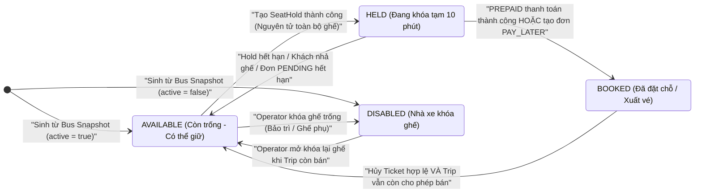
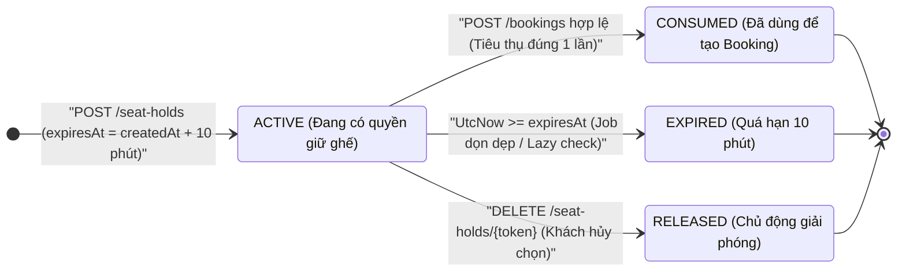
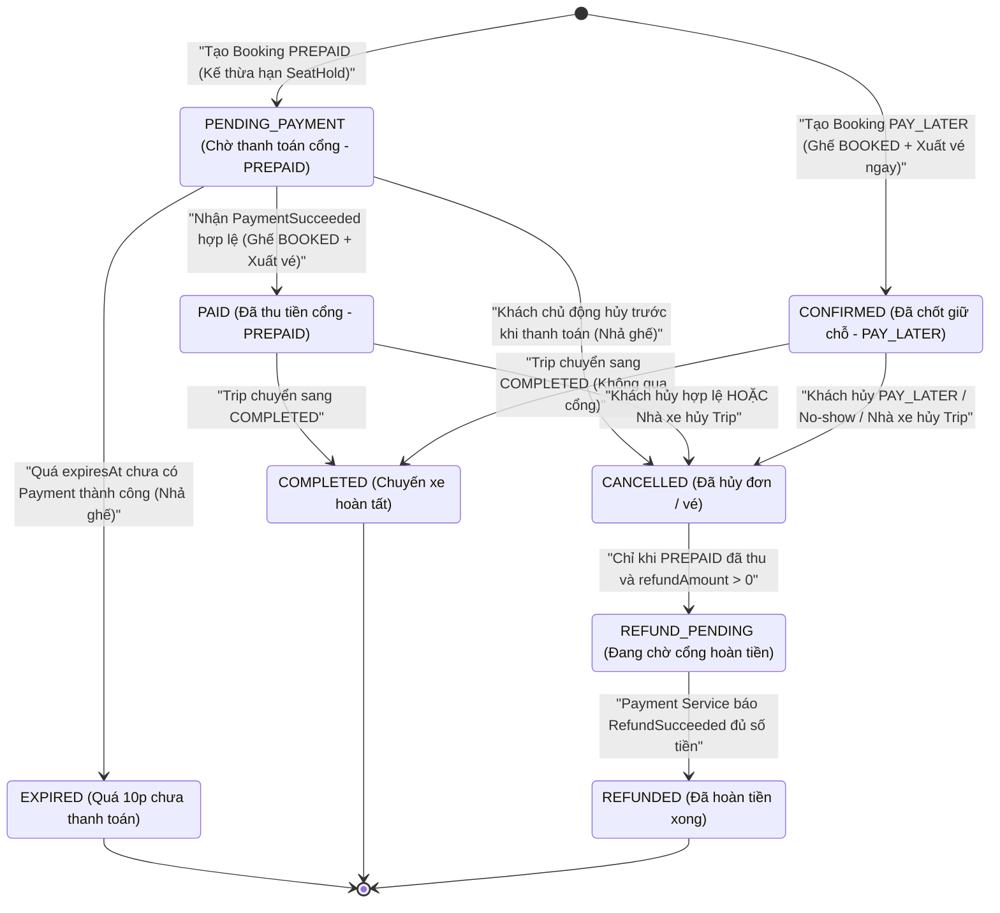
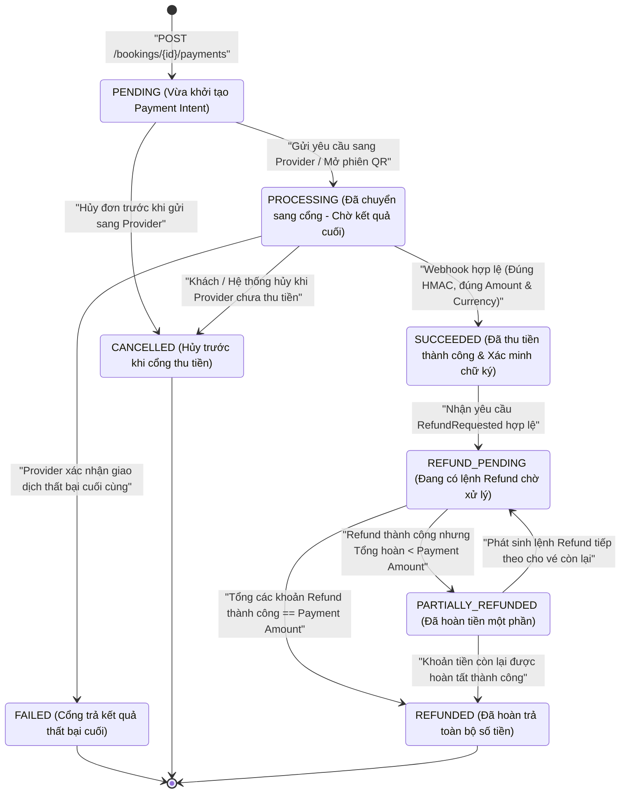
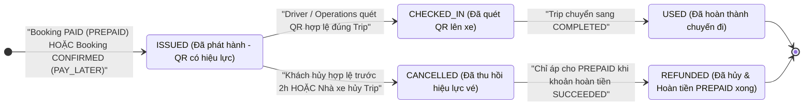
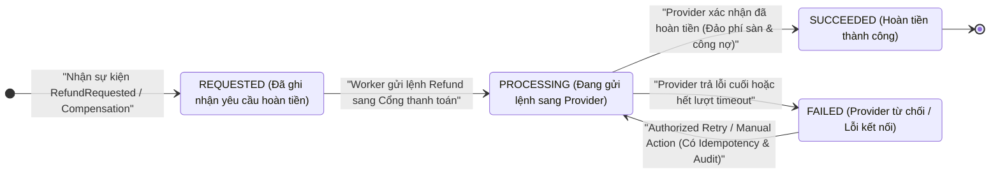

# Chương 03 — Lý Thuyết & Giải Phẫu Chi Tiết 7 Máy Trạng Thái Hữu Hạn (Finite State Machines)

> **Thuộc bộ tài liệu:** Cẩm Nang Thuyết Trình Toàn Diện — Dự án **BLUE Bus Ticket Platform (PBL6)**  
> **Tài liệu nguồn đối chiếu:** [06-yeu-cau-trang-thai.md](../../../srs/v2/06-yeu-cau-trang-thai.md) · [11-phu-luc.md](../../../srs/v2/11-phu-luc.md) · [001_initial.sql (Booking)](../../../database/booking/001_initial.sql) · [001_initial.sql (Payment)](../../../database/payment/001_initial.sql) · [001_initial.sql (Transport)](../../../database/transport/001_initial.sql)

---

## Mở Đầu: Tại Sao Hệ Thống Giao Dịch Tài Chính Phải Sống Bằng Máy Trạng Thái?

Hãy thử tưởng tượng một tình huống kinh hoàng nhưng cực kỳ phổ biến trong các đồ án thiếu kiểm soát trạng thái:
1. Hành khách mua vé `350.000đ`, bước lên xe, tài xế đã quét mã QR cho khách ngồi yên vị trên giường và xe đang chạy giữa đèo Hải Vân.
2. Ngồi trên xe rảnh rỗi, vị khách mở ứng dụng điện thoại bấm thử nút *"Hủy vé"* (hoặc gọi thẳng API hủy bằng Postman) -> Hệ thống thấy vé đó `isPaid == true` nên hồn nhiên hoàn lại `315.000đ` vào tài khoản ngân hàng cho một người đang thực sự nằm trên xe!
3. Tệ hơn nữa, nếu cổng thanh toán gửi nhầm hai lần thông báo lỗi sau khi đã báo thành công, hệ thống ghi đè trạng thái thanh toán về thất bại khiến kế toán đối soát thiếu hụt tiền mặt!

Tất cả những thảm họa trên đều bắt nguồn từ việc lập trình viên quản lý vòng đời thực thể một cách tùy tiện. Trong **BLUE Bus Ticket Platform**, toàn bộ vòng đời của chuyến xe, chiếc ghế, phiên giữ chỗ, đơn đặt vé, khoản thanh toán, tấm vé điện tử và lệnh hoàn tiền đều được khóa chặt bằng **7 Máy Trạng Thái Hữu Hạn (Finite State Machines — FSM)**. Chương này sẽ giúp bạn thấu hiểu từ lý thuyết gốc đến từng ràng buộc `CHECK` trong PostgreSQL bảo vệ 7 cỗ máy này.

---

## Phần 1: Nền Tảng Lý Thuyết — Finite State Machine (FSM) vs "Bẫy Cờ Boolean Rời Rạc"

### 1.1. Sai Lầm Kinh Điển: Tại Sao Không Dùng Biến Boolean `isPaid`, `isCancelled`, `isRefunded`?

Khi mới học thiết kế cơ sở dữ liệu, nhiều người thường thêm các cột kiểu `boolean` vào bảng `bookings` mỗi khi phát sinh yêu cầu mới:
- Tuần 1 làm thanh toán -> thêm cột `is_paid boolean`.
- Tuần 2 làm hết hạn giữ ghế -> thêm cột `is_expired boolean`.
- Tuần 3 làm hủy đơn -> thêm cột `is_cancelled boolean`.
- Tuần 4 làm hoàn tiền -> thêm cột `is_refunded boolean`.
- Tuần 5 làm hoàn tất chuyến -> thêm cột `is_completed boolean`.

Hãy tính toán bằng Tổ hợp toán học: với $5$ biến boolean độc lập, bảng dữ liệu của bạn có tới $2^5 = \mathbf{32\text{ tổ hợp trạng thái}}$ có thể xảy ra, trong khi thực tế nghiệp vụ chỉ có **7–8 trạng thái hợp lệ**! Hơn 24 tổ hợp còn lại là những **"trạng thái quái thai" (Impossible / Corrupted States)** mà không ai giải thích nổi ý nghĩa:
- Điều gì xảy ra nếu một dòng dữ liệu có `is_paid = false`, `is_cancelled = false`, nhưng **`is_refunded = true`**? (Chưa thu tiền chưa hủy đơn nhưng đã đem tiền của sàn đi hoàn cho khách!).
- Điều gì xảy ra nếu `is_paid = true` và **`is_expired = true`** cùng lúc do tiến trình quét đơn hết hạn chạy song song với tiến trình nhận Webhook ngân hàng?
- Mỗi câu lệnh `if-else` ở tầng C# sẽ biến thành một rừng điều kiện rối rắm: `if (booking.IsPaid && !booking.IsCancelled && !booking.IsRefunded && !booking.IsExpired && !booking.IsCompleted)`. Chỉ cần một thành viên trong nhóm quên kiểm tra 1 trong 5 cờ ở một API phụ, lỗ hổng tài chính lập tức xuất hiện!

### 1.2. Bản Chất Toán Học Của Finite State Machine (FSM) Trong Kỹ Thuật Phần Mềm

Thay vì dùng hàng loạt cờ boolean rời rạc, **Máy trạng thái hữu hạn (FSM)** mô hình hóa vòng đời của một thực thể thành một bộ 5 thành phần chặt chẽ $(S, s_0, F, \Sigma, \delta)$:

1. **$S$ (Tập trạng thái hữu hạn — Finite Set of States):** Một cột `status` duy nhất chỉ được mang đúng một giá trị thuộc tập danh sách đóng đã định nghĩa (ví dụ với `SeatHold`: `ACTIVE`, `CONSUMED`, `EXPIRED`, `RELEASED`). Tại một thời điểm, thực thể **chỉ ở đúng 1 trạng thái duy nhất** — triệt tiêu 100% trạng thái mâu thuẫn!
2. **$s_0 \in S$ (Trạng thái khởi tạo — Initial State):** Điểm xuất phát bắt buộc khi bản ghi vừa sinh ra (ví dụ `Ticket` luôn sinh ra ở `ISSUED`).
3. **$F \subseteq S$ (Tập trạng thái kết thúc — Terminal / Absorbing States):** Khi thực thể đã đi vào trạng thái kết thúc (như `SeatHold = EXPIRED` hay `Ticket = USED`), mọi nỗ lực chuyển tiếp đi nơi khác đều bị chặn đứng vĩnh viễn.
4. **$\Sigma$ (Tập sự kiện / Lệnh kích hoạt — Events & Commands):** Các tác động từ Actor hoặc Hệ thống ngoài kèm theo **Điều kiện canh gác (Guard Conditions)** — ví dụ lệnh `CheckIn` đòi hỏi người gọi phải là `DRIVER` được phân công, đúng `tripId` và chữ ký QR hợp lệ.
5. **$\delta: S \times \Sigma \to S$ (Hàm chuyển trạng thái — Transition Function):** Bảng luật chỉ rõ *từ trạng thái A gặp sự kiện E thì được sang trạng thái B*. **Mọi cặp $(s, e)$ không nằm trong bảng luật đều bị từ chối thẳng thừng bằng mã lỗi chuẩn `409 INVALID_STATE_TRANSITION`!**

### 1.3. Kiến Trúc Phòng Thủ 3 Lớp Cho Máy Trạng Thái Trong BLUE

Để đảm bảo không một lỗi lập trình hay cuộc tấn công đồng thời (Race Condition) nào phá vỡ được FSM, dự án BLUE triển khai **3 lớp khóa bảo vệ đồng tâm** ([06-yeu-cau-trang-thai.md mục 6.8](../../../srs/v2/06-yeu-cau-trang-thai.md#L135-L142)):

- **Lớp 1 — Application Guard & Optimistic Concurrency (`row_version`):** Trước khi chuyển trạng thái, tầng Application kiểm tra quyền `Actor`, kiểm tra trạng thái nguồn hiện tại (`if (ticket.Status != "ISSUED") return InvalidStateTransition()`) và kiểm tra phiên bản chống ghi đè đồng thời `row_version == expectedVersion`. Khi cập nhật SQL, hệ thống luôn kèm điều kiện `WHERE id = @id AND status = @expectedOldStatus AND row_version = @ver` đồng thời tăng `row_version = row_version + 1`.
- **Lớp 2 — Ràng buộc Bất biến Cứng trong PostgreSQL (`CHECK` Constraints):** Đây là bức tường thép cuối cùng! Không chỉ kiểm tra tên trạng thái (`status IN (...)`), các bảng SQL của BLUE còn kiểm tra **bất biến chéo giữa cột `status` với các cột mốc thời gian và khóa sở hữu** (ví dụ: ở trạng thái `PAID` thì bắt buộc `paid_at IS NOT NULL AND cancelled_at IS NULL`). Dù ai đó viết nhầm code C# cập nhật thiếu `paid_at` hoặc đẩy đơn `PAY_LATER` sang `REFUNDED`, PostgreSQL sẽ lập tức hủy bỏ Transaction!
- **Lớp 3 — Idempotency & Transactional Outbox/Inbox:** Nếu mạng chập chờn khiến Client gửi lặp lệnh hủy hoặc RabbitMQ giao lặp sự kiện `PaymentSucceeded`, bộ lọc `idempotency_records` và `inbox_messages` sẽ nhận diện ngay lập tức, trả về kết quả cũ mà **không chạy hàm chuyển trạng thái lần thứ hai**.

---

## Phần 2: Giải Phẫu Chi Tiết 7 Máy Trạng Thái Nghiệp Vụ Cốt Lõi

---

### Máy Trạng Thái Số 1: `Trip` — Vòng Đời Chuyến Xe Vận Hành

- **Microservice làm chủ (Single Writer):** `Transport Service (:5082)` trên bảng `transport_db.trips` (và đồng bộ bản sao đọc sang `booking_db.trip_snapshots` qua sự kiện RabbitMQ).
- **Ý nghĩa cốt lõi:** Điều khiển toàn bộ hành trình của một chuyến xe từ lúc nhân viên điều độ nháp lịch trên giấy tờ cho đến khi xe trả hết khách tại bến cuối hoặc bị hủy do sự cố.

```mermaid
stateDiagram-v2
    direction LR
    state "DRAFT (Nháp nội bộ Transport)" as DRAFT
    state "SCHEDULED (Đã mở bán)" as SCHEDULED
    state "BOARDING (Đang đón khách)" as BOARDING
    state "DEPARTED (Đã xuất bến)" as DEPARTED
    state "IN_TRANSIT (Đang trên đường)" as IN_TRANSIT
    state "ARRIVED (Đã tới bến đích)" as ARRIVED
    state "COMPLETED (Hoàn tất chuyến)" as COMPLETED
    state "CANCELLED (Đã hủy chuyến)" as CANCELLED

    [*] --> DRAFT : "Operator tạo chuyến nháp"
    DRAFT --> SCHEDULED : "Publish Trip (Đủ xe, tài xế, giá, snapshot)"
    SCHEDULED --> BOARDING : "Tới giờ đón khách (Driver / Operations)"
    BOARDING --> DEPARTED : "Xe rời bến (Đóng bán vé hoàn toàn)"
    DEPARTED --> IN_TRANSIT : "Xe di chuyển trên tuyến"
    IN_TRANSIT --> ARRIVED : "Xe cập bến đích"
    ARRIVED --> COMPLETED : "Hoàn tất trả khách & Chốt vé USED"

    SCHEDULED --> CANCELLED : "Operator / Admin hủy (Bắt buộc có Reason)"
    BOARDING --> CANCELLED : "Operator / Admin hủy khẩn cấp trước giờ lăn bánh"

    COMPLETED --> [*]
    CANCELLED --> [*]
```



#### Phân tích từng trạng thái & điều kiện chuyển tiếp hợp lệ
1. **`DRAFT` -> `SCHEDULED` (Bước nhảy Publish quan trọng nhất):**
   - Trong `transport_db.trips`, chuyến mới tạo nằm ở `DRAFT` (`sellable = false`), khách hàng tìm kiếm hoàn toàn chưa thấy chuyến này (bảng `booking_db.trip_snapshots` thậm chí chưa nhận các chuyến `DRAFT`, nên trong SRS Chương 6 vòng đời giao dịch công khai bắt đầu tính từ `SCHEDULED`).
   - Chỉ khi `OPERATOR_SCHEDULER` / `OPERATOR_ADMIN` bấm mở bán, thỏa mãn: xe `ACTIVE`, bằng lái tài xế chưa hết hạn, không vi phạm `ex_bus_schedule` / `ex_driver_schedule`, chuyến mới chuyển sang `SCHEDULED`, đóng băng 3 cột JSONB (`route_snapshot`, `bus_snapshot`, `fare_policy_snapshot`) và sinh kho ghế bên Booking.
2. **Chuỗi tiến trình một chiều `SCHEDULED -> BOARDING -> DEPARTED -> IN_TRANSIT -> ARRIVED -> COMPLETED`:**
   - Do `DRIVER` được phân công hoặc `OPERATOR_OPERATIONS` kích hoạt tuần tự.
   - Chú ý cột cờ bán vé `sellable`: Khi đang ở `SCHEDULED` hoặc `BOARDING` (xe đang đậu ở bến đón khách, vẫn còn giường trống cho khách mua vé giờ chót), `sellable` có thể là `true`. Ngay giây phút chuyển sang **`DEPARTED`**, `sellable` bắt buộc về `false` (`BR-BOOK-009`).
3. **Nhánh hủy chuyến `SCHEDULED / BOARDING -> CANCELLED`:**
   - Chỉ dành cho `OPERATOR_OPERATIONS`, `OPERATOR_ADMIN` hoặc `PLATFORM_ADMIN`, bắt buộc truyền `reason`, ghi nhận Audit và kích hoạt quy trình `BP-06` hoàn 100% vé `PREPAID`.

#### Các chuyển đổi bị cấm & Ràng buộc bất biến trong DB
- **Cấm nhảy cóc hoặc đi lùi:** Không thể chuyển từ `SCHEDULED` nhảy thẳng sang `COMPLETED` (bỏ qua xuất bến), hay từ `DEPARTED` lùi ngược về `BOARDING` -> Ném `409 INVALID_STATE_TRANSITION`.
- **Cấm hủy thông thường sau khi xe đã chạy (`DEPARTED -> CANCELLED` bị khóa):** Khi xe đã lăn bánh chở khách rời bến, nhân viên không thể bấm nút hủy chuyến thông thường để tránh hỗn loạn tài chính; nếu xe hỏng dọc đường cần chuyển tải sang xe khác, phải qua quy trình xử lý sự cố đặc biệt có phê duyệt cấp cao.
- **Ràng buộc SQL bảo vệ trực tiếp trong `transport_db.trips` & `booking_db.trip_snapshots`:**
  ```sql
  constraint ck_trips_sellable check (not sellable or status in ('SCHEDULED', 'BOARDING'))
  ```
  Không một câu lệnh lỗi nào có thể bật `sellable = true` cho một chuyến xe đã `DEPARTED`, `COMPLETED` hay `CANCELLED`!

---

### Máy Trạng Thái Số 2: `TripSeat` — Trạng Thái Kho Ghế Theo Từng Chuyến

- **Microservice làm chủ:** `Booking Service (:5083)` trên bảng `booking_db.trip_seats`.
- **Ý nghĩa cốt lõi:** Bảo vệ bất biến sống còn số 1 của dự án (`GOAL-002`, `QA-01`): **Một chiếc ghế trên một chuyến xe tại mọi thời điểm chỉ thuộc về tối đa 1 phiên giữ chỗ hoặc 1 hành khách hợp lệ.**

> [!WARNING]
> **Phân biệt cực kỳ quan trọng khi vấn đáp (`BR-SEAT-002`):**  
> Trên giao diện React / Mobile App, bạn thấy ghế có 5 màu sắc, trong đó có màu **"Đang chọn (`SELECTED`)"**. Hãy nhớ kỹ: **`SELECTED` CHỈ LÀ TRẠNG THÁI HIỂN THỊ CỤC BỘ Ở TẦNG UI CLIENT**, hoàn toàn không tồn tại trong cơ sở dữ liệu hay API của Server! Khi người dùng A vừa bấm chuột vào ghế `A01` (hiện màu `SELECTED` trên máy của A) nhưng chưa bấm nút *"Tiếp tục giữ ghế"*, trên Server ghế `A01` vẫn đang là `AVAILABLE` — nếu người dùng B nhanh tay bấm giữ ghế trước, B sẽ lấy được quyền `HELD` hợp pháp!



#### Phân tích từng mũi tên chuyển tiếp & Các lệnh bị cấm
1. **`AVAILABLE <-> HELD`:** Khi tạo `SeatHold`, mọi ghế trong danh sách yêu cầu phải cùng chuyển từ `AVAILABLE` sang `HELD` trong một Transaction duy nhất, đồng thời cột `active_hold_id` trỏ thẳng tới UUID của `SeatHold` đó. Khi `SeatHold` hết hạn 10 phút (`EXPIRED`), khách chủ động nhả (`RELEASED`), hoặc đơn `PREPAID` quá hạn thanh toán, ghế quay về `AVAILABLE` và xóa `active_hold_id = NULL` (chỉ khi chuyến xe còn bán).
2. **`HELD -> BOOKED`:** Xảy ra ở 2 thời điểm tùy kênh hợp đồng:
   - Với `PAY_LATER`: Chuyển ngay khi tạo `Booking` (`CONFIRMED`).
   - Với `PREPAID`: Chuyển khi `Booking Service` xử lý sự kiện `PaymentSucceeded`.
   Khi sang `BOOKED`, cột `active_hold_id` được xóa về `NULL` và cột `active_booking_item_id` được gán bằng UUID của `booking_items` sở hữu ghế đó!
3. **`BOOKED -> AVAILABLE`:** Chỉ xảy ra duy nhất khi chiếc vé gắn với ghế đó bị hủy hợp lệ (`BP-02`) và chuyến xe vẫn đang mở bán (`SCHEDULED` / `BOARDING`).
4. **Các chuyển đổi bị cấm tuyệt đối:**
   - **Cấm `AVAILABLE -> BOOKED` trực tiếp (nhảy qua `HELD`):** Mọi đơn đặt vé bắt buộc phải đi từ một `SeatHold` hợp lệ (`BR-BOOK-002`).
   - **Cấm `HELD / BOOKED -> DISABLED`:** Nhà xe không được phép khóa bảo trì một chiếc ghế đang có khách giữ chỗ hoặc đã bán vé (`409 INVALID_STATE_TRANSITION`).
   - **Cấm `BOOKED -> AVAILABLE` do hết TTL Cache (`BR-SEAT-024`):** Một khi ghế đã `BOOKED`, dù Redis có khởi động lại hay `SeatHold` cũ đã quá 10 phút từ lâu, ghế `BOOKED` tuyệt đối bất khả xâm phạm!

#### Ràng buộc bất biến "Thép" trong PostgreSQL (`ck_trip_seat_owner`)
Hãy chiêm ngưỡng đoạn SQL tại dòng 48–53 của [001_initial.sql (Booking)](../../../database/booking/001_initial.sql#L48-L53) — đây là đoạn code SQL đáng tự hào nhất khi trình chiếu trước hội đồng:

```sql
constraint ck_trip_seat_owner check (
  (status = 'AVAILABLE' and active_hold_id is null     and active_booking_item_id is null) or
  (status = 'HELD'      and active_hold_id is not null and active_booking_item_id is null) or
  (status = 'BOOKED'    and active_hold_id is null     and active_booking_item_id is not null) or
  (status = 'DISABLED'  and active_hold_id is null     and active_booking_item_id is null)
)
```

Nhìn vào 4 dòng điều kiện loại trừ tương hỗ (Mutually Exclusive) này, bạn thấy rõ: **Không bao giờ tồn tại một chiếc ghế `HELD` vô chủ, không bao giờ có một chiếc ghế vừa `HELD` bởi người A vừa `BOOKED` bởi người B, và không bao giờ hai người cùng trỏ vào một dòng `trip_seats`!**

---

### Máy Trạng Thái Số 3: `SeatHold` — Phiên Giữ Chỗ Có Thời Hạn Cứng 10 Phút

- **Microservice làm chủ:** `Booking Service (:5083)` trên bảng `booking_db.seat_holds`.
- **Ý nghĩa cốt lõi:** Đại diện cho "quyền ưu tiên tạm thời" trong đúng **10 phút** dành cho một `CUSTOMER` đã đăng nhập để điền tên hành khách và thanh toán mà không sợ người khác cướp mất ghế giữa chừng.



#### Phân tích quy tắc vận hành & Ràng buộc bất biến
1. **Cấu trúc "1 Gốc — 3 Đích Kết Thúc" (Single-Step Terminal Machine):**
   - `SeatHold` sinh ra ở `ACTIVE` và chỉ có đúng **1 lần bước đi duy nhất** sang một trong 3 trạng thái cuối (`CONSUMED`, `EXPIRED`, `RELEASED`). Đã rời khỏi `ACTIVE` là kết thúc vĩnh viễn vòng đời của `holdToken` đó!
   - Lưu ý: Khi khách còn đang trong hạn `ACTIVE` và muốn đổi sang ghế khác trên cùng chuyến (`ReplaceHoldAsync`), hệ thống cập nhật danh sách ghế bên trong phiên `ACTIVE` hiện hữu mà **vẫn giữ nguyên mốc `expires_at` ban đầu** — không sinh thêm 10 phút mới!
2. **Cơ chế thu hồi ghế kép (Dual Expiration Strategy — `BR-SEAT-008`):**
   - Nhiều người thắc mắc: *"Nếu cronjob dọn ghế chạy mỗi 1 phút một lần, vậy từ phút `10:01` đến `10:59` ghế hết hạn vẫn bị kẹt à?"*.
   - Câu trả lời trong `BookingService.cs`: Hệ thống áp dụng **Lazy Expiration trước mọi thao tác đọc/ghi** (`await store.ExpireHoldsAsync(ct)` được gọi ngay đầu `GetSeatsAsync`, `CreateHoldAsync`, `CreateBookingAsync`, `QuoteCouponAsync`!). Nghĩa là đúng giây `10:00.001`, hễ có bất kỳ ai mở sơ đồ ghế hoặc đặt mua ghế đó, phiên giữ cũ lập tức bị quét sang `EXPIRED` và nhả ghế về `AVAILABLE` ngay tức khắc mà không trễ dù chỉ 1 giây!
3. **Hai ràng buộc SQL khóa chặt gian lận thời gian:**
   - `ck_seat_holds_expiry`: `CHECK (expires_at = created_at + interval '10 minutes')` — Không một đoạn code nào có thể lén tạo một phiên giữ ghế dài 30 phút hay 2 tiếng!
   - `ck_seat_holds_terminal_time` + `uq_bookings_hold UNIQUE (seat_hold_id)`: Đảm bảo một `SeatHold` chỉ có thể chuyển sang `CONSUMED` (`consumed_at IS NOT NULL`) cho **tối đa đúng 1 `Booking` duy nhất**!

---

### Máy Trạng Thái Số 4: `Booking` — Đơn Đặt Chỗ Hai Nhánh Hợp Đồng (`PREPAID` vs `PAY_LATER`)

- **Microservice làm chủ:** `Booking Service (:5083)` trên bảng `booking_db.bookings`.
- **Ý nghĩa cốt lõi:** Đây là máy trạng thái trung tâm và thú vị nhất của hệ thống vì nó **phân nhánh thành 2 lộ trình tách biệt** tùy theo việc đơn hàng được ký theo hợp đồng `PREPAID` hay `PAY_LATER`.



#### Giải phẫu các quy luật chuyển tiếp & Chốt chặn an toàn trên `Booking`
1. **Hai điểm khởi sinh độc lập từ `[*]`:**
   - Nếu `paymentChannel == 'PREPAID'`: Đơn bắt đầu tại `PENDING_PAYMENT`. Nếu quá `expiresAt` (10 phút từ lúc giữ ghế) mà chưa nhận được xác nhận thanh toán -> chuyển sang trạng thái cuối `EXPIRED` và giải phóng toàn bộ ghế về `AVAILABLE`.
   - Nếu `paymentChannel == 'PAY_LATER'`: Đơn nhảy thẳng từ `[*]` vào **`CONFIRMED`**! Nó không bao giờ đi qua `PENDING_PAYMENT`, không bao giờ bị `EXPIRED` do cổng thanh toán, và cũng **không bao giờ chuyển sang `PAID`** (`BR-BOOK-012`, `BR-PAY-002`).
2. **Điểm rẽ nhánh sau `CANCELLED`:**
   - Với đơn `CONFIRMED` (`PAY_LATER`) hoặc đơn `PENDING_PAYMENT` bị hủy trước khi trả tiền: **`CANCELLED` chính là điểm dừng cuối cùng** (vì sàn chưa thu đồng nào qua cổng nên không có gì để hoàn!).
   - Chỉ với đơn `PAID` (`PREPAID`) bị hủy mà số tiền được hoàn `refundAmount > 0`: Đơn bước tiếp từ `CANCELLED -> REFUND_PENDING`, và khi cổng thanh toán xác nhận đã trả đủ tiền cho khách thì cập nhật điểm đích cuối cùng là **`REFUNDED`**.
3. **Các chuyển đổi bị cấm & Ràng buộc SQL kiểm chứng chéo:**
   - **Cấm sửa hành khách/ghế khi đã `PAID` hoặc `CONFIRMED` (`BR-BOOK-008`):** Đã chốt hợp đồng vận chuyển thì không được lén đổi tên người đi hay đổi mã ghế trực tiếp trên đơn.
   - **Cấm hồi sinh đơn `EXPIRED`:** Nếu đơn đã sang `EXPIRED` mà tiền ngân hàng về trễ, hệ thống **không đẩy ngược `EXPIRED -> PAID`** mà giữ nguyên `EXPIRED` và phát lệnh hoàn tiền bù trừ (`PAYMENT_AFTER_BOOKING_CLOSED`).
   - **Ràng buộc SQL phân luồng tuyệt đối trong `booking_db.bookings` ([001_initial.sql dòng 142–154](../../../database/booking/001_initial.sql#L142-L154)):**
     ```sql
     constraint ck_bookings_channel_status check (
       (payment_channel = 'PREPAID' and status in ('PENDING_PAYMENT','PAID','EXPIRED','CANCELLED','REFUND_PENDING','REFUNDED','COMPLETED'))
       or (payment_channel = 'PAY_LATER' and status in ('CONFIRMED','CANCELLED','COMPLETED'))
     )
     ```
     Đoạn SQL này chứng minh với hội đồng rằng: **Một đơn `PAY_LATER` về mặt vật lý không bao giờ có thể lọt vào trạng thái `REFUND_PENDING` hay `REFUNDED`!**

---

### Máy Trạng Thái Số 5: `Payment` — Giao Dịch Cổng Thanh Toán & Đối Soát Hoàn Tiền Một Phần

- **Microservice làm chủ:** `Payment Service (:5084)` trên bảng `payment_db.payments` (chỉ sinh ra đối với đơn `PREPAID`; mỗi đơn có tối đa 1 bản ghi `payments` thông qua `uq_payments_booking`, bên dưới có thể có nhiều lần thử `payment_attempts`).
- **Ý nghĩa cốt lõi:** Theo dõi trung thực từng nhịp đập của dòng tiền thật với cổng thanh toán ngoài (SePay VietQR), từ lúc khởi tạo lệnh thu cho đến khi hoàn tiền một phần hoặc toàn bộ.



#### Ba nguyên tắc "Sống còn" của Máy Trạng Thái `Payment` khi tích hợp Ngân hàng:
1. **`PROCESSING` là vùng "Chưa chắc chắn", tuyệt đối không được coi là `FAILED`:**
   - Khi khách hàng vừa quét QR chuyển khoản xong nhưng kết nối liên ngân hàng NAPAS bị nghẽn 15 giây, `Payment` nằm ở `PROCESSING`. Lúc này API trả mã **`202 PAYMENT_PROCESSING`** để giao diện hiển thị vòng xoay chờ (polling có giãn cách backoff). Nếu lập trình viên nôn nóng đánh dấu `FAILED` ngay khi hết 5 giây timeout HTTP, khách sẽ bị trừ tiền thật trong tài khoản nhưng giao dịch trên sàn lại báo hỏng!
2. **`SUCCEEDED` là chốt chặn một chiều (Irreversible Ratchet):**
   - Theo quy tắc `SRS 6.4`, một khi `Payment` đã bước vào `SUCCEEDED` (tiền đã xác nhận vào cổng, vé đã xuất), nếu sau đó cổng thanh toán bất ngờ gửi nhầm một gói tin trễ báo `FAILED` hoặc mâu thuẫn dữ liệu, hệ thống **CẤM TUYỆT ĐỐI đổi ngược `SUCCEEDED -> FAILED`**! Thay vào đó, `Payment Service` giữ nguyên trạng thái `SUCCEEDED` và tự động mở một hồ sơ đối soát khẩn cấp trong bảng `reconciliation_cases` (`status = 'OPEN'`, `severity = 'HIGH'/'CRITICAL'`) để chuyên viên `PLATFORM_FINANCE` kiểm tra trực tiếp sao kê ngân hàng.
3. **Hỗ trợ hoàn tiền nhiều đợt (`PARTIALLY_REFUNDED`):**
   - Ví dụ đơn `Booking` mua 2 vé tổng `700.000đ` (`Payment.Amount = 700.000đ`). Sáng thứ Hai khách hủy 1 vé và được hoàn `315.000đ` (`315.000 < 700.000`) -> `Payment` chuyển sang `PARTIALLY_REFUNDED`. Chiều thứ Ba nhà xe gặp sự cố hủy nốt chuyến xe hoặc hoàn tiếp phần còn lại cho tới khi chạm trần `700.000đ` -> `Payment` chuyển sang `REFUNDED`.
4. **Ràng buộc SQL bảo vệ nhất quán thời gian (`ck_payments_state_time`):**
   ```sql
   constraint ck_payments_state_time check (
     (status in ('SUCCEEDED','REFUND_PENDING','PARTIALLY_REFUNDED') and succeeded_at is not null and failed_at is null and cancelled_at is null and refunded_at is null) or
     (status = 'REFUNDED'  and succeeded_at is not null and failed_at is null and cancelled_at is null and refunded_at is not null) or
     (status = 'FAILED'    and failed_at is not null and succeeded_at is null and cancelled_at is null) or
     (status = 'CANCELLED' and cancelled_at is not null and succeeded_at is null and failed_at is null) or
     (status in ('PENDING','PROCESSING') and succeeded_at is null and failed_at is null and cancelled_at is null and refunded_at is null)
   )
   ```

---

### Máy Trạng Thái Số 6: `Ticket` — Quyền Lên Xe & Chống Gian Lận Quét Lặp QR

- **Microservice làm chủ:** `Booking Service (:5083)` trên bảng `booking_db.tickets`.
- **Ý nghĩa cốt lõi:** Đại diện cho "tấm hộ chiếu lên xe" của đúng 1 hành khách tại đúng 1 ghế trên 1 chuyến xe. Đây là lá chắn trực tiếp ngăn chặn cả gian lận quét 1 vé cho 2 người lên xe lẫn gian lận đi xe xong đòi hủy vé hoàn tiền!



#### Sự phân đôi hoàn hảo của vòng đời `Ticket`
Hãy nhìn vào sơ đồ trên: Từ điểm gốc `ISSUED`, tấm vé chỉ có thể rẽ vào **1 trong 2 con đường một chiều không bao giờ gặp lại nhau**:

1. **Con đường Vận hành Thực địa (`ISSUED -> CHECKED_IN -> USED`):**
   - Ngay khoảnh khắc tài xế quét mã QR tại cửa xe và vé bước sang **`CHECKED_IN`**, cánh cửa quay sang `CANCELLED` bị đóng sập vĩnh viễn (`BR-CANCEL-003`)! Hành khách đã bước chân lên xe thì không bao giờ có thể mở app tự bấm hủy vé để trục lợi.
   - Nếu cùng mã QR đó bị đưa vào camera quét lần thứ hai: Hệ thống thấy `ticket.Status != "ISSUED"`, lập tức từ chối tạo chuyển đổi mới và trả về mã lỗi riêng biệt **`409 TICKET_ALREADY_CHECKED_IN`** kèm theo dấu thời gian `checked_in_at` của lần quét đầu tiên (`BR-TICKET-003`).
   - Khi chuyến xe cập bến và chuyển sang `COMPLETED`, tất cả vé `CHECKED_IN` chuyển sang trạng thái kết thúc **`USED`** (mở khóa quyền đánh giá chuyến đi `Review`).

2. **Con đường Thu hồi & Hoàn tiền (`ISSUED -> CANCELLED -> REFUNDED`):**
   - Ngay khi bước sang **`CANCELLED`**, mã QR của tấm vé lập tức bị vô hiệu hóa hoàn toàn (hàm `MapTicket` trong `BookingService.cs` chỉ đính kèm `QrPayload` khi `ticket.Status == "ISSUED"`!). Dù hành khách có chụp ảnh màn hình mã QR từ hôm qua mang ra bến quét, máy của tài xế sẽ báo vé đã hủy ngay lập tức.
   - **Điểm dừng theo kênh hợp đồng:**
     - Nếu vé là **`PAY_LATER`**: Vòng đời kết thúc ngay tại **`CANCELLED`**!
     - Nếu vé là **`PREPAID`** và có tiền hoàn: Sau khi `Payment Service` hoàn tiền thành công, vé tiến thêm bước cuối cùng sang **`REFUNDED`**.
   - Điều này được khóa cứng bằng ràng buộc SQL `ck_tickets_refund_channel` trong [001_initial.sql (Booking) dòng 221–223](../../../database/booking/001_initial.sql#L221-L223):
     ```sql
     constraint ck_tickets_refund_channel check (
       payment_channel = 'PREPAID' or status <> 'REFUNDED'
     )
     ```

---

### Máy Trạng Thái Số 7: `Refund` — Yêu Cầu Hoàn Tiền Với Vòng Lặp Cứu Hộ Có Kiểm Soát

- **Microservice làm chủ:** `Payment Service (:5084)` trên bảng `payment_db.refunds`.
- **Ý nghĩa cốt lõi:** Đảm bảo mọi khoản tiền phải trả lại cho hành khách đều được theo dõi đến cùng, không bao giờ hoàn trùng hai lần và **có cơ chế thử lại an toàn khi cổng ngân hàng bảo trì tạm thời**.



#### Tại sao `Refund` là máy trạng thái duy nhất có vòng lặp `FAILED -> PROCESSING`?
Hãy so sánh sự tinh tế trong thiết kế giữa `Booking` và `Refund`:
- Khi khách đang đặt mua vé mới mà thanh toán `Payment = FAILED`, khách chỉ cần thao tác thanh toán lại hoặc đặt đơn mới.
- Nhưng với **`Refund`**, tấm vé của khách bên `Booking Service` **ĐÃ BỊ HỦY (`CANCELLED`) và chiếc ghế đã được mở bán cho người khác mua mất rồi**! Nếu đúng lúc đêm khuya cổng thanh toán ngân hàng bảo trì khiến lệnh hoàn tiền rơi vào `FAILED`, chúng ta có được khôi phục lại tấm vé cho khách không?
  - **Quy tắc bất khả xâm phạm (`SRS 6.6`):** **`Refund = FAILED` TUYỆT ĐỐI KHÔNG TỰ KHÔI PHỤC `Ticket`!** Bởi vì ghế có thể đã bán cho người khác, và khách hàng cũng đã đinh ninh mình hủy chuyến rồi nên không ra bến xe nữa — tự ý khôi phục vé sẽ gây thảm họa kép!
  - Thay vào đó, nghĩa vụ nợ tiền khách của Sàn vẫn còn nguyên. Vì vậy, máy trạng thái `Refund` cho phép chuyên viên `PLATFORM_FINANCE` hoặc tiến trình cứu hộ có thẩm quyền kích hoạt mũi tên đặc biệt **`FAILED -> PROCESSING`** để thực hiện gửi lại lệnh hoàn tiền trên **cùng một bản ghi `Refund` logic cũ** (được khóa bởi `uq_refund_logical_reference UNIQUE (payment_id, refund_reference)` để ngân hàng không bao giờ trừ tiền đúp 2 lần), cho đến khi tiền về tài khoản khách và đạt đích `SUCCEEDED`!

---

## Phần 3: Bảng Giao Hưởng Liên Thực Thể (Cross-Entity State Choreography Matrix)

Trong kiến trúc Microservices của BLUE, 7 máy trạng thái không đứng cô lập mà chuyển động ăn khớp với nhau như những bánh răng đồng hồ thông qua các sự kiện RabbitMQ. Bảng dưới đây tóm tắt cách một tác động nghiệp vụ làm dịch chuyển đồng bộ cả 7 thực thể:

| Sự Kiện Nghiệp Vụ Xảy Ra | `Trip` | `TripSeat` | `SeatHold` | `Booking` | `Payment` | `Ticket` | `Refund` |
|---|---|---|---|---|---|---|---|
| **1. Mở bán chuyến xe (`BP-04`)** | `DRAFT -> SCHEDULED` | Sinh mới `AVAILABLE` / `DISABLED` | — | — | — | — | — |
| **2. Khách bấm Giữ ghế (`BP-01`)** | `SCHEDULED` | `AVAILABLE -> HELD` | Sinh mới **`ACTIVE`** (10p) | — | — | — | — |
| **3. Hết 10p khách không tạo đơn** | `SCHEDULED` | `HELD -> AVAILABLE` | `ACTIVE -> EXPIRED` | — | — | — | — |
| **4a. Tạo đơn `PREPAID`** | `SCHEDULED` | Giữ nguyên `HELD` | `ACTIVE -> CONSUMED` | Sinh mới **`PENDING_PAYMENT`** | Sinh mới `PENDING -> PROCESSING` | *(Chưa sinh)* | — |
| **4b. Tạo đơn `PAY_LATER`** | `SCHEDULED` | **`HELD -> BOOKED`** | `ACTIVE -> CONSUMED` | Sinh mới **`CONFIRMED`** | *(Không tạo)* | Sinh mới **`ISSUED`** | — |
| **5. Webhook báo thu `PREPAID` xong** | `SCHEDULED` | **`HELD -> BOOKED`** | `CONSUMED` | `PENDING_PAYMENT -> PAID` | `PROCESSING -> SUCCEEDED` | Sinh mới **`ISSUED`** | — |
| **6. Tài xế quét QR lên xe (`BP-05`)** | `BOARDING` | `BOOKED` | `CONSUMED` | `PAID` / `CONFIRMED` | `SUCCEEDED` / — | `ISSUED -> CHECKED_IN` | — |
| **7. Xe tới đích hoàn tất chuyến** | `ARRIVED -> COMPLETED` | `BOOKED` | `CONSUMED` | `-> COMPLETED` | `SUCCEEDED` / — | `CHECKED_IN -> USED` | — |
| **8a. Khách hủy hết đơn `PREPAID` trước 24h** | `SCHEDULED` | `BOOKED -> AVAILABLE` | `CONSUMED` | `PAID -> CANCELLED -> REFUND_PENDING` | `SUCCEEDED -> REFUND_PENDING` | `ISSUED -> CANCELLED` | Sinh mới `REQUESTED -> PROCESSING` |
| **8b. Cổng hoàn tiền 90% thành công** | `SCHEDULED` | `AVAILABLE` | `CONSUMED` | `REFUND_PENDING -> REFUNDED` | `-> PARTIALLY_REFUNDED` (vì trừ 10% phí!) | `CANCELLED -> REFUNDED` | `PROCESSING -> SUCCEEDED` |
| **9. Khách hủy đơn `PAY_LATER`** | `SCHEDULED` | `BOOKED -> AVAILABLE` | `CONSUMED` | `CONFIRMED -> CANCELLED` *(Dừng)* | — | `ISSUED -> CANCELLED` *(Dừng)* | *(Không tạo)* |

> [!TIP]
> **Điểm cực tinh tế ở dòng `8b` trong bảng trên:** Bạn có nhận ra tại sao khi khách hủy hết cả đơn `PREPAID` trước 24h (nhận lại 90% tiền vé, chịu 10% phí hủy), `Booking` và `Ticket` chuyển sang **`REFUNDED`** (vì toàn bộ *nghĩa vụ phải hoàn* cho khách đã hoàn tất 100%), trong khi bản ghi `Payment` gốc lại mang trạng thái **`PARTIALLY_REFUNDED`** không? Bởi vì góc nhìn của `Payment` là đối chiếu với cổng thanh toán: cổng thu `700.000đ` nhưng chỉ trả ra `630.000đ` (`630.000 < 700.000`), còn khi Nhà xe hủy chuyến (`BP-06`, hoàn đủ 100% = `700.000đ`) thì `Payment` mới chuyển sang `REFUNDED`! Nắm được chi tiết này khi vấn đáp, hội đồng chắc chắn sẽ đánh giá bạn hiểu hệ thống ở mức độ chuyên gia!

---

## Phần 4: Góc Phản Biện Hội Đồng — Câu Hỏi Khó & Cách Trả Lời Ghi Điểm Tuyệt Đối

### Câu hỏi 1: *"Trong PostgreSQL đã có cột `status` rồi, tại sao các em còn viết thêm các constraint dài dòng như `ck_tickets_state_time` hay `ck_bookings_terminal_time` kiểm tra `paid_at IS NOT NULL`, `cancelled_at IS NULL` làm gì cho phức tạp?"*
- **Cách trả lời chuẩn xác:**
  > *"Thưa thầy/cô, đây là kỹ thuật **Data-Level State Invariant Enforcement** để chống lại lỗi 'nửa vời' (Partial State Mutation). Trong thực tế bảo trì phần mềm, rất dễ xảy ra trường hợp một câu lệnh `UPDATE` đổi `status = 'PAID'` nhưng quên set `paid_at = NOW()`, hoặc đổi trạng thái nhầm trên một đơn đã có `cancelled_at` từ trước, dẫn đến khi `Reporting Service` thống kê doanh thu theo ngày `paid_at` thì bị thiếu hụt hóa đơn! Nhờ ràng buộc `ck_bookings_terminal_time`, cơ sở dữ liệu bắt buộc trạng thái chữ và các dấu thời gian lịch sử luôn khớp nhau 100% về mặt toán học ở mọi thời điểm."*

### Câu hỏi 2: *"Ở bảng `booking_db.trip_seats`, có khóa ngoại `active_hold_id` trỏ tới `seat_holds(id)` và `active_booking_item_id` trỏ tới `booking_items(id)` dùng từ khóa `DEFERRABLE INITIALLY DEFERRED`. Tại sao phải dùng `DEFERRABLE` ở đây?"*
- **Cách trả lời chuẩn xác:**
  > *"Thưa thầy/cô, trong file `001_initial.sql` của Booking (dòng 257–265), `trip_seats` tham chiếu tới `booking_items`, trong khi `booking_items` lại có khóa ngoại tham chiếu ngược về `trip_seats(id)` — tạo thành mối quan hệ tham chiếu hai chiều chặt chẽ giữa Ghế và Dòng đơn hàng đang chiếm giữ ghế đó. Trong một giao dịch tạo đơn nguyên tử, việc khai báo `DEFERRABLE INITIALLY DEFERRED` cho phép PostgreSQL hoãn việc kiểm tra khóa ngoại tuần hoàn tới đúng thời điểm `COMMIT` cuối cùng của Transaction, giúp ta vừa cập nhật `trip_seats` và chèn `booking_items` mượt mà trong 1 giao dịch, vừa không phải hy sinh tính toàn vẹn khóa ngoại!"*

### Câu hỏi 3: *"Khi hai người dùng bấm nút Check-in hoặc bấm nút Hủy trên cùng một bản ghi ở đúng cùng 1 mili-giây, điều gì ngăn cản cả hai cùng vượt qua câu lệnh `if (status == 'ISSUED')` ở tầng C#?"*
- **Cách trả lời chuẩn xác:**
  > *"Thưa thầy/cô, câu lệnh `if` trên bộ nhớ RAM của C# chỉ là bước kiểm tra sơ bộ (fast-fail), còn chốt chặn quyết định chống Race Condition nằm ở **Khóa lạc quan (`Optimistic Concurrency Control` với cột `row_version`) và câu lệnh `UPDATE` nguyên tử trong PostgreSQL**. Mỗi lần cập nhật trạng thái đều đi kèm điều kiện `WHERE id = @id AND row_version = @expectedVersion` (hoặc `WHERE status = 'AVAILABLE'` khi giữ ghế). PostgreSQL tự động áp khóa dòng (`Row-level Lock`) khi thực thi `UPDATE`: luồng thứ nhất thành công sẽ tăng `row_version` lên `+1` và đổi `status`; luồng thứ hai chạy ngay sau đó một phần triệu giây sẽ thấy số dòng cập nhật `rowsAffected == 0` và nhận ngay mã lỗi `409 VERSION_CONFLICT` hoặc `409 SEAT_UNAVAILABLE`."*

---

> **Bước tiếp theo:** Toàn bộ các quy tắc nghiệp vụ và 7 máy trạng thái khắt khe trên được đặt lên nền tảng kiến trúc kỹ thuật như thế nào? Tại sao nhóm lại chọn 6 Microservices, RabbitMQ, PostgreSQL Lock và YARP Gateway — và giữa bức ảnh kiến trúc ban đầu với mã nguồn thực tế có những điểm tiến hóa đắt giá nào? Mời bạn đọc chương kết của Phần 01: [Chương 04 — 18 Quyết Định Kiến Trúc (ADR), Phân Tích Đánh Đổi (Trade-offs) và Đối Chiếu Thực Tế Mã Nguồn C#](./04-18-quyet-dinh-kien-truc-adr-va-so-sanh-tradeoffs.md)!
