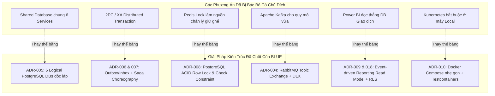
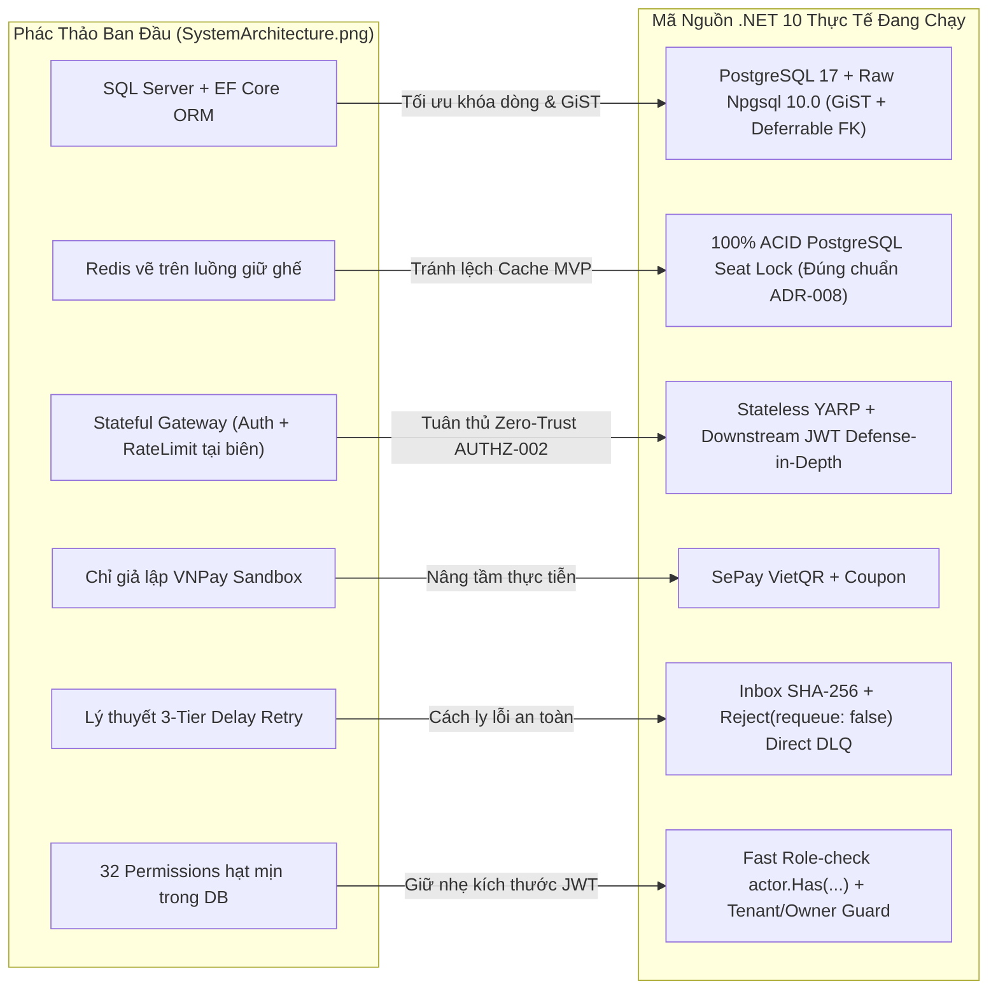

# Chương 04 — Giải Phẫu 18 Quyết Định Kiến Trúc (ADR-001..018), Phân Tích Đánh Đổi (Trade-offs) và Đối Chiếu Thực Tế Mã Nguồn C#

> **Thuộc bộ tài liệu:** Cẩm Nang Thuyết Trình Toàn Diện — Dự án **BLUE Bus Ticket Platform (PBL6)**  
> **Tài liệu nguồn đối chiếu:** [02-01-01-architecture-goals.md](../../../system-design/02-01-system-architecture/02-01-01-architecture-goals.md) · [02-01-04-microservices-architecture.md](../../../system-design/02-01-system-architecture/02-01-04-microservices-architecture.md) · [02-01-12-architecture-decisions.md](../../../system-design/02-01-system-architecture/02-01-12-architecture-decisions.md) · [Directory.Packages.props](../../../../workspace/Directory.Packages.props) · [SystemArchitecture.png](../../../SystemArchitecture.png)

---

## Mở Đầu: Kiến Trúc Phần Mềm Không Có "Viên Đạn Bạc", Chỉ Có Sự Đánh Đổi!

Trong bảo vệ đồ án tốt nghiệp hoặc phỏng vấn kỹ sư cấp cao, câu hỏi phân loại giỏi — xuất sắc không bao giờ là *"Em dùng công nghệ gì?"*, mà luôn là ***"TẠI SAO em chọn công nghệ A thay vì B, và cái giá phải trả cho lựa chọn đó là gì?"***.

Nếu bạn trả lời *"Dạ bọn em dùng Microservices và RabbitMQ vì thấy nó hiện đại, nhiều công ty lớn dùng"*, hội đồng sẽ lập tức xoáy vào độ phức tạp không cần thiết. Ngược lại, nếu bạn chỉ rõ **18 Bản ghi Quyết định Kiến trúc (`ADR-001` đến `ADR-018`)** kèm bảng đánh đổi (Trade-offs) và sự tiến hóa trung thực giữa bản vẽ sơ khởi ban đầu với mã nguồn `.NET 10` thực tế đang chạy, bạn sẽ làm chủ hoàn toàn khán phòng.

---

## Phần 1: Lý Thuyết Cốt Lõi — ADR (Architecture Decision Record) Là Gì?

### 1.1. Khái Niệm ADR và Vấn Đề "Mất Trí Nhớ Kiến Trúc" (Architectural Amnesia)

**ADR (Architecture Decision Record)** — khái niệm được chuẩn hóa bởi kiến trúc sư phần mềm Michael Nygard — là một tài liệu kỹ thuật ngắn gọn, có cấu trúc chuẩn, ghi lại **một quyết định thiết kế có ảnh hưởng sâu rộng đến cấu trúc hệ thống** cùng với bối cảnh, các phương án đã cân nhắc và hệ quả (cả tích cực lẫn tiêu cực) tại đúng thời điểm quyết định đó được đưa ra.

Tại sao mọi dự án phần mềm nghiêm túc đều bắt buộc phải có ADR?
1. **Chống "Mất trí nhớ tập thể":** Sau 3 tháng làm đồ án, chính các thành viên trong nhóm cũng quên mất tại sao ngày xưa lại tách bảng `organizations` sang `Transport` mà để `organization_memberships` ở `Identity`. Có ADR, người mới đọc 2 phút là hiểu ngay lý do gốc rễ.
2. **Ngăn chặn tranh cãi vòng tròn:** Khi một thành viên đề xuất *"Hay mình dùng Redis Lock để giữ ghế cho nhanh?"*, cả nhóm không cần cãi nhau lại từ đầu mà mở thẳng **`ADR-008`** để xem những rủi ro mất khóa nào đã khiến phương án đó bị bác bỏ.
3. **Vòng đời bất biến (Append-only History):** Một ADR đi qua các trạng thái `Proposed` (Đề xuất) -> `Accepted` (Đã phê duyệt áp dụng) -> `Superseded` (Đã được thay thế bởi một ADR mới hơn). **Quy tắc vàng:** Khi công nghệ thay đổi, ta không xóa lịch sử cũ mà viết ADR mới `Supersede` ADR cũ (ví dụ điển hình trong dự án BLUE là **`ADR-017`** nâng cấp lên `.NET 10 LTS` đã thay thế phần `.NET 8` của **`ADR-012`**!).

### 1.2. Kim Chỉ Nam Đánh Đổi Của Dự Án BLUE (Thang Ưu Tiên 6 Bậc)

Mọi quyết định từ `ADR-001` đến `ADR-018` đều tuân theo một thước đo ưu tiên bất di bất dịch được chốt tại [02-01-01-architecture-goals.md mục 5](../../../system-design/02-01-system-architecture/02-01-01-architecture-goals.md#L60-L64):

$$\text{Correctness giao dịch} \succ \text{Bảo mật} \succ \text{Khả năng phục hồi} \succ \text{Hiệu năng} \succ \text{Chi phí} \succ \text{Tiện lợi phát triển}$$

Ý nghĩa của chuỗi thứ tự này: **Không một phép tối ưu hóa tốc độ (Hiệu năng) hay lối tắt viết code nhanh (Tiện lợi) nào được phép làm suy yếu tính đúng đắn của kho ghế, tính chính xác của tiền thanh toán hoặc ranh giới cô lập dữ liệu nhà xe!**

---

## Phần 2: Phân Tích Chi Tiết Toàn Bộ 18 Quyết Định Kiến Trúc (`ADR-001` đến `ADR-018`)

Để dễ theo dõi và ghi nhớ khi thuyết trình, chúng ta chia 18 ADR thành **4 nhóm chủ đề chiến lược**, nhưng vẫn phân tích tỉ mỉ từng mã định danh từ `001` đến `018`:

---

### Nhóm A: Phân Rã Ranh Giới Dịch Vụ & Quyền Sở Hữu Nghiệp Vụ (`ADR-001`, `ADR-013`, `ADR-014`)

#### `ADR-001` — Chia hệ thống thành 6 Microservices theo Bounded Context *(Trạng thái: Accepted)*
- **Bối cảnh:** Nền tảng đặt vé bao gồm 6 miền nghiệp vụ có tốc độ thay đổi, tải truy cập và quy tắc bất biến hoàn toàn khác nhau: Xác thực (`Identity`), Vận tải (`Transport`), Kho ghế & Đặt vé (`Booking`), Thanh toán (`Payment`), Thông báo (`Notification`) và Báo cáo (`Reporting`).
- **Quyết định:** Tách thành đúng 6 dịch vụ nghiệp vụ độc lập tương ứng với 6 Bounded Context của Domain-Driven Design (DDD); cổng `API Gateway` chỉ làm nhiệm vụ điều phối biên chứ không chứa logic nghiệp vụ.
- **Đánh đổi (Trade-offs):**
  - *Được gì:* Ranh giới chủ quyền dữ liệu cực rõ (`Single Writer`); có thể mở rộng ngang riêng lẻ điểm nóng (ví dụ dịp Tết chỉ cần scale thêm `Booking` và `Transport` mà không tốn tài nguyên cho `Reporting`); lỗi sập `Notification` không làm chết luồng bán vé.
  - *Mất gì (Chi phí phải trả):* Phải quản lý hợp đồng OpenAPI/AsyncAPI chặt chẽ, phải theo dõi log phân tán bằng `correlationId`, và chấp nhận tính nhất quán cuối cùng (Eventual Consistency) giữa các miền.
- **Phương án bị từ chối:** Chia nhỏ quá mức (Nano-services: tách riêng `Ticket Service`, `Coupon Service`, `Refund Service` thành 12–15 services) — bị bác bỏ vì làm nổ tung độ phức tạp vận hành cho nhóm đồ án 4 người mà không mang lại lợi ích độc lập thực sự.

#### `ADR-013` — `Transport` sở hữu Hồ sơ Nhà xe (`Organization`); `Identity` sở hữu Thành viên & Vai trò *(Trạng thái: Accepted)*
- **Bối cảnh:** Thực thể `Organization` (Nhà xe) vừa mang thông tin kinh doanh vận tải (tên thương hiệu, bật/tắt trả sau `allow_pay_later`, mức hoa hồng `commission_rate`), vừa là gốc phân quyền Multi-tenant của nhân viên nhà xe. Nếu gom cả hai vào 1 service sẽ làm lẫn lộn miền nghiệp vụ hoặc ép các service phải gọi chéo liên tục.
- **Quyết định:** `Transport Service (:5082)` làm chủ bảng `organizations` (hồ sơ kinh doanh); `Identity Service (:5081)` làm chủ bảng `organization_memberships` và `user_roles` thông qua khóa tham chiếu ngoài `organization_id_external`. YARP Gateway định tuyến `/api/v1/admin/organizations` về `Transport`, nhưng ưu tiên định tuyến đường dẫn con `/api/v1/admin/organizations/{id}/members/**` (`Order: -20`) về `Identity`.
- **Đánh đổi:** Giữ sạch ranh giới DDD và không cần khóa ngoại xuyên DB; đổi lại phải cấu hình thứ tự ưu tiên route (`Order`) cẩn thận trên Gateway và kiểm tra trạng thái thành viên nhất quán.

#### `ADR-014` — `Booking Service` tạm thời sở hữu `SupportCase` liên quan giao dịch *(Trạng thái: Accepted)*
- **Bối cảnh:** Use Case xử lý khiếu nại khách hàng (`UC-ADMIN-03`) cần lưu trữ trạng thái phiếu hỗ trợ, người phụ trách và lịch sử xử lý, nhưng chưa đủ quy mô tải hay vòng đời riêng để đẻ thêm Microservice thứ 7 (`Support Service`).
- **Quyết định:** Đặt `SupportCase` bên trong ranh giới của `Booking Service` (nơi vốn đã nắm giữ ngữ cảnh gần nhất về `Booking` và `Ticket`), liên kết với `Payment` qua mã tham chiếu ngoài. Khi nào nghiệp vụ CSKH phình to thành hệ thống CRM độc lập mới viết ADR mới để tách riêng.
- **Đánh đổi:** Tiết kiệm chi phí vận hành một container + một database thứ 7 trong giai đoạn đầu; đổi lại `Booking Service` gánh thêm một phần trách nhiệm phụ trợ hậu mãi.

---

### Nhóm B: Giao Tiếp Liên Dịch Vụ, Dữ Liệu & Chống Bán Trùng Ghế (`ADR-002`..`ADR-009`)

#### `ADR-002` — Mọi lưu lượng Public API bắt buộc đi qua API Gateway *(Trạng thái: Accepted)*
- **Bối cảnh:** Có 4 ứng dụng Frontend (3 Web Portals + 1 Mobile App) cần giao tiếp với 6 Microservices chạy ở 6 cổng khác nhau. Nếu để Client gọi trực tiếp từng service sẽ lộ cấu trúc mạng nội bộ, cấu hình CORS phân mảnh 6 nơi và khó gắn mã truy vết chuẩn.
- **Quyết định:** Đặt `YARP API Gateway (:5080)` làm điểm nhập công cộng duy nhất cho mọi Client và Webhook. Các Microservices `:5081..:5086` trong môi trường chuẩn nằm ở vùng mạng ứng dụng nội bộ.
- **Đánh đổi:** Tập trung hóa điểm kiểm soát biên, gom gọn Swagger UI và ẩn cấu trúc bên trong; đổi lại thêm 1 chặng nhảy mạng nội bộ (network hop ~1–2ms) và Gateway phải được thiết kế thật nhẹ, stateless để không trở thành điểm nghẽn đơn lẻ (Single Point of Failure).

#### `ADR-003` — Dùng REST/HTTP JSON đồng bộ cho các thao tác cần phản hồi tức thời *(Trạng thái: Accepted)*
- **Bối cảnh:** Khi khách bấm Tìm chuyến, Xem sơ đồ ghế hoặc Giữ ghế, giao diện Web/Mobile cần biết ngay lập tức kết quả thành công hay thất bại (`200/201` hay `409 SEAT_UNAVAILABLE`) trong dưới 1–2 giây.
- **Quyết định:** Sử dụng chuẩn RESTful JSON trên HTTPS với hợp đồng OpenAPI 3.1, bộ mã lỗi chuẩn hóa (`ErrorEnvelope`) và cơ chế chống chuỗi gọi đồng bộ dài (cấm gọi bắc cầu quá 3 services).
- **Đánh đổi:** Dễ tích hợp trực tiếp với trình duyệt và React Native, ngữ nghĩa HTTP rõ ràng; đổi lại các bên gọi và nhận phải cùng trực tuyến tại thời điểm request (temporal coupling trên đường găng).

#### `ADR-004` — Dùng RabbitMQ cho Integration Events và Asynchronous Commands *(Trạng thái: Accepted)*
- **Bối cảnh:** Luồng xác nhận thanh toán sang xuất vé cần cơ chế bàn giao tin cậy kể cả khi một bên khởi động lại; đồng thời việc gửi Email (`Notification`) và cộng dồn số liệu (`Reporting`) cần tách khỏi đường găng và nhận chung một sự kiện từ nhiều nơi (Fan-out).
- **Quyết định:** Chọn **RabbitMQ 4.1** làm Message Broker duy nhất với mô hình `Topic Exchange` (`platform.events`, `platform.commands`), hàng đợi bền vững (`durable queue`), xác nhận thủ công (`manual ACK`) và Dead-Letter Exchange (`platform.dlx`).
- **Tại sao từ chối Apache Kafka hay HTTP đồng bộ toàn phần?**
  - *Từ chối HTTP đồng bộ toàn phần:* Nếu `Payment` gọi thẳng HTTP sang `Booking`, rồi gọi tiếp HTTP sang `Notification` và `Reporting`, chỉ cần SMTP gửi mail chậm 10 giây là Webhook của cổng thanh toán bị timeout!
  - *Từ chối Apache Kafka:* Kafka cực mạnh cho bài toán Big Data Event Streaming hàng triệu bản ghi/giây và lưu trữ log dài hạn để tua lại toàn cục, nhưng rất nặng nề về RAM/vận hành và thiếu linh hoạt trong định tuyến mẫu ký tự đại diện (`booking.booking.*.v1`) cũng như cơ chế ACK/DLQ trên từng tin nhắn đơn lẻ mà quy mô PBL6 cần.

#### `ADR-005` — Database-per-Service trên cùng cụm PostgreSQL vật lý giai đoạn đầu *(Trạng thái: Accepted)*
- **Bối cảnh:** Các Microservices cần độc lập hoàn toàn về cấu trúc bảng và quyền ghi dữ liệu, nhưng việc dựng 6 máy chủ PostgreSQL vật lý riêng biệt trên máy laptop sinh viên sẽ ngốn sạch bộ nhớ RAM.
- **Quyết định:** Áp dụng nghiêm ngặt **Logical Database-per-Service**: 6 database tách biệt (`identity_db`, `transport_db`, `booking_db`, `payment_db`, `notification_db`, `reporting_db`) với tài khoản/quyền truy cập riêng và bộ file migration riêng, chạy chung trên 1 cụm container `postgres:17-alpine` ở môi trường local/khởi đầu. **Cấm tuyệt đối đọc chéo DB, cấm tạo Foreign Key, View hay Trigger xuyên database!**
- **Tại sao từ chối Shared Database (1 CSDL dùng chung cho cả 6 services)?** Nếu 6 services cùng `JOIN` và `UPDATE` chung một bảng `bookings`, một thay đổi cột của nhóm làm Booking sẽ làm gãy code build của nhóm làm Reporting (Schema Coupling), khóa bảng ở báo cáo sẽ làm treo luồng đặt vé, và toàn bộ kiến trúc Microservices biến tướng thành *"Distributed Monolith"* tệ hại!

#### `ADR-006` — Giao nhận tin nhắn `At-Least-Once` kết hợp Transactional Outbox & Inbox *(Trạng thái: Accepted)*
- **Bối cảnh:** Bài toán kinh điển "Dual-Write Problem": Nếu `Payment Service` lưu trạng thái `SUCCEEDED` vào PostgreSQL xong, vừa định bắn tin lên RabbitMQ thì mất điện -> tiền đã thu nhưng `Booking` không bao giờ nhận được tin để xuất vé! Ngược lại, nếu bắn tin lên RabbitMQ trước rồi lệnh `COMMIT` PostgreSQL bị lỗi -> khách được xuất vé miễn phí!
- **Quyết định:**
  - **Đầu phát (Transactional Outbox):** Ghi dữ liệu nghiệp vụ và bản ghi sự kiện vào bảng `outbox_messages` trong **cùng một local ACID Transaction** của PostgreSQL. Sau đó tiến trình nền `OutboxDispatchHostedService` đọc bảng `outbox_messages` đẩy lên RabbitMQ cho tới khi thành công.
  - **Đầu nhận (Idempotent Inbox):** RabbitMQ đảm bảo giao ít nhất một lần (`At-Least-Once`), tức là có thể giao lặp cùng một tin. Consumer dùng `InboxDeduper` kiểm tra `event_id` trong bảng `inbox_messages` có ràng buộc `UNIQUE` trước khi thực thi nghiệp vụ.
- **Phương án bị từ chối:** Kỳ vọng vào *"Exactly-Once Messaging"* từ hạ tầng broker — không khả thi xuyên qua hai hệ thống khác loại (RabbitMQ + PostgreSQL) nếu không tự làm Idempotency.

#### `ADR-007` — Không dùng Giao dịch Phân tán (2PC); Sử dụng Saga Choreography *(Trạng thái: Accepted)*
- **Bối cảnh:** Quy trình thanh toán và hoàn tiền đi xuyên qua `Booking Service`, `Payment Service` và cả máy chủ bên ngoài của `SePay`.
- **Quyết định:** Cấm dùng giao dịch hai pha (`Two-Phase Commit / XA Distributed Transaction`). Thay vào đó dùng mẫu **Saga Choreography** (Vũ đạo sự kiện): mỗi service chỉ khóa và commit database cục bộ của riêng mình rồi phát sự kiện cho bước kế tiếp; nếu bước sau gặp lỗi nghiệp vụ (như tiền về trễ khi đơn đã đóng), service phát sự kiện bù trừ (`PaymentCompensationRequested` / `RefundRequested`).
- **Tại sao từ chối 2PC / XA Transaction?** Giao thức 2PC buộc tất cả các database tham gia phải giữ khóa dòng chờ đợi nhau qua mạng (Blocking Protocol) — nếu 1 node chậm, toàn hệ thống đứng hình; quan trọng hơn, **cổng thanh toán ngân hàng bên ngoài không bao giờ cho phép hệ thống của bạn mở 2PC lock lên database của ngân hàng!**

#### `ADR-008` — PostgreSQL Transaction & Constraint là nguồn chống Double-Booking duy nhất; Redis chỉ hỗ trợ *(Trạng thái: Accepted)*
- **Bối cảnh:** Giữ ghế (`SeatHold`) đòi hỏi cả tốc độ phản hồi nhanh lẫn độ chính xác tuyệt đối 100% không bán trùng ghế dưới tải đồng thời cao.
- **Quyết định:** Đặt chân lý quyền sở hữu ghế (`TripSeat` / `SeatHold`) hoàn toàn trong giao dịch ACID của `Booking PostgreSQL` (khóa dòng + ràng buộc `ck_trip_seat_owner`). Redis nếu dùng chỉ đóng vai trò bộ nhớ đệm đọc hoặc tín hiệu hết hạn phụ trợ, mất trắng Redis hệ thống vẫn không bao giờ bán trùng ghế!
- **Tại sao từ chối dùng Redis Distributed Lock (Redlock) làm nguồn chân lý giữ ghế?** Như chuyên gia hệ phân tán Martin Kleppmann đã chứng minh, Redis hoạt động trong RAM với cơ chế sao lưu bất đồng bộ (asynchronous replication): nếu node Master của Redis bị sập ngay sau khi cấp khóa giữ ghế `A01` cho Khách X nhưng chưa kịp đồng bộ sang Replica, node Replica lên thay sẽ cấp tiếp khóa ghế `A01` cho Khách Y! Ngoài ra hiện tượng tạm dừng thu gom rác (`GC Pause`) hoặc trôi đồng hồ có thể làm hết hạn TTL khóa Redis trước khi DB kịp lưu xong. Với giao dịch tài chính bán vé, chỉ khóa dòng gắn liền với dữ liệu bền vững trong PostgreSQL mới đảm bảo an toàn tuyệt đối!

#### `ADR-009` — `Reporting Service` dùng Read Projection bất đồng bộ (CQRS chọn lọc) *(Trạng thái: Accepted)*
- **Bối cảnh:** Thống kê doanh thu theo tuyến, nhà xe và tỷ lệ lấp đầy ghế đòi hỏi tổng hợp dữ liệu của cả `Transport`, `Booking` và `Payment` trên tập dữ liệu lớn, nhưng quản lý nhà xe xem báo cáo có thể chấp nhận độ trễ vài giây.
- **Quyết định:** `Reporting Service (:5086)` lắng nghe các sự kiện tích hợp qua RabbitMQ để tự đúc sẵn các bảng tổng hợp tối ưu cho việc đọc (`reporting_db`), và luôn trả kèm trường `dataAsOf` để người xem biết báo cáo mới đến giây nào.
- **Đánh đổi:** Truy vấn báo cáo cực nhanh và hoàn toàn không gây tải khóa bảng lên CSDL đặt vé `booking_db`; đổi lại dữ liệu báo cáo có độ trễ nhỏ (Eventual Consistency) và cần khả năng dựng lại (rebuild) khi thêm chỉ số mới.

---

### Nhóm C: Hạ Tầng Triển Khai, Công Nghệ Nền Tảng & Quản Lý Mã Nguồn (`ADR-010`..`ADR-012`, `ADR-015`..`ADR-018`)

#### `ADR-010` — Container hóa toàn bộ; dùng Docker Compose cho môi trường Local *(Trạng thái: Accepted)*
- **Bối cảnh:** Nhóm phát triển đồ án PBL6 gồm 4 thành viên làm việc trên nhiều cấu hình máy khác nhau nhưng phải dựng đồng thời 6 Microservices, API Gateway, PostgreSQL, RabbitMQ, Redis và Mailpit. Nếu cài đặt thủ công từng phần mềm lên hệ điều hành Windows/macOS sẽ dẫn đến hội chứng kinh điển *"Chạy được trên máy em nhưng lỗi trên máy bạn"*.
- **Quyết định:** Đóng gói mọi thành phần bằng chuẩn Container OCI (`api.Dockerfile`, `web.Dockerfile`) và chuẩn hóa môi trường local bằng `workspace/src/infra/docker-compose.yml` (chỉ hạ tầng) cùng `docker-compose.apps.yml` / `docker-compose.production.yml` (toàn bộ ứng dụng). Đi kèm các bài kiểm thử tích hợp tự động dựng container thật bằng thư viện `Testcontainers 4.6.0`.
- **Đánh đổi (Trade-offs):**
  - *Được gì:* Môi trường phát triển và kiểm thử lặp lại chính xác 100% bằng một câu lệnh duy nhất; cùng một container image được mang từ local sang staging/production.
  - *Mất gì:* Yêu cầu máy phát triển có Docker Engine và dung lượng RAM tối thiểu để chạy cụm hạ tầng (nhóm cũng chuẩn bị sẵn script `dev-local.ps1` làm phương án dự phòng chạy trực tiếp không qua Docker khi máy yếu).
- **Phương án bị từ chối:** Bắt buộc dựng cụm **Kubernetes (Minikube / Kind / K3s)** ngay ở môi trường local — bị bác bỏ thẳng vì tiêu tốn quá nhiều tài nguyên phần cứng, kéo dài vòng lặp build-debug mà không đóng góp thêm giá trị cho tính đúng đắn nghiệp vụ của PBL6.

#### `ADR-011` — Production Topology trung lập nhà cung cấp Cloud (`Vendor-neutral`) *(Trạng thái: Proposed)*
- **Bối cảnh:** Ở giai đoạn xây dựng nền tảng học thuật và MVP, dự án chưa có dữ liệu chính thức về ngân sách hạ tầng hàng tháng, cam kết SLA thương mại hay yêu cầu lưu trữ dữ liệu theo vùng địa lý để khóa cứng vào AWS, Microsoft Azure hay Google Cloud Platform.
- **Quyết định:** Giữ toàn bộ kiến trúc triển khai hoàn toàn độc lập với nhà cung cấp đám mây (Vendor-neutral). Hệ thống chỉ dựa trên các giao thức và thành phần tiêu chuẩn mở: Linux Containers, PostgreSQL chuẩn, giao thức AMQP 0-9-1 của RabbitMQ, giao thức gửi thư chuẩn SMTP và biến môi trường 12-Factor App (`ConnectionStrings__*`, `MESSAGING__AMQPURI`).
- **Đánh đổi:**
  - *Được gì:* Có thể triển khai linh hoạt lên bất kỳ VPS Linux nào, máy chủ vật lý của trường đại học, hoặc chuyển đổi giữa AWS ECS / Azure Container Apps / GCP Cloud Run mà không phải sửa một dòng code C# nào.
  - *Mất gì:* Không tận dụng sẵn các dịch vụ độc quyền đóng gói sẵn của một hãng Cloud (như AWS SQS/SNS hay Azure Service Bus — dù hình phác thảo ban đầu từng ghi *RabbitMQ / Azure Service Bus*, nhóm đã chốt chuẩn hóa 100% về RabbitMQ).
- **Phương án bị từ chối:** Khóa chặt sớm vào SDK độc quyền của một hãng Cloud hay một nhà cung cấp Email/SMS duy nhất trước khi có bài toán kinh tế thực tế.

#### `ADR-012` — Chọn Stack ứng dụng C# ASP.NET Core, React 19.2 và React Native *(Trạng thái: Superseded một phần bởi ADR-017)*
- **Bối cảnh:** Hệ thống đòi hỏi 3 kênh giao diện đồng bộ và 6 dịch vụ Backend xử lý giao dịch tiền tệ phức tạp. Nếu mỗi thành viên tự chọn một ngôn ngữ khác nhau (người viết Node.js, người viết Python, người viết Java) thì chi phí tích hợp, chia sẻ thư viện nền tảng (`BuildingBlocks`) và review chéo sẽ vượt tầm kiểm soát.
- **Quyết định:**
  - **Backend:** Thống nhất ngôn ngữ C# trên nền ASP.NET Core Minimal APIs và YARP Reverse Proxy, chia sẻ đúng 3 gói kỹ thuật nền tảng (`BuildingBlocks`, `BuildingBlocks.AspNetCore`, `BuildingBlocks.Messaging`).
  - **Web (Customer + Operator + Admin):** React 19.2 + TypeScript + Vite trên Node.js 24 LTS.
  - **Mobile:** React Native + Expo + TypeScript.
  - **Hợp đồng giao tiếp:** OpenAPI 3.1 cho HTTP REST và JSON Schema 2020-12 / AsyncAPI 3.1 cho tin nhắn sự kiện.
- **Đánh đổi:** Kiểu tĩnh mạnh (Strong Static Typing) từ đầu cuối C# sang TypeScript giúp phát hiện đứt gãy hợp đồng ngay lúc biên dịch (`tsc --noEmit` & `dotnet build`). Nhóm phải giữ kỷ luật nghiêm ngặt: **cấm tạo gói `Shared.Domain` dùng chung thực thể nghiệp vụ giữa 6 services** để tránh phụ thuộc triển khai đồng thời. *(Lưu ý lịch sử: Quyết định ban đầu chọn `.NET 8` trong `ADR-012` đã được nâng cấp chính thức bởi `ADR-017`)*.

#### `ADR-015` — Đóng băng phạm vi MVP 2.0 (`Scope Freeze`: Toàn bộ `MUST`, hoãn `SHOULD/COULD`) *(Trạng thái: Accepted)*
- **Bối cảnh:** Tài liệu SRS 2.1.0 định nghĩa bức tranh sản phẩm rất rộng gồm cả `MUST`, `SHOULD` (Đổi vé, Review, Xuất CSV, Power BI Embedded, Push Notification) và `COULD` (Định vị GPS xe chạy thực tế, AI gợi ý chuyến, Tích điểm thưởng, Giá động). Nếu cố làm tất cả cùng lúc với độ chín nửa vời, đường găng quan trọng nhất là Đặt vé — Thanh toán — Chống trùng ghế sẽ mất ổn định.
- **Quyết định:** Đóng băng phạm vi nghiệm thu MVP 2.0 chỉ bao gồm 100% các yêu cầu hạng `MUST` đạt chuẩn *Definition of Done* (có kiểm thử tự động chứng minh). Các hạng mục `SHOULD/COULD` được giữ nguyên thiết kế hợp đồng trong backlog nhưng mặc định tắt ở runtime MVP cho đến khi luồng cốt lõi hoàn tất.
- **Đánh đổi:** Đảm bảo chất lượng sản phẩm cốt lõi đạt độ tin cậy cấp sản xuất (Production-grade reliability); đổi lại một số tính năng gia tăng trải nghiệm như Đổi vé tự động hay Đánh giá sao sẽ nằm ở lộ trình phát hành kế tiếp.

#### `ADR-016` — Tổ chức mã nguồn dạng Monorepo kết hợp Contract-First và kiểm chứng Kiến trúc tự động *(Trạng thái: Accepted)*
- **Bối cảnh:** Nếu tách 6 Microservices, 1 Gateway và 4 ứng dụng Client thành 11 Git Repositories riêng biệt (Polyrepo), một thay đổi nhỏ trên API giữ ghế sẽ đòi hỏi mở và đồng bộ 4–5 Pull Requests ở nhiều kho mã khác nhau, rất dễ lệch phiên bản hợp đồng đối với quy mô nhóm 4 sinh viên.
- **Quyết định:** Đặt toàn bộ tài liệu (`docs/`), hợp đồng (`docs/contracts/`) và mã nguồn (`workspace/`) trong một **Monorepo** duy nhất, nhưng giữ **ranh giới triển khai độc lập tuyệt đối** cho từng service. Đặc biệt, dự án sử dụng bộ kiểm thử kiến trúc tự động `BusTicketPlatform.ArchitectureTests` (thư viện `NetArchTest.Rules 1.3.2`) để quét mã biên dịch: nếu bất kỳ lập trình viên nào lỡ tay thêm `<ProjectReference>` từ `Booking` sang `Payment` hay từ `Domain` ra `Infrastructure`, pipeline kiểm thử sẽ báo đỏ ngay lập tức!
- **Đánh đổi:** Tốc độ phối hợp nhóm cực nhanh, một PR chứa trọn vẹn từ đặc tả OpenAPI -> Backend -> Frontend -> Integration Test; đổi lại cấu hình CI cần lọc theo đường dẫn thay đổi (path filter) để không phải build lại toàn bộ khi chỉ sửa một file nhỏ.

#### `ADR-017` — Nâng cấp đồng bộ toàn bộ Backend lên `.NET 10 LTS` (`net10.0`) *(Trạng thái: Accepted — Thay thế phần Target Framework của ADR-012)*
- **Bối cảnh:** Tại thời điểm rà soát nền tảng ngày `2026-09-17`, theo chính sách vòng đời hỗ trợ chính thức của Microsoft, cả hai phiên bản `.NET 8` và `.NET 9` đều bước vào giai đoạn kết thúc hỗ trợ bảo mật (End of Support) vào tháng 11/2026, trong khi **`.NET 10` là phiên bản hỗ trợ dài hạn (LTS)** tiếp theo kéo dài đến tháng 11/2028. Việc nâng cấp ngay từ giai đoạn Foundation ít rủi ro hơn rất nhiều so với khi đã viết hàng chục nghìn dòng code.
- **Quyết định:** Chuyển toàn bộ 100% các dự án API, Worker, YARP Gateway, BuildingBlocks và Test Projects sang đích biên dịch `net10.0` (khóa phiên bản SDK `10.0.401` với `rollForward: latestPatch` trong `workspace/global.json`). Cấm trộn lẫn nhiều Target Framework giữa các Microservices.
- **Đánh đổi:**
  - *Được gì:* Thừa hưởng hiệu năng tối ưu của runtime `.NET 10`, sử dụng trực tiếp hàm sinh định danh sắp xếp theo thời gian `Guid.CreateVersion7()` chuẩn gốc trong `UuidV7IdGenerator.cs` (rất tốt cho B-Tree Index của PostgreSQL!), và an tâm về bản vá bảo mật dài hạn.
  - *Mất gì:* Mọi máy trạm lập trình, CI runner và base image trong `api.Dockerfile` bắt buộc phải cài đặt bộ công cụ `.NET 10 SDK/Runtime`.

#### `ADR-018` — Thiết kế Power BI Embedded đọc từ `Reporting Read Model` với bảo mật dòng dữ liệu động (Dynamic RLS) *(Trạng thái: Proposed — Hậu MVP)*
- **Bối cảnh:** Yêu cầu mở rộng `FR-REPORT-004` (`SHOULD`) mong muốn cung cấp bảng điều khiển phân tích trực quan đa chiều (lọc chéo theo thời gian, tuyến đường, loại xe, tỷ lệ lấp đầy). Tuy nhiên, hai rủi ro lớn nhất khi tích hợp công cụ BI vào hệ thống Multi-tenant là: (1) BI chọc thẳng vào DB giao dịch làm treo hệ thống đặt vé, và (2) Nhà xe A nhìn thấy biểu đồ doanh thu của Nhà xe B.
- **Quyết định đề xuất:** Sử dụng **Power BI Embedded** theo mô hình *App-Owns-Data* (xác thực bằng Service Principal, người dùng nhà xe không cần mua tài khoản Power BI cá nhân). Mô hình ngữ nghĩa (Semantic Model) chỉ được phép nhập dữ liệu từ các View BI chỉ đọc của **`reporting_db`** (`Reporting Service`), backend kiểm tra quyền rồi cấp Embed Token ngắn hạn kèm danh tính hiệu lực để kích hoạt **Dynamic Row-Level Security (RLS)** lọc cứng theo `organizationId`, đồng thời hiển thị rõ thời điểm làm mới dữ liệu (`dataAsOf` & `lastRefreshAt`).
- **Phương án bị từ chối tuyệt đối:** Cho phép Power BI kết nối DirectQuery trực tiếp vào `booking_db`, `payment_db` hoặc `transport_db` — bị cấm hoàn toàn vì phá tan quy tắc đóng gói dữ liệu của Microservices (`ADR-005`), tạo truy vấn quét bảng nặng trên luồng OLTP và có nguy cơ phơi bày PII hành khách chưa che mờ.

---

### Nhóm D: Tám Quyết Định Mở Trước Khi Vận Hành Thương Mại (`Open Decisions`)

Một kiến trúc sư giỏi luôn biết phân biệt quyết định nào **phải chốt ngay để viết code đúng** (`ADR-001..017`) và quyết định nào **nên trì hoãn có trách nhiệm (Last Responsible Moment)** cho đến khi có số liệu kinh doanh thực tế. Mục 4 của [02-01-12-architecture-decisions.md](../../../system-design/02-01-system-architecture/02-01-12-architecture-decisions.md#L161-L173) ghi nhận rõ 8 hạng mục sẽ được lập ADR riêng trước khi Go-Live thương mại:

1. **Lựa chọn nền tảng Cloud/Managed cụ thể và vùng lưu trữ dữ liệu (Data Residency)** tại Việt Nam hay Singapore.
2. **Hợp đồng tài khoản Merchant chính thức với Cổng thanh toán Production**, quy trình xoay vòng khóa bí mật (Key Rotation) và API đối soát tự động cuối ngày ngoài môi trường Sandbox.
3. **Nhà cung cấp dịch vụ gửi Email thương mại (SES / SendGrid / Postmark)** với hạn ngạch lớn và webhook theo dõi tỷ lệ thư rơi vào Spam; kích hoạt Push/SMS khi mở khóa backlog.
4. **Hệ thống quản lý bí mật tập trung (Secret Store như Vault / Cloud KMS)** và hạ tầng lưu trữ Observability (Seq / Grafana Tempo / Prometheus) cho Production.
5. **Quyết định dùng PostgreSQL & RabbitMQ dạng dịch vụ quản lý (Managed RDS/CloudAMQP) hay tự vận hành (Self-hosted)** dựa trên bài toán chi phí nhân sự vận hành.
6. **Tinh chỉnh thông số ngưỡng `prefetch`, chu kỳ retry và hạn mức mở rộng (Autoscaling threshold)** sau khi chạy kiểm thử chịu tải thực tế.
7. **Chính sách thời hạn lưu trữ và ẩn danh hóa dữ liệu cũ (Data Retention & Anonymization)** sau khi rà soát pháp lý thương mại điện tử và thuế.
8. **Chốt gói bản quyền Power BI Embedded Capacity (`A-SKU` / `F-SKU`)**, cấu hình Microsoft Entra Tenant và On-premises Data Gateway trước khi chuyển `ADR-018` từ `Proposed` sang `Accepted`.



---

## Phần 3: ĐẶC BIỆT QUAN TRỌNG — Đối Chiếu 6 Điểm Khác Biệt Giữa Ảnh Cũ `SystemArchitecture.png` / Tài Liệu Ban Đầu và Mã Nguồn C# Thực Tế

> [!IMPORTANT]
> **Tại sao mọi thành viên thuyết trình BẮT BUỘC phải thuộc lòng phần này?**  
> Trong thư mục gốc của dự án vẫn giữ bức ảnh tổng quan sơ khởi [`docs/SystemArchitecture.png`](../../../SystemArchitecture.png) (như một bản phác thảo kiến trúc giai đoạn đầu để bảo toàn lịch sử phát triển theo quy định tại `README.md`). Khi bảo vệ đồ án, các thầy cô phản biện rất hay mở bức ảnh `SystemArchitecture.png` đặt cạnh cửa sổ code `workspace/` và hỏi: ***"Trên hình vẽ một đằng, sao trong code các em lại viết một nẻo?"***.  
> Nếu lúng túng, bạn sẽ bị trừ điểm vì lỗi *"tài liệu không khớp code"*. Nhưng nếu bạn chủ động chỉ ra **6 điểm tiến hóa kỹ thuật có chủ đích** dưới đây, bạn sẽ biến câu hỏi khó nhất thành màn trình diễn đẳng cấp nhất buổi bảo vệ!

---

### 3.1. Bảng Ma Trận Tổng Hợp 6 Điểm Khác Biệt Giữa Bản Vẽ Ban Đầu & Thực Thi Thực Tế

| STT | Hạng Mục Kiến Trúc | Trên Ảnh Cũ `SystemArchitecture.png` / Thiết Kế Sơ Khởi | Trong Mã Nguồn Thực Tế (`workspace/src/` & `Directory.Packages.props`) | Bản Chất Của Sự Khác Biệt |
|:---:|---|---|---|---|
| **1** | **Hệ quản trị CSDL & Tầng Data Access** | Vẽ icon **`SQL Server`** dưới cả 6 services và ghi `Infrastructure (EF Core, Repositories)`. | Dùng **`PostgreSQL 17`** (`postgres:17-alpine`) + **`Npgsql 10.0.0` thuần (Raw ADO.NET SQL)** & `SqlBaselineMigrator` (không cài EF Core). | **Tiến hóa kỹ thuật vượt trội** để khai thác GiST Exclusion, Deferrable FK và tối ưu khóa dòng. |
| **2** | **Vai trò của `Redis` trong giữ ghế** | Docker Compose có `redis:7-alpine` và Logical Diagram vẽ mũi tên `Booking -> Redis`. | C# **không cài `StackExchange.Redis`**; 100% giữ ghế & thu hồi hạn chạy bằng giao dịch ACID của PostgreSQL (`BookingRepository.cs`). | **Tuân thủ kỷ luật `ADR-008`**: DB là nguồn chân lý duy nhất; giữ kiến trúc MVP gọn sạch không phụ thuộc cache. |
| **3** | **Trách nhiệm của `YARP API Gateway (:5080)`** | Hộp YARP trên ảnh liệt kê dày đặc: `JWT Validation`, `Rate Limiting`, `Circuit Breaker`, `IP Filtering`. | Gateway là **Stateless Thin Proxy** (Routing theo `Order`, CORS, `CorrelationId`, `ErrorEnvelope`, gom Swagger). Xác thực JWT, khóa brute-force và Idempotency nằm ở **6 Downstream Services**. | **Thực thi Zero-Trust (`AUTHZ-002`)**: Không dồn điểm nghẽn và không phó mặc bảo mật cho lớp vỏ biên. |
| **4** | **Thanh toán và khuyến mãi** | Thiết kế ban đầu đề cập VNPay Sandbox và Promotion ở mức SHOULD. | Checkout hiện tại dùng **SePay VietQR** và đã có **Coupon**. | Demo bằng SePay Sandbox. |
| **5** | **Chiến lược Retry & DLQ trên RabbitMQ** | Tài liệu `07-retry-dlq.md` vẽ 3 tầng hàng đợi trễ `retry.5s -> retry.30s -> retry.5m` trước khi vào DLQ. | `IntegrationEventConsumerHost.cs` bắt lỗi và gọi `RejectAsync(requeue: false)` chuyển thẳng qua `platform.dlx` vào **`Direct DLQ`** (exchange `platform.retry` đã tạo sẵn chờ mở rộng). | **Đơn giản hóa an toàn cho MVP**: Chống lặp vô hạn (`requeue: true`), cách ly ngay tin lỗi để kiểm tra. |
| **6** | **Kiểm tra Phân quyền (`Roles` vs `Permissions`)** | File SQL `identity/001_initial.sql` tạo và seed đủ bảng `roles`, `permissions` (32 quyền) và `role_permissions`. | JWT mang claim `Role` và code C# kiểm tra trực tiếp bằng `actor.Has("OPERATOR_ADMIN", ...)` kết hợp `OrganizationId` / `UserId` mà chưa truy vấn bảng `permissions` lúc runtime. | **Tối ưu hiệu năng Token MVP** trên 10 System Roles cố định, giữ sẵn Schema DB cho phân quyền động hậu MVP. |

---

### 3.2. Mổ Xẻ Chi Tiết Từng Điểm & Kịch Bản Trả Lời Khéo Léo Trước Hội Đồng

---

#### Điểm Khác Biệt 1: `PostgreSQL 17` + Raw `Npgsql 10.0.0` Thay Vì `SQL Server` + `EF Core`

- **Bằng chứng trực tiếp trong mã nguồn:**
  - Mở [`workspace/Directory.Packages.props`](../../../../workspace/Directory.Packages.props#L19-L24): Toàn bộ solution quản lý gói tập trung (Central Package Management) chỉ khai báo trình điều khiển PostgreSQL thuần mà hoàn toàn **không có `Microsoft.EntityFrameworkCore` hay `Microsoft.Data.SqlClient`**:
    ```xml
    <PackageVersion Include="Npgsql" Version="10.0.0" />
    <PackageVersion Include="RabbitMQ.Client" Version="7.1.2" />
    <PackageVersion Include="Testcontainers.PostgreSql" Version="4.6.0" />
    <PackageVersion Include="Testcontainers.RabbitMq" Version="4.6.0" />
    <PackageVersion Include="Yarp.ReverseProxy" Version="2.3.0" />
    ```
  - Toàn bộ tầng Persistence (như [`BookingRepository.cs`](../../../../workspace/src/services/booking/BusTicketPlatform.Booking.Infrastructure/Persistence/BookingRepository.cs) và [`CouponRepository.cs`](../../../../workspace/src/services/booking/BusTicketPlatform.Booking.Infrastructure/Persistence/CouponRepository.cs)) đều viết câu lệnh SQL tham số hóa tường minh qua `NpgsqlCommand`, và tự động khởi chạy schema gốc từ `docs/database/*/001_initial.sql` thông qua `SqlBaselineMigrator` / `db-bootstrap`.
- **Tại sao sự thay đổi này lại cực kỳ đáng giá về mặt kỹ thuật?**
  1. **Tính năng đặc sản không thể thay thế của PostgreSQL:** Trong `transport/001_initial.sql`, hệ thống dùng extension `btree_gist` với ràng buộc loại trừ khoảng thời gian `EXCLUDE USING gist (bus_id WITH =, operating_window WITH &&)` để chặn trùng lịch xe và tài xế ngay tại nhân CSDL — một tính năng mà SQL Server không hề có sẵn tương đương! Ngoài ra còn có `DEFERRABLE INITIALLY DEFERRED` cho khóa ngoại hai chiều của `trip_seats` và kiểu `JSONB` tốc độ cao cho Snapshot chuyến xe.
  2. **Kiểm soát tuyệt đối câu lệnh SQL trên đường găng giữ ghế:** Với bài toán tranh chấp hàng trăm người cùng giữ một ghế (`SeatHold`) hoặc `INSERT ... ON CONFLICT DO UPDATE` (Upsert), việc viết Raw Parameterized SQL qua `Npgsql` giúp nhóm kiểm soát chính xác 100% chiến lược khóa dòng, thứ tự khóa (chống Deadlock) và loại bỏ hoàn toàn chi phí Change Tracker ngầm của EF Core.
  3. **Tối ưu tài nguyên Docker Compose:** Chạy 1 container `postgres:17-alpine` chứa 6 logical databases chỉ tốn khoảng ~80–150MB RAM, nhẹ hơn gấp hàng chục lần so với việc dựng container SQL Server trên máy cá nhân.
- **Cách trả lời ghi điểm khi hội đồng hỏi:**
  > *"Thưa thầy/cô, bức ảnh `SystemArchitecture.png` là bản phác thảo ý tưởng ở giai đoạn khởi đầu môn học, còn trong quá trình thiết kế chi tiết (`ADR-005`, `ADR-008`) và hiện thực hóa mã nguồn `.NET 10`, nhóm đã chủ động chuẩn hóa sang **PostgreSQL 17 kết hợp ADO.NET `Npgsql` thuần**. Lý do là nhóm cần khai thác trực tiếp các ràng buộc toàn vẹn bậc cao của PostgreSQL như `GiST Range Exclusion` để chống trùng lịch xe/tài xế, `Deferrable Foreign Keys` cho kho ghế và cú pháp `ON CONFLICT` nguyên tử, đồng thời kiểm soát tường minh 100% câu lệnh SQL khóa dòng mà không bị phụ thuộc vào SQL sinh tự động của ORM."*

---

#### Điểm Khác Biệt 2: Container `Redis 7` Trong Docker Compose vs Giữ Ghế Thuần PostgreSQL (`ADR-008`)

- **Bằng chứng trực tiếp trong mã nguồn:**
  - Trong [`workspace/src/infra/docker-compose.yml`](../../../../workspace/src/infra/docker-compose.yml#L66-L79), dịch vụ `redis:7-alpine` vẫn được khởi tạo ở cổng `6379` với chế độ bền vững `--appendonly yes`.
  - Tuy nhiên, toàn bộ logic `CreateHoldAsync`, `ExpireHoldsAsync` và `CreateBookingAsync` trong `Booking Service` đều đọc/ghi trực tiếp vào bảng `seat_holds` và `trip_seats` của PostgreSQL mà không gọi qua thư viện Redis client nào.
- **Phân tích bản chất kiến trúc:**
  - Nếu vội vàng chèn Redis vào giữa luồng giữ ghế ngay ở giai đoạn MVP khi chưa cần thiết, nhóm sẽ đối mặt với bài toán đồng bộ hai nguồn dữ liệu (Dual-Store Consistency): ghế trên Redis báo trống nhưng PostgreSQL đã khóa, hoặc ngược lại.
  - Bằng cách kết hợp **Partial Index cực nhẹ** `CREATE INDEX ix_seat_holds_expiry ON seat_holds (expires_at, id) WHERE status = 'ACTIVE'` và hàm dọn dẹp tức thời `ExpireHoldsAsync`, PostgreSQL thực thi kiểm tra và thu hồi ghế hết hạn chỉ trên vài chục dòng `ACTIVE` thay vì quét cả bảng hàng triệu dòng!
- **Cách trả lời ghi điểm khi hội đồng hỏi:**
  > *"Thưa thầy/cô, đây không phải là sự bỏ quên mà là kết quả trực tiếp từ quyết định kiến trúc **`ADR-008`** của nhóm: **PostgreSQL mới là nguồn chân lý duy nhất chống bán trùng ghế, còn Redis không được phép nắm giữ trạng thái sở hữu ghế**. Ở ngưỡng tải mục tiêu của MVP (300 người dùng đồng thời, 100.000 chuyến xe với các composite partial index như `ix_trips_public_search` và `ix_seat_holds_expiry`), bản thân PostgreSQL 17 đã xử lý giữ ghế và tìm kiếm dưới ngưỡng mili-giây một cách hoàn hảo. Vì vậy, trong code MVP nhóm giữ đường đi dữ liệu thuần khiết qua PostgreSQL để tránh rủi ro lệch bộ nhớ đệm (Cache Invalidation Bug), còn container Redis trong Docker Compose được dựng sẵn ở tầng hạ tầng cho các tác vụ Read Cache mở rộng sau MVP."*

---

#### Điểm Khác Biệt 3: Stateless YARP Gateway (`:5080`) vs Xác Thực & Bảo Vệ Tại Downstream Services

- **Bằng chứng trực tiếp trong mã nguồn:**
  - Mở [`Gateway/Program.cs`](../../../../workspace/src/gateway/BusTicketPlatform.Gateway/Program.cs#L70-L85): Pipeline của Gateway mỏng, sắc gọn và hoàn toàn phi trạng thái:
    ```csharp
    app.UseCors("clients");
    app.UseBuildingBlocks(); // CorrelationMiddleware + ErrorEnvelopeMiddleware
    app.MapPlatformHealth();
    app.UseSwaggerUI(options => { /* Gom OpenAPI của 6 Microservices :5081..:5086 */ });
    app.MapReverseProxy();   // YARP định tuyến theo trọng số Order
    ```
  - Ngược lại, từng Microservice bên dưới (`Identity`, `Transport`, `Booking`, `Payment`, `Notification`, `Reporting`) đều tự gọi `AddPlatformJwt()` ([PlatformJwtExtensions.cs](../../../../workspace/src/building-blocks/BusTicketPlatform.BuildingBlocks.AspNetCore/Auth/PlatformJwtExtensions.cs)) để tự xác minh chữ ký JWT, tự kiểm tra `IIdempotencyStore` trên PostgreSQL riêng của mình, và riêng `Identity` kiểm tra trực tiếp `failed_login_count` / `lockout_until` / `authorization_version`.
- **Cách trả lời ghi điểm khi hội đồng hỏi:**
  > *"Thưa thầy/cô, trong tài liệu SRS mục `AUTHZ-002` đã đặt ra quy tắc bảo mật cốt lõi: **'Thành phần xử lý nghiệp vụ phải tự kiểm tra quyền; không chỉ dựa vào Gateway'**. Nếu dồn toàn bộ việc giải mã JWT, kiểm tra phiên thu hồi `authorization_version` trong DB và kiểm tra Idempotency lên YARP Gateway, thì Gateway sẽ biến thành một khối có trạng thái (Stateful Monolith Gateway), vừa tạo nút thắt cổ chai cho toàn hệ thống, vừa khiến các service bên trong trở nên mất an toàn nếu có kết nối nội bộ đi vòng qua Gateway. Việc giữ YARP Gateway hoàn toàn Stateless và đặt lớp xác thực `AddPlatformJwt` + kiểm soát quyền ngay tại từng Microservice giúp hệ thống đạt chuẩn **Defense-in-Depth (Phòng thủ chiều sâu)**."*

---

#### Điểm khác biệt 4. SePay VietQR và Coupon

- **Bằng chứng trực tiếp trong mã nguồn:**
  - Payment tích hợp qua `SePayCheckout.cs`, `SePayIpn.cs` và `SePayPaymentStore.cs`. Test liên service nằm trong `SePayBookingFlowTests.cs`.
  - Hãy xem đoạn mã ký số chuẩn mật mã học trong `SePayCheckout.cs` (dòng 28–36 & 97–98):
    ```csharp
    private static readonly string[] SignedFields = [
        "order_amount", "merchant", "currency", "operation", "order_description",
        "order_invoice_number", "customer_id", "payment_method", "success_url", "error_url", "cancel_url"
    ];

    public static bool Authenticate(string configured, string supplied) =>
        !string.IsNullOrWhiteSpace(configured) &&
        CryptographicOperations.FixedTimeEquals(
            SHA256.HashData(Encoding.UTF8.GetBytes(configured)),
            SHA256.HashData(Encoding.UTF8.GetBytes(supplied)));
    ```
  - Hơn thế nữa, `SePayCheckout.cs` còn giải quyết bài toán thực tế khi demo đồ án: SePay yêu cầu URL trả về phải là tên miền HTTPS công cộng, nên nhóm đã thiết kế cầu nối `LocalReturnState` được ký HMAC (`BLUE_SEPAY_LOCAL_RETURN:`) để dẫn trình duyệt từ cổng thanh toán thật quay về phiên chạy local một cách an toàn tuyệt đối!
- **Cách trả lời ghi điểm khi hội đồng hỏi:**
  > *“Checkout gửi biểu mẫu đã ký sang SePay. Payment xác thực IPN và đối chiếu giao dịch trước khi phát sự kiện để Booking phát hành vé.”*

---

#### Điểm Khác Biệt 5: Cơ Chế `Direct DLQ` Trong Consumer C# Hiện Hành vs Thiết Kế `3-Tier Retry (5s / 30s / 5m)`

- **Bằng chứng trực tiếp trong mã nguồn:**
  - Trong [`definitions.json`](../../../../workspace/src/infra/rabbitmq/definitions.json#L24-L35), RabbitMQ đã được khai báo sẵn cả `platform.retry` lẫn `platform.dlx`, và tất cả các hàng đợi chính đều gắn `"x-dead-letter-exchange": "platform.dlx"`.
  - Trong [`IntegrationEventConsumerHost.cs`](../../../../workspace/src/building-blocks/BusTicketPlatform.BuildingBlocks.Messaging/IntegrationEventConsumerHost.cs#L80-L93), luồng tiêu thụ sự kiện thực thi khử trùng lặp SHA-256 Inbox trước rồi xử lý lỗi như sau:
    ```csharp
    var hash = Convert.ToHexString(SHA256.HashData(delivered.Value.Body.Span));
    if (await inbox.TryAcceptAsync(subscription.ConsumerName, message.EventId, message.EventType, hash, stoppingToken))
    {
        await subscription.Handle(services, message, stoppingToken);
    }
    await bus.AckAsync(delivered.Value.DeliveryTag, stoppingToken);
    // Khi xảy ra Exception ngoài dự kiến:
    await bus.RejectAsync(delivered.Value.DeliveryTag, requeue: false, stoppingToken);
    ```
- **Cách trả lời ghi điểm khi hội đồng hỏi:**
  > *"Thưa thầy/cô, nguyên tắc quan trọng số một trong thiết kế RabbitMQ của nhóm (`07-retry-dlq.md`) là **cấm tuyệt đối dùng `requeue: true` tức thời**, bởi một bản tin sai định dạng (Poison Message) sẽ quay vòng hàng nghìn lần mỗi giây làm treo cứng Consumer. Trong phạm vi MVP hiện tại, khi gặp lỗi xử lý sau khi đã qua bước khử trùng lặp `InboxDeduper`, Consumer thực hiện `Reject(requeue: false)` để cách ly ngay bản tin vào Dead-Letter Queue (`DLQ`) bảo toàn hiện trường cho Admin kiểm tra, trong khi exchange `platform.retry` đã được quy hoạch sẵn trong `definitions.json` để dễ dàng bật thêm các tầng trễ `5s / 30s / 5m` ở phiên bản mở rộng tiếp theo mà không cần thay đổi code nghiệp vụ của Producer."*

---

#### Điểm Khác Biệt 6: Kiểm Tra Phân Quyền Theo `Role` Trong C# (`actor.Has(...)`) vs Bảng `permissions` Trong SQL

- **Bằng chứng trực tiếp trong mã nguồn:**
  - File [`identity/001_initial.sql`](../../../../docs/database/identity/001_initial.sql#L37-L52) tạo bảng `permissions` (32 quyền chi tiết như `tenant.trip.publish`, `platform.payment.reconcile`) và bảng nối `role_permissions`.
  - Trong code C# của các Microservices (ví dụ [`Contracts.cs`](../../../../workspace/src/services/booking/BusTicketPlatform.Booking.Application/Contracts.cs#L5-L8)), đối tượng `Actor` đọc danh sách Role từ JWT Claims và kiểm tra gọn nhẹ:
    ```csharp
    public sealed record Actor(Guid UserId, Guid? OrganizationId, IReadOnlyList<string> Roles)
    {
        public bool Has(params string[] roles) => roles.Any(Roles.Contains);
    }
    ```
- **Cách trả lời ghi điểm khi hội đồng hỏi:**
  > *"Thưa thầy/cô, ở tầng Database của `Identity Service`, nhóm đã thiết kế chuẩn hóa đầy đủ mô hình RBAC 3 tầng gồm `roles`, `permissions` và `role_permissions` để định nghĩa rõ từng trong số 10 System Roles sở hữu tập quyền nghiệp vụ nào. Còn ở tầng truyền tải JWT giữa các Microservices trong MVP, vì 10 System Roles là tập vai trò chuẩn cố định (`system_role = true`), việc nhúng tên Role vào JWT và kiểm tra `actor.Has(...)` kết hợp kiểm tra cứng `OrganizationId` / `UserId` giúp giữ kích thước JWT Token cực kỳ nhỏ gọn trên mọi HTTP Request và cho tốc độ kiểm tra quyền tức thời $O(1)$ trong bộ nhớ mà không cần gọi ngược về `Identity DB` ở mỗi request. Khi sau này nền tảng cần cho phép chủ nhà xe tự tạo 'Role tùy chỉnh' (Custom Roles), hệ thống chỉ cần đổi bước sinh claim sang đọc bảng `role_permissions` đã có sẵn dưới CSDL!"*



---

## Phần 4: Danh Mục Kiểm Chứng Tính Tự Chủ Của Microservice (`Service Autonomy Checklist`)

Trước khi khép lại Folder 01, hãy ghi nhớ **7 tiêu chuẩn vàng** mà cả 6 Microservices trong dự án BLUE đều tuân thủ ([02-01-04-microservices-architecture.md mục 6](../../../system-design/02-01-system-architecture/02-01-04-microservices-architecture.md#L80-L91)) — đây là thước đo chứng minh hệ thống của bạn là **True Microservices** chứ không phải một khối Monolith chia nhỏ thư mục:

1. **Chủ quyền CSDL độc lập:** Mỗi service có logical database riêng (`identity_db`..`reporting_db`), script khởi tạo SQL riêng và chuỗi kết nối riêng; không có bất kỳ câu lệnh `JOIN` hay khóa ngoại nào vắt ngang hai service.
2. **Hợp đồng giao tiếp tường minh:** Mọi API công khai đều xuất bản đặc tả OpenAPI (`/openapi/v1.json`), mọi sự kiện RabbitMQ đều có định danh phiên bản rõ ràng (`.v1`) và bộ kiểm thử `BusTicketPlatform.ContractTests`.
3. **Khả năng quan sát chuẩn hóa (Observability):** Đều tích hợp Health Checks (`/health/live`, `/health/ready`, `/health/startup`), gắn mã truy vết xuyên suốt `X-Correlation-Id` và che mờ thông tin nhạy cảm (`LogRedaction`).
4. **Độ tin cậy sự kiện hai đầu:** Đầu phát sự kiện quan trọng có bảng `outbox_messages` ghi cùng Transaction nghiệp vụ; đầu nhận sự kiện có `InboxDeduper` chống xử lý trùng lặp.
5. **Kiểm chứng ranh giới tự động:** Bộ test `BusTicketPlatform.ArchitectureTests` dùng `NetArchTest` đảm bảo không có sự phụ thuộc ngược chiều trong Clean Architecture (`Domain -> Application -> Infrastructure -> Api`) và không tham chiếu chéo giữa các services.
6. **Triển khai độc lập:** Có thể khởi động lại hoặc nâng cấp `Reporting Service` hay `Notification Service` ngay giữa ban ngày mà khách hàng đang đặt vé ở `Booking Service` không hề hay biết.
7. **Quy trình phục hồi rõ ràng:** Mọi kịch bản nghẽn mạng, giao lặp webhook hay thanh toán trễ đều có đường lui an toàn thông qua hoàn tiền bù trừ (`PAYMENT_AFTER_BOOKING_CLOSED`), đối soát (`reconciliation_cases`) và hàng đợi cách ly lỗi (`DLQ`).

---

## Tổng Kết Chương 04 & Toàn Bộ Folder 01 (`Tổng Quan & Nghiệp Vụ`)

Qua 4 chương chuyên sâu của **Folder 01**, bạn đã nắm vững toàn bộ "linh hồn nghiệp vụ và triết lý kiến trúc" của **BLUE Bus Ticket Platform (PBL6)**:

1. **[Chương 01](./01-bai-toan-actors-va-3-kenh-giao-dien.md):** Hiểu rõ nỗi đau thực tế của mô hình sàn đặt vé đa nhà xe B2B2C, nguyên tắc sống còn **Server-Authoritative State**, ma trận phân quyền của **Guest + 10 Roles thực tế** trên 3 tầng `OWN / TENANT / PLATFORM`, và cách **3 kênh giao diện (4 ứng dụng Client)** hội tụ về **YARP API Gateway `:5080`**.
2. **[Chương 02](./02-7-quy-trinh-nghiep-vu-va-business-rules.md):** Đi xuyên suốt **7 quy trình cốt lõi (`BP-01`..`BP-07`)**, làm chủ sự khác biệt tài chính giữa **`PREPAID` (hoa hồng 10%) vs `PAY_LATER` (không qua cổng, phí sàn 0đ)**, công thức **Coupon**, thuật toán **Phân bổ giảm giá lũy kế không lệch 1 đồng**, và **bảng bậc phí hủy vé `24h / 6h / 2h` (`HALF_UP`)**.
3. **[Chương 03](./03-7-may-trang-thai-state-machines.md):** Nắm chắc lý thuyết **Finite State Machine** và toàn bộ các mũi tên chuyển đổi, lệnh bị cấm cùng ràng buộc `CHECK` SQL của cả **7 thực thể (`Trip`, `TripSeat`, `SeatHold`, `Booking`, `Payment`, `Ticket`, `Refund`)**.
4. **[Chương 04](./04-18-quyet-dinh-kien-truc-adr-va-so-sanh-tradeoffs.md):** Nằm lòng lý do đánh đổi đằng sau **18 quyết định kiến trúc (`ADR-001`..`ADR-018`)** và tự tin giải trình rành mạch **6 điểm tiến hóa thực tế giữa bức ảnh sơ khởi `SystemArchitecture.png` với mã nguồn `.NET 10` hiện hành**.

Với nền móng vững chắc này, bạn đã hoàn toàn sẵn sàng bước sang các phần tiếp theo của Bộ Cẩm Nang để đi sâu vào thiết kế từng Microservice, cơ sở dữ liệu vật lý, RabbitMQ Messaging, Bảo mật và Kịch bản Demo trực tiếp!
