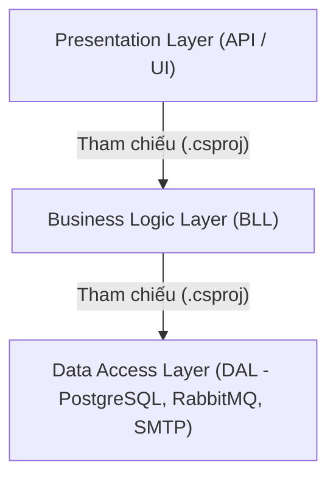
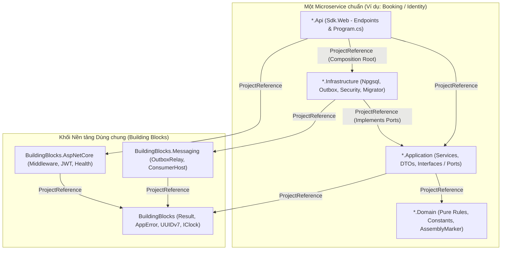
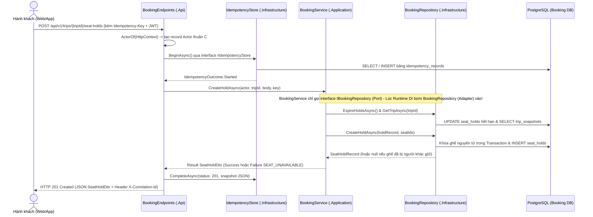

# Chương 02.1: Clean Architecture 4 Tầng — Từ Lý Thuyết Gốc Rễ Đến Từng Dòng Code C#

> **Mục tiêu của chương này**: Giúp bất kỳ sinh viên hay lập trình viên nào — kể cả người chưa từng nghe tới Clean Architecture, SOLID hay Hexagonal Architecture — hiểu thấu đáo **tại sao** dự án **BLUE Bus Ticket Platform (PBL6)** lại chia mỗi microservice thành đúng 4 project (`Domain`, `Application`, `Infrastructure`, `Api`), **từng tầng chứa chính xác những gì** trong mã nguồn thực tế, **sự đánh đổi thực dụng (Pragmatic Architecture)** của đội ngũ phát triển nằm ở đâu, và làm thế nào dự án dùng bộ test tự động (`NetArchTest.Rules` + XML `.csproj` scanner) để "khóa chặt" kiến trúc ngay từ lúc chạy `dotnet test`.

---

## 1. Khởi đầu từ con số 0: Trước khi có Clean Architecture, dự án lớn gặp thảm họa gì?

Để hiểu giá trị của một kiến trúc phần mềm, đừng bắt đầu bằng những vòng tròn đồng tâm trừu tượng. Hãy bắt đầu bằng nỗi đau thực tế khi viết một hệ thống bán vé xe khách quy mô lớn.

### 1.1. Cấp độ sơ khai: "Viết hết SQL và nghiệp vụ vào Controller / Endpoint" (Big Ball of Mud)

Khi mới học lập trình Web, cách nhanh nhất để tạo API đặt vé `POST /api/v1/bookings` là viết tất cả vào một hàm duy nhất:
1. Đọc JSON từ `HttpContext`, kiểm tra header `Authorization` lấy `userId`.
2. Mở kết nối PostgreSQL (`new NpgsqlConnection(...)`) ngay trong hàm API.
3. Viết câu lệnh `SELECT` kiểm tra chuyến xe còn mở bán không, ghế còn giữ chỗ (`seat_holds`) không, tính tiền giảm giá coupon, rồi `INSERT INTO bookings`.
4. Mở kết nối RabbitMQ bắn tin nhắn `BookingCreated` cho dịch vụ Thanh toán (`Payment`) và Thông báo (`Notification`).
5. Trả về mã HTTP `201 Created` hoặc `409 Conflict`.

Cách làm này chạy cực nhanh ở tuần đầu tiên, nhưng bước sang tháng thứ hai khi hệ thống phình lên **6 microservices** (`Identity`, `Transport`, `Booking`, `Payment`, `Notification`, `Reporting`), ba thảm họa lập tức ập đến:

- **Thảm họa 1 — Tắc nghẽn tái sử dụng luồng nghiệp vụ (Code Duplication)**: Giả sử nghiệp vụ *"Nhập chuyến xe mới mở bán vào kho ghế của Booking"* vừa được gọi qua HTTP nội bộ (`POST /api/v1/internal/trips/published`), vừa được kích hoạt tự động khi nhận sự kiện `TripPublished` từ RabbitMQ. Nếu logic nằm dính chặt với `HttpContext` trong Endpoint, worker lắng nghe RabbitMQ không có `HttpContext` để gọi hàm đó! Bạn buộc phải copy-paste hàng trăm dòng SQL sang hai nơi.
- **Thảm họa 2 — Bất khả thi khi viết Unit Test nhanh**: Muốn kiểm tra công thức tính phí hủy vé (trước 24h phạt 10%, trước 6h phạt 20%, dưới 2h cấm hủy) hoặc luật đặt mật khẩu (tối thiểu 10 ký tự, có cả chữ và số), bạn buộc phải dựng cả Web Server + PostgreSQL thật + RabbitMQ thật vì code nghiệp vụ bị trộn chung với `NpgsqlConnection` và `HttpContext`. Một bộ test lẽ ra chạy mất **5 mili-giây** trên RAM nay tốn **30 giây** khởi động container.
- **Thảm họa 3 — Hiệu ứng cánh bướm hạ tầng**: Khi nâng cấp thư viện `Npgsql` lên bản 10.0, đổi cơ chế băm mật khẩu sang `Argon2id`, hay đổi cấu trúc bảng SQL, bạn phải chạm vào đúng file đang chứa quy tắc tính tiền vé và kiểm tra quyền hạn. Một lỗi gõ nhầm ở tầng SQL có thể làm sai lệch logic tính doanh thu.

### 1.2. Cấp độ tiến hóa dở dang: Kiến trúc 3-Tier truyền thống (`UI -> BLL -> DAL`) và "Cái bẫy phụ thuộc"

Để khắc phục chuyện nhồi nhét vào Controller, các giáo trình phần mềm truyền thống dạy mô hình **3 lớp (3-Tier / Layered Architecture)**:
- **Presentation Layer (`UI` / `Api`)**: Nhận HTTP Request, gọi xuống Business Logic Layer.
- **Business Logic Layer (`BLL`)**: Chứa quy tắc nghiệp vụ, gọi xuống Data Access Layer để đọc/ghi dữ liệu.
- **Data Access Layer (`DAL`)**: Chứa code kết nối cơ sở dữ liệu PostgreSQL (`Npgsql`), Entity Framework hoặc gọi API bên thứ ba.

Nghe rất hợp lý! Nhưng hãy nhìn kỹ **chiều mũi tên tham chiếu biên dịch (`<ProjectReference>`)** của mô hình 3-Tier truyền thống:



Bạn có thấy điều bất ổn không?
Trong mô hình 3-Tier, **`BLL` (trái tim nghiệp vụ của công ty) lại phụ thuộc trực tiếp vào `DAL` (chi tiết kỹ thuật hạ tầng)**!
Hệ quả là:
1. Nếu `DAL` cài gói NuGet `Npgsql` hay `RabbitMQ.Client`, toàn bộ kiểu dữ liệu hạ tầng như `NpgsqlException`, `NpgsqlTransaction` dễ dàng rò rỉ ngược lên `BLL`.
2. Bạn vẫn không thể biên dịch hay test độc lập `BLL` nếu không kéo theo `DAL`. Hạ tầng cơ sở dữ liệu — thứ lẽ ra chỉ là "công cụ lưu trữ" — lại ngồi ở vị trí trung tâm, bắt toàn bộ nghiệp vụ phải xoay quanh cấu trúc bảng của nó (*Database-Driven Design* thay vì *Domain-Driven Design*).

Câu hỏi lịch sử đặt ra cho ngành kỹ thuật phần mềm là:
> **Làm sao để lúc chạy (Runtime), tầng Nghiệp vụ (`Application`) vẫn gọi được hàm lưu dữ liệu của tầng Hạ tầng (`Infrastructure`), NHƯNG lúc biên dịch (Compile-time), tầng Nghiệp vụ tuyệt đối KHÔNG tham chiếu tới tầng Hạ tầng?**

Câu trả lời chính là **Nguyên lý Đảo ngược Phụ thuộc (Dependency Inversion Principle)**.

---

## 2. Hai viên gạch lý thuyết gốc rễ: Dependency Inversion (DIP) & Ports and Adapters

### 2.1. Chữ "D" trong SOLID — Dependency Inversion Principle (DIP)

Robert C. Martin (Uncle Bob) phát biểu nguyên lý **Dependency Inversion** gồm 2 mệnh đề kinh điển:
1. *Các module cấp cao (chứa chính sách nghiệp vụ cốt lõi) không được phụ thuộc vào các module cấp thấp (chứa chi tiết kỹ thuật: SQL, SMTP, JWT, RabbitMQ). Cả hai phải phụ thuộc vào **Abstraction (Bản thiết kế trừu tượng / Interface)**.*
2. *Abstraction không được phụ thuộc vào chi tiết. Chi tiết phải phụ thuộc vào Abstraction.*

Hãy hình dung một ví dụ đời thực cực dễ hiểu: **Ổ cắm điện trên tường và cái quạt máy**.
- Ngôi nhà của bạn (Nghiệp vụ cốt lõi) không hề hàn cứng dây đồng vào chiếc quạt Panasonic hay sạc laptop Dell (Chi tiết hạ tầng).
- Thay vào đó, ngôi nhà định nghĩa một **Chuẩn ổ cắm 2 chấu 220V (`Interface`)**.
- Bất kỳ thiết bị điện nào (Quạt, Tủ lạnh, Sạc điện thoại) muốn lấy điện đều phải tự chế tạo phích cắm tuân thủ đúng chuẩn 2 chấu đó (`class Fan : IPowerPlug`).

Trong C#, "phép màu" đảo chiều mũi tên diễn ra chỉ bằng một `interface`:

- **Trước khi đảo chiều (3-Tier truyền thống)**:
  `AuthService` (thuộc `Application`) gọi trực tiếp `class Argon2PasswordHasher` (thuộc `Infrastructure`). Vậy `Application` **phải** `<ProjectReference>` tới `Infrastructure`. Mũi tên đi từ `Application ---> Infrastructure`.
- **Sau khi đảo chiều (Clean Architecture)**:
  1. Tầng `Application` tự tuyên bố: *"Tôi không quan tâm anh băm mật khẩu bằng BCrypt, PBKDF2 hay Argon2id. Tôi chỉ đặt ra hợp đồng `public interface IPasswordHasher { string Hash(string password); bool Verify(string password, string hash); }` ngay tại nhà của tôi (`Identity.Application`)!"*
  2. `AuthService` (trong `Application`) chỉ gọi `IPasswordHasher`. Nó hoàn toàn mù tịt về sự tồn tại của thư viện `Konscious.Security.Cryptography.Argon2`.
  3. Tầng `Infrastructure` tham chiếu ngược vào `Application` (`Infrastructure ---> Application`), và viết class `public sealed class Argon2PasswordHasher : IPasswordHasher`.

Mũi tên phụ thuộc lúc biên dịch đã bị **lật ngược 180 độ**: thay vì nghiệp vụ phụ thuộc hạ tầng, nay **hạ tầng phải cúi đầu tuân thủ hợp đồng của nghiệp vụ**!

### 2.2. Kiến trúc Lục giác — Ports & Adapters (Hexagonal Architecture)

Năm 2005, Alistair Cockburn gọi mô hình này là **Ports & Adapters** (hay **Hexagonal Architecture**), và đến năm 2012 Uncle Bob tổng hợp lại thành tên gọi phổ biến nhất hiện nay: **Clean Architecture**. Dù tên gọi khác nhau, bản chất kỹ thuật trong dự án **BLUE Bus Ticket Platform** là một:

- **Ports (Các cổng giao tiếp — chính là các C# `interface` nằm ở tầng `Application`)**:
  Mở file `workspace/src/services/identity/BusTicketPlatform.Identity.Application/Ports.cs`, bạn sẽ thấy tác giả dự án đặt tên file đúng nghĩa đen là **`Ports.cs`**! Đó là các cổng mà tầng Nghiệp vụ mở ra để nói chuyện với thế giới bên ngoài:
  - `IPasswordHasher`: Cổng băm và kiểm tra mật khẩu.
  - `ITokenService`: Cổng phát hành cặp Access Token (JWT) và Refresh Token.
  - `IChallengeNotifier`: Cổng gửi mã OTP xác thực email / đặt lại mật khẩu.
  - `IIdentityRepository`: Cổng đọc/ghi dữ liệu người dùng, phiên đăng nhập, nhật ký kiểm toán.
  - `IRegistrationEvents`: Cổng phát sự kiện người dùng đăng ký thành công ra hệ thống tin nhắn.
- **Adapters (Các bộ chuyển đổi — chính là các `class` nằm ở tầng `Infrastructure` và `Api`)**:
  - **Primary / Driving Adapters (Bộ điều khiển đầu vào — tầng `*.Api` và Event Consumers)**: Là nơi tiếp nhận tín hiệu kích hoạt từ thế giới bên ngoài rồi gọi vào Application. Ví dụ: `BookingEndpoints.cs` nhận HTTP Request từ người dùng, hoặc `BookingEventHandlers.cs` nhận message từ RabbitMQ rồi gọi `BookingService`.
  - **Secondary / Driven Adapters (Bộ chuyển đổi đầu ra — tầng `*.Infrastructure`)**: Là các class thực thi các `Ports` để nói chuyện với công nghệ thật. Ví dụ: `Argon2PasswordHasher` chuyển lời gọi `IPasswordHasher` thành thuật toán Argon2id; `BookingRepository` chuyển lời gọi `IBookingRepository` thành câu lệnh SQL qua `Npgsql`; `OutboxWriter` chuyển sự kiện thành bản ghi JSONB trong bảng `outbox_messages`.

---

## 3. Giải phẫu chi tiết 4 tầng trong từng Microservice của dự án BLUE

Mở Solution `workspace/BusTicketPlatform.sln`, bạn sẽ thấy cả **6 microservices** (`Identity`, `Transport`, `Booking`, `Payment`, `Notification`, `Reporting`) đều được đúc theo cùng một khuôn mẫu 4 project C# nhất quán tuyệt đối:

```text
src/services/<ten-service>/
├── BusTicketPlatform.<Service>.Domain          (Tầng 1: Lõi quy tắc & hằng số miền bất biến)
├── BusTicketPlatform.<Service>.Application     (Tầng 2: Ca sử dụng / Nghiệp vụ, DTOs & Ports)
├── BusTicketPlatform.<Service>.Infrastructure  (Tầng 3: Adapters CSDL Npgsql, Outbox, Bảo mật)
└── BusTicketPlatform.<Service>.Api             (Tầng 4: HTTP Endpoints & Composition Root)
```

Bên cạnh 6 microservices này, toàn hệ thống còn dùng chung bộ thư viện nền tảng **`building-blocks`** (không chứa logic nghiệp vụ của bất kỳ miền nào):
- `BusTicketPlatform.BuildingBlocks`: Các kiểu nguyên thủy thuần C# (`Result<T>`, `AppError`, `ErrorCodes`, `IIdGenerator`, `IClock`, `IIdempotencyStore`, `LogRedaction`).
- `BusTicketPlatform.BuildingBlocks.AspNetCore`: Các Middleware và Extension cho HTTP (`CorrelationMiddleware`, `ErrorEnvelopeMiddleware`, `PlatformHttp`, `PlatformJwtExtensions`, `HealthEndpointExtensions`).
- `BusTicketPlatform.BuildingBlocks.Messaging`: Hạ tầng truyền thông bất đồng bộ (`EventMessage`, `OutboxRelay`, `OutboxDispatchHostedService`, `InboxDeduper`, `IntegrationEventConsumerHost`).

Hãy mổ xẻ từng tầng một bằng chính những dòng code đang chạy trong dự án!

---

### 3.1. Tầng 1 — `*.Domain`: Lõi tinh khiết & Sự thật trung thực về "Pragmatic Domain" của dự án

#### a) Cấu hình `.csproj` hoàn toàn "trần trụi" (Zero External Dependencies)
Hãy xem file `workspace/src/services/identity/BusTicketPlatform.Identity.Domain/BusTicketPlatform.Identity.Domain.csproj`:

```xml
<Project Sdk="Microsoft.NET.Sdk">
  <PropertyGroup>
    <RootNamespace>BusTicketPlatform.Identity.Domain</RootNamespace>
    <Description>Identity bounded-context domain. No ASP.NET, EF Core or provider SDKs.</Description>
  </PropertyGroup>
</Project>
```

Không một thẻ `<PackageReference>`, không một thẻ `<ProjectReference>` nào! Tầng `Domain` thậm chí còn không tham chiếu tới `BuildingBlocks`. Nó chỉ dựa vào thư viện chuẩn của .NET (`System.*`). Điều này đảm bảo các quy tắc miền ở đây có tuổi thọ vĩnh cửu, hoàn toàn miễn nhiễm với mọi biến động của framework Web hay cơ sở dữ liệu.

#### b) Bên trong `Identity.Domain` có gì?
Trong `BusTicketPlatform.Identity.Domain`, chúng ta có các quy tắc bất biến thuần túy nhất của miền Định danh:

1. **`PasswordPolicy.cs`** — Quy tắc độ mạnh mật khẩu không phụ thuộc hạ tầng băm:
```csharp
namespace BusTicketPlatform.Identity.Domain;

public static class PasswordPolicy
{
    public const int MinLength = 10;
    public const int MaxLength = 128;

    public static bool IsSatisfied(string? password)
    {
        if (string.IsNullOrEmpty(password) || password.Length < MinLength || password.Length > MaxLength)
        {
            return false;
        }

        var hasLetter = false;
        var hasDigit = false;
        foreach (var ch in password)
        {
            if (char.IsLetter(ch))
            {
                hasLetter = true;
            }
            else if (char.IsDigit(ch))
            {
                hasDigit = true;
            }

            if (hasLetter && hasDigit)
            {
                return true;
            }
        }

        return false;
    }
}
```
*Giải thích kỹ thuật*: Thay vì dùng biểu thức chính quy (Regex) phức tạp dễ bị tấn công ReDoS (Regular Expression Denial of Service) hoặc cấp phát bộ nhớ thừa, `PasswordPolicy.IsSatisfied` duyệt từng ký tự `char` trên chuỗi trong một vòng lặp `O(n)` duy nhất và thoát sớm (`return true`) ngay khi bắt gặp đủ ít nhất 1 chữ cái và 1 chữ số trong độ dài `[10..128]`.

2. **`IdentityNormalizer.cs`** — Chuẩn hóa Email/Phone với Source-Generated Regex của .NET hiện đại:
```csharp
using System.Text.RegularExpressions;

namespace BusTicketPlatform.Identity.Domain;

public static partial class IdentityNormalizer
{
    [GeneratedRegex(@"^\+[1-9][0-9]{7,14}$")]
    private static partial Regex PhonePattern();

    [GeneratedRegex(@"^[^@\s]+@[^@\s]+\.[^@\s]+$")]
    private static partial Regex EmailPattern();

    public static string NormalizeEmail(string email) => email.Trim().ToUpperInvariant();

    public static string NormalizePhone(string phone) => phone.Trim();

    public static bool IsEmail(string value) => EmailPattern().IsMatch(value.Trim());

    public static bool IsPhone(string value) => PhonePattern().IsMatch(value.Trim());

    public static bool IsFullName(string value)
    {
        var trimmed = value.Trim();
        return trimmed.Length is >= 2 and <= 150;
    }
}
```
*Giải thích kỹ thuật*: Chú ý từ khóa `partial class` đi kèm thuộc tính `[GeneratedRegex(...)]`. Trong .NET 10, trình biên dịch Roslyn sẽ sinh sẵn mã C# kiểm tra biểu thức chính quy chuẩn E.164 (`^\+[1-9][0-9]{7,14}$`) ngay lúc **compile-time**, loại bỏ hoàn toàn chi phí biên dịch Regex lúc khởi động ứng dụng và hỗ trợ tối ưu AOT/JIT! Đồng thời, `NormalizeEmail` ép toàn bộ email về chữ in hoa (`ToUpperInvariant()`) để chống trùng lặp tài khoản kiểu `User@gmail.com` vs `user@gmail.com`.

3. **`UserStatuses.cs`** (trong `Identity.Domain`) và **`Roles.cs`** (trong `Transport.Domain`): Định nghĩa các tập hằng số trạng thái miền chuẩn mực (`PENDING_VERIFICATION`, `ACTIVE`, `LOCKED`, `DISABLED`; vòng đời chuyến xe `DRAFT` -> `SCHEDULED` -> `BOARDING` -> `DEPARTED` -> `IN_TRANSIT` -> `ARRIVED` -> `COMPLETED` / `CANCELLED`).

#### c) Góc nhìn Kiến trúc Trung thực: Tại sao `Booking.Domain`, `Payment.Domain`, `Notification.Domain`, `Reporting.Domain` chỉ có `AssemblyMarker.cs`?

Nếu bạn mở thư mục `workspace/src/services/notification/BusTicketPlatform.Notification.Domain/` (hoặc `Booking.Domain`, `Payment.Domain`, `Reporting.Domain`), bạn sẽ thấy chỉ có duy nhất một file `AssemblyMarker.cs`:

```csharp
namespace BusTicketPlatform.Notification.Domain;

public static class AssemblyMarker
{
}
```

> [!IMPORTANT]
> **Phân tích trung thực cho buổi bảo vệ đồ án / thuyết trình kỹ thuật**:
> Nếu hội đồng hỏi: *"Tại sao dự án tổ chức Clean Architecture 4 tầng nhưng nhiều project `*.Domain` chỉ có `AssemblyMarker`, không thấy Rich Domain Entities kế thừa `AggregateRoot` như sách DDD giáo điều?"* — Đây chính là điểm ăn điểm nếu bạn hiểu rõ bản chất thiết kế!

Dự án BLUE áp dụng triết lý **Pragmatic Clean Architecture kết hợp Transaction Script / Immutable Record Model**:
1. **Không dùng ORM nặng nề (Không dùng Entity Framework Core)**: Toàn bộ hệ thống dùng **`Npgsql` thuần (Raw SQL)** với khóa lạc quan `row_version` và ràng buộc nguyên tử ngay dưới PostgreSQL (`UPDATE ... WHERE status = 'AVAILABLE'`, `ON CONFLICT DO UPDATE`). Khi không dùng EF Core Change Tracker để theo dõi sự thay đổi trạng thái của object trên RAM, việc xây dựng các class Entity phức tạp có hàng chục private setter rồi lại phải map thủ công qua lại với bản ghi SQL chỉ tạo ra **boilerplate vô ích (Over-engineering)**.
2. **Dữ liệu bất biến (`sealed record`) và chính sách nghiệp vụ đặt gọn ở `*.Application`**: Ví dụ trong `Booking`, các cấu trúc dữ liệu bản ghi như `BookingRecord`, `SeatHoldRecord`, `TicketRecord` và cả chính sách tính phí hủy vé `CancellationPolicy` (phạt 10% / 20% / 30% tùy số giờ trước giờ khởi hành) được đặt trực tiếp trong `Booking.Application/Contracts.cs` cùng với `BookingService.cs`.
3. **Tại sao vẫn giữ project `*.Domain` với `AssemblyMarker` ở cả 6 service?**:
   - Thứ nhất, giữ **tính đồng nhất cấu trúc (Structural Uniformity)** trên toàn bộ 6 microservices (mỗi service luôn có đúng 4 mảnh ghép chuẩn mực).
   - Thứ hai, `AssemblyMarker` đóng vai trò **mỏ neo kiểu (Type Anchor)** để bộ kiểm thử kiến trúc tự động `LayerDependencyTests.cs` quét toàn bộ 6 cụm service trong một `[Theory]` duy nhất.
   - Thứ ba, tạo sẵn "ngăn kéo sạch tuyệt đối" để bất cứ khi nào một service phát sinh quy tắc miền độc lập phức tạp (như `PasswordPolicy` và `IdentityNormalizer` ở `Identity`, hay `TripStatuses` ở `Transport`), đội ngũ có chỗ đặt vào ngay lập tức mà không cần tái cấu trúc Solution!

---

### 3.2. Tầng 2 — `*.Application`: Bộ não điều phối Ca sử dụng (Use Cases), DTOs & Ports

#### a) Cấu hình `.csproj` của tầng `Application`
Xem file `workspace/src/services/booking/BusTicketPlatform.Booking.Application/BusTicketPlatform.Booking.Application.csproj`:

```xml
<Project Sdk="Microsoft.NET.Sdk">
  <PropertyGroup>
    <RootNamespace>BusTicketPlatform.Booking.Application</RootNamespace>
    <Description>Booking use cases and ports. No controllers or ORM mapping.</Description>
  </PropertyGroup>
  <ItemGroup>
    <ProjectReference Include="..\BusTicketPlatform.Booking.Domain\BusTicketPlatform.Booking.Domain.csproj" />
    <ProjectReference Include="..\..\..\building-blocks\BusTicketPlatform.BuildingBlocks\BusTicketPlatform.BuildingBlocks.csproj" />
  </ItemGroup>
</Project>
```

Hãy quan sát sự kỷ luật ở đây:
- `Booking.Application` **CHỈ** được phép tham chiếu tới `Booking.Domain` (cùng service) và `BusTicketPlatform.BuildingBlocks` (để dùng `Result<T>`, `AppError`, `IIdGenerator`, `IClock`).
- Tuyệt đối **KHÔNG** có `Microsoft.AspNetCore.App` (không biết `HttpContext`, `IResult` là gì), **KHÔNG** có `Npgsql`, **KHÔNG** có `RabbitMQ.Client`!

#### b) Ba thành phần cốt lõi bên trong `*.Application`
Lấy `Booking.Application` và `Identity.Application` làm đại diện, tầng này chứa đúng 3 nhóm phần tử:

1. **DTOs, Commands, Queries & Records (`Contracts.cs`)**:
   Định nghĩa dữ liệu đầu vào/đầu ra và ngữ cảnh người gọi (`Actor`). Ví dụ trong `Booking.Application/Contracts.cs`:
   ```csharp
   public sealed record Actor(Guid UserId, Guid? OrganizationId, IReadOnlyList<string> Roles)
   {
       public bool Has(params string[] roles) => roles.Any(Roles.Contains);
   }

   public sealed record CreateSeatHoldRequest(IReadOnlyList<Guid> SeatIds, Guid PickupStopId, Guid DropoffStopId);
   public sealed record SeatHoldDto(string HoldToken, Guid TripId, string Status, IReadOnlyList<TripSeatDto> Seats, DateTimeOffset ExpiresAt, DateTimeOffset ServerTime);
   ```
   Nhờ tách `Actor` thành một `record` thuần C# thay vì truyền `ClaimsPrincipal` của ASP.NET Core vào Service, `BookingService` hoàn toàn độc lập khỏi giao thức HTTP!

2. **Interfaces / Ports (`IBookingRepository`, `IBookingEvents` trong `Contracts.cs` hoặc `Ports.cs`)**:
   Định nghĩa những gì ca sử dụng **cần** hạ tầng thực hiện cho nó:
   ```csharp
   public interface IBookingRepository
   {
       Task ExpireHoldsAsync(CancellationToken cancellationToken);
       Task<TripSnapshot?> GetTripAsync(Guid tripId, CancellationToken cancellationToken);
       Task<SeatHoldRecord?> CreateHoldAsync(SeatHoldRecord hold, IReadOnlyList<Guid> seatIds, CancellationToken cancellationToken);
       Task<BookingRecord?> CreateBookingAsync(BookingRecord booking, IReadOnlyList<BookingItemRecord> items, IReadOnlyList<PassengerRecord> passengers, Guid holdId, CancellationToken cancellationToken);
       // ... các thao tác đọc/ghi kho vé khác
   }

   public interface IBookingEvents
   {
       Task BookingCreatedAsync(BookingRecord booking, Guid correlationId, CancellationToken cancellationToken);
       Task BookingPaidAsync(BookingRecord booking, Guid correlationId, CancellationToken cancellationToken);
       // ...
   }
   ```

3. **Application Services (`BookingService.cs`, `AuthService.cs`, `ProfileService.cs`)**:
   Sử dụng cú pháp **Primary Constructor của C# 12+** để nhận các Port qua Dependency Injection và điều phối từng bước nghiệp vụ, trả về kiểu `Result<T>` thay vì ném Exception. Hãy xem trích đoạn hàm `CreateHoldAsync` trong `BookingService.cs`:
   ```csharp
   public sealed class BookingService(IBookingRepository store, IBookingEvents events, IIdGenerator ids, TicketQrOptions ticketQr)
   {
       public async Task<Result<SeatHoldDto>> CreateHoldAsync(
           Actor actor, Guid tripId, CreateSeatHoldRequest request, string idempotencyKey, CancellationToken cancellationToken)
       {
           // Bước 1: Kiểm tra phân quyền nghiệp vụ (RBAC)
           if (!actor.Has("CUSTOMER"))
               return Result<SeatHoldDto>.Failure(PlatformErrors.AccessDenied());

           // Bước 2: Kiểm tra tính hợp lệ của đầu vào (tối đa 10 ghế, không trùng ghế, điểm đón != điểm trả)
           if (request.SeatIds is null || request.SeatIds.Count is < 1 or > 10
               || request.SeatIds.Any(id => id == Guid.Empty)
               || request.SeatIds.Distinct().Count() != request.SeatIds.Count
               || request.PickupStopId == Guid.Empty || request.DropoffStopId == Guid.Empty
               || request.PickupStopId == request.DropoffStopId)
           {
               return Result<SeatHoldDto>.Failure(PlatformErrors.Validation("Seat hold input is invalid."));
           }

           // Bước 3: Dọn các lượt giữ ghế đã quá hạn & kiểm tra chuyến xe có đang mở bán không
           await store.ExpireHoldsAsync(cancellationToken);
           var trip = await store.GetTripAsync(tripId, cancellationToken);
           if (trip is null || !trip.Sellable)
               return Result<SeatHoldDto>.Failure(PlatformErrors.TripNotSellable());

           // Bước 4: Sinh mã giữ ghế bí mật 256-bit (chỉ lưu bản băm SHA-256 xuống DB để bảo mật!)
           var tokenPlain = Convert.ToBase64String(RandomNumberGenerator.GetBytes(32))
               .TrimEnd('=').Replace('+', '-').Replace('/', '_');

           var hold = new SeatHoldRecord(
               ids.NewUuidV7(), tripId, actor.UserId, idempotencyKey,
               Hash(tokenPlain), tokenPlain, "ACTIVE", 0, trip.Currency,
               DateTimeOffset.UtcNow, DateTimeOffset.UtcNow.AddMinutes(10), []);

           // Bước 5: Nhờ Port IBookingRepository khóa ghế nguyên tử dưới CSDL
           var created = await store.CreateHoldAsync(hold, request.SeatIds.ToArray(), cancellationToken);
           if (created is null)
               return Result<SeatHoldDto>.Failure(PlatformErrors.SeatUnavailable());

           return Result<SeatHoldDto>.Success(MapHold(created));
       }
   }
   ```
   Đọc đoạn code trên, người chưa biết gì về PostgreSQL hay ASP.NET vẫn đọc hiểu 100% quy trình giữ ghế xe khách diễn ra như thế nào: kiểm tra vai trò `CUSTOMER` -> kiểm tra 1..10 ghế không trùng -> kiểm tra chuyến xe `Sellable` -> sinh token 32 bytes ngẫu nhiên mật mã học -> giữ chỗ 10 phút!

---

### 3.3. Tầng 3 — `*.Infrastructure`: Xưởng chế tác Adapters kết nối thế giới vật lý

Nếu tầng `Application` là bộ não ra quyết định trên giấy tờ, thì tầng `Infrastructure` là đôi tay thực thi mọi công việc nặng nhọc với cơ sở dữ liệu PostgreSQL, hàng đợi RabbitMQ, thuật toán mã hóa Argon2id, ký số JWT và kiểm tra sức khỏe hạ tầng.

#### a) Cấu hình `.csproj` của `Booking.Infrastructure` — Bí quyết nhúng SQL Migration (`EmbeddedResource`)
Hãy xem file `workspace/src/services/booking/BusTicketPlatform.Booking.Infrastructure/BusTicketPlatform.Booking.Infrastructure.csproj`:

```xml
<Project Sdk="Microsoft.NET.Sdk">
  <PropertyGroup>
    <RootNamespace>BusTicketPlatform.Booking.Infrastructure</RootNamespace>
    <Description>Booking persistence and adapters.</Description>
  </PropertyGroup>
  <ItemGroup>
    <ProjectReference Include="..\BusTicketPlatform.Booking.Application\BusTicketPlatform.Booking.Application.csproj" />
    <ProjectReference Include="..\..\..\building-blocks\BusTicketPlatform.BuildingBlocks.Messaging\BusTicketPlatform.BuildingBlocks.Messaging.csproj" />
  </ItemGroup>
  <ItemGroup>
    <PackageReference Include="Microsoft.Extensions.Diagnostics.HealthChecks" />
    <PackageReference Include="Microsoft.Extensions.Hosting" />
    <PackageReference Include="Npgsql" />
  </ItemGroup>
  <ItemGroup>
    <EmbeddedResource Include="..\..\..\..\..\docs\database\_shared\000_integration_tables.sql" LogicalName="sql.shared" />
    <EmbeddedResource Include="..\..\..\..\..\docs\database\booking\001_initial.sql" LogicalName="sql.booking" />
    <EmbeddedResource Include="..\..\..\..\..\docs\database\booking\002_coupons.sql" LogicalName="sql.coupons" />
  </ItemGroup>
</Project>
```

Ba điểm sáng kỹ thuật cực kỳ đáng chú ý trong file `.csproj` này:
1. **Chiều tham chiếu chuẩn DIP**: `Booking.Infrastructure` tham chiếu vào `Booking.Application` (để thấy và thực thi `IBookingRepository`, `IBookingEvents`), chứ `Booking.Application` không hề biết tới `Booking.Infrastructure`.
2. **Cô lập gói NuGet hạ tầng**: Chỉ tầng này mới khai báo `<PackageReference Include="Npgsql" />` (hoặc ở `Identity.Infrastructure` mới có `Konscious.Security.Cryptography.Argon2` và `System.IdentityModel.Tokens.Jwt`). Các gói thư viện nặng này không bị tràn sang `Domain` hay `Application`.
3. **Nhúng trực tiếp kịch bản SQL từ `docs/database/` vào file `.dll` (`<EmbeddedResource>`)**: Thay vì copy-paste file `.sql` vào nhiều nơi dễ lệch phiên bản giữa tài liệu thiết kế CSDL và code chạy thật, dự án nhúng thẳng file gốc `docs/database/_shared/000_integration_tables.sql` và `docs/database/booking/001_initial.sql` vào bên trong Assembly lúc biên dịch dưới tên định danh `sql.shared`, `sql.booking`, `sql.coupons`!

#### b) Giải phẫu 6 nhóm class cốt lõi trong `*.Infrastructure`

1. **`Persistence/*Repository.cs` (ví dụ `BookingRepository.cs`, `IdentityRepository.cs`)**:
   Thực thi interface `IBookingRepository` bằng ADO.NET hiện đại với `NpgsqlConnection`, `NpgsqlTransaction` và Raw String Literals (`""" ... """` của C# 11+). Ví dụ khi nhập chuyến xe mới (`ImportTripAsync`), `BookingRepository` mở giao dịch (`BeginTransactionAsync`) và dùng `INSERT ... ON CONFLICT (trip_id) DO UPDATE ... GREATEST(trip_snapshots.source_trip_version, EXCLUDED.source_trip_version)` để đảm bảo dù sự kiện RabbitMQ đến trễ hay lặp lại (out-of-order / duplicate delivery), phiên bản dữ liệu cũ không bao giờ ghi đè lên phiên bản mới!

2. **`OutboxWriter.cs` & `BookingEvents.cs` (Transactional Outbox Adapter)**:
   Thực thi `IBookingEvents`. Khi `BookingService` báo *"Đơn đặt vé vừa được tạo (`BookingCreatedAsync`)"*, thay vì bắn thẳng lên RabbitMQ (rủi ro mất tin nhắn nếu mạng rớt ngay lúc đó), `BookingEvents` đóng gói `EventMessage` rồi nhờ `OutboxWriter` ghi vào bảng `outbox_messages` trong chính PostgreSQL của Booking:
   ```csharp
   public sealed class OutboxWriter(BookingDatabaseOptions options)
   {
       public async Task EnqueueAsync(EventMessage message, CancellationToken cancellationToken)
       {
           var payload = JsonSerializer.Serialize(message, EventMessageJson.Options);
           await using var connection = new NpgsqlConnection(options.ConnectionString);
           await connection.OpenAsync(cancellationToken);
           await using var command = new NpgsqlCommand("""
               INSERT INTO outbox_messages (
                 id, message_type, schema_version, aggregate_id, aggregate_version, payload,
                 correlation_id, occurred_at, attempt_count)
               VALUES (
                 @id, @type, @version, @aggregate, @aggregateVersion, CAST(@payload AS jsonb),
                 @correlation, @occurred, 0);
               """, connection);
           // ... gắn tham số an toàn chống SQL Injection và ExecuteNonQueryAsync
       }
   }
   ```
   Sau đó, tiến trình chạy ngầm `OutboxDispatchHostedService` (từ `BuildingBlocks.Messaging`) sẽ quét bảng `outbox_messages` mỗi 2 giây để đẩy tin nhắn lên RabbitMQ.

3. **`*EventHandlers.cs` (ví dụ `BookingEventHandlers.cs` — Driving Adapter cho RabbitMQ)**:
   Khi dịch vụ `Transport` phát sự kiện `TripPublished` hoặc dịch vụ `Payment` phát sự kiện `PaymentSucceeded` qua RabbitMQ, `IntegrationEventConsumerHost` (sau khi lọc trùng lặp qua bảng `inbox_messages`) sẽ gọi vào `BookingEventHandlers`:
   ```csharp
   public static async Task HandleTripAsync(IServiceProvider services, EventMessage message, CancellationToken cancellationToken)
   {
       var service = services.GetRequiredService<BookingService>();
       if (message.EventType == "TripPublished")
       {
           var body = EventPayload.Deserialize<TripPublishedMessage>(message.Payload);
           if (body is not null && body.TripId != Guid.Empty)
           {
               await service.ImportPublishedTripAsync(body, message.CorrelationId, cancellationToken);
           }
           return;
       }
       // ... xử lý TripStatusChanged, TripCancelled
   }
   ```
   Hãy thấy vẻ đẹp của Clean Architecture tại đây: **Cả HTTP Endpoint (`POST /internal/trips/published`) lẫn RabbitMQ Consumer (`BookingEventHandlers.HandleTripAsync`) đều hội tụ về gọi chung một hàm duy nhất `BookingService.ImportPublishedTripAsync`!** Không một dòng logic nghiệp vụ nào bị nhân bản.

4. **`SqlBaselineMigrator.cs` & `SqlBaselineHostedService.cs` (Tự động khởi tạo Schema lúc khởi động)**:
   Khi container microservice vừa bật lên, `SqlBaselineHostedService` (thực thi `IHostedService`) tự động kích hoạt `SqlBaselineMigrator.ApplyAsync()`. Class này tạo bảng `schema_migrations(filename text PRIMARY KEY, applied_at timestamptz)`, kiểm tra xem các file SQL nhúng (`000_integration_tables.sql`, `001_initial.sql`, `002_coupons.sql`) đã từng chạy chưa; nếu chưa thì đọc luồng tài nguyên (`Assembly.GetExecutingAssembly().GetManifestResourceStream(name)`), thực thi SQL và đánh dấu vào `schema_migrations`. Nhờ cơ chế này, khi chạy Docker Compose hay Testcontainers trong Integration Test, toàn bộ 6 database PostgreSQL tự động dựng bảng hoàn chỉnh mà không cần chạy lệnh CLI thủ công bên ngoài!

5. **`Persistence/IdempotencyStore.cs` & `PostgresHealthCheck.cs`**:
   - `IdempotencyStore` thực thi `IIdempotencyStore` (từ `BuildingBlocks`) trên bảng `idempotency_records` để chống xử lý trùng lặp request HTTP (sẽ được mổ xẻ chi tiết từng dòng ở Chương 02.4).
   - `PostgresHealthCheck` thực thi `IHealthCheck` với câu truy vấn nhẹ `SELECT 1` để báo cáo trạng thái sẵn sàng (`/ready`) cho Docker/Kubernetes (xem Chương 02.2).

6. **`*InfrastructureExtensions.cs` (ví dụ `BookingInfrastructureExtensions.cs`)**:
   Cung cấp hàm mở rộng `AddBookingInfrastructure(this IServiceCollection services, IConfiguration configuration)` gom toàn bộ việc đăng ký DI của tầng Infrastructure và Application lại thành một lời gọi gọn gàng duy nhất cho tầng `Api`.

---

### 3.4. Tầng 4 — `*.Api`: HTTP Endpoints & Composition Root (Gốc lắp ghép)

Một thắc mắc kinh điển của người mới học Clean Architecture là:
> *"Nếu `Application` chỉ biết `IBookingRepository` (interface), không hề tham chiếu tới `Infrastructure`, vậy lúc chạy chương trình ai là người nối `IBookingRepository` với `BookingRepository` thật?"*

Người làm nhiệm vụ nối dây đó được gọi là **Composition Root (Gốc lắp ghép)**, và nó nằm ở điểm khởi đầu của ứng dụng: **`Program.cs` trong tầng `*.Api`**!

Xem file `workspace/src/services/booking/BusTicketPlatform.Booking.Api/BusTicketPlatform.Booking.Api.csproj`:
```xml
<Project Sdk="Microsoft.NET.Sdk.Web">
  <PropertyGroup>
    <RootNamespace>BusTicketPlatform.Booking.Api</RootNamespace>
    <Description>Booking HTTP composition root.</Description>
  </PropertyGroup>
  <ItemGroup>
    <ProjectReference Include="..\BusTicketPlatform.Booking.Application\BusTicketPlatform.Booking.Application.csproj" />
    <ProjectReference Include="..\BusTicketPlatform.Booking.Infrastructure\BusTicketPlatform.Booking.Infrastructure.csproj" />
    <ProjectReference Include="..\..\..\building-blocks\BusTicketPlatform.BuildingBlocks.AspNetCore\BusTicketPlatform.BuildingBlocks.AspNetCore.csproj" />
  </ItemGroup>
</Project>
```

Lưu ý:
- Chỉ tầng `*.Api` mới dùng `Sdk="Microsoft.NET.Sdk.Web"` (chứa Kestrel Web Server và pipeline ASP.NET Core).
- `Booking.Api` tham chiếu đồng thời tới `Booking.Application`, `Booking.Infrastructure` và `BuildingBlocks.AspNetCore` để thực hiện 2 nhiệm vụ duy nhất:
  1. **Trong `Program.cs` (Composition Root)**: Lắp ghép toàn bộ đồ thị Dependency Injection (`AddBuildingBlocks()`, `AddBookingInfrastructure()`, `AddPlatformJwt()`, `AddHealthChecks()`) và định hình thứ tự Middleware (`UseBuildingBlocks()`, `UseAuthentication()`, `UseAuthorization()`, `MapBookingEndpoints()`).
  2. **Trong `*Endpoints.cs` (ví dụ `BookingEndpoints.cs`)**: Ánh xạ đường dẫn HTTP (`/api/v1/bookings`), rút trích danh tính `Actor` từ JWT Claims, bọc cơ chế chống trùng lặp `WithIdempotency(...)`, gọi hàm tương ứng của `BookingService`, rồi chuyển kết quả `Result<T>` thành phản hồi HTTP JSON chuẩn qua `.ToHttp(context.CorrelationId())`.

> [!TIP]
> **Dòng cuối cùng `public partial class Program;` trong `Program.cs` dùng để làm gì?**
> Trong .NET Top-level statements, trình biên dịch tự sinh ra class `Program` ở phạm vi `internal`, khiến project kiểm thử tích hợp (`BusTicketPlatform.Booking.Api.IntegrationTests`) không thể nhìn thấy nó. Khai báo thêm dòng `public partial class Program;` ở cuối file mở quyền truy cập `public` cho `WebApplicationFactory<Program>`, cho phép bộ Integration Test khởi chạy toàn bộ API thật ngay trong bộ nhớ kết hợp với PostgreSQL/RabbitMQ của Testcontainers!

---

## 4. Sơ đồ đối chiếu: Chiều phụ thuộc Biên dịch (Compile-Time) vs Luồng chạy thực tế (Runtime)

Đây là bức tranh quan trọng nhất để trình bày trên slide thuyết trình bảo vệ đồ án. Nhiều người nhầm lẫn giữa *"ai gọi ai lúc chạy"* và *"project nào tham chiếu project nào lúc biên dịch"*.

### 4.1. Sơ đồ 1: Chiều mũi tên tham chiếu `.csproj` lúc Biên dịch (Compile-Time Dependencies)

Tất cả mọi mũi tên phụ thuộc mã nguồn đều **hướng vào phía trong về phía `Domain` và `BuildingBlocks`**. Không có bất kỳ mũi tên nào đi ngược từ trong ra ngoài!



### 4.2. Sơ đồ 2: Luồng điều khiển lúc Chạy (Runtime Request Flow) nhờ Đảo ngược Phụ thuộc

Khi khách hàng bấm nút **"Giữ ghế"** (`POST /api/v1/trips/{tripId}/seat-holds`), luồng chạy thực tế đi xuyên từ `Api` -> `Application` -> `Infrastructure` -> `PostgreSQL` mà vẫn không vi phạm quy tắc biên dịch nhờ DI Container truyền `BookingRepository` vào vị trí của `IBookingRepository`:



---

## 5. Kỷ luật Thép bằng Code: Kiểm thử Kiến trúc Tự động (`ArchitectureTests`)

Trong hầu hết các dự án sinh viên hoặc doanh nghiệp thiếu kiểm soát, Clean Architecture chỉ đẹp trong tuần đầu tiên. Đến gần ngày deadline, một thành viên vội vàng gõ lệnh `dotnet add reference` nối thẳng từ `Booking` sang `Transport` để gọi ké Repository, hoặc lén cài `Npgsql` thẳng vào `Application` cho tiện. Chỉ sau vài lần phá rào, kiến trúc 4 tầng biến thành một khối Monolith rối rắm (*Distributed Big Ball of Mud*).

Dự án **BLUE Bus Ticket Platform** chặn đứng nguy cơ đó bằng project **`workspace/src/tests/architecture/BusTicketPlatform.ArchitectureTests/`**. Mỗi khi chạy `dotnet test`, hai bộ "cảnh sát kiến trúc" sẽ tự động thanh tra toàn bộ Bytecode Assembly lẫn mã XML của mọi file `.csproj`!

### 5.1. Cảnh sát số 1: `LayerDependencyTests.cs` — Thanh tra sự phụ thuộc giữa các Tầng bằng `NetArchTest.Rules`

Hãy đọc trọn vẹn mã nguồn thực tế của file `workspace/src/tests/architecture/BusTicketPlatform.ArchitectureTests/LayerDependencyTests.cs`:

```csharp
using NetArchTest.Rules;

namespace BusTicketPlatform.ArchitectureTests;

public sealed class LayerDependencyTests
{
    public static TheoryData<Type, string> Services() => new()
    {
        { typeof(Identity.Domain.AssemblyMarker), "Identity" },
        { typeof(Transport.Domain.AssemblyMarker), "Transport" },
        { typeof(Booking.Domain.AssemblyMarker), "Booking" },
        { typeof(Payment.Domain.AssemblyMarker), "Payment" },
        { typeof(Notification.Domain.AssemblyMarker), "Notification" },
        { typeof(Reporting.Domain.AssemblyMarker), "Reporting" }
    };

    [Theory]
    [MemberData(nameof(Services))]
    public void Domain_does_not_reference_host_stack(Type domainMarker, string service)
    {
        var result = Types.InAssembly(domainMarker.Assembly)
            .ShouldNot()
            .HaveDependencyOnAny(
                "Microsoft.AspNetCore",
                "Microsoft.EntityFrameworkCore",
                "Npgsql",
                "Yarp.ReverseProxy",
                $"BusTicketPlatform.{service}.Application",
                $"BusTicketPlatform.{service}.Infrastructure",
                $"BusTicketPlatform.{service}.Api")
            .GetResult();
        Assert.True(result.IsSuccessful, Format(result));
    }

    [Fact]
    public void Identity_application_does_not_reference_host_or_infrastructure()
    {
        AssertLayer(typeof(Identity.Application.AssemblyMarker).Assembly, "Identity");
    }

    [Fact]
    public void Transport_application_does_not_reference_host_or_infrastructure()
    {
        AssertLayer(typeof(Transport.Application.AssemblyMarker).Assembly, "Transport");
    }

    [Fact]
    public void Booking_application_does_not_reference_host_or_infrastructure()
    {
        AssertLayer(typeof(Booking.Application.AssemblyMarker).Assembly, "Booking");
    }

    [Fact]
    public void Payment_application_does_not_reference_host_or_infrastructure()
    {
        AssertLayer(typeof(Payment.Application.AssemblyMarker).Assembly, "Payment");
    }

    [Fact]
    public void Notification_application_does_not_reference_host_or_infrastructure()
    {
        AssertLayer(typeof(Notification.Application.AssemblyMarker).Assembly, "Notification");
    }

    [Fact]
    public void Reporting_application_does_not_reference_host_or_infrastructure()
    {
        AssertLayer(typeof(Reporting.Application.AssemblyMarker).Assembly, "Reporting");
    }

    [Fact]
    public void Building_blocks_do_not_reference_bounded_contexts()
    {
        var result = Types.InAssembly(typeof(BuildingBlocks.AssemblyMarker).Assembly)
            .ShouldNot()
            .HaveDependencyOnAny(
                "BusTicketPlatform.Identity",
                "BusTicketPlatform.Transport",
                "BusTicketPlatform.Booking",
                "BusTicketPlatform.Payment",
                "BusTicketPlatform.Notification",
                "BusTicketPlatform.Reporting",
                "BusTicketPlatform.Gateway")
            .GetResult();
        Assert.True(result.IsSuccessful, Format(result));
    }

    private static void AssertLayer(System.Reflection.Assembly application, string service)
    {
        var result = Types.InAssembly(application)
            .ShouldNot()
            .HaveDependencyOnAny(
                "Microsoft.AspNetCore",
                "Microsoft.EntityFrameworkCore",
                "Npgsql",
                "Yarp.ReverseProxy",
                $"BusTicketPlatform.{service}.Infrastructure",
                $"BusTicketPlatform.{service}.Api")
            .GetResult();
        Assert.True(result.IsSuccessful, Format(result));
    }

    private static string Format(TestResult result) =>
        result.FailingTypeNames is null ? "architecture rule failed" : string.Join(", ", result.FailingTypeNames);
}
```

#### Giải thích từng bài kiểm thử trong `LayerDependencyTests.cs`:

| Tên bài Test | Số kịch bản chạy | Quy tắc kiến trúc được bảo vệ | Điều gì xảy ra nếu lập trình viên vi phạm? |
| :--- | :---: | :--- | :--- |
| `Domain_does_not_reference_host_stack` | **6 lần** (qua `[Theory]` + `Services()`) | Quét toàn bộ kiểu dữ liệu trong `*.Domain.dll` của cả 6 service. Cấm tuyệt đối phụ thuộc vào `Microsoft.AspNetCore`, `Microsoft.EntityFrameworkCore`, `Npgsql`, `Yarp.ReverseProxy`, và cấm tham chiếu ngược ra `Application`, `Infrastructure`, `Api`. | Build/Test đỏ ngay lập tức, hàm `Format(result)` in đích danh tên class vừa vi phạm! |
| `*_application_does_not_reference_host_or_infrastructure` | **6 bài `[Fact]`** cho 6 service | Quét `*.Application.dll` thông qua `AssertLayer(...)`. Cho phép `Application` dùng `Domain` và `BuildingBlocks`, nhưng cấm tuyệt đối chạm vào `Microsoft.AspNetCore`, `EF Core`, `Npgsql`, `Yarp`, `*.Infrastructure` và `*.Api`. | Ngăn chặn hoàn toàn hành vi dùng `HttpContext` hay `NpgsqlConnection` bên trong Service nghiệp vụ. |
| `Building_blocks_do_not_reference_bounded_contexts` | **1 bài `[Fact]`** | Đảm bảo thư viện nền tảng dùng chung `BusTicketPlatform.BuildingBlocks` giữ đúng vai trò "hạ tầng kỹ thuật chung", cấm chứa bất kỳ sự phụ thuộc ngược nào vào 6 miền nghiệp vụ (`Identity`..`Reporting`) hay `Gateway`. | Ngăn chặn căn bệnh biến `Shared/Common` thành bãi rác chứa hổ lốn nghiệp vụ chéo giữa các service! |

Bạn cũng đã thấy vai trò thực tiễn của class rỗng `public static class AssemblyMarker { }` rồi chứ? Nhờ biểu thức `typeof(Booking.Domain.AssemblyMarker).Assembly`, trình biên dịch buộc phải nạp đúng file `.dll` của project đó vào bộ nhớ và cung cấp tham chiếu kiểu an toàn (type-safe) cho `NetArchTest.Rules` mà không phải truyền chuỗi tên file `.dll` dễ gõ sai!

---

### 5.2. Cảnh sát số 2: `ProjectReferenceTests.cs` — Thanh tra ranh giới Microservices và Chuẩn hóa `.csproj`

`NetArchTest.Rules` kiểm tra ở mức **IL Bytecode** (những kiểu thực sự được gọi trong code C#). Nhưng nếu một lập trình viên thêm `<ProjectReference>` sai trái vào `.csproj` mà chưa kịp gọi class nào, hoặc tự ý hạ phiên bản `.NET` xuống `net8.0`, hoặc ghim cứng số phiên bản thư viện NuGet lẻ tẻ thì sao?

Đó là lý do dự án có thêm file `workspace/src/tests/architecture/BusTicketPlatform.ArchitectureTests/ProjectReferenceTests.cs` sử dụng `System.Xml.Linq.XDocument` để đọc thẳng cấu trúc XML của toàn bộ các file `.csproj` trên ổ đĩa:

```csharp
using System.Xml.Linq;

namespace BusTicketPlatform.ArchitectureTests;

public sealed class ProjectReferenceTests
{
    [Fact]
    public void Workspace_pins_net10_and_projects_do_not_override_it()
    {
        var root = FindWorkspaceRoot();
        var props = File.ReadAllText(Path.Combine(root, "Directory.Build.props"));
        Assert.Contains("<TargetFramework>net10.0</TargetFramework>", props);

        foreach (var project in CsprojFiles())
        {
            var text = File.ReadAllText(project);
            Assert.DoesNotContain("net8.0", text);
            Assert.DoesNotContain("net9.0", text);
            if (text.Contains("<TargetFramework>", StringComparison.Ordinal))
            {
                Assert.Contains("<TargetFramework>net10.0</TargetFramework>", text);
            }
        }
    }

    [Fact]
    public void Services_do_not_project_reference_other_services()
    {
        var servicesRoot = Path.Combine(FindWorkspaceRoot(), "src", "services");
        foreach (var project in Directory.GetFiles(servicesRoot, "*.csproj", SearchOption.AllDirectories))
        {
            var owner = ServiceName(project);
            var xml = XDocument.Load(project);
            var refs = xml.Descendants("ProjectReference")
                .Select(e => e.Attribute("Include")?.Value)
                .Where(v => !string.IsNullOrWhiteSpace(v))
                .ToArray();

            foreach (var reference in refs)
            {
                var normalized = reference!.Replace('\\', '/');
                if (!normalized.Contains("/services/", StringComparison.OrdinalIgnoreCase))
                {
                    continue;
                }

                Assert.Contains($"/{owner}/", normalized, StringComparison.OrdinalIgnoreCase);
            }
        }
    }

    [Fact]
    public void Package_versions_are_centralized()
    {
        foreach (var project in CsprojFiles())
        {
            var xml = XDocument.Load(project);
            var versions = xml.Descendants("PackageReference")
                .Select(e => e.Attribute("Version")?.Value)
                .Where(v => !string.IsNullOrWhiteSpace(v))
                .ToArray();

            Assert.True(versions.Length == 0, $"{project} pins PackageReference Version; use Directory.Packages.props.");
        }
    }
    // ... các hàm hỗ trợ CsprojFiles(), ServiceName(), FindWorkspaceRoot()
}
```

#### Giải thích sức mạnh của 3 quy tắc trong `ProjectReferenceTests.cs`:

1. **`Workspace_pins_net10_and_projects_do_not_override_it`**:
   Xác minh file gốc `Directory.Build.props` ghim `<TargetFramework>net10.0</TargetFramework>` và quét toàn bộ mọi file `.csproj` trong workspace để cấm bất kỳ project con nào tự ý lùi về `net8.0` hay `net9.0`.
2. **`Services_do_not_project_reference_other_services` (Luật Bất Khả Xâm Phạm của Microservices!)**:
   Hàm này lấy tên thư mục cha trực tiếp dưới `src/services/` làm `owner` (ví dụ `booking`, `identity`, `payment`). Sau đó nó đọc tất cả thẻ `<ProjectReference Include="..." />` trong file XML.
   - Nếu đường dẫn tham chiếu trỏ tới `building-blocks` (không chứa `/services/`): Cho qua (`continue`).
   - Nếu đường dẫn tham chiếu trỏ tới `/services/...`: Bắt buộc đường dẫn đó phải chứa chính tên `/{owner}/`!
   - **Ý nghĩa sống còn**: `Booking.Application` có thể tham chiếu `Booking.Domain`, nhưng nếu ai đó từ `Booking` dám tham chiếu sang `Transport.Application` hay `Payment.Domain`, bài test này nổ tung ngay lập tức! Các microservices buộc phải hoàn toàn độc lập về mặt mã nguồn (Decoupled Bounded Contexts) và chỉ giao tiếp với nhau qua hợp đồng sự kiện bất đồng bộ (`EventMessage` trên RabbitMQ) hoặc HTTP API công khai.
3. **`Package_versions_are_centralized`**:
   Quét mọi thẻ `<PackageReference>` trong toàn bộ Solution và đảm bảo thuộc tính `Version="..."` không bao giờ xuất hiện ở từng project lẻ. Tất cả phiên bản thư viện phải được quản lý tập trung tại một nơi duy nhất là `Directory.Packages.props` (chúng ta sẽ tìm hiểu sâu cơ chế này ngay trong Chương 02.2 tiếp theo).

---

## 6. Tổng kết Chương 02.1 — Những điểm cốt lõi cần nhớ khi vấn đáp

1. **Tại sao cần Clean Architecture 4 tầng?**: Để đảo ngược chiều phụ thuộc (DIP) thông qua các `interface` (Ports), giúp tầng nghiệp vụ cốt lõi (`Domain` + `Application`) hoàn toàn độc lập với giao thức HTTP (`ASP.NET Core`) và công nghệ lưu trữ (`Npgsql` / `RabbitMQ`), cho phép tái sử dụng cùng một hàm Service cho cả HTTP API lẫn RabbitMQ Consumer và viết Unit Test siêu tốc.
2. **Tại sao nhiều project `*.Domain` chỉ có `AssemblyMarker`?**: Dự án chọn hướng **Pragmatic Clean Architecture** — vì dùng SQL thuần (`Npgsql`) với cơ chế khóa nguyên tử dưới PostgreSQL thay vì ORM `EF Core`, nên không tạo các class Entity cồng kềnh dư thừa mà dùng `sealed record` bất biến kết hợp Application Service; chỉ khi có quy tắc miền tinh khiết phức tạp (như `PasswordPolicy`, `IdentityNormalizer` ở `Identity`) mới tách hẳn vào `Domain`, trong khi vẫn giữ khung 4 tầng đồng nhất và mỏ neo `AssemblyMarker` cho toàn bộ 6 microservices.
3. **Kiến trúc được bảo vệ tự động như thế nào?**: Không dựa vào trí nhớ con người, mà được kiểm chứng tự động ở cả 2 cấp độ: Bytecode Assembly (`LayerDependencyTests` với `NetArchTest.Rules`) và cấu trúc XML dự án (`ProjectReferenceTests` cấm tuyệt đối việc các microservices tham chiếu chéo sang nhau).
