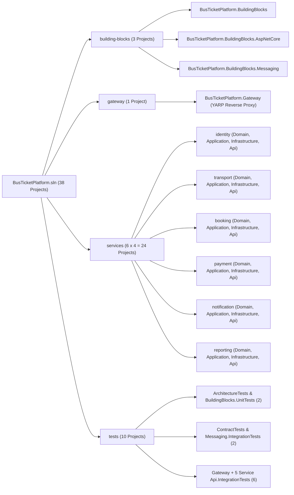
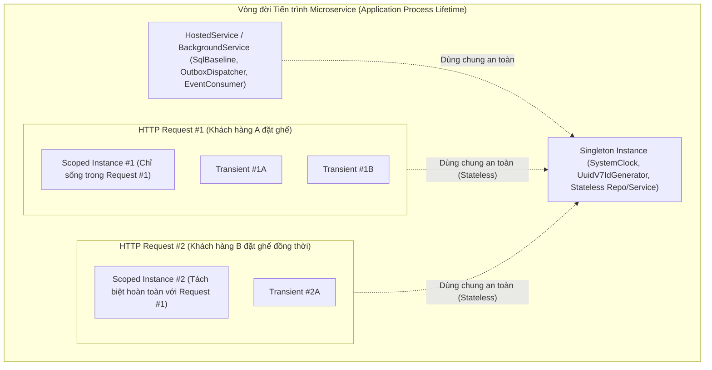

# Chương 02.2: .NET 10, Minimal APIs, Dependency Injection & Quản Trị Solution Cấp Doanh Nghiệp

> **Mục tiêu của chương này**: Đưa người đọc từ góc nhìn tổng thể của toàn bộ kho mã nguồn `workspace/BusTicketPlatform.sln` (38 projects C#) đi sâu vào cách dự án chuẩn hóa môi trường biên dịch **.NET 10** không lệch một bản vá nào giữa các máy lập trình viên, tại sao dự án chọn **Minimal APIs** thay vì **MVC Controllers** truyền thống, cơ chế hoạt động thực sự của **Dependency Injection (DI)** và tiến trình chạy ngầm (`BackgroundService`), cho tới bộ **Health Checks** chuẩn đám mây Kubernetes/Docker (`/live`, `/ready`, `/startup`, `/health`).

---

## 1. Giải phẫu Cấu trúc Solution & Hệ thống Quản trị Build Tập trung

Khi mở thư mục `workspace/`, trước khi đi vào bất kỳ dòng code C# nào trong `src/`, bạn sẽ bắt gặp **4 tệp cấu hình gốc** đóng vai trò "Hiến pháp biên dịch" của toàn bộ nền tảng:
1. `BusTicketPlatform.sln`
2. `global.json`
3. `Directory.Build.props`
4. `Directory.Packages.props`

Nhiều sinh viên khi làm đồ án thường tạo từng project rời rạc bằng chuột phải trên Visual Studio, để mặc mỗi project một kiểu cấu hình và cài gói NuGet mỗi nơi một phiên bản. Trong hệ thống gồm hàng chục projects như **BLUE Bus Ticket Platform**, cách làm thủ công đó sẽ dẫn tới hội chứng *"Trên máy em chạy được mà lên CI/CD hoặc máy bạn cùng nhóm thì lỗi build!"*. Hãy xem 4 tệp cấu hình này dập tắt rủi ro đó từ trong trứng nước như thế nào.

---

### 1.1. Bản đồ toàn cảnh `BusTicketPlatform.sln` — 38 Projects được phân vùng khoa học

Trong tệp `workspace/BusTicketPlatform.sln`, MSBuild sử dụng các **Solution Folders** (GUID loại `{2150E333-8FDC-42A3-9474-1A3956D46DE8}`) kết hợp với bảng ánh xạ cha-con `GlobalSection(NestedProjects)` để quy hoạch **38 C# Projects (`.csproj`)** thành 4 phân khu rõ rệt dưới gốc `src`:



> [!NOTE]
> **Tại sao gom tất cả 6 Microservices và Gateway vào chung một Solution (`.sln`) theo mô hình Monorepo?**
> Triển khai độc lập (Independent Deployment - mỗi service đóng gói thành một Docker container riêng với PostgreSQL riêng) **không đồng nghĩa** với việc phải xé lẻ kho code thành 7 Git repositories rời rạc! Đặt chung trong một `.sln` giúp bạn chỉ cần gõ một lệnh `dotnet build` hoặc `dotnet test` để kiểm chứng toàn bộ hệ thống cùng lúc, đồng thời cho phép `ArchitectureTests` và `ContractTests` đối chiếu chéo toàn bộ các service ngay trên một lần chạy CI, trong khi tính độc lập giữa các service vẫn được bảo vệ tuyệt đối bởi bài test `Services_do_not_project_reference_other_services`.

---

### 1.2. Tệp `global.json` — Khóa chặt phiên bản bộ công cụ biên dịch (.NET SDK Pinning)

Nội dung toàn bộ tệp `workspace/global.json`:

```json
{
  "sdk": {
    "rollForward": "latestPatch",
    "version": "10.0.401"
  }
}
```

**Tại sao phải có tệp nhỏ xíu 6 dòng này?**
Trong hệ sinh thái .NET cần phân biệt rõ hai khái niệm:
- **Target Framework (`net10.0`)**: Phiên bản Runtime mà ứng dụng chạy trên đó.
- **.NET SDK (`10.0.401`)**: Bộ trình biên dịch Roslyn, MSBuild và bộ phân tích mã tĩnh (Code Analyzers) cài trên máy lập trình viên hoặc máy chủ GitHub Actions/Docker build.

Nếu không có `global.json`, máy thành viên A cài SDK `10.0.100`, máy thành viên B cài SDK `10.1.200` preview. Vì dự án bật chế độ **coi mọi cảnh báo là lỗi biên dịch (`TreatWarningsAsErrors=true`)**, chỉ cần bản SDK mới hơn bổ sung thêm một cảnh báo cú pháp mới là code đang xanh trên máy A sẽ lập tức đỏ rực trên máy B!
- `"version": "10.0.401"`: Yêu cầu hệ thống sử dụng nhánh tính năng (feature band) `10.0.4xx` từ mốc `10.0.401`.
- `"rollForward": "latestPatch"`: Cực kỳ tinh tế — cho phép tự động nhận các bản vá bảo mật nhỏ cùng nhánh `10.0.4xx` (ví dụ `10.0.402`, `10.0.403`), nhưng **ngăn chặn** việc tự động nhảy sang nhánh feature band mới (`10.0.500` hay `11.0.100`) có nguy cơ thay đổi hành vi trình biên dịch.

---

### 1.3. Tệp `Directory.Build.props` — Kế thừa thuộc tính biên dịch tự động cho cả 38 Projects

MSBuild có một cơ chế kỳ diệu: mỗi khi biên dịch bất kỳ tệp `.csproj` nào, nó sẽ tự động đi ngược lên các thư mục cha để tìm tệp tên là **`Directory.Build.props`** và nạp các thiết lập trong đó **trước khi** đọc nội dung `.csproj`. Nhờ đó, bạn không phải lặp lại 15 dòng cấu hình giống hệt nhau trong cả 38 file `.csproj`!

Hãy đọc từng dòng của tệp `workspace/Directory.Build.props`:

```xml
<Project>
  <PropertyGroup>
    <TargetFramework>net10.0</TargetFramework>
    <Nullable>enable</Nullable>
    <ImplicitUsings>enable</ImplicitUsings>
    <LangVersion>latest</LangVersion>
    <TreatWarningsAsErrors>true</TreatWarningsAsErrors>
    <AnalysisLevel>latest</AnalysisLevel>
    <EnableNETAnalyzers>true</EnableNETAnalyzers>
    <EnforceCodeStyleInBuild>true</EnforceCodeStyleInBuild>
    <ManagePackageVersionsCentrally>true</ManagePackageVersionsCentrally>
    <Deterministic>true</Deterministic>
    <NeutralLanguage>en</NeutralLanguage>
    <CentralPackageTransitivePinningEnabled>true</CentralPackageTransitivePinningEnabled>
  </PropertyGroup>

  <PropertyGroup Condition="'$(IsTestProject)' == 'true'">
    <IsPackable>false</IsPackable>
  </PropertyGroup>
</Project>
```

Bảng giải nghĩa từng "chốt chặn kỹ thuật" trong tệp này:

| Thuộc tính MSBuild | Giá trị | Tác dụng thực tế đối với chất lượng mã nguồn |
| :--- | :---: | :--- |
| `<TargetFramework>` | `net10.0` | Toàn bộ 38 projects đồng loạt chạy trên .NET 10 (LTS mới nhất với `Guid.CreateVersion7()`, hiệu năng JIT/GC tối ưu và Minimal OpenAPI tích hợp sẵn). |
| `<Nullable>` | `enable` | Bật **Nullable Reference Types**. Biến `string` không bao giờ được phép gán `null`, muốn cho phép rỗng phải ghi rõ `string?`. Nếu cố tình chấm `.Length` trên biến `string?` mà chưa kiểm tra `null`, trình biên dịch cảnh báo lỗi ngay — triệt tiêu 90% lỗi kinh điển `NullReferenceException` lúc chạy thật! |
| `<ImplicitUsings>` | `enable` | Tự động nạp các namespace nền tảng (`System`, `System.Collections.Generic`, `System.Linq`, `System.Threading.Tasks`,...) giúp đầu mỗi file C# cực kỳ gọn gàng. |
| `<TreatWarningsAsErrors>` | `true` | **Kỷ luật thép**: Biến mọi cảnh báo (Warning) thành lỗi dừng biên dịch (Compile Error). Không ai được phép phớt lờ cảnh báo biến thừa, thiếu `await` hay rủi ro `null`. |
| `<AnalysisLevel>` + `<EnableNETAnalyzers>` + `<EnforceCodeStyleInBuild>` | `latest` / `true` | Kích hoạt toàn bộ bộ quy tắc Roslyn .NET Analyzers ngay trong lệnh `dotnet build` trên terminal/CI (chứ không chỉ hiển thị gạch chân vàng trong IDE). |
| `<Deterministic>` | `true` | Đảm bảo **Reproducible Builds**: Cùng một mã nguồn biên dịch ở hai thời điểm khác nhau sẽ sinh ra tệp nhị phân `.dll` giống nhau từng bit một, giúp tối ưu bộ nhớ đệm Docker layer cache. |
| `<ManagePackageVersionsCentrally>` + `<CentralPackageTransitivePinningEnabled>` | `true` | Bật tính năng Quản lý gói NuGet tập trung (CPM) và ghim cả phiên bản của gói phụ thuộc bắc cầu (xem mục 1.4 ngay dưới đây). |
| `Condition="'$(IsTestProject)' == 'true'"` | `<IsPackable>false</IsPackable>` | Tự động nhận diện các project kiểm thử để không đóng gói nhầm chúng thành thư viện `.nupkg` khi phát hành. |

---

### 1.4. Tệp `Directory.Packages.props` — Central Package Management (CPM) & Transitive Pinning

Trong cách làm cũ, mỗi project tự ghi `<PackageReference Include="Npgsql" Version="10.0.0" />`. Khi có 6 tầng `Infrastructure` cùng dùng `Npgsql`, nếu ai đó nâng cấp ở `Booking` lên `10.0.2` mà quên 5 service còn lại, toàn hệ thống lâm vào cảnh **"Diamond Dependency Hell"** (xung đột phiên bản thư viện).

Với **Central Package Management (CPM)** trong `workspace/Directory.Packages.props`, toàn bộ 27 gói NuGet của toàn hệ thống được quản lý tại một bảng duy nhất:

```xml
<Project>
  <ItemGroup>
    <!-- Nhóm Kiểm thử & Kiến trúc -->
    <PackageVersion Include="coverlet.collector" Version="6.0.4" />
    <PackageVersion Include="Microsoft.AspNetCore.Mvc.Testing" Version="10.0.0" />
    <PackageVersion Include="Microsoft.Extensions.TimeProvider.Testing" Version="10.0.0" />
    <PackageVersion Include="Microsoft.NET.Test.Sdk" Version="17.14.1" />
    <PackageVersion Include="NetArchTest.Rules" Version="1.3.2" />
    <PackageVersion Include="xunit" Version="2.9.3" />
    <PackageVersion Include="xunit.runner.visualstudio" Version="3.1.4" />
    <PackageVersion Include="Testcontainers" Version="4.6.0" />
    <PackageVersion Include="Testcontainers.PostgreSql" Version="4.6.0" />
    <PackageVersion Include="Testcontainers.RabbitMq" Version="4.6.0" />

    <!-- Nhóm Web, API Gateway, OpenAPI & Bảo mật -->
    <PackageVersion Include="Microsoft.AspNetCore.OpenApi" Version="10.0.12" />
    <PackageVersion Include="Swashbuckle.AspNetCore.SwaggerUI" Version="10.2.3" />
    <PackageVersion Include="Yarp.ReverseProxy" Version="2.3.0" />
    <PackageVersion Include="Konscious.Security.Cryptography.Argon2" Version="1.3.1" />
    <PackageVersion Include="Microsoft.AspNetCore.Authentication.JwtBearer" Version="10.0.0" />
    <PackageVersion Include="System.IdentityModel.Tokens.Jwt" Version="8.14.0" />

    <!-- Nhóm Hạ tầng Cơ sở dữ liệu, Hàng đợi & Hợp đồng -->
    <PackageVersion Include="Npgsql" Version="10.0.0" />
    <PackageVersion Include="RabbitMQ.Client" Version="7.1.2" />
    <PackageVersion Include="JsonSchema.Net" Version="7.3.4" />
    <PackageVersion Include="YamlDotNet" Version="16.3.0" />
    <PackageVersion Include="SSH.NET" Version="2026.0.0" />
    <PackageVersion Include="Microsoft.Extensions.Diagnostics.HealthChecks" Version="10.0.0" />
    <PackageVersion Include="Microsoft.Extensions.Configuration" Version="10.0.0" />
    <PackageVersion Include="Microsoft.Extensions.Configuration.Abstractions" Version="10.0.0" />
    <PackageVersion Include="Microsoft.Extensions.DependencyInjection" Version="10.0.0" />
    <PackageVersion Include="Microsoft.Extensions.Logging" Version="10.0.0" />
    <PackageVersion Include="Microsoft.Extensions.Hosting" Version="10.0.0" />
  </ItemGroup>
</Project>
```

Khi đó, ở các file `.csproj` con (như `Booking.Infrastructure.csproj`), ta chỉ viết ngắn gọn `<PackageReference Include="Npgsql" />` (không được phép ghi `Version`).

**Vậy còn cờ `<CentralPackageTransitivePinningEnabled>true</CentralPackageTransitivePinningEnabled>` lợi hại ra sao?**
Giả sử thư viện bên thứ ba `Testcontainers` (bản `4.6.0`) bên trong nó phụ thuộc bắc cầu (transitive dependency) vào một bản cũ của `SSH.NET` có lỗ hổng bảo mật CVE. Khi bật `CentralPackageTransitivePinningEnabled=true`, chỉ cần khai báo `<PackageVersion Include="SSH.NET" Version="2026.0.0" />` ngay trong `Directory.Packages.props`, NuGet sẽ **tự động ép nâng cấp gói phụ thuộc ngầm bên dưới** lên bản an toàn `2026.0.0` cho mọi project mà không cần cài thừa gói `SSH.NET` trực tiếp vào `.csproj`! (Đó chính là lý do `SSH.NET` xuất hiện ở dòng 21 của `Directory.Packages.props`!).

---

## 2. Lý thuyết & Thực chiến: .NET 10 Minimal APIs vs MVC Controllers

Nếu mở bất kỳ project `*.Api` nào trong dự án BLUE (`Identity.Api`, `Booking.Api`, `Transport.Api`...), bạn sẽ **không tìm thấy thư mục `Controllers/`** hay bất kỳ class nào kế thừa `: ControllerBase`! Toàn bộ nền tảng được xây dựng 100% bằng **ASP.NET Core Minimal APIs**.

### 2.1. Tại sao Minimal APIs vượt trội hơn MVC Controllers trong kiến trúc Microservices?

Trong hơn một thập kỷ (từ ASP.NET MVC tới .NET 5), mọi HTTP API đều đi qua bộ máy **MVC Pipeline** đồ sộ: mỗi khi có một HTTP Request tới, framework phải kích hoạt `ControllerActivator` khởi tạo class Controller, chạy qua hàng loạt lớp lọc (`ResourceFilter`, `ActionFilter`, `ExceptionFilter`, `ResultFilter`), ModelState dictionary, ViewData/TempData... vốn sinh ra từ thời làm Web render HTML truyền thống.

Từ .NET 6 và hoàn thiện vượt bậc ở **.NET 10**, Microsoft giới thiệu **Minimal APIs** gắn trực tiếp hàm xử lý C# vào **Endpoint Routing Engine** mà không cần bước qua bộ khung MVC nặng nề:

| Tiêu chí so sánh | ASP.NET Core MVC Controllers | .NET 10 Minimal APIs (Dự án BLUE sử dụng) |
| :--- | :--- | :--- |
| **Độ phức tạp Pipeline** | Đi qua chuỗi 5 tầng Filter + Controller Factory + ModelState phức tạp. | Đi thẳng từ `EndpointRoutingMiddleware` vào Delegate thực thi (Zero MVC overhead). |
| **Cấp phát bộ nhớ (Memory Allocation) & RPS** | Mỗi request phải `new` một đối tượng Controller cùng nhiều metadata phụ trợ trên Heap. | Dùng `static` method / lambda cực nhẹ, ít tốn RAM, đạt thông lượng (Throughput) cao hơn rõ rệt. |
| **Bệnh "Fat Controller"** | Một file `BookingController.cs` thường tiêm 10–12 dependencies vào Constructor dù mỗi hàm Action chỉ dùng 1–2 cái trong số đó! | **Method-level DI**: Hàm Endpoint nào cần dịch vụ nào (ví dụ `IIdempotencyStore`) thì chỉ khai báo tham số ngay tại hàm đó! |
| **Tổ chức theo nhóm tính năng** | Phân mảnh rải rác hoặc gắn cứng theo tên class `[Route("api/v1/[controller]")]`. | Gom nhóm cây phân cấp cực kỳ rõ ràng bằng `MapGroup("/api/v1")` kết hợp chính sách bảo mật tập trung (`.RequireAuthorization()`). |

---

### 2.2. Giải phẫu cách Minimal API vận hành trong `BookingEndpoints.cs` và `IdentityEndpoints.cs`

Hãy nhìn vào mã nguồn thực tế trong `workspace/src/services/identity/BusTicketPlatform.Identity.Api/IdentityEndpoints.cs` và `workspace/src/services/booking/BusTicketPlatform.Booking.Api/BookingEndpoints.cs` để nắm trọn 4 kỹ thuật cốt lõi của Minimal APIs:

#### Kỹ thuật 1: Phân cấp đường dẫn và Áp chính sách hàng loạt bằng `MapGroup`
Trong `IdentityEndpoints.cs`:
```csharp
public static IEndpointRouteBuilder MapIdentityEndpoints(this IEndpointRouteBuilder app)
{
    var api = app.MapGroup("/api/v1");

    // Nhóm 1: Các API xác thực công khai (/api/v1/auth/*)
    var auth = api.MapGroup("/auth").AllowAnonymous();
    auth.MapPost("/register", RegisterAsync);
    auth.MapPost("/verify", VerifyAsync);
    auth.MapPost("/login", LoginAsync);
    // Riêng logout nằm trong nhóm /auth nhưng bắt buộc phải đăng nhập -> ghi đè cục bộ!
    auth.MapPost("/logout", LogoutAsync).RequireAuthorization();

    // Nhóm 2: Hồ sơ cá nhân (/api/v1/users/me/*) -> Khóa bảo mật cả cụm 1 lần duy nhất!
    var me = api.MapGroup("/users/me").RequireAuthorization();
    me.MapGet("/", GetMeAsync);
    me.MapPatch("/", UpdateMeAsync);

    // Nhóm 3: Quản trị viên (/api/v1/admin/*)
    var admin = api.MapGroup("/admin").RequireAuthorization();
    admin.MapGet("/users/{userId:guid}", GetUserAsync);
    // ...
    return app;
}
```
Thay vì phải gắn `[Authorize]` lặp đi lặp lại trên 20 hàm dễ bị quên sót một hàm gây lỗ hổng bảo mật (Broken Access Control), `.MapGroup("/admin").RequireAuthorization()` tự động khóa chặt toàn bộ các route con bên dưới nó! Tương tự, trong `BookingEndpoints.cs`, dòng `.RequireRateLimiting("ticket-lookup")` áp giới hạn chống dò mã vé (tối đa 40 lần/phút) trực tiếp lên duy nhất endpoint `POST /api/v1/tickets/lookup`.

#### Kỹ thuật 2: Route Constraints (`{tripId:guid}` vs `{**holdToken}`)
Hãy quan sát hai cách khai báo tham số đường dẫn rất tinh tế trong `BookingEndpoints.cs`:
```csharp
api.MapGet("/trips/{tripId:guid}/seats", GetSeatsAsync).RequireAuthorization();
api.MapGet("/seat-holds/{**holdToken}", GetHoldAsync).RequireAuthorization();
```
- **`{tripId:guid}` (Ràng buộc kiểu GUID ngay tầng định tuyến)**: Nếu client gọi `/api/v1/trips/abc-xyz/seats` (không phải định dạng UUID 128-bit hợp lệ), bộ định tuyến từ chối ngay từ cửa (trả về `404 Not Found`), không tốn công gọi vào hàm C# bên trong!
- **`{**holdToken}` (Catch-all Route Parameter với hai dấu sao `**`)**: Tại sao lại có `**`? `holdToken` là chuỗi bí mật 256-bit mã hóa Base64URL. Ký hiệu `**` bảo đảm bộ định tuyến bắt trọn toàn bộ phần đuôi URL phía sau `/seat-holds/` (kể cả trong các bài test truyền chuỗi đặc biệt chứa dấu gạch chéo) vào biến `string holdToken` mà không bị đứt gãy đường dẫn!

#### Kỹ thuật 3: Cơ chế Tự động Ràng buộc Tham số (Automatic Parameter Binding)
Hãy nhìn chữ ký hàm `CreateHoldAsync` trong `BookingEndpoints.cs`:

```csharp
private static async Task<IResult> CreateHoldAsync(
    HttpContext context,            // (1) Special Framework Type -> Lấy ngữ cảnh HTTP hiện tại
    BookingService service,         // (2) Registered Service -> Tự động tiêm từ DI Container!
    IIdempotencyStore store,        // (3) Registered Interface -> Tự động tiêm từ DI Container!
    Guid tripId,                    // (4) Khớp tên {tripId:guid} trên URL -> Lấy từ Route!
    CreateSeatHoldRequest body)     // (5) Complex Record Type (POST) -> Tự động đọc từ JSON Body!
```

Và chữ ký hàm `ListBookingsAsync`:
```csharp
private static async Task<IResult> ListBookingsAsync(
    HttpContext context,            // (1) Ngữ cảnh HTTP
    BookingService service,         // (2) Tiêm từ DI Container
    int page = 0,                   // (3) Kiểu nguyên thủy trên hàm GET -> Tự đọc từ Query String (?page=0)!
    int size = 20)                  // (4) Query String có giá trị mặc định (?size=20)!
```

**Làm sao .NET 10 biết tham số nào lấy từ đâu mà không cần viết `[FromBody]`, `[FromRoute]`, `[FromQuery]`, `[FromServices]`?**
Trình biên dịch .NET sử dụng **Request Delegate Generator** phân tích chữ ký hàm theo thứ tự ưu tiên chuẩn mực:
1. Các kiểu đặc biệt của ASP.NET Core (`HttpContext`, `HttpRequest`, `HttpResponse`, `ClaimsPrincipal`, `CancellationToken`) được cấp trực tiếp từ pipeline hiện hành.
2. Các kiểu đã được đăng ký trong `IServiceCollection` (như `BookingService`, `IIdempotencyStore`, `AuthService`) được tự động rút ra từ **DI Container**!
3. Các kiểu đơn giản (`Guid`, `int`, `string`, `bool`...) nếu trùng tên với biến `{...}` trên mẫu URL sẽ lấy từ **Route Values**; nếu không có trên mẫu URL thì tự động tìm trên **Query String** (`?page=1&size=10`).
4. Tham số kiểu phức tạp (`record` / `class` như `CreateSeatHoldRequest`) trong các phương thức có thân dữ liệu (`POST`, `PUT`, `PATCH`) tự động được giải tuần tự hóa (deserialize) từ **JSON Request Body** bằng `System.Text.Json` (nếu JSON lỗi cú pháp, ném `BadHttpRequestException` và được `ErrorEnvelopeMiddleware` bắt gọn trả về `400 VALIDATION_ERROR`!).


---

## 3. Giải phẫu Vòng đời Dependency Injection (DI) & Tiến trình Chạy ngầm (`HostedService`)

**Dependency Injection (DI)** là trái tim vận hành của .NET hiện đại: thay vì bạn tự gõ từ khóa `new BookingService(new BookingRepository(...))` rải rác khắp nơi, bạn đăng ký "công thức lắp ráp" vào `builder.Services` (`IServiceCollection`) lúc khởi động ứng dụng, và bộ chứa IoC Container (`IServiceProvider`) sẽ tự động khởi tạo cũng như giải phóng tài nguyên (`Dispose`) đúng thời điểm.

### 3.1. Bốn cơ chế vòng đời trong .NET DI — Phân biệt từ bản chất Bộ nhớ

Để không bao giờ dùng sai vòng đời dẫn tới rò rỉ bộ nhớ (Memory Leak) hoặc xung đột dữ liệu giữa hai người dùng đang đặt vé cùng lúc (Race Condition), hãy nắm vững bảng so sánh 4 cơ chế sau:

| Phương thức đăng ký | Số lần khởi tạo (`new`) | Khi nào bị hủy (`Dispose`)? | Trường hợp sử dụng tiêu chuẩn |
| :--- | :--- | :--- | :--- |
| **`AddTransient<T>()`** | **Mỗi lần yêu cầu (per resolution)**: Cứ nơi nào xin `T` là tạo mới một đối tượng độc lập. | Cuối phạm vi (`Scope`) chứa nó (nếu thực thi `IDisposable`). | Các bộ tính toán nhỏ nhẹ, có biến tạm nội bộ ngắn hạn, không chia sẻ trạng thái. |
| **`AddScoped<T>()`** | **Mỗi HTTP Request 1 lần duy nhất (per HTTP request scope)**: Trong suốt 1 request từ đầu tới cuối, mọi class cùng nhận chung 1 instance `T`; sang request của người khác thì tạo mới. | Ngay khi HTTP Response trả xong về cho client. | Entity Framework `DbContext`, `UnitOfWork` hoặc ngữ cảnh người dùng gắn chặt theo từng HTTP Request. |
| **`AddSingleton<T>()`** | **Đúng 1 lần duy nhất cho toàn bộ vòng đời tiến trình (per process)**: Mọi người dùng, mọi luồng CPU dùng chung 1 instance duy nhất trên Heap. | Chỉ khi tắt hẳn ứng dụng (`app.Run()` kết thúc / dừng container). | Các dịch vụ **không lưu trạng thái riêng tư (Stateless)**, cấu hình `Options`, `IClock`, `IIdGenerator`, bộ đệm Cache có khóa đồng bộ. |
| **`AddHostedService<T>()`** | Khởi tạo như Singleton đặc biệt do `IHost` quản lý, tự chạy `StartAsync` khi bật server và `StopAsync` khi tắt server. | Khi Host nhận tín hiệu dừng (`SIGTERM` từ Docker/K8s). | Tác vụ nền dài hạn: chạy SQL Migration lúc khởi động, quét Outbox đẩy tin lên RabbitMQ, lắng nghe hàng đợi sự kiện. |



---

### 3.2. Giải phẫu Thực tế: Tại sao Dự án BLUE đăng ký Repositories và Services là `AddSingleton`?

Hãy đọc kỹ 3 đoạn đăng ký DI thực tế trong dự án:

**1) Trong `HostingExtensions.cs` (`BuildingBlocks.AspNetCore`)**:
```csharp
public static IServiceCollection AddBuildingBlocks(this IServiceCollection services)
{
    services.AddSingleton<IClock, SystemClock>();
    services.AddSingleton<IIdGenerator, UuidV7IdGenerator>();
    return services;
}
```

**2) Trong `BookingInfrastructureExtensions.cs` (`Booking.Infrastructure`)**:
```csharp
public static IServiceCollection AddBookingInfrastructure(this IServiceCollection services, IConfiguration configuration)
{
    var options = new BookingDatabaseOptions
    {
        ConnectionString = configuration.GetConnectionString(BookingDatabaseOptions.ConnectionStringName) ?? ""
    };
    services.AddSingleton(options);
    services.AddSingleton<SqlBaselineMigrator>();
    services.AddHostedService<SqlBaselineHostedService>();
    services.AddSingleton<IIdempotencyStore, IdempotencyStore>();
    services.AddSingleton<IBookingRepository, BookingRepository>();
    services.AddSingleton<OutboxWriter>();
    services.AddSingleton(sp => new OutboxRelay(sp.GetRequiredService<BookingDatabaseOptions>().ConnectionString));
    services.AddHostedService<OutboxDispatchHostedService>();
    services.AddSingleton<IBookingEvents, BookingEvents>();
    services.AddSingleton(new TicketQrOptions
    {
        SigningKey = configuration["Authentication:SigningKey"] ?? "local-dev-only-change-me-32bytes-min"
    });
    services.AddSingleton<BookingService>();
    // ... đăng ký EventSubscription cho RabbitMQ
    return services;
}
```

**3) Trong `IdentityInfrastructureExtensions.cs` (`Identity.Infrastructure`)**:
```csharp
services.AddSingleton(options);
services.Configure<Security.AuthenticationOptions>(configuration.GetSection(Security.AuthenticationOptions.SectionName));
services.Configure<Security.SmtpOptions>(configuration.GetSection(Security.SmtpOptions.SectionName));
services.AddSingleton<SqlBaselineMigrator>();
services.AddHostedService<SqlBaselineHostedService>();
services.AddSingleton<IPasswordHasher, Argon2PasswordHasher>();
services.AddSingleton<ITokenService, JwtTokenService>();
services.AddSingleton<CapturingChallengeNotifier>();
services.AddSingleton<IChallengeMailbox>(sp => sp.GetRequiredService<CapturingChallengeNotifier>());
services.AddSingleton<IChallengeNotifier, ChallengeNotifier>();
services.AddSingleton<IIdentityRepository, IdentityRepository>();
services.AddSingleton<IIdempotencyStore, IdempotencyStore>();
services.AddSingleton<OutboxPublisher>();
services.AddSingleton(sp => new OutboxRelay(sp.GetRequiredService<IdentityDatabaseOptions>().ConnectionString));
services.AddHostedService<OutboxDispatchHostedService>();
services.AddSingleton<IRegistrationEvents, RegistrationEvents>();
services.AddSingleton<AuthService>();
services.AddSingleton<ProfileService>();
services.AddSingleton<AdminIdentityService>();
```

> [!IMPORTANT]
> **Câu hỏi phỏng vấn "sát thủ"**: *"Trong các dự án dùng Entity Framework Core, người ta luôn dặn phải đăng ký Repository là `AddScoped`. Tại sao ở dự án BLUE, `BookingRepository`, `IdentityRepository`, `IdempotencyStore` và `BookingService` đều đăng ký là `AddSingleton`? Làm vậy có bị lỗi đụng độ kết nối Database (Thread-Safety issue) khi 1.000 người đặt vé cùng lúc không?"*

**Câu trả lời chuẩn xác từ mã nguồn**: **Hoàn toàn an toàn đa luồng (100% Thread-Safe) và còn giúp giảm tải cho Garbage Collector (GC)!** Bởi vì:
1. **Tại sao EF Core bắt buộc phải dùng `AddScoped`?** Vì `DbContext` của EF Core giữ một đối tượng `ChangeTracker` và một kết nối vật lý bên trong trường dữ liệu (`field`) của chính nó. Nếu hai luồng cùng dùng chung 1 `DbContext`, kết nối TCP tới PostgreSQL sẽ bị hai câu lệnh xâu xé cùng lúc và nổ lỗi `InvalidOperationException: A second operation was started on this context instance`.
2. **Còn `BookingRepository` của dự án BLUE lưu giữ cái gì trong `field`?**
   Hãy nhìn Primary Constructor của nó:
   ```csharp
   public sealed partial class BookingRepository(BookingDatabaseOptions options, IIdGenerator ids) : IBookingRepository
   ```
   Trường dữ liệu duy nhất nó cầm là chuỗi cấu hình bất biến `options.ConnectionString` và bộ sinh mã `ids`! Nó **không hề giữ `NpgsqlConnection` làm biến toàn cục của class**!
3. **Mỗi khi có 1.000 luồng gọi vào `BookingRepository` cùng lúc**:
   Bên trong thân từng hàm, nó viết:
   ```csharp
   await using var connection = new NpgsqlConnection(options.ConnectionString);
   await connection.OpenAsync(cancellationToken);
   ```
   Biến `connection` là biến cục bộ (local variable) nằm riêng biệt trên ngữ cảnh thực thi bất đồng bộ của từng request! Bên dưới nắp máy, trình điều khiển `Npgsql` quản lý sẵn một **Connection Pool (Hồ kết nối TCP dùng chung an toàn đa luồng)**: `OpenAsync()` mượn 1 kết nối nhàn rỗi từ Pool trong vài micro-giây, chạy câu lệnh SQL xong thì khối `await using` lập tức trả kết nối sạch về lại Pool.
4. **Lợi ích kép**:
   - Không tốn chi phí cấp phát bộ nhớ (`new BookingRepository`, `new BookingService`) hàng vạn lần mỗi giây trên Gen-0 Heap.
   - Các tiến trình chạy nền (`BackgroundService` như `IntegrationEventConsumerHost` vốn là Singleton) có thể gọi thẳng vào `BookingService` mà không lo phạm lỗi **Captive Dependency** (lỗi giữ con tin một đối tượng `Scoped` bên trong `Singleton`)!

> [!TIP]
> **Mẹo hay về Forwarding Singleton trong `IdentityInfrastructureExtensions.cs` (dòng 28–29)**:
> Hãy để ý cặp dòng code rất khéo léo này:
> ```csharp
> services.AddSingleton<CapturingChallengeNotifier>();
> services.AddSingleton<IChallengeMailbox>(sp => sp.GetRequiredService<CapturingChallengeNotifier>());
> ```
> Nếu viết ngây thơ `services.AddSingleton<IChallengeMailbox, CapturingChallengeNotifier>()` rồi lại viết thêm một interface khác trỏ tới `CapturingChallengeNotifier`, DI Container sẽ tạo ra **2 đối tượng khác nhau** trên bộ nhớ! Dùng biểu thức lambda `sp => sp.GetRequiredService<CapturingChallengeNotifier>()` ép DI Container chuyển tiếp về **cùng 1 vùng nhớ duy nhất**, nhờ đó khi `ChallengeNotifier` ghi mã OTP vừa gửi vào hòm thư tạm trong bài Integration Test, `IChallengeMailbox` đọc ra thấy ngay mã OTP đó!

---

### 3.3. Giải phẫu 3 `HostedService` cốt lõi vận hành ngầm trong mỗi Microservice

Khi bạn gõ `dotnet run` (hoặc bật Docker container) cho `Booking.Api`, không chỉ có Web Server lắng nghe cổng HTTP `5083`, mà `IHost` còn đồng thời đánh thức **3 công nhân chạy ngầm**:

1. **Công nhân khởi động (`IHostedService`) — `SqlBaselineHostedService.cs`**:
   ```csharp
   public sealed class SqlBaselineHostedService(SqlBaselineMigrator migrator) : IHostedService
   {
       public Task StartAsync(CancellationToken cancellationToken) => migrator.ApplyAsync(cancellationToken);
       public Task StopAsync(CancellationToken cancellationToken) => Task.CompletedTask;
   }
   ```
   Vì trực tiếp cài đặt `IHostedService.StartAsync`, ASP.NET Core Host sẽ **chờ (`await`) `StartAsync` chạy xong xuôi** (tức là các bảng SQL `outbox_messages`, `idempotency_records`, `bookings`, `tickets`... đã được tạo đầy đủ) rồi mới tiếp tục khởi chạy các dịch vụ tiếp theo và mở cổng nhận lưu lượng!

2. **Công nhân chuyển phát Outbox (`BackgroundService`) — `OutboxDispatchHostedService.cs`**:
   Kế thừa lớp cơ sở `BackgroundService` (lớp này bọc sẵn `IHostedService` để cho phép vòng lặp bất tận chạy trên luồng nền không làm treo quá trình khởi động Web Server):
   ```csharp
   public sealed class OutboxDispatchHostedService(
       OutboxRelay relay, IConfiguration configuration, ILogger<OutboxDispatchHostedService> logger) : BackgroundService
   {
       protected override async Task ExecuteAsync(CancellationToken stoppingToken)
       {
           var uri = configuration["Messaging:AmqpUri"];
           if (string.IsNullOrWhiteSpace(uri)) return; // Tự tắt êm ái nếu chạy Unit/API test không cấu hình RabbitMQ!

           await using var bus = await RabbitMqSmokeBus.ConnectAsync(uri, stoppingToken);
           while (!stoppingToken.IsCancellationRequested)
           {
               try
               {
                   await relay.PublishPendingAsync(bus, stoppingToken);
               }
               catch (Exception exception) when (exception is not OperationCanceledException)
               {
                   logger.LogError(exception, "Outbox dispatch cycle failed");
               }
               await Task.Delay(TimeSpan.FromSeconds(2), stoppingToken);
           }
       }
   }
   ```
   *Điểm tinh tế*: Bộ lọc ngoại lệ `when (exception is not OperationCanceledException)` đảm bảo rằng: nếu RabbitMQ bị rớt mạng tạm thời, công nhân chỉ ghi log lỗi rồi ngủ 2 giây thử lại chứ **không làm sập toàn bộ tiến trình API**; nhưng khi Docker gửi lệnh tắt container (`stoppingToken` bị hủy sinh ra `OperationCanceledException`), vòng lặp thoát ra gọn gàng ngay lập tức (Graceful Shutdown)!

3. **Công nhân tiêu thụ sự kiện (`BackgroundService`) — `IntegrationEventConsumerHost.cs`**:
   Nhận danh sách toàn bộ `IEnumerable<EventSubscription>` đã đăng ký trong DI (ví dụ `booking.trip-events.q` và `booking.payment-events.q`), tự động khai báo Queue & Routing Key trên RabbitMQ, rồi dùng `Task.WhenAll(...)` chạy song song các vòng bơm `PumpAsync`: kiểm tra chống trùng qua `InboxDeduper`, gọi hàm xử lý nghiệp vụ, rồi mới gửi tín hiệu xác nhận `AckAsync` (hoặc đẩy sang Dead-Letter Queue qua `RejectAsync(requeue: false)` nếu dữ liệu hỏng).

---

## 4. Giải phẫu Health Checks chuẩn Kubernetes / Docker (`/live`, `/ready`, `/startup`, `/health`)

Trong môi trường triển khai container thực tế (Docker Compose, Kubernetes, Cloud Run), hệ thống điều phối (Orchestrator) không có mắt người để nhìn màn hình console xem microservice còn sống hay đã treo. Nó liên tục gửi các gói tin thăm dò sức khỏe (**Health Probes**).

Nhiều người mới làm Web chỉ viết đại một hàm `app.MapGet("/health", () => "OK")`. Cách làm sơ sài đó gây ra hai tai nạn nghiêm trọng trên Production:
- **Tai nạn 1**: Ứng dụng kết nối tới PostgreSQL bị đứt mạng tạm thời 5 giây, nhưng `/health` vẫn báo `"OK"` -> Load Balancer (hoặc YARP Gateway) vẫn cứ đổ hàng ngàn khách hàng vào container đang mù DB đó!
- **Tai nạn 2 (Ngược lại)**: Nếu nhét câu lệnh kiểm tra PostgreSQL vào chung endpoint Liveness (`/live`), khi cụm PostgreSQL bảo trì mất 15 giây, Kubernetes tưởng cả 6 microservices bị treo code (deadlock) nên **giết và khởi động lại toàn bộ tất cả các Pod liên tục (CrashLoopBackOff)**, tạo ra cơn bão kết nối dập sập luôn DB vừa mới tỉnh dậy!

Dự án **BLUE Bus Ticket Platform** giải quyết bài toán này chuẩn mực 100% theo đặc tả đám mây thông qua cặp tệp `HealthEndpointExtensions.cs` và `PostgresHealthCheck.cs`.

### 4.1. Mã nguồn `HealthEndpointExtensions.cs` (`BuildingBlocks.AspNetCore`)

```csharp
using Microsoft.AspNetCore.Builder;
using Microsoft.AspNetCore.Diagnostics.HealthChecks;
using Microsoft.AspNetCore.Http;
using Microsoft.AspNetCore.Routing;
using Microsoft.Extensions.Diagnostics.HealthChecks;

namespace BusTicketPlatform.BuildingBlocks.AspNetCore.Health;

public static class HealthEndpointExtensions
{
    public static IEndpointRouteBuilder MapPlatformHealth(this IEndpointRouteBuilder endpoints)
    {
        endpoints.MapHealthChecks("/live", new HealthCheckOptions
        {
            Predicate = static check => check.Tags.Contains("live"),
            ResponseWriter = WriteStatus
        });

        endpoints.MapHealthChecks("/ready", new HealthCheckOptions
        {
            Predicate = static check => check.Tags.Contains("ready"),
            ResponseWriter = WriteStatus
        });

        endpoints.MapHealthChecks("/startup", new HealthCheckOptions
        {
            Predicate = static check => check.Tags.Contains("startup"),
            ResponseWriter = WriteStatus
        });

        endpoints.MapHealthChecks("/health", new HealthCheckOptions
        {
            Predicate = static check => check.Tags.Contains("live"),
            ResponseWriter = WriteStatus
        });

        return endpoints;
    }

    private static Task WriteStatus(HttpContext context, HealthReport report)
    {
        context.Response.ContentType = "application/json";
        var payload = new
        {
            status = report.Status.ToString().ToLowerInvariant()
        };
        return context.Response.WriteAsJsonAsync(payload);
    }
}
```

### 4.2. Mã nguồn `PostgresHealthCheck.cs` & Cách gắn nhãn `tags` trong `Program.cs`

Hãy xem `PostgresHealthCheck.cs` (trong `Booking.Infrastructure`, và tương tự ở 5 service còn lại):
```csharp
public sealed class PostgresHealthCheck(BookingDatabaseOptions options) : IHealthCheck
{
    public async Task<HealthCheckResult> CheckHealthAsync(
        HealthCheckContext context,
        CancellationToken cancellationToken = default)
    {
        if (!options.IsConfigured)
        {
            return HealthCheckResult.Unhealthy("Booking connection string is not configured.");
        }

        try
        {
            await using var connection = new NpgsqlConnection(options.ConnectionString);
            await connection.OpenAsync(cancellationToken);
            await using var command = new NpgsqlCommand("SELECT 1", connection);
            await command.ExecuteScalarAsync(cancellationToken);
            return HealthCheckResult.Healthy();
        }
        catch (Exception exception)
        {
            return HealthCheckResult.Unhealthy("Booking database is unreachable.", exception);
        }
    }
}
```

Và nhìn cách chúng được ghép nhãn (`tags`) trong `Booking.Api/Program.cs` + `BookingInfrastructureExtensions.cs`:
```csharp
builder.Services.AddHealthChecks()
    .AddCheck("self", () => HealthCheckResult.Healthy(), tags: ["live", "ready", "startup"])
    .AddBookingDatabaseCheck(); // Bên trong gắn: builder.AddCheck<PostgresHealthCheck>("database", tags: ["ready"]);
```

### 4.3. Ma trận phân tách trách nhiệm của 4 Endpoints Sức khỏe

Sự kết hợp giữa `Predicate = check => check.Tags.Contains(...)` và cách đánh nhãn `"self"` vs `"database"` tạo ra hành vi vận hành vô cùng thông minh:

| Endpoint | Bộ lọc `Tags` | Kiểm tra cái gì? | HTTP `200` vs `503` | Hành động của Kubernetes / Docker |
| :--- | :---: | :--- | :--- | :--- |
| **`GET /startup`** | `startup` | Chỉ chạy `"self"` (xác nhận Kestrel & Host đã qua bước `SqlBaselineHostedService` và sẵn sàng trả lời HTTP). | `200 {"status":"healthy"}` | Báo hiệu container đã khởi động xong, bắt đầu bàn giao cho Liveness & Readiness theo dõi. |
| **`GET /live`** & **`GET /health`** | `live` | Chỉ chạy `"self"` (**KHÔNG gọi PostgreSQL!**). Xác nhận Thread Pool của .NET không bị treo cứng (deadlock). | `200 {"status":"healthy"}` | Nếu `/live` không phản hồi -> tiến trình C# đã chết lâm sàng -> **Kill và Restart container**. Nhờ không dính tới DB, khi PostgreSQL chập chờn container vẫn không bị giết oan! |
| **`GET /ready`** | `ready` | Chạy **CẢ `"self"` LẪN `"database"`** (`SELECT 1` xuống PostgreSQL thật). | `200 {"status":"healthy"}` hoặc `503 {"status":"unhealthy"}` | Nếu DB đứt kết nối -> `/ready` trả `503 Service Unavailable` -> Load Balancer **tạm ngưng định tuyến request mới vào Pod này** (nhưng giữ nguyên Pod sống), ngay khi DB có mạng lại thì `SELECT 1` xanh trở lại và Pod tự động nhận khách tiếp! |

> [!NOTE]
> **Bảo mật thông tin nhạy cảm trên Endpoint Health**:
> Để ý hàm `WriteStatus`: thay vì in toàn bộ chuỗi kết nối hay thông báo lỗi nội bộ của `NpgsqlException` ra JSON công khai (kẻ tấn công có thể dò được IP/tên máy chủ PostgreSQL nội bộ), `WriteStatus` chỉ xuất ra đúng một trường tối giản `{"status": "healthy"}` hoặc `{"status": "unhealthy"}` (cùng mã HTTP `200` / `503`), còn chi tiết ngoại lệ được giữ kín bên trong hệ thống giám sát nội bộ của ASP.NET Core HealthChecks!

---

## 5. Tổng kết Chương 02.2 — Những điểm cốt lõi cần nhớ khi vấn đáp

1. **Quản trị biên dịch đồng nhất**: Bộ ba `global.json` (ghim SDK `10.0.401`), `Directory.Build.props` (ép `net10.0`, `Nullable=enable`, `TreatWarningsAsErrors=true`) và `Directory.Packages.props` (Central Package Management + Transitive Pinning) đảm bảo cả 38 projects biên dịch nhất quán tuyệt đối trên mọi máy tính và CI/CD.
2. **Minimal APIs trong .NET 10**: Loại bỏ độ trễ của MVC Pipeline, dùng Method-level DI gọn nhẹ, gom nhóm bảo mật bằng `MapGroup().RequireAuthorization()`, kiểm tra định dạng tham số ngay tầng định tuyến (`{tripId:guid}`, `{**holdToken}`) và tự động ánh xạ tham số thông minh.
3. **Thiết kế DI Stateless Singleton & HostedServices**: Nhờ không dùng `DbContext` giữ trạng thái mà mở kết nối ngắn hạn qua `Npgsql` Connection Pool trong từng hàm, toàn bộ Repositories và Services vận hành an toàn dưới dạng `Singleton` hiệu năng cao, phối hợp nhịp nhàng với `SqlBaselineHostedService`, `OutboxDispatchHostedService` và `IntegrationEventConsumerHost`.
4. **Health Probes tách biệt `/live` và `/ready`**: Dùng hệ thống `Tags` để tách kiểm tra sự sống của tiến trình (`self`) khỏi sự sẵn sàng của cơ sở dữ liệu (`SELECT 1`), ngăn chặn thảm họa khởi động lại dây chuyền khi hạ tầng lưu trữ gặp sự cố tạm thời.
