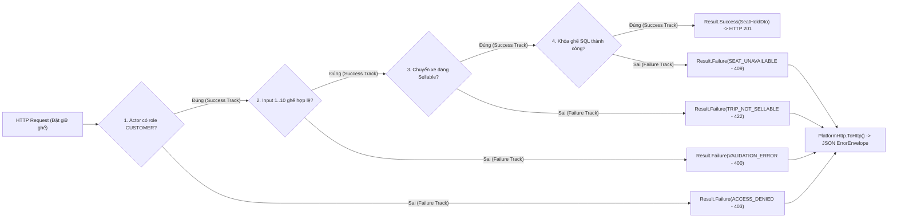
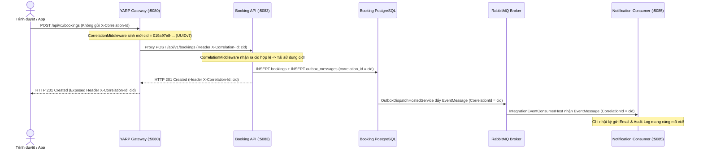

# Chương 02.3: Railway-Oriented Programming, Mẫu `Result<T>` & Chuẩn Hóa Error Envelope Toàn Hệ Thống

> **Mục tiêu của chương này**: Giải thích từ gốc rễ khoa học máy tính tại sao việc ném ngoại lệ (`throw new Exception(...)`) để điều khiển luồng lỗi nghiệp vụ là một **Anti-pattern** chết người trong hệ thống đặt vé tải cao; cách dự án **BLUE Bus Ticket Platform** áp dụng triết lý **Railway-Oriented Programming (ROP)** bằng kiểu `readonly record struct Result<T>` không tốn một byte cấp phát Heap; giải phẫu toàn bộ **33 mã lỗi chuẩn hóa (`ErrorCodes.cs`)**; và theo chân bộ đôi `CorrelationMiddleware` + `ErrorEnvelopeMiddleware` đảm bảo mọi phản hồi lỗi trên toàn bộ 6 microservices luôn đồng nhất, truy vết xuyên suốt và bảo mật tuyệt đối ở Production.

---

## 1. Lý thuyết Gốc rễ: Tại sao `throw new Exception` cho lỗi nghiệp vụ là Anti-Pattern?

Khi mới học lập trình hướng đối tượng (Java / C#), hầu hết lập trình viên đều quen tay viết code xử lý đặt vé theo kiểu sau:

```csharp
// ❌ CÁCH VIẾT CŨ (DÙNG EXCEPTION ĐỂ ĐIỀU KHIỂN NGHIỆP VỤ - ANTI-PATTERN!)
public async Task<SeatHoldDto> CreateHoldAsync(Guid tripId, Guid[] seatIds)
{
    var trip = await repo.GetTripAsync(tripId);
    if (trip is null)
        throw new NotFoundException("Không tìm thấy chuyến xe!");

    if (!trip.Sellable)
        throw new BusinessRuleException("Chuyến xe chưa mở bán!");

    var hold = await repo.CreateHoldAsync(seatIds);
    if (hold is null)
        throw new SeatConflictException("Ghế vừa có người khác đặt mất rồi!");

    return Map(hold);
}
```

Đoạn code trông có vẻ ngắn gọn, nhưng khi đưa vào một nền tảng bán vé xe khách thực tế (đặc biệt vào giờ cao điểm mở bán vé lễ/Tết khi hàng ngàn người cùng tranh 40 ghế trên một chuyến xe, nghĩa là **99% lượt bấm sẽ rơi vào nhánh "hết ghế"**), cách dùng `throw` này gây ra **3 hậu quả nghiêm trọng**:

### 1.1. Hậu quả 1: Tàn phá hiệu năng CPU & RAM do "Stack Unwinding"
Trong .NET Runtime (CLR), đối tượng `Exception` được thiết kế dành riêng cho các **tai nạn bất khả kháng hiếm gặp** (đứt cáp mạng tới PostgreSQL, hết sạch bộ nhớ `OutOfMemoryException`, hỏng file cấu hình). Mỗi khi lệnh `throw new ...` được thực thi, CLR phải làm một chuỗi công việc cực nặng:
1. Cấp phát đối tượng `Exception` lớn trên vùng nhớ **Managed Heap** (tạo áp lực cho bộ dọn rác Garbage Collector).
2. Tạm dừng luồng thực thi bình thường để quét ngược toàn bộ ngăn xếp lời gọi hàm (**Stack Unwinding**), thu thập tên phương thức, địa chỉ IL offset và số dòng mã nguồn để dựng chuỗi `StackTrace`.
3. Tra cứu bảng xử lý ngoại lệ (Exception Handling Clauses) qua từng tầng hàm bất đồng bộ (`async` state machines) cho tới tận Middleware ngoài cùng.

Các phép đo benchmark thực tế trên .NET cho thấy việc `throw` và `catch` một ngoại lệ **chậm hơn từ 500 đến 2.000 lần** so với lệnh `return` một giá trị `struct` thông thường! Nếu 5.000 khách hàng cùng bấm giữ 1 ghế cuối cùng, 4.999 người thất bại đều kích hoạt `throw new SeatConflictException` -> CPU của máy chủ sẽ cháy rực chỉ để chụp Stack Trace cho một tình huống kinh doanh hoàn toàn bình thường!

### 1.2. Hậu quả 2: Lệnh `GOTO` tàng hình và "Chữ ký hàm thiếu trung thực" (Dishonest Signatures)
Trong C#, trình biên dịch không kiểm tra Checked Exceptions. Hãy nhìn chữ ký hàm:
```csharp
Task<SeatHoldDto> CreateHoldAsync(Actor actor, Guid tripId, CreateSeatHoldRequest request, ...);
```
Chữ ký này nói dối người gọi! Nó hứa hẹn: *"Truyền tham số vào đi, tôi sẽ trả về `SeatHoldDto`"*. Nó giấu nhẹm sự thật rằng bên dưới tầng sâu thứ 4 có thể văng ra 6 loại ngoại lệ khác nhau (`AccessDenied`, `Validation`, `TripNotSellable`, `SeatUnavailable`...). Lệnh `throw` hoạt động chẳng khác nào câu lệnh **`GOTO` tàng hình** nhảy cóc qua hàng loạt hàm trung gian, khiến người viết Endpoint không biết phải bắt những lỗi nào, rất dễ bỏ sót dẫn đến lỗi `500 Internal Server Error` oan uổng.

### 1.3. Giải pháp: Railway-Oriented Programming (ROP) — Mô hình Hai Đường Ray

Nhà khoa học máy tính Scott Wlaschin đề xuất mô hình **Railway-Oriented Programming (Lập trình hướng đường ray)**:
- Thay vì giả định hàm luôn thành công và ném bom khi thất bại, ta đóng gói đầu ra vào một "toa tàu hộp kín" gọi là **`Result<T>`**.
- Mọi bước xử lý trong ca sử dụng giống như các **bộ ghi đường ray (Railroad Switches)** nối tiếp nhau trên hai làn ray song song:
  1. **Đường ray Xanh (`Success Track`)**: Chở giá trị hợp lệ `T Value` đi tiếp sang bước kiểm tra kế tiếp.
  2. **Đường ray Đỏ (`Failure Track`)**: Ngay khi một quy tắc nghiệp vụ không thỏa mãn (ví dụ ghế đã bị giữ), đoàn tàu chuyển làn êm ái sang đường ray Đỏ mang theo `AppError Error` và đi thẳng về ga cuối (HTTP Endpoint) để trả mã lỗi `409 SEAT_UNAVAILABLE` mà không nổ bất kỳ quả bom Exception nào!



> [!IMPORTANT]
> **Nguyên tắc phân định rạch ròi trong dự án BLUE**:
> - **Lỗi nghiệp vụ dự kiến được (Expected Domain/Application Errors)**: Hết ghế, sai mật khẩu, tài khoản bị khóa tạm thời, quá hạn thanh toán, trùng email, thiếu `Idempotency-Key`... -> **100% trả về `Result.Failure(AppError)`**.
> - **Sự cố kỹ thuật bất khả kháng (Unexpected Infrastructure Failures)**: Sập máy chủ PostgreSQL (`NpgsqlException`), mất kết nối mạng, hết RAM -> **Để nguyên cho văng `Exception`**, nơi `ErrorEnvelopeMiddleware` ở ngoài cùng sẽ bắt lại, ghi log `LogError` đầy đủ cho kỹ sư vận hành và trả về `500 INTERNAL_ERROR` an toàn cho người dùng!

---

## 2. Giải phẫu Từng Dòng Code Bộ Lõi `Results` & `Errors` trong `BuildingBlocks`

### 2.1. Tệp `Result.cs` — Bí mật hiệu năng của `readonly record struct`

Hãy đọc trọn vẹn 45 dòng code của `workspace/src/building-blocks/BusTicketPlatform.BuildingBlocks/Results/Result.cs`:

```csharp
using BusTicketPlatform.BuildingBlocks.Errors;

namespace BusTicketPlatform.BuildingBlocks.Results;

public readonly record struct Result
{
    public bool IsSuccess { get; }
    public AppError? Error { get; }

    private Result(bool isSuccess, AppError? error)
    {
        IsSuccess = isSuccess;
        Error = error;
    }

    public static Result Success() => new(true, null);

    public static Result Failure(AppError error)
    {
        ArgumentNullException.ThrowIfNull(error);
        return new Result(false, error);
    }
}

public readonly record struct Result<T>
{
    public bool IsSuccess { get; }
    public T? Value { get; }
    public AppError? Error { get; }

    private Result(bool isSuccess, T? value, AppError? error)
    {
        IsSuccess = isSuccess;
        Value = value;
        Error = error;
    }

    public static Result<T> Success(T value) => new(true, value, null);

    public static Result<T> Failure(AppError error)
    {
        ArgumentNullException.ThrowIfNull(error);
        return new Result<T>(false, default, error);
    }
}
```

Tại sao tác giả không viết `public class Result<T>` như các bài hướng dẫn cơ bản trên mạng, mà lại viết tổ hợp 3 từ khóa **`public readonly record struct Result<T>`**? Từng từ khóa đều mang ý đồ tối ưu sâu sắc của .NET hiện đại:

1. **Tại sao là `struct` thay vì `class`? (Zero Heap Allocation)**:
   - Nếu `Result<T>` là `class` (Reference Type), cứ mỗi một lần hàm Service trả về `Result.Success(dto)`, CLR lại phải cấp phát thêm một vỏ hộp đối tượng `Result` trên vùng nhớ **Heap** (tốn 24–32 bytes kèm Object Header), sau đó bộ dọn rác Garbage Collector (GC) phải tốn CPU đi quét dọn hàng triệu vỏ hộp này.
   - Khi khai báo là `struct` (Value Type), bản thân cấu trúc `Result<T>` (chỉ gồm 1 biến `bool` + 2 con trỏ tham chiếu `Value` và `Error`) nằm gọn ngay trên **ngăn xếp CPU (Stack) hoặc thanh ghi (CPU Registers)**. Khi hàm kết thúc, con trỏ Stack lùi lại là bộ nhớ tự giải phóng tức thì với **chi phí GC bằng 0 tuyệt đối**!
2. **Tại sao phải có từ khóa `readonly`? (Chống Defensive Copy & Đảm bảo Bất biến)**:
   - Trong C#, nếu một `struct` không có từ khóa `readonly`, mỗi khi truyền nó vào biến `in` hoặc trường `readonly`, trình biên dịch sợ phương thức bên trong làm biến đổi dữ liệu nên âm thầm tạo bản sao phòng thủ (*Defensive Copy*) gây tốn CPU.
   - Đánh dấu `readonly struct` cam kết với trình biên dịch Roslyn rằng `IsSuccess`, `Value` và `Error` không bao giờ thay đổi sau khi khởi tạo — vừa an toàn tuyệt đối, vừa giúp JIT Compiler tối ưu tốc độ tối đa.
3. **Tại sao dùng `record struct`? (So sánh theo giá trị tự động)**:
   - Trình biên dịch tự động tổng hợp các phương thức so sánh bằng giá trị (`IEquatable<Result<T>>`, toán tử `==`, `!=`) và hàm `ToString()` rõ ràng giúp viết Unit Test cực kỳ sướng tay.
4. **Tại sao tách riêng 2 kiểu `Result` (không generic) và `Result<T>` (có generic)?**:
   - Trong C#, `void` không thể truyền làm tham số kiểu `Result<void>`. Với các thao tác chỉ thực hiện hành động mà không cần trả dữ liệu (như `ReleaseHoldAsync`, `LogoutAsync`, `ApplyTripStatusAsync` trả về `204 No Content`), dự án dùng `Result` thuần gọn nhẹ. Với các thao tác có dữ liệu trả về (như `CreateHoldAsync` trả về `SeatHoldDto`), dự án dùng `Result<SeatHoldDto>`.
5. **Khóa `private` Constructor + Guard Clause `ArgumentNullException.ThrowIfNull(error)`**:
   - Không cho phép bên ngoài gọi bừa `new Result<int>(true, 0, someError)` (trạng thái mâu thuẫn vừa thành công vừa có lỗi!). Bắt buộc phải đi qua cổng `Result<T>.Success(value)` hoặc `Result<T>.Failure(error)` có kiểm tra `error` khác `null` (được kiểm chứng trực tiếp trong `workspace/src/tests/building-blocks/BusTicketPlatform.BuildingBlocks.UnitTests/ResultTests.cs`).

> [!NOTE]
> **Lưu ý nhỏ cho lập trình viên C# về `default(Result)` của `struct`**:
> Vì mọi `struct` trong .NET luôn có giá trị mặc định zero-initialized `default` (khi đó `IsSuccess == false` và `Error == null`), quy ước bắt buộc trong dự án là **không bao giờ khởi tạo biến bằng `default`**, mà luôn gọi tường minh `Result.Success()` hoặc `Result.Failure(...)`. Nhờ vậy, mỗi khi kiểm tra `if (!result.IsSuccess)`, ta hoàn toàn yên tâm `result.Error!` chắc chắn khác `null`.

---

### 2.2. Tệp `AppError.cs` — Tại sao tự định nghĩa `StatusCodes` riêng mà không dùng của ASP.NET Core?

Hãy xem tệp `workspace/src/building-blocks/BusTicketPlatform.BuildingBlocks/Errors/AppError.cs`:

```csharp
namespace BusTicketPlatform.BuildingBlocks.Errors;

public sealed record AppError(
    string Code,
    string Message,
    int StatusCode,
    IReadOnlyDictionary<string, object>? Details = null)
{
    public static AppError Validation(string message, IReadOnlyDictionary<string, object>? details = null) =>
        new(ErrorCodes.ValidationError, message, StatusCodes.BadRequest, details);

    public static AppError NotFound(string message) =>
        new(ErrorCodes.ResourceNotFound, message, StatusCodes.NotFound);

    public static AppError Internal(string correlationId) =>
        new(
            ErrorCodes.InternalError,
            "An unexpected error occurred.",
            StatusCodes.InternalServerError,
            new Dictionary<string, object> { ["correlationId"] = correlationId });
}

public static class StatusCodes
{
    public const int BadRequest = 400;
    public const int Unauthorized = 401;
    public const int Forbidden = 403;
    public const int NotFound = 404;
    public const int Conflict = 409;
    public const int Gone = 410;
    public const int Unprocessable = 422;
    public const int Locked = 423;
    public const int TooManyRequests = 429;
    public const int InternalServerError = 500;
    public const int ServiceUnavailable = 503;
}
```

Hãy để ý chi tiết kiến trúc tinh tế:
- `AppError` là một `sealed record` (Reference Type trên Heap — hoàn toàn hợp lý vì nó chỉ được khởi tạo khi thực sự có lỗi xảy ra, còn trên nhánh thành công biến `Error` chỉ là con trỏ `null` không tốn bộ nhớ!).
- Tại sao tác giả lại viết riêng `public static class StatusCodes` gồm 11 hằng số số nguyên (`400..503`) trong khi `Microsoft.AspNetCore.Http.StatusCodes` đã có sẵn?
  Bởi vì `BusTicketPlatform.BuildingBlocks` được tham chiếu bởi tầng `*.Application`, mà theo kiểm thử kiến trúc `LayerDependencyTests.cs`, **`Application` và `BuildingBlocks` bị cấm tuyệt đối tham chiếu tới `Microsoft.AspNetCore`!** Việc khai báo 11 hằng số `const int` độc lập giữ cho tầng lõi hoàn toàn tinh khiết nhưng vẫn biểu đạt ngữ nghĩa mã lỗi rõ ràng, không phải viết "con số ma thuật" (magic numbers) rải rác trong code.

---

### 2.3. Từ điển Toàn tập 33 Mã Lỗi Hệ Thống (`ErrorCodes.cs`) & `PlatformErrors.cs`

Trong các hệ thống thiếu chuẩn hóa, Frontend/Mobile khổ sở vì mỗi API trả lỗi một kiểu: chỗ trả chuỗi tiếng Việt, chỗ trả chuỗi tiếng Anh, chỗ đổi câu chữ thông báo là giao diện vỡ tan tành vì trót viết `if (res.message.includes("ghế"))`.

Dự án BLUE thiết lập một **Danh mục Mã lỗi Máy đọc ổn định (Machine-Readable Error Catalog)** trong `workspace/src/building-blocks/BusTicketPlatform.BuildingBlocks/Errors/ErrorCodes.cs` gồm **đúng 33 hằng số chuẩn `SCREAMING_SNAKE_CASE`**. Frontend chỉ cần dựa vào `error.code` để hiển thị thông báo đa ngôn ngữ hoặc bật nút hành động phù hợp!

Dưới đây là bảng giải phẫu trọn vẹn **cả 33 hằng số** trong `ErrorCodes.cs` đối chiếu với mã HTTP trong `PlatformErrors.cs` và `IdentityErrors.cs`:

#### Nhóm A — 10 Mã lỗi Nền tảng & Giao thức Chung (Platform & HTTP Protocol)

| STT | Hằng số C# trong `ErrorCodes` | Giá trị chuỗi JSON (`code`) | HTTP Status | Ý nghĩa & Tình huống kích hoạt thực tế |
| :-: | :--- | :--- | :-: | :--- |
| 1 | `ValidationError` | `"VALIDATION_ERROR"` | `400` | Dữ liệu đầu vào sai định dạng, thiếu trường bắt buộc, JSON lỗi cú pháp hoặc `Idempotency-Key` sai độ dài (`< 16` hoặc `> 200`). Kèm `details: { "field": "..." }`. |
| 2 | `AuthenticationRequired` | `"AUTHENTICATION_REQUIRED"` | `401` | Chưa gửi kèm Bearer JWT Token, hoặc Token đã hết hạn / bị thu hồi (`AuthorizationVersion` không khớp). |
| 3 | `InvalidCredentials` | `"INVALID_CREDENTIALS"` | `401` | Đăng nhập sai Email/Số điện thoại hoặc sai mật khẩu (cố tình trả chung 1 mã để chống dò tài khoản - User Enumeration!). |
| 4 | `AccessDenied` | `"ACCESS_DENIED"` | `403` | Đã đăng nhập nhưng không đủ vai trò RBAC hoặc khác nhà xe (`OrganizationId`). |
| 5 | `ResourceNotFound` | `"RESOURCE_NOT_FOUND"` | `404` | Không tìm thấy tài nguyên (chuyến xe, đơn vé, người dùng) hoặc người dùng cố xem vé của người khác. |
| 6 | `MethodNotAllowed` | `"METHOD_NOT_ALLOWED"` | `405` | Gọi sai phương thức HTTP trên đường dẫn (ví dụ gọi `DELETE` vào endpoint chỉ mở `GET`/`POST`). |
| 7 | `RateLimited` | `"RATE_LIMITED"` | `429` | Vượt ngưỡng giới hạn tần suất (ví dụ tra cứu vé công khai quá 40 lần/phút hoặc yêu cầu OTP quá 5 lần/15 phút). |
| 8 | `UpstreamUnavailable` | `"UPSTREAM_UNAVAILABLE"` | `503` | Dịch vụ phụ thuộc phía sau đang không phản hồi (ánh xạ từ các mã Gateway `502`, `503`, `504`). |
| 9 | `VersionConflict` | `"VERSION_CONFLICT"` | `409` | Xung đột khóa lạc quan (`ExpectedVersion` gửi lên khác `row_version` hiện tại trong PostgreSQL khi hai người sửa cùng lúc). |
| 10 | `InternalError` | `"INTERNAL_ERROR"` | `500` | Lỗi hệ thống bất ngờ chưa xử lý (ẩn hoàn toàn thông tin nội bộ, chỉ đính kèm `correlationId` để tra log). |

#### Nhóm B — 7 Mã lỗi Định danh, Xác thực & Bảo mật Phiên (`Identity` Service)

| STT | Hằng số C# trong `ErrorCodes` | Giá trị chuỗi JSON (`code`) | HTTP Status | Ý nghĩa & Tình huống kích hoạt thực tế |
| :-: | :--- | :--- | :-: | :--- |
| 11 | `IdentityAlreadyUsed` | `"IDENTITY_ALREADY_USED"` | `409` | Email hoặc số điện thoại đăng ký đã thuộc về một tài khoản kích hoạt khác trong hệ thống. |
| 12 | `VerificationInvalid` | `"VERIFICATION_INVALID"` | `422` | Mã OTP xác thực email / đặt lại mật khẩu không đúng hoặc đã vượt quá 5 lần nhập sai. |
| 13 | `VerificationExpired` | `"VERIFICATION_EXPIRED"` | `410` | Mã thử thách OTP đã quá hạn 30 phút (`410 Gone` phản ánh tài nguyên từng tồn tại nhưng nay đã hết hiệu lực vĩnh viễn). |
| 14 | `PasswordPolicyViolation` | `"PASSWORD_POLICY_VIOLATION"` | `422` | Mật khẩu mới không thỏa `PasswordPolicy` (dưới 10 ký tự, trên 128 ký tự, thiếu chữ cái hoặc thiếu chữ số). |
| 15 | `AccountLocked` | `"ACCOUNT_LOCKED"` | `423` | Tài khoản bị khóa(`LOCKED` / `DISABLED`) hoặc đang bị tạm khóa 15 phút do nhập sai mật khẩu liên tiếp 5 lần (`423 Locked`). |
| 16 | `SessionInvalid` | `"SESSION_INVALID"` | `401` | Refresh Token không tồn tại, đã hết hạn 14 ngày hoặc phiên đăng nhập đã bị đăng xuất. |
| 17 | `SessionReuseDetected` | `"SESSION_REUSE_DETECTED"` | `401` | **Phát hiện đánh cắp Refresh Token!** Một Refresh Token cũ đã xoay vòng (rotated) bị đem ra dùng lại -> hệ thống lập tức thu hồi toàn bộ họ phiên (`RevokeFamilyAsync`) để bảo vệ người dùng! |

#### Nhóm C — 3 Mã lỗi Chống Trùng Lặp Giao Dịch (`Idempotency`)

| STT | Hằng số C# trong `ErrorCodes` | Giá trị chuỗi JSON (`code`) | HTTP Status | Ý nghĩa & Tình huống kích hoạt thực tế |
| :-: | :--- | :--- | :-: | :--- |
| 18 | `IdempotencyKeyRequired` | `"IDEMPOTENCY_KEY_REQUIRED"` | `400` | Gọi API biến đổi trạng thái quan trọng (giữ ghế, đặt vé, thanh toán, hủy vé) mà quên gửi header `Idempotency-Key`. |
| 19 | `IdempotencyConflict` | `"IDEMPOTENCY_CONFLICT"` | `409` | Dùng lại cùng một `Idempotency-Key` cũ nhưng nội dung JSON Body gửi lên lại bị thay đổi (khác mã băm SHA-256). |
| 20 | `IdempotencyInProgress` | `"IDEMPOTENCY_IN_PROGRESS"` | `409` | Request gốc mang `Idempotency-Key` này hiện vẫn đang ở trạng thái `PROCESSING` chưa chạy xong, yêu cầu client chờ đợi. |

#### Nhóm D — 13 Mã lỗi Vận tải, Giữ ghế, Đặt vé & Thanh toán (`Transport`, `Booking`, `Payment`)

| STT | Hằng số C# trong `ErrorCodes` | Giá trị chuỗi JSON (`code`) | HTTP Status | Ý nghĩa & Tình huống kích hoạt thực tế |
| :-: | :--- | :--- | :-: | :--- |
| 21 | `ScheduleConflict` | `"SCHEDULE_CONFLICT"` | `409` | Lịch chạy của xe khách hoặc tài xế bị trùng lắp thời gian với một chuyến xe khác đang hoạt động. |
| 22 | `InvalidStateTransition` | `"INVALID_STATE_TRANSITION"` | `409` | Chuyển trạng thái sai quy trình vòng đời (ví dụ chuyến xe đã `COMPLETED` mà đòi hủy, hoặc vé đã hủy mà đòi hoàn tiền lại). |
| 23 | `ResourceConflict` | `"RESOURCE_CONFLICT"` | `409` | Xung đột tài nguyên nghiệp vụ tổng quát (ví dụ biển số xe, mã tuyến hoặc mã nhân sự đã tồn tại). |
| 24 | `TripNotSellable` | `"TRIP_NOT_SELLABLE"` | `422` | Chuyến xe chưa mở bán (`DRAFT`) hoặc đã khởi hành/đóng bán, không thể tạo lượt giữ ghế mới. |
| 25 | `SeatUnavailable` | `"SEAT_UNAVAILABLE"` | `409` | Một hoặc nhiều ghế khách chọn vừa bị người khác giữ chỗ (`HELD`) hoặc đã bán (`BOOKED`). |
| 26 | `SeatHoldExpired` | `"SEAT_HOLD_EXPIRED"` | `410` | Lượt giữ ghế 10 phút đã hết hạn trước khi khách kịp áp mã giảm giá hoặc bấm tạo đơn đặt vé. |
| 27 | `PayLaterNotAllowed` | `"PAY_LATER_NOT_ALLOWED"` | `422` | Khách chọn thanh toán trả sau khi lên xe (`PAY_LATER`) nhưng chính sách của nhà xe chuyến đó không cho phép. |
| 28 | `PreviewStale` | `"PREVIEW_STALE"` | `410` | Bản xem trước phí hủy vé (`CancellationPreview`, hiệu lực 5 phút) đã hết hạn hoặc đã được sử dụng, buộc phải xem trước lại. |
| 29 | `TicketAlreadyCheckedIn` | `"TICKET_ALREADY_CHECKED_IN"` | `409` | Nhân viên nhà xe quét mã QR vé lên xe nhưng vé này đã được soát vé (`CHECKED_IN`) trước đó rồi! |
| 30 | `PriceMismatch` | `"PRICE_MISMATCH"` | `422` | Tổng tiền `ExpectedTotal` trên màn hình khách nhìn thấy lệch với giá thực tế máy chủ tính toán (chống gian lận sửa giá phía client hoặc giá vừa biến động). |
| 31 | `PaymentNotAllowed` | `"PAYMENT_NOT_ALLOWED"` | `422` | Đơn đặt vé không ở trạng thái cho phép tạo giao dịch thanh toán (ví dụ đơn đã thanh toán xong hoặc là đơn trả sau). |
| 32 | `BookingExpired` | `"BOOKING_EXPIRED"` | `410` | Cửa sổ chờ thanh toán của đơn đặt vé (hoặc lượt giữ chỗ) đã khép lại (`410 Gone`). |
| 33 | `WebhookInvalid` | `"WEBHOOK_INVALID"` | `400` | Gói tin Webhook gọi về từ cổng thanh toán (như SePay) sai chữ ký bảo mật hoặc sai cấu trúc xác thực. |

> [!TIP]
> **Sự tinh tế trong việc chọn HTTP Status Codes (`400` vs `409` vs `410` vs `422` vs `423`)**:
> Thay vì lười biếng trả `400 Bad Request` cho mọi thứ, bảng mã trên tuân thủ chặt chẽ chuẩn **RFC 9110**:
> - `400`: Cú pháp/khuôn dạng dữ liệu gửi lên bị lỗi ngay từ vòng gửi xe.
> - `422 Unprocessable Content`: Cú pháp JSON hoàn toàn đúng, nhưng vi phạm quy tắc chính sách nghiệp vụ (sai giá `PRICE_MISMATCH`, mật khẩu yếu, nhà xe cấm trả sau).
> - `409 Conflict`: Xung đột trạng thái hiện thời trên máy chủ (ghế đã có người giữ, trùng lịch tài xế, vé đã check-in).
> - `410 Gone`: Tài nguyên có thời hạn sống (OTP 30 phút, giữ ghế 10 phút, preview hủy 5 phút) nay đã hết hạn.
> - `423 Locked`: Tài khoản đang trong thời gian khóa bảo vệ chống dò mật khẩu (Brute-force lockout).

---

### 2.4. Tệp `ErrorMapper.cs`, `ErrorEnvelope.cs` & Cầu nối HTTP `PlatformHttp.ToHttp()`

Khi đã có `AppError` từ tầng `Application`, làm thế nào để chuyển nó thành một phong bì JSON thống nhất trên toàn hệ thống? Ba mảnh ghép nhỏ gọn sau đây đảm nhận việc đó:

#### a) `ErrorEnvelope.cs` — Khuôn mẫu Phong bì Lỗi Chuẩn Toàn Nền tảng
Trong `workspace/src/building-blocks/BusTicketPlatform.BuildingBlocks/Http/ErrorEnvelope.cs`:

```csharp
using System.Text.Json.Serialization;
using BusTicketPlatform.BuildingBlocks.Errors;

namespace BusTicketPlatform.BuildingBlocks.Http;

public sealed record ErrorEnvelope(ErrorEnvelopeBody Error)
{
    public static ErrorEnvelope From(AppError error, Guid correlationId) =>
        new(new ErrorEnvelopeBody(error.Code, error.Message, correlationId, error.Details));
}

public sealed record ErrorEnvelopeBody(
    string Code,
    string Message,
    [property: JsonPropertyName("correlationId")] Guid CorrelationId,
    IReadOnlyDictionary<string, object>? Details);
```

Bất kể lỗi phát sinh từ `Identity` (cổng `5081`), `Booking` (cổng `5083`), `Payment` (cổng `5084`) hay ngay tại `Gateway` (cổng `5080`), ứng dụng Frontend luôn luôn nhận về **đúng một cấu trúc JSON bất biến duy nhất**:

```json
{
  "error": {
    "code": "SEAT_UNAVAILABLE",
    "message": "One or more seats are not available.",
    "correlationId": "019a97e4-8b12-7c40-9d31-42f8a109c3e5"
  }
}
```
Hoặc khi lỗi kiểm tra đầu vào có chỉ định trường lỗi (`details` tự động ẩn đi khi bằng `null` nhờ cấu hình `JsonIgnoreCondition.WhenWritingNull`):
```json
{
  "error": {
    "code": "VALIDATION_ERROR",
    "message": "Đơn tối thiểu 500,000 đ để dùng mã này.",
    "correlationId": "019a97e5-1024-7a11-8f20-99bc12004a11",
    "details": {
      "field": "couponCode"
    }
  }
}
```

#### b) `PlatformHttp.ToHttp()` — Biến đổi `Result<T>` thành `IResult` chỉ trong 1 dòng lệnh
Trong `workspace/src/building-blocks/BusTicketPlatform.BuildingBlocks.AspNetCore/Http/PlatformHttp.cs`:

```csharp
public static IResult ToHttp(this Result result, Guid correlationId, int successStatus = 204)
{
    if (result.IsSuccess)
    {
        return successStatus == 204 ? HttpResults.NoContent() : HttpResults.StatusCode(successStatus);
    }

    return Error(result.Error!, correlationId);
}

public static IResult ToHttp<T>(this Result<T> result, Guid correlationId, int successStatus = 200)
{
    if (!result.IsSuccess)
    {
        return Error(result.Error!, correlationId);
    }

    return HttpResults.Json(result.Value, Json, statusCode: successStatus);
}

public static IResult Error(AppError error, Guid correlationId) =>
    HttpResults.Json(ErrorEnvelope.From(error, correlationId), Json, statusCode: error.StatusCode);
```

Nhờ Extension Method này, mỗi Endpoint trong `BookingEndpoints.cs` không cần viết bất kỳ câu lệnh `if/else` hay `switch/case` rườm rà nào nữa:
```csharp
api.MapGet("/trips/{tripId:guid}/coupons", async (HttpContext context, BookingService service, Guid tripId) =>
    (await service.ListCouponsAsync(tripId, context.RequestAborted)).ToHttp(context.CorrelationId()));
```

#### c) `ErrorMapper.cs` — Bộ dịch các ngoại lệ lạ & mã HTTP trần của Framework
Trong `workspace/src/building-blocks/BusTicketPlatform.BuildingBlocks/Errors/ErrorMapper.cs`:

```csharp
namespace BusTicketPlatform.BuildingBlocks.Errors;

public static class ErrorMapper
{
    public static AppError FromUnknown(Exception _, Guid correlationId)
    {
        return AppError.Internal(correlationId.ToString());
    }

    public static AppError FromStatus(int statusCode, Guid correlationId)
    {
        return statusCode switch
        {
            400 => AppError.Validation("The request is invalid."),
            401 => new AppError(ErrorCodes.AuthenticationRequired, "Authentication is required.", 401),
            403 => new AppError(ErrorCodes.AccessDenied, "Access is denied.", 403),
            404 => AppError.NotFound("The requested resource was not found."),
            405 => new AppError(ErrorCodes.MethodNotAllowed, "The HTTP method is not allowed for this resource.", 405),
            429 => new AppError(ErrorCodes.RateLimited, "Too many requests.", 429),
            502 or 503 or 504 => new AppError(ErrorCodes.UpstreamUnavailable, "A required dependency is unavailable.", 503),
            _ => AppError.Internal(correlationId.ToString())
        };
    }
}
```
Hãy để ý tham số `Exception _` (ký hiệu discard `_` của C#!) trong `FromUnknown`: hàm này cố tình **phớt lờ hoàn toàn `exception.Message`** để tạo ra thông báo chung `"An unexpected error occurred."`! Kể cả khi câu lệnh SQL bị lỗi chứa tên bảng mật hay thông tin nhạy cảm trong `exception.Message`, nó cũng không bao giờ lọt vào `ErrorMapper.FromUnknown` (được kiểm chứng chặt chẽ trong bài test `Unknown_exception_maps_to_internal_error` của `ErrorMapperTests.cs`).

---

## 3. Giải phẫu `CorrelationMiddleware.cs` — Sợi chỉ đỏ truy vết xuyên 6 Microservices

### 3.1. Nỗi ác mộng gỡ lỗi trong Hệ thống Phân tán (Distributed Tracing Problem)
Trong một ứng dụng Monolith cũ, khi đơn đặt vé bị lỗi, bạn chỉ cần mở đúng 1 file log trên 1 máy chủ để đọc từ trên xuống dưới.
Nhưng trong **BLUE Bus Ticket Platform**, chỉ một cú nhấp chuột **"Thanh toán đơn đặt vé"** của khách hàng sẽ kích hoạt chuỗi phản ứng dây chuyền đi qua **5 tiến trình độc lập**:
1. Trình duyệt gửi HTTP Request vào **YARP API Gateway** (`:5080`).
2. Gateway chuyển tiếp (proxy) sang **Booking API** (`:5083`) tạo đơn vé và ghi bản ghi vào bảng `outbox_messages`.
3. Khách chuyển khoản -> Webhook gọi vào **Payment API** (`:5084`) -> ghi sự kiện `PaymentSucceeded` vào Outbox -> đẩy lên **RabbitMQ**.
4. **Booking Consumer**, **Notification Consumer** (`:5085`) và **Reporting Consumer** (`:5086`) đồng thời bốc sự kiện `PaymentSucceeded` từ RabbitMQ để xuất vé QR, gửi email vé điện tử và cộng doanh thu cho nhà xe!

Giữa lúc có 500 khách hàng đang đặt vé đồng thời, các dòng log của 500 người trộn lẫn vào nhau trên 6 container khác nhau. Nếu khách hàng gọi tổng đài báo *"Em vừa bị trừ tiền mà chưa nhận được vé!"*, làm sao kỹ sư tìm ra đúng 5 mảnh ghép của riêng giao dịch đó trong biển triệu dòng log chỉ trong 3 giây?

Câu trả lời là **Correlation ID (`X-Correlation-Id`)**!

### 3.2. Giải phẫu từng dòng code `CorrelationMiddleware.cs`

Hãy đọc mã nguồn `workspace/src/building-blocks/BusTicketPlatform.BuildingBlocks.AspNetCore/Correlation/CorrelationMiddleware.cs` (đi kèm hằng số `HeaderName = "X-Correlation-Id"` trong `CorrelationDefaults.cs` và nhãn OpenTelemetry `CorrelationTag = "correlation.id"` trong `TelemetryConventions.cs`):

```csharp
using BusTicketPlatform.BuildingBlocks.Correlation;
using BusTicketPlatform.BuildingBlocks.Ids;
using Microsoft.AspNetCore.Http;

namespace BusTicketPlatform.BuildingBlocks.AspNetCore.Correlation;

public sealed class CorrelationMiddleware(RequestDelegate next, IIdGenerator idGenerator)
{
    public const string HttpContextItemKey = "CorrelationId";

    public async Task InvokeAsync(HttpContext context)
    {
        var correlationId = Resolve(context.Request.Headers[CorrelationDefaults.HeaderName], idGenerator);
        context.Items[HttpContextItemKey] = correlationId;
        context.Response.OnStarting(() =>
        {
            context.Response.Headers[CorrelationDefaults.HeaderName] = correlationId.ToString();
            return Task.CompletedTask;
        });

        await next(context);
    }

    public static Guid Resolve(string? rawHeader, IIdGenerator idGenerator)
    {
        if (Guid.TryParse(rawHeader, out var parsed) && parsed != Guid.Empty)
        {
            return parsed;
        }

        return idGenerator.NewUuidV7();
    }
}

public static class HttpContextCorrelationExtensions
{
    public static Guid GetCorrelationId(this HttpContext context)
    {
        if (context.Items.TryGetValue(CorrelationMiddleware.HttpContextItemKey, out var value) && value is Guid id)
        {
            return id;
        }

        return Guid.Empty;
    }
}
```

#### Phân tích 3 chi tiết kỹ thuật đắt giá trong 46 dòng code trên:

1. **Hàm `Resolve` vừa kế thừa vừa chống giả mạo rỗng (`parsed != Guid.Empty`)**:
   - Khi request mới tinh từ trình duyệt đi tới **Gateway** (chưa có header `X-Correlation-Id`), `Guid.TryParse` trả `false` -> Gateway tự động sinh mới một mã **UUIDv7 theo thứ tự thời gian** (`idGenerator.NewUuidV7()`).
   - Khi YARP Gateway chuyển tiếp request xuống **Booking API**, header `X-Correlation-Id` đi theo gói tin HTTP -> `Booking API` chạy qua cùng `CorrelationMiddleware` này, thấy header đã là một GUID hợp lệ khác `00000000-0000-0000-0000-000000000000` (`Guid.Empty`) nên **giữ nguyên và tái sử dụng chính mã đó** thay vì sinh mã mới! (Hành vi này được kiểm thử bằng `StubIdGenerator` và `ThrowingIdGenerator` trong `CorrelationMiddlewareTests.cs`).
2. **Lưu trữ trong `context.Items["CorrelationId"]`**:
   Từ điển `HttpContext.Items` sống trọn vẹn trong phạm vi của 1 HTTP Request. Nhờ đó, bất kỳ Middleware nào đứng sau (`ErrorEnvelopeMiddleware`), bất kỳ Endpoint nào (`context.CorrelationId()`) cũng rút ra được mã `Guid` này tức thì mà không cần phân tích (`Guid.TryParse`) chuỗi header lặp đi lặp lại.
3. **Tại sao gán Response Header bên trong callback `context.Response.OnStarting(...)` thay vì gán sau `await next(context)`?**:
   Đây là lỗi kinh điển của lập trình viên ASP.NET Core thiếu kinh nghiệm! Trong HTTP/1.1 và HTTP/2, ngay khi Endpoint bắt đầu stream những byte JSON đầu tiên xuống socket mạng bên trong `await next(context)`, phần **HTTP Response Headers đã được gửi đi mất rồi (`HasStarted == true`)**. Nếu bạn đợi `await next(context)` chạy xong mới gán `context.Response.Headers["X-Correlation-Id"] = ...`, chương trình sẽ văng ngoại lệ `InvalidOperationException: Headers are read-only, response has already started`!
   Đăng ký callback `context.Response.OnStarting(...)` đảm bảo ASP.NET Core tự động chèn header `X-Correlation-Id` vào gói tin phản hồi **ngay khoảnh khắc sát trước khi byte đầu tiên rời khỏi máy chủ**, dù luồng xử lý bên trong kết thúc bình thường hay bị ngắt giữa chừng bởi Middleware khác!

### 3.3. Hành trình xuyên biên giới từ HTTP sang CSDL Outbox, RabbitMQ và Audit Logs

Sợi dây `CorrelationId` không dừng lại ở biên giới HTTP! Hãy xem sơ đồ luồng lan truyền thực tế trong dự án:



Nhìn lại file `Gateway/Program.cs` (dòng 64–65), bạn sẽ thấy Gateway cấu hình CORS `.WithExposedHeaders("X-Correlation-Id")` để code JavaScript trên trình duyệt đọc được mã này và hiển thị trên hộp thoại báo lỗi: *"Mã tra cứu hỗ trợ: 019a97e8-..."*!

---

## 4. Giải phẫu `ErrorEnvelopeMiddleware.cs` — Lá chắn Thép không bao giờ lộ Stack Trace

### 4.1. Thứ tự vàng trong `UseBuildingBlocks()` (`HostingExtensions.cs`)
Mở lại `HostingExtensions.cs`, bạn sẽ thấy thứ tự đăng ký hai Middleware nền tảng:

```csharp
public static IApplicationBuilder UseBuildingBlocks(this IApplicationBuilder app)
{
    app.UseMiddleware<Correlation.CorrelationMiddleware>();
    app.UseMiddleware<Http.ErrorEnvelopeMiddleware>();
    return app;
}
```
Và trong `Program.cs` của mọi microservice:
```csharp
app.UseBuildingBlocks();     // Chạy thứ 1 (Correlation) -> thứ 2 (ErrorEnvelope)
app.UseAuthentication();     // Chạy thứ 3 (JWT Bearer)
app.UseAuthorization();      // Chạy thứ 4 (RBAC Policies)
app.UseRateLimiter();        // Chạy thứ 5 (Giới hạn tốc độ)
app.MapBookingEndpoints();   // Chạy cuối cùng (Nghiệp vụ)
```

**Tại sao thứ tự này lại mang tính sống còn?**
- `CorrelationMiddleware` phải đứng **ngoài cùng** (trước cả `ErrorEnvelopeMiddleware`), để dù có bất kỳ lỗi gì xảy ra ở các tầng bên trong, `context.GetCorrelationId()` luôn luôn có sẵn mã `Guid` hợp lệ!
- `ErrorEnvelopeMiddleware` phải đứng **bọc bên ngoài** `UseAuthentication()`, `UseAuthorization()`, `UseRateLimiter()` và `Endpoints` để hứng trọn mọi thất bại từ xác thực JWT, phân quyền, giới hạn tốc độ cho tới ngoại lệ CSDL!

### 4.2. Giải phẫu từng dòng code `ErrorEnvelopeMiddleware.cs`

Hãy đọc trọn vẹn 74 dòng code của `workspace/src/building-blocks/BusTicketPlatform.BuildingBlocks.AspNetCore/Http/ErrorEnvelopeMiddleware.cs`:

```csharp
public sealed class ErrorEnvelopeMiddleware(
    RequestDelegate next,
    ILogger<ErrorEnvelopeMiddleware> logger,
    IWebHostEnvironment environment)
{
    private static readonly JsonSerializerOptions JsonOptions = new()
    {
        PropertyNamingPolicy = JsonNamingPolicy.CamelCase,
        DefaultIgnoreCondition = System.Text.Json.Serialization.JsonIgnoreCondition.WhenWritingNull
    };

    public async Task InvokeAsync(HttpContext context)
    {
        try
        {
            await next(context);

            if (!context.Response.HasStarted && context.Response.StatusCode >= 400 && IsEmptyJsonResponse(context))
            {
                var correlationId = context.GetCorrelationId();
                var error = ErrorMapper.FromStatus(context.Response.StatusCode, correlationId);
                await WriteEnvelope(context, error, correlationId);
            }
        }
        catch (Exception exception)
        {
            if (context.Response.HasStarted)
            {
                throw;
            }

            logger.LogError(exception, "Unhandled exception for {Method} {Path}", context.Request.Method, context.Request.Path);
            var correlationId = context.GetCorrelationId();
            var error = exception is Microsoft.AspNetCore.Http.BadHttpRequestException
                ? AppError.Validation("The request body is invalid.")
                : ErrorMapper.FromUnknown(exception, correlationId);
            if (environment.IsDevelopment())
            {
                var details = new Dictionary<string, object>(error.Details ?? new Dictionary<string, object>())
                {
                    ["exception"] = exception.GetType().Name,
                    ["detail"] = exception.Message
                };
                error = error with { Details = details };
            }

            await WriteEnvelope(context, error, correlationId);
        }
    }

    private static bool IsEmptyJsonResponse(HttpContext context)
    {
        return context.Response.ContentLength is null or 0
            && string.IsNullOrEmpty(context.Response.ContentType);
    }

    public static Task WriteEnvelope(HttpContext context, AppError error, Guid correlationId)
    {
        context.Response.Clear();
        context.Response.StatusCode = error.StatusCode;
        context.Response.ContentType = MediaTypeNames.Application.Json;
        var envelope = ErrorEnvelope.From(error, correlationId);
        return context.Response.WriteAsJsonAsync(envelope, JsonOptions);
    }
}
```

### 4.3. Hai cơ chế "Bắt trọn không lọt lưới" của `ErrorEnvelopeMiddleware`

#### Cơ chế 1 (Dòng 25–32): Biến các phản hồi rỗng của ASP.NET Core thành Phong bì JSON chuẩn!
Khi bạn gọi một API có gắn `.RequireAuthorization()` mà không truyền JWT Token, `AuthenticationMiddleware` của Microsoft mặc định chỉ gán `context.Response.StatusCode = 401` rồi kết thúc với **phần thân rỗng tuếch (0 bytes, không có `Content-Type`)**! Tương tự:
- Người dùng không đủ quyền -> `AuthorizationMiddleware` trả `403` rỗng.
- Gõ sai URL -> `EndpointRoutingMiddleware` trả `404` rỗng.
- Quá tốc độ tra cứu vé -> `RateLimitingMiddleware` trả `429` rỗng.
- Ở YARP Gateway khi microservice phía sau chưa bật -> trả `502` / `503` / `504`.

Nếu trả phản hồi 0 byte về Frontend mà code Frontend gọi `await response.json()`, trình duyệt sẽ văng lỗi `SyntaxError: Unexpected end of JSON input`!
Nhờ đoạn kiểm tra sau `await next(context)`:
- Nếu `!context.Response.HasStarted` (chưa ghi dữ liệu ra mạng),
- Và `StatusCode >= 400`,
- Và `IsEmptyJsonResponse(context)` (`ContentLength` là `null` hoặc `0` và chưa gán `ContentType` — nghĩa là Endpoint chưa tự ghi `ErrorEnvelope` của riêng nó),
Thì Middleware lập tức gọi `ErrorMapper.FromStatus(...)` và đóng gói lại thành JSON chuẩn `{"error": {"code": "AUTHENTICATION_REQUIRED", "message": "...", "correlationId": "..."}}`! Ngược lại, nếu Endpoint đã chủ động trả lỗi chi tiết qua `PlatformHttp.ToHttp()` (lúc này `ContentType` đã là `application/json`), `IsEmptyJsonResponse` trả `false` nên Middleware tôn trọng giữ nguyên phản hồi gốc!

#### Cơ chế 2 (Dòng 34–57): Bắt Ngoại lệ Bất ngờ & Chốt chặn An ninh Môi trường Production
Khi có ngoại lệ chưa lường trước văng ra từ bên trong:
1. **Kiểm tra an toàn luồng mạng**: Nếu `context.Response.HasStarted` là `true`, ta không thể xóa sửa StatusCode được nữa nên `throw` lại để Kestrel đóng kết nối đúng chuẩn giao thức.
2. **Ghi Log có cấu trúc (Structured Logging)**: `logger.LogError(exception, "Unhandled exception for {Method} {Path}", ...)` lưu toàn bộ Stack Trace vào hệ thống log máy chủ phục vụ kỹ sư điều tra.
3. **Nhận diện JSON hỏng từ người dùng (`BadHttpRequestException`)**: Trong Minimal APIs, nếu client gửi chuỗi JSON thiếu dấu ngoặc nhọn `{ "seatIds": [invalid }` hoặc thiếu tham số bắt buộc, ASP.NET Core ném `BadHttpRequestException`. Nếu không có dòng 43–44, lỗi do client gửi sai cú pháp lại bị biến thành lỗi `500 INTERNAL_ERROR` đổ oan cho server! Nhờ kiểm tra kiểu này, hệ thống chuyển mượt mà về `400 VALIDATION_ERROR ("The request body is invalid.")`.
4. **Phân tách môi trường `Development` vs `Production` (OWASP Security Best Practice)**:
   - Khi đang lập trình trên máy cá nhân (`ASPNETCORE_ENVIRONMENT=Development`), `environment.IsDevelopment()` bằng `true` -> hệ thống dùng biểu thức `with` của C# record nhân bản `error` kèm thêm `"exception": "NpgsqlException"` và `"detail": "..."` vào `details` để lập trình viên sửa lỗi nhanh trên Swagger/Postman.
   - Khi chạy trên máy chủ thực tế (`Production` / `Staging`), khối `if` này tự động đóng sập lại! Kẻ tấn công dò quét lỗi chỉ nhận được duy nhất câu thông báo vô hại `"An unexpected error occurred."` kèm mã `correlationId`, tuyệt đối **không bao giờ nhìn thấy tên thư viện CSDL, cấu trúc bảng SQL hay đường dẫn thư mục mã nguồn trên máy chủ**!

---

## 5. Tổng kết Chương 02.3 — Những điểm cốt lõi cần nhớ khi vấn đáp

1. **Railway-Oriented Programming (`Result<T>`)**: Biến lỗi nghiệp vụ thành giá trị trả về tường minh trên 2 làn đường ray (Success & Failure), loại bỏ hoàn toàn chi phí CPU Stack Unwinding và hiệu ứng `GOTO` ẩn của `throw Exception`.
2. **Tối ưu cấp độ kiểu dữ liệu**: Khai báo `public readonly record struct Result<T>` giúp lưu trữ kết quả ngay trên Stack với **Zero Heap Allocation**, trong khi tách biệt hoàn toàn khỏi thư viện Web để dùng xuyên suốt tầng `Application`.
3. **Chuẩn hóa 33 mã lỗi & Phong bì JSON duy nhất**: Mọi lỗi từ xác thực (`401`), phân quyền (`403`), hết ghế (`409`), hết hạn giữ chỗ (`410`), lệch giá (`422`), khóa tài khoản (`423`), giới hạn tốc độ (`429`) đến lỗi bất ngờ (`500`) đều quy về 33 hằng số `ErrorCodes` trong cấu trúc `{ error: { code, message, correlationId, details } }`.
4. **Truy vết & Bảo vệ toàn diện bằng Middleware**: `CorrelationMiddleware` duy trì mã UUIDv7 `X-Correlation-Id` xuyên suốt từ Gateway qua các API và hàng đợi RabbitMQ; `ErrorEnvelopeMiddleware` bọc kín cả các phản hồi lỗi rỗng của framework lẫn ngoại lệ hệ thống mà không bao giờ làm rò rỉ Stack Trace ở Production.
