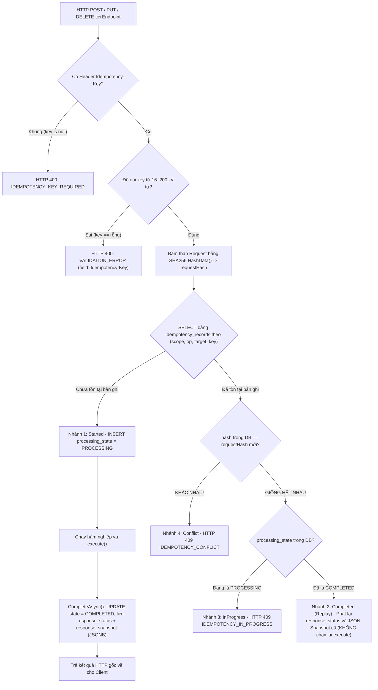

# Chương 02.4: Chống Trùng Lặp Giao Dịch (Idempotency-Key), IClock & LogRedaction

> **Mục tiêu của chương này**: Giải phẫu cơ chế Idempotency-Key đảm bảo khách bấm nút Đặt vé / Thanh toán nhiều lần trên mạng chập chờn vẫn chỉ xử lý đúng 1 lần duy nhất, cùng 2 tiện ích nền tảng IClock và LogRedaction trong BuildingBlocks.

---

## Phần 1: Cơ Chế HTTP Idempotency (Idempotency-Key) Chống Đặt Vé & Thanh Toán Trùng
Hãy tưởng tượng hành khách Minh đang ngồi trên tàu/xe đi qua vùng sóng 4G yếu, mở ứng dụng BLUE chọn 2 ghế giường nằm trị giá `700.000 đ` và bấm nút **"Xác nhận Đặt vé"** (`POST /api/v1/bookings`).

1. Điện thoại gửi gói tin HTTP `POST /api/v1/bookings` đi thành công tới máy chủ `Booking.Api`.
2. Máy chủ `Booking.Api` kiểm tra ghế hợp lệ, trừ kho ghế, tạo đơn đặt vé `BK-9988` vào PostgreSQL và gửi gói tin phản hồi `HTTP 201 Created` quay ngược về điện thoại.
3. **Đúng khoảnh khắc gói tin phản hồi đang bay trên không trung thì điện thoại mất sóng 4G 3 giây!**
4. Ứng dụng trên điện thoại thấy hết thời gian chờ (`Request Timeout`), không hề biết đơn `BK-9988` đã tạo xong! Thế là ứng dụng tự động gửi lại (Auto-Retry) hoặc Minh sốt ruột bấm nút **"Xác nhận Đặt vé"** thêm lần thứ 2!

Nếu API được viết theo cách thông thường (không có Idempotency), điều gì xảy ra?
- Nếu là API **Tạo lượt giữ ghế (`POST /seat-holds`)** hoặc **Gửi lại email OTP (`POST /resend-verification`)** hay **Yêu cầu hủy vé (`POST /cancel`)**: Máy chủ coi lần bấm thứ 2 là một yêu cầu hoàn toàn mới -> hoặc báo lỗi sai lệch (`409 Ghế đã bị giữ` dù chính người đó vừa giữ xong, làm màn hình thanh toán bị kẹt cứng không lấy lại được `holdToken`!), hoặc gửi 2–3 email rác trùng nhau, hoặc tạo 2 giao dịch thanh toán trùng lặp!

Trong Toán học và Khoa học Máy tính, một phép toán $f$ được gọi là **Idempotent (Lũy đẳng)** nếu thực hiện nó 1 lần hay thực hiện lặp lại $N$ lần với cùng tham số đầu vào đều cho ra **đúng một trạng thái hệ thống duy nhất và trả về cùng một kết quả**:
$$f(f(x)) = f(x)$$

Trong chuẩn HTTP (`RFC 9110`):
- `GET`, `HEAD`, `OPTIONS`, `PUT`, `DELETE` về mặt lý thuyết là lũy đẳng tự nhiên.
- Riêng **`POST`** (tạo giữ chỗ, tạo đơn vé, kích hoạt thanh toán, xác thực OTP, hủy vé) **bẩm sinh KHÔNG lũy đẳng**! Muốn biến `POST` thành lũy đẳng an toàn tuyệt đối trên mạng không tin cậy, ngành tài chính – thương mại điện tử (Stripe, Adyen, Visa và **BLUE Bus Ticket Platform**) sử dụng cơ chế header **`Idempotency-Key`** (theo dự thảo chuẩn IETF `Idempotency-Key HTTP Header Field`).

---

### 2.2. Giải phẫu Bảng SQL `idempotency_records` & Ràng buộc Khóa Phức hợp 4 Cột

Mở tệp `docs/database/_shared/000_integration_tables.sql` (dòng 35–53), mọi microservice có thao tác ghi đều sở hữu bảng `idempotency_records` với thiết kế cực kỳ chặt chẽ:

```sql
create table idempotency_records (
  id uuid primary key,
  actor_scope varchar(200) not null,
  operation varchar(120) not null,
  target_reference varchar(200) not null default '',
  idempotency_key varchar(200) not null,
  request_hash varchar(128) not null,
  processing_state varchar(20) not null,
  response_status integer,
  response_snapshot jsonb,
  resource_reference varchar(200),
  created_at timestamptz not null,
  expires_at timestamptz not null,
  constraint uq_idempotency_scope unique (actor_scope, operation, target_reference, idempotency_key),
  constraint ck_idempotency_state check (processing_state in ('PROCESSING','COMPLETED','FAILED_RETRYABLE')),
  constraint ck_idempotency_expiry check (expires_at > created_at)
);

create index ix_idempotency_expiry on idempotency_records (expires_at);
```

Hãy phân tích ý nghĩa kiến trúc của từng cột và ràng buộc trong bảng này:

1. **Tại sao ràng buộc duy nhất `uq_idempotency_scope` lại ghép tới 4 cột `(actor_scope, operation, target_reference, idempotency_key)` thay vì chỉ đánh `UNIQUE (idempotency_key)`?**
   Đây là một thiết kế bảo mật chống tấn công **Cross-User Key Collision** xuất sắc!
   - Giả sử chỉ đánh `UNIQUE (idempotency_key)`: Nếu tin tặc cố tình gửi `Idempotency-Key: 11111111-1111-1111` trước, rồi một người dùng khác (hoặc một thao tác khác) vô tình sinh trùng khóa đó, người dùng thật sẽ nhận nhầm phản hồi của người khác hoặc bị khóa lỗi `409 Conflict`!
   - Khi ghép đủ bộ tứ `(actor_scope, operation, target_reference, idempotency_key)` — ví dụ trong `BookingEndpoints.CreateBookingAsync` truyền `("booking", "create-booking", actor.UserId.ToString(), key)` — không gian khóa của từng khách hàng (`actor.UserId`) và từng hành động (`create-hold` vs `create-booking` vs `cancel`) được **cô lập hoàn toàn với nhau**!
2. **Cột `request_hash varchar(128) not null`**: Lưu mã băm **SHA-256** (64 ký tự Hex) của phần thân JSON Request ban đầu. Dùng để phát hiện hành vi "râu ông nọ cắm cằm bà kia" — tái sử dụng lại `Idempotency-Key` cũ nhưng lén sửa đổi danh sách ghế hoặc số tiền bên trong payload!
3. **Cột `processing_state`**: Có ràng buộc `CHECK` chỉ nhận `'PROCESSING'`, `'COMPLETED'` (hoặc `'FAILED_RETRYABLE'`), đóng vai trò máy trạng thái kiểm soát đồng thời.
4. **Cặp cột `response_status integer` và `response_snapshot jsonb`**: Lưu nguyên vẹn mã HTTP (ví dụ `201`, `200`, `204`, hoặc kể cả `409`) và toàn bộ cục JSON kết quả của lần thực thi đầu tiên để sẵn sàng "phát lại băng ghi hình" (Replay) cho các lần gọi trùng sau đó.
5. **Cột `expires_at` + Index `ix_idempotency_expiry`**: Mỗi khóa có vòng đời 24 giờ (`NOW() + INTERVAL '24 hours'`), kèm chỉ mục riêng trên `expires_at` để tác vụ dọn dẹp định kỳ xóa các bản ghi quá hạn mà không phải quét toàn bảng (Full Table Scan).

---

### 2.3. Giải phẫu Hợp đồng `IIdempotencyStore.cs` (`BuildingBlocks`)

Trong `workspace/src/building-blocks/BusTicketPlatform.BuildingBlocks/Idempotency/IIdempotencyStore.cs`:

```csharp
namespace BusTicketPlatform.BuildingBlocks.Idempotency;

public interface IIdempotencyStore
{
    Task<IdempotencyOutcome> BeginAsync(
        string actorScope,
        string operation,
        string targetReference,
        string key,
        string requestHash,
        CancellationToken cancellationToken);

    Task CompleteAsync(
        string actorScope,
        string operation,
        string targetReference,
        string key,
        int status,
        string responseSnapshot,
        CancellationToken cancellationToken);
}

public abstract record IdempotencyOutcome
{
    public sealed record Started : IdempotencyOutcome;
    public sealed record Completed(int Status, string Snapshot) : IdempotencyOutcome;
    public sealed record InProgress : IdempotencyOutcome;
    public sealed record Conflict : IdempotencyOutcome;
}
```

Hãy chiêm ngưỡng cách mô hình hóa kiểu dữ liệu **`abstract record IdempotencyOutcome`** với 4 lớp con `sealed record` lồng bên trong! Trong ngôn ngữ lập trình hàm (F#, Rust), đây gọi là **Discriminated Union (Kiểu hợp phân biệt)**. Thay vì trả về một class mập mờ có hàng tá thuộc tính rỗng `bool IsConflict`, `bool IsInProgress`, `string? Snapshot` dễ truy cập nhầm, C# Pattern Matching (`outcome switch { ... }`) buộc người gọi xử lý rành mạch từng trường hợp một với dữ liệu đi kèm chính xác tuyệt đối (chỉ duy nhất nhánh `Completed` mới mang theo `Status` và `Snapshot`!).

---

### 2.4. Giải phẫu Trọn vẹn Luồng chạy: `PlatformHttp.WithIdempotency` + `HashPayload` + `IdempotencyStore.cs`

Để thấy toàn bộ cỗ máy chống trùng lặp vận hành ăn khớp như đồng hồ Thụy Sĩ ra sao, hãy đọc nối tiếp hai đoạn mã thực tế ở tầng HTTP (`PlatformHttp.cs`) và tầng CSDL (`Booking.Infrastructure/Persistence/IdempotencyStore.cs`).

#### Mảnh ghép 1: Điều phối tại tầng HTTP (`PlatformHttp.cs` dòng 59–112)

```csharp
public static string? IdempotencyKey(this HttpRequest request)
{
    if (!request.Headers.TryGetValue("Idempotency-Key", out var values))
    {
        return null;
    }

    var key = values.ToString();
    return key.Length is >= 16 and <= 200 ? key : "";
}

public static string HashPayload<T>(T payload) =>
    Convert.ToHexString(SHA256.HashData(JsonSerializer.SerializeToUtf8Bytes(payload, Json)));

public static async Task<IResult> WithIdempotency(
    this HttpContext context,
    IIdempotencyStore store,
    string actorScope,
    string operation,
    string target,
    string requestHash,
    Func<Task<(int Status, object? Body)>> execute)
{
    var correlationId = context.CorrelationId();
    var key = context.Request.IdempotencyKey();
    if (key is null)
    {
        return Error(PlatformErrors.IdempotencyKeyRequired(), correlationId);
    }

    if (key.Length == 0)
    {
        return Error(PlatformErrors.Validation("Idempotency-Key is invalid.", "Idempotency-Key"), correlationId);
    }

    var outcome = await store.BeginAsync(actorScope, operation, target, key, requestHash, context.RequestAborted);
    return outcome switch
    {
        IdempotencyOutcome.Conflict => Error(PlatformErrors.IdempotencyConflict(), correlationId),
        IdempotencyOutcome.InProgress => Error(PlatformErrors.IdempotencyInProgress(), correlationId),
        IdempotencyOutcome.Completed completed => completed.Status == 204
            ? HttpResults.StatusCode(204)
            : HttpResults.Json(JsonSerializer.Deserialize<object>(completed.Snapshot, Json), Json, statusCode: completed.Status),
        _ => await FinishAsync()
    };

    async Task<IResult> FinishAsync()
    {
        var (status, body) = await execute();
        var snapshot = body is null ? "{}" : JsonSerializer.Serialize(body, Json);
        await store.CompleteAsync(actorScope, operation, target, key, status, snapshot, context.RequestAborted);
        return body is null ? HttpResults.StatusCode(status) : HttpResults.Json(body, Json, statusCode: status);
    }
}
```

> *(Lưu ý kiến trúc nhỏ: Dịch vụ `Identity` — được viết đầu tiên trong dự án — có một bản sao tương đương của `IIdempotencyStore` trong `Identity.Application/Ports.cs` và `HttpResults.WithIdempotency` trong `Identity.Api/HttpResults.cs` với `actorScope` cố định là `"identity"`, trước khi mẫu này được chuẩn hóa lên `BuildingBlocks` cho toàn bộ `Booking`, `Transport`, `Payment`, `Notification` cùng tái sử dụng!)*

#### Mảnh ghép 2: Thực thi dưới PostgreSQL (`Booking.Infrastructure/Persistence/IdempotencyStore.cs`)

```csharp
public sealed class IdempotencyStore(BookingDatabaseOptions options, IIdGenerator ids) : IIdempotencyStore
{
    public async Task<IdempotencyOutcome> BeginAsync(
        string actorScope,
        string operation,
        string targetReference,
        string key,
        string requestHash,
        CancellationToken cancellationToken)
    {
        await using var connection = new NpgsqlConnection(options.ConnectionString);
        await connection.OpenAsync(cancellationToken);
        await using var existing = new NpgsqlCommand("""
            SELECT request_hash, processing_state, response_status, response_snapshot
            FROM idempotency_records
            WHERE actor_scope = @scope AND operation = @operation AND target_reference = @target AND idempotency_key = @key;
            """, connection);
        existing.Parameters.AddWithValue("scope", actorScope);
        existing.Parameters.AddWithValue("operation", operation);
        existing.Parameters.AddWithValue("target", targetReference);
        existing.Parameters.AddWithValue("key", key);
        await using var reader = await existing.ExecuteReaderAsync(cancellationToken);
        if (await reader.ReadAsync(cancellationToken))
        {
            var hash = reader.GetString(0);
            var state = reader.GetString(1);
            if (!string.Equals(hash, requestHash, StringComparison.Ordinal))
            {
                return new IdempotencyOutcome.Conflict();
            }

            if (state == "COMPLETED")
            {
                var status = reader.IsDBNull(2) ? 200 : reader.GetInt32(2);
                var snapshot = reader.IsDBNull(3) ? "{}" : reader.GetString(3);
                return new IdempotencyOutcome.Completed(status, snapshot);
            }

            return new IdempotencyOutcome.InProgress();
        }

        await reader.CloseAsync();
        await using var insert = new NpgsqlCommand("""
            INSERT INTO idempotency_records (
              id, actor_scope, operation, target_reference, idempotency_key, request_hash,
              processing_state, created_at, expires_at)
            VALUES (@id, @scope, @operation, @target, @key, @hash, 'PROCESSING', NOW(), NOW() + INTERVAL '24 hours');
            """, connection);
        insert.Parameters.AddWithValue("id", ids.NewUuidV7());
        insert.Parameters.AddWithValue("scope", actorScope);
        insert.Parameters.AddWithValue("operation", operation);
        insert.Parameters.AddWithValue("target", targetReference);
        insert.Parameters.AddWithValue("key", key);
        insert.Parameters.AddWithValue("hash", requestHash);
        await insert.ExecuteNonQueryAsync(cancellationToken);
        return new IdempotencyOutcome.Started();
    }

    public async Task CompleteAsync(
        string actorScope,
        string operation,
        string targetReference,
        string key,
        int status,
        string responseSnapshot,
        CancellationToken cancellationToken)
    {
        await using var connection = new NpgsqlConnection(options.ConnectionString);
        await connection.OpenAsync(cancellationToken);
        await using var command = new NpgsqlCommand("""
            UPDATE idempotency_records
            SET processing_state = 'COMPLETED', response_status = @status, response_snapshot = CAST(@snapshot AS jsonb)
            WHERE actor_scope = @scope AND operation = @operation AND target_reference = @target AND idempotency_key = @key;
            """, connection);
        command.Parameters.AddWithValue("scope", actorScope);
        command.Parameters.AddWithValue("operation", operation);
        command.Parameters.AddWithValue("target", targetReference);
        command.Parameters.AddWithValue("key", key);
        command.Parameters.AddWithValue("status", status);
        command.Parameters.AddWithValue("snapshot", responseSnapshot);
        await command.ExecuteNonQueryAsync(cancellationToken);
    }
}
```

---

### 2.5. Giải phẫu Chi tiết 2 Chốt kiểm tra Đầu vào & 4 Nhánh Kết quả (`IdempotencyOutcome`)

Hãy theo dõi sơ đồ cây quyết định đầy đủ từ lúc gói tin HTTP chạm vào `WithIdempotency`:



Hãy phân tích sâu từng nhánh để thấy sự chặt chẽ trong mọi tình huống biên:

1. **Vòng gửi xe — Kiểm tra sự hiện diện & Độ dài khóa (`16..200` ký tự)**:
   - Quên gửi header `Idempotency-Key`: Hệ thống từ chối ngay với `400 IDEMPOTENCY_KEY_REQUIRED`.
   - Gửi khóa quá ngắn như `"123"` (`< 16` ký tự dễ gây trùng ngẫu nhiên) hoặc quá dài (`> 200` ký tự tràn cột `varchar(200)`): Hàm `IdempotencyKey()` trả chuỗi rỗng `""`, kích hoạt lỗi `400 VALIDATION_ERROR` chỉ đích danh trường `"Idempotency-Key"`. Khuyến nghị chuẩn cho Frontend là sinh một UUID (`36` ký tự) cho mỗi thao tác bấm nút của người dùng.
2. **Cách tính vân tay dữ liệu `HashPayload<T>(payload)`**:
   - Dùng `JsonSerializer.SerializeToUtf8Bytes(payload, Json)` tuần tự hóa DTO C# ra mảng byte UTF-8 chuẩn hóa (camelCase, bỏ qua trường `null`), sau đó băm một bước không cấp phát mảng trung gian bằng API tĩnh tốc độ cao `.NET SHA256.HashData(...)` và đổi ra chuỗi Hex 64 ký tự (`Convert.ToHexString`).
3. **Nhánh 1 — `IdempotencyOutcome.Started` (Lần gọi đầu tiên hợp lệ)**:
   - Bản ghi chưa có trong DB -> Chèn dòng mới mang khóa chính `ids.NewUuidV7()`, trạng thái `'PROCESSING'`, hạn sống 24 giờ.
   - Tiến vào hàm nội bộ `FinishAsync()` gọi delegate nghiệp vụ `await execute()`.
   - Hãy xem cách `BookingEndpoints.CreateBookingAsync` viết delegate `execute`:
     ```csharp
     return await context.WithIdempotency(store, "booking", "create-booking", actor.UserId.ToString(), PlatformHttp.HashPayload(body), async () =>
     {
         var result = await service.CreateBookingAsync(actor, body, context.CorrelationId(), context.RequestAborted);
         return result.IsSuccess
             ? (201, (object?)result.Value)
             : (result.Error!.StatusCode, ErrorEnvelope.From(result.Error, context.CorrelationId()));
     });
     ```
   - Chạy xong `execute()`, `CompleteAsync` cập nhật dòng đó sang `'COMPLETED'`, ghi lại mã HTTP (`201`, `204`, hoặc mã lỗi nghiệp vụ `409`/`422`) cùng bản chụp JSON `CAST(@snapshot AS jsonb)`.
4. **Nhánh 2 — `IdempotencyOutcome.Completed` (Phát lại nguyên bản — Idempotent Replay)**:
   - Quay lại kịch bản chiếc xe qua hầm đèo Hải Vân: Lần gọi thứ 2 mang y hệt `Idempotency-Key` và y hệt `CreateBookingRequest` tới máy chủ.
   - `BeginAsync` tìm thấy dòng cũ, kiểm tra `hash == requestHash` (khớp 100%) và thấy `state == "COMPLETED"`.
   - `WithIdempotency` **bỏ qua hoàn toàn hàm `execute()`** (không chạm vào kho ghế, không tạo đơn thứ 2, không bắn sự kiện Outbox lần 2!), giải tuần tự lại `completed.Snapshot` và trả về đúng mã `201 Created` kèm đúng thông tin đơn vé `BK-9988` y như lần 1! Đối với ứng dụng điện thoại, trải nghiệm mượt mà như chưa hề có cú rớt mạng nào xảy ra! (Nếu API gốc trả `204 No Content` như `ReleaseHoldAsync` hay `LogoutAsync`, dòng 99–100 khéo léo trả `HttpResults.StatusCode(204)` không thân JSON đúng chuẩn HTTP).
5. **Nhánh 3 — `IdempotencyOutcome.InProgress` (Hai cú nhấp đúp song song — Double-Click Race)**:
   - Nếu người dùng nhấp đúp chuột cực nhanh làm Request #2 tới máy chủ khi Request #1 vẫn đang tính toán dở dang (`state == "PROCESSING"`):
   - Nhánh `InProgress` lập tức chặn Request #2 lại và trả về `409 IDEMPOTENCY_IN_PROGRESS ("The original request is still in progress.")`, bảo vệ nghiệp vụ bên trong không chạy chồng chéo song song.
6. **Nhánh 4 — `IdempotencyOutcome.Conflict` (Chống lạm dụng khóa với Payload khác)**:
   - Nếu lập trình viên Frontend mắc lỗi gắn cứng 1 `Idempotency-Key` cho cả phiên làm việc: lần đầu đặt ghế `A01`, lần sau đổi ý chọn ghế `B02` nhưng vẫn gửi kèm `Idempotency-Key` cũ!
   - Nếu không kiểm tra `request_hash`, máy chủ sẽ ngây thơ phát lại đơn đặt ghế `A01` cũ khiến khách tưởng đã đặt được ghế `B02`! Nhờ phép so sánh `!string.Equals(hash, requestHash, StringComparison.Ordinal)`, hệ thống lập tức phát hiện sự sai lệch vân tay SHA-256 và báo động đỏ `409 IDEMPOTENCY_CONFLICT ("The idempotency key was reused with a different payload.")`!

> [!TIP]
> **Phân tích chuyên sâu mức Senior cho buổi bảo vệ (Edge-case Analysis)**:
> Nếu hội đồng hỏi sâu: *"Điều gì xảy ra nếu 2 request trùng khóa đến cùng một micro-giây, cả hai cùng chạy lệnh `SELECT` thấy chưa có bản ghi rồi cùng chạy lệnh `INSERT`?"*
> - Nhờ ràng buộc cứng **`constraint uq_idempotency_scope unique (...)`** dưới PostgreSQL, cơ sở dữ liệu sẽ chỉ cho phép **đúng 1 lệnh `INSERT` thành công**, còn lệnh thứ 2 bị PostgreSQL chặn lại ngay lập tức bằng ngoại lệ vi phạm khóa duy nhất (`PostgresException` SQLState `23505`), tuyệt đối không thể lọt cả hai vào `execute()`!
> - Để nâng cấp hoàn hảo hơn nữa ở quy mô Production lớn, ta có thể gộp `SELECT` + `INSERT` thành một câu lệnh nguyên tử duy nhất `INSERT INTO idempotency_records ... ON CONFLICT ON CONSTRAINT uq_idempotency_scope DO NOTHING` và bọc `try/catch` trong `FinishAsync()` để chuyển trạng thái về `'FAILED_RETRYABLE'` nếu kết nối DB bị đứt đột ngột giữa lúc đang chạy `execute()`.

---

## Phần C: Trừu Tượng Hóa Thời Gian (`IClock`) & Che Giấu Dữ Liệu Nhạy Cảm (`LogRedaction`)

Hai tiện ích cuối cùng trong `BusTicketPlatform.BuildingBlocks` tuy rất ngắn gọn nhưng thể hiện rõ tư duy thiết kế hướng kiểm thử (**Testability**) và bảo mật quyền riêng tư (**Privacy by Design**).

---

### 3.1. `IClock.cs` & `SystemClock.cs` — Tại sao không gọi thẳng `DateTimeOffset.UtcNow`?

Hãy xem cặp tệp trong `workspace/src/building-blocks/BusTicketPlatform.BuildingBlocks/Time/`:

```csharp
// IClock.cs
namespace BusTicketPlatform.BuildingBlocks.Time;

public interface IClock
{
    DateTimeOffset UtcNow { get; }
}

// SystemClock.cs
namespace BusTicketPlatform.BuildingBlocks.Time;

public sealed class SystemClock : IClock
{
    public DateTimeOffset UtcNow => DateTimeOffset.UtcNow;
}
```

#### a) Hai bài toán kỹ thuật mà `IClock` giải quyết:
1. **Luôn ép buộc chuẩn giờ Quốc tế `DateTimeOffset` (UTC, Offset `+00:00`)**:
   Một tai nạn kinh điển ở các hệ thống bán vé là dùng nhầm `DateTime.Now` (giờ địa phương của máy chủ). Khi máy chủ phát triển ở Việt Nam (`UTC+7`) còn container Production chạy trên đám mây chuẩn `UTC+0`, chuyến xe khởi hành lúc `08:00` sáng sẽ bị lệch mất 7 tiếng! Kiểu `DateTimeOffset` luôn gắn chặt thông tin độ lệch múi giờ, và `PrimitiveTests.cs` kiểm tra rõ `Assert.Equal(TimeSpan.Zero, now.Offset)`.
2. **Biến "Thời gian" thành tham số điều khiển được trong Unit Test (Deterministic Time Testing)**:
   Hãy nhìn vào `Identity.Application/AuthService.cs`:
   - Nhập sai mật khẩu 5 lần -> khóa tài khoản **15 phút** (`LockoutMinutes = 15`).
   - Mã OTP xác thực email hết hạn sau **30 phút** (`ChallengeMinutes = 30`).
   - Refresh Token hết hạn sau **14 ngày** (`RefreshDays = 14`).

   Nếu bên trong `AuthService` viết cứng `DateTimeOffset.UtcNow`, làm sao bạn viết Unit Test kiểm tra kịch bản *"Sau 15 phút 01 giây tài khoản tự động mở khóa trở lại"*? Chẳng lẽ bắt tiến trình chạy test phải gọi `await Task.Delay(TimeSpan.FromMinutes(15))` ngồi đợi 15 phút thật?!
   Nhờ `AuthService` nhận `IClock clock` qua Constructor và gọi `var now = clock.UtcNow;`, trong bài Unit Test ta chỉ cần truyền một `FakeClock` vào, gọi `fakeClock.Advance(TimeSpan.FromMinutes(16))` để **"tua nhanh thời gian" 16 phút chỉ trong 0,001 mili-giây**!

#### b) Đối chiếu Thực tế Áp dụng trong Dự án:
- **Nơi đã áp dụng chuẩn mực**: Dịch vụ `Identity` (`AuthService` và `AdminIdentityService`) tiêm `IClock` đầy đủ vào Constructor và dùng `clock.UtcNow` cho toàn bộ logic kiểm tra khóa tài khoản, hết hạn OTP, phát hành phiên và kích hoạt người dùng.
- **Khoảng trống thực tế ở các service còn lại**: Trong `BookingService`, `PaymentService`, `TransportService` và `ReportingService`, các lập trình viên hiện vẫn đang gọi trực tiếp `DateTimeOffset.UtcNow` (ví dụ khi kiểm tra hạn giữ ghế 10 phút `hold.ExpiresAt <= DateTimeOffset.UtcNow` hoặc tính phí hủy vé `CancellationPolicy.For(trip.DepartureAt, DateTimeOffset.UtcNow)`). Dù `SystemClock` đã được đăng ký sẵn vào DI qua `AddBuildingBlocks()` ở mọi microservice, việc chuyển nốt các lệnh gọi trực tiếp sang `IClock` ở `Booking` và `Payment` sẽ giúp việc viết Unit Test cho kịch bản hết hạn giữ ghế dễ dàng hơn rất nhiều.

---

### 3.2. `LogRedaction.cs` — Bộ lọc Chống Rò rỉ Thông tin Cá nhân (PII) & Bí mật Xác thực

Trong các sự cố an ninh mạng thực tế, rất nhiều vụ lộ mật khẩu khách hàng, lộ JWT Token hay chuỗi kết nối CSDL không phải do hacker tấn công trực tiếp vào PostgreSQL, mà do... **lập trình viên vô tình ghi nguyên cục Request/Config ra hệ thống Log tập trung (Elasticsearch / CloudWatch / Seq)**! Theo tiêu chuẩn bảo vệ dữ liệu cá nhân (GDPR / Nghị định 13/2023/NĐ-CP về Bảo vệ dữ liệu cá nhân tại Việt Nam), ngay cả `email` và `phone` của hành khách cũng là dữ liệu định danh cá nhân (**PII — Personally Identifiable Information**) cần được che chắn trên log vận hành.

Hãy đọc trọn vẹn mã nguồn `workspace/src/building-blocks/BusTicketPlatform.BuildingBlocks/Logging/LogRedaction.cs`:

```csharp
namespace BusTicketPlatform.BuildingBlocks.Logging;

public static class LogRedaction
{
    private static readonly HashSet<string> SensitiveKeys = new(StringComparer.OrdinalIgnoreCase)
    {
        "password",
        "passwordHash",
        "token",
        "accessToken",
        "refreshToken",
        "authorization",
        "email",
        "phone",
        "secret",
        "connectionString",
        "jwt"
    };

    public const string MaskValue = "***";

    public static bool IsSensitive(string key)
    {
        if (SensitiveKeys.Contains(key))
        {
            return true;
        }

        return key.Contains("password", StringComparison.OrdinalIgnoreCase)
            || key.Contains("secret", StringComparison.OrdinalIgnoreCase)
            || key.Contains("token", StringComparison.OrdinalIgnoreCase);
    }

    public static object? Mask(object? value) => value is null ? null : MaskValue;

    public static Dictionary<string, object?> Redact(IEnumerable<KeyValuePair<string, object?>> properties)
    {
        var result = new Dictionary<string, object?>(StringComparer.OrdinalIgnoreCase);
        foreach (var pair in properties)
        {
            result[pair.Key] = IsSensitive(pair.Key) ? Mask(pair.Value) : pair.Value;
        }

        return result;
    }
}
```

#### Giải phẫu cơ chế bảo vệ 2 tầng của `LogRedaction`:

1. **Tầng 1 — Tra cứu tức thì `O(1)` qua `HashSet<string>` không phân biệt hoa thường (`StringComparer.OrdinalIgnoreCase`)**:
   Bất kể khóa thuộc tính viết kiểu `"Password"`, `"PASSWORD"`, `"Email"` hay `"connectionString"`, tập 11 từ khóa nhạy cảm (`password`, `passwordHash`, `token`, `accessToken`, `refreshToken`, `authorization`, `email`, `phone`, `secret`, `connectionString`, `jwt`) đều bị bắt gọn trong thời gian hằng số `O(1)`.
2. **Tầng 2 — Quét chuỗi con dự phòng (`Substring Fallback`)**:
   Nếu lập trình viên đặt tên biến biến thể mới như `"NewPassword"`, `"ConfirmPassword"`, `"SePayWebhookSecret"` hay `"LookupToken"`, câu lệnh kiểm tra phụ `key.Contains("password" | "secret" | "token", StringComparison.OrdinalIgnoreCase)` vẫn tự động nhận diện và che thành `"***"`!
3. **Bảo toàn ngữ nghĩa `null` (`Mask(object? value)`)**:
   Nếu giá trị gốc là `null`, hàm `Mask` giữ nguyên `null` thay vì biến thành chuỗi `"***"` — giúp kỹ sư gỡ lỗi vẫn phân biệt được trường hợp *"người dùng không gửi trường `refreshToken` lên (`null`)"* với trường hợp *"người dùng có gửi giá trị lên và đã bị che (`"***"`)"*!
4. **Kiểm thử tự động trong `LogRedactionTests.cs`**:
   Bài test xác nhận rõ: khi đưa vào từ điển gồm `userId`, `email`, `password` và `accessToken`, duy nhất mã định danh vô hại `userId` (`"01990a00-0000-7000-8000-000000000002"`) được giữ nguyên để truy vết, còn cả `email`, `password` lẫn `accessToken` đều bị biến thành `"***"`.

> [!IMPORTANT]
> **Chỉ rõ Khoảng trống Thực tế (Implementation Gap) để Ghi điểm Tuyệt đối khi Thuyết trình**:
> Khi kiểm tra toàn bộ cây mã nguồn bằng công cụ tìm kiếm tham chiếu (`Select-String "LogRedaction"`), bạn cần nắm rõ một sự thật kỹ thuật quan trọng:
> - Hiện tại, `LogRedaction` mới chỉ tồn tại ở dạng **thư viện tiện ích tĩnh đã có đầy đủ Unit Test** trong `BusTicketPlatform.BuildingBlocks` (`LogRedaction.cs` và `LogRedactionTests.cs`), chứ **chưa được gắn tự động (wire-up) vào Logging Pipeline (`ILogger` / Custom `ConsoleFormatter` hoặc Middleware ghi log) của các project `*.Api`**!
> - Sở dĩ dự án hiện tại vẫn an toàn trước lỗi lộ PII trên log là vì các dịch vụ trong dự án tuân thủ kỷ luật ghi log tối giản (ví dụ `ErrorEnvelopeMiddleware` chỉ log `{Method}` và `{Path}` chứ không bao giờ dump nguyên thân Request Body ra log).
> - **Đề xuất hướng mở rộng hoàn hảo khi bảo vệ đồ án**: Nếu hội đồng hỏi *"Làm sao để đảm bảo lập trình viên mới vào nhóm gọi `logger.LogInformation("Login {@Request}", body)` cũng không làm lộ mật khẩu?"*, bạn có thể trả lời ngay: *"Chúng em đã xây dựng sẵn bộ máy `LogRedaction.Redact()` trong `BuildingBlocks` và kiểm thử đầy đủ bằng Unit Test; bước tích hợp tiếp theo chỉ cần viết một `RedactingLoggerProvider` hoặc Serilog Destructuring Policy gọi thẳng vào `LogRedaction.IsSensitive()` trong `UseBuildingBlocks()` là tự động bảo vệ toàn bộ 6 microservices!"*

---

## 4. Tổng kết Toàn bộ Chương 02 — Bản đồ Kiến trúc Nền tảng của BLUE Bus Ticket Platform

Khép lại 4 tệp tài liệu của **Folder 02**, bạn đã nắm trọn trong tay toàn bộ "khung xương sống" của dự án **BLUE Bus Ticket Platform**:

| Mảnh ghép Kiến trúc | Tệp Mã nguồn Trọng tâm | Giá trị Kỹ thuật Cốt lõi Mang lại |
| :--- | :--- | :--- |
| **Clean Architecture 4 Tầng + Tests** | `*.Domain`, `*.Application`, `*.Infrastructure`, `*.Api`, `LayerDependencyTests.cs`, `ProjectReferenceTests.cs` | Đảo ngược phụ thuộc qua Ports/Interfaces, cô lập tuyệt đối các Microservices và tự động bắt lỗi phá vỡ kiến trúc ngay lúc chạy `dotnet test`. |
| **Quản trị .NET 10, Minimal APIs, DI & Health** | `global.json`, `Directory.Build.props`, `Directory.Packages.props`, `*Endpoints.cs`, `HealthEndpointExtensions.cs` | Đồng bộ SDK `10.0.401` & gói NuGet tập trung; Minimal API hiệu năng cao; Stateless Singleton DI + Background Workers; tách biệt `/live` và `/ready` chuẩn K8s. |
| **Railway-Oriented Programming & Error Envelope** | `Result.cs`, `AppError.cs`, `ErrorCodes.cs`, `CorrelationMiddleware.cs`, `ErrorEnvelopeMiddleware.cs` | `readonly record struct Result<T>` không tốn Heap; 33 mã lỗi máy đọc chuẩn hóa; truy vết xuyên suốt bằng `X-Correlation-Id` và bảo vệ kín Stack Trace ở Production. |
| **UUIDv7, HTTP Idempotency & Tiện ích** | `UuidV7IdGenerator.cs`, `PlatformHttp.cs`, `IdempotencyStore.cs`, `IClock.cs`, `LogRedaction.cs` | Khóa chính 128-bit sắp xếp theo thời gian tối ưu B-tree PostgreSQL; chống đặt vé kép / thanh toán trùng trên mạng 4G chập chờn qua 4 trạng thái `IdempotencyOutcome`. |
