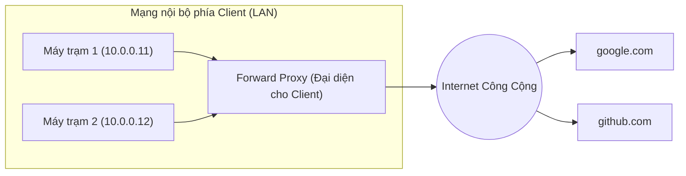
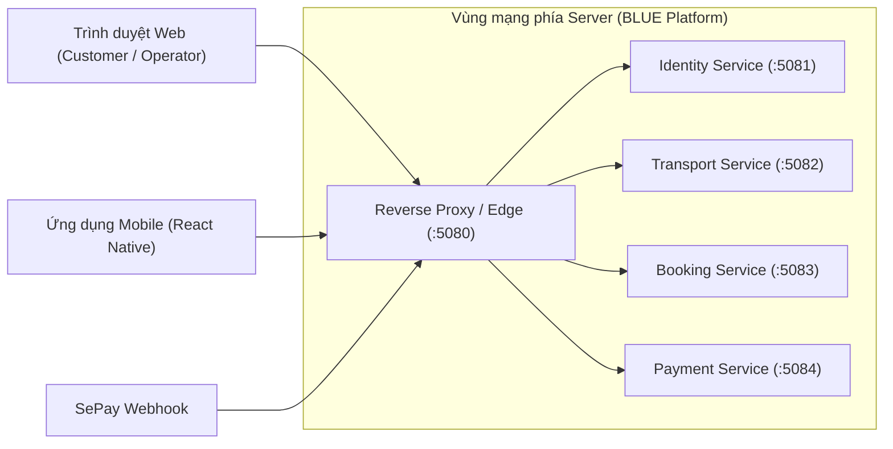
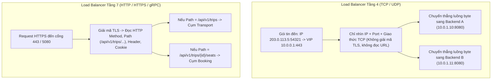
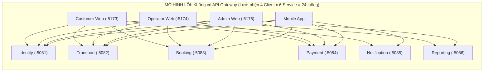
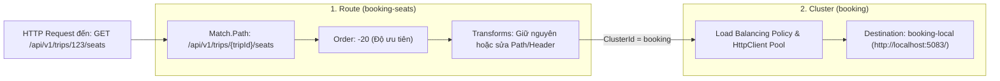
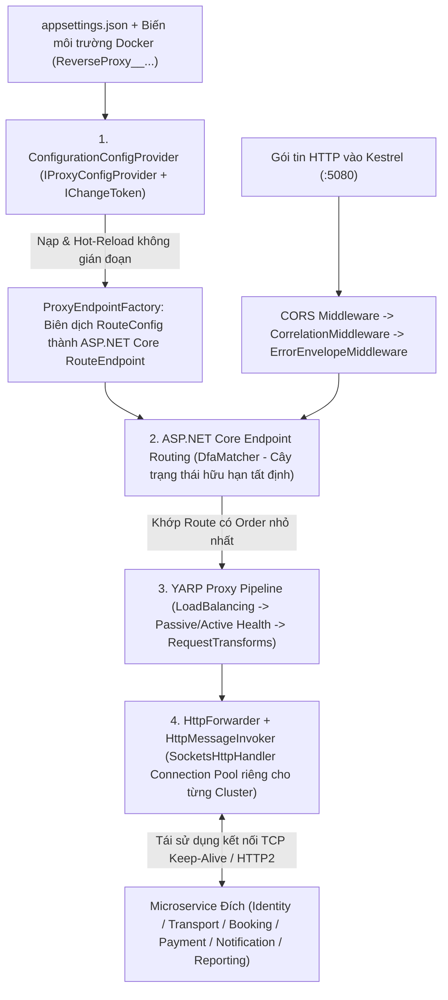

# Bài 01: Lý Thuyết API Gateway, Reverse Proxy Và Kiến Trúc YARP Từ Con Số 0

> **Thuộc bộ tài liệu:** Cẩm nang thuyết trình toàn diện — Dự án **BLUE Bus Ticket Platform (PBL6)**
> **Chủ đề:** Hạ tầng mạng biên (Edge Networking), Reverse Proxy, Load Balancing và động cơ YARP trên nền `.NET 10`
> **Mã nguồn tham chiếu cốt lõi:**
> - [BusTicketPlatform.Gateway.csproj](file:///C:/Users/minht/.gemini/antigravity/worktrees/PBL6/c_to_n_b/workspace/src/gateway/BusTicketPlatform.Gateway/BusTicketPlatform.Gateway.csproj)
> - [Program.cs](file:///C:/Users/minht/.gemini/antigravity/worktrees/PBL6/c_to_n_b/workspace/src/gateway/BusTicketPlatform.Gateway/Program.cs)
> - [appsettings.json](file:///C:/Users/minht/.gemini/antigravity/worktrees/PBL6/c_to_n_b/workspace/src/gateway/BusTicketPlatform.Gateway/appsettings.json)
> - [02-01-05-service-communication.md](file:///C:/Users/minht/.gemini/antigravity/worktrees/PBL6/c_to_n_b/docs/system-design/02-01-system-architecture/02-01-05-service-communication.md)
> - [02-01-12-architecture-decisions.md](file:///C:/Users/minht/.gemini/antigravity/worktrees/PBL6/c_to_n_b/docs/system-design/02-01-system-architecture/02-01-12-architecture-decisions.md) (`ADR-001`, `ADR-002`, `ADR-012`, `ADR-013`, `ADR-017`)

---

## Mở Đầu: Khi Một Ứng Dụng Vỡ Ra Thành 6 Mảnh Độc Lập

Hãy hình dung bạn xây dựng một website bán vé xe khách theo kiến trúc nguyên khối (**Monolith**) truyền thống. Toàn bộ mã nguồn đăng nhập, tìm chuyến xe, giữ ghế, thanh toán SePay, gửi email vé điện tử và xuất báo cáo doanh thu đều nằm chung trong một tiến trình duy nhất chạy ở địa chỉ `http://localhost:5000`. Khi đó, câu chuyện giao tiếp mạng của lập trình viên Frontend (React) hoặc Mobile (React Native) đơn giản đến mức gần như không cần suy nghĩ: chỉ có đúng **1 địa chỉ máy chủ**, **1 cấu hình CORS**, và **1 kết nối mạng**.

Tuy nhiên, trong dự án **BLUE Bus Ticket Platform**, theo quyết định kiến trúc [ADR-001](file:///C:/Users/minht/.gemini/antigravity/worktrees/PBL6/c_to_n_b/docs/system-design/02-01-system-architecture/02-01-12-architecture-decisions.md#L28-L35), hệ thống được phân rã thành **6 Bounded-Context Microservices** hoàn toàn độc lập về mã nguồn, tiến trình chạy và cơ sở dữ liệu (`Database-per-Service` theo `ADR-005`):

1. **Identity Service** (`:5081`) — Quản lý định danh, phiên đăng nhập JWT, phân quyền và thành viên tổ chức.
2. **Transport Service** (`:5082`) — Quản lý nhà xe (Organization), bến bãi, tuyến đường, xe khách, tài xế và lịch trình chuyến xe.
3. **Booking Service** (`:5083`) — Trái tim giao dịch giữ chỗ (`SeatHold`), đặt vé (`Booking`), xuất vé (`Ticket`), mã giảm giá (`Coupon`) và danh sách hành khách (`Manifest`).
4. **Payment Service** (`:5084`) — Cổng tích hợp thanh toán SePay, xử lý Webhook/IPN, hoàn tiền (`Refund`), đối soát (`Settlement`) và chi trả (`Payout`).
5. **Notification Service** (`:5085`) — Gửi thông báo bất đồng bộ qua email và tiếp nhận yêu cầu hỗ trợ/hợp tác của khách hàng.
6. **Reporting Service** (`:5086`) — Mô hình đọc (Read Model Projection) tổng hợp báo cáo doanh thu, vận hành cho nhà xe và quản trị viên sàn.

Ngay khoảnh khắc 1 tiến trình biến thành 6 tiến trình lắng nghe trên 6 cổng mạng khác nhau, một câu hỏi kiến trúc sống còn lập tức xuất hiện: **Ai sẽ là người đứng ra tiếp đón trình duyệt của khách hàng, ứng dụng di động và các cổng thanh toán bên ngoài?**

Để trả lời thấu đáo câu hỏi đó mà không học vẹt khái niệm, chúng ta cần đi ngược về gốc rễ của mạng máy tính: phân biệt rạch ròi **Forward Proxy**, **Reverse Proxy**, **Load Balancer (L4/L7)** và **API Gateway**.

---

## Chương 1: Giải Mã Từ Con Số 0 — Proxy, Load Balancer Và API Gateway

Trong tiếng Anh, **Proxy** có nghĩa là *"người đại diện / người ủy quyền"*. Trong mạng máy tính, bất kỳ máy chủ trung gian nào đứng chắn giữa **Client (Máy khách)** và **Server (Máy chủ đích)** để nhận gói tin từ bên này rồi chuyển tiếp sang bên kia đều là một dạng Proxy. Nhưng tùy vào việc **"nó đứng về phe ai và bảo vệ ai"**, thế giới mạng chia làm hai thái cực đối lập hoàn toàn: **Forward Proxy** và **Reverse Proxy**.

### 1.1. Forward Proxy (Proxy Chiều Đi — Người Đại Diện Của Client)

Hãy tưởng tượng bạn đang ngồi trong mạng nội bộ của một trường đại học hoặc một tập đoàn tài chính. Máy tính cá nhân của bạn không được phép kết nối trực tiếp ra ngoài Internet. Muốn đọc một bài báo trên `google.com`, trình duyệt của bạn phải gửi yêu cầu đến một máy chủ nội bộ gọi là **Forward Proxy** (ví dụ: Squid Proxy, VPN doanh nghiệp, hoặc cấu hình biến môi trường `HTTP_PROXY`).



**Bản chất kỹ thuật của Forward Proxy:**
- **Đứng về phe Client:** Client **biết rõ** sự tồn tại của Forward Proxy (thường phải cấu hình IP/Port của proxy trong cài đặt mạng hoặc trình duyệt) và chủ động nhờ nó đi lấy dữ liệu hộ.
- **Ẩn danh tính Client trước Server:** Khi gói tin đến `google.com`, địa chỉ IP nguồn (`Source IP`) trên gói tin TCP là địa chỉ IP công cộng của Forward Proxy, **không phải** IP riêng của máy trạm `10.0.0.11`. Máy chủ `google.com` không hề biết đằng sau Forward Proxy có bao nhiêu chiếc máy tính đang ngồi.
- **Mục đích sử dụng chính:**
  1. Kiểm soát truy cập chiều ra (chặn nhân viên vào mạng xã hội trong giờ làm việc).
  2. Lưu bộ nhớ đệm nội bộ (Web Caching) cho các tệp tải về lặp đi lặp lại trong cùng công ty.
  3. Ẩn danh tính người dùng hoặc vượt tường lửa địa lý (VPN / Corporate Egress Gateway).

### 1.2. Reverse Proxy (Proxy Chiều Về — Người Gác Cổng Của Server)

Bây giờ hãy lật ngược tấm gương 180 độ. Khách hàng ngoài đời thực mở trình duyệt gõ địa chỉ hệ thống đặt vé xe khách của chúng ta (ví dụ `http://localhost:5080` khi chạy local hoặc `https://bluebus.vn` trên môi trường thực tế). Khách hàng **không cần cấu hình bất kỳ proxy nào** trên máy của họ; họ cứ đinh ninh rằng mình đang nói chuyện trực tiếp với một máy chủ duy nhất của BLUE Bus.

Nhưng sự thật là máy chủ đứng ở cổng `:5080` đó **không hề chứa một dòng logic tính giá vé hay kiểm tra mật khẩu nào cả**! Nó là một **Reverse Proxy** — người lễ tân đứng chắn ngay cửa ra vào của trung tâm dữ liệu phía Server.



**Bản chất kỹ thuật của Reverse Proxy:**
- **Đứng về phe Server:** Trình duyệt của người dùng chỉ thấy duy nhất địa chỉ IP và Port của Reverse Proxy. Toàn bộ cấu trúc mạng bên trong (`:5081` đến `:5086`, hay các container `http://identity:8080`, `http://booking:8080`) đều hoàn toàn **vô hình** đối với thế giới bên ngoài.
- **Ngắt kết nối vật lý làm đôi (Dual TCP Connection):** Trình duyệt thiết lập kết nối TCP số 1 với Reverse Proxy. Reverse Proxy đọc yêu cầu HTTP, rồi tự mình dùng kết nối TCP số 2 (thường được giữ sống sẵn trong hồ kết nối — Connection Pool) để gọi vào máy chủ đích phía sau, nhận kết quả trả về rồi mới ghi ngược ra kết nối TCP số 1 cho trình duyệt.
- **Nhiệm vụ cốt lõi:**
  1. **Che giấu Topology nội bộ:** Giảm bề mặt tấn công mạng (Attack Surface).
  2. **SSL/TLS Termination:** Giải mã HTTPS nặng nề ngay tại cửa ngõ để các dịch vụ nội bộ phía sau có thể giao tiếp HTTP tốc độ cao trong mạng riêng cô lập.
  3. **Nén & Tối ưu truyền tải:** Nén `gzip`/`brotli`, gộp kết nối `HTTP/2` hoặc `HTTP/3` ngoài biên về `HTTP/1.1` hoặc `HTTP/2` nội bộ.

> [!TIP]
> **Mẹo nhớ nhanh chỉ trong 1 câu khi đứng trước hội đồng bảo vệ:**
> - **Forward Proxy** giấu **Client** khỏi mắt **Server** (bảo vệ người đi hỏi).
> - **Reverse Proxy** giấu **Server** khỏi mắt **Client** (bảo vệ hệ thống trả lời).

---

### 1.3. Load Balancer Layer 4 (L4) Khác Layer 7 (L7) Ra Sao?

Khi lượng khách đặt vé dịp Tết tăng vọt gấp 50 lần, một thực thể `Booking Service` duy nhất không chịu nổi tải. Bạn nhân bản `Booking Service` lên thành 3 container chạy song song (`booking-1`, `booking-2`, `booking-3`). Công cụ đứng trước để chia đều lượng khách vào 3 container này gọi là **Load Balancer (Bộ cân bằng tải)**.

Dựa trên **Mô hình tham chiếu mạng OSI 7 tầng**, bộ cân bằng tải được chia thành hai đẳng cấp hoạt động rất khác nhau là **Layer 4 (Tầng Giao vận — Transport Layer)** và **Layer 7 (Tầng Ứng dụng — Application Layer)**:



| Tiêu chí đối chiếu | Load Balancer Layer 4 (L4) | Load Balancer Layer 7 (L7) |
|---|---|---|
| **Tầng mạng hoạt động** | Tầng 4 — Transport (`TCP`, `UDP`, `TLS passthrough`) | Tầng 7 — Application (`HTTP/1.1`, `HTTP/2`, `HTTP/3`, `gRPC`, `WebSocket`) |
| **Đơn vị dữ liệu nhìn thấy** | Gói tin mạng (Segments/Datagrams) chứa **Source IP, Source Port, Dest IP, Dest Port** | Thông điệp HTTP hoàn chỉnh: **Method (`GET`/`POST`), URL Path, Query String, Headers, Cookies** |
| **Có mở "phong bì" HTTP không?** | **KHÔNG.** Coi dữ liệu bên trong là dòng byte mù; thậm chí không cần giữ khóa giải mã HTTPS | **CÓ.** Phải kết thúc (terminate) kết nối TCP/TLS để phân tích cú pháp HTTP |
| **Khả năng định tuyến thông minh** | Mù nội dung: không thể phân biệt `/api/v1/auth/login` với `/api/v1/bookings` trên cùng 1 cổng | Cực kỳ linh hoạt: định tuyến theo từng đoạn đường dẫn (Path), tên miền ảo (`Host`), hay Header |
| **Tốc độ & Độ trễ (Latency)** | Cực nhanh (tính bằng micro-giây), tốn rất ít CPU/RAM, chịu tải hàng triệu gói tin/giây | Nhỉnh hơn vài phần nghìn giây (mili-giây) do phải parse HTTP header và quản lý 2 vòng đời TCP |
| **Công cụ tiêu biểu** | Linux IPVS, AWS Network Load Balancer (NLB), HAProxy (chế độ `mode tcp`) | Nginx, Envoy, HAProxy (`mode http`), AWS Application Load Balancer (ALB), Traefik |

---

### 1.4. Vậy API Gateway Khác Gì Reverse Proxy Và L7 Load Balancer?

Đến đây nhiều bạn sinh viên thường thắc mắc: *"Nghe L7 Load Balancer và Reverse Proxy đã biết đọc URL Path `/api/v1/bookings` để chia về `Booking Service` rồi, vậy tại sao người ta lại đẻ thêm khái niệm **API Gateway**? Phải chăng chỉ là bình mới rượu cũ?"*

Câu trả lời là: **Mọi API Gateway đều có lõi là một Reverse Proxy kiêm L7 Load Balancer, nhưng không phải Reverse Proxy hay L7 Load Balancer nào cũng là một API Gateway!**

Nếu Reverse Proxy / L7 Load Balancer làm việc với tư duy của **Kỹ sư Hạ tầng Mạng (Network Infrastructure)** — chỉ quan tâm *chuyển luồng HTTP này tới máy chủ nào sống khỏe*, thì **API Gateway** làm việc với tư duy của **Kiến trúc sư Phần mềm & Nghiệp vụ (Application & API Contract Governance)** — nó hiểu rõ các quy ước giao thức của chính nền tảng đang xây dựng:

1. **Khâu nối mặt phẳng API hướng miền (API Composition / Unified Surface Routing):** Ghép hàng chục đường dẫn phân mảnh từ 6 microservices có cấu trúc URL chồng lấn nhau thành một cây RESTful API thống nhất `/api/v1/...` khớp 100% với bản hợp đồng OpenAPI (`platform-mvp.openapi.yaml`).
2. **Xử lý các mối bận tâm cắt ngang (Cross-Cutting Application Concerns):**
   - Kiểm soát chính sách **CORS** đặc thù cho các custom header nghiệp vụ như `Idempotency-Key` (chống thanh toán/đặt vé trùng) và `X-Correlation-Id` (vết giao dịch xuyên suốt hệ thống).
   - Cấp phát mã định danh truy vết phân tán (`UUIDv7` Correlation ID) ngay từ biên nếu Client quên gửi.
   - Bọc và chuẩn hóa mọi lỗi sập mạng, đứt cáp hay đường dẫn không tồn tại thành **Chuẩn Phong Bì Lỗi (Standard Error Envelope JSON)** thống nhất của toàn dự án thay vì trả trang HTML mặc định thô kệch của máy chủ web (`502 Bad Gateway nginx/1.27`).
   - Có khả năng mở rộng xác thực tập trung (JWT/OAuth2), giới hạn tốc độ theo tài khoản/API key (Rate Limiting / Quota), biến đổi đường dẫn (`PathRemovePrefix`), tổng hợp tài liệu Swagger UI.

Bảng tổng kết dưới đây giúp bạn nắm trọn vẹn bức tranh toàn cảnh của cả 4 khái niệm:

| Khái niệm | Đứng ở đâu? | Tầng OSI | Hiểu nghiệp vụ API? | Vai trò thực tế trong BLUE Bus Ticket Platform |
|---|---|---|---|---|
| **Forward Proxy** | Phía mạng Client | L4 / L7 | Không | Không thuộc kiến trúc backend của dự án (chỉ có nếu máy người dùng bật VPN công ty). |
| **L4 Load Balancer** | Cửa ngõ hạ tầng Cloud | Tầng 4 (TCP/UDP) | Không | Phù hợp đặt ngoài cùng trên Cloud Production (như AWS NLB) để chia tải TCP vào cụm Ingress. |
| **Reverse Proxy / L7 LB** | Trước Web/App Server | Tầng 7 (HTTP) | Rất ít (chỉ mức HTTP thô) | Container **Nginx** (`customer-web:8080`) phục vụ file tĩnh React SPA và đẩy `/api/*` sang Gateway. |
| **API Gateway** | Cửa ngõ biên của hệ Microservices | Tầng 7+ (API Semantics) | **Sâu sắc** (Contract, Error Envelope, Correlation, CORS, Precedence) | Dự án **`BusTicketPlatform.Gateway`** dùng **YARP** trên `.NET 10` đứng trước toàn bộ 6 microservices! |

---

## Chương 2: Giải Phẫu "Ác Mộng Kiến Trúc" — 5 Thảm Họa Nếu KHÔNG Có API Gateway

Trong tài liệu kiến trúc [ADR-002](file:///C:/Users/minht/.gemini/antigravity/worktrees/PBL6/c_to_n_b/docs/system-design/02-01-system-architecture/02-01-12-architecture-decisions.md#L8), nhóm phát triển đã chốt nguyên tắc bất di bất dịch: **"Mọi public business API đi qua API Gateway"**.

Để thấy rõ giá trị thực chiến của quyết định này (chứ không phải thêm Gateway cho "đúng bài vở"), chúng ta hãy đặt giả thuyết phản chứng: **Chuyện gì sẽ xảy ra nếu ta xóa bỏ dự án `BusTicketPlatform.Gateway` (`:5080`) và bắt 3 cổng Web (Customer `:5173`, Operator `:5174`, Admin `:5175`) cùng ứng dụng Mobile gọi thẳng vào 6 cổng `5081..5086`?**



Ngay lập tức, 5 vấn đề kỹ thuật nghiêm trọng sẽ đánh sập tốc độ phát triển và độ an toàn của hệ thống:

### Vấn đề 1: Cơn Ác Mộng CORS Nhân Lên Gấp 6 Lần & Bão Preflight `OPTIONS`

Theo chính sách **Same-Origin Policy** của mọi trình duyệt hiện đại (Chrome, Safari, Edge, Firefox), hai địa chỉ chỉ được coi là "cùng nguồn (Same-Origin)" khi trùng khớp cả 3 thành phần: `Scheme` (`http`) + `Host` (`localhost`) + `Port` (`5173`). Chỉ cần lệch con số Port (`5173` gọi sang `5081`, `5082`, `5083`...), trình duyệt lập tức kích hoạt cơ chế kiểm duyệt **CORS (Cross-Origin Resource Sharing)**.

Khi Frontend gửi kèm các Header bắt buộc của nền tảng như `Authorization: Bearer ...`, `Idempotency-Key`, và `X-Correlation-Id`, trình duyệt **bắt buộc** phải bắn một gói tin thăm dò `OPTIONS` (**Preflight Request**) đi trước để xin phép!

Nếu không có API Gateway ở `:5080`:
- **Chi phí vận hành mã nguồn x6:** Thay vì chỉ khai báo chính sách CORS `"clients"` tại một nơi duy nhất là [Gateway/Program.cs](file:///C:/Users/minht/.gemini/antigravity/worktrees/PBL6/c_to_n_b/workspace/src/gateway/BusTicketPlatform.Gateway/Program.cs#L31-L67), bạn phải copy-paste cấu hình `Cors:Origins`, `WithHeaders(...)`, `WithExposedHeaders("X-Correlation-Id")` vào cả **6 file `Program.cs`** và **6 bộ biến môi trường Docker Compose** của 6 microservices! Quên cập nhật 1 dòng ở `Payment Service` khi đổi domain mới sẽ khiến toàn bộ tính năng thanh toán chết đứng trên trình duyệt.
- **Độ trễ mạng tăng vọt (Preflight Multiplication):** Bộ nhớ đệm Preflight của trình duyệt (`Access-Control-Max-Age`) lưu khóa theo từng cặp `(Origin, Target Origin + URL)`. Khi một trang Chi tiết Chuyến xe vừa gọi `Transport (:5082)` lấy thông tin xe, vừa gọi `Booking (:5083)` lấy sơ đồ ghế trống, vừa gọi `Payment (:5084)` lấy phương thức thanh toán, trình duyệt phải thực hiện bắt tay TCP riêng rẽ và kiểm tra CORS chéo tới 3 máy chủ khác nhau thay vì tận dụng chung 1 kết nối HTTP Keep-Alive duy nhất tới Gateway!

### Vấn đề 2: Phơi Bày Trần Trụi Topology Nội Bộ & Mở Rộng Bề Mặt Tấn Công

Trong kiến trúc chuẩn có API Gateway (xem cấu hình mạng Docker thực tế tại [docker-compose.apps.yml](file:///C:/Users/minht/.gemini/antigravity/worktrees/PBL6/c_to_n_b/workspace/src/infra/docker-compose.apps.yml#L130-L169)), trên môi trường Production, chỉ duy nhất tầng biên (Nginx / API Gateway) được phép mở cổng đón lưu lượng từ Internet công cộng; toàn bộ 6 microservices nằm sâu trong mạng ảo riêng tư (`private network: platform`), không gắn Public IP.

Nếu xóa bỏ Gateway để trình duyệt và Mobile gọi thẳng vào 6 microservices:
- Bạn buộc phải mở toang **6 địa chỉ IP/Port công khai** ra ngoài Internet.
- Kẻ tấn công chỉ cần nhìn vào F12 Network Tab của trình duyệt là vẽ lại được toàn bộ sơ đồ phân rã hệ thống: dịch vụ nào giữ tiền (`Payment`), dịch vụ nào giữ mật khẩu (`Identity`), dịch vụ nào chạy báo cáo nặng dễ bị tấn công làm cạn tài nguyên (`Reporting`).
- Nguy hiểm hơn, các đầu nối tích hợp máy-với-máy như Webhook thanh toán từ đối tác SePay (`/integrations/payments/sepay/ipn`) buộc phải chọc thẳng vào ruột `Payment Service` mà không có lớp đệm lọc đường dẫn ngoài biên.

### Vấn đề 3: Khóa Cứng Frontend/Mobile Vào Cấu Trúc Vật Lý Backend (Không Thể Tái Cấu Trúc!)

Đây là đòn chí mạng về mặt **Kiến trúc Phần mềm (Software Evolution)**. Hãy nhìn vào cách dự án BLUE Bus Ticket Platform thiết kế cây URL RESTful cực kỳ tinh tế cho người dùng cuối:

- `GET /api/v1/trips/{tripId}` — Lấy thông tin lịch trình chuyến xe (do **`Transport Service`** sở hữu).
- `GET /api/v1/trips/{tripId}/seats` — Xem sơ đồ ghế còn trống theo thời gian thực (do **`Booking Service`** sở hữu theo `ADR-008`!).
- `GET /api/v1/trips/{tripId}/coupons` — Xem danh sách mã giảm giá áp dụng cho chuyến xe đó (do **`Booking Service`** sở hữu!).
- `POST /api/v1/bookings/{bookingId}/payments` — Khởi tạo giao dịch thanh toán cho đơn đặt vé (do **`Payment Service`** sở hữu!).
- `GET /api/v1/admin/organizations` — Quản lý hồ sơ pháp lý nhà xe (do **`Transport Service`** sở hữu theo **`ADR-013`**!).
- `GET /api/v1/admin/organizations/{organizationId}/members` — Quản lý danh sách nhân sự và vai trò trong nhà xe đó (do **`Identity Service`** sở hữu theo **`ADR-013`**!).

Hãy tưởng tượng nếu **KHÔNG** có API Gateway đứng ra định tuyến ngầm đằng sau:
- Lập trình viên React và React Native sẽ phải tự học thuộc lòng ranh giới Bounded Context của Backend! Trong bộ HTTP Client của Frontend sẽ xuất hiện hàng chục câu lệnh rẽ nhánh kinh hoàng kiểu: *"Nếu gọi `/trips/{id}` thì nối chuỗi vào `TRANSPORT_API_URL` (`:5082`), nhưng nếu thêm hậu tố `/seats` ở đuôi thì phải đổi sang `BOOKING_API_URL` (`:5083`)!"*
- Đáng sợ hơn nữa: Theo [ADR-014](file:///C:/Users/minht/.gemini/antigravity/worktrees/PBL6/c_to_n_b/docs/system-design/02-01-system-architecture/02-01-12-architecture-decisions.md#L92-L98), nghiệp vụ `SupportCase` hiện tạm đặt ở `Booking Service` để tinh gọn MVP, và kiến trúc sư đã ghi rõ *"nếu support mở rộng thành capability độc lập, tạo ADR migration/service split"*.
  - **Khi có API Gateway:** Backend tách `Support Service` ra cổng `:5087`, sửa đúng **3 dòng JSON** trong `appsettings.json` của Gateway. Toàn bộ Web và hàng vạn máy điện thoại cài App Mobile cũ vẫn chạy mượt mà không cần cập nhật!
  - **Khi không có API Gateway:** Tách hoặc gộp bất kỳ microservice nào cũng đồng nghĩa với việc **đập đi viết lại và phát hành bản vá khẩn cấp cho cả Customer Web, Operator Web, Admin Web lẫn ứng dụng iOS/Android trên chợ ứng dụng!** Lúc đó Microservices mất sạch tính độc lập triển khai (Independent Deployability).

### Vấn đề 4: Đứt Gãy Kiểm Soát `X-Correlation-Id` Và Chuẩn Hóa Lỗi Khi Dịch Vụ Con Bị Sập

Trong hệ thống phân tán, một microservice đang khởi động lại hoặc quá tải tạm thời là chuyện hoàn toàn bình thường.
- **Khi có API Gateway:** Dù `Identity Service` bị sập hoàn toàn (như kịch bản kiểm thử cố tình trỏ về cổng chết `http://127.0.0.1:1/` trong [GatewayHealthAndErrorTests.cs](file:///C:/Users/minht/.gemini/antigravity/worktrees/PBL6/c_to_n_b/workspace/src/tests/gateway/BusTicketPlatform.Gateway.IntegrationTests/GatewayHealthAndErrorTests.cs#L15-L22)), yêu cầu gửi tới Gateway vẫn đi qua `CorrelationMiddleware` (gắn mã `X-Correlation-Id` chuẩn UUIDv7) và được `ErrorEnvelopeMiddleware` bọc lại êm ái thành HTTP `503 Service Unavailable` kèm JSON chuẩn:
  ```json
  {
    "error": {
      "code": "UPSTREAM_UNAVAILABLE",
      "message": "A required dependency is unavailable.",
      "correlationId": "0195a8e0-7c3b-7000-8000-123456789abc"
    }
  }
  ```
  Giao diện React chỉ cần một bộ xử lý lỗi duy nhất đọc `response.error.code` và hiện thông báo thân thiện kèm mã hỗ trợ kỹ thuật cho khách hàng.
- **Khi không có API Gateway:** Trình duyệt đập thẳng vào socket đóng của `:5081`, nhận ngoại lệ cấp trình duyệt `TypeError: Failed to fetch` (`net::ERR_CONNECTION_REFUSED`) trắng trơn, không có HTTP Status Code, không có JSON body, không có `X-Correlation-Id` trên máy chủ để đội vận hành tra cứu nhật ký sự cố!

### Vấn đề 5: Phân Mảnh Tài Liệu Hợp Đồng API (`OpenAPI / Swagger`) Và Chứng Chỉ Bảo Mật

Không có điểm hội tụ ở biên đồng nghĩa với việc:
- Trên môi trường thật, quản trị viên mạng phải cấu hình, gia hạn chứng chỉ SSL/TLS (`Let's Encrypt` / Cloud Certificate) và chính sách bảo mật HTTP Header cho 6 tên miền phụ hoặc 6 cổng khác nhau (`identity-api.bluebus.vn`, `booking-api.bluebus.vn`...).
- Lập trình viên Frontend/Mobile khi tích hợp API phải mở cùng lúc **6 tab trình duyệt khác nhau** ở 6 cổng `5081..5086` để đọc tài liệu OpenAPI thay vì chỉ mở một địa chỉ tập trung duy nhất `http://localhost:5080/swagger` (có menu thả xuống chọn cả 6 API) và tải hợp đồng tổng thể tại `http://localhost:5080/openapi.yaml`.

---

## Chương 3: Giải Phẫu YARP (Yet Another Reverse Proxy) — Động Cơ C# Bên Dưới API Gateway

### 3.1. YARP Là Gì Và Câu Chuyện Ra Đời Từ Nội Bộ Microsoft

**YARP** là viết tắt hài hước của cụm từ **"Yet Another Reverse Proxy"** (*Lại thêm một Reverse Proxy nữa*) — một thư viện mã nguồn mở chính thức do chính đội ngũ kỹ sư **ASP.NET / .NET Networking của Microsoft** chế tạo và bảo trợ.

Trước khi có YARP, các đội ngũ sản phẩm khổng lồ bên trong Microsoft (như Azure App Service, Dynamics 365, Bing...) rơi vào một tình thế tiến thoái lưỡng nan:
- Nếu dùng các proxy viết bằng C/C++ như **Nginx** hay **Envoy**, họ có tốc độ rất cao nhưng lại rất vất vả mỗi khi muốn nhúng logic nghiệp vụ đặc thù bằng C# (đọc cấu hình động từ bộ nhớ `.NET`, tích hợp DI Container, tái sử dụng Middleware C#, phát sinh Telemetry chuẩn `System.Diagnostics.Activity`).
- Ngược lại, nếu tự viết một đoạn code C# ngây thơ dùng `HttpClient` để nhận request rồi gọi sang máy chủ khác, họ sẽ lập tức vấp phải hàng loạt bẫy mạng chết người ở tầng giao thức HTTP: rò rỉ socket (`TIME_WAIT`), mất Hop-by-Hop headers (`Transfer-Encoding`, `Connection`, `Keep-Alive`), sai lệch `X-Forwarded-*`, vỡ kết nối `WebSocket` / `gRPC` streaming, hoặc nuốt mất mã chuyển hướng `302 Redirect`.

Vì vậy, Microsoft quyết định tạo ra **YARP** với triết lý ngược hẳn các đối thủ truyền thống: **Thay vì là một tệp thực thi (binary executable) đóng kín chạy độc lập bên ngoài, YARP là một thư viện NuGet cắm thẳng vào trái tim máy chủ web Kestrel và hệ thống Endpoint Routing của ASP.NET Core!**

Trong dự án **BLUE Bus Ticket Platform**, YARP được khai báo cực kỳ gọn gàng tại hai tệp:
- Tệp quản lý phiên bản tập trung [Directory.Packages.props](file:///C:/Users/minht/.gemini/antigravity/worktrees/PBL6/c_to_n_b/workspace/Directory.Packages.props#L26):
  ```xml
  <PackageVersion Include="Yarp.ReverseProxy" Version="2.3.0" />
  ```
- Tệp dự án [BusTicketPlatform.Gateway.csproj](file:///C:/Users/minht/.gemini/antigravity/worktrees/PBL6/c_to_n_b/workspace/src/gateway/BusTicketPlatform.Gateway/BusTicketPlatform.Gateway.csproj#L1-L16) kế thừa `net10.0` từ [Directory.Build.props](file:///C:/Users/minht/.gemini/antigravity/worktrees/PBL6/c_to_n_b/workspace/Directory.Build.props#L3):
  ```xml
  <Project Sdk="Microsoft.NET.Sdk.Web">
    <PropertyGroup>
      <RootNamespace>BusTicketPlatform.Gateway</RootNamespace>
      <Description>YARP edge gateway for public HTTP routing.</Description>
    </PropertyGroup>
    <ItemGroup>
      <PackageReference Include="Swashbuckle.AspNetCore.SwaggerUI" />
      <PackageReference Include="Yarp.ReverseProxy" />
    </ItemGroup>
    <ItemGroup>
      <ProjectReference Include="..\..\building-blocks\BusTicketPlatform.BuildingBlocks.AspNetCore\BusTicketPlatform.BuildingBlocks.AspNetCore.csproj" />
    </ItemGroup>
    <ItemGroup>
      <Content Include="..\..\..\..\docs\contracts\openapi\platform-mvp.openapi.yaml" Link="openapi.yaml" CopyToOutputDirectory="PreserveNewest" />
    </ItemGroup>
  </Project>
  ```

Chỉ với gói `Yarp.ReverseProxy` phiên bản `2.3.0` chạy trên nền runtime **`.NET 10 LTS`** (`ADR-017`), tiến trình `BusTicketPlatform.Gateway` trở thành một cỗ máy Reverse Proxy kiêm API Gateway chuẩn công nghiệp!

---

### 3.2. Mô Hình Dữ Liệu Cốt Lõi Của YARP: `Routes`, `Clusters`, `Destinations` Và `Transforms`

Để điều khiển YARP mà không bị rối trước hàng trăm dòng JSON trong [appsettings.json](file:///C:/Users/minht/.gemini/antigravity/worktrees/PBL6/c_to_n_b/workspace/src/gateway/BusTicketPlatform.Gateway/appsettings.json), bạn chỉ cần nắm vững 4 mảnh ghép tách biệt rõ ràng giữa **"Luật nhận diện đường đi (What to match)"** và **"Nơi gửi gói tin tới (Where to send)"**:



1. **`Route` (Tuyến đường định tuyến):** Trả lời câu hỏi *"Yêu cầu HTTP này có khớp với mẫu đường dẫn nào không, ưu tiên xét trước hay xét sau, và nếu khớp thì giao cho cụm dịch vụ (`ClusterId`) nào?"*.
   Ví dụ thực tế trích từ [appsettings.json](file:///C:/Users/minht/.gemini/antigravity/worktrees/PBL6/c_to_n_b/workspace/src/gateway/BusTicketPlatform.Gateway/appsettings.json#L73-L77):
   ```json
   "booking-seats": {
     "ClusterId": "booking",
     "Order": -20,
     "Match": { "Path": "/api/v1/trips/{tripId}/seats" }
   }
   ```
2. **`Transforms` (Bộ biến đổi gói tin — tùy chọn):** Trả lời câu hỏi *"Trước khi chuyển yêu cầu sang microservice đích, ta có cần cắt bớt tiền tố đường dẫn hay gắn thêm Header gì không?"*.
   Ví dụ route tương thích ngược `identity-legacy` tại [appsettings.json](file:///C:/Users/minht/.gemini/antigravity/worktrees/PBL6/c_to_n_b/workspace/src/gateway/BusTicketPlatform.Gateway/appsettings.json#L293-L298):
   ```json
   "identity-legacy": {
     "ClusterId": "identity",
     "Order": 20,
     "Match": { "Path": "/identity/{**catch-all}" },
     "Transforms": [{ "PathRemovePrefix": "/identity" }]
   }
   ```
   Khi Client gọi `/identity/api/v1/auth/login`, bộ biến đổi `PathRemovePrefix` cắt bỏ `/identity` để `Identity Service` nhận đúng `/api/v1/auth/login`! (Mặc định ngay cả khi không khai báo `Transforms`, YARP vẫn tự động áp bộ biến đổi chuẩn để gắn các header `X-Forwarded-For`, `X-Forwarded-Proto`, `X-Forwarded-Host` nhằm giúp service đích biết thông tin gốc của Client).
3. **`Cluster` (Cụm dịch vụ đích logic):** Đại diện cho một Bounded-Context Microservice logic (trong dự án ta có đúng **6 Clusters**: `identity`, `transport`, `booking`, `payment`, `notification`, `reporting`). Việc tách `Route` chỉ tham chiếu tên chuỗi `"ClusterId": "booking"` giúp **hàng chục Routes khác nhau dùng chung một Cluster** mà không phải lặp lại địa chỉ IP/Port!
4. **`Destinations` (Danh sách điểm đích vật lý của một Cluster):** Một Cluster có thể chứa 1 hoặc nhiều địa chỉ máy chủ thực tế (`Address`). Ở môi trường phát triển cục bộ ([appsettings.json](file:///C:/Users/minht/.gemini/antigravity/worktrees/PBL6/c_to_n_b/workspace/src/gateway/BusTicketPlatform.Gateway/appsettings.json#L300-L307)), mỗi Cluster chứa 1 destination local:
   ```json
   "Clusters": {
     "identity":     { "Destinations": { "identity-local":     { "Address": "http://localhost:5081/" } } },
     "transport":    { "Destinations": { "transport-local":    { "Address": "http://localhost:5082/" } } },
     "booking":      { "Destinations": { "booking-local":      { "Address": "http://localhost:5083/" } } },
     "payment":      { "Destinations": { "payment-local":      { "Address": "http://localhost:5084/" } } },
     "notification": { "Destinations": { "notification-local": { "Address": "http://localhost:5085/" } } },
     "reporting":    { "Destinations": { "reporting-local":    { "Address": "http://localhost:5086/" } } }
   }
   ```
   Khi cần mở rộng quy mô ngang (Horizontal Scaling), ta chỉ cần khai báo thêm `booking-node-2`, `booking-node-3` vào trong `Destinations` của cụm `booking` kèm `LoadBalancingPolicy` (như `PowerOfTwoChoices` mặc định của YARP hoặc `RoundRobin`), toàn bộ 14 routes đang trỏ về `"ClusterId": "booking"` sẽ tự động được chia tải ngay lập tức!

---

### 3.3. Kiến Trúc Bên Trong Của YARP Hoạt Động Ra Sao? (Deep-Dive Internals)

Nhiều người lầm tưởng YARP chỉ là một hàm `Middleware` đọc chuỗi URL bằng biểu thức chính quy (`Regex`), sau đó `new HttpClient().SendAsync(...)`. Sự thật bên dưới lớp vỏ 3 dòng code `AddReverseProxy().LoadFromConfig(...)` và `app.MapReverseProxy()` là một dây chuyền kỹ thuật tinh vi bậc nhất của `.NET`:



Hãy mổ xẻ từng mắt xích trong 4 chặng nội bộ này:

#### Chặng 1: `IProxyConfigProvider` & Cơ Chế Snapshot Bất Biến Hỗ Trợ Hot-Reload
Khi `Program.cs` gọi:
```csharp
builder.Services.AddReverseProxy()
    .LoadFromConfig(builder.Configuration.GetSection("ReverseProxy"));
```
YARP đăng ký dịch vụ `ConfigurationConfigProvider` (triển khai giao diện `IProxyConfigProvider`). Khi ứng dụng khởi chạy, provider này đọc toàn bộ mục `"ReverseProxy"` từ hệ thống `IConfiguration` của .NET (tức là kết hợp tự động cả `appsettings.json`, `appsettings.Development.json` và các biến môi trường `ReverseProxy__Clusters__...` truyền từ Docker Compose!).

Điểm đắt giá là YARP đóng gói bảng cấu hình này thành một bản chụp bất biến (**Immutable Snapshot** `IProxyConfig`) gắn kèm một tín hiệu theo dõi thay đổi (`IChangeToken`). Nếu tệp `appsettings.json` được chỉnh sửa trên đĩa cứng lúc hệ thống đang chạy, YARP tự động dựng bảng định tuyến mới trong nền và tráo đổi con trỏ nguyên tử (**Atomic Swap**) sang cấu hình mới mà **không làm đứt bất kỳ kết nối HTTP nào đang xử lý dở!**

#### Chặng 2: Khớp Đường Dẫn Siêu Tốc Nhờ Tích Hợp Thẳng Vào `ASP.NET Core Endpoint Routing` (`DfaMatcher`)
Đây là điểm ăn tiền lớn nhất giúp YARP đè bẹp các thư viện proxy thế hệ cũ:
- YARP **không tự viết bộ khớp URL riêng bằng vòng lặp `for` + `Regex`**. Nếu bạn có 58 routes (như trong dự án này) hoặc 5.000 routes, việc duyệt tuần tự từng Regex tốn thời gian tỉ lệ thuận với số lượng route `O(N)`.
- Thay vào đó, khi gọi `app.MapReverseProxy()`, `ProxyEndpointFactory` biến từng route trong cấu hình YARP thành một **`RouteEndpoint` bản địa của ASP.NET Core** — bình đẳng 100% với các endpoint nội bộ như `app.MapGet("/openapi.yaml", ...)` hay `app.MapPlatformHealth()` (`/live`, `/ready`)!
- Bộ định tuyến lõi của ASP.NET Core biên dịch toàn bộ cây URL thành một **Cây ôtômát hữu hạn tất định (`DfaMatcher` — Deterministic Finite Automaton)**. Khi một yêu cầu HTTP chạm vào Kestrel, nó nhảy qua từng đoạn dấu gạch chéo `/` trên cây DFA trong bộ nhớ với thời gian gần như hằng số theo độ dài chuỗi URL `O(L)`, sau đó chọn ứng viên thắng cuộc dựa trên độ ưu tiên **`Order`** (số nhỏ thắng số lớn) và độ đặc thù của mẫu đường dẫn!

#### Chặng 3: YARP Proxy Pipeline (Chuỗi Xử Lý Chuyên Biệt Sau Khi Khớp Route)
Ngay khi `DfaMatcher` chọn trúng một `RouteEndpoint` của YARP (ví dụ route `booking-seats` gắn với `ClusterId = "booking"`), yêu cầu bước vào đường ống con của riêng YARP (`ReverseProxyConventionBuilder`):
1. **`ProxyInvokerMiddleware`:** Tra cứu trạng thái sống của `ClusterState` (`booking`).
2. **`LoadBalancingMiddleware`:** Lấy danh sách các `DestinationState` đang khỏe mạnh trong cụm `booking`. Nếu có nhiều bản sao, thuật toán cân bằng tải mặc định **`PowerOfTwoChoices`** (chọn ngẫu nhiên 2 máy chủ rồi giao việc cho máy đang gánh ít request đồng thời hơn — thuật toán nổi tiếng giúp tránh hiện tượng dồn cục tốt hơn cả Round-Robin thuần túy!) sẽ chọn ra 1 đích đến. Trong môi trường hiện tại có 1 destination (`booking-local`), nó chọn ngay điểm đích đó với chi phí bằng 0.
3. **Thực thi `RequestTransforms`:** Lọc bỏ ngay lập tức các **Hop-by-Hop HTTP Headers** không được phép chuyển tiếp qua proxy theo chuẩn RFC 9110 (như `Connection`, `Keep-Alive`, `Transfer-Encoding`, `TE`, `Upgrade` khi không nâng cấp giao thức), bảo toàn nguyên vẹn các End-to-End Headers quan trọng của dự án (`Authorization`, `Idempotency-Key`, `X-Correlation-Id`, `Content-Type`), và gắn bộ `X-Forwarded-For`, `X-Forwarded-Proto`, `X-Forwarded-Host`.

#### Chặng 4: `HttpForwarder` & Hồ Tái Sử Dụng Kết Nối `HttpMessageInvoker` (`SocketsHttpHandler`)
Cuối cùng, thành phần `IHttpForwarder` bắn yêu cầu sang Microservice đích. Nhưng tại sao trong mã nguồn của YARP, Microsoft lại dùng trực tiếp **`HttpMessageInvoker`** bọc quanh **`SocketsHttpHandler`** cho mỗi Cluster chứ không khởi tạo `HttpClient` thông thường?

> [!IMPORTANT]
> **Bí mật kỹ thuật cấp Hệ điều hành: Ngăn chặn thảm họa cạn kiệt cổng tạm thời (SNAT / Ephemeral Port Exhaustion)**
> Mỗi kết nối TCP đi ra từ Gateway tới một Microservice cần mượn 1 cổng nguồn tạm thời của hệ điều hành (Ephemeral Port, thường chỉ có khoảng `16.384` đến `28.000` cổng khả dụng trong dải `49152–65535`). Ngay cả khi đóng kết nối xong, hệ điều hành vẫn khóa cổng đó ở trạng thái **`TIME_WAIT`** suốt **60–120 giây** để hứng các gói tin TCP đi lạc!
> Nếu mở mới kết nối TCP cho mỗi request đặt vé (giả sử 500 req/giây), chỉ sau chưa đầy 1 phút Gateway sẽ vắt kiệt toàn bộ kho cổng TCP của máy chủ và sập toàn diện với lỗi `SocketException: Address already in use`!

YARP giải quyết triệt để bài toán này bằng cách thông qua `ForwarderHttpClientFactory` tạo **một thực thể `HttpMessageInvoker` duy nhất gắn chặt với vòng đời của mỗi `Cluster`**:
- Bên dưới `HttpMessageInvoker` là `SocketsHttpHandler` của `.NET 10` duy trì **Connection Pool (Hồ kết nối sống)**: kết nối TCP mở sang `booking (:5083)` hay `http://booking:8080` được giữ mở liên tục (`HTTP/1.1 Keep-Alive` hoặc ghép kênh đa luồng `HTTP/2 Multiplexing`), xử lý hàng chục nghìn request kế tiếp nhau trên chỉ vài socket vật lý mà không tốn thời gian bắt tay 3 bước TCP (`SYN -> SYN-ACK -> ACK`)!
- Khác với `HttpClient` vốn có thêm lớp vỏ quản lý timeout/buffer trung gian dễ gây cấp phát bộ nhớ thừa, `HttpMessageInvoker` là lớp nền siêu nhẹ bậc thấp nhất, được YARP cấu hình đặc biệt cho vai trò Proxy:
  - `AllowAutoRedirect = false`: Nếu `Payment Service` trả về lệnh chuyển hướng `302 Found` (ví dụ trong luồng cầu nối thanh toán `/integrations/payments/sepay/browser-return`), YARP **không tự ý đi theo link redirect đó**, mà trả nguyên mã `302` kèm header `Location` về cho trình duyệt của khách hàng tự chuyển trang!
  - `AutomaticDecompression = DecompressionMethods.None`: Nếu upstream đã nén sẵn JSON bằng `gzip`, YARP truyền thẳng luồng byte nén (Zero-buffer streaming) từ socket của Microservice sang socket của Client mà không tốn CPU giải nén rồi lại nén lại!
  - `ActivityHeadersPropagator`: Tự động tiêm ngữ cảnh vết phân tán chuẩn W3C (`traceparent`, `tracestate`) như đã quy định tại mục 2.1 của [02-01-05-service-communication.md](file:///C:/Users/minht/.gemini/antigravity/worktrees/PBL6/c_to_n_b/docs/system-design/02-01-05-service-communication.md#L21).

---

## Chương 4: Đặt Lên Bàn Cân — Tại Sao Chọn YARP Cho `.NET 10` Thay Vì Ocelot, Nginx Thuần Hay Kong / APISIX?

Khi bảo vệ đồ án trước hội đồng, một câu hỏi kinh điển chắc chắn sẽ được đặt ra: *"Thị trường có hàng tá công cụ làm API Gateway rất nổi tiếng như Ocelot (cũng của C#), Nginx, Kong hay Apache APISIX. Tại sao nhóm lại quyết định chọn YARP theo `ADR-012` và `ADR-017`?"*

Dưới đây là lập luận kỹ thuật sắc bén đối chiếu từng phương án dựa trên đúng bối cảnh thực tế của dự án **BLUE Bus Ticket Platform** (hệ sinh thái `.NET 10`, monorepo, chia sẻ `BuildingBlocks`, quy mô nhóm phát triển 4 kỹ sư):

### 4.1. Tại Sao Chọn YARP Thay Vì Ocelot?

Trong giai đoạn `.NET Core 2.0 – 3.1` (khoảng năm 2018–2020), **Ocelot** từng là thư viện quen thuộc trong các bài hướng dẫn Microservices bằng C#. Tuy nhiên, bước sang kỷ nguyên `.NET 8 / .NET 10`, YARP đã vượt qua Ocelot toàn diện ở mọi khía cạnh cốt lõi:

1. **Kiến trúc định tuyến và Hiệu năng (Throughput & Memory Allocation):**
   - Ocelot được thiết kế từ trước khi ASP.NET Core hoàn thiện Endpoint Routing hiện đại; nó vận hành như một chuỗi Middleware riêng rẽ tự phân tích đường dẫn và cấp phát nhiều đối tượng trung gian trên Heap (gây áp lực lên bộ dọn rác Garbage Collector khi tải cao).
   - YARP được chính đội ngũ kiến trúc sư Kestrel/ASP.NET Core của Microsoft viết mới từ đầu, cắm thẳng vào bộ máy **`DfaMatcher`** của ASP.NET Core và truyền luồng dữ liệu bất đồng bộ (`Stream` / `PipeReader` / `PipeWriter`), cho thông lượng (requests/sec) cao gấp nhiều lần và độ trễ đuôi (`p99 latency`) thấp hơn rõ rệt.
2. **Sự đồng nhất với chuẩn Cấu hình `.NET` (`IConfiguration`):**
   - Ocelot ép lập trình viên dùng định dạng tệp riêng `ocelot.json` với cú pháp mảng `ReRoutes` rất khó ghi đè từng phần tử bằng biến môi trường trong Docker! (Ghi đè mảng bằng chỉ số `__0__`, `__1__` cực kỳ dễ nhầm lẫn khi thứ tự route thay đổi).
   - YARP dùng cấu trúc Từ điển theo tên khóa (`Dictionary<string, ClusterConfig>`, `Dictionary<string, RouteConfig>`) ngay trong `appsettings.json` chuẩn! Nhờ vậy, trong [docker-compose.apps.yml](file:///C:/Users/minht/.gemini/antigravity/worktrees/PBL6/c_to_n_b/workspace/src/infra/docker-compose.apps.yml#L161-L166), nhóm chỉ cần viết biến môi trường cực kỳ tường minh theo tên khóa:
     `ReverseProxy__Clusters__booking__Destinations__booking-local__Address=http://booking:8080/`
     là ghi đè chính xác địa chỉ đích mà không sợ lệch chỉ số mảng!
3. **Cam kết hỗ trợ dài hạn (`LTS` Lifecycle):** YARP được Microsoft phát hành song hành và kiểm thử tương thích trực tiếp với từng bản phát hành `.NET 10 LTS`, hỗ trợ trọn vẹn HTTP/2, HTTP/3 (QUIC), gRPC và WebSockets mà không gặp rủi ro thư viện cộng đồng bị đình trệ bảo trì.

### 4.2. Tại Sao Chọn YARP Thay Vì Nginx Thuần (Pure Nginx Làm API Gateway)?

Trước tiên, hãy quan sát thật tinh tế mã nguồn dự án: **Dự án BLUE Bus Ticket Platform CÓ sử dụng Nginx, nhưng đặt đúng vai trò sở trường của nó!**
- Trong [apps/web/Dockerfile](file:///C:/Users/minht/.gemini/antigravity/worktrees/PBL6/c_to_n_b/workspace/src/apps/web/Dockerfile#L17-L26) và [apps/web/docker/nginx.conf](file:///C:/Users/minht/.gemini/antigravity/worktrees/PBL6/c_to_n_b/workspace/src/apps/web/docker/nginx.conf#L7-L31), container `customer-web` dùng `nginxinc/nginx-unprivileged:1.27-alpine` làm **Web Server phục vụ tài sản tĩnh (Static Assets + React Router SPA fallback `/index.html`)** kết hợp chuyển tiếp nhánh `/api/` về `http://gateway:8080`.

Vậy tại sao ta không xóa luôn YARP đi rồi nhét cả 58 luật định tuyến vào tệp `nginx.conf`? Bởi vì Nginx thuần vấp phải **3 rào cản lớn** khi đóng vai trò Application API Gateway của dự án này:

1. **Không thể dùng chung thư viện C# `BusTicketPlatform.BuildingBlocks.AspNetCore`:**
   - Toàn bộ 6 microservices và Gateway của chúng ta dùng chung chính xác một chuẩn sinh mã vết **`UUIDv7`** (`CorrelationMiddleware`) và chuẩn phong bì lỗi **`ErrorEnvelopeMiddleware`** (`{ error: { code, message, correlationId, details } }`).
   - Nếu dùng Nginx thuần làm Gateway, khi một microservice bị sập kết nối hoặc khi người dùng gọi nhầm một URL không tồn tại (`/does-not-exist`), Nginx sẽ trả về trang HTML mặc định hoặc JSON viết cứng trong file `.conf` **không thể tự sinh chuẩn `UUIDv7` đồng bộ logic C#** nếu không cài thêm module mở rộng `njs` (JavaScript) hoặc `OpenResty/Lua` phức tạp! Với YARP, chỉ một dòng `app.UseBuildingBlocks();` trong `Program.cs` là Gateway thừa hưởng 100% hành vi chuẩn của toàn nền tảng.
2. **Không thể chạy Kiểm thử Tích hợp Trong Bộ Nhớ (`In-Memory Integration Testing`):**
   - Hãy nhìn vào [GatewayClientSurfaceTests.cs](file:///C:/Users/minht/.gemini/antigravity/worktrees/PBL6/c_to_n_b/workspace/src/tests/gateway/BusTicketPlatform.Gateway.IntegrationTests/GatewayClientSurfaceTests.cs) và [GatewayHealthAndErrorTests.cs](file:///C:/Users/minht/.gemini/antigravity/worktrees/PBL6/c_to_n_b/workspace/src/tests/gateway/BusTicketPlatform.Gateway.IntegrationTests/GatewayHealthAndErrorTests.cs): Nhờ YARP là một ứng dụng ASP.NET Core, nhóm dùng `WebApplicationFactory<Program>` dựng toàn bộ API Gateway ngay trong RAM khi chạy `dotnet test`, kiểm tra tự động cả CORS Preflight, `/openapi.yaml`, `X-Correlation-Id`, lỗi `UPSTREAM_UNAVAILABLE` và đối chiếu toàn bộ >60 đường dẫn OpenAPI chỉ trong **vài trăm mili-giây** trên CI/CD mà không cần khởi động bất kỳ container Docker nào! Với Nginx `.conf`, bạn không thể test bằng xUnit `WebApplicationFactory` như vậy.
3. **Độ phức tạp khi quản lý 58+ quy tắc ưu tiên có tham số động (`{tripId}`, `{organizationId}`):**
   - Trong `nginx.conf`, việc trộn lẫn `location = ...`, `location ^~ ...`, và hàng chục biểu thức chính quy `location ~ ^/api/v1/admin/organizations/[^/]+/members(/.*)?$` phụ thuộc chặt vào thứ tự dòng viết trong file, rất dễ gây lỗi nuốt nhầm route (regex trap) và cực kỳ khó viết unit test kiểm chứng độ phủ hợp đồng. Trong khi đó, cú pháp Route Template `/api/v1/admin/organizations/{organizationId}/members/{**catch-all}` kèm số nguyên `Order: -20` của YARP rõ ràng, tự mô tả và đồng nhất 100% với cú pháp Minimal API / Controller của `.NET`.

### 4.3. Tại Sao Chọn YARP Thay Vì Kong Hoặc Apache APISIX?

**Kong** (dựa trên OpenResty/Nginx + Lua) và **Apache APISIX** (OpenResty + Lua + etcd) là những Enterprise API Gateway rất mạnh cho các tập đoàn đa ngôn ngữ (nơi đội A viết Java, đội B viết Go, đội C viết Python, và có riêng một phòng ban Platform/SRE 10 người chuyên trực vận hành Gateway).

Nhưng đối với dự án **BLUE Bus Ticket Platform** (nhóm phát triển 4 thành viên, toàn bộ Backend thống nhất C# `.NET 10` theo `ADR-012`/`ADR-017`), việc đưa Kong hay APISIX vào sẽ tạo ra **Gánh nặng Vận hành Quá Tải (Operational Overkill)**:

1. **Phình to hạ tầng phụ thuộc trên máy phát triển cục bộ:**
   - Trong [docker-compose.yml](file:///C:/Users/minht/.gemini/antigravity/worktrees/PBL6/c_to_n_b/workspace/src/infra/docker-compose.yml) và [docker-compose.apps.yml](file:///C:/Users/minht/.gemini/antigravity/worktrees/PBL6/c_to_n_b/workspace/src/infra/docker-compose.apps.yml), máy tính của mỗi thành viên đã phải gánh cụm hạ tầng gồm: `postgres`, `db-bootstrap`, `rabbitmq`, `redis`, `mailpit`, `pgadmin`, 6 container Microservices và 3 container Web.
   - Nếu dùng APISIX, bạn phải cõng thêm cụm **`etcd`** tốn hàng trăm MB RAM; nếu dùng Kong ở chế độ đầy đủ, bạn phải nuôi thêm schema DB riêng và tiến trình Kong Admin/Proxy nặng nề (hoặc phải quản lý tệp khai báo YAML hàng nghìn dòng riêng biệt). Trong khi đó, container `gateway` chạy YARP dùng chung chính xác cùng một `api.Dockerfile` mỏng nhẹ của `.NET 10` với 6 microservices kia, khởi động trong tích tắc và chỉ chiếm vài chục MB RAM!
2. **Phân mảnh ngôn ngữ lập trình và công cụ Debug (Cognitive Load):**
   - Khi muốn tùy biến một hành vi ở biên (ví dụ: chuẩn hóa mã lỗi `UPSTREAM_UNAVAILABLE` kèm UUIDv7), trên Kong/APISIX bạn phải viết custom plugin bằng **Lua** (hoặc Go PDK) — một ngôn ngữ nằm ngoài stack C#/TypeScript của nhóm. Với YARP, mọi thành viên đều đọc, đặt Breakpoint trên Visual Studio / Rider / VS Code và viết kiểm thử bằng C# quen thuộc mỗi ngày.

### 4.4. Bảng Ma Trận So Sánh Tổng Hợp Các Giải Pháp API Gateway

| Tiêu chí đánh giá | YARP (`.NET 10`) — **Lựa chọn của dự án** | Ocelot (`.NET`) | Nginx Thuần | Kong / Apache APISIX |
|---|---|---|---|---|
| **Hiệu năng & Bộ nhớ** | **Rất cao** (Kestrel + `DfaMatcher` + `SocketsHttpHandler`) | Trung bình – Thấp (Middleware tự chế, tốn GC) | **Cực cao** (C native event loop) | **Rất cao** (OpenResty / C + LuaJIT) |
| **Dùng chung C# `BuildingBlocks`** | **Tuyệt đối (100%)** (`Correlation`, `ErrorEnvelope`) | Có thể gắn Middleware C# | **Không thể** (phải viết lại bằng Lua/njs) | **Không thể** (phải viết plugin Lua/Go/Wasm) |
| **Kiểm thử tự động `dotnet test`** | **Siêu tốc** (`WebApplicationFactory<Program>` in-memory) | Hỗ trợ qua TestServer | Phải dựng container thật ngoài tiến trình | Phải dựng container + DB/etcd |
| **Ghi đè cấu hình bằng Env Docker** | **Tự nhiên** (`ReverseProxy__Clusters__...`) | Rất khó (vướng mảng `ReRoutes` trong `ocelot.json`) | Phải dùng `envsubst` sinh lại file `.conf` | Qua Admin API hoặc tệp YAML declarative riêng |
| **Chi phí vận hành (DevOps)** | **Cực nhẹ** (chung `api.Dockerfile`, stateless 100%) | Nhẹ | Nhẹ | **Rất nặng** (cần etcd / DB riêng, quản trị phức tạp) |
| **Độ khớp với nhóm 4 người `.NET`** | **Hoàn hảo (10/10)** | Khá (6/10 - công nghệ cũ) | Trung bình (7/10 - tốt cho Web tĩnh hơn API) | Thấp cho quy mô nhóm nhỏ (4/10 - quá cồng kềnh) |

---

## Chương 5: Tổng Kết & Câu Hỏi Phản Biện Thường Gặp Khi Thuyết Trình

### Tóm tắt 4 ý cốt lõi cần ghi nhớ
1. **Reverse Proxy** đứng chắn trước Server để ẩn giấu cấu trúc mạng nội bộ, trong khi **API Gateway** nâng tầm Reverse Proxy / L7 Load Balancer lên mức hiểu ngữ nghĩa ứng dụng: khâu nối hợp đồng REST `/api/v1`, kiểm soát CORS nghiệp vụ, cấp phát `X-Correlation-Id` và chuẩn hóa phong bì lỗi `ErrorEnvelope`.
2. Nếu không có API Gateway trước 6 microservices của **BLUE Bus Ticket Platform**, hệ thống sẽ rơi vào 5 bẫy lớn: lặp lại cấu hình CORS gấp 6 lần, lộ cổng mạng nội bộ, khóa chặt code Frontend/Mobile vào ranh giới vật lý của từng microservice (phá vỡ `ADR-013` và khả năng tách service của `ADR-014`), mất kiểm soát mã lỗi khi upstream sập, và phân mảnh tài liệu OpenAPI.
3. **YARP (`2.3.0`)** đạt hiệu năng vượt trội nhờ biến mỗi Route thành `RouteEndpoint` trên cây **`DfaMatcher`** của ASP.NET Core và duy trì hồ kết nối sống **`HttpMessageInvoker` (`SocketsHttpHandler`)** theo từng Cluster để triệt tiêu độ trễ bắt tay TCP lẫn lỗi cạn kiệt cổng `TIME_WAIT`.
4. Chọn **YARP trên `.NET 10`** là điểm cân bằng vàng (Sweet Spot) cho dự án: nhanh hơn và hiện đại hơn Ocelot, gắn kết C# `BuildingBlocks` và kiểm thử `WebApplicationFactory` chặt chẽ hơn Nginx thuần, đồng thời nhẹ nhàng, thực dụng hơn rất nhiều so với Kong hay APISIX.

### Góc Luyện Tập Bảo Vệ Đồ Án (Q&A Cùng Hội Đồng)

**Câu hỏi 1: *"Trong sơ đồ Docker Compose của nhóm, thầy thấy có cả container Nginx ở `customer-web` lẫn container YARP ở `gateway`. Vậy có bị thừa hai lớp Reverse Proxy chồng nhau không?"***
> **Cách trả lời ghi điểm tuyệt đối:**
> *"Thưa thầy/cô, hai lớp này đảm nhiệm hai trách nhiệm hoàn toàn tách biệt theo nguyên tắc Separation of Concerns ạ:*
> *1. **Nginx trong container `customer-web` (`:5173 -> :8080`)** đóng vai trò **Web Server phục vụ giao diện SPA** (trả các tệp `.js`, `.css` nén gzip với cache 1 năm, xử lý fallback `/index.html` cho React Router) và làm cầu nối cùng nguồn (Same-Origin BFF proxy) cho riêng trình duyệt Web để tránh phát sinh CORS Preflight trên môi trường container.*
> *2. Trong khi đó, **YARP API Gateway (`:5080`)** là **cửa ngõ API trung tâm của toàn nền tảng** phục vụ không chỉ Customer Web mà còn cả Operator Web, Admin Web, ứng dụng **Mobile React Native** (vốn không đi qua Nginx của Web!), và các **Webhook máy-với-máy từ SePay**. Nginx không hề biết bên dưới `/api/v1/...` có 6 microservices nào, còn YARP mới là nơi nắm giữ 58 luật định tuyến hướng miền, gắn `UUIDv7 Correlation ID` và chuẩn hóa `ErrorEnvelope` bằng C#."*

**Câu hỏi 2: *"Nếu toàn bộ lưu lượng đều chui qua một cổ chai API Gateway duy nhất, nhỡ bản thân API Gateway trở thành Single Point of Failure (Điểm lỗi đơn) thì sao?"***
> **Cách trả lời ghi điểm tuyệt đối:**
> *"Dạ đúng là về mặt logic mọi request đều đi qua tầng Gateway, nhưng về mặt vật lý tiến trình `BusTicketPlatform.Gateway` được thiết kế **hoàn toàn phi trạng thái (100% Stateless)** — nó không kết nối PostgreSQL, không kết nối Redis hay RabbitMQ, không lưu session trong RAM. Do đó, trên môi trường Production, chúng ta có thể nhân bản ngang (scale out) lên 2–3 replicas `gateway` đứng sau một Cloud L4/L7 Load Balancer rất dễ dàng, kèm cơ chế tự phục hồi qua các đầu dò sức khỏe `/live` và `/ready` mà nhóm đã tích hợp sẵn."*

---
*Tiếp theo ở **Bài 02**, chúng ta sẽ mở trực tiếp tệp `Program.cs` của Gateway ra mổ xẻ từng dòng lệnh từ dòng 1 đến dòng 173, giải mã cơ chế CORS Preflight, truy vết đường đi thực tế của gói tin trên cả môi trường Vite Local lẫn Docker Compose, và phân tích thẳng thắn sự đánh đổi giữa Thiết kế và Code thực tế!*
