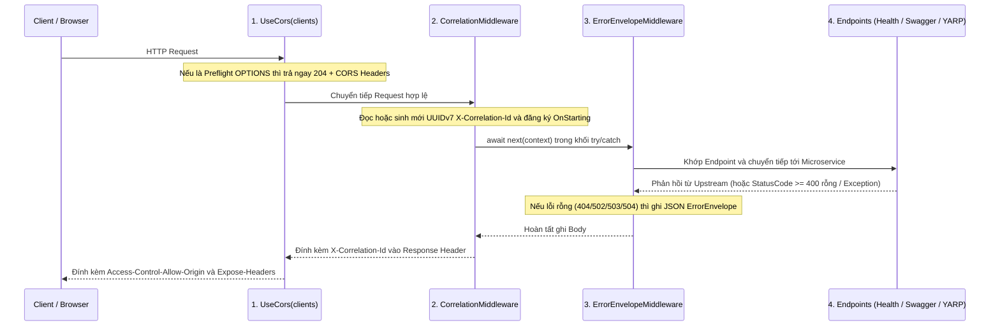
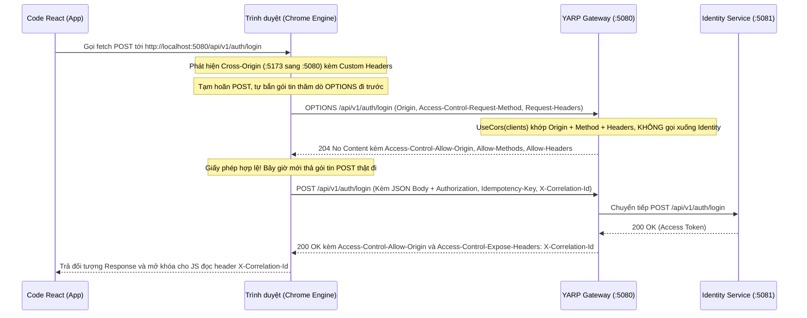
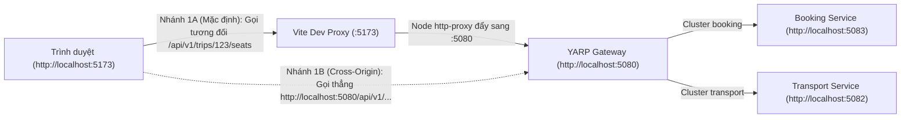
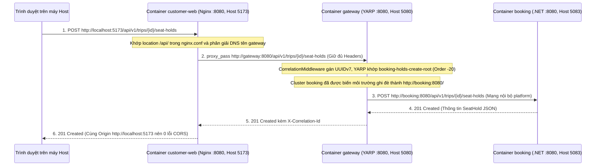
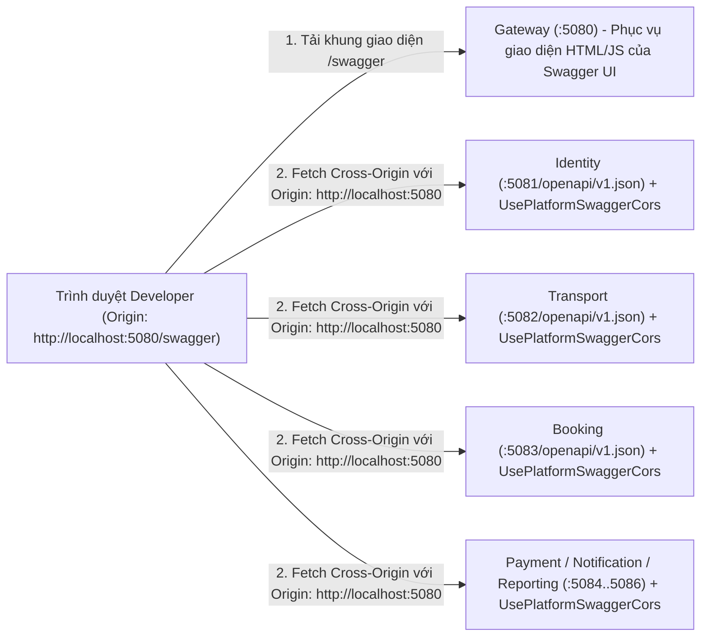

# Bài 02: Giải Phẫu Code Gateway — Middleware Pipeline, CORS, Hành Trình Gói Tin, Error Envelope & Swagger

> **Thuộc bộ tài liệu:** Cẩm nang thuyết trình toàn diện — Dự án **BLUE Bus Ticket Platform (PBL6)**
> **Chủ đề:** Giải phẫu chi tiết từng dòng mã nguồn `BusTicketPlatform.Gateway`, cơ chế CORS Preflight, định tuyến xuyên môi trường (Vite vs Docker Compose), bọc lỗi Upstream và đối chiếu Thiết kế – Thực thi
> **Mã nguồn tham chiếu cốt lõi:**
> - [Program.cs (Gateway)](file:///C:/Users/minht/.gemini/antigravity/worktrees/PBL6/c_to_n_b/workspace/src/gateway/BusTicketPlatform.Gateway/Program.cs)
> - [HostingExtensions.cs](file:///C:/Users/minht/.gemini/antigravity/worktrees/PBL6/c_to_n_b/workspace/src/building-blocks/BusTicketPlatform.BuildingBlocks.AspNetCore/HostingExtensions.cs)
> - [CorrelationMiddleware.cs](file:///C:/Users/minht/.gemini/antigravity/worktrees/PBL6/c_to_n_b/workspace/src/building-blocks/BusTicketPlatform.BuildingBlocks.AspNetCore/Correlation/CorrelationMiddleware.cs)
> - [ErrorEnvelopeMiddleware.cs](file:///C:/Users/minht/.gemini/antigravity/worktrees/PBL6/c_to_n_b/workspace/src/building-blocks/BusTicketPlatform.BuildingBlocks.AspNetCore/Http/ErrorEnvelopeMiddleware.cs)
> - [OpenApiExtensions.cs](file:///C:/Users/minht/.gemini/antigravity/worktrees/PBL6/c_to_n_b/workspace/src/building-blocks/BusTicketPlatform.BuildingBlocks.AspNetCore/OpenApiExtensions.cs)
> - [GatewayHealthAndErrorTests.cs](file:///C:/Users/minht/.gemini/antigravity/worktrees/PBL6/c_to_n_b/workspace/src/tests/gateway/BusTicketPlatform.Gateway.IntegrationTests/GatewayHealthAndErrorTests.cs)
> - [docker-compose.apps.yml](file:///C:/Users/minht/.gemini/antigravity/worktrees/PBL6/c_to_n_b/workspace/src/infra/docker-compose.apps.yml)
> - [nginx.conf (apps/web)](file:///C:/Users/minht/.gemini/antigravity/worktrees/PBL6/c_to_n_b/workspace/src/apps/web/docker/nginx.conf) & [vite.config.ts](file:///C:/Users/minht/.gemini/antigravity/worktrees/PBL6/c_to_n_b/workspace/src/apps/web/vite.config.ts)

---

## Chương 1: Giải Phẫu Từng Khối Lệnh Từ Dòng 1 Đến Dòng 173 Của `Gateway/Program.cs`

Toàn bộ trái tim điều phối của dự án `BusTicketPlatform.Gateway` gói gọn trong đúng **173 dòng lệnh** tại tệp [Program.cs](file:///C:/Users/minht/.gemini/antigravity/worktrees/PBL6/c_to_n_b/workspace/src/gateway/BusTicketPlatform.Gateway/Program.cs#L1-L173). Trong kiến trúc ASP.NET Core Minimal Hosting của `.NET 10`, tệp này được chia thành hai nửa rõ rệt ngăn cách bởi dòng 69 (`var app = builder.Build();`):

- **Nửa trên (Dòng 1 – 68): Pha Đăng Ký Dịch Vụ (Dependency Injection & Configuration Phase)** — Chuẩn bị công cụ vào thùng chứa `IServiceCollection`.
- **Nửa dưới (Dòng 69 – 173): Pha Lắp Ráp Đường Ống HTTP (Middleware & Endpoint Pipeline Phase)** — Quy định thứ tự các trạm gác mà mọi gói tin HTTP phải đi qua.

Hãy đi qua từng khối lệnh một cách tỉ mỉ để hiểu vì sao không một dòng nào thừa và không một thứ tự nào được phép đảo lộn.

---

### 1.1. Dòng 1 – 10: Khởi Tạo Host Và Đăng Ký Hạt Nhân `AddBuildingBlocks()`

```csharp
using BusTicketPlatform.BuildingBlocks.AspNetCore;
using BusTicketPlatform.BuildingBlocks.AspNetCore.Health;
using Microsoft.Extensions.Diagnostics.HealthChecks;

var builder = WebApplication.CreateBuilder(args);

// ============================================================
// Building Blocks
// ============================================================
builder.Services.AddBuildingBlocks();
```

- **Dòng 5 (`WebApplication.CreateBuilder(args)`):** Khởi tạo Kestrel Web Server cùng hệ thống cấu hình phân lớp (`IConfiguration`) theo đúng thứ tự ghi đè từ thấp lên cao của `.NET`:
  1. `appsettings.json` (cấu hình nền tảng chứa danh sách `Cors:Origins`, 58 `Routes` và 6 `Clusters` mặc định trỏ về `localhost:5081..5086`).
  2. `appsettings.{ASPNETCORE_ENVIRONMENT}.json` (ví dụ [appsettings.Development.json](file:///C:/Users/minht/.gemini/antigravity/worktrees/PBL6/c_to_n_b/workspace/src/gateway/BusTicketPlatform.Gateway/appsettings.Development.json) nâng mức log `Default` lên `Debug` khi chạy qua cấu hình `http://localhost:5080` trong [launchSettings.json](file:///C:/Users/minht/.gemini/antigravity/worktrees/PBL6/c_to_n_b/workspace/src/gateway/BusTicketPlatform.Gateway/Properties/launchSettings.json#L8-L11)).
  3. **Environment Variables (Biến môi trường hệ điều hành / Docker Compose)** — lớp quyền lực dùng để ghi đè địa chỉ Cluster trong container mà ta sẽ mổ xẻ ở Chương 3!
  4. Tham số dòng lệnh `args`.
- **Dòng 10 (`builder.Services.AddBuildingBlocks()`):** Mở tệp [HostingExtensions.cs](file:///C:/Users/minht/.gemini/antigravity/worktrees/PBL6/c_to_n_b/workspace/src/building-blocks/BusTicketPlatform.BuildingBlocks.AspNetCore/HostingExtensions.cs#L10-L15), ta thấy hàm mở rộng này đăng ký 2 Singleton nền tảng cho toàn nền tảng:
  ```csharp
  services.AddSingleton<IClock, SystemClock>();
  services.AddSingleton<IIdGenerator, UuidV7IdGenerator>();
  ```
  Nhờ có `IIdGenerator` (`UuidV7IdGenerator`), Gateway có khả năng tự sinh mã định danh vết giao dịch `UUIDv7` (chuẩn UUID sắp xếp tăng dần theo thời gian thực mili-giây) ngay tại biên cho mọi request đi vào hệ thống.

---

### 1.2. Dòng 12 – 18: Nạp Động Cơ YARP Reverse Proxy

```csharp
// ============================================================
// YARP Reverse Proxy
// ============================================================
builder.Services.AddReverseProxy()
    .LoadFromConfig(
        builder.Configuration.GetSection("ReverseProxy"));
```

- `AddReverseProxy()` đưa toàn bộ hạ tầng lõi của YARP (`IHttpForwarder`, `ForwarderHttpClientFactory`, các bộ cân bằng tải và bộ biến đổi header mặc định) vào DI Container.
- `.LoadFromConfig(builder.Configuration.GetSection("ReverseProxy"))` liên kết YARP với nhánh `"ReverseProxy"` trong `IConfiguration`. Lưu ý rằng nó nhận vào đối tượng `IConfigurationSection` tổng hợp cuối cùng (sau khi đã gộp cả `appsettings.json` lẫn biến môi trường Docker), đồng thời lắng nghe sự kiện reload tự động qua `IChangeToken`.

---

### 1.3. Dòng 20 – 27: Triết Lý Thiết Kế Health Check Độc Lập Của Gateway

```csharp
// ============================================================
// Health Checks
// ============================================================
builder.Services.AddHealthChecks()
    .AddCheck(
        "self",
        () => HealthCheckResult.Healthy(),
        tags: ["live", "ready", "startup"]);
```

**Câu hỏi sắc bén đặt ra ở đây:** *Trong `Identity.Api` hay `Booking.Api`, Health Check có gọi `.AddIdentityDatabaseCheck()` / `.AddBookingDatabaseCheck()` để kiểm tra kết nối PostgreSQL. Tại sao ở Gateway, nhóm chỉ kiểm tra `"self"` (luôn trả về `Healthy` miễn là tiến trình Kestrel còn sống), mà **KHÔNG** viết health check đi ping cả 6 microservices phía sau?*

> [!IMPORTANT]
> **Nguyên tắc Chống Hiệu Ứng Domino Khởi Động Lại (Anti-Cascading Failure in Orchestration):**
> Nếu `/live` hoặc `/ready` của Gateway phụ thuộc vào sức khỏe của cả 6 microservices, chuyện thảm khốc sau sẽ xảy ra: Giả sử `Reporting Service` (một dịch vụ đọc báo cáo không nằm trên luồng bán vé thiết yếu!) bị quá tải và treo 15 giây. Nếu Gateway báo `Unhealthy`, Docker hoặc Kubernetes sẽ tưởng **bản thân Gateway bị hỏng** nên giết container `gateway` hoặc rút `gateway` khỏi Load Balancer! Kết quả: Khách hàng đang đăng nhập (`Identity`), tìm chuyến (`Transport`) và đặt vé (`Booking`) bị **chết chùm toàn bộ 100%** chỉ vì dịch vụ xuất báo cáo gặp sự cố!
> Vì vậy, Gateway phải giữ trạng thái sống độc lập (`Liveness_is_ok_without_backends`), còn nếu 1 microservice cụ thể bị sập, chỉ riêng các route thuộc microservice đó mới trả về `503 UPSTREAM_UNAVAILABLE`.

---

### 1.4. Dòng 29 – 68: Đăng Ký Chính Sách Bảo Mật Trình Duyệt CORS (`"clients"`)

```csharp
var origins =
    builder.Configuration
        .GetSection("Cors:Origins")
        .Get<string[]>() ?? [];

builder.Services.AddCors(options =>
{
    options.AddPolicy("clients", policy =>
    {
        if (origins.Length == 0 ||
            origins.Contains("*", StringComparer.Ordinal))
        {
            policy.AllowAnyOrigin();
        }
        else
        {
            policy.WithOrigins(origins);
        }

        policy
            .WithHeaders(
                "Authorization",
                "Content-Type",
                "Accept",
                "Idempotency-Key",
                "X-Correlation-Id")
            .WithMethods(
                "GET", "POST", "PUT", "PATCH", "DELETE", "OPTIONS")
            .WithExposedHeaders(
                "X-Correlation-Id");
    });
});
```

- Đọc mảng `"Cors:Origins"` từ [appsettings.json](file:///C:/Users/minht/.gemini/antigravity/worktrees/PBL6/c_to_n_b/workspace/src/gateway/BusTicketPlatform.Gateway/appsettings.json#L10-L17) gồm 4 nguồn phát triển cục bộ: `http://localhost:5173`, `http://localhost:5174`, `http://127.0.0.1:5173`, `http://127.0.0.1:5174` (lưu ý `localhost` và `127.0.0.1` đối với trình duyệt là **2 Origin khác hẳn nhau** về mặt chuỗi ký tự, nên khai báo cả hai giúp lập trình viên gõ cách nào trên thanh địa chỉ cũng không bị lỗi CORS!).
- Nếu cấu hình mảng rỗng hoặc chứa ký tự đại diện `"*"`, chính sách chuyển sang `AllowAnyOrigin()`; ngược lại khóa chặt danh sách trắng bằng `WithOrigins(origins)` để bảo vệ người dùng khỏi các trang web độc hại giả mạo yêu cầu chéo miền.

---

### 1.5. Dòng 69 – 85: Thứ Tự Vàng Trong Đường Ống Middleware (`app.Build()` -> `UseCors` -> `UseBuildingBlocks` -> `MapPlatformHealth`)

```csharp
var app = builder.Build();

app.UseCors("clients");
app.UseBuildingBlocks();
app.MapPlatformHealth();
```

Trong ASP.NET Core, các Middleware hoạt động giống như những **lớp búp bê Nga (Matryoshka)** lồng vào nhau theo hai chiều (chiều đi vào Request và chiều quay ra Response):



**Tại sao thứ tự `UseCors` -> `UseBuildingBlocks` -> `Endpoints` lại mang tính sống còn?**
1. **`app.UseCors("clients")` phải đứng ĐẦU TIÊN (Dòng 74):**
   - Nếu là gói tin thăm dò Preflight `OPTIONS`, `CorsMiddleware` chặn đứng và trả kết quả `204 No Content` ngay tại cửa mà không tốn công đi sâu vào pipeline hay gọi xuống Microservice.
   - Quan trọng hơn: Khi đặt `UseCors` ở ngoài cùng bọc lấy `UseBuildingBlocks()`, ngay cả khi xảy ra lỗi `404 Not Found` hoặc lỗi sập dịch vụ `503 Service Unavailable` do `ErrorEnvelopeMiddleware` tạo ra ở bên trong, phản hồi lỗi quay ra ngoài vẫn đi ngang qua `CorsMiddleware` để được đóng dấu `Access-Control-Allow-Origin`! Nếu bạn đặt `UseCors` phía sau bộ bắt lỗi, khi server bị lỗi `500/503`, response trả về sẽ **mất sạch CORS Header**, khiến trình duyệt che giấu luôn nội dung JSON lỗi và báo nhầm trên Console thành *"CORS Error"* gây hoang mang cực độ lúc debug!
2. **`app.UseBuildingBlocks()` đứng THỨ HAI (Dòng 79):**
   Bên trong [HostingExtensions.cs](file:///C:/Users/minht/.gemini/antigravity/worktrees/PBL6/c_to_n_b/workspace/src/building-blocks/BusTicketPlatform.BuildingBlocks.AspNetCore/HostingExtensions.cs#L20-L25), thứ tự hai middleware con cũng được tính toán chặt chẽ:
   - `CorrelationMiddleware` chạy **trước** để giải quyết mã `X-Correlation-Id` (giữ nguyên mã Client gửi lên nếu là `Guid` hợp lệ khác `Guid.Empty`, hoặc sinh mới `idGenerator.NewUuidV7()`), cất vào `context.Items["CorrelationId"]` và cài callback `context.Response.OnStarting(...)` để đảm bảo mọi phản hồi đều mang header `X-Correlation-Id`.
   - `ErrorEnvelopeMiddleware` chạy **ngay sau** `CorrelationMiddleware`, nhờ đó khi bắt được lỗi từ YARP hay từ ngoại lệ chưa xử lý, nó gọi `context.GetCorrelationId()` là lấy được ngay mã vết vừa tạo để nhúng vào thân JSON `error.correlationId`!
3. **`app.MapPlatformHealth()` (Dòng 84):**
   Mở [HealthEndpointExtensions.cs](file:///C:/Users/minht/.gemini/antigravity/worktrees/PBL6/c_to_n_b/workspace/src/building-blocks/BusTicketPlatform.BuildingBlocks.AspNetCore/Health/HealthEndpointExtensions.cs#L11-L48), phương thức này ánh xạ 4 đường dẫn kiểm tra sức khỏe chuẩn Cloud-Native: `/live`, `/ready`, `/startup` và `/health`, tất cả đều trả về JSON gọn sạch `{"status":"healthy"}` (được Docker Compose dùng trong lệnh `curl -fsS http://127.0.0.1:8080/live` mỗi 10 giây!).

---

### 1.6. Dòng 87 – 160: Cổng Tài Liệu Tập Trung `/swagger` Và Xuất Bản Hợp Đồng `/openapi.yaml`

- **Dòng 99 – 124 (`app.UseSwaggerUI(...)`):** Khởi tạo giao diện đồ họa Swagger UI tại đường dẫn `/swagger`, gom toàn bộ 6 tệp đặc tả JSON động từ cổng `5081` đến `5086` vào một thanh chọn duy nhất trên góc phải màn hình.
- **Dòng 129 – 160 (`app.MapGet("/openapi.yaml", ...)`):** Xuất bản tệp hợp đồng gốc `platform-mvp.openapi.yaml` với kiểu MIME `"application/yaml"`.
  Hãy chú ý kỹ thuật phòng thủ đường dẫn cực khéo ở dòng 133–153:
  ```csharp
  var candidates = new[]
  {
      Path.Combine(environment.ContentRootPath, "openapi.yaml"),
      Path.GetFullPath(Path.Combine(
          environment.ContentRootPath,
          "..", "..", "..", "..",
          "docs", "contracts", "openapi", "platform-mvp.openapi.yaml"))
  };
  var path = candidates.FirstOrDefault(File.Exists);
  ```
  - **Ứng viên số 1 (`ContentRootPath/openapi.yaml`):** Phục vụ khi chạy trong **Docker Container** hoặc bản `dotnet publish`, nơi cấu trúc thư mục ngoài repo (`../../../../docs/...`) không còn tồn tại, nhưng tệp YAML đã được sao chép vào ngay cạnh file `.dll` nhờ dòng `<Content Include="..\..\..\..\docs\contracts\openapi\platform-mvp.openapi.yaml" Link="openapi.yaml" CopyToOutputDirectory="PreserveNewest" />` trong `.csproj`!
  - **Ứng viên số 2 (`../../../../docs/contracts/openapi/platform-mvp.openapi.yaml`):** Phục vụ khi chạy `dotnet run` hoặc chạy `WebApplicationFactory` trong bộ kiểm thử tích hợp mà tệp gốc vừa được sửa trực tiếp trong thư mục `docs/`.

---

### 1.7. Dòng 162 – 173: `app.MapReverseProxy()`, `app.Run()` Và Bí Ẩn Của `public partial class Program;`

```csharp
// ============================================================
// YARP Reverse Proxy
// MUST BE LAST
// ============================================================
app.MapReverseProxy();

app.Run();

public partial class Program;
```

- **Dòng 166 (`app.MapReverseProxy()` — Ghi chú `MUST BE LAST`):** Đăng ký toàn bộ 58 routes của YARP vào bảng Endpoint Routing cuối cùng của ứng dụng. Đặt sau các endpoint cục bộ (`/live`, `/ready`, `/startup`, `/health`, `/openapi.yaml`) giúp mã nguồn thể hiện rõ ưu tiên: những đường dẫn quản trị nội tại của chính Gateway sẽ được xử lý trực tiếp tại Gateway, còn toàn bộ không gian đường dẫn nghiệp vụ `/api/v1/...`, `/integrations/...`, `/identity/...` sẽ do YARP đảm nhận chuyển tiếp.
- **Dòng 173 (`public partial class Program;`):** Khi viết Minimal APIs không có hàm `Main` tường minh (Top-Level Statements), trình biên dịch C# tự động sinh ra một lớp `internal class Program` ẩn bên trong assembly `BusTicketPlatform.Gateway`. Vì là `internal`, dự án kiểm thử bên ngoài `BusTicketPlatform.Gateway.IntegrationTests` sẽ không nhìn thấy lớp `Program` để truyền vào `IClassFixture<WebApplicationFactory<Program>>`! Dòng khai báo ngắn gọn `public partial class Program;` nâng tầm vực truy cập của lớp tự sinh đó lên `public`, mở khóa toàn bộ sức mạnh kiểm thử tích hợp trong bộ nhớ!

---

## Chương 2: Giải Mã Tận Gốc Cơ Chế CORS, Preflight `OPTIONS` Và Cặp Bài Trùng Header Của Dự Án

Rất nhiều lập trình viên khi gặp lỗi chữ đỏ `Access to fetch at 'http://localhost:5080/...' from origin 'http://localhost:5173' has been blocked by CORS policy` thường phản xạ mò mẫm thêm `AllowAnyOrigin()` mà không hiểu chuyện gì thực sự diễn ra trên dây mạng. Hãy giải phẫu tường tận cơ chế này qua chính các Header thực tế của **BLUE Bus Ticket Platform**.

### 2.1. Tại Sao `localhost:5173` Gọi `localhost:5080` Trên Cùng Một Máy Lại Bị Trình Duyệt Chặn?

Trình duyệt định nghĩa một **Origin (Nguồn gốc)** bằng bộ ba bất khả phân:
$$\text{Origin} = \text{Scheme (Giao thức)} + \text{Host (Tên miền/IP)} + \text{Port (Cổng)}$$

- Giao diện React chạy ở: `http` + `localhost` + `5173`.
- YARP API Gateway chạy ở: `http` + `localhost` + `5080`.

Dù cả hai đều là `http://localhost`, việc khác số cổng (`5173 ≠ 5080`) khiến trình duyệt xếp đây là giao tiếp **Cross-Origin (Khác nguồn)**. Lý do trình duyệt cảnh giác cao độ đến vậy là để phòng vệ: trên máy lập trình viên hoặc người dùng có thể có một dịch vụ quản trị nhạy cảm đang lắng nghe ngầm ở một cổng khác (như pgAdmin `:5050` hay cổng debug cục bộ); nếu một trang web lạ ở cổng A tự ý dùng JavaScript đọc dữ liệu từ cổng B thì toàn bộ dữ liệu nội bộ sẽ bị đánh cắp!

### 2.2. Luồng 2 Bước Của Preflight `OPTIONS` Request Diễn Ra Như Thế Nào?

Theo đặc tả Fetch Standard, nếu bạn gửi một yêu cầu `POST /api/v1/bookings` kèm `Content-Type: application/json` và các Header đặc thù của dự án (`Authorization`, `Idempotency-Key`, `X-Correlation-Id`), đây **không phải** là một *Simple Request*. Nó có khả năng làm thay đổi dữ liệu trên máy chủ (đặt vé, trừ tiền!).

Vì vậy, trình duyệt **tự động giữ gói tin `POST` lại chưa gửi vội**, mà tự phát sinh một gói tin dò đường bằng phương thức **`OPTIONS`** (gọi là **Preflight Request**):



Chính hành vi chuẩn xác từng chi tiết này đã được khóa chặt bằng bài kiểm thử tự động trong [GatewayClientSurfaceTests.cs](file:///C:/Users/minht/.gemini/antigravity/worktrees/PBL6/c_to_n_b/workspace/src/tests/gateway/BusTicketPlatform.Gateway.IntegrationTests/GatewayClientSurfaceTests.cs#L17-L31):

```csharp
[Fact]
public async Task Cors_preflight_allows_browser_clients()
{
    using var request = new HttpRequestMessage(HttpMethod.Options, "/api/v1/auth/login");
    request.Headers.Add("Origin", "http://localhost:5173");
    request.Headers.Add("Access-Control-Request-Method", "POST");
    request.Headers.Add("Access-Control-Request-Headers", "authorization,content-type,idempotency-key,x-correlation-id");

    var response = await _client.SendAsync(request);
    Assert.Equal(HttpStatusCode.NoContent, response.StatusCode);
    Assert.Equal("http://localhost:5173", response.Headers.GetValues("Access-Control-Allow-Origin").Single());
    var allowed = string.Join(",", response.Headers.GetValues("Access-Control-Allow-Headers")).ToLowerInvariant();
    Assert.Contains("authorization", allowed);
    Assert.Contains("idempotency-key", allowed);
}
```

### 2.3. Tại Sao Phải Khai Báo Cả `WithHeaders(...)` Lẫn `WithExposedHeaders("X-Correlation-Id")`?

Đây là câu hỏi phân loại trình độ hiểu biết thực sự về giao thức HTTP/CORS:

1. **Tại sao phải có `.WithHeaders("Authorization", "Content-Type", "Accept", "Idempotency-Key", "X-Correlation-Id")`?**
   - Theo [02-01-05-service-communication.md](file:///C:/Users/minht/.gemini/antigravity/worktrees/PBL6/c_to_n_b/docs/system-design/02-01-05-service-communication.md#L20-L23), mọi lệnh ghi quan trọng (giữ ghế `SeatHold`, tạo `Booking`, khởi tạo `Payment`, hủy vé, hoàn tiền) **bắt buộc** phải đính kèm `Idempotency-Key` để chống trừ tiền hai lần khi mạng chập chờn, và có thể đính kèm `X-Correlation-Id` để nối vết từ giao diện xuống tận RabbitMQ consumer.
   - Cả `Idempotency-Key` lẫn `X-Correlation-Id` đều là **Non-standard / Custom Request Headers**. Nếu thiếu chúng trong `WithHeaders(...)`, ở bước Preflight `OPTIONS`, Gateway sẽ không liệt kê chúng trong `Access-Control-Allow-Headers`, và trình duyệt sẽ lập tức hủy bỏ lệnh đặt vé ngay trên máy khách trước khi gói tin kịp rời khỏi trình duyệt!

2. **Tại sao đã cho phép ở `WithHeaders` rồi mà vẫn phải viết thêm `.WithExposedHeaders("X-Correlation-Id")`?**
   - `WithHeaders` chỉ cấp quyền cho **Chiều Đi (Request: Client -> Server)**.
   - Ở **Chiều Về (Response: Server -> Client)**, trình duyệt áp dụng một màng lọc bảo mật thứ hai: Mặc định, mã JavaScript trong ứng dụng React (`response.headers.get(...)`) **chỉ được phép nhìn thấy 7 Header an toàn cơ bản** (`Cache-Control`, `Content-Language`, `Content-Length`, `Content-Type`, `Expires`, `Last-Modified`, `Pragma`). Mọi Header khác do máy chủ trả về — dù hiển thị rành rành trong cửa sổ DevTools Network F12 — đều bị trình duyệt trả về `null` khi code JavaScript cố đọc!
   - Nhờ khai báo `.WithExposedHeaders("X-Correlation-Id")`, Gateway đính kèm dòng `Access-Control-Expose-Headers: X-Correlation-Id` vào gói tin trả về, mở khóa cho tầng HTTP Client của React đọc được mã vết `X-Correlation-Id` trong cả trường hợp thành công lẫn thất bại (ví dụ hiển thị dòng chữ *"Mã tra cứu hỗ trợ: 0195a8e0-..."* trên hộp thoại thông báo lỗi).

---

## Chương 3: Truy Vết Hành Trình Của 1 HTTP Request Qua 2 Môi Trường (Local Dev vs Docker Compose)

Một câu hỏi cực kỳ thực tế mà bất kỳ thành viên nào trong nhóm cũng phải nắm trong lòng bàn tay: *"Khi người dùng bấm nút **Tìm chuyến xe** hoặc **Giữ ghế** trên trình duyệt ở `http://localhost:5173`, gói tin HTTP thực sự đi qua những cổng nào, tiến trình nào trước khi chạm tới `Booking Service`?"*

Câu trả lời thú vị là: **Giao diện React không hề phải đổi code, nhưng dưới tầng hạ tầng tồn tại 2 lộ trình vật lý khác nhau tùy thuộc vào việc bạn đang chạy Local Dev bằng `pnpm` + `dotnet run` hay đang dựng nguyên cụm Docker Compose!**

---

### 3.1. Môi Trường 1: Local Development (`Vite Dev Server` / Trực Tiếp `:5080` -> `localhost:5081..5086`)

Khi lập trình trên máy cá nhân, bạn khởi động các tiến trình `.NET` trực tiếp trên máy chủ Windows/macOS/Linux:
- `BusTicketPlatform.Gateway` lắng nghe tại `http://localhost:5080` (theo [launchSettings.json](file:///C:/Users/minht/.gemini/antigravity/worktrees/PBL6/c_to_n_b/workspace/src/gateway/BusTicketPlatform.Gateway/Properties/launchSettings.json#L8)).
- 6 Microservices lần lượt lắng nghe tại `http://localhost:5081` (`Identity`) đến `http://localhost:5086` (`Reporting`).
- Ứng dụng Web React chạy trên **Vite Dev Server** tại `http://localhost:5173`.

Hãy mở tệp cấu hình [vite.config.ts](file:///C:/Users/minht/.gemini/antigravity/worktrees/PBL6/c_to_n_b/workspace/src/apps/web/vite.config.ts#L17-L36) để xem cơ chế điều hướng cực thông minh lúc phát triển:

```typescript
server: {
  proxy: {
    ...(env.API_TRANSPORT_PROXY_TARGET
      ? {
          "^/api/v1/operator/(drivers|driver-files|resource-metadata|buses|trips)(/|[?]|$)":
            {
              target: env.API_TRANSPORT_PROXY_TARGET,
              changeOrigin: true,
            },
        }
      : {}),
    "/api/v1": {
      target:
        process.env.API_PROXY_TARGET ||
        env.API_PROXY_TARGET ||
        "http://localhost:5080",
      changeOrigin: true,
    },
  },
},
```



Trên môi trường Local Dev có **2 cách gói tin đi tới Gateway**:
1. **Nhánh 1A — Đi xuyên qua Vite Dev Proxy (Mặc định khi `VITE_API_BASE_URL` để trống):**
   - Code React gọi đường dẫn tương đối `fetch("/api/v1/trips/123/seats")`, tức là gửi về chính `http://localhost:5173/api/v1/trips/123/seats` (cùng nguồn Same-Origin với trang web nên **không tốn Preflight `OPTIONS`**!).
   - Tiến trình Node.js của Vite Dev Server bắt tiền tố `"/api/v1"`, dùng bộ proxy tích hợp đẩy sang `http://localhost:5080` (`changeOrigin: true` đổi `Host` header thành `localhost:5080`).
   - *(Mẹo tăng tốc dev nội bộ)*: Nếu một lập trình viên Frontend chỉ đang test riêng tính năng quản lý xe/tài xế với một đồng đội Backend chỉ bật mỗi `Transport Service (:5082)` mà lười bật Gateway, họ có thể đặt biến `API_TRANSPORT_PROXY_TARGET=http://localhost:5082` để Vite nắn tạm riêng vài route operator sang thẳng `:5082`!
2. **Nhánh 1B — Gọi trực tiếp vào `http://localhost:5080` (Mobile App / Postman / Khi cấu hình Base URL tường minh):**
   - Trình duyệt ở `:5173` bắn thẳng sang `http://localhost:5080/api/v1/...`. Lúc này chính sách CORS `"clients"` tại Gateway phát huy tác dụng đón Preflight `OPTIONS`, sau đó YARP đọc `Clusters` trong `appsettings.json` để nối sang `http://localhost:5083/` (`Booking Service`).

---

### 3.2. Môi Trường 2: Docker Compose Full-Stack (`Browser -> Nginx :8080 -> gateway:8080 -> booking:8080`)

Khi chạy toàn bộ nền tảng bằng Docker Compose theo hướng dẫn trong [docker-compose.apps.yml](file:///C:/Users/minht/.gemini/antigravity/worktrees/PBL6/c_to_n_b/workspace/src/infra/docker-compose.apps.yml#L3-L4):
```powershell
docker compose -f docker-compose.yml -f docker-compose.apps.yml up -d --build --wait
```
Thế giới mạng bên trong hoàn toàn thay đổi! Hãy nhớ một chân lý căn bản của Docker: **Bên trong một container, `localhost` (`127.0.0.1`) chính là bản thân container đó, KHÔNG PHẢI máy tính thật (Host) của bạn và càng KHÔNG PHẢI các container hàng xóm!**

Ngoài ra, hãy nhìn vào cấu hình chung `x-api` ở dòng 18–19 của [docker-compose.apps.yml](file:///C:/Users/minht/.gemini/antigravity/worktrees/PBL6/c_to_n_b/workspace/src/infra/docker-compose.apps.yml#L17-L20):
```yaml
ASPNETCORE_ENVIRONMENT: Production
ASPNETCORE_URLS: http://+:8080
```
Mọi container `.NET` (cả `gateway` lẫn 6 microservices) bên trong mạng ảo `platform` đều lắng nghe ở cổng nội bộ **`8080`** (chỉ khi ánh xạ `ports` ra ngoài máy Host cho lập trình viên debug mới ánh xạ thành `5080:8080`, `5081:8080`... `5086:8080`).

Hãy theo dấu từng bước chân của gói tin đặt vé trên môi trường Docker Compose:



#### Soi kỹ cấu hình Nginx làm cầu nối trước YARP Gateway
Trong tệp [apps/web/docker/nginx.conf](file:///C:/Users/minht/.gemini/antigravity/worktrees/PBL6/c_to_n_b/workspace/src/apps/web/docker/nginx.conf#L20-L52) (được đóng gói vào image `customer-web` khi chạy chế độ thật, cùng cấu hình tương đương tại [infra/docker/nginx-web.conf](file:///C:/Users/minht/.gemini/antigravity/worktrees/PBL6/c_to_n_b/workspace/src/infra/docker/nginx-web.conf#L13-L37)), Nginx được cấu hình cực kỳ chuẩn mực:

```nginx
location /api/ {
  proxy_pass http://gateway:8080;
  proxy_http_version 1.1;
  proxy_set_header Host $host;
  proxy_set_header X-Forwarded-For $proxy_add_x_forwarded_for;
  proxy_set_header X-Forwarded-Proto $scheme;
  proxy_set_header Authorization $http_authorization;
  proxy_set_header Idempotency-Key $http_idempotency_key;
  proxy_set_header X-Correlation-Id $http_x_correlation_id;
  proxy_connect_timeout 5s;
  proxy_read_timeout 60s;
}
```

- **Tại sao phải có `proxy_http_version 1.1;`?** Mặc định cổ điển của Nginx khi nói chuyện với upstream là `HTTP/1.0` (đóng kết nối ngay sau mỗi request!). Bật `1.1` giúp Nginx giữ kết nối ổn định và truyền tải chunked response chuẩn xác sang Kestrel của YARP.
- **Bảo vệ các đường dẫn tích hợp Thanh toán SePay khỏi bị SPA nuốt mất:** Ở cuối tệp `nginx.conf` có quy tắc `location / { try_files $uri $uri/ /index.html; }` để phục vụ React Router. Nếu đối tác SePay gọi IPN server-to-server vào `/integrations/payments/sepay/ipn` hoặc chuyển hướng trình duyệt về `/integrations/payments/sepay/browser-return` mà Nginx trả nhầm tệp HTML trang chủ React thì giao dịch thanh toán sẽ hỏng hoàn toàn! Do đó, hai khối `location = /integrations/payments/sepay/ipn` (giới hạn `client_max_body_size 64k;` chống tấn công bơm payload lớn) và `location = /integrations/payments/sepay/browser-return` được khai báo tường minh để đẩy thẳng sang `http://gateway:8080`!

---

### 3.3. Phép Thuật Ghi Đè Cấu Hình Phân Cấp (`ReverseProxy__Clusters__...`) Của `.NET`

Hãy nhìn vào tệp `appsettings.json` nằm cứng bên trong image Docker của `gateway`:
```json
"Clusters": {
  "booking": {
    "Destinations": {
      "booking-local": {
        "Address": "http://localhost:5083/"
      }
    }
  }
}
```
Nếu giữ nguyên giá trị `"http://localhost:5083/"`, khi container `gateway` chạy trong Docker, nó sẽ tự gọi vào cổng `5083` của chính nó và nhận ngay lỗi `Connection Refused`! Vậy làm sao nhóm đổi cả 6 địa chỉ này sang tên DNS nội bộ của Docker (`http://identity:8080/`, `http://booking:8080/`...) mà **không cần sửa file `appsettings.json` cũng không cần build 2 Docker image khác nhau**?

Câu trả lời nằm ở dòng 158–166 của [docker-compose.apps.yml](file:///C:/Users/minht/.gemini/antigravity/worktrees/PBL6/c_to_n_b/workspace/src/infra/docker-compose.apps.yml#L158-L166):

```yaml
environment:
  <<: *api-env
  Cors__Origins__0: http://localhost:5173
  Cors__Origins__1: http://127.0.0.1:5173
  ReverseProxy__Clusters__identity__Destinations__identity-local__Address: http://identity:8080/
  ReverseProxy__Clusters__transport__Destinations__transport-local__Address: http://transport:8080/
  ReverseProxy__Clusters__booking__Destinations__booking-local__Address: http://booking:8080/
  ReverseProxy__Clusters__payment__Destinations__payment-local__Address: http://payment:8080/
  ReverseProxy__Clusters__notification__Destinations__notification-local__Address: http://notification:8080/
  ReverseProxy__Clusters__reporting__Destinations__reporting-local__Address: http://reporting:8080/
```

**Cơ chế hoạt động bên dưới của `.NET EnvironmentVariablesConfigurationProvider`:**
1. Trong hệ thống `IConfiguration` của C#, đường dẫn đến một khóa lồng nhau trong JSON được phân tách bằng dấu hai chấm `:`, ví dụ:
   `ReverseProxy:Clusters:booking:Destinations:booking-local:Address`
2. Tuy nhiên, trên hệ điều hành Linux (nền tảng chạy container Alpine/Debian) và chuẩn POSIX shell (`bash`/`sh`), **dấu hai chấm `:` không phải là ký tự hợp lệ trong tên biến môi trường!**
3. Vì vậy, Microsoft quy ước dùng **hai dấu gạch dưới liên tiếp (`__`)** làm ký hiệu đại diện đa nền tảng. Ngay khi container `gateway` khởi động, `.NET` tự động dịch chuỗi `__` thành dấu `:`, tìm đúng lá `Address` bên trong nhánh `booking-local` (lưu ý một dấu gạch ngang đơn `-` trong `booking-local` được giữ nguyên!), và **ghi đè đè lên giá trị cũ trong `appsettings.json`** thành `http://booking:8080/`!
4. Tương tự đối với mảng JSON `"Cors": { "Origins": [...] }`, `.NET` đánh số phần tử mảng từ `0`, nên `Cors__Origins__0` và `Cors__Origins__1` ghi đè chính xác hai phần tử đầu của mảng! Đây chính là chuẩn mực **12-Factor App** kinh điển: *Một bản build duy nhất chạy trên mọi môi trường chỉ bằng cấu hình biến môi trường*.

---

## Chương 4: Giải Phẫu Cơ Chế Bọc Lỗi Sập Kết Nối Upstream (`502/503/504`) Thành `UPSTREAM_UNAVAILABLE`

Một trong những điểm tinh tế nhất của `BusTicketPlatform.Gateway` nằm ở cách `ErrorEnvelopeMiddleware` phối hợp không một vết gợn với YARP khi dịch vụ phía sau bị chết cứng hoặc khi khách hàng gõ sai đường dẫn.

Hãy đặt câu hỏi kỹ thuật sâu: **Khi `Identity Service` bị sập nguồn (không thể kết nối TCP), YARP ném Exception ra ngoài hay YARP làm gì? Và tại sao phản hồi cuối cùng lại mang mã `503 Service Unavailable` với `"code": "UPSTREAM_UNAVAILABLE"`?**

Hãy theo dõi từng dòng code thực thi trong [ErrorEnvelopeMiddleware.cs](file:///C:/Users/minht/.gemini/antigravity/worktrees/PBL6/c_to_n_b/workspace/src/building-blocks/BusTicketPlatform.BuildingBlocks.AspNetCore/Http/ErrorEnvelopeMiddleware.cs#L21-L73) và [ErrorMapper.cs](file:///C:/Users/minht/.gemini/antigravity/worktrees/PBL6/c_to_n_b/workspace/src/building-blocks/BusTicketPlatform.BuildingBlocks/Errors/ErrorMapper.cs#L10-L23):

```csharp
// Trích ErrorEnvelopeMiddleware.cs (dòng 23-33)
try
{
    await next(context);

    if (!context.Response.HasStarted && context.Response.StatusCode >= 400 && IsEmptyJsonResponse(context))
    {
        var correlationId = context.GetCorrelationId();
        var error = ErrorMapper.FromStatus(context.Response.StatusCode, correlationId);
        await WriteEnvelope(context, error, correlationId);
    }
}
```

```csharp
// Trích ErrorMapper.cs (dòng 10-23)
public static AppError FromStatus(int statusCode, Guid correlationId)
{
    return statusCode switch
    {
        400 => AppError.Validation("The request is invalid."),
        401 => new AppError(ErrorCodes.AuthenticationRequired, "Authentication is required.", 401),
        403 => new AppError(ErrorCodes.AccessDenied, "Access is denied.", 403),
        404 => AppError.NotFound("The requested resource was not found."),
        405 => new AppError(ErrorCodes.MethodNotAllowed, "The HTTP method is not allowed for this resource.", 405),
        429 => new AppError(ErrorCodes.RateLimited, "Too many requests.", 429),
        502 or 503 or 504 => new AppError(ErrorCodes.UpstreamUnavailable, "A required dependency is unavailable.", 503),
        _ => AppError.Internal(correlationId.ToString())
    };
}
```

**Diễn biến vi mô qua 4 bước khi Upstream bị sập:**
1. `HttpForwarder` của YARP cố mở kết nối TCP tới `Identity Service` (trong bài test [GatewayHealthAndErrorTests.cs](file:///C:/Users/minht/.gemini/antigravity/worktrees/PBL6/c_to_n_b/workspace/src/tests/gateway/BusTicketPlatform.Gateway.IntegrationTests/GatewayHealthAndErrorTests.cs#L17-L21) được cố tình ghi đè vào cổng chết `http://127.0.0.1:1/`).
2. Socket hệ điều hành từ chối kết nối (`SocketException` bên trong `HttpRequestException`). **Điểm mấu chốt:** YARP tự bắt lỗi kết nối này bên trong `HttpForwarder` (ghi log cảnh báo mức hệ thống của YARP), **KHÔNG ném Exception văng ra khối `catch`**, mà chỉ đặt `context.Response.StatusCode = 502` (`Bad Gateway` — hoặc `504 Gateway Timeout` nếu hết thời gian chờ) rồi kết thúc hàm mà **chưa ghi bất kỳ byte nào vào Response Body** (`HasStarted == false`, `ContentLength == null`, `ContentType == null`).
3. Luồng điều khiển lùi ra dòng 27 của `ErrorEnvelopeMiddleware`:
   - `!context.Response.HasStarted` -> `true`!
   - `context.Response.StatusCode >= 400` -> `true` (`502 >= 400`)!
   - `IsEmptyJsonResponse(context)` -> `true`!
   *(Ngược lại, nếu `Identity Service` đang sống và tự trả lỗi nghiệp vụ `401 INVALID_CREDENTIALS` đã có sẵn JSON body `application/json`, thì `IsEmptyJsonResponse` trả về `false` -> Middleware tại Gateway **tôn trọng tuyệt đối và giữ nguyên 100% thông báo lỗi nghiệp vụ của Microservice**, không hề ghi đè!)*
4. Với phản hồi `502` rỗng của YARP, `ErrorMapper.FromStatus(502, correlationId)` khớp nhánh `502 or 503 or 504`, quy hoạch toàn bộ các mã lỗi hạ tầng kết nối (`502 Bad Gateway`, `503 Service Unavailable`, `504 Gateway Timeout`) về một trạng thái chuẩn duy nhất **`503 Service Unavailable`** với mã lỗi `"UPSTREAM_UNAVAILABLE"` và thông điệp an toàn `"A required dependency is unavailable."`, tuyệt đối không rò rỉ tên lớp Exception, địa chỉ IP nội bộ `127.0.0.1:1` hay Stack Trace ra ngoài Internet!

Hãy xem bài kiểm thử chứng minh toàn bộ chuỗi logic này trong [GatewayHealthAndErrorTests.cs](file:///C:/Users/minht/.gemini/antigravity/worktrees/PBL6/c_to_n_b/workspace/src/tests/gateway/BusTicketPlatform.Gateway.IntegrationTests/GatewayHealthAndErrorTests.cs#L64-L77):

```csharp
[Fact]
public async Task Unavailable_upstream_returns_safe_service_unavailable_envelope()
{
    using var request = new HttpRequestMessage(HttpMethod.Post, "/api/v1/auth/login")
    {
        Content = JsonContent.Create(new { identifier = "nobody@example.test", password = "irrelevant" })
    };
    var response = await _client.SendAsync(request);
    Assert.Equal(HttpStatusCode.ServiceUnavailable, response.StatusCode);
    var envelope = await response.Content.ReadFromJsonAsync<Envelope>(Json);
    Assert.NotNull(envelope);
    Assert.Equal("UPSTREAM_UNAVAILABLE", envelope.Error.Code);
    Assert.DoesNotContain("exception", await response.Content.ReadAsStringAsync(), StringComparison.OrdinalIgnoreCase);
}
```

Và tương tự, khi Client gọi một URL không khớp bất kỳ route nào trong 58 routes của YARP (ví dụ `GET /does-not-exist`), ASP.NET Core Endpoint Routing kết thúc pipeline với `StatusCode = 404` rỗng -> `ErrorEnvelopeMiddleware` lập tức đón lấy và biến nó thành JSON chuẩn `404` mang `"code": "RESOURCE_NOT_FOUND"` cùng `X-Correlation-Id` khớp khít giữa HTTP Header và JSON Body!

---

## Chương 5: Cơ Chế Centralized Swagger UI (`/swagger` + `UsePlatformSwaggerCors`) Và `/openapi.yaml`

Dự án cung cấp song song **2 công cụ tài liệu OpenAPI** ngay trên cổng `:5080` của Gateway, phục vụ hai mục đích bổ trợ cho nhau:

### 5.1. Cổng Giao Diện Tập Trung `/swagger` Và Vai Trò Của `UsePlatformSwaggerCors()`

Trong [Gateway/Program.cs](file:///C:/Users/minht/.gemini/antigravity/worktrees/PBL6/c_to_n_b/workspace/src/gateway/BusTicketPlatform.Gateway/Program.cs#L99-L124), Gateway chỉ cài gói giao diện `Swashbuckle.AspNetCore.SwaggerUI` (không cần cài bộ sinh schema nặng nề vì bản thân Gateway không có Controller nghiệp vụ):

```csharp
app.UseSwaggerUI(options =>
{
    options.SwaggerEndpoint("http://localhost:5081/openapi/v1.json", "Identity API");
    options.SwaggerEndpoint("http://localhost:5082/openapi/v1.json", "Transport API");
    options.SwaggerEndpoint("http://localhost:5083/openapi/v1.json", "Booking API");
    options.SwaggerEndpoint("http://localhost:5084/openapi/v1.json", "Payment API");
    options.SwaggerEndpoint("http://localhost:5085/openapi/v1.json", "Notification API");
    options.SwaggerEndpoint("http://localhost:5086/openapi/v1.json", "Reporting API");
});
```

**Hãy chú ý một bẫy mạng rất dễ bỏ qua ở đây:**
1. Lập trình viên mở trình duyệt gõ `http://localhost:5080/swagger`. Trang HTML/JS của Swagger UI được tải về từ Origin **`http://localhost:5080`**.
2. Khi bạn chọn `"Booking API"` trên thanh thả xuống, **chính trình duyệt của bạn** (chứ không phải máy chủ Gateway!) sẽ dùng `fetch()` gọi sang **`http://localhost:5083/openapi/v1.json`** để tải cấu trúc API, và khi bạn bấm nút **"Try it out -> Execute"**, trình duyệt cũng bắn request từ `:5080` sang `:5083`!
3. Vì `:5080 ≠ :5083`, trình duyệt lập tức chặn lại kiểm tra CORS! Nếu `Booking Service (:5083)` không mở cửa cho Origin `http://localhost:5080`, màn hình Swagger UI tại Gateway sẽ báo lỗi đỏ rực `Failed to fetch openapi/v1.json`!

Đó chính là lý do ra đời của tệp [OpenApiExtensions.cs](file:///C:/Users/minht/.gemini/antigravity/worktrees/PBL6/c_to_n_b/workspace/src/building-blocks/BusTicketPlatform.BuildingBlocks.AspNetCore/OpenApiExtensions.cs#L9-L40) trong `BuildingBlocks.AspNetCore`, được gọi đồng loạt ở cả **6 Microservices** (`AddPlatformOpenApi()` + `AddPlatformSwaggerCors()` + `UsePlatformSwaggerCors()` + `MapPlatformOpenApi()`):

```csharp
public static IServiceCollection AddPlatformSwaggerCors(this IServiceCollection services)
{
    services.AddCors(options =>
    {
        options.AddPolicy("swagger", policy =>
        {
            policy
                .WithOrigins("http://localhost:5080")
                .AllowAnyHeader()
                .AllowAnyMethod();
        });
    });
    return services;
}
```
Nhờ chính sách `"swagger"` chỉ tin cậy đích danh Origin `http://localhost:5080` của Gateway, cả 6 microservices vừa khép kín trước các trang web lạ, vừa cho phép cổng Swagger tập trung tại `:5080/swagger` đọc trực tiếp tài liệu `.NET 10 Native OpenAPI` (`/openapi/v1.json`) và chạy thử API mượt mà!



### 5.2. Điểm Xuất Bản Hợp Đồng Chuẩn `/openapi.yaml` (`Contract-First`)

Khác với `/swagger` (nơi phản ánh các endpoint thực tế được sinh tự động từ code C# của từng microservice phục vụ debug lúc phát triển), đường dẫn **`GET http://localhost:5080/openapi.yaml`** xuất bản nguyên bản tệp hợp đồng thiết kế tổng thể **`platform-mvp.openapi.yaml` (OpenAPI 3.1)** theo triết lý `Contract-First` (`ADR-016`) — phục vụ cho các bộ sinh mã TypeScript Client của Frontend/Mobile và các bài kiểm thử đối chiếu hợp đồng tự động.

---

## Chương 6: Phân Tích Thẳng Thắn Thiết Kế vs Code Thực Tế — Tại Sao Gateway KHÔNG Gọi `AddPlatformJwt()` Và KHÔNG Cài Rate Limiter?

Khi đọc tài liệu kiến trúc [ADR-002](file:///C:/Users/minht/.gemini/antigravity/worktrees/PBL6/c_to_n_b/docs/system-design/02-01-12-architecture-decisions.md#L8) và [02-01-05-service-communication.md](file:///C:/Users/minht/.gemini/antigravity/worktrees/PBL6/c_to_n_b/docs/system-design/02-01-05-service-communication.md#L22-L35), bạn sẽ thấy thiết kế đề cập:
- *"Authorization: Bearer `<token>`; service tự kiểm tra quyền và tenant scope."*
- *"Rate limit: Theo IP/account/client ở Gateway; endpoint auth/webhook có policy riêng."*

Nhưng khi đối chiếu thẳng thắn vào 173 dòng code của `BusTicketPlatform.Gateway/Program.cs`, ta thấy **Gateway hiện KHÔNG gọi `AddPlatformJwt()` (`UseAuthentication`/`UseAuthorization`) và cũng KHÔNG gọi `AddRateLimiter()`**, mà toàn bộ việc đó đang được thực thi tại từng Microservice phía sau! Cụ thể trong mã nguồn thực tế:
- **Về Xác thực JWT:**
  - 5 Microservices (`Transport`, `Booking`, `Payment`, `Notification`, `Reporting`) đều gọi `builder.Services.AddPlatformJwt(builder.Configuration);` (trong [PlatformJwtExtensions.cs](file:///C:/Users/minht/.gemini/antigravity/worktrees/PBL6/c_to_n_b/workspace/src/building-blocks/BusTicketPlatform.BuildingBlocks.AspNetCore/Auth/PlatformJwtExtensions.cs#L11-L39)) để tự xác thực chữ ký khóa đối xứng `SigningKey`, `Issuer = "busticket-identity"`, `Audience = "busticket"`, hạn dùng với `ClockSkew = 30s` và tự kiểm tra phân quyền theo vai trò/tổ chức (`organizationId`).
  - Đặc biệt, riêng **`Identity Service`** ([Identity.Api/Program.cs](file:///C:/Users/minht/.gemini/antigravity/worktrees/PBL6/c_to_n_b/workspace/src/services/identity/BusTicketPlatform.Identity.Api/Program.cs#L44-L67)) cài đặt sự kiện `OnTokenValidated` truy vấn thẳng bảng User trong DB để đối chiếu `user.Status == Active` và **`user.AuthorizationVersion == tokenVersion`** (giúp thu hồi hiệu lực JWT ngay lập tức khi tài khoản bị khóa hoặc đổi quyền!).
- **Về Rate Limiting:**
  - Trong **`Booking Service`** ([Booking.Api/Program.cs](file:///C:/Users/minht/.gemini/antigravity/worktrees/PBL6/c_to_n_b/workspace/src/services/booking/BusTicketPlatform.Booking.Api/Program.cs#L26-L34) & `BookingEndpoints.cs`), nhóm cài `FixedWindowLimiter("ticket-lookup")` giới hạn **40 requests / 1 phút** (trả mã `429`) trên endpoint tra cứu vé công khai `POST /api/v1/tickets/lookup` (chống kẻ xấu vét cạn mã vé + số điện thoại của khách).
  - Trong **`Notification Service`** (`Notification.Api/Program.cs`), nhóm cài `FixedWindowLimiter("customer-requests")` bảo vệ 2 form gửi yêu cầu hỗ trợ/đối tác công khai `POST /api/v1/customer-requests/support` và `/partner` (chống spam hộp thư).

### Đánh Giá Kiến Trúc Công Tâm: Tại Sao Nhóm Chọn Cách Này Ở MVP Và Sự Đánh Đổi Là Gì?

Việc không dồn JWT Validation và Rate Limiter lên Gateway trong giai đoạn hiện tại không phải là sự thiếu sót ngẫu nhiên, mà phản ánh mô hình **"Thin Routing Gateway + Zero-Trust Autonomous Services" (Gateway mỏng chuyên định tuyến + Dịch vụ tự chủ không tin cậy mù quáng mạng nội bộ)**:

| Khía cạnh | Ưu điểm của hiện trạng (Đặt Auth & Rate Limit ở từng Service) | Nhược điểm / Rủi ro (Khi thiếu lớp chặn thô tại Gateway) |
|---|---|---|
| **1. Độ chính xác nghiệp vụ & Phân quyền (AuthZ)** | **Rất cao & An toàn (Defense-in-Depth):** Ngay cả khi một request lọt vào mạng nội bộ hoặc gọi trực tiếp qua cổng `5081..5086` lúc dev/test, từng Microservice vẫn tự bảo vệ mình 100%, không bị lỗ hổng "ruột mềm vỏ cứng". Hơn nữa, Gateway không phải phân biệt phức tạp hàng chục endpoint công khai (`/trips`, `/explore`, `/auth/login`, SePay IPN webhook...) với các endpoint bắt buộc đăng nhập! | Một request mang JWT rác/hết hạn vẫn đi tốn thêm **1 chặng mạng nội bộ (1 network hop)** từ Gateway vào tới Microservice rồi mới bị từ chối bằng `401 AUTHENTICATION_REQUIRED`. |
| **2. Thu hồi Token (`AuthorizationVersion`)** | Gateway giữ được tính **100% Stateless** (không phải kết nối chéo vào `identity_db` hay Redis để kiểm tra `AuthorizationVersion` như `Identity.Api` đang làm). | Các service ngoài `Identity` chỉ kiểm tra chữ ký + hạn sống của Access Token ngắn hạn (stateless JWT), chưa chặn ngay ở cửa ngõ biên. |
| **3. Độ tinh chỉnh của Rate Limiting** | Mỗi team phụ trách Microservice hiểu rõ ngưỡng chịu tải của từng endpoint cụ thể trong miền của mình (ví dụ `ticket-lookup` cho 40 lần/phút khác hẳn ngưỡng tìm chuyến xe hay gửi form liên hệ). | **Điểm yếu cần cải thiện trước Production:** Nếu bị tấn công Flood/DDoS tầng 7 quy mô lớn vào các API tìm kiếm công khai (`/api/v1/trips`), lưu lượng xấu vẫn xuyên qua Gateway đập vào các Microservices thay vì bị cắt đứt sớm ngay từ vòng ngoài (Edge Shedding). |

> [!TIP]
> **Chiến lược trả lời xuất sắc nhất nếu Hội đồng hỏi xoáy về điểm khác biệt giữa Tài liệu và Code này:**
> *"Dạ thưa Hội đồng, nhóm hoàn toàn nhận thức rõ sự phân vai này ạ. Trong phạm vi MVP hiện tại, nhóm ưu tiên nguyên tắc **Zero-Trust ở tầng Service**: cả 6 microservices đều bắt buộc tự xác thực JWT qua `AddPlatformJwt()` và các endpoint nhạy cảm không cần đăng nhập (như tra cứu vé `/tickets/lookup` hay gửi form hỗ trợ `/customer-requests`) đã được gắn `FixedWindowLimiter` trả mã `429 RATE_LIMITED` ngay tại service sở hữu. Nhờ vậy Gateway giữ được sự tinh gọn, không cần chứa logic ngoại lệ cho các route public hay webhook thanh toán. Khi nâng cấp lên môi trường Production thực tế (theo lộ trình của `02-01-05-service-communication.md`), nhóm sẽ giữ nguyên lớp kiểm tra chi tiết ở từng Service và chỉ cần bổ sung thêm một lớp **Coarse-Grained Global IP Rate Limiter** (`app.UseRateLimiter()`) khoảng vài dòng code trên `Gateway/Program.cs` để chắn bão lưu lượng từ vòng ngoài — tạo thành lá chắn bảo vệ 2 lớp hoàn chỉnh!"*

---
*Sau khi đã nắm trọn 173 dòng code `Program.cs` và hành trình xuyên suốt của gói tin, hãy bước sang **Bài 03** — nơi chúng ta mổ xẻ thuật toán khớp đường dẫn `Order Precedence` và lập bảng giải phẫu chi tiết **toàn bộ 58/58 Routes thực tế** trong `appsettings.json`!*
