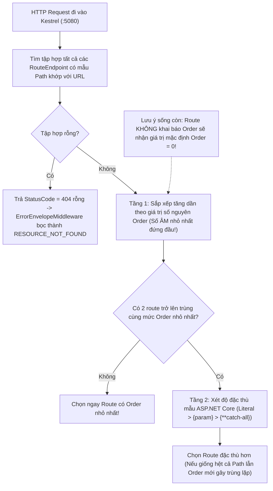
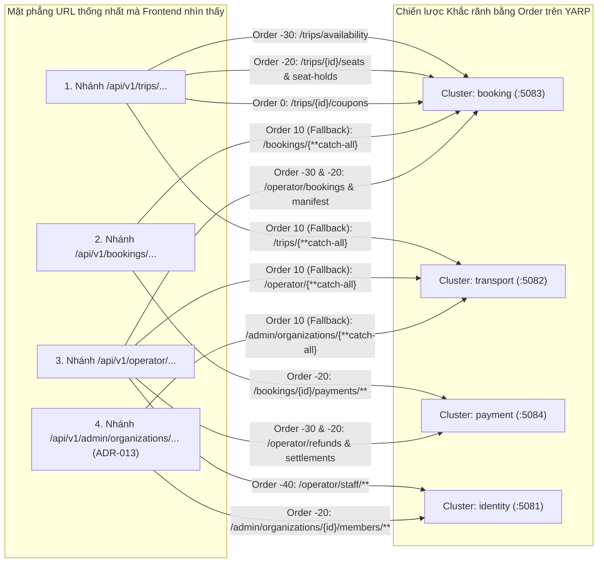

# Bài 03: Bảng Định Tuyến YARP Toàn Diện & Chiến Lược Độ Ưu Tiên `Order Precedence`

> **Thuộc bộ tài liệu:** Cẩm nang thuyết trình toàn diện — Dự án **BLUE Bus Ticket Platform (PBL6)**
> **Chủ đề:** Thuật toán khớp đường dẫn của YARP, triết lý *Domain-Unified REST Surface*, giải phẫu trọn vẹn bảng định tuyến thực tế (tất cả **58 Routes** phát triển từ bộ khung 50+ routes MVP) và cơ chế kiểm thử hợp đồng tự động
> **Mã nguồn tham chiếu cốt lõi:**
> - [appsettings.json (Gateway)](file:///C:/Users/minht/.gemini/antigravity/worktrees/PBL6/c_to_n_b/workspace/src/gateway/BusTicketPlatform.Gateway/appsettings.json)
> - [GatewayClientSurfaceTests.cs](file:///C:/Users/minht/.gemini/antigravity/worktrees/PBL6/c_to_n_b/workspace/src/tests/gateway/BusTicketPlatform.Gateway.IntegrationTests/GatewayClientSurfaceTests.cs)
> - [02-01-12-architecture-decisions.md](file:///C:/Users/minht/.gemini/antigravity/worktrees/PBL6/c_to_n_b/docs/system-design/02-01-system-architecture/02-01-12-architecture-decisions.md) (`ADR-001`, `ADR-002`, `ADR-013`, `ADR-016`)

---

## Chương 1: Thuật Toán Khớp Đường Dẫn (Route Matching) Của YARP & Quyền Lực Tối Thượng Của `Order`

Khi mở tệp [appsettings.json](file:///C:/Users/minht/.gemini/antigravity/worktrees/PBL6/c_to_n_b/workspace/src/gateway/BusTicketPlatform.Gateway/appsettings.json#L18-L299) của `BusTicketPlatform.Gateway`, ấn tượng đầu tiên của bất kỳ người đọc nào cũng là những con số nguyên âm và dương lặp đi lặp lại: `"Order": -40`, `"Order": -30`, `"Order": -20`, một số dòng không hề ghi `"Order"`, rồi `"Order": 10` và `"Order": 20`.

Nếu bạn xóa thử các con số `"Order"` này đi, hệ thống đặt vé sẽ lập tức rơi vào tình trạng hỗn loạn: bấm xem sơ đồ ghế trống thì báo lỗi `404 Not Found` từ `Transport Service`, quản trị viên xem danh sách nhân viên nhà xe thì đâm nhầm vào dịch vụ vận tải, còn khách hàng bấm thanh toán đơn đặt vé thì gói tin lại chui tọt vào `Booking Service` thay vì `Payment Service`!

Để hiểu tại sao thuộc tính `Order` lại nắm giữ sinh mạng của toàn bộ tầng biên, hãy nắm vững 3 quy luật cốt lõi trong bộ máy định tuyến của YARP và ASP.NET Core.

---

### 1.1. Ba Dạng Mẫu Đường Dẫn (Route Templates) Trong `Match.Path`

YARP sử dụng chính xác cú pháp Route Template của ASP.NET Core Endpoint Routing với 3 cấp độ khớp từ hẹp đến rộng:

1. **Đường dẫn tĩnh tuyệt đối (Literal Path):**
   Ví dụ: `"/api/v1/trips/availability"` hoặc `"/api/v1/bookings"`.
   Chỉ khớp khi từng ký tự trên URL (không phân biệt chữ hoa/thường) giống hệt mẫu khai báo và có đúng bấy nhiêu đoạn ngăn cách bởi dấu `/`.
2. **Đường dẫn có tham số đơn đoạn (`{param}` — Single-Segment Parameter):**
   Ví dụ: `"/api/v1/trips/{tripId}/seats"` hoặc `"/api/v1/customer-requests/{kind}"`.
   Cặp ngoặc nhọn `{tripId}` đóng vai trò biến đại diện khớp với **bất kỳ chuỗi ký tự nào khác rỗng nằm trọn trong 1 đoạn URL** (tức là không chứa dấu gạch chéo `/`). Ví dụ `/api/v1/trips/abc-123/seats` sẽ khớp, nhưng `/api/v1/trips/abc-123/extra/seats` sẽ không khớp.
3. **Đường dẫn gom trọn gói (`{**catch-all}` — Multi-Segment Wildcard):**
   Ví dụ: `"/api/v1/trips/{**catch-all}"` hoặc `"/api/v1/operator/{**catch-all}"`.
   Hai dấu sao `**` báo cho bộ định tuyến biết rằng nó có quyền **nuốt trọn tất cả mọi phân đoạn con sâu bất kỳ phía sau dấu `/` đó** — dù là 1 cấp (`/api/v1/trips/123`), 2 cấp (`/api/v1/trips/123/seats`) hay 5 cấp (`/api/v1/operator/trips/123/stops/456`)!

> [!WARNING]
> **Giải mã câu hỏi kinh điển: Tại sao trong `appsettings.json` luôn phải đi theo "Cặp bài trùng" `*-root` và `{**catch-all}`?**
> Bạn sẽ thấy khắp tệp cấu hình có các cặp song sinh như:
> - `booking`: `"/api/v1/bookings/{**catch-all}"` đi kèm `booking-root`: `"/api/v1/bookings"`
> - `tickets`: `"/api/v1/tickets/{**catch-all}"` đi kèm `tickets-root`: `"/api/v1/tickets"`
> - `identity-members`: `".../members/{**catch-all}"` đi kèm `identity-members-root`: `".../members"`
>
> **Lý do kỹ thuật:** Trong mẫu `"/api/v1/bookings/{**catch-all}"`, trước biến `{**catch-all}` có một dấu gạch chéo `/`. Khi bộ kiểm thử hợp đồng (như hàm `Matches` trong `GatewayClientSurfaceTests.cs` dịch thành biểu thức chính quy `^\/api\/v1\/bookings\/.*$`) hoặc các công cụ kiểm tra mẫu đường dẫn nghiêm ngặt đối chiếu với yêu cầu gọi thẳng vào gốc tập hợp **`GET /api/v1/bookings`** (không có dấu `/` ở đuôi!), mẫu có dấu `/` phía sau sẽ bị trượt hoặc gây nhập nhằng! Việc tách rõ một route `-root` cho bản thân tập hợp cha (`/bookings`) và một route `{**catch-all}` cho toàn bộ tài nguyên con (`/bookings/{id}`, `/bookings/{id}/cancel`...) đảm bảo độ chính xác tuyệt đối 100% không phụ thuộc trailing slash!

---

### 1.2. Luật Vàng Của Thuộc Tính `Order`: Số Nhỏ Thắng Số Lớn & Giá Trị Ngầm Định `0`

Khi một HTTP Request (chẳng hạn `GET /api/v1/trips/999/seats`) đi vào YARP, trên lý thuyết nó khớp **cùng lúc cả 2 mẫu đường dẫn** trong `appsettings.json`:
- Khớp mẫu 1 (`booking-seats`): `"/api/v1/trips/{tripId}/seats"` -> Trỏ về **`booking` (`:5083`)**.
- Khớp mẫu 2 (`transport-trips`): `"/api/v1/trips/{**catch-all}"` -> Trỏ về **`transport` (`:5082`)**.

Để quyết định ai thắng cuộc, ASP.NET Core `DfaMatcher` áp dụng quy tắc phân xử **2 tầng nghiêm ngặt** (và **KHÔNG phụ thuộc vào việc route nào viết ở dòng trên hay dòng dưới trong file JSON!**):



**Hai định luật bắt buộc phải khắc cốt ghi tâm:**
1. **Số càng NHỎ thì độ ưu tiên càng CAO (`-40` ưu tiên cao nhất -> rồi đến `-30` -> `-20` -> `0` -> `10` -> `20` thấp nhất):**
   Đừng nhầm với điểm số thông thường! Trong ASP.NET Core Endpoint Routing, `Order` nghĩa là *"Thứ tự xếp hàng được gọi tên trước"* (giống hạng Nhất `1` đứng trước hạng Mười `10`, và hạng `-40` đứng tuốt lên đầu hàng trước cả hạng `0`).
2. **Khi KHÔNG ghi `"Order"` trong JSON, giá trị mặc định luôn bằng `0`:**
   Trong lớp `RouteConfig` của YARP, thuộc tính `int? Order` khi bỏ trống sẽ được `ProxyEndpointFactory` gán về mặc định `0` của `RouteEndpoint` (và trong bài test [GatewayClientSurfaceTests.cs](file:///C:/Users/minht/.gemini/antigravity/worktrees/PBL6/c_to_n_b/workspace/src/tests/gateway/BusTicketPlatform.Gateway.IntegrationTests/GatewayClientSurfaceTests.cs#L62) cũng mô phỏng chính xác bằng lệnh `route.Value.TryGetProperty("Order", out var order) ? order.GetInt32() : 0`).
   Chính vì các route nền `catch-all` được nhóm chủ động đẩy lùi xuống **`Order: 10`**, nên bất kỳ route mới nào quên ghi `Order` (mặc định `= 0`) vẫn tự động đứng trước `Order: 10` (`0 < 10`)! Đây là một kỹ thuật thiết kế "khoảng đệm an toàn quanh số 0" cực kỳ chuyên nghiệp.

---

## Chương 2: Triết Lý Thiết Kế `"Domain-Unified REST Surface"` (Mặt Phẳng API Hướng Miền Thống Nhất)

### 2.1. Hai Trường Phái Thiết Kế URL Cho Hệ Microservices

Khi đứng trước 6 microservices, các đội ngũ kỹ thuật thường đứng trước ngã ba đường với 2 cách đặt tên URL công khai:

- **Cách 1 — URL phản chiếu ranh giới Microservice vật lý (Service-Prefixed URL — Cách dễ dãi nhưng tệ hại):**
  - `/transport-service/api/v1/trips/{id}`
  - `/booking-service/api/v1/trips/{id}/seats`
  - `/transport-service/api/v1/admin/organizations/{id}`
  - `/identity-service/api/v1/admin/organizations/{id}/members`
  *Hệ quả:* Toàn bộ cấu trúc chia tách nội bộ của Backend bị phơi bày ra hợp đồng API công khai. Lập trình viên Frontend/Mobile và đối tác tích hợp bị ép phải hiểu kiến trúc nội bộ của bạn; mỗi lần Backend chuyển quyền sở hữu một endpoint từ service A sang service B là URL bị gãy (Breaking Change)!

- **Cách 2 — Mặt phẳng REST hướng miền thống nhất (`Domain-Unified REST Surface` — Lựa chọn của BLUE Bus Ticket Platform):**
  Khách hàng và lập trình viên Frontend chỉ nhìn thấy **một cây tài nguyên nghiệp vụ duy nhất, tự nhiên và thuần khiết RESTful** dưới gốc `/api/v1`:
  - Nhánh hành khách tìm kiếm & đặt vé: `/api/v1/explore/...`, `/api/v1/trips/...`, `/api/v1/seat-holds/...`, `/api/v1/bookings/...`, `/api/v1/tickets/...`, `/api/v1/payments/...`, `/api/v1/refunds/...`
  - Nhánh vận hành nhà xe (Operator Portal): `/api/v1/operator/...`
  - Nhánh tài xế (Driver App): `/api/v1/driver/...`
  - Nhánh quản trị sàn (Admin Portal): `/api/v1/admin/...`

Còn bên dưới mặt nước phẳng lặng đó, **YARP API Gateway dùng chiến lược "Khắc rãnh độ ưu tiên (`Order` Carving)"** để bẻ lái từng nhánh con về đúng Bounded Context chịu trách nhiệm nguồn sự thật (Authoritative Owner)!

---

### 2.2. Bốn Cuộc "Khắc Rãnh Liên Miền" (Cross-Context Carving) Đắt Giá Nhất Trong Dự Án

Hãy quan sát sơ đồ trực quan cách 4 không gian URL lớn được chia sẻ hài hòa giữa nhiều Microservices nhờ chênh lệch `Order`:



1. **Điển hình số 1 — Giải quyết triệt để `ADR-013` (`/admin/organizations` vs `/members`):**
   Theo [ADR-013](file:///C:/Users/minht/.gemini/antigravity/worktrees/PBL6/c_to_n_b/docs/system-design/02-01-12-architecture-decisions.md#L84-L90), hồ sơ doanh nghiệp vận tải (`Organization` tên công ty, mã số thuế, trạng thái hoạt động) thuộc quyền sở hữu của **`Transport Service`**, nhưng danh sách tài khoản nhân sự và vai trò gắn vào tổ chức đó (`OrganizationMembership`) lại thuộc vòng đời bảo mật của **`Identity Service`**.
   Nhờ đặt `identity-members` và `identity-members-root` ở **`Order: -20`** trong khi `transport-admin-orgs` nằm ở **`Order: 10`**, cả hai tài nguyên cùng chung sống dưới cây URL chuẩn mực `/api/v1/admin/organizations/{organizationId}/...` mà không cần bất kỳ truy vấn khóa ngoại xuyên cơ sở dữ liệu (Cross-DB Foreign Key) nào!
2. **Điển hình số 2 — Tách bạch Lịch trình xe (`Transport`) và Tồn kho ghế thời gian thực (`Booking` theo `ADR-008`):**
   Thông tin tĩnh/bán tĩnh của chuyến xe (`GET /api/v1/trips/{tripId}`, điểm đón trả, biển số xe) thuộc `Transport Service` (`Order: 10`). Nhưng ngay khi nối thêm `/availability` (`Order: -30`), `/seats` (`Order: -20`), `/seat-holds` (`Order: -20`), hoặc `/coupons` (`Order: 0`), YARP lập tức bẻ lái sang `Booking Service` — nơi nắm khóa dòng PostgreSQL bảo vệ bất biến chống đặt trùng ghế!
3. **Điển hình số 3 — Cổng vận hành nhà xe `/api/v1/operator/...` hội tụ 4 Microservices:**
   Đối với nhân viên nhà xe đăng nhập vào **Operator Portal**, mọi thao tác của họ đều mang tiền tố đồng nhất `/api/v1/operator/...`. Mặc định (`Order: 10`), các thao tác quản lý xe, tuyến, chuyến, tài xế rơi về `Transport`. Nhưng YARP đã khéo léo khoét 3 rãnh ưu tiên cao hơn:
   - Quản lý nhân viên nhà xe (`/operator/staff/**`) -> `Order: -40` -> **`Identity`**.
   - Xem đơn đặt vé của nhà xe (`/operator/bookings`) và xuất phơi lệnh hành khách lên xe (`/operator/trips/{tripId}/manifest`) -> `Order: -30` / `-20` -> **`Booking`**.
   - Xử lý hoàn tiền (`/operator/refunds`) và xem bảng đối soát doanh thu (`/operator/settlements`) -> `Order: -30` / `-20` -> **`Payment`**.
4. **Điển hình số 4 — Khởi tạo thanh toán dưới tài nguyên đơn đặt vé (`/bookings/{bookingId}/payments`):**
   Theo chuẩn thiết kế RESTful, giao dịch thanh toán sinh ra từ một đơn đặt vé cụ thể nên đường dẫn đẹp nhất là `POST /api/v1/bookings/{bookingId}/payments`. Nhờ `Order: -20`, yêu cầu này vượt mặt `booking` catch-all (`Order: 10`) để đi thẳng vào **`Payment Service`**!

---

## Chương 3: Giải Phẫu Chi Tiết Toàn Bộ 58/58 Routes Thực Tế Theo 6 Tầng Độ Ưu Tiên

> [!NOTE]
> **Ghi chú chính xác về con số Routes trong mã nguồn thực tế:**
> Trong giai đoạn thiết kế khung MVP ban đầu, bảng định tuyến có khoảng 50 routes (do đó tài liệu giữ tên gọi lịch sử quen thuộc là *"Bảng định tuyến 50 routes"*). Qua quá trình hoàn thiện thêm các tính năng trực tiếp (Coupon báo giá, kiểm tra chỗ trống nhanh, quản lý nhân sự Operator, hoàn tiền Operator, form hỗ trợ khách hàng...), tệp [appsettings.json](file:///C:/Users/minht/.gemini/antigravity/worktrees/PBL6/c_to_n_b/workspace/src/gateway/BusTicketPlatform.Gateway/appsettings.json#L19-L299) hiện hành chứa chính xác **58 Routes** chia vào **6 tầng `Order`** (`-40`, `-30`, `-20`, `0`, `10`, `20`), phân phối về **6 Clusters**.
> Dưới đây là bảng giải phẫu **đầy đủ 100% cả 58/58 Routes không sót một dòng nào**, sắp xếp theo đúng thứ tự ưu tiên mà bộ máy YARP thực thi từ cao xuống thấp!

### 3.1. Tầng 1: `Order = -40` — Ưu Tiên Tối Thượng (2 Routes)

Tầng cao nhất toàn hệ thống dành riêng cho phân hệ quản trị nhân sự của nhà xe (`Operator Staff`), cắt đứt sớm nhất trước khi bất kỳ luật `/operator/...` nào khác được xét tới.

| STT | Tên Route (`RouteId`) | Dòng JSON | `Match.Path` | Cluster Đích | Ý nghĩa nghiệp vụ & Hậu quả nếu thiếu `Order: -40` |
|---:|---|---:|---|---|---|
| 01 | `identity-operator-staff` | 33–37 | `/api/v1/operator/staff/{**catch-all}` | `identity` (`:5081`) | Cập nhật trạng thái, vai trò, chi tiết từng nhân viên nhà xe. **Nếu thiếu `Order` âm:** Bị route `transport-operator` (`/api/v1/operator/{**catch-all}`, `Order: 10`) nuốt trọn vì cả hai cùng là `{**catch-all}` dưới `/operator/` -> Trả `404` từ Transport! |
| 02 | `identity-operator-staff-root` | 38–42 | `/api/v1/operator/staff` | `identity` (`:5081`) | Liệt kê danh sách nhân viên hoặc mời/tạo mới nhân viên thuộc nhà xe hiện tại. **Nếu thiếu `Order` âm:** Bị `transport-operator` (`Order: 10`) nuốt mất và gửi nhầm sang `Transport Service`! |

---

### 3.2. Tầng 2: `Order = -30` — Ưu Tiên Đặc Biệt Cho Các Endpoint Live & Giao Thoa (7 Routes)

Tầng `-30` tập hợp các API nghiệp vụ trực tiếp (Live Portal APIs) cần cắt ngang các nhánh chung của `trips`, `operator`, hoặc mở các đầu nối chuyên biệt cho Customer Portal.

| STT | Tên Route (`RouteId`) | Dòng JSON | `Match.Path` | Cluster Đích | Ý nghĩa nghiệp vụ & Hậu quả nếu thiếu `Order: -30` |
|---:|---|---:|---|---|---|
| 03 | `booking-availability` | 23–27 | `/api/v1/trips/availability` | `booking` (`:5083`) | Truy vấn nhanh số lượng ghế trống khả dụng của danh sách chuyến xe từ tồn kho ghế thực tế. **Nếu thiếu `Order` âm:** Bị `transport-trips` (`/api/v1/trips/{**catch-all}`, `Order: 10`) tưởng `"availability"` là một `{tripId}` và gửi nhầm sang `Transport Service`! |
| 04 | `customer-requests` | 28–32 | `/api/v1/customer-requests/{kind}` | `notification` (`:5085`) | Tiếp nhận biểu mẫu công khai từ khách hàng (`/support` yêu cầu hỗ trợ và `/partner` đăng ký mở nhà xe đối tác, có gắn Rate Limiter). Không có catch-all `/customer-requests` ở dưới nhưng đặt `-30` để ưu tiên khớp nhanh ngoài biên. |
| 05 | `payment-methods` | 43–47 | `/api/v1/payment-methods` | `payment` (`:5084`) | Lấy danh sách phương thức thanh toán đang bật trên sàn (phương thức checkout SePay đã cấu hình). Đặt ở `-30` giúp khớp tức thì đường dẫn tĩnh trước khi duyệt tới nhóm route nền `Order: 10`. |
| 06 | `operator-bookings-live` | 48–52 | `/api/v1/operator/bookings` | `booking` (`:5083`) | Nhà xe tra cứu danh sách đơn đặt vé thuộc các chuyến xe của tổ chức mình. **Nếu thiếu `Order` âm:** Bị `transport-operator` (`/api/v1/operator/{**catch-all}`, `Order: 10`) nuốt chửng và đẩy nhầm về `Transport Service`! *(Lưu ý kiểm toán: Route này ưu tiên cao hơn và che phủ route lịch sử `operator-bookings-root` ở `Order: -20`, cả hai cùng trỏ về `booking`)*. |
| 07 | `operator-refunds-live` | 53–57 | `/api/v1/operator/refunds` | `payment` (`:5084`) | Nhà xe xem danh sách các yêu cầu/giao dịch hoàn tiền của hành khách thuộc nhà xe. **Nếu thiếu `Order` âm:** Bị `transport-operator` (`Order: 10`) nuốt mất! |
| 08 | `operator-refunds-detail-live` | 58–62 | `/api/v1/operator/refunds/{refundId}` | `payment` (`:5084`) | Nhà xe xem chi tiết hoặc xử lý một hồ sơ hoàn tiền cụ thể theo `refundId`. **Nếu thiếu `Order` âm:** Bị `transport-operator` (`Order: 10`) nuốt mất! |
| 09 | `transport-explore-live` | 63–67 | `/api/v1/explore/{**catch-all}` | `transport` (`:5082`) | Phục vụ trang chủ khám phá tuyến đường phổ biến, bến xe, gợi ý điểm đi/đến cho khách vãng lai. *(Lưu ý kiểm toán: Cùng trỏ về `transport` giống `transport-explore` ở `Order: 10`, nhưng đặt ở `-30` giúp luồng tìm kiếm trang chủ khớp ngay ở nhóm đầu)*. |

---

### 3.3. Tầng 3: `Order = -20` — Lớp Khắc Rãnh Cross-Context Cốt Lõi Của MVP (13 Routes)

Đây là tầng xương sống thực thi trực tiếp các quyết định kiến trúc quan trọng nhất của dự án (`ADR-008` về quyền sở hữu ghế/manifest, `ADR-013` về tách hồ sơ nhà xe và thành viên tổ chức, cùng luồng Webhook/Payment con).

| STT | Tên Route (`RouteId`) | Dòng JSON | `Match.Path` | Cluster Đích | Ý nghĩa nghiệp vụ & Hậu quả nếu thiếu `Order: -20` |
|---:|---|---:|---|---|---|
| 10 | `payment-webhook` | 68–72 | `/integrations/payments/{**catch-all}` | `payment` (`:5084`) | Nhận tín hiệu IPN / Webhook ký số từ SePay (`/sepay/ipn`), cầu nối trình duyệt (`/sepay/browser-return`) và callback tương thích nếu provider cũ được bật riêng. Lưu ý đây là nhánh **không mang tiền tố `/api/v1`**, được ưu tiên `-20` để đi thẳng vào `Payment Service`. |
| 11 | `booking-seats` | 73–77 | `/api/v1/trips/{tripId}/seats` | `booking` (`:5083`) | Hiển thị sơ đồ ghế và trạng thái ghế thực tế (`AVAILABLE`, `HELD`, `BOOKED`) của một chuyến xe. **Nếu thiếu `Order: -20`:** Bị `transport-trips` (`/api/v1/trips/{**catch-all}`, `Order: 10`) nuốt mất và đẩy nhầm sang `Transport Service`! |
| 12 | `booking-holds-create` | 78–82 | `/api/v1/trips/{tripId}/seat-holds/{**catch-all}` | `booking` (`:5083`) | Các thao tác con dưới tài nguyên giữ ghế theo chuyến xe. **Nếu thiếu `Order: -20`:** Bị `transport-trips` (`Order: 10`) nuốt mất! |
| 13 | `booking-holds-create-root` | 83–87 | `/api/v1/trips/{tripId}/seat-holds` | `booking` (`:5083`) | Lệnh `POST` quan trọng bậc nhất khi đặt vé: Khóa tạm các ghế đã chọn trên chuyến `{tripId}` trong thời gian đếm ngược (yêu cầu `Idempotency-Key`). **Nếu thiếu `Order: -20`:** Bị `transport-trips` (`Order: 10`) nuốt mất! |
| 14 | `booking-holds` | 88–92 | `/api/v1/seat-holds/{**catch-all}` | `booking` (`:5083`) | Truy vấn trạng thái phiên giữ ghế (`GET /api/v1/seat-holds/{holdId}`) hoặc chủ động nhả ghế (`DELETE` / `release`) trước khi hết hạn TTL. Đặt cùng nhóm `-20` đồng bộ với toàn bộ họ API giữ chỗ. |
| 15 | `booking-payments` | 93–97 | `/api/v1/bookings/{bookingId}/payments/{**catch-all}` | `payment` (`:5084`) | Truy vấn hoặc thao tác chi tiết giao dịch thanh toán con thuộc đơn đặt vé `{bookingId}`. **Nếu thiếu `Order: -20`:** Bị route `booking` (`/api/v1/bookings/{**catch-all}`, `Order: 10`) nuốt mất và gửi nhầm về `Booking Service`! |
| 16 | `booking-payments-root` | 98–102 | `/api/v1/bookings/{bookingId}/payments` | `payment` (`:5084`) | Khởi tạo phiên thanh toán (tạo checkout SePay) hoặc liệt kê lịch sử lần thanh toán của đơn `{bookingId}`. **Nếu thiếu `Order: -20`:** Bị route `booking` (`Order: 10`) nuốt mất! |
| 17 | `operator-bookings-root` | 103–107 | `/api/v1/operator/bookings` | `booking` (`:5083`) | Route gốc của MVP bảo vệ danh sách đơn đặt vé nhà xe trước `transport-operator` (`Order: 10`). *(Hiện cùng đường dẫn và cùng trỏ về `booking` với `operator-bookings-live` ở `Order: -30`)*. |
| 18 | `booking-manifest` | 108–112 | `/api/v1/operator/trips/{tripId}/manifest` | `booking` (`:5083`) | Xuất danh sách hành khách lên xe (Passenger Manifest: tên khách, số ghế, mã vé, trạng thái soát vé check-in) cho nhà xe/phụ xe. **Nếu thiếu `Order: -20`:** Bị `transport-operator` (`/api/v1/operator/{**catch-all}`, `Order: 10`) nuốt mất vì đường dẫn bắt đầu bằng `/api/v1/operator/trips/...`! |
| 19 | `identity-members` | 113–117 | `/api/v1/admin/organizations/{organizationId}/members/{**catch-all}` | `identity` (`:5081`) | Thực thi trực tiếp **`ADR-013`**: Quản trị viên sàn sửa vai trò, khóa/xóa thành viên cụ thể trong một nhà xe. **Nếu thiếu `Order: -20`:** Bị `transport-admin-orgs` (`/api/v1/admin/organizations/{**catch-all}`, `Order: 10`) nuốt mất và gửi nhầm sang `Transport Service`! |
| 20 | `identity-members-root` | 118–122 | `/api/v1/admin/organizations/{organizationId}/members` | `identity` (`:5081`) | Thực thi trực tiếp **`ADR-013`**: Liệt kê hoặc gán mới người dùng làm quản trị viên/nhân sự của nhà xe `{organizationId}`. **Nếu thiếu `Order: -20`:** Bị `transport-admin-orgs` (`Order: 10`) nuốt mất! |
| 21 | `operator-settlements` | 123–127 | `/api/v1/operator/settlements/{**catch-all}` | `payment` (`:5084`) | Nhà xe xem chi tiết kỳ đối soát công nợ, doanh thu ròng sau chiết khấu sàn của từng kỳ cụ thể. **Nếu thiếu `Order: -20`:** Bị `transport-operator` (`/api/v1/operator/{**catch-all}`, `Order: 10`) nuốt mất! |
| 22 | `operator-settlements-root` | 128–132 | `/api/v1/operator/settlements` | `payment` (`:5084`) | Nhà xe xem danh sách tổng hợp các kỳ đối soát doanh thu. **Nếu thiếu `Order: -20`:** Bị `transport-operator` (`Order: 10`) nuốt mất! |

---

### 3.4. Tầng 4: `Order = 0` (Ngầm Định Khi Không Ghi `Order`) — Cụm Nghiệp Vụ Coupon (3 Routes)

Hãy nhìn lên ngay 3 dòng đầu tiên của mục `"Routes"` trong [appsettings.json](file:///C:/Users/minht/.gemini/antigravity/worktrees/PBL6/c_to_n_b/workspace/src/gateway/BusTicketPlatform.Gateway/appsettings.json#L20-L22):
```json
"trip-coupons": { "ClusterId": "booking", "Match": { "Path": "/api/v1/trips/{tripId}/coupons" } },
"coupon-quote": { "ClusterId": "booking", "Match": { "Path": "/api/v1/coupons/quote" } },
"coupon-admin": { "ClusterId": "booking", "Match": { "Path": "/api/v1/admin/coupons" } },
```

Đây là **ví dụ thực tế sống động nhất** chứng minh lợi ích của việc hiểu sâu giá trị mặc định `Order = 0`: Dù lập trình viên viết 3 dòng này ngắn gọn trên 1 hàng mà **không hề khai báo `"Order"`**, YARP tự động cấp cho chúng **`Order = 0`**. Và vì `0 < 10`, route `trip-coupons` vẫn hiên ngang đánh bại `transport-trips` (`Order = 10`)!

| STT | Tên Route (`RouteId`) | Dòng JSON | `Match.Path` | Cluster Đích | Ý nghĩa nghiệp vụ & Tại sao `Order = 0` hoạt động đúng? |
|---:|---|---:|---|---|---|
| 23 | `trip-coupons` | 20 | `/api/v1/trips/{tripId}/coupons` | `booking` (`:5083`) | Lấy danh sách mã giảm giá khả dụng cho chuyến xe `{tripId}`. Nhờ `Order = 0` mặc định nhỏ hơn `Order = 10`, nó thắng `transport-trips` (`/api/v1/trips/{**catch-all}`) để đi về `Booking Service`! *(Nếu `transport-trips` cũng để trống `Order = 0` thay vì `10` thì chỉ lệch một chút cấu hình là rất dễ bị đè)*. |
| 24 | `coupon-quote` | 21 | `/api/v1/coupons/quote` | `booking` (`:5083`) | Tính toán thử số tiền được giảm giá (Quote Preview) khi khách nhập mã khuyến mãi ở bước thanh toán. Đi thẳng về `Booking Service` với `Order = 0`. |
| 25 | `coupon-admin` | 22 | `/api/v1/admin/coupons` | `booking` (`:5083`) | Quản trị viên sàn tạo mới hoặc liệt kê chương trình mã giảm giá. Không có catch-all `/api/v1/admin/{**catch-all}` chung nên `Order = 0` hoàn toàn độc lập và an toàn. |

---

### 3.5. Tầng 5: `Order = 10` — Mặt Phẳng Nền (Baseline Catch-All & Root) Của 6 Bounded Contexts (32 Routes)

Sau khi các tầng `-40`, `-30`, `-20` và `0` đã gạn lọc hết toàn bộ những trường hợp giao thoa liên miền tinh vi, tầng **`Order = 10`** đóng vai trò là **Lưới hứng nền tảng (Domain Baseline Layer)** cho tất cả 6 Microservices, được tổ chức thành từng cặp `{**catch-all}` và `-root` rành mạch:

#### A. Nhóm nền thuộc `Booking Service` (`:5083`) — 6 Routes
| STT | Tên Route (`RouteId`) | Dòng JSON | `Match.Path` | Cluster Đích | Ý nghĩa nghiệp vụ |
|---:|---|---:|---|---|---|
| 26 | `booking` | 133–137 | `/api/v1/bookings/{**catch-all}` | `booking` | Xem chi tiết đơn đặt vé (`/bookings/{id}`), xem trước phí hủy (`cancel-preview`), hủy đơn đặt vé (`cancel`)... *(Mọi nhánh con ngoài `/payments` đã rẽ ở `-20`)*. |
| 27 | `booking-root` | 138–142 | `/api/v1/bookings` | `booking` | Tạo đơn đặt vé mới (`POST` từ `SeatHold` kèm `Idempotency-Key`) và lấy danh sách lịch sử đặt vé của hành khách hiện tại (`GET`). |
| 28 | `tickets` | 143–147 | `/api/v1/tickets/{**catch-all}` | `booking` | Xem chi tiết vé điện tử, mã QR vé, tra cứu vé công khai (`/tickets/lookup` có Rate Limiter), soát vé lên xe (`check-in`). |
| 29 | `tickets-root` | 148–152 | `/api/v1/tickets` | `booking` | Liệt kê danh sách vé đã phát hành của người dùng đăng nhập. |
| 30 | `booking-admin` | 153–157 | `/api/v1/admin/bookings/{**catch-all}` | `booking` | Quản trị viên sàn tra cứu chi tiết đơn đặt vé toàn hệ thống, can thiệp xử lý sự cố giao dịch và `SupportCase` (`ADR-014`). |
| 31 | `booking-admin-root` | 158–162 | `/api/v1/admin/bookings` | `booking` | Quản trị viên sàn lọc và phân trang toàn bộ đơn đặt vé trên sàn. |

#### B. Nhóm nền thuộc `Payment Service` (`:5084`) — 12 Routes
| STT | Tên Route (`RouteId`) | Dòng JSON | `Match.Path` | Cluster Đích | Ý nghĩa nghiệp vụ |
|---:|---|---:|---|---|---|
| 32 | `payments` | 163–167 | `/api/v1/payments/{**catch-all}` | `payment` | Truy vấn trạng thái giao dịch thanh toán theo `paymentId` (phục vụ màn hình chờ quét QR polling trạng thái hội tụ của Saga). |
| 33 | `payments-root` | 168–172 | `/api/v1/payments` | `payment` | Truy vấn danh sách giao dịch thanh toán của người dùng. |
| 34 | `refunds` | 173–177 | `/api/v1/refunds/{**catch-all}` | `payment` | Khách hàng xem chi tiết tiến độ hoàn tiền (`PENDING`, `SUCCEEDED`, `FAILED`) của một yêu cầu hoàn tiền cụ thể. |
| 35 | `refunds-root` | 178–182 | `/api/v1/refunds` | `payment` | Liệt kê lịch sử hoàn tiền hoặc gửi yêu cầu hoàn tiền. |
| 36 | `admin-payments` | 183–187 | `/api/v1/admin/payments/{**catch-all}` | `payment` | Admin sàn tra cứu chi tiết, đối chiếu log biên nhận với cổng thanh toán cho từng `paymentId`. |
| 37 | `admin-payments-root` | 188–192 | `/api/v1/admin/payments` | `payment` | Admin sàn tra cứu và lọc toàn bộ giao dịch thu tiền trên hệ thống. |
| 38 | `admin-refunds` | 193–197 | `/api/v1/admin/refunds/{**catch-all}` | `payment` | Admin sàn phê duyệt, xử lý ngoại lệ hoặc đối soát từng lệnh hoàn tiền cụ thể. |
| 39 | `admin-refunds-root` | 198–202 | `/api/v1/admin/refunds` | `payment` | Admin sàn xem danh sách tổng thể các hồ sơ hoàn tiền toàn sàn. |
| 40 | `admin-settlements` | 203–207 | `/api/v1/admin/settlements/{**catch-all}` | `payment` | Admin sàn chốt sổ đối soát kỳ thanh toán cho từng nhà xe cụ thể. |
| 41 | `admin-settlements-root` | 208–212 | `/api/v1/admin/settlements` | `payment` | Admin sàn liệt kê và tạo kỳ đối soát công nợ định kỳ. |
| 42 | `admin-payouts` | 213–217 | `/api/v1/admin/payouts/{**catch-all}` | `payment` | Admin sàn cập nhật trạng thái lệnh giải ngân / chuyển khoản thực tế cho nhà xe (`payoutId`). |
| 43 | `admin-payouts-root` | 218–222 | `/api/v1/admin/payouts` | `payment` | Admin sàn quản lý danh sách các đợt chi trả doanh thu về tài khoản ngân hàng của đối tác nhà xe. |

#### C. Nhóm nền thuộc `Identity Service` (`:5081`) — 4 Routes
| STT | Tên Route (`RouteId`) | Dòng JSON | `Match.Path` | Cluster Đích | Ý nghĩa nghiệp vụ |
|---:|---|---:|---|---|---|
| 44 | `identity-auth` | 223–227 | `/api/v1/auth/{**catch-all}` | `identity` | Toàn bộ vòng đời xác thực: đăng ký (`register`), xác minh OTP/email, đăng nhập (`login`), làm mới phiên (`refresh`), đăng xuất (`logout`), quên/đổi mật khẩu. |
| 45 | `identity-users` | 228–232 | `/api/v1/users/{**catch-all}` | `identity` | Hồ sơ cá nhân của người dùng đang đăng nhập (`/users/me`, cập nhật họ tên, số điện thoại, tùy chọn tài khoản). |
| 46 | `identity-admin-users` | 233–237 | `/api/v1/admin/users/{**catch-all}` | `identity` | Admin sàn xem chi tiết người dùng, khóa/mở khóa tài khoản vi phạm (tăng `AuthorizationVersion` thu hồi token tức thì). |
| 47 | `identity-admin-users-root` | 238–242 | `/api/v1/admin/users` | `identity` | Admin sàn tìm kiếm và phân trang danh sách toàn bộ tài khoản người dùng trên nền tảng. |

#### D. Nhóm nền thuộc `Transport Service` (`:5082`) — 7 Routes
| STT | Tên Route (`RouteId`) | Dòng JSON | `Match.Path` | Cluster Đích | Ý nghĩa nghiệp vụ |
|---:|---|---:|---|---|---|
| 48 | `transport-admin-orgs` | 243–247 | `/api/v1/admin/organizations/{**catch-all}` | `transport` | Thực thi **`ADR-013`**: Admin sàn xem chi tiết, duyệt kích hoạt hoặc tạm ngưng hồ sơ nhà xe (`organizationId`). *(Nhánh con `/members` đã được tầng `-20` bẻ sang `identity`)*. |
| 49 | `transport-admin-orgs-root` | 248–252 | `/api/v1/admin/organizations` | `transport` | Admin sàn tạo mới hồ sơ đối tác nhà xe và liệt kê toàn bộ nhà xe trên hệ thống. |
| 50 | `transport-operator` | 253–257 | `/api/v1/operator/{**catch-all}` | `transport` | Catch-all chủ lực của **Operator Portal**: nhà xe quản lý đội xe (`buses`), sơ đồ ghế mẫu, tài xế (`drivers`, `driver-files`), tuyến đường, tạo/mở bán/hủy chuyến xe (`trips`). *(Sau khi đã nhường `staff`, `bookings`, `manifest`, `refunds`, `settlements` cho các tầng âm)*. |
| 51 | `transport-driver` | 258–262 | `/api/v1/driver/{**catch-all}` | `transport` | Phân hệ dành riêng cho Tài xế: xem lịch phân công chạy xe, cập nhật trạng thái khởi hành / hoàn thành chuyến đi. |
| 52 | `transport-explore` | 263–267 | `/api/v1/explore/{**catch-all}` | `transport` | Route nền khám phá địa điểm, tuyến đường, bến xe công khai (đồng hành cùng `transport-explore-live` ở tầng `-30`). |
| 53 | `transport-trips` | 268–272 | `/api/v1/trips/{**catch-all}` | `transport` | Xem chi tiết thông tin hành trình, nhà xe, tiện ích, điểm đón/trả của một chuyến xe (`/trips/{tripId}`). *(Sau khi đã nhường `/availability`, `/seats`, `/seat-holds`, `/coupons` cho `booking`)*. |
| 54 | `transport-trips-root` | 273–277 | `/api/v1/trips` | `transport` | API tìm kiếm chuyến xe công khai (`GET /api/v1/trips?origin=...&destination=...&date=...`) — một trong những endpoint chịu tải đọc cao nhất toàn sàn! |

#### E. Nhóm nền thuộc `Notification Service` (`:5085`) & `Reporting Service` (`:5086`) — 3 Routes
| STT | Tên Route (`RouteId`) | Dòng JSON | `Match.Path` | Cluster Đích | Ý nghĩa nghiệp vụ |
|---:|---|---:|---|---|---|
| 55 | `notifications` | 278–282 | `/api/v1/notifications/{**catch-all}` | `notification` | Người dùng đánh dấu đã đọc thông báo cụ thể hoặc quản lý thiết lập nhận thông báo. |
| 56 | `notifications-root` | 283–287 | `/api/v1/notifications` | `notification` | Lấy hộp thư danh sách thông báo trong ứng dụng của người dùng. |
| 57 | `reports` | 288–292 | `/api/v1/reports/{**catch-all}` | `reporting` | Truy vấn toàn bộ báo cáo thống kê doanh thu, tỷ lệ lấp đầy ghế, số lượng vé bán cho Operator và Admin từ Read Model Projection (`ADR-009`, công bố kèm mốc `dataAsOf`). |

---

### 3.6. Tầng 6: `Order = 20` — Tương Thích Ngược Kèm Biến Đổi Đường Dẫn `PathRemovePrefix` (1 Route)

Ở tận đáy bảng ưu tiên (`Order = 20`, chỉ được xét khi không một route nào ở các tầng `-40`, `-30`, `-20`, `0`, `10` khớp) là route thứ **58**:

```json
"identity-legacy": {
  "ClusterId": "identity",
  "Order": 20,
  "Match": { "Path": "/identity/{**catch-all}" },
  "Transforms": [{ "PathRemovePrefix": "/identity" }]
}
```

| STT | Tên Route (`RouteId`) | Dòng JSON | `Match.Path` & `Transforms` | Cluster Đích | Ý nghĩa kỹ thuật |
|---:|---|---:|---|---|---|
| 58 | `identity-legacy` | 293–298 | `/identity/{**catch-all}` + `PathRemovePrefix: "/identity"` | `identity` (`:5081`) | Giữ tương thích ngược cho các script/công cụ kiểm thử thế hệ đầu gọi theo kiểu tiền tố dịch vụ (ví dụ `POST /identity/api/v1/auth/login` hoặc `GET /identity/live`). Trước khi đẩy sang `Identity Service`, bộ `Transforms` tự động gọt bỏ chuỗi `"/identity"` ở đầu để URI chuyển tiếp thành `/api/v1/auth/login` hoặc `/live` khớp đúng endpoint bên trong `Identity.Api`! |

---

### 3.7. Thống Kê Tổng Hợp & Ghi Chú Kiểm Toán Cấu Hình (`Code Audit Insights`)

Bảng tổng kết phân bổ toàn bộ **58 Routes** trên ma trận `Cluster x Order`:

| Cluster Đích (Microservice) | Cổng Local | Cổng Nội Bộ Docker | `Order -40` | `Order -30` | `Order -20` | `Order 0` | `Order 10` | `Order 20` | **Tổng Số Routes** |
|---|---:|---:|---:|---:|---:|---:|---:|---:|---:|
| **`payment`** | `:5084` | `payment:8080` | 0 | 3 | 5 | 0 | 12 | 0 | **20 routes** |
| **`booking`** | `:5083` | `booking:8080` | 0 | 2 | 6 | 3 | 6 | 0 | **17 routes** |
| **`transport`** | `:5082` | `transport:8080` | 0 | 1 | 0 | 0 | 7 | 0 | **8 routes** |
| **`identity`** | `:5081` | `identity:8080` | 2 | 0 | 2 | 0 | 4 | 1 | **9 routes** |
| **`notification`** | `:5085` | `notification:8080` | 0 | 1 | 0 | 0 | 2 | 0 | **3 routes** |
| **`reporting`** | `:5086` | `reporting:8080` | 0 | 0 | 0 | 0 | 1 | 0 | **1 route** |
| **Tổng cộng toàn Gateway** | **`:5080`** | **`gateway:8080`** | **2** | **7** | **13** | **3** | **32** | **1** | **58 routes** |

> [!TIP]
> **Điểm cộng cực lớn nếu Hội đồng hỏi xoáy 2 cặp Route trùng đường dẫn trong `appsettings.json`:**
> Khi đọc siêu kỹ file JSON, người chấm gắt gao có thể phát hiện 2 cặp route có cùng `Match.Path` và cùng `ClusterId`:
> 1. `operator-bookings-live` (`Order: -30`, dòng 48) và `operator-bookings-root` (`Order: -20`, dòng 103) — cùng khớp `/api/v1/operator/bookings` và cùng trỏ về `"booking"`.
> 2. `transport-explore-live` (`Order: -30`, dòng 63) và `transport-explore` (`Order: 10`, dòng 263) — cùng khớp `/api/v1/explore/{**catch-all}` và cùng trỏ về `"transport"`.
>
> **Giải thích chuẩn xác:** Trong quá trình tích hợp dần các phân hệ Portal từ chế độ giả lập (`mock`) sang chế độ gọi thật (`live`), nhóm đã bổ sung nhóm route `-live` ở tầng ưu tiên `-30` phía đầu file để gom nhóm kiểm soát các luồng đã lên live mà vẫn giữ lại các khai báo nền cũ ở tầng `-20` / `10` nhằm không gây xung đột nhánh Git giữa các thành viên. Vì chúng khác nhau về `Order` (`-30` luôn thắng `-20` và `10`) và cùng trỏ về một `ClusterId` duy nhất, YARP xử lý hoàn toàn tất định (deterministic), không hề gây lỗi `AmbiguousMatchException` và kết quả định tuyến đúng 100%!

---

## Chương 4: Giải Phẫu `GatewayClientSurfaceTests.cs` — Khi Bộ Test Tự Động Canh Gác Hợp Đồng OpenAPI

Làm sao một nhóm 4 kỹ sư khi thêm hàng chục API mới vào tệp đặc tả `platform-mvp.openapi.yaml` có thể chắc chắn 100% rằng **không ai quên khai báo route tương ứng trên YARP Gateway**, và **không ai vô tình sửa `Order` làm hỏng ranh giới giữa `Transport`, `Booking`, `Payment` và `Identity`**?

Câu trả lời nằm ở tệp kiểm thử tích hợp xuất sắc [GatewayClientSurfaceTests.cs](file:///C:/Users/minht/.gemini/antigravity/worktrees/PBL6/c_to_n_b/workspace/src/tests/gateway/BusTicketPlatform.Gateway.IntegrationTests/GatewayClientSurfaceTests.cs#L44-L126). Hãy mổ xẻ hai bài kiểm thử quan trọng nhất trong tệp này!

---

### 4.1. Bài Test Quét Toàn Bộ Hợp Đồng OpenAPI (`Gateway_routes_cover_every_openapi_path`)

```csharp
[Fact]
public void Gateway_routes_cover_every_openapi_path()
{
    var openApi = File.ReadAllText(Path.Combine(RepoRoot(), "docs", "contracts", "openapi", "platform-mvp.openapi.yaml"));
    var paths = Regex.Matches(openApi, @"^  (/[A-Za-z0-9_{}/-]+):", RegexOptions.Multiline)
        .Select(match => match.Groups[1].Value)
        .Where(path => !path.Contains("{$ref", StringComparison.Ordinal))
        .Distinct(StringComparer.Ordinal)
        .ToArray();
    Assert.True(paths.Length >= 60, $"expected MVP paths, found {paths.Length}");

    var settings = JsonDocument.Parse(File.ReadAllText(Path.Combine(
        RepoRoot(), "workspace", "src", "gateway", "BusTicketPlatform.Gateway", "appsettings.json")));
    var templates = settings.RootElement
        .GetProperty("ReverseProxy")
        .GetProperty("Routes")
        .EnumerateObject()
        .Select(route => (
            Template: route.Value.GetProperty("Match").GetProperty("Path").GetString()!,
            Order: route.Value.TryGetProperty("Order", out var order) ? order.GetInt32() : 0))
        .OrderBy(route => route.Order)
        .ToArray();

    foreach (var path in paths)
    {
        var requestPath = path.StartsWith("/integrations/", StringComparison.Ordinal) ? path : "/api/v1" + path;
        var sample = Sample(requestPath);
        var match = templates.FirstOrDefault(route => Matches(route.Template, sample));
        Assert.False(string.IsNullOrEmpty(match.Template), $"No Gateway route for {path} (as {sample}).");
    }
}
```

**Giải phẫu thuật toán kiểm chứng tự động qua 4 bước cực kỳ thông minh:**
1. **Bước 1 — Trích xuất mọi đường dẫn từ Nguồn sự thật duy nhất (`platform-mvp.openapi.yaml`):**
   Biểu thức chính quy `^  (/[A-Za-z0-9_{}/-]+):` (chú ý đúng **2 dấu cách thụt đầu dòng** của chuẩn YAML dưới mục `paths:`) quét ra toàn bộ hơn **60 đường dẫn hợp đồng** (ví dụ `/auth/login`, `/trips/{tripId}/seats`, `/integrations/payments/sepay/ipn`...). Dòng `Assert.True(paths.Length >= 60)` là chốt chặn chống lỗi đọc nhầm file rỗng hoặc regex hỏng!
2. **Bước 2 — Mô phỏng bảng sắp xếp `Order` của YARP:**
   Đọc trực tiếp `appsettings.json` của Gateway, lấy mọi `Match.Path` cùng giá trị `Order` (nếu không ghi `Order` thì gán đúng mặc định `0`), rồi sắp xếp tăng dần `.OrderBy(route => route.Order)`.
3. **Bước 3 — Sinh URL thực nghiệm bằng hàm `Sample(requestPath)`:**
   - Trong file OpenAPI, các đường dẫn nghiệp vụ được viết tương đối dưới server `/api/v1` (như `/trips/{tripId}/seats`), riêng webhook tích hợp bắt đầu bằng `/integrations/...`. Dòng 68 tự động gắn tiền tố `"/api/v1"` cho đúng URL thực tế mà Client gọi vào Gateway.
   - Sau đó, hàm `Sample` (dòng 104–105) dùng `Regex.Replace(template, "\\{[^}]+\\}", "aaaaaaaa-aaaa-aaaa-aaaa-aaaaaaaaaaaa")` thay thế mọi biến tham số như `{tripId}`, `{bookingId}`, `{organizationId}` thành một mã UUID giả định hợp lệ!
4. **Bước 4 — Bộ biên dịch mẫu đường dẫn `Matches(string template, string path)` (Dòng 107–126):**
   Hàm `Matches` đi từng ký tự qua `template` của YARP để dịch thành biểu thức chính quy neo đầu cuối `^...$`:
   - Các ký tự tĩnh được bọc an toàn bằng `Regex.Escape(...)`.
   - Khi gặp cặp `{...}`: nếu tên biến bắt đầu bằng `"**"` (tức `{**catch-all}`), nó dịch thành **`.*`** (khớp mọi đoạn đường dẫn con phía sau); ngược lại nếu là biến đơn `{tripId}`, nó dịch thành **`[^/]+`** (chỉ khớp đúng 1 đoạn không chứa dấu `/`)!
   Chỉ cần 1 đường dẫn mới được thêm vào `platform-mvp.openapi.yaml` mà chưa có route đón nhận trên Gateway, lệnh `dotnet test` trên CI sẽ nổ đỏ ngay lập tức với thông báo chỉ đích danh đường dẫn bị thiếu!

---

### 4.2. Bài Test Khóa Chặt Ranh Giới Liên Miền (`Seat_and_manifest_routes_beat_transport_catchall`)

Không chỉ kiểm tra *"có khớp route nào đó hay không"*, bài test thứ tư (dòng 75–102) kiểm tra thẳng vào tính đúng đắn của **`Order Precedence`** — đảm bảo gói tin phải rơi vào **ĐÚNG chủ sở hữu Bounded Context**:

```csharp
[Fact]
public void Seat_and_manifest_routes_beat_transport_catchall()
{
    Assert.Equal("booking", ClusterFor("/api/v1/trips/aaaaaaaa-aaaa-aaaa-aaaa-aaaaaaaaaaaa/seats"));
    Assert.Equal("transport", ClusterFor("/api/v1/trips/aaaaaaaa-aaaa-aaaa-aaaa-aaaaaaaaaaaa"));
    Assert.Equal("booking", ClusterFor("/api/v1/operator/trips/aaaaaaaa-aaaa-aaaa-aaaa-aaaaaaaaaaaa/manifest"));
    Assert.Equal("transport", ClusterFor("/api/v1/operator/trips"));
    Assert.Equal("payment", ClusterFor("/api/v1/bookings/aaaaaaaa-aaaa-aaaa-aaaa-aaaaaaaaaaaa/payments"));
    Assert.Equal("booking", ClusterFor("/api/v1/bookings/aaaaaaaa-aaaa-aaaa-aaaa-aaaaaaaaaaaa"));
    Assert.Equal("identity", ClusterFor("/api/v1/admin/organizations/aaaaaaaa-aaaa-aaaa-aaaa-aaaaaaaaaaaa/members"));
    Assert.Equal("transport", ClusterFor("/api/v1/admin/organizations"));
}
```

Hãy nhìn vẻ đẹp đối xứng tuyệt đối của 4 cặp kiểm chứng (8 dòng `Assert.Equal`):
1. **Cặp 1 (`/trips`):** Có `/seats` ở cuối phải về **`booking`**, bỏ `/seats` đi phải về **`transport`**.
2. **Cặp 2 (`/operator/trips`):** Có `/manifest` ở cuối phải về **`booking`**, bỏ `/manifest` đi phải về **`transport`**.
3. **Cặp 3 (`/bookings`):** Có `/payments` ở cuối phải về **`payment`**, bỏ `/payments` đi phải về **`booking`**.
4. **Cặp 4 (`/admin/organizations` — Kiểm chứng sống `ADR-013`):** Có `/members` ở cuối phải về **`identity`**, bỏ `/members` đi phải về **`transport`**.

Nếu bất kỳ ai vô tình xóa `"Order": -20` của `booking-seats` hay `identity-members`, hàm `ClusterFor(...)` sẽ trả về `"transport"` và đánh trượt bản build ngay lập tức trước khi lỗi kịp lọt lên môi trường tích hợp!

---

## Chương 5: Tổng Kết Toàn Bộ Chuyên Đề 03 — API Gateway Và YARP

Khép lại trọn vẹn bộ 3 bài chuyên sâu của **Folder 03 (`03-api-gateway-va-yarp`)**, bạn đã nắm giữ đầy đủ vũ khí lý thuyết lẫn thực chiến mã nguồn để thuyết trình tự tin trước bất kỳ câu hỏi nào về tầng giao tiếp biên của **BLUE Bus Ticket Platform**:

1. **Về mặt Lý thuyết & Lựa chọn công nghệ (Bài 01):** Hiểu thấu sự tiến hóa từ Forward/Reverse Proxy, L4/L7 Load Balancer lên API Gateway; nắm rõ 5 thảm họa nếu để Frontend/Mobile gọi thẳng 6 cổng microservices; và giải thích được kiến trúc nội tại `DfaMatcher` + `HttpMessageInvoker` Connection Pool giúp **YARP (`2.3.0`) trên `.NET 10`** vượt trội hơn Ocelot, gắn kết C# `BuildingBlocks` tốt hơn Nginx thuần, và tinh gọn hơn Kong/APISIX cho đội ngũ 4 kỹ sư.
2. **Về mặt Giải phẫu Code & Hạ tầng chạy thực tế (Bài 02):** Thuộc lòng từng khối lệnh trong 173 dòng `Gateway/Program.cs`; giải thích rành mạch luồng Preflight `OPTIONS` cùng cặp `WithHeaders` / `WithExposedHeaders("X-Correlation-Id")`; vẽ lại được lộ trình gói tin ở cả Vite Local lẫn Docker Compose (kèm phép ghi đè biến môi trường phân cấp `__`); giải mã cách `ErrorEnvelopeMiddleware` biến lỗi `502` rỗng của YARP thành `503 UPSTREAM_UNAVAILABLE`; và phân tích công tâm sự đánh đổi khi đặt JWT Validation + Rate Limiter ở từng Microservice.
3. **Về mặt Quy hoạch Mặt phẳng API & Kiểm thử Hợp đồng (Bài 03):** Làm chủ chiến lược **Domain-Unified REST Surface**, nắm rõ vai trò của từng con số `Order` (`-40`, `-30`, `-20`, `0` mặc định, `10`, `20`) trên toàn bộ **58/58 Routes thực tế**, và hiểu cách `GatewayClientSurfaceTests.cs` tự động canh gác 100% đường dẫn của hợp đồng OpenAPI 3.1.


---

## Phụ Lục Thực Chiến: Mô Phỏng Tay (Dry-Run Trace) 6 Kịch Bản URL Hóc Búa Nhất & Câu Hỏi Bảo Vệ Đồ Án

Để kiểm tra xem bạn đã thực sự làm chủ toàn bộ bảng định tuyến 58 Routes chưa, hãy cùng chạy thử bằng mắt thường 6 yêu cầu HTTP thực tế đi vào cổng `:5080` của YARP Gateway và xem bộ máy `DfaMatcher` quyết định như thế nào trong chưa đầy 1 phần triệu giây!

### Bảng Truy Vết 6 Tình Huống Điển Hình

1. **Tình huống 1: `GET /api/v1/trips/availability?tripIds=t1,t2`**
   - *Các ứng viên khớp mẫu Path:*
     - `booking-availability` (`/api/v1/trips/availability`, `Order = -30`)
     - `transport-trips` (`/api/v1/trips/{**catch-all}`, `Order = 10`)
   - *Phân xử `Order`:* `-30 < 10` -> **`booking-availability` thắng tuyệt đối!**
   - *Đích đến cuối cùng:* Cụm `booking` (`http://localhost:5083/api/v1/trips/availability?tripIds=t1,t2`).

2. **Tình huống 2: `GET /api/v1/trips/0195a8e0-1111-7000-8000-000000000001/coupons`**
   - *Các ứng viên khớp mẫu Path:*
     - `trip-coupons` (`/api/v1/trips/{tripId}/coupons`, không ghi `Order` -> ngầm định **`Order = 0`**)
     - `transport-trips` (`/api/v1/trips/{**catch-all}`, `Order = 10`)
   - *Phân xử `Order`:* `0 < 10` -> **`trip-coupons` thắng cuộc!**
   - *Đích đến cuối cùng:* Cụm `booking` (`:5083`), lấy đúng danh sách mã giảm giá gắn với chuyến xe!

3. **Tình huống 3: `POST /api/v1/admin/organizations/0195a8e0-2222-7000-8000-000000000002/members`**
   - *Các ứng viên khớp mẫu Path:*
     - `identity-members-root` (`/api/v1/admin/organizations/{organizationId}/members`, `Order = -20`)
     - `transport-admin-orgs` (`/api/v1/admin/organizations/{**catch-all}`, `Order = 10`)
   - *Phân xử `Order`:* `-20 < 10` -> **`identity-members-root` thắng cuộc (thực thi `ADR-013`)!**
   - *Đích đến cuối cùng:* Cụm `identity` (`:5081`). Lưu ý tại sao khớp `identity-members-root` mà không phải `identity-members`? Vì URL kết thúc ngay sau chữ `/members` không có đoạn con phía sau!

4. **Tình huống 4: `POST /api/v1/operator/staff/0195a8e0-3333-7000-8000-000000000003/deactivate`**
   - *Các ứng viên khớp mẫu Path:*
     - `identity-operator-staff` (`/api/v1/operator/staff/{**catch-all}`, `Order = -40`)
     - `transport-operator` (`/api/v1/operator/{**catch-all}`, `Order = 10`)
   - *Phân xử `Order`:* `-40 < 10` -> **`identity-operator-staff` thắng ở tầng cao nhất toàn hệ thống!**
   - *Đích đến cuối cùng:* Cụm `identity` (`:5081`).

5. **Tình huống 5: `POST /identity/api/v1/auth/login`**
   - *Các ứng viên khớp mẫu Path:*
     - Không một route `/api/v1/...` nào khớp vì URL bắt đầu bằng `/identity/`!
     - Duy nhất `identity-legacy` (`/identity/{**catch-all}`, `Order = 20`) khớp!
   - *Thực thi `Transforms`:* Bộ biến đổi `[{ "PathRemovePrefix": "/identity" }]` cắt bỏ tiền tố `/identity`, biến đường dẫn từ `/identity/api/v1/auth/login` thành **`/api/v1/auth/login`**.
   - *Đích đến cuối cùng:* Cụm `identity` nhận được `POST http://localhost:5081/api/v1/auth/login` chuẩn xác 100%!

6. **Tình huống 6: `GET /api/v2/flights` (Đường dẫn không tồn tại)**
   - *Các ứng viên khớp mẫu Path:* Tập hợp rỗng (`0` ứng viên).
   - *Xử lý tại Gateway:* YARP không can thiệp -> ASP.NET Core Endpoint Routing để lại `StatusCode = 404` với thân rỗng -> `ErrorEnvelopeMiddleware` bắt lấy ở chiều quay ra, đọc `X-Correlation-Id` từ `CorrelationMiddleware` và trả về HTTP `404 Not Found` kèm JSON chuẩn:
     ```json
     {
       "error": {
         "code": "RESOURCE_NOT_FOUND",
         "message": "The requested resource was not found.",
         "correlationId": "0195a8e0-9999-7000-8000-abcdef123456"
       }
     }
     ```

---

### Góc Hỏi Đáp Bảo Vệ Đồ Án (Q&A Cùng Hội Đồng Về Định Tuyến YARP)

**Câu hỏi 1: *"Tại sao nhóm lại đặt các số `Order` cách quãng nhau là `-40`, `-30`, `-20`, `0`, `10`, `20` mà không đặt liền nhau là `1`, `2`, `3`, `4`, `5`?"***
> **Cách trả lời chuyên nghiệp:**
> *"Dạ đây là quy ước đánh số bước nhảy thập phân (Step-by-10 Numbering Convention) kinh điển trong kỹ thuật mạng và tường lửa (tương tự đánh số luật ACL trên Cisco Router hoặc `iptables`). Việc để khoảng trống 10 đơn vị giữa các tầng (`-40`, `-30`, `-20`, `0`, `10`, `20`) giúp kiến trúc mở rộng cực kỳ dễ dàng trong tương lai: nếu sau này phát sinh một route đặc thù cần nhét vào giữa tầng `-20` và `-30`, nhóm chỉ cần gán `Order: -25` mà không phải đi sửa lại toàn bộ con số `Order` của 58 routes hiện có!"*

**Câu hỏi 2: *"Khi một Microservice đổi cấu trúc URL nội bộ so với hợp đồng công khai bên ngoài, YARP xử lý bằng cách nào để không làm gãy Frontend?"***
> **Cách trả lời chuyên nghiệp:**
> *"Dạ YARP cung cấp hệ thống **Request Transforms** ngay trong cấu hình JSON mà không cần viết lại code C#. Minh chứng thực tế ngay trong dự án của nhóm là route số 58 `identity-legacy` sử dụng `Transforms: [{ "PathRemovePrefix": "/identity" }]`, ngoài ra YARP còn hỗ trợ `PathPrefix`, `PathPattern` (viết lại toàn bộ mẫu đường dẫn tham số hóa, ví dụ biến `/api/v1/legacy-trips/{id}` thành `/api/v2/catalog/trips/{id}`) và `RequestHeader` transform. Nhờ lớp đệm biến đổi này, hợp đồng hướng tới khách hàng bên ngoài luôn được giữ ổn định dài hạn."*

**Câu hỏi 3: *"Làm sao nhóm dám chắc khi sửa tệp `platform-mvp.openapi.yaml` lên 70 hay 80 endpoints thì bảng YARP `appsettings.json` không bị sót đường dẫn?"***
> **Cách trả lời chuyên nghiệp:**
> *"Dạ nhóm không kiểm tra bằng mắt thường mà khóa tự động trên CI bằng bài kiểm thử `Gateway_routes_cover_every_openapi_path` và `Seat_and_manifest_routes_beat_transport_catchall` trong `GatewayClientSurfaceTests.cs`. Mỗi lần chạy `dotnet test`, bộ test tự động đọc trực tiếp tệp `platform-mvp.openapi.yaml`, trích xuất toàn bộ danh sách đường dẫn, thế UUID mẫu và đối chiếu với thuật toán sắp xếp `Order` của `appsettings.json`. Bất kỳ đường dẫn mới nào thiếu route hoặc sai độ ưu tiên `Order` sẽ làm gãy pipeline kiểm thử ngay lập tức trước khi code được phép merge!"*
