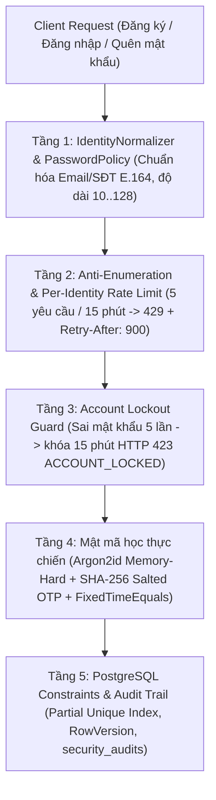
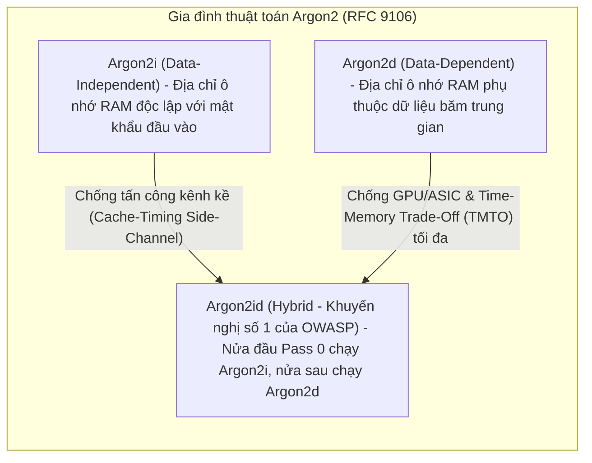
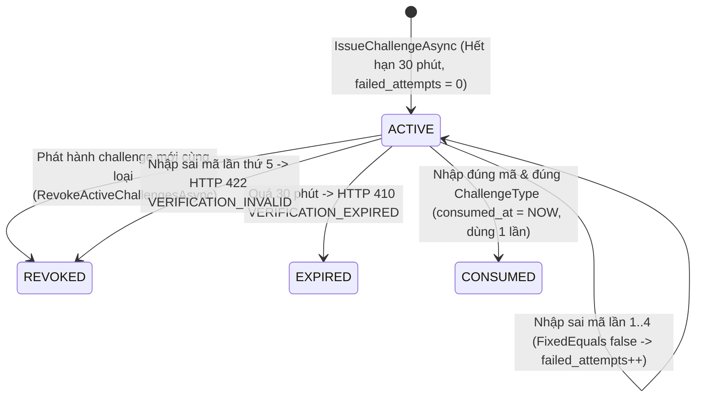
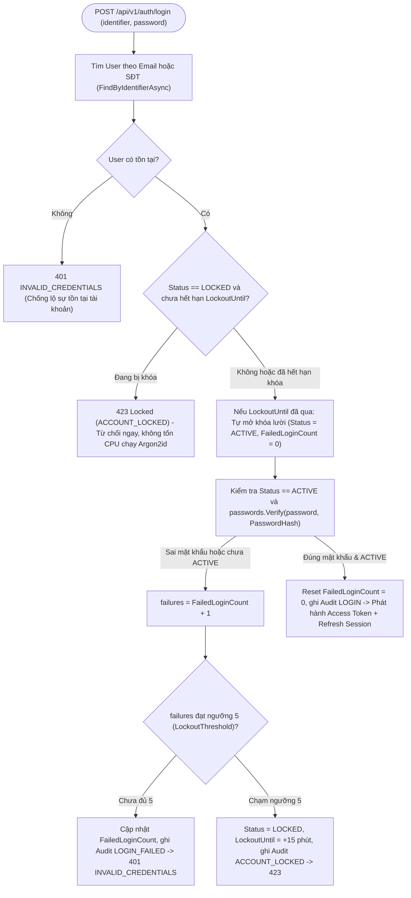

# Bài 01: Mật Mã Học Ứng Dụng — Argon2id, OTP Challenge & Hệ Thống Phòng Vệ Chống Vét Cạn

> **Thuộc bộ tài liệu:** Cẩm nang Thuyết trình Toàn diện — Dự án **BLUE Bus Ticket Platform (PBL6)**
> **Chuyên đề 04:** An toàn Thông tin, Định danh, JWT, RBAC & Kiểm toán Bảo mật OWASP
> **Mã nguồn trọng tâm:** `BusTicketPlatform.Identity.Domain`, `BusTicketPlatform.Identity.Application`, `BusTicketPlatform.Identity.Infrastructure`

---

## Mở Đầu: Tại Sao Dịch Vụ Identity Là "Trái Tim Phòng Thủ" Của Toàn Sàn Đặt Vé?

Trong kiến trúc Microservices của **BLUE Bus Ticket Platform**, toàn bộ 6 dịch vụ nghiệp vụ (`Identity`, `Transport`, `Booking`, `Payment`, `Notification`, `Reporting`) đều vận hành xoay quanh danh tính người dùng. Nếu dịch vụ `Booking` bị lỗi logic, hậu quả có thể dừng lại ở một đơn đặt ghế sai trạng thái; nhưng nếu dịch vụ **`Identity`** bị xuyên thủng ở tầng mật mã hoặc xác thực, kẻ tấn công có thể:

1. **Chiếm đoạt tài khoản khách hàng (Account Takeover - ATO)** để hủy vé, lấy mã QR lên xe hoặc trục lợi tiền hoàn trả.
2. **Giả mạo nhân sự điều hành nhà xe (`OPERATOR_ADMIN`)** để hủy hàng loạt chuyến xe đang mở bán của đối thủ cạnh tranh.
3. **Leo thang lên quản trị viên sàn (`PLATFORM_ADMIN`)** để thao túng cấu hình đối soát tài chính toàn hệ thống.

Để bảo vệ cửa ngõ sống còn này, `BusTicketPlatform.Identity` không dựa vào một lớp khóa đơn lẻ mà triển khai mô hình **Phòng thủ chiều sâu (Defense in Depth)** trải dài từ tầng chuẩn hóa dữ liệu (Domain), kiểm soát luồng xác thực (Application), dẫn xuất khóa mật khẩu chống GPU (Infrastructure) cho tới ràng buộc toàn vẹn mức cơ sở dữ liệu PostgreSQL.



Bài viết đầu tiên này sẽ dẫn dắt bạn đi từ những khái niệm nền tảng nhất của mật mã học (dành cho người chưa từng học qua môn An toàn thông tin) cho tới việc giải phẫu từng dòng code C# và câu lệnh SQL thực tế đang chạy trong dự án.

---

## Chương 1: Lý Thuyết Mật Mã Học Nền Tảng Cho Người Mới Bắt Đầu

Khi đứng trước hội đồng bảo vệ đồ án tốt nghiệp hoặc phỏng vấn kỹ sư Backend, câu hỏi kinh điển đầu tiên luôn là: *"Em hãy phân biệt Encoding, Encryption, Hashing và Password Key Derivation? Tại sao Base64 không phải là mã hóa, và tại sao không dùng SHA-256 để lưu mật khẩu?"*

Hãy dùng một hình ảnh trực quan để phân biệt rạch ròi **4 khái niệm** này trước khi chạm vào code:

### 1.1. Phân biệt 4 khái niệm cốt lõi: Encoding vs Encryption vs Hashing vs Password KDF

#### 1. Encoding (Mã hóa định dạng dữ liệu — Ví dụ: `Base64`, `Base64Url`, `Hex`, `UTF-8`)
* **Bản chất:** Chỉ là việc **chuyển đổi cách biểu diễn dữ liệu** từ hệ nhị phân (`byte[]`) sang chuỗi ký tự văn bản an toàn để truyền qua mạng HTTP, lưu vào JSON hoặc cột `VARCHAR` trong cơ sở dữ liệu.
* **Có dùng khóa bí mật (Secret Key) không?** **KHÔNG!** Quy tắc chuyển đổi được công khai toàn cầu (RFC 4648). Bất kỳ ai nhìn thấy chuỗi Base64 `cy6ju2qxIW5R3lj4S65idA==` đều có thể dịch ngược về mảng 16 byte gốc trong chưa đầy 1 micro-giây.
* **Mục đích:** Tính tương thích truyền tải (Data Usability/Transport), **tuyệt đối không mang tính bảo mật (Zero Confidentiality)**.
* **Ứng dụng trong dự án BLUE:** Biểu diễn mảng byte ngẫu nhiên của `salt` và `hash` thành chuỗi chữ cái lưu trong cột `users.password_hash` (`Convert.ToBase64String(salt)` trong `Argon2PasswordHasher.cs`).

#### 2. Encryption (Mã hóa bảo mật hai chiều — Ví dụ: `AES-256-GCM`, `RSA-2048`)
* **Bản chất:** Biến đổi văn bản rõ (*Plaintext*) thành bản mã (*Ciphertext*) thông qua một thuật toán toán học và **Khóa bí mật (Key)** sao cho **chỉ người nắm giữ khóa giải mã hợp lệ mới khôi phục lại được dữ liệu ban đầu**.
* **Tính chiều hướng:** **Hai chiều (Reversible)** — `Decrypt(Key, Encrypt(Key, Data)) == Data`.
* **Khi nào dùng?** Khi hệ thống **bắt buộc phải đọc lại dữ liệu gốc** sau này (ví dụ: lưu số CCCD/Hộ chiếu hành khách cần đối chiếu pháp lý, hoặc mã hóa đường truyền TLS/HTTPS).
* **Tại sao KHÔNG dùng Encryption để lưu mật khẩu người dùng?** Vì hệ thống xác thực **không cần biết mật khẩu gốc của bạn là gì**, chỉ cần kiểm tra xem chuỗi bạn vừa gõ có khớp với lúc đăng ký hay không. Nếu dùng AES để mã hóa mật khẩu, một khi Hacker đánh cắp được cả Database lẫn khóa AES trên máy chủ ứng dụng, toàn bộ mật khẩu thật của hàng triệu khách hàng sẽ bị giải mã sạch sẽ trong vài giây!

#### 3. Cryptographic Hashing (Hàm băm mật mã một chiều tốc độ cao — Ví dụ: `SHA-256`, `SHA-512`)
* **Bản chất:** Giống như một "cỗ máy xay sinh tố toán học" nhận đầu vào có độ dài bất kỳ (1 ký tự hay 1 bộ phim 4GB) và nghiền nát thành một chuỗi đầu ra có độ dài cố định (với `SHA-256` là đúng 32 bytes = 256 bits = 64 ký tự Hex).
* **3 tính chất vàng của hàm băm mật mã:**
  1. **Một chiều (Pre-image Resistance):** Từ ly sinh tố không thể lắp ghép ngược lại thành quả táo ban đầu.
  2. **Hiệu ứng tuyết lở (Avalanche Effect):** Chỉ cần thay đổi 1 bit đầu vào (ví dụ `"Pass1"` thành `"Pass2"`), đầu ra 256-bit sẽ thay đổi hoàn toàn (~50% số bit đảo chiều ngẫu nhiên), không có bất kỳ sự tương đồng nào.
  3. **Chống đụng độ (Collision Resistance):** Không thể tìm được hai đầu vào khác nhau cho ra cùng một giá trị băm trong thời gian khả thi.
* **Đặc điểm thiết kế cực kỳ quan trọng:** `SHA-256` được thiết kế để **chạy NHANH NHẤT CÓ THỂ** nhằm kiểm tra toàn vẹn file, ký số gói tin mạng, băm khối Blockchain hoặc băm các chuỗi ngẫu nhiên có độ hỗn loạn (entropy) cao (như Refresh Token 32 bytes). Chính ưu điểm "siêu nhanh" này lại biến `SHA-256` thành **tử huyệt** khi dùng cho mật khẩu con người!

#### 4. Password Key Derivation Function / Password Hashing (Dẫn xuất khóa mật khẩu — `PBKDF2`, `BCrypt`, `Scrypt`, `Argon2id`)
* **Bản chất:** Là các hàm băm một chiều chuyên dụng được thiết kế ngược hẳn với `SHA-256`: **chủ động làm CHẬM quá trình tính toán và chủ động NGỐN RAM (Memory-Hard)** kết hợp với **Muối ngẫu nhiên (Cryptographic Salt)**.
* **Mục đích:** Khi người dùng thật đăng nhập, máy chủ tốn khoảng `10ms – 100ms` và vài chục MB RAM để kiểm tra 1 mật khẩu — người dùng hoàn toàn không cảm thấy chậm. Nhưng khi Hacker muốn thử vét cạn **1 tỷ mật khẩu**, chi phí thời gian và phần cứng sẽ bị nhân lên hàng tỷ lần, biến cuộc tấn công thành bất khả thi về mặt kinh tế!

| Tiêu chí so sánh | Encoding (`Base64`) | Encryption (`AES-256`) | Fast Hash (`SHA-256`) | Password KDF (`Argon2id`) |
| :--- | :--- | :--- | :--- | :--- |
| **Chiều biến đổi** | Hai chiều (Công khai) | Hai chiều (Cần Key) | Một chiều (Không dịch ngược) | Một chiều (Không dịch ngược) |
| **Yêu cầu Secret/Salt** | Không có | Bắt buộc Secret Key | Tùy ngữ cảnh | Bắt buộc Salt ngẫu nhiên riêng biệt |
| **Tốc độ tính toán** | Cực nhanh (Nano-giây) | Rất nhanh (Hardware AES-NI) | Rất nhanh (Hàng tỷ lần/giây trên GPU) | **Chủ đích chậm & ngốn RAM** |
| **Chống dàn đào GPU/ASIC** | Không | Phụ thuộc độ dài Key | **Cực kém (Thảm họa cho mật khẩu)** | **Rất mạnh (Memory-Hard)** |
| **Nơi dùng trong dự án BLUE** | Encode Salt/Hash, Token URL | Lưu cipher giấy tờ tùy thân | Băm Refresh Token & Salted OTP | **Băm mật khẩu (`users.password_hash`)** |

---

### 1.2. Tại sao băm mật khẩu bằng `SHA-256` là thảm họa trước dàn Card đồ họa GPU?

Giả sử một lập trình viên thiếu kinh nghiệm viết code lưu mật khẩu như sau:
```csharp
// PHẢN MẪU NGUY HIỂM - TUYỆT ĐỐI KHÔNG BAO GIỜ DÙNG CHO MẬT KHẨU!
string badHash = Convert.ToHexString(SHA256.HashData(Encoding.UTF8.GetBytes(password)));
```

Chuyện gì xảy ra khi cơ sở dữ liệu bị rò rỉ (qua lỗi SQL Injection, lộ file backup S3, hoặc nhân viên nội bộ lấy cắp)?

1. **Thảm họa thứ nhất — Rainbow Table (Bảng cầu vồng) & Lộ mật khẩu trùng nhau:**
   Vì không có `Salt`, nếu 5.000 khách hàng cùng đặt mật khẩu phổ biến là `123456789a`, cả 5.000 dòng trong bảng `users` đều có chung một chuỗi `password_hash` giống hệt nhau! Kẻ tấn công chỉ cần tra ngược trong từ điển băm tính sẵn (Rainbow Table) mất 0.001 giây là bẻ gãy toàn bộ 5.000 tài khoản cùng lúc.
2. **Thảm họa thứ hai — Sức mạnh hủy diệt của GPU ngay cả khi ĐÃ thêm Salt vào `SHA-256`:**
   Nhiều bạn nghĩ: *"Vậy em lấy `SHA256(salt + password)` là an toàn rồi!"*. **Sai lầm nghiêm trọng!** `Salt` chỉ chống được Rainbow Table tính sẵn (ép kẻ tấn công phải dò lại từ đầu cho từng tài khoản), nhưng **không làm chậm tốc độ thử mật khẩu**!
   * Một CPU máy chủ thông thường có 8–16 nhân lớn (tối ưu cho rẽ nhánh phức tạp).
   * Ngược lại, một chiếc card đồ họa tiêu dùng như **NVIDIA RTX 4090** sở hữu tới **16.384 nhân CUDA** chuyên xử lý các phép toán bit song song. Thuật toán `SHA-256` chỉ cần vài thanh ghi 32-bit siêu nhỏ ngay trong nhân ALU mà không cần đọc/ghi bộ nhớ RAM ngoài.
   * Kết quả thực nghiệm với công cụ *Hashcat*: Một dàn gồm 8 card RTX 4090 có thể băm tới **~180 tỷ phép thử `SHA-256` mỗi giây (180 GH/s)**!
   * Mật khẩu của con người không phải chuỗi 32 byte ngẫu nhiên mà thường nằm trong từ điển mở rộng + quy tắc biến thể (tên riêng + ngày sinh + số điện thoại, khoảng $10^9$ đến $10^{11}$ tổ hợp phổ biến). Với tốc độ 180 tỷ lần/giây, dàn GPU bẻ gãy mật khẩu `CustomerPass1` chỉ trong **chưa đầy 1 giây**!

---

### 1.3. Sự tiến hóa của Password KDF và lý do `Argon2id` lên ngôi vương

Để đánh bại GPU và máy đào chuyên dụng ASIC, ngành mật mã học đã trải qua 3 thế hệ tiến hóa:

1. **Thế hệ 1 — `PBKDF2` (2000):** Lặp đi lặp lại hàm `HMAC-SHA256` khoảng `100.000` đến `600.000` vòng (CPU-hard). Nhược điểm: Nó chỉ tốn chu kỳ tính toán ALU chứ vẫn chỉ tốn vài trăm byte bộ nhớ -> GPU với 16.384 nhân vẫn chia nhau chạy 16.384 mật khẩu song song cực tốt!
2. **Thế hệ 2 — `BCrypt` (1999):** Sử dụng mảng trạng thái Blowfish 4 KiB trong bộ nhớ đệm L1/L2 và giới hạn đầu vào mật khẩu tối đa 72 bytes. Khá tốt trước GPU đời cũ nhưng bộ nhớ 4 KiB vẫn lọt vừa SRAM nội bộ của FPGA/GPU hiện đại.
3. **Thế hệ 3 — `Argon2` (Quán quân cuộc thi Password Hashing Competition 2015, chuẩn hóa tại IETF RFC 9106):**
   Ý tưởng thiên tài của **Memory-Hard Function**: Vũ khí đắt đỏ và khan hiếm nhất trên GPU/ASIC chính là **băng thông và dung lượng bộ nhớ RAM trên mỗi nhân xử lý**. Nếu mỗi phép thử mật khẩu bắt buộc phải cấp phát và đọc/ghi liên tục một vùng nhớ lớn (ví dụ `8 MiB` đến `64 MiB` RAM), 16.384 nhân CUDA của RTX 4090 (chỉ có tổng cộng 24 GB VRAM) sẽ ngay lập tức bị nghẽn cổ chai bộ nhớ (Memory Bandwidth Bottleneck), chỉ còn chạy được vài trăm nhân thay vì hàng vạn nhân!

Thuật toán Argon2 có 3 biến thể, và việc hiểu rõ sự kết hợp của **`Argon2id`** là điểm cộng cực lớn khi bảo vệ đồ án:



* **`Argon2d` (Data-dependent):** Thứ tự nhảy cóc giữa các khối RAM phụ thuộc vào giá trị băm tức thời của mật khẩu. Kẻ tấn công không thể tính trước vị trí ô nhớ để cắt giảm RAM (chống tấn công *Time-Memory Trade-Off - TMTO* mạnh nhất). Tuy nhiên, trên môi trường Cloud chia sẻ chung CPU vật lý, tiến trình độc hại nằm cùng máy chủ có thể quan sát độ trễ bộ nhớ đệm CPU (Cache-timing Side-Channel) để suy đoán thông tin.
* **`Argon2i` (Data-independent):** Thứ tự truy cập các khối RAM được sinh tiền định chỉ dựa trên chỉ số vòng lặp, hoàn toàn không phụ thuộc mật khẩu -> miễn nhiễm với Cache-timing Side-Channel, nhưng kháng GPU/TMTO yếu hơn `Argon2d`.
* **`Argon2id` (Hybrid — Lựa chọn của dự án BLUE):** Trong nửa đầu của vòng quét bộ nhớ đầu tiên, thuật toán truy cập RAM theo kiểu **`Argon2i`** để xóa nhòa mọi dấu vết kênh kề liên quan tới mật khẩu gốc; từ nửa sau trở đi, thuật toán chuyển sang chế độ **`Argon2d`** để phát huy tối đa sức mạnh khóa chặt GPU/ASIC. Đây chính là thuật toán số 1 được **OWASP Password Storage Cheat Sheet** và **NIST** khuyên dùng hiện nay.

---

## Chương 2: Giải Phẫu Từng Dòng `Argon2PasswordHasher.cs` & Đối Chiếu Thiết Kế

Hãy mở trực tiếp file triển khai tại `workspace/src/services/identity/BusTicketPlatform.Identity.Infrastructure/Security/Argon2PasswordHasher.cs` (sử dụng thư viện mật mã `Konscious.Security.Cryptography`):

```csharp
using System.Security.Cryptography;
using System.Text;
using BusTicketPlatform.Identity.Application;
using Konscious.Security.Cryptography;

namespace BusTicketPlatform.Identity.Infrastructure.Security;

public sealed class Argon2PasswordHasher : IPasswordHasher
{
    public string Hash(string password)
    {
        var salt = RandomNumberGenerator.GetBytes(16);
        var hash = Derive(password, salt);
        return $"argon2id$m=8192$t=1$p=1${Convert.ToBase64String(salt)}${Convert.ToBase64String(hash)}";
    }

    public bool Verify(string password, string hash)
    {
        var parts = hash.Split('$');
        if (parts.Length != 6 || parts[0] != "argon2id")
        {
            return false;
        }

        var salt = Convert.FromBase64String(parts[4]);
        var expected = Convert.FromBase64String(parts[5]);
        var actual = Derive(password, salt);
        return CryptographicOperations.FixedTimeEquals(expected, actual);
    }

    private static byte[] Derive(string password, byte[] salt)
    {
        using var argon2 = new Argon2id(Encoding.UTF8.GetBytes(password));
        argon2.Salt = salt;
        argon2.DegreeOfParallelism = 1;
        argon2.Iterations = 1;
        argon2.MemorySize = 8192;
        return argon2.GetBytes(32);
    }
}
```

Mặc dù chỉ gói gọn trong 40 dòng code sạch gọn theo kiến trúc Clean Architecture (implement port `IPasswordHasher` của tầng `Application`), từng dòng ở đây đều chứa quyết định kỹ thuật đắt giá:

### 2.1. Giải phẫu 5 tham số mật mã trong hàm `Hash` và `Derive`

1. **`RandomNumberGenerator.GetBytes(16)` ( Dòng 12 — Salt 16 bytes = 128 bits):**
   * Hệ thống sử dụng bộ sinh số ngẫu nhiên an toàn mật mã học (**CSPRNG** — *Cryptographically Secure Pseudo-Random Number Generator*) do nhân hệ điều hành cung cấp (`BCryptGenRandom` trên Windows / `/dev/urandom` trên Linux Docker).
   * **Tại sao tuyệt đối không dùng `new Random()` của C#?** Vì `System.Random` dựa trên thuật toán dự đoán được theo hạt giống thời gian (seed); nếu biết thời điểm tài khoản tạo ra, kẻ tấn công có thể đoán trước chuỗi số ngẫu nhiên. Với 128-bit CSPRNG, xác suất hai người dùng có cùng Salt là $1 / 2^{128}$ (nhỏ hơn xác suất chọn trúng cùng một hạt cát trong toàn bộ vũ trụ quan sát được).
   * Nhờ `salt` riêng cho mỗi lần gọi `Hash()`, dù hai tài khoản trong `011_dev_login_seed.sql` có đặt cùng một mật khẩu đi chăng nữa, hai chuỗi `password_hash` sinh ra sẽ khác nhau 100%.

2. **`argon2.MemorySize = 8192` (Dòng 37 — Chi phí bộ nhớ `m = 8192 KiB = 8 MiB`):**
   * Đơn vị của `Konscious.Security.Cryptography` là **KiB (Kibibytes)**. Giá trị `8192` tương đương `8 MiB` RAM nguyên khối (gồm 8.192 khối nhớ 1 KiB) được cấp phát và nhào trộn trong suốt quá trình dẫn xuất.

3. **`argon2.Iterations = 1` (Dòng 36 — Chi phí thời gian `t = 1` vòng quét):**
   * Số lượt quét toàn bộ ma trận bộ nhớ 8 MiB. Với `Argon2id`, ngay cả khi `t = 1`, ma trận bộ nhớ được chia thành 4 lát cắt (slices): 2 lát đầu chạy `Argon2i` và 2 lát sau chạy `Argon2d`, vẫn bảo toàn tính chất lai chống cả Side-Channel lẫn GPU.

4. **`argon2.DegreeOfParallelism = 1` (Dòng 35 — Độ song song `p = 1` làn xử lý):**
   * Tại sao đặt `p = 1` thay vì `p = 4`? Trong môi trường Web API chịu tải cao (ví dụ giờ cao điểm lễ Tết có hàng trăm khách hàng bấm nút Đăng nhập cùng một giây trên container Docker giới hạn 2 vCPU), nếu mỗi request đăng nhập chiếm 4 luồng CPU (`p = 4`), ThreadPool của ASP.NET Core sẽ nhanh chóng cạn kiệt (Thread Starvation), gây nghẽn toàn bộ các API khác! Giữ `p = 1` giúp kiểm soát chặt chẽ CPU và đỉnh tiêu thụ bộ nhớ (Memory Burst) trên mỗi request đồng thời.

5. **`argon2.GetBytes(32)` (Dòng 38 — Độ dài đầu ra 32 bytes = 256 bits):**
   * Sinh ra mảng kết quả dẫn xuất khóa dài 256 bits, triệt tiêu hoàn toàn nguy cơ đụng độ (Birthday Attack đòi hỏi $2^{128}$ phép thử).

---

### 2.2. Giải phẫu cấu trúc chuỗi lưu trong Database (`011_dev_login_seed.sql`)

Hãy nhìn vào một bản ghi thực tế của tài khoản `Seed Customer` (mật khẩu dev `CustomerPass1`) trong file `docs/database/identity/011_dev_login_seed.sql` (dòng 7):

```text
argon2id$m=8192$t=1$p=1$cy6ju2qxIW5R3lj4S65idA==$MyfbQOTUXLH2msCqtUPbFmpS0UcbwjAgr2BZjJhm+RY=
└───┬──┘ └──┬─┘ └┬┘ └┬┘ └──────────┬───────────┘ └─────────────────────┬──────────────────────┘
 parts[0]  [1]  [2] [3]         parts[4]                            parts[5]
Thuật toán RAM  Vòng Luồng  Salt (16B -> 24 ký tự Base64)    Derived Hash (32B -> 44 ký tự Base64)
```

* **Câu hỏi hay gặp:** *"Ủa, lưu luôn `salt` ngay bên cạnh `hash` trong cùng cột `users.password_hash` như vậy thì lộ `salt` cho Hacker rồi còn tác dụng gì nữa?"*
* **Câu trả lời chuẩn mật mã học:** `Salt` **KHÔNG PHẢI LÀ KHÓA BÍ MẬT (`Secret Key` / `Pepper`)**! Nhiệm vụ thiết kế của `Salt` không phải là giữ bí mật, mà là **tính duy nhất (Uniqueness)** cho từng mật khẩu để:
  1. Vô hiệu hóa hoàn toàn mọi bảng tra cứu tính sẵn (Rainbow Tables) trên toàn thế giới.
  2. Buộc kẻ tấn công muốn dò 10.000 tài khoản thì phải chạy thuật toán `Argon2id` tốn 8 MiB RAM từ đầu cho **từng tài khoản một**, không thể gom chung một lần băm cho cả 10.000 người.
* Trong hàm `Verify(string password, string hash)` (dòng 19–27), hệ thống cắt chuỗi theo ký tự `$` thành đúng 6 phần (`parts.Length != 6 || parts[0] != "argon2id"`). Nếu bản ghi thuộc dữ liệu giả lập không cho phép đăng nhập như trong `010_synthetic_seed.sql` (`password_hash = 'SYNTHETIC_LOCAL_HASH_NOT_FOR_LOGIN'`), điều kiện `parts.Length != 6` sẽ lập tức trả về `false` một cách an toàn tuyệt đối mà không bao giờ ném ngoại lệ `FormatException`!

---

### 2.3. Tại sao bắt buộc dùng `CryptographicOperations.FixedTimeEquals`? (Bài học Ổ khóa số & Timing Attack)

Ở dòng 28 của `Argon2PasswordHasher.cs`, lập trình viên **không viết** `expected.SequenceEqual(actual)` hay `parts[5] == Convert.ToBase64String(actual)`, mà viết:

```csharp
return CryptographicOperations.FixedTimeEquals(expected, actual);
```

Tại sao một phép so sánh `==` bình thường lại nguy hiểm trong mật mã học? Hãy hình dung **Ví dụ Tên trộm bẻ ổ khóa số cơ học bằng ống nghe**:

* **Cách hoạt động của toán tử `==` / `SequenceEqual` (Early-Exit Comparison):**
  Máy tính kiểm tra lần lượt từ trái sang phải (`byte[0]`, `byte[1]`, `byte[2]`...). Ngay khi thấy `byte[0]` không khớp, hàm lập tức kết luận `false` và dừng lại ở nano-giây thứ 5. Nếu `byte[0]` đúng nhưng `byte[1]` sai, hàm mất 10 nano-giây mới dừng. Nếu 15 byte đầu đúng, hàm mất 75 nano-giây!
  Điều này giống hệt một ổ khóa số rẻ tiền mà mỗi khi vặn đúng chữ số thứ nhất, chốt bi bên trong kêu một tiếng *"tách"* và khựng lại lâu hơn một chút. Tên trộm không cần thử $10^6 = 1.000.000$ tổ hợp; hắn chỉ cần xoay từng vòng một, lắng nghe độ trễ để tìm từng số (chỉ mất $10 \times 6 = 60$ lần thử)! Trong an ninh mạng, kỹ thuật đo chênh lệch thời gian phản hồi này gọi là **Timing Side-Channel Attack (Tấn công đo thời gian)**.
* **Cách hoạt động của `CryptographicOperations.FixedTimeEquals` (Constant-Time Comparison):**
  Nếu độ dài hai mảng bằng nhau (32 bytes), hàm sử dụng phép toán logic bitwise `XOR` (`expected[i] ^ actual[i]`) kết hợp phép tích lũy `OR` trên **tất cả 32 bytes từ đầu đến cuối mà không bao giờ rẽ nhánh dừng sớm (`if/break`)**, đồng thời gắn chỉ thị `[MethodImpl(MethodImplOptions.NoInlining | MethodImplOptions.NoOptimization)]` trong .NET Runtime để trình biên dịch JIT không tự ý tối ưu hóa thành dừng sớm!
  Dù bạn sai ngay từ byte đầu tiên hay đúng tới byte thứ 31, thời gian CPU thực thi **luôn luôn bằng nhau tuyệt đối**. Tên trộm áp ống nghe vào két sắt hoàn toàn "điếc đặc"!

*(Lưu ý tinh tế: Với riêng Argon2, đầu vào là mật khẩu đã đi qua hàm băm một chiều nên kẻ tấn công khó chỉnh từng byte của `actual` trực tiếp, nhưng việc áp dụng nhất quán `FixedTimeEquals` cho mọi phép so sánh giá trị mật mã trong dự án — từ Argon2 hash, OTP hash, QR HMAC cho tới SePay signature — chính là kỷ luật vàng của kỹ thuật lập trình an toàn Secure Coding!)*

---

### 2.4. Đối chiếu thẳng thắn: Code thực tế (`m=8192, t=1`) vs Tài liệu Thiết kế (`m=19456, t=2`)

Khi đọc chéo giữa mã nguồn và tài liệu `docs/implementation/03-configuration-baseline.md` (dòng 15–19), bạn sẽ phát hiện một điểm đối chiếu cực kỳ thú vị để trình bày trước hội đồng:

| Tham số Argon2id | Cấu hình chuẩn Thiết kế (`03-configuration-baseline.md`) | Code thực thi hiện tại (`Argon2PasswordHasher.cs` & `011_dev_login_seed.sql`) | Ý nghĩa kỹ thuật & Đánh đổi (Trade-off) |
| :--- | :---: | :---: | :--- |
| **Memory (`m`)** | `19456 KiB` (~19 MiB) | `8192 KiB` (8 MiB) | `19 MiB, t=2, p=1` chính là ngưỡng khuyến nghị chuẩn số 1 của **OWASP Cheat Sheet**. Code hiện tại hạ xuống `8 MiB, t=1` để chạy bộ Integration Tests (Testcontainers tạo hàng chục user liên tiếp) nhanh và nhẹ RAM trên máy cá nhân. |
| **Iterations (`t`)** | `2` | `1` | Tăng từ `1` lên `2` nhân đôi thời gian CPU cho mỗi phép thử mật khẩu. |
| **Parallelism (`p`)** | `1` | `1` | Đồng nhất 100%: tránh bùng nổ luồng và bộ nhớ khi nhiều user đăng nhập đồng thời. |
| **Salt / Output** | `16 bytes` / `32 bytes` | `16 bytes` / `32 bytes` | Đồng nhất 100%: chuẩn 128-bit Salt và 256-bit Hash. |

> [!TIP]
> **Điểm ăn điểm khi bảo vệ đồ án:** Nhờ chuỗi lưu trong DB có định dạng tự mô tả `argon2id$m=8192$t=1$p=1$<salt>$<hash>`, hệ thống đã sẵn sàng cho cơ chế **Cryptographic Agility (Linh hoạt nâng cấp mật mã)**! Khi lên Production, ta chỉ cần đọc `m=19456, t=2` từ `IOptions` trong hàm `Hash()`, còn trong hàm `Verify()` ta parse động `m`, `t`, `p` từ `parts[1..3]` của chuỗi lưu trong DB. Khi đó: mật khẩu cũ (`m=8192, t=1`) vẫn đăng nhập bình thường, và ngay khoảnh khắc người dùng đăng nhập thành công, `LoginAsync` có thể tự động băm lại (Transparent Re-hash) lên chuẩn `m=19456, t=2` mà không bắt khách hàng phải đặt lại mật khẩu!


---

## Chương 3: Chuẩn Hóa Định Danh, Chính Sách Mật Khẩu & Cơ Chế OTP Challenge (`auth_challenges`)

Một thuật toán băm mật khẩu mạnh đến đâu cũng trở nên vô nghĩa nếu người dùng đặt mật khẩu `"123456"` hoặc kẻ tấn công lợi dụng sự khác biệt chữ hoa/chữ thường (`Admin@test.com` vs `admin@test.com`) để tạo tài khoản trùng lặp. Tầng `BusTicketPlatform.Identity.Domain` giải quyết triệt để bài toán này trước khi dữ liệu chạm tới cơ sở dữ liệu.

### 3.1. Giải phẫu `IdentityNormalizer.cs` và Ràng buộc Duy nhất trên PostgreSQL

Mã nguồn tại `workspace/src/services/identity/BusTicketPlatform.Identity.Domain/IdentityNormalizer.cs`:

```csharp
using System.Text.RegularExpressions;

namespace BusTicketPlatform.Identity.Domain;

public static partial class IdentityNormalizer
{
    [GeneratedRegex(@"^\+[1-9][0-9]{7,14}$")]
    private static partial Regex PhonePattern();

    [GeneratedRegex(@"^[^@\s]+@[^@\s]+\.[^@\s]+$")]
    private static partial Regex EmailPattern();

    public static string NormalizeEmail(string email) => email.Trim().ToUpperInvariant();

    public static string NormalizePhone(string phone) => phone.Trim();

    public static bool IsEmail(string value) => EmailPattern().IsMatch(value.Trim());

    public static bool IsPhone(string value) => PhonePattern().IsMatch(value.Trim());

    public static bool IsFullName(string value)
    {
        var trimmed = value.Trim();
        return trimmed.Length is >= 2 and <= 150;
    }
}
```

**4 điểm sáng kỹ thuật cần nhấn mạnh:**

1. **`[GeneratedRegex]` (Compile-Time Regex Source Generator của .NET hiện đại):**
   Thay vì khởi tạo `new Regex(...)` lúc chạy (tốn chi phí parse biểu thức và tiềm ẩn nguy cơ **ReDoS — Regular Expression Denial of Service** do backtracking vô tận khi gặp chuỗi độc hại), `[GeneratedRegex]` sinh sẵn mã C# kiểm tra ký tự tối ưu ngay lúc biên dịch (`dotnet build`), vừa siêu nhanh vừa miễn nhiễm backtracking phức tạp.
2. **Chuẩn số điện thoại quốc tế ITU-T E.164 (`^\+[1-9][0-9]{7,14}$`):**
   Bắt đầu bằng dấu `+`, mã quốc gia từ `1–9` (không có số `0` đứng đầu sau dấu `+`), tổng cộng từ 8 đến 15 chữ số (ví dụ Việt Nam: `+84912345678`). Ở API quản trị nhân sự `AdminUserEndpoints.cs` (dòng 59–63), hệ thống còn hỗ trợ tự động chuyển đổi số nội địa 10 số Việt Nam (`^0[35789][0-9]{8}$`) sang định dạng chuẩn `+84...` trước khi đi qua `IdentityNormalizer.IsPhone(...)`.
3. **`ToUpperInvariant()` thay vì `ToLower()`:**
   Trong .NET, chuẩn Microsoft khuyến nghị dùng `ToUpperInvariant()` để chuẩn hóa chuỗi không phân biệt hoa thường (nhằm tránh lỗi kinh điển *Turkish-I Problem* nơi chữ `i` viết hoa thành `İ` có dấu chấm ở một số ngôn ngữ hệ điều hành).
4. **Cặp cột kép `email` + `normalized_email` đi kèm Partial Unique Index trong `001_initial.sql` (dòng 23–24):**
   ```sql
   create unique index uq_users_email on users (normalized_email) where deleted_at is null;
   create unique index uq_users_phone on users (normalized_phone) where deleted_at is null;
   ```
   Hệ thống vẫn giữ nguyên `email` gốc khách nhập (ví dụ `MinhTran@Example.com`) để hiển thị thân thiện và gửi thư, nhưng đánh Unique Index trên `normalized_email` (`MINHTRAN@EXAMPLE.COM`) có điều kiện `where deleted_at is null` (hỗ trợ Soft Delete mà không khóa vĩnh viễn email của tài khoản đã xóa mềm).

---

### 3.2. Giải phẫu `PasswordPolicy.cs` — Tuân thủ triết lý NIST SP 800-63B

Mã nguồn tại `workspace/src/services/identity/BusTicketPlatform.Identity.Domain/PasswordPolicy.cs`:

```csharp
namespace BusTicketPlatform.Identity.Domain;

public static class PasswordPolicy
{
    public const int MinLength = 10;
    public const int MaxLength = 128;

    public static bool IsSatisfied(string? password)
    {
        if (string.IsNullOrEmpty(password) || password.Length < MinLength || password.Length > MaxLength)
        {
            return false;
        }

        var hasLetter = false;
        var hasDigit = false;
        foreach (var ch in password)
        {
            if (char.IsLetter(ch))
            {
                hasLetter = true;
            }
            else if (char.IsDigit(ch))
            {
                hasDigit = true;
            }

            if (hasLetter && hasDigit)
            {
                return true;
            }
        }

        return false;
    }
}
```

* **Tại sao `MinLength = 10` và chỉ bắt buộc Chữ + Số thay vì ép ký tự đặc biệt rắc rối?**
  Theo tiêu chuẩn định danh số hiện đại **NIST SP 800-63B**, độ dài mật khẩu (*Length >= 10*) đóng góp vào Entropy (độ khó đoán) lớn hơn rất nhiều so với việc ép người dùng gõ ký tự đặc biệt trên điện thoại di động (vốn khiến người dùng đặt kiểu dễ đoán như `Pass@123`). Đồng thời, vòng lặp cho phép cụm mật khẩu dài (Passphrase như `"ChuyenXeDemDaLat2026"`), dừng sớm ngay khi tìm đủ cả chữ lẫn số (`if (hasLetter && hasDigit) return true;`).
* **Tại sao bắt buộc chặn trần `MaxLength = 128`?**
  Đây là chốt chặn chống **Long-Password DoS Attack**! Nếu không giới hạn chiều dài tối đa, kẻ tấn công có thể gửi liên tiếp các request đăng nhập chứa chuỗi `password` dài **10 MB** để ép máy chủ phải copy mảng byte khổng lồ vào bộ nhớ `Encoding.UTF8.GetBytes(password)` và băm Argon2id, gây nghẽn RAM tức khắc!

---

### 3.3. Giải phẫu Luồng Đăng Ký (`RegisterAsync`) & Xử Lý Thông Minh Tài Khoản Chờ Xác Minh

Trong `AuthService.cs` (dòng 26–85), khi khách hàng gửi `POST /api/v1/auth/register`:

1. Hệ thống kiểm tra tuần tự `IsFullName` -> `IsEmail` -> `IsPhone` -> `PasswordPolicy.IsSatisfied` (nếu vi phạm mật khẩu trả về `422 Unprocessable Entity` với mã lỗi `PASSWORD_POLICY_VIOLATION`).
2. Tra cứu `existingEmail` và `existingPhone` theo bản chuẩn hóa.
3. **Điểm tinh tế trong trải nghiệm người dùng kiêm bảo mật (Dòng 54–63):**
   ```csharp
   if (existingEmail is not null || existingPhone is not null)
   {
       if (existingEmail is { Status: UserStatuses.PendingVerification } pending
           && pending.NormalizedEmail == email
           && pending.NormalizedPhone == phone)
       {
           return await IssueChallengeAsync(pending, ChallengeTypes.EmailVerification, command.Email.Trim(), correlationId, cancellationToken);
       }

       await users.InsertAuditAsync(null, existingEmail?.Id ?? existingPhone?.Id, "REGISTER_REJECTED", "DENIED", "IDENTITY_IN_USE", correlationId, cancellationToken);
       return Result<AcceptedResponse>.Failure(IdentityErrors.IdentityAlreadyUsed());
   }
   ```
   * **Trường hợp 1:** Người dùng thật vừa bấm Đăng ký xong nhưng lỡ tay tắt trình duyệt hoặc mạng rớt chưa kịp nhập OTP, sau đó quay lại điền đúng Email + SĐT đó để đăng ký lại -> Hệ thống nhận diện tài khoản đang ở trạng thái `PENDING_VERIFICATION` khớp cả hai định danh, tự động thu hồi OTP cũ và phát lại OTP mới (`202 Accepted`) một cách mượt mà!
   * **Trường hợp 2:** Email hoặc SĐT đã thuộc về tài khoản `ACTIVE` (hoặc lệch cặp Email/SĐT) -> Hệ thống ghi nhận nhật ký an ninh `REGISTER_REJECTED` (`IDENTITY_IN_USE`) và trả về `409 Conflict` với câu thông báo trung tính `"That identity cannot be used."` (không chỉ đích danh là trùng Email hay trùng SĐT nhằm hạn chế lộ thông tin chéo).
4. Nếu hoàn toàn mới: Tạo `UserRecord` với `ids.NewUuidV7()` (UUIDv7 sắp xếp tăng dần theo thời gian giúp B-Tree Index của PostgreSQL không bị phân mảnh trang nhớ!), băm mật khẩu bằng `passwords.Hash(command.Password)`, gán trạng thái `PENDING_VERIFICATION`, gán vai trò gốc `CUSTOMER`, phát sự kiện miền `UserRegisteredAsync` qua Outbox, và gọi `IssueChallengeAsync` trả về `202 Accepted`.

---

### 3.4. Giải phẫu Cơ chế OTP Challenge (`auth_challenges`): Tại sao phải băm `SHA256("{challengeId:N}:{code}")`?

Hãy đọc kỹ bộ đôi hàm `IssueChallengeAsync` và `ConsumeChallengeAsync` trong `AuthService.cs` (dòng 301–384):

```csharp
private async Task<Result<AcceptedResponse>> IssueChallengeAsync(
    UserRecord user,
    string type,
    string email,
    Guid correlationId,
    CancellationToken cancellationToken)
{
    await users.RevokeActiveChallengesAsync(user.Id, type, cancellationToken);
    var now = clock.UtcNow;
    var code = RandomNumberGenerator.GetInt32(0, 1_000_000).ToString("D6");
    var challengeId = ids.NewUuidV7();
    var challenge = new ChallengeRecord(
        challengeId,
        user.Id,
        IdentityNormalizer.NormalizeEmail(email),
        type,
        HashSecret($"{challengeId:N}:{code}"),
        ChallengeStatuses.Active,
        0,
        now.AddMinutes(ChallengeMinutes));
    await users.InsertChallengeAsync(challenge, cancellationToken);
    await notifier.NotifyAsync(email, type, challengeId, code, cancellationToken);
    await users.InsertAuditAsync(user.Id, user.Id, type, "SUCCEEDED", "CHALLENGE_ISSUED", correlationId, cancellationToken);
    return Result<AcceptedResponse>.Success(new AcceptedResponse(challengeId, "ACCEPTED"));
}
```

Đây là đoạn code mẫu mực mà bất kỳ hệ thống Fintech/Ngân hàng nào cũng áp dụng khi xử lý mã xác thực một lần (OTP):

#### Câu hỏi 1: Tại sao không lưu thẳng mã 6 chữ số (ví dụ `"048291"`) dạng rõ vào bảng `auth_challenges`?
Nếu lưu dạng rõ (`plaintext`), bất kỳ ai có quyền `SELECT` trên DB (DBA, tài khoản Read-Replica phục vụ phân tích, hoặc kẻ tấn công khai thác lỗi đọc dữ liệu) đều có thể nhìn thấy ngay lập tức mã `PASSWORD_RESET` đang hoạt động của `PLATFORM_ADMIN`, từ đó đổi mật khẩu chiếm quyền điều khiển toàn sàn ngay lập tức!

#### Câu hỏi 2: Mã OTP chỉ có 6 chữ số (`000000` -> `999999`, tức chỉ có đúng 1 triệu khả năng). Nếu chỉ băm `SHA256(code)` thì có an toàn không?
**KHÔNG HỀ AN TOÀN — VÀ ĐÂY LÀ LÝ DO DÒNG 317 GHÉP `"{challengeId:N}:{code}"`!**
Hãy làm một phép tính nhỏ:
* Không gian mẫu của OTP 6 số chỉ có $10^6 = 1.000.000$ giá trị.
* Nếu ta chỉ băm `SHA256(code)`:
  1. Trước hết, cột `auth_challenges.token_hash` trong `001_initial.sql` (dòng 114) có ràng buộc **`UNIQUE` (`token_hash varchar(128) not null unique`)**! Nếu hai người dùng tình cờ nhận cùng mã `"123456"` (theo nghịch lý ngày sinh nhật *Birthday Paradox*, chỉ cần ~1.177 mã OTP trong lịch sử bảng là xác suất đụng độ đã vượt 50%!), lệnh `INSERT` sẽ nổ lỗi `23505 Unique Violation` ngay lập tức!
  2. Nguy hiểm hơn: Kẻ tấn công đọc trộm DB chỉ mất **0.005 giây trên 1 nhân CPU laptop** để chạy vòng lặp `for (i = 0..999999)` lập từ điển ngược cho TẤT CẢ các challenge cùng lúc.
* Khi ghép `HashSecret($"{challengeId:N}:{code}")` (ví dụ `SHA256("019a95c4e2b0700080001a2b3c4d5e6f:048291")`):
  * `challengeId` (UUIDv7 128-bit) đóng vai trò **Unique Per-Challenge Salt & Context Binding**: Hai mã OTP giống nhau của hai lần gửi khác nhau sẽ cho ra hai chuỗi `token_hash` khác nhau hoàn toàn, thỏa mãn tuyệt đối ràng buộc `UNIQUE` trên bảng `auth_challenges`.
  * Kẻ tấn công không thể hoán đổi (transplant) hash của challenge này sang challenge khác, và không thể dùng một bảng cầu vồng chung.

#### Câu hỏi 3: Nếu kẻ tấn công vẫn có thể vét cạn 1 triệu số qua API HTTP `/api/v1/auth/verify` hoặc `/reset-password` thì sao?
Đó là lúc **Vòng đời trạng thái Challenge (`ConsumeChallengeAsync`, dòng 348–384)** khóa chặt cánh cửa vét cạn trực tuyến:



Hãy xem các chốt chặn chồng lớp bên trong `ConsumeChallengeAsync`:
1. **Chống đánh tráo mục đích (`challenge.ChallengeType != expectedType`, dòng 354):** Kẻ tấn công không thể lấy `challengeId` của luồng `EMAIL_VERIFICATION` đem truyền vào API `/api/v1/auth/reset-password` (vốn yêu cầu `PASSWORD_RESET`), dù mã 6 số có đúng!
2. **Thu hồi mã cũ ngay khi xin mã mới (`RevokeActiveChallengesAsync`, dòng 308):** Mỗi khi người dùng bấm "Gửi lại mã", toàn bộ mã `ACTIVE` trước đó bị chuyển sang `REVOKED`. Trên toàn hệ thống, mỗi user chỉ có tối đa **1 mã duy nhất** còn sống cho mỗi loại thao tác.
3. **Thời gian sống ngắn (`ChallengeMinutes = 30`, dòng 20 & 366):** Quá 30 phút, challenge bị đánh dấu `EXPIRED` và trả về mã chuẩn ngữ nghĩa HTTP `410 Gone` (`VERIFICATION_EXPIRED` — được kiểm chứng trực tiếp tại test `Expired_verification_challenge_is_rejected_and_account_stays_pending` trong `AuthFlowTests.cs`, dòng 179–219).
4. **So sánh hằng thời gian (`FixedEquals`, dòng 372) + Tử hình sau 5 lần đoán sai (`ChallengeAttemptLimit = 5`, dòng 22 & 374–377):**
   ```csharp
   if (!FixedEquals(challenge.TokenHash, HashSecret($"{challenge.Id:N}:{code}")))
   {
       var attempts = challenge.FailedAttempts + 1;
       var status = attempts >= ChallengeAttemptLimit ? ChallengeStatuses.Revoked : challenge.Status;
       await users.UpdateChallengeAsync(challenge with { FailedAttempts = attempts, Status = status }, cancellationToken);
       return Result.Failure(IdentityErrors.VerificationInvalid());
   }
   ```
   Nhờ giới hạn cứng **5 lần thử**, xác suất kẻ tấn công đoán mò trúng mã OTP 6 chữ số cho 1 challenge tụt xuống chỉ còn:
   $$P = \frac{5}{1.000.000} = 0.0005\% \text{ (1 phần 200.000)}$$
   Ngay ở lần sai thứ 5, `status` bị đóng đinh thành `'REVOKED'`. Dù ở lần thứ 6 kẻ tấn công có nhập **đúng mã thật** đi chăng nữa, dòng 359 (`if (challenge.Status != ChallengeStatuses.Active)`) vẫn lập tức từ chối!

*(Mẹo kiến trúc thực tế trong `ChallengeNotifier.cs`: Dịch vụ thông báo vừa gửi email thật qua `SmtpClient` — kết nối tới Mailpit cổng `1025` khi chạy Docker — vừa lưu bản sao vào bộ nhớ `CapturingChallengeNotifier` khi bật `CaptureChallenges = true` để bộ Integration Test `AuthFlowTests` lấy mã OTP tự động qua `_fixture.Mailbox.LastFor(email)` mà không cần giả lập mock rời rạc. Đặc biệt, khối `catch` ở dòng 86–89 đảm bảo nếu máy chủ SMTP tạm thời chập chờn, giao dịch tạo tài khoản trong DB vẫn được bảo toàn để người dùng bấm `resend-verification` sau đó!)*

---

## Chương 4: Ba Cơ Chế Phòng Vệ Chủ Động — Anti-Enumeration, Rate Limiting & Account Lockout

Ngoài mật mã học, một hệ thống định danh chuẩn công nghiệp phải tự bảo vệ trước các cuộc tấn công tự động hóa bằng Botnet (Credential Stuffing, User Enumeration, Email Bombing, Brute-Force). Dịch vụ `Identity` triển khai **3 lá chắn chủ động** ngay trong `AuthService.cs` và `IdentityEndpoints.cs`:

### 4.1. Lá chắn 1: Anti-Enumeration (Chống dò quét danh sách Email khách hàng)

**Kịch bản tấn công User Enumeration:**
Đối thủ cạnh tranh hoặc tin tặc có trong tay danh sách 100.000 email người dùng Việt Nam. Chúng viết script tự động bắn vào API `/api/v1/auth/forgot-password` hoặc `/api/v1/auth/resend-verification`. Nếu hệ thống ngây thơ trả về `404 Not Found ("Email không tồn tại")` cho người lạ và `200 OK ("Đã gửi email")` cho khách hàng thật, chỉ sau 15 phút tin tặc sẽ lọc ra chính xác danh sách toàn bộ khách hàng đang đi xe của sàn BLUE để tung chiến dịch lừa đảo (Spear Phishing)!

**Cách `AuthService` hóa giải triệt để (`ForgotPasswordAsync` dòng 244–264 & `ResendVerificationAsync` dòng 120–140):**

```csharp
public async Task<Result<AcceptedResponse>> ForgotPasswordAsync(EmailCommand command, Guid correlationId, CancellationToken cancellationToken)
{
    if (!IdentityNormalizer.IsEmail(command.Email))
    {
        return Result<AcceptedResponse>.Failure(IdentityErrors.Validation("Email is invalid.", "email"));
    }

    var normalizedEmail = IdentityNormalizer.NormalizeEmail(command.Email);
    if (!await AllowSensitiveRequestAsync("FORGOT_PASSWORD_REQUESTED", normalizedEmail, correlationId, cancellationToken))
    {
        return Result<AcceptedResponse>.Failure(IdentityErrors.RateLimited());
    }

    var user = await users.FindByNormalizedEmailAsync(normalizedEmail, cancellationToken);
    if (user is { Status: UserStatuses.Active or UserStatuses.Locked })
    {
        return await IssueChallengeAsync(user, ChallengeTypes.PasswordReset, command.Email.Trim(), correlationId, cancellationToken);
    }

    return Result<AcceptedResponse>.Success(new AcceptedResponse(ids.NewUuidV7(), "ACCEPTED"));
}
```

Hãy quan sát dòng 263:
* Khi `user` tồn tại và đang `ACTIVE` hoặc `LOCKED`: Hệ thống tạo challenge và trả về `202 Accepted` với JSON `{ "operationId": "<uuid-v7>", "status": "ACCEPTED" }`.
* Khi `user` **KHÔNG TỒN TẠI** (hoặc đang `DISABLED` / `PENDING_VERIFICATION`): Hệ thống **VẪN sinh ra một `ids.NewUuidV7()` giả lập** và trả về đúng mã `202 Accepted` với cấu trúc JSON `{ "operationId": "<uuid-v7>", "status": "ACCEPTED" }` **giống hệt nhau không sai một ký tự**!
* Kịch bản này được kiểm chứng tự động trong `AuthFlowTests.cs` (dòng 291–304): cả `"missing@example.test"` lẫn email thật đều nhận `HttpStatusCode.Accepted`!
* Tương tự ở `LoginAsync` (dòng 151–178): Dù nhập sai Email (không tìm thấy `user`) hay đúng Email nhưng sai Mật khẩu, hệ thống đều trả về duy nhất một lỗi `401 Unauthorized` — `INVALID_CREDENTIALS` (`"The credentials are not valid."`), tuyệt đối không bao giờ tiết lộ *"Sai mật khẩu"* hay *"Không tìm thấy tài khoản"*.

---

### 4.2. Lá chắn 2: Per-Identity Rate Limiting qua bảng `security_audits` (Chống Spam OTP & Email Bombing)

Nếu `forgot-password` và `resend-verification` cho phép gọi vô hạn, kẻ tấn công có thể dùng chúng để "dội bom thư" (Email Bombing) vào hòm thư của nạn nhân làm cháy hạn ngạch SMTP của sàn, hoặc xin hàng ngàn mã OTP mới liên tục.

Hãy xem cách hàm `AllowSensitiveRequestAsync` (`AuthService.cs`, dòng 327–346) kết hợp với `IdentityEndpoints.cs` (dòng 264–272) giải quyết bài toán này **mà không cần phụ thuộc bộ nhớ cục bộ (Stateless across multiple API replicas)**:

```csharp
// Trong AuthService.cs:
public const int SensitiveRequestLimit = 5;
public const int SensitiveRequestWindowMinutes = 15;

private async Task<bool> AllowSensitiveRequestAsync(
    string action,
    string normalizedIdentifier,
    Guid correlationId,
    CancellationToken cancellationToken)
{
    var fingerprint = HashSecret(normalizedIdentifier);
    var since = clock.UtcNow.AddMinutes(-SensitiveRequestWindowMinutes);
    var count = await users.CountRecentAuditsAsync(action, fingerprint, since, cancellationToken);
    var allowed = count < SensitiveRequestLimit;
    await users.InsertAuditAsync(
        null,
        null,
        action,
        allowed ? "ALLOWED" : "DENIED",
        fingerprint,
        correlationId,
        cancellationToken);
    return allowed;
}
```

Và tại tầng HTTP (`IdentityEndpoints.cs`, dòng 264–272):

```csharp
private static object ErrorEnvelopeBody(BusTicketPlatform.BuildingBlocks.Errors.AppError error, HttpContext http)
{
    if (error.StatusCode == StatusCodes.Status429TooManyRequests)
    {
        http.Response.Headers.RetryAfter = (AuthService.SensitiveRequestWindowMinutes * 60).ToString(System.Globalization.CultureInfo.InvariantCulture);
    }

    return BusTicketPlatform.BuildingBlocks.Http.ErrorEnvelope.From(error, http.CorrelationId());
}
```

**3 chi tiết thiết kế cực kỳ sắc sảo trong 20 dòng code trên:**

1. **Bảo vệ quyền riêng tư PII trong Audit Log (`fingerprint = HashSecret(normalizedIdentifier)`):**
   Khi ai đó gõ một email bất kỳ (kể cả email không tồn tại trong hệ thống như `missing@example.test`) vào ô Quên mật khẩu, hệ thống **không lưu địa chỉ email thô vào bảng `security_audits`**, mà băm `SHA-256` thành chuỗi 64 ký tự Hex lưu vào cột `reason_code`. Nhờ vậy, bảng nhật ký an ninh tuân thủ nguyên tắc *Data Minimization / GDPR* (không thu thập trái phép email người lạ) nhưng vẫn đếm chính xác số lần yêu cầu trên cùng một định danh!
2. **Cửa sổ trượt bền vững cấp cụm máy chủ (Sliding Window 5 lần / 15 phút trên PostgreSQL):**
   Câu truy vấn `CountRecentAuditsAsync` (`SELECT COUNT(*) FROM security_audits WHERE action = @action AND reason_code = @reason AND occurred_at >= @since`, được tăng tốc bởi index `ix_security_audit_action_time`) đếm số lượt gọi trong 15 phút gần nhất. Dù `Identity.Api` có nhân bản ra 5 container chạy song song sau Load Balancer, bộ đếm vẫn chính xác tuyệt đối và áp dụng đồng đều cho cả email có thật lẫn email không tồn tại (giữ vững tính Anti-Enumeration ngay cả ở ngưỡng chặn Rate Limit!).
3. **Tuân thủ chuẩn HTTP RFC 9110 (`429 Too Many Requests` + `Retry-After: 900`):**
   Ngay ở lần gọi thứ 6 trong vòng 15 phút, API trả về mã `429` (`RATE_LIMITED`) kèm HTTP Response Header `Retry-After: 900` ($15 \text{ phút} \times 60 = 900 \text{ giây}$) để Frontend hiển thị bộ đếm ngược chính xác. Hành vi này được kiểm chứng nghiêm ngặt trong ca test `Resend_and_forgot_password_are_rate_limited_per_identity` (`AuthFlowTests.cs`, dòng 222–275).

---

### 4.3. Lá chắn 3: Account Lockout & Lazy Auto-Unlock (Chống Brute-Force Mật Khẩu)

Đối với API đăng nhập `POST /api/v1/auth/login`, bên cạnh việc `Argon2id` làm chậm mỗi phép thử, `AuthService.LoginAsync` (dòng 149–184) dựng thêm bức tường **Khóa tài khoản tạm thời sau 5 lần sai mật khẩu liên tiếp**:



Hãy chú ý **4 chi tiết cực kỳ thông minh** trong `LoginAsync`:

1. **Chặn sớm trước khi chạy Argon2id (`Early Rejection`, dòng 157–160):**
   Khi tài khoản đã rơi vào trạng thái `LOCKED` và chưa hết 15 phút (`LockoutUntil > clock.UtcNow`), hàm lập tức trả về `423 Locked` (`ACCOUNT_LOCKED`) ở dòng 159 **trước khi gọi `passwords.Verify`**. Nhờ vậy:
   * Kẻ tấn công tiếp tục bắn thêm 10.000 request đăng nhập vào tài khoản đó cũng **không thể ép máy chủ tốn 8 MiB RAM chạy Argon2id** (chống CPU/Memory Exhaustion)!
   * Ngay cả khi kẻ tấn công tình cờ đoán ĐÚNG mật khẩu thật ở lần thử thứ 6 trong thời gian khóa, hệ thống vẫn lạnh lùng từ chối `423 ACCOUNT_LOCKED` (đã được kiểm chứng tại `SecurityAndAdminTests.cs`, dòng 42–48!).
2. **Cơ chế Lazy Auto-Unlock (Mở khóa lười không cần Background Cronjob, dòng 162–165):**
   ```csharp
   if (user.LockoutUntil is { } expired && expired <= clock.UtcNow && user.Status == UserStatuses.Locked)
   {
       user = user with { Status = UserStatuses.Active, FailedLoginCount = 0, LockoutUntil = null };
   }
   ```
   Hệ thống không cần tốn một tiến trình chạy ngầm quét bảng `users` mỗi giây để mở khóa! Khi hết 15 phút, ngay lần đầu tiên chủ tài khoản đăng nhập lại, `LoginAsync` tự động nhận biết `LockoutUntil <= clock.UtcNow`, khôi phục `Status = ACTIVE` trong bộ nhớ và kiểm tra mật khẩu rồi lưu xuống DB.
3. **Phân biệt Khóa tạm thời tự động (15 phút) vs Khóa quản trị viên (`AdminIdentityService.cs`, dòng 69):**
   Khi `PLATFORM_ADMIN` chủ động khóa một tài khoản vi phạm qua API `PATCH /api/v1/admin/users/{userId}/status`, `AdminIdentityService` gán `LockoutUntil = clock.UtcNow.AddYears(50)` (50 năm!). Nhờ đó, nhánh Lazy Auto-Unlock sẽ không tự động mở khóa tài khoản bị Admin xử phạt, trong khi nếu khách hàng chỉ quên mật khẩu dẫn tới bị khóa 15 phút, họ vẫn có thể dùng luồng `ForgotPasswordAsync` -> `ResetPasswordAsync` (dòng 258 & 291: cho phép `Status: Active or Locked` nhận OTP đặt lại mật khẩu và tự động mở khóa lại về `Active` sau khi xác minh chủ sở hữu email!).
4. **Bảo vệ Idempotency cho các thao tác nhạy cảm (`HttpResults.WithIdempotency` & `IdempotencyStore.cs`):**
   Các endpoint thay đổi trạng thái xác thực như `/verify`, `/resend-verification`, `/refresh`, `/logout`, `/forgot-password`, `/reset-password` đều bắt buộc truyền header `Idempotency-Key` (dài 16–200 ký tự). Bảng `idempotency_records` lưu `SHA-256` của payload request (`HashPayload`) trong 24 giờ: nếu mạng chập chờn khiến trình duyệt gửi đúp cùng một request xác minh OTP, lần gọi thứ hai nhận lại nguyên vẹn snapshot kết quả `200 OK` đầu tiên thay vì bị báo lỗi *"OTP đã được sử dụng (`CONSUMED`)"*! Nếu dùng lại cùng `Idempotency-Key` nhưng tráo đổi nội dung body, hệ thống lập tức bắt quả tang và trả về `409 IDEMPOTENCY_CONFLICT`.

---

## Chương 5: Cẩm Nang Hỏi – Đáp Phản Biện Trước Hội Đồng Bảo Vệ

Dưới đây là 5 câu hỏi xoáy sâu nhất mà giảng viên phản biện thường đặt ra cho phần Mật mã & Xác thực, kèm câu trả lời chuẩn xác bám sát mã nguồn dự án:

### Câu 1: *"Trong DB của nhóm có cả Argon2id lẫn SHA-256 (`AuthService.HashSecret`). Khi nào nhóm dùng Argon2id, khi nào dùng SHA-256? Dùng lẫn lộn vậy có sai nguyên tắc không?"*
* **Trả lời:** Dạ hoàn toàn có chủ đích dựa trên **Entropy (độ ngẫu nhiên của đầu vào)** ạ:
  * **Mật khẩu người dùng (`users.password_hash`)** do con người tự nghĩ ra nên có **Entropy thấp** (dễ bị dò bằng từ điển trên GPU) -> Bắt buộc dùng **`Argon2id`** (`MemorySize = 8192 KiB`, kèm `16-byte random Salt`) để làm chậm và khóa bộ nhớ GPU.
  * **Refresh Token (`refresh_sessions.token_hash`)** là mảng 32 bytes (256 bits) sinh bởi `RandomNumberGenerator.GetBytes(32)` — có **Entropy cực đại $2^{256}$**, không một siêu máy tính nào trong vũ trụ có thể vét cạn nổi dù hàm băm nhanh đến đâu -> Dùng **`SHA-256`** để xác thực mỗi lần làm mới phiên nhanh dưới `0.01ms`, giảm tải CPU cho máy chủ.
  * **OTP 6 chữ số (`auth_challenges.token_hash`)** có không gian nhỏ ($10^6$), nhưng chỉ sống **30 phút**, bị gắn chặt với muối định danh `SHA256("{challengeId:N}:{code}")` và bị **thu hồi vĩnh viễn (`REVOKED`) ngay sau 5 lần đoán sai** ở tầng ứng dụng.

### Câu 2: *"Nếu kẻ tấn công biết cơ chế khóa tài khoản sau 5 lần nhập sai mật khẩu (`LockoutThreshold = 5`), hắn viết script cứ 15 phút lại cố tình nhập sai 5 lần vào email của khách VIP hoặc Admin để khóa tài khoản họ mãi mãi (Account Lockout DoS) thì nhóm xử lý thế nào?"*
* **Trả lời:** Đây chính là bài toán đánh đổi kinh điển giữa *Chống Brute-Force* và *Chống Lockout DoS*. Hiện tại trong thiết kế của dự án đã có sẵn 3 điểm giảm thiểu và hướng mở rộng rõ ràng:
  1. Đối với tài khoản khách hàng bị kẻ xấu khóa DoS, chủ tài khoản thật sở hữu hòm thư email vẫn có thể gọi `forgot-password` -> `reset-password` (vì dòng 258 của `AuthService.cs` chủ đích cho phép cả trạng thái `UserStatuses.Locked` nhận mã khôi phục và mở khóa ngay ở dòng 291).
  2. Tài khoản đang đăng nhập sẵn từ trước có phiên hợp lệ không bị văng ra bởi lockout đăng nhập tạm thời (vì `LoginAsync` chỉ đổi trạng thái tạm thời mà không tăng `AuthorizationVersion` hay gọi `RevokeUserSessionsAsync`, khác hẳn với lệnh khóa của Admin).
  3. Hướng hoàn thiện ở `SEC-07` (`docs/security/SECURITY-REMEDIATION-TASKS.md`): Bổ sung bộ giới hạn tốc độ phân vùng theo địa chỉ IP kết hợp Device Fingerprint tại Gateway để chặn IP của kẻ tấn công trước khi chạm tới bộ đếm `FailedLoginCount` của nạn nhân.

### Câu 3: *"Tại sao khi đổi Email trong `ProfileService.UpdateAsync`, hệ thống không cập nhật ngay cột `email` mà trả về `202 Accepted`?"*
* **Trả lời:** Dạ để chống lỗ hổng **Unverified Email Hijacking**! Trong `ProfileService.cs` (dòng 45–92), nếu người dùng đổi Họ tên hoặc SĐT thì cập nhật ngay (`200 OK`), nhưng riêng khi đổi sang `Email` mới, hệ thống kiểm tra email mới chưa bị ai dùng, giữ nguyên `user.Email` cũ đang xác thực, rồi gọi `auth.IssueEmailChangeAsync` gửi mã OTP xác minh tới hòm thư **mới** và trả về `202 Accepted` (`PROFILE_EMAIL_PENDING`). Chỉ khi người dùng mở hòm thư mới lấy đúng mã OTP gọi vào `VerifyAsync` (`AuthService.cs` dòng 102–110: lấy `challenge.TargetNormalized.ToLowerInvariant()`), địa chỉ email mới thực sự được cập nhật. Nếu không làm vậy, người dùng gõ nhầm sang email người khác sẽ mất quyền kiểm soát tài khoản ngay lập tức!

---

> **Bài tiếp theo:** Sau khi người dùng vượt qua bước xác minh OTP hoặc đăng nhập bằng mật khẩu Argon2id thành công, hệ thống làm thế nào để cấp phát "tấm thẻ thông hành" đi xuyên qua 6 Microservices mà không cần hỏi lại mật khẩu, đồng thời tự động phát hiện và chặt đứt phiên làm việc ngay khoảnh khắc Hacker đánh cắp Refresh Token? Mời bạn đọc tiếp **[Bài 02: Kiến Trúc JWT Access Token & Cơ Chế Refresh Token Family Rotation](./02-kien-truc-jwt-access-token-va-refresh-token-family.md)**.
