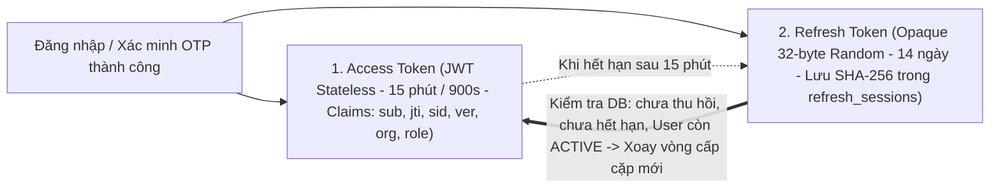
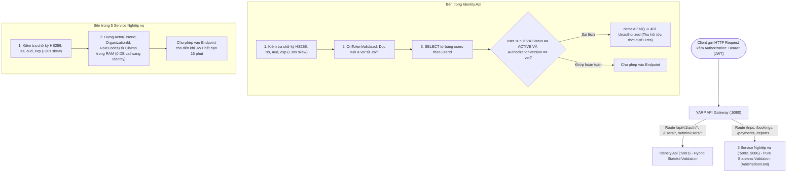
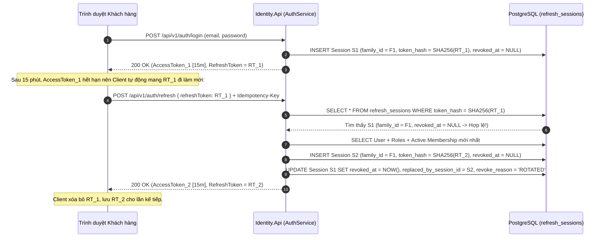
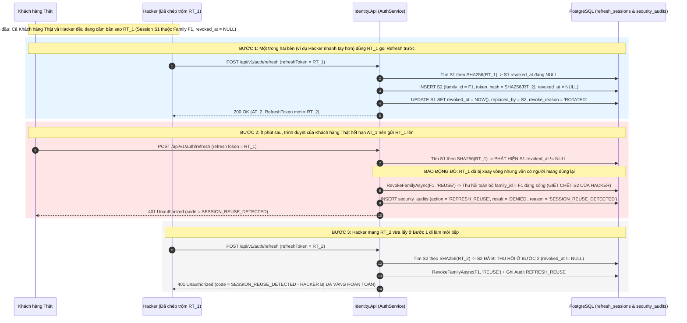

# Bài 02: Kiến Trúc JWT Access Token & Cơ Chế Xoay Vòng Refresh Token Family (Reuse Detection)

> **Thuộc bộ tài liệu:** Cẩm nang Thuyết trình Toàn diện — Dự án **BLUE Bus Ticket Platform (PBL6)**
> **Chuyên đề 04:** An toàn Thông tin, Định danh, JWT, RBAC & Kiểm toán Bảo mật OWASP
> **Mã nguồn trọng tâm:** `JwtTokenService.cs`, `PlatformJwtExtensions.cs`, `Identity.Api/Program.cs`, `AuthService.cs`, `IdentityRepository.cs`

---

## Chương 1: Lý Thuyết Nền Tảng — Từ Session Truyền Thống Đến Kiến Trúc Cặp Bài Trùng Access Token & Refresh Token

Nếu đây là lần đầu tiên bạn làm việc với một hệ thống Microservices gồm 6 dịch vụ độc lập như **BLUE Bus Ticket Platform**, câu hỏi đầu tiên cần làm sáng tỏ là: *"Tại sao sau khi đăng nhập ở `Identity.Api` (cổng `5081`), khi khách hàng sang `Booking.Api` (cổng `5083`) để giữ ghế hoặc sang `Payment.Api` (cổng `5084`) để thanh toán, các dịch vụ đó biết ngay khách hàng là ai mà không cần kết nối chung vào Database của Identity?"*

### 1.1. Stateful Session/Cookie truyền thống vs Stateless JWT (JSON Web Token)

Hãy hình dung câu chuyện kiểm soát vé tại một khu liên hợp giải trí có **6 cổng trò chơi khác nhau**:

#### Mô hình 1: Stateful Session (Thẻ gửi đồ có sổ tra cứu trung tâm)
* Khi khách vào cổng chính (`Identity`), nhân viên tạo một dòng trong cuốn sổ cái trung tâm (RAM máy chủ hoặc Redis): `"Mã phiếu #99812 -> Nguyễn Văn A, Khách hàng, Hết hạn 18:00"`, rồi đưa cho khách tờ giấy chỉ ghi đúng con số `#99812` (thường lưu trong HTTP Cookie).
* Mỗi khi khách bước tới bất kỳ trò chơi nào (`Transport`, `Booking`, `Payment`, `Notification`, `Reporting`), nhân viên gác cổng đó không thể nhìn tờ giấy `#99812` mà biết khách là ai — họ **bắt buộc phải gọi điện bộ đàm về quầy trung tâm** để tra sổ!
* **Nhược điểm trong Microservices:**
  1. **Nghẽn cổ chai & Độ trễ mạng nội bộ (Network Hop Overhead):** Mọi HTTP request nghiệp vụ đều phát sinh thêm 1 truy vấn mạng nội bộ về kho phiên trung tâm.
  2. **Điểm chết duy nhất (Single Point of Failure):** Nếu kho phiên trung tâm quá tải hoặc đứt kết nối, cả 6 dịch vụ tê liệt hoàn toàn.

#### Mô hình 2: Stateless JWT — JSON Web Token (Chuẩn IETF RFC 7519 — "Hộ chiếu có con dấu mật mã chống giả")
* Khi khách đăng nhập thành công tại `Identity`, quầy định danh in thẳng một tấm thẻ thông hành ghi rõ: *"Họ tên ID: `01990a00...`, Vai trò: `CUSTOMER`, Nhà xe: `null`, Có giá trị đến `11:15:00`"* rồi đóng **Con dấu mật mã (`HMAC-SHA256`)** lên tấm thẻ đó.
* Khi khách cầm tấm thẻ JWT bước sang `Booking.Api` để đặt ghế, `Booking.Api` **tự kiểm tra con dấu mật mã ngay trên RAM của chính nó** (mất chưa tới `0.05 mili-giây`), đọc luôn `UserId` và `Roles` trên thẻ để xử lý đơn hàng mà **không cần gọi một cuộc điện thoại nào sang `Identity.Api` hay Database của Identity**!

| Tiêu chí so sánh | Stateful Session truyền thống | Stateless JWT Access Token |
| :--- | :--- | :--- |
| **Nơi lưu trạng thái phiên** | Lưu tại Server (Database / Redis) | Tự mang theo bên trong Token gửi từ Client |
| **Chi phí xác thực mỗi Request** | Tốn I/O tra cứu DB hoặc Cache tập trung | **0 I/O mạng** — chỉ tính toán hàm băm trên RAM |
| **Khả năng mở rộng ngang (Scale-out)** | Phụ thuộc băng thông Session Store | Tuyệt vời cho Microservices độc lập (DB-per-service) |
| **Khả năng thu hồi tức thời (Revocation)** | **Rất dễ** (xóa dòng trong sổ là xong) | **Rất khó** (thẻ đã đóng dấu phát ra ngoài vẫn hợp lệ tới khi hết hạn!) |

---

### 1.2. Giải phẫu cấu trúc 3 phần của một chuỗi JWT (`Header.Payload.Signature`)

Một chuỗi JWT tiêu chuẩn mà Frontend của BLUE gửi trong HTTP Header `Authorization: Bearer <token>` luôn gồm đúng **3 phần chuỗi Base64Url nối với nhau bằng 2 dấu chấm (`.`)**:

```text
eyJhbGciOiJIUzI1NiIsInR5cCI6IkpXVCJ9.eyJzdWIiOiIwMTk5MGEwMC0wMDAwLTcwMDAtODAwMC0wMDAwMDAwMDAwMDIiLCJ2ZXIiOiIwIn0.7K8vXz9...
└─────────────────┬────────────────┘ └─────────────────────────────────────┬───────────────────────────────────┘ └────┬────┘
            1. HEADER                                                 2. PAYLOAD                                 3. SIGNATURE
```

1. **Phần 1 — `Header` (Tiêu đề thuật toán, mã hóa Base64Url):**
   ```json
   {
     "alg": "HS256",
     "typ": "JWT"
   }
   ```
   Cho người nhận biết token này thuộc loại `JWT` và được ký bằng thuật toán `HMAC-SHA256` (`HS256`).

2. **Phần 2 — `Payload` (Nội dung các khẳng định — *Claims*, mã hóa Base64Url):**
   ```json
   {
     "sub": "01990a00-0000-7000-8000-000000000021",
     "jti": "019a95d1-4a10-7b22-9c11-881234567890",
     "sid": "019a95d1-4a0f-7000-8123-001122334455",
     "ver": "0",
     "org": "01990a00-0000-7000-8000-000000000001",
     "http://schemas.microsoft.com/ws/2008/06/identity/claims/role": "OPERATOR_ADMIN",
     "nbf": 1763438400,
     "exp": 1763439300,
     "iss": "busticket-identity",
     "aud": "busticket"
   }
   ```
   > [!CAUTION]
   > **CẢNH BÁO BẢO MẬT SỐNG CÒN CHO NGƯỜI MỚI:** Như đã học ở Bài 01, `Payload` của JWT chỉ được **Encoding bằng Base64Url chứ KHÔNG HỀ ĐƯỢC MÃ HÓA (Not Encrypted)**! Bất kỳ ai bắt được chuỗi JWT hoặc mở DevTools trình duyệt dán lên trang `jwt.io` đều đọc rõ mồn một toàn bộ nội dung bên trong Payload. Vì vậy, thiết kế của BLUE **chỉ lưu định danh UUID, phiên bản số nguyên và mã Role**, tuyệt đối **KHÔNG lưu mật khẩu, email, số điện thoại hay số CCCD** vào trong JWT!

3. **Phần 3 — `Signature` (Chữ ký mật mã chống giả mạo):**
   Máy chủ `Identity` lấy chuỗi ghép của `Header` và `Payload` rồi đưa vào hàm `HMAC-SHA256` cùng với khóa bí mật `SigningKey` chỉ máy chủ mới biết:
   $$\text{Signature} = \text{Base64UrlEncode}\Big(\text{HMAC-SHA256}\big(\text{SigningKey},\ \text{Base64Url(Header)} + \text{"."} + \text{Base64Url(Payload)}\big)\Big)$$
   * **Chuyện gì xảy ra nếu một khách hàng ranh mãnh giải mã Base64 phần `Payload`, tự sửa `"CUSTOMER"` thành `"PLATFORM_ADMIN"`, rồi encode Base64 lại gửi lên `Booking.Api`?**
     Khi `Booking.Api` nhận token, nó tự lấy `Header + "." + Payload_đã_bị_sửa` đem băm `HMAC-SHA256` với `SigningKey` thật của máy chủ. Do hiệu ứng tuyết lở của hàm băm mật mã, chữ ký tính ra sẽ **khác một trời một vực** so với phần `Signature` mà kẻ tấn công gửi kèm (vì hắn không có `SigningKey` để tính lại chữ ký hợp lệ!). Middleware xác thực lập tức bác bỏ thẳng thừng với lỗi **`401 Unauthorized`**!

---

### 1.3. Tại sao Access Token chỉ sống 15 phút (`900s`) và bắt buộc phải có thêm Refresh Token (14 ngày)?

Đây là bài toán kinh điển mang tên **"Nghịch lý thu hồi của Stateless JWT"**:
* Nếu ta cấp một JWT Access Token có hạn sử dụng **14 ngày** để khách hàng đỡ phải đăng nhập lại: Chuyện gì xảy ra nếu ở ngày thứ 2, nhân viên điều hành nhà xe bị sa thải (hoặc khách hàng bị lộ token ở quán nét)? Vì các service `Transport`, `Booking`, `Payment` chỉ kiểm tra chữ ký và hạn `exp` mà không hỏi DB, kẻ đó vẫn ung dung dùng tấm thẻ 14 ngày kia phá hoại hệ thống suốt **12 ngày còn lại**!
* Ngược lại, nếu chỉ cấp JWT Access Token sống **15 phút** mà không có cơ chế gia hạn ngầm: Cứ mỗi 15 phút khách đang chọn ghế giữa chừng lại bị văng ra màn hình bắt gõ lại Email + Mật khẩu — trải nghiệm người dùng sẽ thảm hại!

**Giải pháp kiến trúc chuẩn mực trong BLUE Bus Ticket Platform — Mô hình Dual-Token (Cặp bài trùng 2 Token):**



1. **Access Token (JWT Stateless — sống 15 phút = `900 giây`):** Đi kèm mọi request tới tất cả Microservices để đạt tốc độ cực đại. Nếu chẳng may bị rò rỉ hoặc nhân sự bị tước quyền, cửa sổ rủi ro tự nhiên trên các service thuần stateless tự động khép lại sau tối đa **15 phút**.
2. **Refresh Token (Opaque Stateful — sống 14 ngày):** Là một chuỗi 32 bytes ngẫu nhiên vô nghĩa (không phải JWT), được lưu vết chặt chẽ trong bảng `refresh_sessions` của PostgreSQL. Cứ mỗi 15 phút khi Access Token hết hạn, trình duyệt âm thầm gửi Refresh Token về **duy nhất một cửa ngõ `POST /api/v1/auth/refresh`**. Tại đây, `Identity.Api` có toàn quyền kiểm tra Database: nếu tài khoản đã bị khóa, đã đổi mật khẩu, đã đăng xuất, hoặc phát hiện dấu hiệu bị đánh cắp token, hệ thống **từ chối cấp Access Token mới ngay lập tức**!

---

## Chương 2: Giải Phẫu Từng Dòng `JwtTokenService.cs` & `PlatformJwtExtensions.cs`

### 2.1. Nơi khai sinh Token: `JwtTokenService.cs`

Hãy đọc toàn bộ file `workspace/src/services/identity/BusTicketPlatform.Identity.Infrastructure/Security/JwtTokenService.cs`:

```csharp
using System.IdentityModel.Tokens.Jwt;
using System.Security.Claims;
using System.Security.Cryptography;
using System.Text;
using BusTicketPlatform.Identity.Application;
using Microsoft.Extensions.Options;
using Microsoft.IdentityModel.Tokens;

namespace BusTicketPlatform.Identity.Infrastructure.Security;

public sealed class AuthenticationOptions
{
    public const string SectionName = "Authentication";

    public string Issuer { get; set; } = "busticket-identity";
    public string Audience { get; set; } = "busticket";
    public string SigningKey { get; set; } = "";
    public int AccessTokenSeconds { get; set; } = 900;
}

public sealed class JwtTokenService(IOptions<AuthenticationOptions> options) : ITokenService
{
    public (string AccessToken, string RefreshTokenPlain, string RefreshTokenHash, int ExpiresIn) Issue(
        UserRecord user,
        IReadOnlyList<string> roles,
        Guid sessionId,
        Guid? organizationId = null)
    {
        var settings = options.Value;
        var key = new SymmetricSecurityKey(Encoding.UTF8.GetBytes(settings.SigningKey));
        var credentials = new SigningCredentials(key, SecurityAlgorithms.HmacSha256);
        var claims = new List<Claim>
        {
            new(JwtRegisteredClaimNames.Sub, user.Id.ToString()),
            new(JwtRegisteredClaimNames.Jti, Guid.CreateVersion7().ToString()),
            new("sid", sessionId.ToString()),
            new("ver", user.AuthorizationVersion.ToString())
        };
        if (organizationId is not null)
        {
            claims.Add(new Claim("org", organizationId.Value.ToString()));
        }

        claims.AddRange(roles.Select(role => new Claim(ClaimTypes.Role, role)));

        var expires = DateTime.UtcNow.AddSeconds(settings.AccessTokenSeconds);
        var jwt = new JwtSecurityToken(
            settings.Issuer,
            settings.Audience,
            claims,
            DateTime.UtcNow,
            expires,
            credentials);
        var access = new JwtSecurityTokenHandler().WriteToken(jwt);
        var refresh = Convert.ToBase64String(RandomNumberGenerator.GetBytes(32));
        return (access, refresh, AuthService.HashSecret(refresh), settings.AccessTokenSeconds);
    }
}
```

#### Bảng giải phẫu ý nghĩa từng Claim bên trong JWT của hệ thống BLUE:

| Tên Claim trong JWT | Nguồn dữ liệu C# | Ví dụ giá trị thực tế | Vai trò kiến trúc & Bảo mật trong dự án |
| :--- | :--- | :--- | :--- |
| **`sub`** *(Subject)* | `user.Id.ToString()` | `"01990a00-0000-7000-8000-000000000002"` | Định danh gốc bất biến (UUIDv7) của người dùng. Mọi service trích xuất qua `context.User.UserId()` để kiểm tra quyền sở hữu đơn vé. |
| **`jti`** *(JWT ID)* | `Guid.CreateVersion7().ToString()` | `"019a95e0-12ab-7000-8000-..."` | Mã định danh duy nhất cho **riêng lần cấp Access Token này**. Đảm bảo hai token cấp cùng một giây cho cùng một user vẫn có chuỗi JWT khác nhau và sẵn sàng cho cơ chế Blacklist theo từng token. |
| **`sid`** *(Session ID)* | `sessionId.ToString()` | `"019a95e0-12aa-7000-8000-..."` | Khóa chính của dòng phiên làm việc hiện hành trong bảng `refresh_sessions`. Được trích xuất qua `http.User.SessionId()` khi người dùng gọi `POST /api/v1/auth/logout` để ghi vết chính xác phiên nào kích hoạt đăng xuất. |
| **`ver`** *(Auth Version)* | `user.AuthorizationVersion.ToString()` | `"0"`, `"1"`, `"2"`... | **Con số phiên bản thẩm quyền** nằm trong bảng `users`. Mỗi khi đổi mật khẩu, khóa tài khoản hoặc thay đổi Role toàn cục, con số này cộng thêm `1`, làm các Access Token mang số `ver` cũ mất hiệu lực ngay tại `Identity.Api`! |
| **`org`** *(Organization)* | `organizationId.Value.ToString()` | `"01990a00-0000-7000-8000-000000000001"` | **Hạt nhân cô lập đa thuê bao (Multi-tenancy)**. Chỉ xuất hiện nếu user có bản ghi `ACTIVE` trong bảng `organization_memberships`. Các service dùng `context.User.OrganizationId()` để đóng khung dữ liệu nhà xe. |
| **`ClaimTypes.Role`** | `roles.Select(...)` | `"CUSTOMER"`, `"OPERATOR_ADMIN"`, ... | Một user có thể mang **nhiều claim Role cùng lúc** (gộp từ vai trò toàn cục và vai trò trong nhà xe qua `AuthService.TokenRolesAsync`). Phục vụ trực tiếp cho `User.IsInRole(...)` và `actor.Has(...)`. |
| **`iss` & `aud`** | `settings.Issuer` / `Audience` | `"busticket-identity"` / `"busticket"` | Chống tấn công **Cross-Service Token Confusion** (ngăn việc mang JWT của một ứng dụng khác dùng chung hạ tầng sang giả mạo trên hệ thống đặt vé). |
| **`nbf` & `exp`** | `UtcNow` -> `+900s` | Unix Timestamp (giây) | Thời điểm bắt đầu có hiệu lực (*Not Before*) và thời điểm hết hạn (*Expiration* — đúng 15 phút). |

Hãy để ý thêm dòng 55–56 của `JwtTokenService.cs`:
```csharp
var refresh = Convert.ToBase64String(RandomNumberGenerator.GetBytes(32));
return (access, refresh, AuthService.HashSecret(refresh), settings.AccessTokenSeconds);
```
Ngay trong cùng một lệnh `Issue(...)`, dịch vụ sinh ra chuỗi `RefreshTokenPlain` (44 ký tự Base64 đại diện cho 256-bit ngẫu nhiên CSPRNG) để trả một lần duy nhất về cho Client, đồng thời băm ngay `AuthService.HashSecret(refresh)` (`SHA-256` Hex 64 ký tự) để tầng Application ghi xuống bảng `refresh_sessions` — **bản rõ `RefreshTokenPlain` không bao giờ chạm tới ổ cứng của Database**!

---

### 2.2. Nơi xác minh Token dùng chung: `PlatformJwtExtensions.cs`

Tại thư viện nền tảng dùng chung `workspace/src/building-blocks/BusTicketPlatform.BuildingBlocks.AspNetCore/Auth/PlatformJwtExtensions.cs`:

```csharp
using System.Text;
using Microsoft.AspNetCore.Authentication.JwtBearer;
using Microsoft.Extensions.Configuration;
using Microsoft.Extensions.DependencyInjection;
using Microsoft.IdentityModel.Tokens;

namespace BusTicketPlatform.BuildingBlocks.AspNetCore.Auth;

public static class PlatformJwtExtensions
{
    public static IServiceCollection AddPlatformJwt(this IServiceCollection services, IConfiguration configuration)
    {
        var section = configuration.GetSection("Authentication");
        var issuer = section["Issuer"] ?? "busticket-identity";
        var audience = section["Audience"] ?? "busticket";
        var signingKey = string.IsNullOrWhiteSpace(section["SigningKey"])
            ? "local-dev-only-change-me-32bytes-min"
            : section["SigningKey"]!;

        services.AddAuthentication(JwtBearerDefaults.AuthenticationScheme)
            .AddJwtBearer(options =>
            {
                options.TokenValidationParameters = new TokenValidationParameters
                {
                    ValidateIssuer = true,
                    ValidateAudience = true,
                    ValidateIssuerSigningKey = true,
                    ValidateLifetime = true,
                    ValidIssuer = issuer,
                    ValidAudience = audience,
                    IssuerSigningKey = new SymmetricSecurityKey(Encoding.UTF8.GetBytes(signingKey)),
                    ClockSkew = TimeSpan.FromSeconds(30),
                    RoleClaimType = System.Security.Claims.ClaimTypes.Role,
                    NameClaimType = "sub"
                };
            });
        services.AddAuthorization();
        return services;
    }
}
```

**Tại sao dòng `ClockSkew = TimeSpan.FromSeconds(30)` (dòng 32) lại cực kỳ đáng chú ý?**
* Nhiều lập trình viên .NET không hề biết rằng: **Giá trị mặc định của `TokenValidationParameters.ClockSkew` trong Microsoft IdentityModel là `5 phút (300 giây)`!** Nghĩa là nếu bạn đặt hạn Access Token 15 phút mà quên cấu hình `ClockSkew`, token thực chất sống tới **20 phút**!
* Trong dự án BLUE, các kỹ sư đã chủ động ép chặt `ClockSkew` xuống chỉ còn **`30 giây`** — vừa đủ để bù trừ độ trễ đồng bộ thời gian NTP vài mili-giây giữa các container Docker, vừa thu hẹp tối đa thời gian sống dư thừa sau khi hết hạn.
* Bốn cờ kiểm tra `ValidateIssuer`, `ValidateAudience`, `ValidateIssuerSigningKey`, `ValidateLifetime` đều bật `true` tường minh, chặn đứng tấn công kinh điển **`alg: "none"`** (nơi kẻ tấn công sửa Header JWT thành không chữ ký để lừa thư viện bỏ qua kiểm tra).

---

## Chương 3: Điểm Tinh Tế Kiến Trúc — Sự Khác Biệt Giữa Xác Thực JWT Tại `Identity.Api` Và 5 Service Nghiệp Vụ

Nếu chỉ đọc lướt qua codebase, nhiều người tưởng rằng cả 6 Microservices đều dùng chung hàm `AddPlatformJwt(...)`. **Thực tế không phải vậy!** Đây là một chi tiết kiến trúc cực kỳ đắt giá thể hiện sự am hiểu sâu sắc về ranh giới Microservices của dự án:

* **5 Service nghiệp vụ (`Transport`, `Booking`, `Payment`, `Notification`, `Reporting`):** Trong `Program.cs` của cả 5 service này đều gọi `builder.Services.AddPlatformJwt(builder.Configuration);` -> Thực thi **Pure Stateless Validation** (chỉ kiểm tra chữ ký mật mã `HS256`, `iss`, `aud` và hạn `exp` trên RAM).
* **Riêng `Identity.Api` (`workspace/src/services/identity/BusTicketPlatform.Identity.Api/Program.cs`, dòng 25–68):** Không dùng `AddPlatformJwt` mặc định mà gắn thêm hook **`JwtBearerEvents.OnTokenValidated`** chọc thẳng vào PostgreSQL!

Hãy đọc nguyên văn đoạn code tại `Identity.Api/Program.cs` (dòng 44–68):

```csharp
options.Events = new JwtBearerEvents
{
    OnTokenValidated = async context =>
    {
        var subject = context.Principal?.FindFirstValue("sub")
            ?? context.Principal?.FindFirstValue(ClaimTypes.NameIdentifier);
        var versionValue = context.Principal?.FindFirstValue("ver");
        if (!Guid.TryParse(subject, out var userId)
            || !long.TryParse(versionValue, out var tokenVersion))
        {
            context.Fail("The access token is missing required identity claims.");
            return;
        }

        var repository = context.HttpContext.RequestServices.GetRequiredService<IIdentityRepository>();
        var user = await repository.FindByIdAsync(userId, context.HttpContext.RequestAborted);
        if (user is null
            || user.Status != UserStatuses.Active
            || user.AuthorizationVersion != tokenVersion)
        {
            context.Fail("The access token has been revoked.");
        }
    }
};
```



### 3.1. Khi nào `users.authorization_version` tăng lên?

Khảo sát toàn bộ mã nguồn `BusTicketPlatform.Identity.Application`, cột `authorization_version` khởi đầu từ `0` khi tạo tài khoản và được **tăng lên `+ 1`** trong **3 sự kiện an ninh trọng yếu** sau:

1. **Khi người dùng đặt lại mật khẩu mới (`AuthService.ResetPasswordAsync`, dòng 286–296):**
   ```csharp
   var updated = user with
   {
       PasswordHash = passwords.Hash(command.NewPassword),
       FailedLoginCount = 0,
       LockoutUntil = null,
       Status = user.Status == UserStatuses.Locked ? UserStatuses.Active : user.Status,
       AuthorizationVersion = user.AuthorizationVersion + 1,
       RowVersion = user.RowVersion + 1
   };
   await users.UpdateUserAsync(updated, cancellationToken);
   await users.RevokeUserSessionsAsync(user.Id, "PASSWORD_RESET", clock.UtcNow, cancellationToken);
   ```
   Ngay khoảnh khắc mật khẩu được đặt lại (ví dụ khi nghi ngờ lộ tài khoản), mọi Access Token cũ đang cầm `ver = 0` lập tức bị lệch với `AuthorizationVersion = 1` trong DB và bị chặn đứng tại `Identity.Api`!
2. **Khi Quản trị viên sàn thay đổi trạng thái tài khoản (`AdminIdentityService.ChangeStatusAsync`, dòng 64–75):**
   Khi `PLATFORM_ADMIN` khóa (`LOCKED`) hoặc vô hiệu hóa (`DISABLED`) một tài khoản, cả `Status` lẫn `AuthorizationVersion` (`+1`) đều thay đổi đồng thời thu hồi sạch `refresh_sessions`. Kịch bản này được chứng minh trực tiếp trong test `Admin_can_manage_user_status_but_not_self` (`SecurityAndAdminTests.cs`, dòng 121–136): Ngay sau khi Admin khóa Customer, Customer mang Access Token vừa mới cấp trước đó 1 giây gọi `GET /api/v1/users/me` lập tức nhận **`401 Unauthorized`**!
3. **Khi Quản trị viên sàn thay thế vai trò toàn cục (`AdminIdentityService.ReplaceRolesAsync`, dòng 107–110):**
   Khi tước hoặc thay đổi quyền hệ thống của một nhân sự, `AuthorizationVersion` tăng thêm `1` và thu hồi toàn bộ phiên làm việc để buộc người đó phải nhận token mới phản ánh đúng quyền hạn mới.

### 3.2. Góc nhìn Phản biện Chuyên sâu: Sự đánh đổi và Phát hiện Kiểm toán `F04`

Là một kỹ sư bảo mật trung thực và sắc bén khi thuyết trình, bạn hãy chỉ ra luôn **2 hệ quả thực tế** của kiến trúc lai này (đã được ghi nhận minh bạch tại mục **`F04` / `SEC-05`** trong báo cáo kiểm toán OWASP của dự án):

1. **Tại `AuthService.LogoutAsync` (dòng 236–242):**
   ```csharp
   public async Task<Result> LogoutAsync(Guid sessionId, Guid userId, Guid correlationId, CancellationToken cancellationToken)
   {
       var now = clock.UtcNow;
       await users.RevokeUserSessionsAsync(userId, "LOGOUT", now, cancellationToken);
       await users.InsertAuditAsync(userId, userId, "LOGOUT", "SUCCEEDED", sessionId.ToString(), correlationId, cancellationToken);
       return Result.Success();
   }
   ```
   Hiện tại `LogoutAsync` thu hồi toàn bộ Refresh Session của user (`RevokeUserSessionsAsync`), nghĩa là không ai có thể xin cấp mới sau 15 phút nữa; nhưng hàm **chưa tăng `AuthorizationVersion`** và `OnTokenValidated` chưa kiểm tra trạng thái sống của `sid`. Do đó, ca kiểm thử kiểm toán `Security_logged_out_access_token_cannot_read_profile` (`AuthFlowTests.cs`, dòng 106–122) đã bắt được hành vi: trong khoảng tối đa 15 phút còn lại trước khi `exp`, Access Token cũ sau khi Logout vẫn đọc được `/api/v1/users/me`.
2. **Xuyên qua 5 Service nghiệp vụ (`Booking`, `Transport`, `Payment`, `Notification`, `Reporting`):**
   Do 5 service này không truy cập chung DB `identity`, khi một tài khoản bị khóa hoặc thu hồi quyền tại `Identity`, Access Token hiện hữu của họ vẫn qua được lớp `AddPlatformJwt` ở các service kia cho đến khi hết cửa sổ 15 phút (+30s skew).
   * **Giải pháp kiến trúc chuẩn được đề xuất tại `SEC-05`:** Tăng `AuthorizationVersion` (hoặc kiểm tra `sid`) khi Logout, kết hợp đẩy sự kiện thu hồi (`jti` / `sid` / `userId:ver` với TTL đúng bằng 15 phút) lên **Redis Denylist dùng chung** (hiện container `redis:7-alpine` đã có sẵn trong `docker-compose.yml`!). Như vậy 5 service nghiệp vụ chỉ tốn `0.2ms` kiểm tra trên RAM của Redis mà vẫn thu hồi tức thời toàn cục xuyên 6 services!


---

## Chương 4: Giải Phẫu Cơ Chế Refresh Token Rotation & Phát Hiện Đánh Cắp Theo Gia Đình Phiên (`Token Family Reuse Detection`)

Đây là **tinh hoa bảo mật ấn tượng nhất** trong toàn bộ dịch vụ `BusTicketPlatform.Identity`, tuân thủ chuẩn **OAuth 2.0 Security Best Current Practice (RFC 9700)**. Nếu trình bày mạch lạc cơ chế này trên bảng trắng hoặc slide sơ đồ tuần tự, nhóm chắc chắn sẽ chinh phục hoàn toàn hội đồng chấm thi!

### 4.1. Vấn đề: Điều gì xảy ra nếu Hacker đánh cắp được Refresh Token 14 ngày?

Giả sử hệ thống chỉ dùng Refresh Token tĩnh truyền thống (một chuỗi Refresh Token dùng đi dùng lại suốt 14 ngày cho đến khi hết hạn):
* Kẻ tấn công lợi dụng một tiện ích mở rộng độc hại trên trình duyệt (Malicious Browser Extension) hoặc đọc trộm bộ nhớ thiết bị lấy được bản sao `RefreshToken_1` của nạn nhân.
* Cứ mỗi 15 phút, cả trình duyệt của nạn nhân lẫn máy tính của Hacker cùng gửi `RefreshToken_1` lên `/api/v1/auth/refresh` để nhận Access Token mới.
* **Hậu quả thảm khốc:** Máy chủ hoàn toàn không thể phân biệt được có 2 người đang dùng chung 1 token! Hacker ung dung nằm vùng đọc trộm lịch sử chuyến đi và vé của nạn nhân suốt 14 ngày mà không ai hay biết!

**Lời giải của chuẩn OAuth 2.0 BCP & Dự án BLUE — Xoay vòng đơn dụng kết hợp Phả hệ Phiên (`Single-Use Rotation + Token Family`):**
1. **Mỗi Refresh Token chỉ được phép dùng ĐÚNG 1 LẦN DUY NHẤT!** Ngay khi đem `RT_1` đi đổi lấy Access Token mới, `Identity` lập tức đánh dấu `RT_1` là đã thu hồi (`revoke_reason = 'ROTATED'`) và phát về một Refresh Token hoàn toàn mới `RT_2` (thuộc cùng một nhánh gia đình `family_id`).
2. **Bẫy gấu mật mã (Cryptographic Tripwire):** Vì người dùng hợp pháp đã vứt bỏ `RT_1` để cất `RT_2`, nên theo logic tất yếu, **không bao giờ được phép có bất kỳ ai mang `RT_1` quay lại máy chủ lần thứ hai**!
3. Nếu một ngày đẹp trời, có kẻ mang một Refresh Token **đã từng bị thu hồi (`RevokedAt != null`)** quay lại gọi `/api/v1/auth/refresh` -> Hệ thống lập tức kết luận 100%: **Đã có hai thực thể cùng nắm giữ một chuỗi bí mật (một bên là chủ thật, một bên là kẻ cắp)!** Ngay tức khắc, hệ thống kích hoạt "cầu dao tổng": **chặt đứt toàn bộ các phiên còn sống thuộc cùng `family_id` đó (`RevokeFamilyAsync`)**, đuổi cả kẻ cắp lẫn thiết bị bị nhiễm độc ra khỏi hệ thống!

---

### 4.2. Giải phẫu Bảng `refresh_sessions` trong PostgreSQL (`001_initial.sql`)

Hãy xem thiết kế bảng dữ liệu tại `docs/database/identity/001_initial.sql` (dòng 91–108):

```sql
create table refresh_sessions (
  id uuid primary key,
  user_id uuid not null references users(id),
  family_id uuid not null,
  token_hash varchar(128) not null unique,
  issued_at timestamptz not null,
  expires_at timestamptz not null,
  revoked_at timestamptz,
  replaced_by_session_id uuid references refresh_sessions(id),
  revoke_reason varchar(120),
  user_agent_hash varchar(128),
  ip_hash varchar(128),
  constraint ck_refresh_expiry check (expires_at > issued_at)
);

create index ix_refresh_user_active on refresh_sessions (user_id, expires_at) where revoked_at is null;
create index ix_refresh_family on refresh_sessions (family_id, issued_at);
```

Hãy quan sát cách các cột liên kết với nhau thành một **Danh sách liên kết đơn tự tham chiếu (Self-Referencing Singly Linked List)** trong cùng một cây gia đình `family_id`:

* **`id`:** Định danh UUIDv7 của riêng một thế hệ phiên (chính là giá trị được nhúng vào claim `"sid"` trong JWT Access Token đi kèm).
* **`family_id`:** Mã định danh gốc của **lần đăng nhập ban đầu** trên thiết bị đó (`AuthService.IssueSessionAsync`, dòng 395 tạo `ids.NewUuidV7()` mới cho `family_id` lúc Login/Verify; còn khi Refresh ở dòng 224 thì **giữ nguyên `session.FamilyId`** cha truyền con nối!).
* **`token_hash` (`UNIQUE`):** Chuỗi băm `SHA-256` Hex của Refresh Token. Kể cả khi lộ toàn bộ bảng `refresh_sessions`, kẻ tấn công cũng không thể dịch ngược `token_hash` thành `RefreshTokenPlain` 32 bytes để gọi API!
* **`revoked_at` & `revoke_reason`:** Nếu `revoked_at IS NULL`, phiên đang sống. Nếu khác `NULL`, phiên đã chết kèm lý do pháp y rõ ràng (`'ROTATED'`, `'REUSE'`, `'LOGOUT'`, v.v.).
* **`replaced_by_session_id`:** Khóa ngoại trỏ sang `id` của phiên con kế nhiệm nó sau khi xoay vòng, cho phép kiểm toán viên truy vết trọn vẹn lịch sử từ lúc đăng nhập lúc 8h sáng qua 20 lần làm mới cho đến thời điểm phát hiện xâm nhập lúc 14h chiều!

---

### 4.3. Giải phẫu Từng Dòng `AuthService.RefreshAsync` & `IdentityRepository`

Hãy đọc kỹ hàm `RefreshAsync` tại `workspace/src/services/identity/BusTicketPlatform.Identity.Application/AuthService.cs` (dòng 186–234):

```csharp
public async Task<Result<SessionResponse>> RefreshAsync(string? refreshToken, Guid correlationId, CancellationToken cancellationToken)
{
    if (string.IsNullOrWhiteSpace(refreshToken))
    {
        return Result<SessionResponse>.Failure(IdentityErrors.SessionInvalid());
    }

    var hash = HashSecret(refreshToken);
    var session = await users.FindSessionByTokenHashAsync(hash, cancellationToken);
    if (session is null)
    {
        return Result<SessionResponse>.Failure(IdentityErrors.SessionInvalid());
    }

    if (session.RevokedAt is not null)
    {
        await users.RevokeFamilyAsync(session.FamilyId, "REUSE", clock.UtcNow, cancellationToken);
        await users.InsertAuditAsync(session.UserId, session.UserId, "REFRESH_REUSE", "DENIED", "SESSION_REUSE_DETECTED", correlationId, cancellationToken);
        return Result<SessionResponse>.Failure(IdentityErrors.SessionReuse());
    }

    if (session.ExpiresAt <= clock.UtcNow)
    {
        return Result<SessionResponse>.Failure(IdentityErrors.SessionInvalid());
    }

    var user = await users.FindByIdAsync(session.UserId, cancellationToken);
    if (user is null || user.Status is not UserStatuses.Active)
    {
        await users.RevokeUserSessionsAsync(session.UserId, "USER_INACTIVE", clock.UtcNow, cancellationToken);
        return Result<SessionResponse>.Failure(IdentityErrors.SessionInvalid());
    }

    var now = clock.UtcNow;
    var issued = tokens.Issue(user, await TokenRolesAsync(user.Id, cancellationToken), ids.NewUuidV7(), await TokenOrgAsync(user.Id, cancellationToken));
    var replacement = new SessionRecord(
        ids.NewUuidV7(),
        user.Id,
        session.FamilyId,
        issued.RefreshTokenHash,
        now.AddDays(RefreshDays),
        null,
        null);
    await users.InsertSessionAsync(replacement, now, cancellationToken);
    await users.UpdateSessionAsync(
        session with { RevokedAt = now, ReplacedBySessionId = replacement.Id },
        cancellationToken);
    return Result<SessionResponse>.Success(await ToSession(user, issued.AccessToken, issued.RefreshTokenPlain, issued.ExpiresIn, replacement.Id, cancellationToken));
}
```

Và đặt cạnh 2 câu lệnh SQL thực thi tương ứng trong `IdentityRepository.cs` (dòng 263–289):

```csharp
public async Task UpdateSessionAsync(SessionRecord session, CancellationToken cancellationToken)
{
    await using var connection = await OpenAsync(cancellationToken);
    await using var command = new NpgsqlCommand("""
        UPDATE refresh_sessions
        SET revoked_at = @revoked, replaced_by_session_id = @replaced, revoke_reason = COALESCE(revoke_reason, 'ROTATED')
        WHERE id = @id;
        """, connection);
    command.Parameters.AddWithValue("id", session.Id);
    command.Parameters.AddWithValue("revoked", (object?)session.RevokedAt?.UtcDateTime ?? DBNull.Value);
    command.Parameters.AddWithValue("replaced", (object?)session.ReplacedBySessionId ?? DBNull.Value);
    await command.ExecuteNonQueryAsync(cancellationToken);
}

public async Task RevokeFamilyAsync(Guid familyId, string reason, DateTimeOffset revokedAt, CancellationToken cancellationToken)
{
    await using var connection = await OpenAsync(cancellationToken);
    await using var command = new NpgsqlCommand("""
        UPDATE refresh_sessions
        SET revoked_at = COALESCE(revoked_at, @revoked), revoke_reason = @reason
        WHERE family_id = @family AND revoked_at IS NULL;
        """, connection);
    command.Parameters.AddWithValue("family", familyId);
    command.Parameters.AddWithValue("reason", reason);
    command.Parameters.AddWithValue("revoked", revokedAt.UtcDateTime);
    await command.ExecuteNonQueryAsync(cancellationToken);
}
```

Hãy theo dõi từng bước kiểm tra cực kỳ chặt chẽ trong `RefreshAsync`:

1. **Bước 1 (Dòng 188–198):** Kiểm tra chuỗi rỗng, băm `SHA-256` (`HashSecret`) và tìm trong `refresh_sessions`. Nếu gửi token bịa đặt không có trong DB -> trả `401 SESSION_INVALID`.
2. **Bước 2 — Chốt chặn Vàng chống Đánh cắp (Dòng 200–205):**
   Kiểm tra `if (session.RevokedAt is not null)` **TRƯỚC CẢ KHI KIỂM TRA HẠN `ExpiresAt`**! Tại sao phải đặt trước? Vì kể cả một token cũ đã hết hạn nhưng trước đó từng bị xoay vòng (`RevokedAt != null`), việc nó xuất hiện trở lại vẫn là bằng chứng thép của hành vi phát lại (Replay/Theft), cần kích hoạt `RevokeFamilyAsync(session.FamilyId, "REUSE", ...)` để bảo vệ phiên hiện tại của người dùng, ghi cảnh báo `REFRESH_REUSE` vào `security_audits` và trả về `401 Unauthorized` với mã lỗi đặc biệt **`SESSION_REUSE_DETECTED`**!
3. **Bước 3 (Dòng 207–217):** Kiểm tra hạn 14 ngày (`session.ExpiresAt <= clock.UtcNow`), sau đó truy vấn lại `users` trong DB:
   * Nếu tài khoản không còn ở trạng thái `ACTIVE` (ví dụ bị khóa hoặc vô hiệu hóa) -> Dọn sạch toàn bộ phiên của user (`RevokeUserSessionsAsync(..., "USER_INACTIVE")`) và từ chối!
   * Nếu tài khoản vẫn `ACTIVE`, dòng 220 **nạp lại danh sách Role mới nhất (`TokenRolesAsync`) và Organization mới nhất (`TokenOrgAsync`) từ DB** để nhúng vào Access Token mới! Điều này có nghĩa là nếu nhân viên vừa được thăng chức từ `DRIVER` lên `OPERATOR_OPERATIONS`, sau lần refresh kế tiếp họ tự động nhận đầy đủ quyền mới.
4. **Bước 4 (Dòng 221–233):** Chèn bản ghi phiên kế nhiệm `replacement` mang cùng `session.FamilyId` với hạn 14 ngày mới (Sliding Expiration), sau đó cập nhật phiên cha `session` với `RevokedAt = now`, `ReplacedBySessionId = replacement.Id` và `revoke_reason = 'ROTATED'`.

---

### 4.4. Sơ đồ Tuần tự Chi tiết: Luồng Bình Thường vs Luồng Hacker Đánh Cắp Refresh Token

#### Sơ đồ 1: Luồng Xoay vòng Phiên Bình thường (Happy Path Rotation)



---

#### Sơ đồ 2: Luồng Kịch tính — Hacker Đánh cắp `RT_1` & Cơ chế Tự Hủy Cả Nhánh Phiên (`Reuse Detection`)

Có **2 kịch bản thực tế** có thể xảy ra sau khi Hacker chép trộm được `RT_1` từ máy nạn nhân. Điều kỳ diệu là **dù ai nhanh tay gọi API trước (Nạn nhân gọi trước hay Hacker gọi trước), cơ chế Family Reuse Detection đều bắt sống và vô hiệu hóa kẻ tấn công!**



Hãy chiêm ngưỡng bài kiểm thử tích hợp tự động xác minh chính xác từng bước kịch bản này tại `workspace/src/tests/identity/BusTicketPlatform.Identity.Api.IntegrationTests/AuthFlowTests.cs` (dòng 51–77):

```csharp
var rotated = await IdentityTestData.SendAsync(
    client,
    HttpMethod.Post,
    "/api/v1/auth/refresh",
    new { refreshToken = refresh },
    idempotency: IdentityTestData.IdempotencyKey());
Assert.Equal(HttpStatusCode.OK, rotated.Response.StatusCode);
var nextRefresh = rotated.Body.GetProperty("refreshToken").GetString();
Assert.NotEqual(refresh, nextRefresh);

var reuse = await IdentityTestData.SendAsync(
    client,
    HttpMethod.Post,
    "/api/v1/auth/refresh",
    new { refreshToken = refresh },
    idempotency: IdentityTestData.IdempotencyKey());
Assert.Equal(HttpStatusCode.Unauthorized, reuse.Response.StatusCode);
Assert.Equal("SESSION_REUSE_DETECTED", reuse.Body.GetProperty("error").GetProperty("code").GetString());

var familyDead = await IdentityTestData.SendAsync(
    client,
    HttpMethod.Post,
    "/api/v1/auth/refresh",
    new { refreshToken = nextRefresh },
    idempotency: IdentityTestData.IdempotencyKey());
Assert.Equal(HttpStatusCode.Unauthorized, familyDead.Response.StatusCode);
```

1. Lần gọi đầu tiên với `refresh` (`RT_1`) -> Trả về `200 OK` và sinh ra `nextRefresh` (`RT_2 != RT_1`).
2. Lần gọi lại với `refresh` cũ (`RT_1`) -> Lập tức bị bắt quả tang `401 Unauthorized` với mã lỗi `"SESSION_REUSE_DETECTED"`.
3. Ngay sau đó, thử mang `nextRefresh` (`RT_2` — vốn chưa từng được dùng!) gọi lên `/refresh` -> **Cũng bị từ chối `401 Unauthorized` (`familyDead`)** vì cả nhánh phả hệ `family_id` đã bị tiêu diệt bởi `RevokeFamilyAsync`!

---

### 4.5. Tại sao thiết kế `family_id` thay vì thu hồi toàn bộ `user_id` khi phát hiện Reuse?

Đây là câu hỏi phân loại sinh viên Xuất sắc với sinh viên Khá:
* Giả sử anh Minh đăng nhập tài khoản khách hàng trên **2 thiết bị độc lập**:
  * Trên **iPhone cá nhân**: Lúc đăng nhập tạo ra `Family_A`.
  * Trên **Máy tính quán Internet công cộng**: Lúc đăng nhập tạo ra `Family_B`.
* Nếu máy tính ở quán Internet bị cài mã độc đánh cắp Refresh Token của `Family_B`, lệnh `RevokeFamilyAsync(session.FamilyId, "REUSE")` sẽ **chỉ tiêu diệt nhánh `Family_B`** (khóa chặt máy tính quán nét), trong khi phiên làm việc `Family_A` trên chiếc iPhone cá nhân trong túi anh Minh **vẫn hoạt động bình thường không hề bị gián đoạn**!
* Ngược lại, đối với các sự kiện thay đổi an ninh cấp tài khoản như **Đặt lại mật khẩu (`PASSWORD_RESET`)**, **Admin khóa tài khoản (`STATUS_LOCKED`)**, **Đổi vai trò (`ROLES_REPLACED`)** hoặc **Đăng xuất (`LOGOUT`)**, hệ thống chủ đích gọi `RevokeUserSessionsAsync(userId, ...)` để quét sạch **tất cả các `family_id`** trên mọi thiết bị của người dùng đó!

#### Bảng tổng hợp 8 mã `revoke_reason` phục vụ Điều tra Pháp y Số (Digital Forensics) trong `refresh_sessions`:

| Giá trị cột `revoke_reason` | Nơi phát sinh trong Code | Phạm vi thu hồi | Ý nghĩa điều tra an ninh |
| :--- | :--- | :---: | :--- |
| **`ROTATED`** | `IdentityRepository.UpdateSessionAsync` | Chỉ 1 phiên cha | Xoay vòng định kỳ hợp lệ sang phiên con kế nhiệm (`replaced_by_session_id`). |
| **`REUSE`** | `AuthService.RefreshAsync` (dòng 202) | Cả nhánh `family_id` | **Cảnh báo xâm nhập:** Refresh Token cũ bị mang ra tái sử dụng trái phép! |
| **`LOGOUT`** | `AuthService.LogoutAsync` (dòng 239) | Toàn bộ `user_id` | Người dùng chủ động bấm Đăng xuất. |
| **`PASSWORD_RESET`** | `AuthService.ResetPasswordAsync` (dòng 296) | Toàn bộ `user_id` | Người dùng khôi phục mật khẩu mới -> đá văng mọi phiên cũ. |
| **`USER_INACTIVE`** | `AuthService.RefreshAsync` (dòng 215) | Toàn bộ `user_id` | Cố làm mới phiên khi tài khoản không còn ở trạng thái `ACTIVE`. |
| **`STATUS_LOCKED` / `STATUS_DISABLED`** | `AdminIdentityService.ChangeStatusAsync` | Toàn bộ `user_id` | Quản trị viên sàn khóa hoặc vô hiệu hóa tài khoản. |
| **`ROLES_REPLACED`** | `AdminIdentityService.ReplaceRolesAsync` | Toàn bộ `user_id` | Quản trị viên sàn thay đổi vai trò hệ thống của nhân sự. |
| **`MEMBERSHIP_SUSPENDED` / `MEMBERSHIP_CHANGED`** | `AdminIdentityService` & `IdentityOperatorStaffEndpoints` | Toàn bộ `user_id` | Thu hồi/thay đổi tư cách thành viên nhân sự tại nhà xe. |

---

## Chương 5: Cẩm Nang Hỏi – Đáp Phản Biện Trước Hội Đồng Bảo Vệ

### Câu 1: *"Nếu mạng điện thoại của khách hàng chập chờn (3G yếu), trình duyệt gửi `POST /api/v1/auth/refresh` kèm `RT_1`, máy chủ xử lý xong rồi nhưng gói tin phản hồi rớt giữa đường nên trình duyệt tự động retry gửi lại đúng request `RT_1` đó lần thứ 2. Chẳng lẽ khách hàng thật lại bị quy chụp là Hacker (`SESSION_REUSE_DETECTED`) và bị văng khỏi ứng dụng sao?"*
* **Trả lời:** Câu hỏi cực kỳ thực tế và **đó chính xác là lý do endpoint `/api/v1/auth/refresh` trong `IdentityEndpoints.cs` (dòng 69–77) được bọc trong cơ chế `WithIdempotency`!**
  Hãy nhìn vào code thực tế:
  ```csharp
  private static Task<IResult> RefreshAsync(RefreshRequest? body, AuthService auth, IIdempotencyStore store, HttpContext http)
  {
      var token = body?.RefreshToken;
      return http.WithIdempotency(store, "refreshSession", token ?? "cookie", HttpResults.HashPayload(token), async () =>
      {
          var result = await auth.RefreshAsync(token, http.CorrelationId(), http.RequestAborted);
          return result.IsSuccess ? (200, (object?)result.Value) : (result.Error!.StatusCode, ErrorEnvelopeBody(result.Error, http));
      });
  }
  ```
  * Khi trình duyệt của khách hàng bị rớt mạng và tự động retry mạng cho cùng một thao tác làm mới, nó giữ nguyên cùng một header **`Idempotency-Key`**. `IdempotencyStore` nhận ra khóa này đã ở trạng thái `COMPLETED`, lập tức trả lại nguyên vẹn cặp `(AccessToken_2, RT_2)` đã lưu trong `response_snapshot` **mà không gọi lại vào `AuthService.RefreshAsync`**, giúp khách hàng không bao giờ bị văng oan do lỗi mạng!
  * Ngược lại, Hacker ở một máy tính khác không thể biết `Idempotency-Key` mà trình duyệt nạn nhân vừa sinh ngẫu nhiên; hắn buộc phải tạo `Idempotency-Key` mới, đi xuyên vào `AuthService.RefreshAsync` và dính ngay bẫy `SESSION_REUSE_DETECTED`!

### Câu 2: *"Tại sao dự án dùng thuật toán ký đối xứng `HS256` (`HMAC-SHA256`) thay vì bất đối xứng `RS256` (`RSA`) hay `ES256` (`ECDSA`)? Ưu và nhược điểm của quyết định này là gì?"*
* **Trả lời:**
  * **Ưu điểm của `HS256` trong MVP:** Tốc độ ký và xác minh cực nhanh (nhanh gấp hàng chục lần `RS256`), chuỗi chữ ký ngắn gọn (32 bytes thay vì 256 bytes của RSA-2048 giúp giảm kích thước HTTP Header trên mọi request), cấu hình đơn giản qua biến môi trường chung `Authentication__SigningKey`.
  * **Nhược điểm bảo mật cần lưu ý (đã phân tích tại `F02` / `SEC-02` của báo cáo kiểm toán):** Với `HS256`, cả bên phát hành (`Identity`) lẫn 5 bên chỉ xác minh (`Transport`, `Booking`, `Payment`, `Notification`, `Reporting`) đều phải giữ chung một khóa bí mật `SigningKey`. Nếu 1 trong 5 service vệ tinh (ví dụ `Reporting`) bị lộ biến môi trường, kẻ tấn công có thể dùng khóa đó để tự ký giả mạo token `PLATFORM_ADMIN`!
  * **Hướng nâng cấp chuẩn Production:** Chuyển sang thuật toán bất đối xứng **`RS256` hoặc `EdDSA`**, trong đó **chỉ duy nhất `Identity.Api` nắm giữ Private Key** để ký token, còn 5 service còn lại chỉ đọc **Public Key** (qua chuẩn JWKS endpoint `/.well-known/jwks.json`). Khi đó dù cả 5 service vệ tinh có lộ cấu hình thì cũng không ai giả mạo được chữ ký của `Identity`!

---

> **Bài tiếp theo:** Sau khi JWT đã chứng minh **"Bạn là ai (`Authentication`)"** và trao cho bạn danh sách `Role` cùng định danh nhà xe `org`, làm thế nào hệ thống kiểm soát **"Bạn được phép chạm vào dòng dữ liệu nào (`Authorization`)"** giữa 10 vai trò khác nhau và hàng chục nhà xe cùng hoạt động trên một sàn chung? Mời bạn đọc tiếp **[Bài 03: Phân Quyền RBAC 10 Vai Trò, Chống BOLA/IDOR & Cô Lập Đa Thuê Bao Multi-Tenancy](./03-rbac-10-roles-va-co-lap-da-thue-bao-multi-tenancy.md)**.
