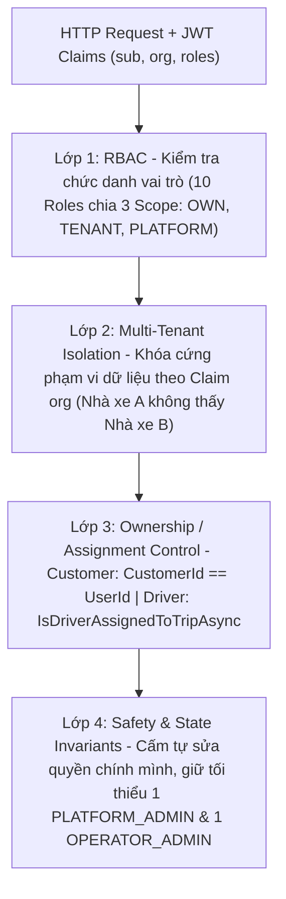
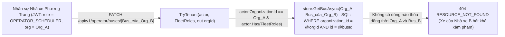

# Bài 03: Phân Quyền RBAC 10 Vai Trò, Chống BOLA/IDOR & Cô Lập Đa Thuê Bao (Multi-Tenancy)

> **Thuộc bộ tài liệu:** Cẩm nang Thuyết trình Toàn diện — Dự án **BLUE Bus Ticket Platform (PBL6)**
> **Chuyên đề 04:** An toàn Thông tin, Định danh, JWT, RBAC & Kiểm toán Bảo mật OWASP
> **Mã nguồn trọng tâm:** `001_initial.sql`, `AuthService.cs`, `AdminIdentityService.cs`, `IdentityOperatorStaffEndpoints.cs`, `CustomerPreferencesEndpoints.cs`, `TransportService.cs`, `BookingService.cs`

---

## Chương 1: Lý Thuyết Phân Quyền Cho Người Mới — Từ AuthN/AuthZ Đến Đa Thuê Bao (Multi-Tenancy)

Trong hai bài trước, chúng ta đã giải quyết trọn vẹn câu hỏi **"Chứng minh danh tính"** bằng Argon2id, OTP Challenge và chữ ký JWT. Nhưng trong một nền tảng thương mại điện tử phức tạp kết nối cả **Khách mua vé**, **Tài xế lái xe**, **Điều độ viên của hàng chục Nhà xe đối thủ** và **Ban quản trị Sàn**, việc đăng nhập thành công mới chỉ là bước qua cổng ngoài cùng!

### 1.1. Phân biệt rạch ròi Authentication (AuthN) vs Authorization (AuthZ)

Rất nhiều lập trình viên mới vào nghề dùng lẫn lộn hai từ này, dẫn tới trả sai mã trạng thái HTTP (`401` vs `403`). Hãy ghi nhớ hình ảnh **Sân bay Quốc tế**:

| Khía cạnh | Authentication (`AuthN` — Xác thực) | Authorization (`AuthZ` — Phân quyền / Cấp phép) |
| :--- | :--- | :--- |
| **Câu hỏi cốt lõi** | **"Bạn là ai?"** (*Who are you?*) | **"Bạn được phép làm gì & chạm vào dữ liệu nào?"** (*What are you allowed to do?*) |
| **Ví dụ đời thực** | Xuất trình Căn cước công dân / Hộ chiếu tại quầy an ninh để chứng minh bạn đúng là Nguyễn Văn A. | Cầm thẻ lên máy bay ghế Phổ thông `14B`: bạn được lên đúng chuyến bay `VN123`, nhưng **không được** vào Phòng chờ Thương gia và **không được** bước vào buồng lái phi công! |
| **Cơ chế trong dự án BLUE** | Mật khẩu Argon2id, OTP 6 số, chữ ký JWT `HS256`, Refresh Session (`UseAuthentication()`). | Kiểm tra `Role`, `OrganizationId`, `CustomerId`, `DriverUserId` (`UseAuthorization()` & Domain Guards). |
| **Mã lỗi HTTP chuẩn khi thất bại** | **`401 Unauthorized`** (`AUTHENTICATION_REQUIRED` / `INVALID_CREDENTIALS` / `SESSION_INVALID`) | **`403 Forbidden`** (`ACCESS_DENIED`) hoặc **`404 Not Found`** (`RESOURCE_NOT_FOUND` — ẩn tài nguyên chống dò quét) |

---

### 1.2. Bốn Mô hình Kiểm soát Truy cập (Access Control Models) Phối hợp trong Dự án BLUE

Một ứng dụng đơn giản (như Blog cá nhân) chỉ cần phân biệt `Admin` và `User`. Nhưng với sàn vé xe khách B2B2C đa nhà xe, **BLUE Bus Ticket Platform** kết hợp **4 tầng kiểm soát truy cập đồng thời**:



1. **RBAC (*Role-Based Access Control* — Phân quyền dựa trên Vai trò):** Quyền hạn được gom nhóm theo vị trí công việc trong thực tế vận tải (Lịch trình viên chỉ được xếp xe/lịch chạy, Kế toán nhà xe chỉ được xem doanh thu/hoàn tiền chứ không được hủy chuyến xe).
2. **Permission-Based (*Phân quyền hạt mịn theo Quyền thao tác*):** Định nghĩa từng hành động nguyên tử dạng `scope.resource.action` (ví dụ `tenant.trip.publish`, `tenant.ticket.checkin`).
3. **Resource / Ownership-Based (*Kiểm soát quyền sở hữu đối tượng — Chống lỗ hổng số 1 thế giới OWASP API1:2023 BOLA / IDOR*):**
   * **BOLA (*Broken Object Level Authorization*) / IDOR (*Insecure Direct Object Reference*)** xảy ra khi API kiểm tra người gọi có vai trò `CUSTOMER` hợp lệ rồi cho phép đọc luôn `GET /api/v1/bookings/{bookingId}` mà **quên kiểm tra xem `bookingId` đó có phải của chính người gọi hay không**! Chỉ cần đổi UUID trên thanh địa chỉ, kẻ tấn công xem trộm được họ tên, SĐT, lộ trình di chuyển của người khác.
4. **Multi-Tenant Isolation (*Cô lập Đa thuê bao*):**
   Trong mô hình SaaS Shared-Database (nhiều nhà xe dùng chung cụm bảng `buses`, `routes`, `trips`, `bookings`), mỗi nhà xe là một **Tenant (Thuê bao độc lập)**. Nếu thiếu bộ lọc `organization_id` ở bất kỳ câu lệnh đọc/ghi nào, Nhà xe A có thể đọc trộm doanh thu hoặc phá hoại sơ đồ ghế của Nhà xe B!

---

## Chương 2: Giải Phẫu Hệ Thống 10 Vai Trò (`roles`) & 37 Quyền Hạt Mịn (`permissions`)

### 2.1. Thiết kế Schema Phân quyền trong PostgreSQL (`001_initial.sql`)

Hãy mở file `docs/database/identity/001_initial.sql` (dòng 27–52 và 144–186). Nền tảng định nghĩa 3 bảng danh mục chuẩn mực (`roles`, `permissions`, `role_permissions`) với ràng buộc `CHECK` chặt chẽ trên phạm vi (`scope`):

```sql
insert into roles (id, code, scope, description, created_at) values
  (gen_random_uuid(), 'CUSTOMER', 'OWN', 'Own-resource customer policy', now()),
  (gen_random_uuid(), 'DRIVER', 'TENANT', 'Assigned trip driver', now()),
  (gen_random_uuid(), 'OPERATOR_ADMIN', 'TENANT', 'Tenant administrator', now()),
  (gen_random_uuid(), 'OPERATOR_SCHEDULER', 'TENANT', 'Fleet and schedule manager', now()),
  (gen_random_uuid(), 'OPERATOR_OPERATIONS', 'TENANT', 'Trip operations and check-in', now()),
  (gen_random_uuid(), 'OPERATOR_FINANCE', 'TENANT', 'Tenant finance/report reader', now()),
  (gen_random_uuid(), 'PLATFORM_ADMIN', 'PLATFORM', 'Platform identity and organization admin', now()),
  (gen_random_uuid(), 'PLATFORM_SUPPORT', 'PLATFORM', 'Platform support reader', now()),
  (gen_random_uuid(), 'PLATFORM_FINANCE', 'PLATFORM', 'Platform finance operator', now()),
  (gen_random_uuid(), 'PLATFORM_AUDITOR', 'PLATFORM', 'Read-only platform auditor', now())
on conflict (code) do nothing;
```

#### Bảng Phân tích Toàn diện 10 Vai trò Nghiệp vụ của Sàn BLUE:

| STT | Mã Vai trò (`code`) | Phạm vi (`scope`) | Bắt buộc Claim `org`? | Trách nhiệm Nghiệp vụ & Quyền hạn Thực tế trong Code |
| :-: | :--- | :---: | :---: | :--- |
| 1 | **`CUSTOMER`** | `OWN` | Không | Hành khách mua vé: giữ ghế (`CreateHold`), đặt đơn, áp mã giảm giá, thanh toán, nhận QR vé, tự hủy vé hoàn tiền theo chính sách giờ khởi hành. Chỉ thấy dữ liệu của chính `UserId` mình. |
| 2 | **`DRIVER`** | `TENANT` | **Có** | Tài xế nhà xe: xem lịch phân công (`GetMyAssignments`), xem danh sách hành khách (`Manifest`), quét QR soát vé lên xe (`Validate`/`CheckIn`), chuyển trạng thái chuyến đi (`BOARDING` -> `DEPARTED` -> `IN_TRANSIT` -> `ARRIVED` -> `COMPLETED`) **chỉ cho đúng chuyến mình được phân công cầm lái**. |
| 3 | **`OPERATOR_ADMIN`** | `TENANT` | **Có** | Quản trị viên cao nhất của một Nhà xe: toàn quyền quản lý hồ sơ nhà xe, nhân sự nội bộ (`/api/v1/operator/staff`), đội xe, tài xế, tuyến đường, lịch chạy, vận hành chuyến, đối soát doanh thu & hoàn tiền trong phạm vi nhà xe đó. |
| 4 | **`OPERATOR_SCHEDULER`** | `TENANT` | **Có** | Điều độ lịch trình & đội xe (`FleetRoles`): thêm/sửa xe khách, cấu hình sơ đồ ghế, quản lý hồ sơ bằng lái tài xế, thiết lập tuyến đường/điểm đón trả, tạo chuyến nháp/lịch lặp định kỳ và xuất bản mở bán (`PublishTrip`). **Không được** xem báo cáo doanh thu hay hoàn tiền! |
| 5 | **`OPERATOR_OPERATIONS`** | `TENANT` | **Có** | Điều hành hiện trường bến bãi (`OperateRoles` & `CancelRoles`): xem danh sách đơn vé của nhà xe, xuất phơi lệnh hành khách (`Manifest`) mọi chuyến thuộc nhà xe, hỗ trợ quét vé lên xe, chuyển trạng thái hoặc hủy chuyến khẩn cấp (`CancelTrip`). |
| 6 | **`OPERATOR_FINANCE`** | `TENANT` | **Có** | Kế toán tài chính nhà xe: tra cứu giao dịch thanh toán, yêu cầu/theo dõi hoàn tiền (`Refunds`), xem bảng quyết toán hoa hồng (`Settlements`) và 3 báo cáo doanh thu/đặt chỗ/lấp đầy ghế của riêng nhà xe mình. |
| 7 | **`PLATFORM_ADMIN`** | `PLATFORM` | Không | Quản trị viên tối cao của Sàn BLUE: tạo mới nhà xe đối tác, quản lý tài khoản/trạng thái/vai trò người dùng toàn hệ thống, gán quản trị viên đầu tiên cho nhà xe, cấu hình mã khuyến mãi sàn (`SaveCoupon`), xem/xử lý vận hành liên nhà xe. |
| 8 | **`PLATFORM_SUPPORT`** | `PLATFORM` | Không | Chuyên viên Chăm sóc khách hàng của Sàn: tra cứu đơn đặt vé toàn sàn (`SearchBookings` chỉ đọc) để hỗ trợ giải đáp khiếu nại hành khách mà **không có quyền** sửa tài khoản hay giải ngân tiền. |
| 9 | **`PLATFORM_FINANCE`** | `PLATFORM` | Không | Kế toán đối soát của Sàn: xem toàn bộ giao dịch thanh toán, hoàn tiền, bảng quyết toán của mọi nhà xe và tạo lệnh chi trả định kỳ cho nhà xe (`CreatePayout` tại `/api/v1/admin/payouts`). |
| 10 | **`PLATFORM_AUDITOR`** | `PLATFORM` | Không | Kiểm toán viên độc lập (Read-only): được định nghĩa trong schema phân quyền để phục vụ đọc nhật ký kiểm toán, tổ chức, thanh toán và báo cáo mà không có bất kỳ quyền ghi (mutate) nào. |

---

### 2.2. Đối chiếu sâu sắc: 37 Permissions trong SQL vs Kiểm tra theo Role (`actor.Has`) trong C#

Khi đọc `001_initial.sql` (dòng 157–186), bạn sẽ thấy hệ thống khởi tạo sẵn **37 quyền hạt mịn** (ví dụ: `'tenant.bus.manage'`, `'tenant.trip.publish'`, `'tenant.ticket.checkin'`, `'report.revenue.read'`, `'platform.payment.reconcile'`, `'platform.dlq.replay'`...) kèm lời chú thích thiết kế rất chuẩn mực ở dòng 174:
> `-- Role-permission assignment is explicit. A new permission is never granted automatically.` *(Nguyên tắc Đặc quyền tối thiểu — Least Privilege)*.

Tuy nhiên, khi đọc sang tầng C# (`JwtTokenService.cs`, `TransportService.cs`, `BookingService.cs`, `PaymentService.cs`), bạn sẽ thấy:
* Lúc phát hành JWT, `JwtTokenService.Issue` chỉ nhúng các claim **`ClaimTypes.Role`** (1–2 chuỗi ngắn như `"OPERATOR_SCHEDULER"`), chứ **không nhúng danh sách 20–30 chuỗi `permissions`** vào trong JWT.
* Tại các Microservices nghiệp vụ, đối tượng `Actor` kiểm tra quyền thông qua hàm `actor.Has(...)`:
  ```csharp
  // Ví dụ trong TransportService.cs (dòng 11-17):
  private static readonly string[] FleetRoles = [Roles.OperatorAdmin, Roles.OperatorScheduler];
  private static readonly string[] OperateRoles = [Roles.OperatorAdmin, Roles.OperatorOperations, Roles.Driver];
  private static readonly string[] CancelRoles = [Roles.OperatorAdmin, Roles.OperatorOperations];
  ```

**Tại sao nhóm thiết kế như vậy? (Điểm giải thích ghi điểm kiến trúc thực chiến):**
1. **Giữ kích thước JWT Header nhỏ gọn (Token Bloat Prevention):** Một quản trị viên `OPERATOR_ADMIN` sở hữu hơn 20 permissions (`tenant.*` + `report.*.read`). Nếu nhồi toàn bộ 20 chuỗi permission vào Payload của mọi JWT Access Token, kích thước HTTP Header `Authorization` tăng gấp 3–4 lần trên hàng triệu request mạng (nguy cơ chạm ngưỡng giới hạn header `4KB/8KB` của Reverse Proxy/Nginx!).
2. **Định nghĩa Role Group tĩnh ngay tại Domain Service (`FleetRoles`, `OperateRoles`, `CancelRoles`):** Vừa khớp 1-1 với bảng ánh xạ `role_permissions` trong tài liệu cơ sở dữ liệu, vừa cực kỳ tường minh khi đọc code và kiểm toán bảo mật tĩnh (Static Code Analysis).
3. **Sẵn sàng mở rộng (Future-Proof Schema):** Nhờ bảng `permissions` và `role_permissions` đã nằm sẵn chuẩn chỉnh trong DB `identity`, khi tương lai sàn cho phép mỗi nhà xe tự tạo *Custom Role* (ví dụ `"Trưởng trạm Đà Nẵng"` chỉ có 3 quyền chọn lọc), hệ thống không cần sửa lại cấu trúc bảng cơ sở dữ liệu!

---

## Chương 3: Kiến Trúc Gắn Kết Đa Thuê Bao — Từ `organization_memberships` Đến Claim `"org"` Trong JWT

Làm thế nào hệ thống biết tài khoản `operator.seed@example.test` thuộc về Nhà xe `01990a00-0000-7000-8000-000000000001`, trong khi tài khoản `admin.seed@example.test` lại là Quản trị viên toàn sàn không thuộc riêng nhà xe nào?

### 3.1. Cặp bảng `organization_memberships` & `user_roles` với Hai Partial Unique Index Tách Biệt

Hãy quan sát thiết kế cơ sở dữ liệu cực kỳ chặt chẽ trong `docs/database/identity/001_initial.sql` (dòng 54–90):

```sql
create table organization_memberships (
  id uuid primary key,
  user_id uuid not null references users(id),
  organization_id_external uuid not null,
  status varchar(30) not null,
  started_at timestamptz not null,
  ended_at timestamptz,
  created_at timestamptz not null,
  updated_at timestamptz not null,
  row_version bigint not null default 0,
  constraint ck_membership_status check (status in ('ACTIVE','SUSPENDED','ENDED')),
  constraint ck_membership_end check (ended_at is null or ended_at >= started_at)
);

create unique index uq_membership_active
  on organization_memberships (user_id, organization_id_external)
  where status in ('ACTIVE','SUSPENDED');

create table user_roles (
  id uuid primary key,
  user_id uuid not null references users(id),
  role_id uuid not null references roles(id),
  organization_id_external uuid,
  active boolean not null default true,
  created_at timestamptz not null,
  ended_at timestamptz
);

create unique index uq_user_platform_role_active
  on user_roles (user_id, role_id)
  where active and organization_id_external is null;

create unique index uq_user_tenant_role_active
  on user_roles (user_id, role_id, organization_id_external)
  where active and organization_id_external is not null;
```

**Tại sao PostgreSQL lại cần TỚI HAI Unique Index riêng biệt (`uq_user_platform_role_active` và `uq_user_tenant_role_active`) trên bảng `user_roles`?**
* Đây là một bẫy kinh điển của SQL chuẩn: Trong SQL, giá trị `NULL` đại diện cho *"chưa xác định"*, nên `NULL = NULL` không trả về `TRUE`! Nếu bạn chỉ viết một lệnh `UNIQUE (user_id, role_id, organization_id_external)` thông thường, PostgreSQL sẽ cho phép chèn **hàng chục dòng trùng nhau** của vai trò `CUSTOMER` hoặc `PLATFORM_ADMIN` (vì cột `organization_id_external` của chúng là `NULL`)!
* Bằng cách tách làm 2 Partial Unique Index có mệnh đề `WHERE`:
  1. `uq_user_platform_role_active` (`WHERE active AND organization_id_external IS NULL`): Khóa chặt không cho phép gán trùng vai trò cấp Sàn (`PLATFORM_*` / `CUSTOMER`) đang hoạt động.
  2. `uq_user_tenant_role_active` (`WHERE active AND organization_id_external IS NOT NULL`): Khóa chặt không cho phép gán trùng vai trò cấp Nhà xe (`OPERATOR_*` / `DRIVER`) trong cùng một tổ chức, đồng thời khi thu hồi quyền (`SET active = false, ended_at = NOW()` trong `IdentityRepository.ReplaceUserRolesAsync`), dòng lịch sử cũ vẫn được giữ lại phục vụ kiểm toán mà không cản trở việc gán lại vai trò đó trong tương lai!

---

### 3.2. Dòng chảy Định danh Nhà xe: Từ Database vào JWT (`TokenRolesAsync` & `TokenOrgAsync`)

Hãy xem cách `AuthService.cs` (dòng 417–433) tổng hợp thẩm quyền của người dùng mỗi khi đăng nhập hoặc xoay vòng Refresh Token:

```csharp
private async Task<IReadOnlyList<string>> TokenRolesAsync(Guid userId, CancellationToken cancellationToken)
{
    var roles = (await users.GetRoleCodesAsync(userId, cancellationToken)).ToList();
    var memberships = await users.GetMembershipsForUserAsync(userId, cancellationToken);
    foreach (var membership in memberships.Where(item => item.Status == "ACTIVE"))
    {
        roles.AddRange(membership.RoleCodes);
    }

    return roles.Distinct(StringComparer.Ordinal).ToArray();
}

private async Task<Guid?> TokenOrgAsync(Guid userId, CancellationToken cancellationToken)
{
    var memberships = await users.GetMembershipsForUserAsync(userId, cancellationToken);
    return memberships.FirstOrDefault(item => item.Status == "ACTIVE")?.OrganizationId;
}
```

Hãy theo dõi tính nhất quán tuyệt đối của đoạn code này:
1. `users.GetRoleCodesAsync(userId)` chỉ lấy các vai trò toàn cục (`organization_id_external IS NULL AND active`).
2. Các vai trò nhà xe (`OPERATOR_ADMIN`, `DRIVER`...) **chỉ được nạp vào JWT nếu bản ghi `organization_memberships` tương ứng đang có `Status == "ACTIVE"`**! Nếu Quản trị viên nhà xe tạm đình chỉ một nhân viên (`Status = "SUSPENDED"` trong `IdentityOperatorStaffEndpoints.cs` dòng 28), ngay lập tức cả phiên cũ bị thu hồi (`RevokeUserSessionsAsync`), và nếu người đó đăng nhập lại thì cả `TokenRolesAsync` lẫn `TokenOrgAsync` đều **bỏ qua membership bị đình chỉ đó** — nhân viên mất sạch mọi quyền hạn và mất luôn claim `"org"`!
3. Khi request đi tới bất kỳ Microservice nào (`Transport`, `Booking`, `Payment`, `Reporting`), hàm mở rộng `PlatformHttp.OrganizationId` (`PlatformHttp.cs` dòng 53–54) đọc lại claim `"org"` đã được bảo vệ bằng chữ ký mật mã `HS256`:
   ```csharp
   public static Guid? OrganizationId(this ClaimsPrincipal user) =>
       Guid.TryParse(user.FindFirstValue("org"), out var id) ? id : null;
   ```
   Và đóng gói vào record bất biến `Actor(Guid UserId, Guid? OrganizationId, IReadOnlyList<string> RoleCodes)`. **Mọi quyết định cô lập nhà xe phía sau đều lấy `actor.OrganizationId` từ chữ ký JWT này, tuyệt đối không tin tưởng bất kỳ tham số `organizationId` nào do Client tự điền trong JSON body đối với luồng Operator!**


---

## Chương 4: Giải Phẫu 4 Tầng Cô Lập Dữ Liệu Thực Chiến Xuyên Các Microservices

Lý thuyết RBAC chỉ thực sự sống động khi bạn nhìn thấy từng dòng điều kiện `if` trong C# bảo vệ tài sản của khách hàng và nhà xe trước những kịch bản tấn công tinh vi nhất. Hãy lần lượt giải phẫu **4 tầng cô lập thực tế** đang chạy trong hệ thống:

### 4.1. Tầng 1: Cô Lập Sở Hữu Cá Nhân (`CUSTOMER`) — Nghệ Thuật Trả `404 NotFound` Thay Vì `403 Forbidden` Để Chống BOLA/IDOR

Hãy mở `workspace/src/services/booking/BusTicketPlatform.Booking.Application/BookingService.cs` (dòng 338–348, 382–388, 573–594, 722–723):

```csharp
public async Task<Result<BookingDto>> GetBookingAsync(Actor actor, Guid bookingId, CancellationToken cancellationToken)
{
    await store.ExpireHoldsAsync(cancellationToken);
    var booking = await store.GetBookingAsync(bookingId, cancellationToken);
    if (booking is null || !CanRead(actor, booking))
    {
        return Result<BookingDto>.Failure(PlatformErrors.NotFound());
    }

    return Result<BookingDto>.Success(MapBooking(booking));
}

private static bool CanRead(Actor actor, BookingRecord booking) =>
    booking.CustomerId == actor.UserId
    || actor.Has("PLATFORM_ADMIN", "PLATFORM_SUPPORT")
    || actor.OrganizationId == booking.OrganizationId;
```

Và tương tự tại các điểm thao tác nhạy cảm khác:
* **Giữ ghế & Áp mã giảm giá (`QuoteCouponAsync` dòng 46, `GetHoldAsync` dòng 170, `CreateBookingAsync` dòng 198):**
  ```csharp
  if (hold is null || hold.CustomerId != actor.UserId)
      return Result<SeatHoldDto>.Failure(PlatformErrors.NotFound());
  ```
  Kể cả kẻ khác đoán được chuỗi `holdToken`, hắn cũng không thể cướp chỗ đang giữ của bạn để xuất đơn tên hắn!
* **Xem trước phí hủy & Hủy đơn (`PreviewAsync` dòng 385, `CancelAsync` dòng 446):**
  ```csharp
  if (booking is null || booking.CustomerId != actor.UserId)
      return Result<OperationAccepted>.Failure(PlatformErrors.NotFound());
  ```
  Lưu ý tinh tế: Hàm `CanRead` cho phép `PLATFORM_SUPPORT` và nhân sự nhà xe đọc đơn hàng để hỗ trợ khách, nhưng **riêng hàm hủy đơn `CancelAsync` chỉ chấp nhận duy nhất `booking.CustomerId == actor.UserId`**! Không một nhân viên nhà xe nào được mượn API tự hủy của khách để tự ý hủy vé khách đã mua!
* **Tạo & Xem thanh toán (`PaymentService.cs` dòng 122, 184, 197):**
  ```csharp
  if (quote is null || quote.CustomerId != actor.UserId)
      return Result<PaymentDto>.Failure(PlatformErrors.NotFound());
  ```

> [!IMPORTANT]
> **Câu hỏi phỏng vấn kinh điển: Tại sao khi khách hàng A cố truy cập `bookingId` của khách hàng B, hệ thống lại trả về `404 NotFound (RESOURCE_NOT_FOUND)` thay vì `403 Forbidden (ACCESS_DENIED)`?**
>
> **Giải thích chuẩn OWASP API1 (BOLA Prevention):**
> * Nếu hệ thống trả về `404` khi đơn không tồn tại nhưng lại trả về **`403 Forbidden`** khi đơn thuộc về người khác, kẻ tấn công đã nhận được một **tín hiệu rò rỉ thông tin (Existence Oracle)**: *"À! Mã UUID này CÓ THẬT và đang là một đơn đặt vé hợp lệ của ai đó!"*.
> * Bằng cách trả về **`404 NotFound`** đồng nhất cho cả hai trường hợp (`booking is null || !CanRead(...)`), đối với góc nhìn của khách hàng A, đơn hàng của khách hàng B **hoàn toàn vô hình như chưa từng tồn tại trong vũ trụ**! Chuẩn HTTP RFC 9110 (Mục 15.5.4) chính thức khuyến nghị trả `404` thay cho `403` khi máy chủ không muốn tiết lộ sự tồn tại của tài nguyên cho người không có quyền.

---

### 4.2. Tầng 2: Cô Lập Đa Nhà Xe (`OPERATOR_*`) Qua Thiết Kế Fail-Closed `TransportService.TryTenant`

Trong dịch vụ quản lý đội xe và lịch chạy `BusTicketPlatform.Transport.Application/TransportService.cs`, mọi thao tác của nhà xe đều bắt buộc đi qua cánh cổng kiểm tra chung **`TryTenant`** (dòng 952–963):

```csharp
private static bool TryTenant(Actor actor, string[] roles, out Guid organizationId, out AppError error)
{
    organizationId = actor.OrganizationId ?? Guid.Empty;
    if (actor.OrganizationId is null || !actor.Has(roles))
    {
        error = PlatformErrors.AccessDenied();
        return false;
    }

    error = PlatformErrors.AccessDenied();
    return true;
}
```

Hãy xem cách `TryTenant` phối hợp với tầng Repository trong `UpdateBusAsync` (dòng 145–156) và `PublishTripAsync` (dòng 748–759):

```csharp
public async Task<Result<BusDto>> UpdateBusAsync(Actor actor, Guid busId, BusInput input, CancellationToken cancellationToken)
{
    if (!TryTenant(actor, FleetRoles, out var orgId, out var error))
    {
        return Fail<BusDto>(error);
    }

    var bus = await store.GetBusAsync(orgId, busId, cancellationToken);
    if (bus is null)
    {
        return Fail<BusDto>(PlatformErrors.NotFound());
    }
    // ...
}
```



**Hai nguyên tắc vàng làm nên sự vững chắc của `TransportService`:**
1. **Fail-Closed (Đóng an toàn mặc định):** Nếu vì bất kỳ lý do gì token của nhân sự nhà xe bị thiếu claim `org` (`actor.OrganizationId is null`), `TryTenant` lập tức trả về `false` -> `403 ACCESS_DENIED` ngay từ dòng đầu tiên, không bao giờ chạm tới Database! *(Trong Bài 04, chúng ta sẽ thấy chuyện gì xảy ra khi 3 hàm search ở Booking/Payment/Reporting quên áp dụng mẫu `TryTenant` này — phát hiện `F03`!).*
2. **Ràng buộc khóa kép `(orgId, resourceId)` ngay tại câu truy vấn:** Ngay cả khi tạo chuyến đi mới (`PrepareTripDraftAsync`, dòng 622–635), hệ thống truy vấn cả 3 thực thể `GetRouteAsync(orgId, input.RouteId)`, `GetBusAsync(orgId, input.BusId)` và `GetDriverAsync(orgId, input.DriverId)` bằng cùng `orgId` của người gọi! Nhờ đó, Nhà xe A **không bao giờ có thể gán chiếc xe buýt hoặc tài xế của Nhà xe B vào chuyến đi của mình** (Cross-Tenant Entity Injection)!

---

### 4.3. Tầng 3: Cô Lập Kép 2 Lớp Cho Tài Xế (`DRIVER` — Tenant Scope + Explicit Trip Assignment)

Giả sử Nhà xe Phương Trang có 50 tài xế cùng mang claim `org = Phương_Trang` và `role = DRIVER`. Nếu chỉ dừng ở cô lập theo `org`, Tài xế Tuấn (đang nghỉ ở nhà) có thể mở app bấm chuyển chuyến xe Đà Nẵng – Huế của Tài xế Hùng sang trạng thái `"ĐÃ KHỞI HÀNH"` hoặc xem danh sách SĐT hành khách trên xe của Tài xế Hùng!

Để ngăn chặn sự lạm quyền nội bộ này, cả `TransportService` lẫn `BookingService` đều triển khai **Cô lập Kép 2 Lớp** dành riêng cho `DRIVER`:

#### Nơi thứ 1: Chuyển trạng thái vận hành chuyến đi (`TransportService.TransitionTripAsync`, dòng 825–848)

```csharp
public async Task<Result<TripDto>> TransitionTripAsync(Actor actor, Guid tripId, TripTransitionRequest request, Guid correlationId, CancellationToken cancellationToken)
{
    if (!TryTenant(actor, OperateRoles, out var orgId, out var error))
    {
        return Fail<TripDto>(error);
    }

    var trip = await store.GetTripAsync(tripId, cancellationToken);
    if (trip is null || trip.OrganizationId != orgId)
    {
        return Fail<TripDto>(PlatformErrors.NotFound());
    }

    if (trip.RowVersion != request.ExpectedVersion)
    {
        return Fail<TripDto>(PlatformErrors.VersionConflict());
    }

    var driverOnly = actor.Has(Roles.Driver) && !actor.Has(Roles.OperatorAdmin, Roles.OperatorOperations);
    if (driverOnly && !await store.IsDriverAssignedToTripAsync(actor.UserId, tripId, cancellationToken))
    {
        return Fail<TripDto>(PlatformErrors.AccessDenied());
    }
    // ...
}
```

#### Nơi thứ 2: Xem phơi lệnh hành khách & Quét QR soát vé lên xe (`BookingService.cs`, dòng 665–670 & 768–789)

```csharp
private async Task<bool> CanCheckInAsync(Actor actor, TicketRecord ticket, CancellationToken cancellationToken)
{
    if (!actor.Has("DRIVER", "OPERATOR_ADMIN", "OPERATOR_OPERATIONS", "PLATFORM_ADMIN"))
    {
        return false;
    }

    if (actor.Has("PLATFORM_ADMIN"))
    {
        return true;
    }

    var booking = await store.GetBookingAsync(ticket.BookingId, cancellationToken);
    var trip = await store.GetTripAsync(ticket.TripId, cancellationToken);
    if (booking is null || trip is null || actor.OrganizationId != booking.OrganizationId)
    {
        return false;
    }

    var driverOnly = actor.Has("DRIVER") && !actor.Has("OPERATOR_ADMIN", "OPERATOR_OPERATIONS");
    return !driverOnly || trip.DriverUserId == actor.UserId;
}
```

**Hãy chú ý dòng biểu thức boolean cực kỳ tinh tế xuất hiện ở cả hai service:**
```csharp
var driverOnly = actor.Has("DRIVER") && !actor.Has("OPERATOR_ADMIN", "OPERATOR_OPERATIONS");
```
* **Nếu người gọi chỉ là Tài xế thuần túy (`driverOnly == true`):** Bắt buộc phải vượt qua cả 2 cửa ải:
  1. Cửa ải Nhà xe: `actor.OrganizationId == trip.OrganizationId`.
  2. Cửa ải Phân công trực tiếp: `IsDriverAssignedToTripAsync(actor.UserId, tripId)` (bảng `driver_assignments` ở Transport) và `trip.DriverUserId == actor.UserId` (trên bản chụp `trip_snapshots` ở Booking). Nếu không đúng chuyến mình cầm lái -> **`403 ACCESS_DENIED`**!
* **Tại sao lại có thêm vế `&& !actor.Has("OPERATOR_ADMIN", "OPERATOR_OPERATIONS")`?**
  Thực tế ở Việt Nam, rất nhiều chủ nhà xe tư nhân quy mô vừa và nhỏ vừa giữ vai trò Quản trị viên nhà xe (`OPERATOR_ADMIN`), vừa trực tiếp lái xe tăng cường vào dịp lễ (`DRIVER`). Nếu viết cẩu thả `if (actor.Has("DRIVER") && !IsAssigned...)`, ông chủ nhà xe mang cả hai role sẽ bị vai trò `DRIVER` "kéo tụt quyền", không thể điều hành các chuyến xe khác của chính công ty mình! Cách viết `driverOnly` đảm bảo **hợp quyền theo đặc quyền cao nhất mà người dùng nắm giữ hợp pháp (Additive Role Semantics)**!

---

### 4.4. Tầng 4: Sáu Chốt Chặn An Toàn Quản Trị (`Safety Guardrails`) & Chống Stored XSS Trong Dịch Vụ Identity

Không chỉ bảo vệ dữ liệu nghiệp vụ, `BusTicketPlatform.Identity` còn cài đặt **6 chốt chặn an toàn quản trị** để ngăn quản trị viên tự bắn vào chân mình hoặc bị lợi dụng leo thang đặc quyền:

#### Chốt chặn 1: Cấm Tự Khóa hoặc Tự Sửa Quyền Chính Mình (`AdminIdentityService.cs`, dòng 35–38 & 83–86)
```csharp
if (command.ActorId == command.UserId)
{
    return Result<UserProfileDto>.Failure(IdentityErrors.AccessDenied());
}
```
* Áp dụng trên cả `ChangeStatusAsync` lẫn `ReplaceRolesAsync`. Một `PLATFORM_ADMIN` không thể vô tình bấm nhầm nút `DISABLED` vào dòng tài khoản của chính mình trên bảng danh sách người dùng, cũng không thể tự chỉnh sửa tập quyền của bản thân (tuân thủ nguyên tắc **Separation of Duties — Phân tách nhiệm vụ**). Đã được kiểm chứng tự động tại `SecurityAndAdminTests.cs` (dòng 146–152).

#### Chốt chặn 2: Bảo vệ `PLATFORM_ADMIN` Cuối Cùng Đang Hoạt Động Trên Toàn Sàn (`AdminIdentityService.cs`, dòng 56–62 & 99–105)
```csharp
var roles = await users.GetRoleCodesAsync(user.Id, cancellationToken);
if (roles.Contains(RoleCodes.PlatformAdmin, StringComparer.Ordinal)
    && command.Status != UserStatuses.Active
    && await users.CountPlatformAdminsAsync(cancellationToken) <= 1)
{
    return Result<UserProfileDto>.Failure(IdentityErrors.AccessDenied());
}
```
Và câu truy vấn đếm cực kỳ chặt chẽ trong `IdentityRepository.cs` (dòng 138–144):
```sql
SELECT COUNT(DISTINCT ur.user_id)
FROM user_roles ur
JOIN roles r ON r.id = ur.role_id
JOIN users u ON u.id = ur.user_id
WHERE r.code = 'PLATFORM_ADMIN' AND ur.active AND u.status = 'ACTIVE' AND u.deleted_at IS NULL;
```
* Nếu trên toàn sàn chỉ còn duy nhất **1 `PLATFORM_ADMIN` đang `ACTIVE`**, mọi nỗ lực khóa, vô hiệu hóa hoặc gỡ role `PLATFORM_ADMIN` khỏi người đó (dù được thực hiện bởi một tiến trình hợp lệ nào) đều bị chặn đứng bằng `403 ACCESS_DENIED` — ngăn chặn thảm họa **"Lockout Toàn Hệ Thống" (Orphaned Platform)**!

#### Chốt chặn 3: Bảo vệ `OPERATOR_ADMIN` Cuối Cùng Của Từng Nhà Xe (`IdentityOperatorStaffEndpoints.cs`, dòng 27)
```csharp
if (m.RoleCodes.Contains("OPERATOR_ADMIN")
    && (body.Role != "OPERATOR_ADMIN" || body.Status != "ACTIVE")
    && members.Count(m => m.Status == "ACTIVE" && m.RoleCodes.Contains("OPERATOR_ADMIN")) <= 1)
    return Results.Conflict(new { message = "Cần giữ ít nhất một quản trị viên đang hoạt động." });
```
* Tương tự cấp sàn, mỗi nhà xe bắt buộc phải luôn duy trì ít nhất 1 `OPERATOR_ADMIN` đang `ACTIVE` để nhà xe không bị "mồ côi người quản lý".

#### Chốt chặn 4: Whitelist Vai trò Nhân sự Nhà xe & Chống Chiếm đoạt Tài khoản Chéo Tổ chức (`IdentityOperatorStaffEndpoints.cs`, dòng 24, 33, 36)
1. Khi `OPERATOR_ADMIN` thêm hoặc sửa nhân sự tại `/api/v1/operator/staff`, hệ thống kiểm tra cứng:
   ```csharp
   if (role is not ("DRIVER" or "OPERATOR_SCHEDULER" or "OPERATOR_ADMIN" or "OPERATOR_FINANCE" or "OPERATOR_OPERATIONS"))
       return Results.BadRequest();
   ```
   Điều này **chặn đứng 100% tấn công Vertical Privilege Escalation**: Một `OPERATOR_ADMIN` không bao giờ có thể truyền `"role": "PLATFORM_ADMIN"` vào API quản lý nhân sự nhà xe để tự biến nhân viên của mình thành Admin của toàn sàn!
2. Hơn nữa, ở dòng 36:
   ```csharp
   if (user is not null && !members.Any(m => m.UserId == user.Id))
       return Results.Conflict(new { message = "Email đã thuộc tài khoản khác. Quản trị viên hệ thống cần thêm tài khoản này vào tổ chức." });
   ```
   Nếu email đó đã tồn tại trên hệ thống (ví dụ là tài khoản cá nhân của một khách hàng hoặc nhân sự nhà xe khác), `OPERATOR_ADMIN` không được tự ý "bắt cóc" tài khoản đó gắn vào tổ chức mình, mà phải qua quy trình thẩm định của `PLATFORM_ADMIN`!

#### Chốt chặn 5: Chống Ghi Đè Tương Tranh Bằng `RowVersion` (`Optimistic Concurrency Control`)
Tất cả các lệnh cập nhật hồ sơ cá nhân (`ProfileService.UpdateAsync`), trạng thái/vai trò người dùng (`AdminIdentityService`), thành viên nhà xe (`IdentityOperatorStaffEndpoints`), xe buýt/tuyến/chuyến (`TransportService`) và soát vé (`BookingService.CheckInAsync`) đều bắt buộc kiểm tra `ExpectedVersion == entity.RowVersion`. Nếu hai quản trị viên cùng mở một hồ sơ nhân sự và bấm Lưu cùng lúc, người thứ hai lập tức nhận **`409 Conflict` (`VERSION_CONFLICT`)** thay vì âm thầm ghi đè làm mất quyết định phân quyền của người thứ nhất!

#### Chốt chặn 6: Chặn Đứng Tấn Công Stored XSS Qua Ảnh Đại Diện SVG (`CustomerPreferencesEndpoints.cs`, dòng 30–32)
Hãy nhìn vào đoạn kiểm tra nhỏ nhưng cực kỳ sắc sảo trong `CustomerPreferencesEndpoints.cs`:
```csharp
if (body.Province is null || body.Province.Length > 100 || body.Avatar is null || body.Avatar.Length > 200000 ||
    (body.Avatar.Length > 0 && !Regex.IsMatch(body.Avatar, "^data:image/webp;base64,[A-Za-z0-9+/=]+$")))
    return Results.BadRequest(new { code = "VALIDATION_ERROR", message = "Invalid profile preferences." });
```
* **Tại sao tải ảnh `SVG` lại gây ra lỗ hổng bảo mật nghiêm trọng (Stored XSS)?**
  Không giống ảnh điểm ảnh thuần túy (`PNG`, `JPEG`, `WebP`), định dạng **`image/svg+xml` thực chất là một tài liệu XML có quyền nhúng thẻ `<script>` và sự kiện JavaScript thực thi trực tiếp** (ví dụ: `data:image/svg+xml,<svg onload='alert(document.cookie)'/>`)! Nếu máy chủ chấp nhận lưu chuỗi `data:image/...` bất kỳ, khi nhân viên CSKH hoặc trình duyệt mở ảnh đại diện đó ra, mã độc JavaScript của kẻ tấn công sẽ chạy ngay trong ngữ cảnh trang web!
* Hệ thống áp dụng **Strict Allowlist (Danh sách trắng nghiêm ngặt)**: chỉ chấp nhận duy nhất định dạng ảnh nhị phân an toàn `data:image/webp;base64,` với bảng chữ cái Base64 thuần túy `[A-Za-z0-9+/=]+` và chặn kích thước tối đa `200.000` ký tự (~150 KB). Kịch bản tấn công `<svg onload='alert(1)'/>` đã được đưa thẳng vào bài kiểm thử hồi quy `CustomerPreferencesTests.cs` (dòng 27–30) và bị đánh chặn bằng `400 BadRequest`!

---

## Chương 5: Cẩm Nang Hỏi – Đáp Phản Biện Trước Hội Đồng Bảo Vệ

### Câu 1: *"Trong `AuthService.TokenOrgAsync` (dòng 432), code đang viết `memberships.FirstOrDefault(item => item.Status == "ACTIVE")?.OrganizationId`. Nếu một người dùng làm việc cho 2 nhà xe cùng lúc (2 bản ghi `ACTIVE` trong `organization_memberships`) thì sao?"*
* **Trả lời:** Đây là một giới hạn thiết kế có chủ đích trong phạm vi MVP hiện tại: mỗi tài khoản nhân sự vận hành gắn với **1 nhà xe hoạt động chính tại một thời điểm** (`TokenOrgAsync` lấy tổ chức `ACTIVE` đầu tiên đưa vào claim đơn trị `"org"`). Tuy nhiên, bảng cơ sở dữ liệu `organization_memberships` và `user_roles` đã được thiết kế quan hệ `1-N` đầy đủ! Để mở rộng cho mô hình một kế toán viên làm thuê cho nhiều nhà xe trong tương lai, ta chỉ cần thêm endpoint `POST /api/v1/auth/switch-organization { organizationId }` để người dùng chọn ngữ cảnh nhà xe muốn làm việc và phát lại JWT chứa đúng `"org"` và `RoleCodes` của riêng nhà xe đó!

### Câu 2: *"Khi Quản trị viên Nhà xe đổi vai trò hoặc đình chỉ một nhân viên trong `IdentityOperatorStaffEndpoints.cs` (dòng 28), hệ thống có thu hồi quyền của nhân viên đó ngay không?"*
* **Trả lời:** Dạ có thu hồi phiên và ghi vết kiểm toán đầy đủ ạ! Ở dòng 28 của `IdentityOperatorStaffEndpoints.cs`:
  1. Cập nhật `organization_memberships` (`UpdateMembershipAsync` kèm tăng `RowVersion`).
  2. Thay thế vai trò trong `user_roles` của tổ chức đó (`ReplaceUserRolesAsync`).
  3. Gọi ngay `RevokeUserSessionsAsync(m.UserId, "MEMBERSHIP_CHANGED", ...)` để vô hiệu hóa toàn bộ Refresh Token của nhân viên đó, ngăn không cho làm mới Access Token.
  4. Ghi vào bảng `security_audits` hành động `"operator.membership.update"`.
  *(Điểm cải tiến nhỏ có thể nêu thêm nếu hội đồng hỏi sâu: Hiện tại `IdentityOperatorStaffEndpoints.Patch` chưa tăng `users.authorization_version` như `AdminIdentityService.ReplaceRolesAsync`, nên việc đồng bộ tăng `AuthorizationVersion` + đẩy lên Redis Denylist theo task `SEC-05` sẽ giúp thu hồi tức thời 100% ngay trong giây đầu tiên!).*

---

> **Bài tiếp theo:** Không phải mọi giao tiếp trong hệ thống đặt vé xe khách đều có thể mang theo JWT của người dùng đăng nhập! Khi tài xế dùng camera quét mã QR trên tờ vé giấy của khách, khi khách vãng lai tra cứu vé chỉ bằng SĐT, hay khi cổng thanh toán SePay bắn Webhook từ máy chủ ngân hàng về hệ thống — làm sao xác thực tính toàn vẹn dữ liệu? Và báo cáo Tự Kiểm Toán OWASP API Top 10 của dự án đã phơi bày và lên kế hoạch vá những lỗ hổng thực chiến nào? Mời bạn đọc mảnh ghép cuối cùng: **[Bài 04: Bảo Mật Webhook, Vé QR HMAC, Lookup Token & Tự Kiểm Toán OWASP API Top 10](./04-bao-mat-webhook-qr-hmac-va-kiem-toan-owasp.md)**.


---

## Phụ Lục Thực Chiến: Giải Phẫu Dữ Liệu Seed Đăng Nhập (`010` & `011`), `AdminUserEndpoints.cs` Và Ma Trận 37 Quyền Hạt Mịn

Để hỗ trợ trực tiếp cho buổi Demo trực tiếp (Live Demo) trước hội đồng, phụ lục này tổng hợp chi tiết các tài khoản mẫu trong cơ sở dữ liệu, quy trình tạo nhân sự quản trị và ma trận toàn bộ 37 quyền hạt mịn trong PostgreSQL.

### P.1. Giải phẫu 4 Tài khoản Dev/Demo trong `010_synthetic_seed.sql` & `011_dev_login_seed.sql`

Khi khởi chạy hệ thống lần đầu, `SqlBaselineHostedService` nạp tuần tự `001_initial.sql` -> `010_synthetic_seed.sql` -> `011_dev_login_seed.sql`:

* **Tại `010_synthetic_seed.sql`:** Hệ thống tạo trước khách hàng mẫu `01990a00-0000-7000-8000-000000000002` với `password_hash = 'SYNTHETIC_LOCAL_HASH_NOT_FOR_LOGIN'` — minh họa kỹ thuật **Non-Loginable Placeholder Hash** (vì chuỗi này không bắt đầu bằng `argon2id$` và không có 6 phần ngăn cách bởi `$`, hàm `Argon2PasswordHasher.Verify` luôn trả về `false`, đảm bảo dữ liệu seed cấu trúc không bao giờ mở cửa hậu đăng nhập nếu quên chạy script dev!).
* **Tại `011_dev_login_seed.sql`:** Hệ thống cập nhật mật khẩu Argon2id thật (`m=8192, t=1, p=1`) và khởi tạo đủ **4 Persona cốt lõi** phục vụ kiểm thử phân quyền chéo:

| Persona | Email / SĐT Đăng nhập | Mật khẩu Dev | UUID Tài khoản (`sub`) | Vai trò (`user_roles`) | Thuộc Nhà xe (`org`) |
| :--- | :--- | :--- | :--- | :--- | :--- |
| **Khách hàng** *(Seed Customer)* | `seed.customer@example.test`<br/>`+840000000001` | `CustomerPass1` | `...000000000002` | `CUSTOMER` (`org = null`) | Có 1 bản ghi membership `...000001` |
| **Quản trị Nhà xe** *(Seed Operator Admin)* | `operator.seed@example.test`<br/>`+840000000010` | `OperatorPass1` | `...000000000021` | `OPERATOR_ADMIN` (gắn `org`) | `01990a00-0000-7000-8000-000000000001` |
| **Quản trị Sàn** *(Seed Platform Admin)* | `admin.seed@example.test`<br/>`+840000000011` | `AdminPass1234` | `...000000000022` | `PLATFORM_ADMIN` (`org = null`) | Không thuộc nhà xe lẻ (`null`) |
| **Tài xế** *(Seed Driver)* | `driver.seed@example.test`<br/>`+840000000012` | `DriverPass1` | `...000000000023` | `DRIVER` (gắn `org`) | `01990a00-0000-7000-8000-000000000001` |

*(Lưu ý thú vị khi đọc kỹ `010` + `011`: Tài khoản `Seed Customer` `...000002` trong `010_synthetic_seed.sql` dòng 21–31 có một dòng trong `organization_memberships` gắn với tổ chức `...000001` nhưng trong `user_roles` chỉ có role `CUSTOMER` toàn cục. Vì vậy khi đăng nhập, JWT của tài khoản này có claim `org = ...000001` nhưng `roles = ["CUSTOMER"]`, chứng minh rằng dù có claim `org` mà không có role `OPERATOR_*` trong `RoleCodes`, hàm `TransportService.TryTenant` vẫn chặn đứng `403 ACCESS_DENIED` khi cố gọi API nhà xe!)*

---

### P.2. Giải phẫu Cơ chế Tạo Hồ sơ Nhân sự Không Lộ Mật Khẩu Tạm (`AdminUserEndpoints.cs`)

Khi `PLATFORM_ADMIN` tạo hồ sơ nhân sự mới qua `POST /api/v1/admin/users` (`AdminUserEndpoints.cs`, dòng 20–34) hoặc khi `OPERATOR_ADMIN` thêm nhân viên mới qua `POST /api/v1/operator/staff` (`IdentityOperatorStaffEndpoints.cs`, dòng 37):

```csharp
var user = new UserRecord(
    Guid.CreateVersion7(),
    body.FullName.Trim(),
    email,
    email.ToUpperInvariant(),
    phone,
    phone,
    hasher.Hash(Convert.ToBase64String(RandomNumberGenerator.GetBytes(48))),
    "ACTIVE",
    null, 0, null, 0, 0, DateTimeOffset.UtcNow);
```

* **Tại sao lại băm `RandomNumberGenerator.GetBytes(48)` (384 bits ngẫu nhiên không ai biết, kể cả Admin vừa bấm nút tạo)?**
  Trong các hệ thống cũ kém an toàn, Admin thường đặt mật khẩu mặc định kiểu `"Welcome123"` rồi gửi qua chat Zalo cho nhân viên mới — dẫn tới Admin biết mật khẩu của nhân viên hoặc nhân viên quên đổi mật khẩu mặc định!
  Ở dự án BLUE, hệ thống sinh ra một mật khẩu ngẫu nhiên 48 bytes (64 ký tự Base64), băm Argon2id lưu xuống DB rồi **hủy ngay chuỗi gốc khỏi bộ nhớ RAM**! Không một ai trên đời biết mật khẩu khởi tạo này; nhân sự mới sẽ chủ động dùng tính năng `Quên mật khẩu (Forgot Password)` gửi OTP về chính hòm thư cá nhân của họ để tự thiết lập mật khẩu riêng!
* Đồng thời, khi Admin cập nhật Email của nhân sự tại `PATCH /api/v1/admin/users/{id}` (`AdminUserEndpoints.cs` dòng 47):
  ```sql
  email_verified_at = CASE WHEN email = @email THEN email_verified_at ELSE NULL END,
  row_version = row_version + 1
  WHERE id = @id AND row_version = @version
  ```
  Câu lệnh SQL nguyên tử vừa kiểm tra khóa lạc quan `WHERE row_version = @version`, vừa tự động xóa dấu xác minh `email_verified_at = NULL` nếu địa chỉ email bị thay đổi, đảm bảo tính trung thực tuyệt đối của trạng thái xác thực email!

---

### P.3. Bảng Tham Chiếu Toàn Bộ 37 Permissions Trong `001_initial.sql`

| Nhóm Phạm vi (`scope`) | Danh sách Mã Quyền (`permissions.code`) | Các Role Được Cấp Trong `role_permissions` |
| :--- | :--- | :--- |
| **`TENANT` — Tổ chức & Đội xe** (7 quyền) | `tenant.organization.manage`, `tenant.bus.read`, `tenant.bus.manage`, `tenant.driver.read`, `tenant.driver.manage`, `tenant.route.read`, `tenant.route.manage` | `OPERATOR_ADMIN` (tất cả); `OPERATOR_SCHEDULER` (6 quyền xe, tài xế, tuyến đường). |
| **`TENANT` — Chuyến đi** (5 quyền) | `tenant.trip.read`, `tenant.trip.manage`, `tenant.trip.publish`, `tenant.trip.operate`, `tenant.trip.cancel` | `OPERATOR_ADMIN` (tất cả); `OPERATOR_SCHEDULER` (`read`, `manage`, `publish`); `OPERATOR_OPERATIONS` (`read`, `operate`, `cancel`); `DRIVER` (`read`, `operate`). |
| **`TENANT` — Đặt chỗ & Soát vé** (4 quyền) | `tenant.booking.read`, `tenant.manifest.read`, `tenant.ticket.validate`, `tenant.ticket.checkin` | `OPERATOR_ADMIN` & `OPERATOR_OPERATIONS` (cả 4); `DRIVER` (`manifest.read`, `ticket.validate`, `ticket.checkin`). |
| **`TENANT` — Tài chính Nhà xe** (3 quyền) | `tenant.payment.read`, `tenant.refund.read`, `tenant.refund.request` | `OPERATOR_ADMIN` & `OPERATOR_FINANCE`. |
| **`REPORT` — Báo cáo Phân tích** (3 quyền) | `report.revenue.read`, `report.booking.read`, `report.occupancy.read` | `OPERATOR_ADMIN`, `OPERATOR_FINANCE`, `PLATFORM_FINANCE`, `PLATFORM_AUDITOR`. |
| **`PLATFORM` — Định danh & Tổ chức** (7 quyền) | `platform.organization.read`, `platform.organization.manage`, `platform.user.read`, `platform.user.manage`, `platform.role.manage`, `platform.membership.read`, `platform.membership.manage` | `PLATFORM_ADMIN` (cả 7); `PLATFORM_AUDITOR` (`organization.read`, `user.read`). |
| **`PLATFORM` — Hỗ trợ, Tài chính & Hệ thống** (8 quyền) | `platform.support.read`, `platform.support.manage`, `platform.payment.read`, `platform.payment.manage`, `platform.refund.read`, `platform.refund.request`, `platform.payment.reconcile`, `platform.audit.read`, `platform.dlq.replay` *(tổng cộng 37 quyền trên toàn bảng)* | `PLATFORM_SUPPORT` (support + đọc payment/refund/audit); `PLATFORM_FINANCE` (toàn quyền payment/refund/reconcile); `PLATFORM_ADMIN` & `PLATFORM_AUDITOR` (`audit.read`; riêng `platform.dlq.replay` để dành cấp tường minh khi vận hành hạ tầng). |
