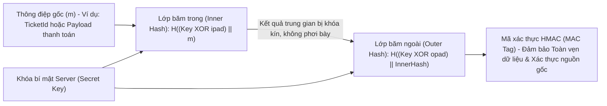
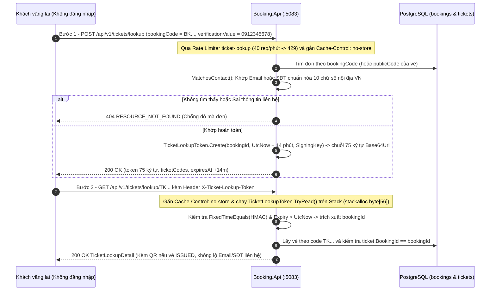
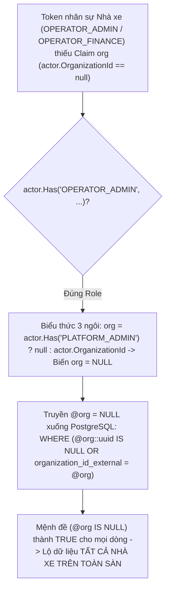
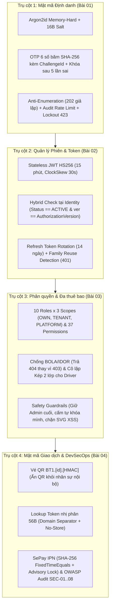

# Bài 04: Bảo Mật Webhook, Vé Điện Tử QR HMAC, Lookup Token & Tự Kiểm Toán OWASP API Top 10

> **Thuộc bộ tài liệu:** Cẩm nang Thuyết trình Toàn diện — Dự án **BLUE Bus Ticket Platform (PBL6)**
> **Chuyên đề 04:** An toàn Thông tin, Định danh, JWT, RBAC & Kiểm toán Bảo mật OWASP
> **Mã nguồn trọng tâm:** `TicketQr.cs`, `TicketLookupToken.cs`, `SePayCheckout.cs`, `SePayIpn.cs`, `SePayPaymentStore.cs`, `VnPayCheckout.cs`, `docs/security/owasp-api-2026-11-16/`

---

## Chương 1: Lý Thuyết HMAC — Khi Dữ Liệu Phải Đi Qua "Vùng Đất Không Tin Cậy" Ngoài Tầm Tay Của JWT

Ở Bài 02 và Bài 03, mọi tương tác đều diễn ra giữa một trình duyệt đã đăng nhập (mang `Authorization: Bearer <JWT>`) và API Server. Nhưng trong đời sống thực tế của một nền tảng bán vé xe khách trực tuyến, có **4 luồng nghiệp vụ trọng yếu mà tại đó KHÔNG HỀ CÓ JWT của chủ đơn hàng**:

1. **Quét mã QR lên xe tại bến bãi:** Hành khách đưa tờ giấy in mã QR hoặc ảnh chụp màn hình Zalo cho tài xế quét. Tờ giấy không thể tự "đăng nhập" hay xoay vòng Refresh Token!
2. **Khách vãng lai tra cứu vé nhanh:** Bố mẹ ở quê được con cái đặt vé giúp, chỉ có Mã đặt chỗ (`BK...`) và Số điện thoại, muốn mở web xem giờ xe chạy và mã vé mà không có tài khoản đăng nhập.
3. **Chuyển hướng trình duyệt sang Cổng thanh toán (SePay) rồi quay về:** Dữ liệu giá tiền đi qua trình duyệt của chính người mua (nơi họ có thể bấm F12 sửa HTML form!), và URL quay về phải nhảy từ tên miền công khai về phiên làm việc của khách.
4. **Webhook / IPN từ máy chủ Ngân hàng bắn về Backend (`Server-to-Server`):** Máy chủ của SePay gọi thẳng vào `POST /integrations/payments/sepay/ipn` để báo *"Khách vừa chuyển khoản thành công 450.000đ"* — đương nhiên SePay không có tài khoản người dùng trên sàn BLUE!

Làm thế nào để chống giả mạo dữ liệu trên cả 4 mặt trận này? Câu trả lời thống nhất của ngành mật mã học ứng dụng chính là **HMAC (`Hash-based Message Authentication Code` — Chuẩn IETF RFC 2104)**.

---

### 1.1. HMAC khác Hàm băm thường (`SHA-256`) ở chỗ nào? Tại sao không tự ghép `SHA256(key + message)`?

#### 1. Tại sao `SHA-256(message)` thuần túy vô dụng trước kẻ giả mạo?
Hàm băm `SHA-256` không có khóa bí mật. Nếu mã QR trên vé chỉ được tạo bằng `ticketId + "." + SHA256(ticketId)`, bất kỳ ai biết một `ticketId` bất kỳ đều có thể tự chạy hàm `SHA-256` công khai trên mạng để in ra một tấm vé QR có mã kiểm tra hợp lệ 100%!

#### 2. Tại sao tự chế `SHA-256(secretKey + message)` lại dính lỗ hổng kinh điển *Length Extension Attack*?
Nhiều người nghĩ: *"Chỉ cần nối khóa bí mật vào đầu thông điệp rồi băm `SHA256(secretKey + message)` là xong!"*. **Sai lầm chết người trong mật mã học!**
* Các hàm băm thuộc họ *Merkle–Damgård* (như `SHA-256`, `SHA-512`) xử lý dữ liệu theo từng khối nối tiếp nhau (64 bytes/khối), và **kết quả băm cuối cùng thực chất chính là trạng thái thanh ghi nội bộ của cỗ máy băm ngay sau khối cuối cùng**.
* Nếu kẻ tấn công nhìn thấy chuỗi `message = "amount=100000"` và mã băm `H = SHA256(secretKey + message)`, hắn **không cần biết `secretKey` là gì**, chỉ cần nạp ngược giá trị `H` vào làm trạng thái khởi đầu của bộ băm `SHA-256`, rồi băm nối tiếp thêm đuôi `"&amount=1000"` để tạo ra một mã băm mới hoàn toàn hợp lệ với `secretKey` của máy chủ! Kỹ thuật tấn công đáng sợ này gọi là **Length Extension Attack (Tấn công nối dài thông điệp)**.

#### 3. Cấu trúc băm lồng 2 lớp bất khả xâm phạm của `HMAC` (RFC 2104)
Để tiêu diệt vĩnh viễn Length Extension Attack, `HMAC` trộn khóa bí mật $K$ qua hai hằng số đệm (`ipad = 0x36`, `opad = 0x5c`) và thực hiện **hai lần băm lồng nhau**:

$$\text{HMAC}(K, m) = H\Big(\ (K' \oplus \text{opad}) \ \parallel \ H\big((K' \oplus \text{ipad}) \parallel m\big)\ \Big)$$



Vì kết quả của lớp băm trong không bao giờ lộ ra ngoài mà bị bọc kín bởi lớp băm ngoài có trộn lại khóa bí mật lần hai, không một kẻ tấn công nào không nắm giữ `Secret Key` có thể sửa dù chỉ 1 bit của thông điệp hay nối dài thêm dữ liệu!

---

## Chương 2: Giải Phẫu 4 Cơ Chế Xác Thực Mật Mã Ngoài JWT Trong Dự Án BLUE

### 2.1. Cơ chế 1: Vé Điện Tử QR (`TicketQr.cs`) & Chính Sách Ẩn Chuỗi QR Khỏi Nhân Sự Nội Bộ

Hãy đọc trọn vẹn file `workspace/src/services/booking/BusTicketPlatform.Booking.Application/TicketQr.cs`:

```csharp
using System.Security.Cryptography;
using System.Text;

namespace BusTicketPlatform.Booking.Application;

public sealed class TicketQrOptions
{
    public string SigningKey { get; init; } = "local-dev-only-change-me-32bytes-min";
}

public static class TicketQr
{
    public const string Prefix = "BT1";

    public static string Create(Guid ticketId, string signingKey)
    {
        var id = ticketId.ToString("N");
        return $"{Prefix}.{id}.{Mac(id, signingKey)}";
    }

    public static bool TryVerify(string payload, string signingKey, out Guid ticketId)
    {
        ticketId = default;
        var parts = payload.Split('.', 3, StringSplitOptions.TrimEntries);
        if (parts.Length != 3
            || !parts[0].Equals(Prefix, StringComparison.Ordinal)
            || !Guid.TryParseExact(parts[1], "N", out ticketId))
        {
            return false;
        }

        var expected = Mac(parts[1], signingKey);
        var actual = parts[2].ToUpperInvariant();
        if (actual.Length != expected.Length)
        {
            return false;
        }

        return CryptographicOperations.FixedTimeEquals(Encoding.ASCII.GetBytes(expected), Encoding.ASCII.GetBytes(actual));
    }

    private static string Mac(string ticketIdN, string signingKey) =>
        Convert.ToHexString(HMACSHA256.HashData(Encoding.UTF8.GetBytes(signingKey), Encoding.UTF8.GetBytes(ticketIdN)));
}
```

#### Giải phẫu chi tiết cấu trúc mã QR và quy tắc hiển thị bảo mật:

1. **Định dạng có phiên bản `BT1.<ticketId:N>.<HMACSHA256_HEX>`:**
   * `BT1` (*Bus Ticket v1*): Tiền tố định danh phiên bản giao thức. Nếu sang năm sàn nâng cấp thuật toán lên chữ ký bất đối xứng `Ed25519` để thiết bị cầm tay của tài xế quét vé ngoại tuyến (offline) trên đèo không có sóng 4G, chỉ cần định nghĩa tiền tố `BT2` song song mà các vé `BT1` khách mua trước đó hàng tháng vẫn quét lên xe bình thường!
   * `<ticketId:N>`: Chuỗi 32 ký tự Hex không dấu gạch ngang của UUIDv7 mã vé.
   * `<HMACSHA256_HEX>`: 64 ký tự Hex chữ hoa tính từ `HMACSHA256(signingKey, ticketIdN)`, được đối chiếu bằng `CryptographicOperations.FixedTimeEquals` (chống Timing Attack khi quét qua API `/api/v1/tickets/validate`).

2. **Tại sao chỉ hiển thị chuỗi QR khi người gọi là Chủ vé VÀ vé đang ở trạng thái `"ISSUED"`?**
   Hãy xem cách `BookingService.cs` kiểm soát chặt chẽ tham số `includeQr` ở 3 nơi (`ListBookingTicketsAsync` dòng 557, `GetTicketAsync` dòng 582–593, và `MapTicket` dòng 734–748):
   ```csharp
   public async Task<Result<TicketDto>> GetTicketAsync(Actor actor, Guid ticketId, CancellationToken cancellationToken)
   {
       await store.ExpireHoldsAsync(cancellationToken);
       var ticket = await store.GetTicketAsync(ticketId, cancellationToken);
       if (ticket is null)
       {
           return Result<TicketDto>.Failure(PlatformErrors.NotFound());
       }

       if (ticket.CustomerId == actor.UserId)
       {
           return Result<TicketDto>.Success(MapTicket(ticket, includeQr: ticket.Status == "ISSUED"));
       }

       var booking = await store.GetBookingAsync(ticket.BookingId, cancellationToken);
       if (booking is null || !CanRead(actor, booking))
       {
           return Result<TicketDto>.Failure(PlatformErrors.NotFound());
       }

       return Result<TicketDto>.Success(MapTicket(ticket)); // <-- includeQr mặc định = FALSE!
   }
   ```
   * **Bảo vệ chống gian lận nội bộ (Insider Threat Prevention):** Khi nhân viên CSKH của sàn (`PLATFORM_SUPPORT`) hoặc nhân viên điều hành nhà xe (`OPERATOR_OPERATIONS`) mở màn hình quản trị xem thông tin vé của khách để hỗ trợ đổi giờ, code đi xuống dòng 593 (`includeQr: false`) -> Trường `qrToken` trả về **`null`**! Điều này đảm bảo **không một nhân viên nào trên hệ thống có thể nhìn thấy hoặc chụp trộm mã QR của khách hàng** để tuồn ra ngoài quét lậu lên xe trước khách thật!
   * **Bảo vệ vòng đời trạng thái:** Ngay cả với chính chủ vé (`ticket.CustomerId == actor.UserId`), chuỗi QR cũng chỉ được sinh ra khi `ticket.Status == "ISSUED"`. Ngay khi vé đã quét lên xe (`CHECKED_IN`) hoặc đã hủy (`CANCELLED`), mã QR tự động biến mất khỏi giao diện, tránh nhầm lẫn đưa nhầm vé cũ cho tài xế.

---

### 2.2. Cơ chế 2: Tra Cứu Vé Không Đăng Nhập (`TicketLookupToken.cs`) — Luồng 2 Bước Zero-Allocation Có Phân Tách Miền

Làm thế nào cho phép khách vãng lai tra cứu vé mà không biến API thành mồi ngon cho kẻ tấn công vét cạn toàn bộ vé trên sàn? Dự án BLUE thiết kế **Luồng Xác Thực 2 Bước (Two-Step Capability Token)** cực kỳ tinh xảo.

Hãy đọc nguyên văn `workspace/src/services/booking/BusTicketPlatform.Booking.Application/TicketLookupToken.cs`:

```csharp
using System.Buffers.Binary;
using System.Security.Cryptography;
using System.Text;

namespace BusTicketPlatform.Booking.Application;

public sealed record TicketLookupAccess(string Token, IReadOnlyList<string> TicketCodes, DateTimeOffset ExpiresAt);
public sealed record TicketLookupDetail(TicketDto Ticket, string BookingCode, Guid SeatId, Guid PickupStopId, Guid DropoffStopId);

internal static class TicketLookupToken
{
    private const int PayloadLength = 24;

    private static byte[] Key(string secret) =>
        HMACSHA256.HashData(Encoding.UTF8.GetBytes(secret), "blue-ticket-lookup-v1"u8);

    public static string Create(Guid bookingId, DateTimeOffset expiry, string secret)
    {
        var data = new byte[PayloadLength + 32];
        bookingId.TryWriteBytes(data);
        BinaryPrimitives.WriteInt64BigEndian(data.AsSpan(16), expiry.ToUnixTimeSeconds());
        HMACSHA256.HashData(Key(secret), data.AsSpan(0, PayloadLength), data.AsSpan(PayloadLength));
        return Convert.ToBase64String(data).TrimEnd('=').Replace('+', '-').Replace('/', '_');
    }

    public static bool TryRead(string token, string secret, out Guid bookingId)
    {
        bookingId = default;
        if (token.Length != 75) return false;
        Span<byte> data = stackalloc byte[PayloadLength + 32];
        if (!Convert.TryFromBase64String(token.Replace('-', '+').Replace('_', '/') + "=", data, out var written)
            || written != data.Length)
            return false;
        var expected = HMACSHA256.HashData(Key(secret), data[..PayloadLength]);
        if (!CryptographicOperations.FixedTimeEquals(expected, data[PayloadLength..])
            || BinaryPrimitives.ReadInt64BigEndian(data[16..]) <= DateTimeOffset.UtcNow.ToUnixTimeSeconds())
            return false;
        bookingId = new Guid(data[..16]);
        return true;
    }
}
```



#### 5 Điểm Sáng Kỹ Thuật Đỉnh Cao Trong `TicketLookupToken`:

1. **Dẫn xuất khóa con bằng Domain Separator (`"blue-ticket-lookup-v1"u8`, dòng 14–15):**
   Dù hệ thống truyền chung biến cấu hình `ticketQr.SigningKey` vào cả `TicketQr` lẫn `TicketLookupToken`, `TicketLookupToken` **không dùng trực tiếp khóa gốc** mà băm `HMACSHA256(secret, "blue-ticket-lookup-v1")` để sinh ra một khóa con hoàn toàn độc lập! Trong mật mã học, kỹ thuật này gọi là **Key Derivation with Domain Separation**, đảm bảo chữ ký ở giao thức QR không bao giờ có thể bị cắt ghép sang giao thức Lookup Token!
2. **Đóng gói nhị phân 56 bytes siêu tối ưu với `Span<byte>` và `stackalloc`:**
   Thay vì serialize JSON cồng kềnh tốn bộ nhớ Heap và Garbage Collector, token chỉ gồm đúng **56 bytes** (`[0..15]: Guid bookingId` + `[16..23]: Int64 Big-Endian Unix Expiry` + `[24..55]: 32-byte HMAC-SHA256`), khi chuyển sang Base64Url luôn có độ dài bất biến **`75 ký tự`**. Dòng 29 (`if (token.Length != 75) return false;`) bác bỏ mọi chuỗi rác trong `1 nano-giây` mà không cấp phát 1 byte Heap nào (`stackalloc byte[56]`)!
3. **Chuẩn hóa SĐT Việt Nam 10 số & Chống rò rỉ thông tin liên hệ (`BookingService.cs` dòng 535–550):**
   Hàm `MatchesContact` lọc ký tự số ASCII, tự động quy đổi `+84912345678` hoặc `84912345678` về `0912345678` và bắt buộc đủ 10 số (`phone.Length == 10`). Đặc biệt, ở Bước 2 (`TicketLookupDetail`), dữ liệu trả về **chỉ chứa thông tin vé, ghế và điểm đón/trả, hoàn toàn KHÔNG chứa Email hay Số điện thoại của người đặt** (đã vượt qua kiểm toán OWASP API3 Property Authorization!).
4. **Truyền qua Custom Header `X-Ticket-Lookup-Token` thay vì URL Query String:**
   Đặt token trong HTTP Header giúp token không bị lưu vết vào lịch sử trình duyệt (Browser History), không bị ghi vào Access Log mặc định của Reverse Proxy, và không bị rò rỉ qua header `Referer` khi nhấp vào liên kết ngoài.
5. **Chống lưu đệm máy tính công cộng (`Cache-Control: no-store`, `BookingEndpoints.cs` dòng 69 & 79):**
   Bắt buộc trình duyệt xóa sạch dữ liệu vé khỏi bộ nhớ đệm đĩa cứng ngay khi đóng tab, bảo vệ hành khách tra cứu vé ở tiệm in ấn hoặc máy tính công cộng.

---

### 2.3. Cơ chế 3 & 4: Bảo Mật Cổng Thanh Toán SePay (IPN + Localhost Return Bridge) & VNPay (`HMAC-SHA512`)

Thanh toán là nơi kẻ tấn công nhắm vào trực tiếp nhất để chiếm đoạt tiền thật (Financial Fraud). Trong `BusTicketPlatform.Payment`, hệ thống triển khai song song 2 cổng với kỷ luật mật mã khắt khe:

#### A. SePay Checkout Signature & Cầu nối `BLUE_SEPAY_LOCAL_RETURN:` (`SePayCheckout.cs`)
1. **Ký Form Thanh toán (`SePayCheckout.Sign`, dòng 28–36):**
   Ghép chính xác 11 trường theo thứ tự bắt buộc của SePay (`order_amount`, `merchant`, `currency`, `operation`, `order_description`, `order_invoice_number`, `customer_id`, `payment_method`, `success_url`, `error_url`, `cancel_url`), ký `Base64(HMAC-SHA256)`. Nếu kẻ mua mở F12 sửa `<input name="order_amount" value="1000">`, chữ ký `signature` lập tức vỡ và cổng SePay từ chối giao dịch ngay tại cửa!
2. **Cầu nối Quay về Localhost Có Chữ Ký (`TryReadLocalReturn`, dòng 43–50 & 77–95):**
   * Khi chạy môi trường `sandbox` kết nối cổng SePay thật qua domain công khai (tunnel), SePay yêu cầu URL callback phải là HTTPS public (`!uri.IsLoopback`), trong khi trình duyệt dev đang chạy ở `http://localhost:5173`.
   * Thay vì mở một endpoint redirect tự do nguy hiểm, `BuildAction` đóng gói `LocalReturnState(BookingId, Origin, Expiry +24h)` và ký `HMAC-SHA256` kèm domain separator **`"BLUE_SEPAY_LOCAL_RETURN:" + payload`**.
   * Khi trình duyệt quay về `/integrations/payments/sepay/browser-return?state=...` (`PaymentEndpoints.cs` dòng 22–28, gắn `Cache-Control: no-store` và `Referrer-Policy: no-referrer`), `TryReadLocalReturn` kiểm tra: (1) Đang ở môi trường `sandbox`, (2) Chữ ký khớp bằng `FixedTimeEquals`, (3) Chưa quá hạn `Expiry`, và (4) **Đích đến bắt buộc phải là địa chỉ Loopback nội bộ (`uri.IsLoopback && uri.UserInfo.Length == 0`)**! Không một domain lừa đảo bên ngoài nào có thể lọt qua cầu nối này!

#### B. SePay IPN Webhook: Tuyệt kỹ Băm Kép Chống Lộ Độ Dài Khóa & Giao dịch Nguyên tử (`PaymentEndpoints.cs` & `SePayPaymentStore.cs`)

Hãy chiêm ngưỡng 2 dòng code tại `SePayCheckout.Authenticate` (`SePayCheckout.cs`, dòng 97–98):

```csharp
public static bool Authenticate(string configured, string supplied) => !string.IsNullOrWhiteSpace(configured)
    && CryptographicOperations.FixedTimeEquals(
        SHA256.HashData(Encoding.UTF8.GetBytes(configured)),
        SHA256.HashData(Encoding.UTF8.GetBytes(supplied)));
```

> [!TIP]
> **Chi tiết mật mã đẳng cấp chuyên gia (Senior Security Insight):**
> Tại sao không truyền thẳng mảng byte của `configured` và `supplied` từ Header `X-Secret-Key` vào `FixedTimeEquals`, mà phải băm **`SHA256.HashData(...)` cả hai vế trước**?
> * Bởi vì hàm `CryptographicOperations.FixedTimeEquals(left, right)` bắt đầu bằng câu lệnh `if (left.Length != right.Length) return false;`! Nếu so sánh trực tiếp, kẻ tấn công gửi `X-Secret-Key` có độ dài lần lượt 1, 2, 3... ký tự và đo thời gian phản hồi sẽ **biết được chính xác độ dài của `IpnSecretKey`**!
> * Khi băm cả hai chuỗi qua `SHA-256` trước khi so sánh, cả hai mảng đầu vào của `FixedTimeEquals` **luôn luôn dài cố định đúng 32 bytes** dù kẻ tấn công gửi chuỗi rỗng hay chuỗi dài 1.000 ký tự — khóa kín 100% mọi kênh rò rỉ thông tin về độ dài khóa bí mật!

Sau khi vượt qua xác thực `X-Secret-Key` và bộ lọc cú pháp nghiêm ngặt `SePayIpn.Parse` (`ORDER_PAID`, `CAPTURED`, `APPROVED`, số tiền khớp tuyệt đối giữa `order_amount` và `transaction_amount`), `SePayPaymentStore.ApplySePayAsync` (`SePayPaymentStore.cs` dòng 12–122) thực thi giao dịch ACID nguyên tử với **5 lớp bảo vệ tài chính**:
1. **Khóa tư vấn mức giao dịch PostgreSQL (`pg_advisory_xact_lock(hashtext(@txn))` & `hashtext(@booking)`) + `FOR UPDATE`:** Chặn tuyệt đối Race Condition khi cổng thanh toán bắn 2 request IPN trùng nhau cách nhau 1 mili-giây.
2. **Chống Tái sử dụng Mã giao dịch Ngân hàng cho Đơn khác (Dòng 38–43):** Kiểm tra `provider_transaction_id = @txn AND payment_id <> @payment` trong bảng `webhook_receipts` — một giao dịch chuyển khoản thật không bao giờ có thể bị dùng để gạch nợ cho hai hóa đơn khác nhau!
3. **Idempotent Receipt Deduplication (Dòng 47–59):** Ghi vào `webhook_receipts` với `ON CONFLICT (provider, external_event_id) DO NOTHING`. Nếu IPN gửi lại lần 2 -> trả `200 OK` êm ái mà không tạo thêm vé hay bút toán quyết toán thứ hai!
4. **Xử lý Thanh toán Trễ Sau Khi Hết Giữ Ghế (`Late Payment Auto-Refund`, dòng 66 & 80–85):** Nếu khách quét QR chuyển khoản quá muộn lúc ghế đã hết hạn 10 phút và bán cho người khác (`payment.ExpiresAt <= UtcNow`), hệ thống **không phát sự kiện xuất vé trùng ghế**, mà tự động chuyển thanh toán sang `REFUND_PENDING` và xếp hàng lệnh hoàn tiền `LATE_PROVIDER_SUCCESS` trả lại tiền cho khách!
5. **Đối soát Bất thường (`reconciliation_cases`, dòng 108–119):** Nếu ngân hàng báo hủy giao dịch sau khi vé đã xuất (`VOID_AFTER_CAPTURE`), hệ thống mở hồ sơ cảnh báo mức `HIGH` cho kế toán đối soát thay vì âm thầm thu hồi vé khiến hành khách đang ngồi trên xe bị đuổi xuống!

#### C. Mã tương thích VNPay Sandbox, tắt mặc định (`VnPayCheckout.cs`)
Sử dụng chuẩn ký của cổng thanh toán nội địa VNPay (dòng 69–93): lọc các tham số bắt đầu bằng `vnp_` (trừ `vnp_SecureHash` và `vnp_SecureHashType`), sắp xếp khóa theo thứ tự từ điển nhị phân **`StringComparer.Ordinal`**, mã hóa URL (`WebUtility.UrlEncode`), ký bằng **`HMAC-SHA512`** (512-bit) và xác minh hằng thời gian `FixedTimeEquals`.


---

## Chương 3: Giải Phẫu Báo Cáo Tự Kiểm Toán OWASP API Top 10 (`docs/security/owasp-api-2026-11-16/`)

> [!IMPORTANT]
> **Góc nhìn chiến lược khi thuyết trình Đồ án Tốt nghiệp / PBL6:**
> Rất nhiều nhóm sinh viên sợ nhắc tới các điểm yếu còn tồn tại vì lo bị trừ điểm. Trên thực tế, trước một hội đồng gồm các giảng viên và kiến trúc sư dày dạn kinh nghiệm, việc tuyên bố *"Hệ thống của em an toàn tuyệt đối 100%"* mới là điều thiếu thuyết phục nhất!
> Ngược lại, dự án **BLUE Bus Ticket Platform** đã thực hiện một đợt **Tự Kiểm Toán Bảo Mật Thực Chiến (Internal Red-Team & OWASP API Security Top 10 2023 Audit)** bài bản như một doanh nghiệp phần mềm chuyên nghiệp:
> * Kiểm kê đầy đủ **117 API Operations** từ OpenAPI sống của cả 6 Microservices.
> * Chạy ma trận **68 ca kiểm thử phân quyền Postman** trực tiếp qua YARP Gateway thật (`localhost:5080`) — đạt **68/68 Pass**.
> * Chạy **21 kịch bản thăm dò trực tiếp (Live HTTP Probes)** và viết thêm **5 ca Integration Tests hồi quy gắn nhãn `[Trait("Category", "SecurityAudit")]`** chạy trên PostgreSQL Testcontainers cô lập — chủ đích giữ trạng thái **Đỏ (Failing)** để làm tiêu chuẩn nghiệm thu bắt buộc cho kế hoạch khắc phục **`SEC-01` -> `SEC-08`** (`docs/security/SECURITY-REMEDIATION-TASKS.md`)!
>
> Trình bày phần này một cách đĩnh đạc chính là minh chứng hùng hồn nhất cho tư duy **DevSecOps & Secure Software Development Lifecycle (SSDLC)** của nhóm!

---

### 3.1. Bức tranh Tổng quan Đối chiếu OWASP API Security Top 10 (2023)

| Mã OWASP 2023 | Tên Hạng mục Rủi ro | Điểm Mạnh Đã Vượt Qua Kiểm Thử | Phát Hiện Cần Khắc Phục (`Finding`) |
| :--- | :--- | :--- | :--- |
| **API1:2023** | *Broken Object Level Authorization (BOLA)* | Che giấu đơn/vé của khách khác bằng `404`; cô lập Driver 2 lớp; `TransportService.TryTenant` fail-closed. | **`F03` (High):** Operator thiếu claim `org` truyền `null` xuống SQL thành xem toàn sàn. |
| **API2:2023** | *Broken Authentication* | Argon2id, OTP băm kèm salt + giới hạn 5 lần thử, Account Lockout 15m, Refresh Family Reuse Detection. | **`F02` (Critical):** Dùng khóa ký JWT fallback mặc định.<br/>**`F04` (Medium):** Logout chưa thu hồi tức thời Access Token. |
| **API3:2023** | *Broken Object Property Level Authorization* | Tính giá tiền & giảm giá thuần phía Server (`PriceMismatch`); chặn SVG XSS ở Avatar; Lookup không lộ SĐT/Email. | Cần tiếp tục kiểm toán fuzzing toàn diện mọi DTO mở rộng. |
| **API4:2023** | *Unrestricted Resource Consumption* | Chặn trần `size <= 100`, `MaxLength = 128` password, `ContentLength <= 64KB` IPN, Per-identity OTP limit. | **`SEC-07`:** `ticket-lookup` dùng chung 1 giỏ 40 req/phút chưa chia theo IP; thiếu quota giữ ghế mỗi user. |
| **API5:2023** | *Broken Function Level Authorization (BFLA)* | 68/68 ca gọi không phép qua YARP Gateway `:5080` đều bị chặn chuẩn xác; Admin guards chống tự sửa quyền. | **`F01` (Critical):** Các endpoint nội bộ `/internal/*` trên cổng service lẻ chưa gắn xác thực. |
| **API6:2023** | *Unrestricted Access to Sensitive Flows* | Khóa bi quan giữ ghế đồng thời, hết hạn giữ ghế 10m, chống dùng lại giao dịch SePay IPN, hoàn tiền tự động khi trả trễ. | **`SEC-07`:** Bổ sung chống Bot giữ ghế hàng loạt quy mô lớn. |
| **API7:2023** | *Server-Side Request Forgery (SSRF)* | Server không tự fetch bất kỳ `ReturnUri` tùy ý nào do người dùng cung cấp trong luồng thanh toán. | Tiếp tục duy trì chính sách Egress Network chặt chẽ. |
| **API8:2023** | *Security Misconfiguration* | Frontend Nginx bật `X-Frame-Options: DENY`, `nosniff`, `Referrer-Policy`; CORS chặn origin lạ; `pgadmin` bind `127.0.0.1`. | **`F02`** (khóa mẫu) & **`F06` (High):** Mở cổng Docker `5081..5086` và Mailpit `8025` trên `0.0.0.0`; bổ sung CSP (`SEC-08`). |
| **API9:2023** | *Improper Inventory Management* | Quản lý tập trung OpenAPI contract của 117 operations. | **`F05` (Medium):** Callback VNPay cũ (`/integrations/payments/{provider}/return`) còn mở và dính Open Redirect. |
| **API10:2023** | *Unsafe Consumption of APIs* | Kiểm tra chặt schema, số tiền, loại tiền, trạng thái và chữ ký của SePay IPN trước khi ghi DB. | Duy trì kiểm thử hợp đồng (Contract Testing) khi tích hợp cổng thứ ba. |

---

### 3.2. Giải Phẫu Sâu 6 Phát Hiện Thực Tế (`F01` -> `F06`) & Phương Án Vá Triệt Để (`SEC-01..08`)

Hãy đi sâu vào từng phát hiện với mã nguồn thực tế để hiểu rõ **Nguyên nhân gốc rễ (Root Cause)** -> **Kịch bản khai thác (Exploit Path)** -> **Cách sửa triệt để (Remediation)**:

---

#### Phát hiện `F01` (Critical — OWASP API5): Các Endpoint Nội Bộ `/internal/*` Chưa Gắn Xác Thực Phía Service

* **Vị trí trong mã nguồn:**
  1. `BookingEndpoints.cs` (dòng 60–61):
     ```csharp
     api.MapPost("/internal/trips/published", ImportAsync);
     api.MapPost("/internal/payments/succeeded", PaymentSucceededAsync);
     ```
  2. `Reporting.Api/Program.cs` (dòng 53): `app.MapPost("/internal/projections/bookings", ...)`
  3. `PaymentEndpoints.cs` (dòng 45): `endpoints.MapPost("/internal/quotes", QuoteAsync);`
  4. `TransportEndpoints.cs` (dòng 56): `endpoints.MapPost("/internal/trips/{tripId:guid}/inventory-ready", InventoryReadyAsync);`
  5. `Notification.Api/Program.cs` (dòng 52): `app.MapPost("/internal/notifications", ...)`
* **Tại sao lập trình viên dễ mắc lỗi này?**
  Khi nhìn vào cấu hình YARP Gateway (`Gateway/appsettings.json`), nhóm hoàn toàn **không ánh xạ** đường dẫn `/internal/*` ra cổng công khai `5080`. Nếu kẻ tấn công gọi qua Gateway `http://localhost:5080/api/v1/internal/payments/succeeded`, Gateway chặn ngay lập tức (`404 Not Found`)! Tuy nhiên, nguyên tắc **Zero Trust Architecture** chỉ ra rằng: không bao giờ được ỷ lại hoàn toàn vào bức tường ngoài cùng (Perimeter Security). Do `docker-compose.apps.yml` (dòng 77) đồng thời mở cổng `5083:8080` của `Booking.Api` trực tiếp ra host, kẻ tấn công có kết nối mạng tới cổng `5083` có thể tạo một đơn `PREPAID` rồi bắn thẳng một JSON không cần token:
  `POST http://<host>:5083/api/v1/internal/payments/succeeded` với đúng `bookingId` và `amount` -> `BookingService.ApplyPaymentSucceededAsync` tưởng sự kiện đến từ `Payment.Api` nên chuyển đơn sang **`PAID` và xuất vé điện tử miễn phí (`204 No Content`)**!
* **Bằng chứng kiểm thử hồi quy:** Ca test `Security_anonymous_payment_event_cannot_issue_tickets` (`BookingFlowTests.cs` dòng 354–372) và `Anonymous_clients_cannot_inject_reporting_projections` (`Reporting/SecurityAuditTests.cs` dòng 13–19).
* **Phương án khắc phục triệt để (`SEC-01`):**
  1. Vì hệ thống đã có hạ tầng giao tiếp bất đồng bộ **RabbitMQ Outbox / Inbox**, gỡ bỏ hoàn toàn các HTTP ingestion endpoint dư thừa chỉ phục vụ đồng bộ nội bộ.
  2. Nếu giữ lại cho mục đích vận hành nội bộ, bắt buộc xác thực **Service-to-Service Identity riêng biệt** (mTLS hoặc chữ ký nội bộ `X-Internal-Signature` kèm `Timestamp` + `Nonce` chống Replay; **tuyệt đối không dùng `.RequireAuthorization()` chung chung** vì nếu chỉ gắn `.RequireAuthorization()`, một khách hàng `CUSTOMER` đăng nhập hợp lệ vẫn gọi được endpoint nội bộ!).

---

#### Phát hiện `F02` (Critical — OWASP API2 & API8): Sử Dụng Khóa Ký JWT Mặc Định Trong Cấu Hình Runtime

* **Vị trí trong mã nguồn & cấu hình:**
  * `PlatformJwtExtensions.cs` (dòng 16–18) & `Identity.Api/Program.cs` (dòng 37–39): Fallback về chuỗi `"local-dev-only-change-me-32bytes-min"` khi biến cấu hình rỗng.
  * `docker-compose.apps.yml` (dòng 18 & 22):
    ```yaml
    ASPNETCORE_ENVIRONMENT: Production
    Authentication__SigningKey: ${JWT_SIGNING_KEY:-local-dev-only-change-me-32bytes-min}
    ```
* **Tác động bảo mật:** Nếu người vận hành chạy `docker compose up` mà quên truyền biến môi trường `JWT_SIGNING_KEY` từ bên ngoài, Docker Compose tự động điền chuỗi fallback công khai trong Git dù container đang mang nhãn `ASPNETCORE_ENVIRONMENT=Production`. Với khóa đối xứng `HS256` đã lộ, kẻ tấn công có thể dùng 5 dòng script Python tự ký ra một JWT mang role `"PLATFORM_ADMIN"` để vượt qua mọi service chỉ kiểm tra chữ ký!
* **Phương án khắc phục triệt để (`SEC-02`):**
  * Áp dụng quy tắc **Fail-Fast Startup Validation** (đã nêu rõ trong tài liệu chuẩn `03-configuration-baseline.md` dòng 78): Trong `Program.cs`, nếu `!builder.Environment.IsDevelopment()` mà `SigningKey` bị rỗng, ngắn hơn 32 bytes, hoặc bằng với bất kỳ hằng số mẫu nào từng xuất hiện trong Git (`"local-dev-only-..."`), ứng dụng **ném ngay `InvalidOperationException` từ chối khởi động** thay vì âm thầm chạy với khóa yếu!
  * Về lâu dài, chuyển sang cặp khóa bất đối xứng **`RS256` / `Ed25519`** để chỉ duy nhất `Identity.Api` giữ Private Key ký token.

---

#### Phát hiện `F03` (High — OWASP API1): Bẫy Thiết Kế "Fail-Open" Khi `OrganizationId == null` Ở 3 Hàm Tra Cứu

Đây là bài học đắt giá nhất về lập trình an toàn với kiểu dữ liệu `Nullable<Guid>` (`Guid?`) trong C# và SQL mà bất kỳ kỹ sư Backend nào cũng cần khắc cốt ghi tâm!

* **Hãy đặt lên bàn cân so sánh 2 đoạn code thực tế trong dự án:**
  * **Bên làm ĐÚNG chuẩn Fail-Closed (`TransportService.TryTenant`, dòng 955):**
    ```csharp
    if (actor.OrganizationId is null || !actor.Has(roles))
    {
        error = PlatformErrors.AccessDenied(); // Thiếu org -> Đóng sập cửa 403 ngay!
        return false;
    }
    ```
  * **Bên mắc bẫy Fail-Open (`BookingService.SearchBookingsAsync` dòng 376, `PaymentService.cs` dòng 371/385/400, và `ReportingService.cs` dòng 79):**
    ```csharp
    // Trong BookingService.cs (dòng 376):
    var org = actor.Has("PLATFORM_ADMIN", "PLATFORM_SUPPORT") ? (Guid?)null : actor.OrganizationId;
    var items = await store.SearchBookingsAsync(org, page, size, cancellationToken);
    ```
    Và nhìn xuống câu lệnh SQL nhận tham số `org` đó trong `BookingRepository.cs` (dòng 549) cũng như `ReportingRepository.cs` (dòng 105):
    ```sql
    WHERE (@org::uuid IS NULL OR b.organization_id_external = @org)
    ```



* **Bài học sâu sắc:** Lập trình viên đã dùng chung một giá trị đặc biệt `null` để biểu diễn **hai ngữ nghĩa hoàn toàn trái ngược nhau**: (1) *"Người gọi là Quản trị viên Toàn Sàn được xem tất cả"* và (2) *"Người gọi là Nhân sự Nhà xe nhưng không có mã nhà xe"*. Khi hai ngữ nghĩa này chập làm một ở tầng SQL `(@org IS NULL OR ...)`, việc thiếu thông tin định danh thuê bao lại vô tình biến thành quyền tối thượng toàn hệ thống!
* **Phương án khắc phục triệt để (`SEC-03`):**
  1. Chặn cứng ngay tại tầng Application trước mọi câu truy vấn:
     ```csharp
     var isPlatformScope = actor.Has("PLATFORM_ADMIN", "PLATFORM_SUPPORT");
     if (!isPlatformScope && actor.OrganizationId is null)
     {
         return Result<BookingPageDto>.Failure(PlatformErrors.AccessDenied());
     }
     ```
  2. Ở tầng SQL Repository, tách riêng tham số cờ tường minh `@allTenants::boolean` thay vì lạm dụng `@org IS NULL` làm ký tự đại diện (wildcard)!

---

#### Phát hiện `F04` (Medium — OWASP API2): Khoảng Trống Thu Hồi Tức Thời Access Token Sau Khi Đăng Xuất

* **Hiện trạng:** Như đã phân tích kỹ ở Bài 02 (Mục 3.2), `AuthService.LogoutAsync` thu hồi sạch các dòng trong `refresh_sessions`, nhưng chưa tăng `users.authorization_version` (hoặc kiểm tra trạng thái sống của `sid` trong `OnTokenValidated`), khiến Access Token cũ còn sống tối đa tới hết cửa sổ 15 phút (+30s skew). Đồng thời 5 service dùng `AddPlatformJwt` chưa nhận tín hiệu thu hồi chéo trước hạn 15 phút.
* **Phương án khắc phục triệt để (`SEC-05`):**
  * Kiểm tra sự tồn tại và trạng thái chưa thu hồi của `sid` (hoặc tăng `AuthorizationVersion`) khi Logout.
  * Sử dụng **Redis Distributed Denylist** lưu khóa `revoked:sid:{sessionId}` hoặc `user:min_ver:{userId}` với thời gian tự xóa (`TTL = 930 giây`) để cả 6 Microservices từ chối ngay lập tức mọi token đã đăng xuất hoặc bị khóa tài khoản với độ trễ dưới `1ms`.

---

#### Phát hiện `F05` (Medium — OWASP API8 & API9): Lỗ Hổng Open Redirect Ở Endpoint Callback VNPay Cũ

* **Vị trí trong mã nguồn (`PaymentEndpoints.cs`, dòng 186–197):**
  ```csharp
  private static async Task<IResult> ReturnAsync(HttpContext context, PaymentService service, string provider)
  {
      var map = context.Request.Query.ToDictionary(pair => pair.Key, pair => (object)pair.Value.ToString(), StringComparer.OrdinalIgnoreCase);
      var result = await service.HandleWebhookAsync(provider, map, context.CorrelationId(), context.RequestAborted);
      var returnUri = map.TryGetValue("vnp_ReturnUrl", out var raw) ? raw?.ToString() : null;
      if (!string.IsNullOrWhiteSpace(returnUri) && Uri.TryCreate(returnUri, UriKind.Absolute, out var uri))
      {
          return Results.Redirect(uri.ToString());
      }

      return result.ToHttp(context.CorrelationId());
  }
  ```
* **Nguyên nhân & Kịch bản tấn công lừa đảo (Phishing via Open Redirect):**
  Hãy nhìn dòng 189–194: Mặc dù `service.HandleWebhookAsync(...)` đã kiểm tra chữ ký `HMAC-SHA512` và trả về `result.IsSuccess == false` (`WEBHOOK_INVALID`), nhưng dòng 191 lại **kiểm tra `vnp_ReturnUrl` và gọi `Results.Redirect(uri.ToString())` TRƯỚC KHI xét `result.IsSuccess`!**
  Kẻ lừa đảo có thể gửi tin nhắn SMS cho hành khách một đường link bắt đầu bằng tên miền thật của sàn BLUE:
  `https://blue-bus.vn/integrations/payments/vnpay/return?vnp_ReturnUrl=https://fake-login-steal-otp.invalid`
  Hành khách nhìn thấy tên miền đầu link uy tín nên yên tâm bấm vào -> Máy chủ trả `302 Found` đẩy thẳng trình duyệt sang trang giả mạo để đánh cắp mật khẩu!
* **Sự đối lập thú vị ngay trong cùng một file `PaymentEndpoints.cs`:**
  Ở dòng 22–28 của chính file này, cầu nối mới `SePayCheckout.TryReadLocalReturn` lại được viết **an toàn tuyệt đối chuẩn sách giáo khoa** (bắt buộc chữ ký HMAC + kiểm tra hết hạn + khóa cứng đích đến loopback, sai là trả lỗi `400` ngay chứ không bao giờ redirect mù)! Điều này chứng minh chuẩn điển hình của **OWASP API9 (Improper Inventory Management)**: khi nâng cấp từ cổng VNPay cũ sang cổng SePay mới, endpoint legacy chưa được dọn dẹp hoặc siết lại theo chuẩn mới!
* **Phương án khắc phục triệt để (`SEC-06`):** Gỡ bỏ hoàn toàn route `/integrations/payments/{provider}/return` nếu đã ngừng dùng VNPay, hoặc kiểm tra bắt buộc `if (!result.IsSuccess) return result.ToHttp(...);` và chỉ redirect về URL cố định cấu hình phía máy chủ (`options.CustomerOrigin`), tuyệt đối không đọc đích redirect thô từ query string!

---

#### Phát hiện `F06` & Các Hạng Mục Gia Cố Hạ Tầng (`SEC-04`, `SEC-07`, `SEC-08`)

1. **Thu hẹp bề mặt cổng Docker (`F06` -> `SEC-04`):**
   * Trong `docker-compose.yml` và `docker-compose.apps.yml`, hiện tại các cổng API lẻ (`5081..5086`), PostgreSQL (`5432`), RabbitMQ (`5672/15672`), Redis (`6379`) và đặc biệt là hộp thư thử nghiệm **Mailpit (`8025/1025` — nơi lưu toàn bộ email chứa mã OTP 6 chữ số!)** đang được khai báo dạng `"8025:8025"` (mặc định Docker gắn lên `0.0.0.0`, mở ra toàn mạng LAN nếu không có Firewall chặn). Trong khi đó, container `pgadmin` (dòng 99 của `docker-compose.yml`) đã làm mẫu rất đúng: `"127.0.0.1:${PGADMIN_HOST_PORT:-5050}:80"`.
   * **Cách khắc phục:** Trong cấu hình triển khai thực tế (`docker-compose.production.yml`), xóa toàn bộ `ports:` của 6 API nội bộ, DB, Broker (chỉ giao tiếp nội bộ qua mạng ảo `networks: [platform]`), đẩy Mailpit vào profile `dev` và bind `127.0.0.1` cho mọi cổng công cụ gỡ lỗi cục bộ; chỉ phơi duy nhất cổng HTTPS của Reverse Proxy / Frontend ra ngoài!
2. **Phân vùng Hạn mức Tốc độ theo IP/Tài khoản (`SEC-07`):**
   * Chuyển `AddFixedWindowLimiter("ticket-lookup")` từ một hạn ngạch chung toàn sàn (40 req/phút — nơi 1 kẻ tấn công gửi 40 req sẽ làm khách thật thứ 41 bị kẹt `429`) sang `RateLimitPartition.GetFixedWindowLimiter(clientIp, ...)` đi kèm cấu hình `ForwardedHeadersOptions` chỉ tin tưởng IP của YARP Gateway nội bộ (tránh bị kẻ tấn công giả mạo header `X-Forwarded-For`!).
3. **Gia cố HTTP Security Headers & Phụ thuộc (`SEC-08`):**
   * Bổ sung header `Content-Security-Policy` (CSP) lên cấu hình Nginx của Frontend bên cạnh bộ ba `X-Frame-Options: DENY`, `X-Content-Type-Options: nosniff` và `Referrer-Policy` sẵn có; cập nhật bản vá cho các gói Node phụ trợ (`body-parser`, `minimatch`).

---

## Chương 4: Tổng Kết Chuyên Đề 04 & Bí Quyết Ghi Điểm Tuyệt Đối Khi Vấn Đáp

Khép lại 4 bài viết chuyên sâu của **Folder 04**, bạn đã nắm trọn trong tay toàn bộ kiến trúc An toàn Thông tin của **BLUE Bus Ticket Platform** từ lý thuyết mật mã đến từng dòng lệnh thực thi:



### Ba Câu Chốt Hạ Dành Cho Người Thuyết Trình Nhóm Bảo Mật:

1. **Khi trình bày về Thiết kế Bảo mật:** *"Chúng em không bảo mật theo cảm tính hay chỉ che nút bấm trên giao diện React, mà xây dựng phòng thủ chiều sâu ở mọi tầng Backend: mật khẩu chống GPU bằng `Argon2id`, phiên làm việc tự phát hiện hành vi đánh cắp bằng `Refresh Token Family Rotation`, vé điện tử và cổng thanh toán SePay bảo toàn chữ ký bằng `HMAC-SHA256` kèm so sánh hằng thời gian `FixedTimeEquals`."*
2. **Khi trình bày về Cô lập Dữ liệu Sàn Đa Nhà Xe:** *"Hệ thống phân tách rạch ròi 10 vai trò trên 3 phạm vi `OWN`, `TENANT` và `PLATFORM`: khách hàng bị cô lập theo `CustomerId` với chiến thuật trả `404` chống dò quét BOLA; nhà xe bị đóng khung theo claim `org`; và tài xế chịu sự kiểm soát kép vừa đúng nhà xe vừa đúng chuyến phân công."*
3. **Khi trình bày về Kiểm toán OWASP API Top 10:** *"Điểm chúng em tự hào nhất là quy trình tự kiểm toán trung thực trên môi trường Docker thực tế: kiểm kê 117 API, tự viết các bài test tấn công tự động để chỉ ra các điểm nghẽn tinh vi như lỗi Fail-Open `OrganizationId == null` hay phơi lộ route nội bộ, từ đó thiết lập lộ trình khắc phục `SEC-01..08` có tiêu chí nghiệm thu định lượng rõ ràng trước khi đưa sản phẩm ra môi trường công khai."*


---

## Phụ Lục Thực Chiến: Giải Phẫu Bộ Lọc `SePayIpn.cs` & Bộ Kiểm Thử Hồi Quy `Category=SecurityAudit`

### P.1. Giải Phẫu Từng Điều Kiện Chặn Gian Lận Trong `SePayIpn.Parse` (`SePayIpn.cs`)

Trước khi `SePayPaymentStore.ApplySePayAsync` mở khóa giao dịch cơ sở dữ liệu, payload JSON từ cổng thanh toán phải vượt qua 12 điều kiện lọc nghiêm ngặt trong `workspace/src/services/payment/BusTicketPlatform.Payment.Application/SePayIpn.cs` (dòng 19–39):

```csharp
public static class SePayIpn
{
    public static Result<SePayNotification> Parse(JsonElement body)
    {
        string Read(JsonElement obj, string name) => obj.ValueKind == JsonValueKind.Object && obj.TryGetProperty(name, out var value) ? value.ToString() : "";
        JsonElement Child(string name) => body.ValueKind == JsonValueKind.Object && body.TryGetProperty(name, out var value) ? value : default;
        var order = Child("order");
        var transaction = Child("transaction");
        var type = Read(body, "notification_type");
        var invoice = Read(order, "order_invoice_number");
        var id = Read(transaction, "id");
        var currency = Read(order, "order_currency");
        if (type is not ("ORDER_PAID" or "TRANSACTION_VOID") || invoice.Length is < 1 or > 120
            || id.Length is < 1 or > 160 || currency != "VND"
            || !decimal.TryParse(Read(order, "order_amount"), NumberStyles.AllowDecimalPoint, CultureInfo.InvariantCulture, out var amount)
            || amount <= 0 || amount > long.MaxValue || amount != decimal.Truncate(amount)
            || !decimal.TryParse(Read(transaction, "transaction_amount"), NumberStyles.AllowDecimalPoint, CultureInfo.InvariantCulture, out var txnAmount)
            || txnAmount != amount || Read(transaction, "transaction_currency") != currency
            || type == "ORDER_PAID" && (Read(order, "order_status") != "CAPTURED"
                || Read(transaction, "transaction_status") != "APPROVED" || Read(transaction, "transaction_type") != "PAYMENT"))
            return Result<SePayNotification>.Failure(PlatformErrors.WebhookInvalid());
        return Result<SePayNotification>.Success(new SePayNotification(invoice, id, type, (long)amount, currency));
    }
}
```

**Tại sao từng điều kiện nhỏ ở trên đều chống lại một kiểu gian lận cổng thanh toán có thật (OWASP API10 — Unsafe Consumption of APIs)?**
1. **`amount != decimal.Truncate(amount)`:** Tiền Việt Nam Đồng (`VND`) không có xu lẻ thập phân trong nghiệp vụ đặt vé (`Pricing:Currency = VND`, số nguyên `long`). Nếu payload bất thường gửi `"300000.50"`, hệ thống từ chối ngay thay vì làm tròn sai lệch sổ cái kế toán!
2. **`txnAmount != amount` & `Read(transaction, "transaction_currency") != currency`:** Ngăn chặn kịch bản *Partial Payment / Currency Mismatch* (hóa đơn ghi `300.000 VND` nhưng giao dịch thực chuyển chỉ có `3.000 VND` hoặc khác đơn vị tiền tệ).
3. **`order_status == "CAPTURED" && transaction_status == "APPROVED" && transaction_type == "PAYMENT"`:** Tránh nhầm lẫn thông báo khởi tạo chờ thanh toán (`PENDING`), giao dịch hoàn tiền (`REFUND`) hay giao dịch bị từ chối (`DECLINED`) thành giao dịch đã thu tiền thành công!

---

### P.2. Giải Phẫu Mã Nguồn Các Bài Kiểm Thử Tấn Công Tự Động (`Category=SecurityAudit`)

Trong quy trình **Test-Driven Security Remediation**, trước khi sửa một dòng code ứng dụng nào cho `F01`, `F03`, `F04`, nhóm đã viết sẵn bộ kiểm thử tấn công tự động bằng xUnit + Testcontainers để **chứng minh lỗ hổng tái hiện được 100% bằng máy** và làm thước đo nghiệm thu:

#### 1. Chứng minh `F01` & `F03` trên `Booking.Api` (`BookingFlowTests.cs`, dòng 352–390)

```csharp
[Fact]
[Trait("Category", "SecurityAudit")]
public async Task Security_anonymous_payment_event_cannot_issue_tickets()
{
    var client = _fixture.CreateClient();
    var trip = await ImportTrip(client);
    var token = TestJwt.Mint(Guid.CreateVersion7(), ["CUSTOMER"]);
    var hold = await CreateHold(client, trip, trip.SeatIds, token);
    var total = hold.Body.GetProperty("seats")[0].GetProperty("price").GetProperty("amount").GetInt64();
    var booking = await CreateBooking(client, trip, hold.Body.GetProperty("holdToken").GetString()!, token,
        total, "PREPAID", [Passenger(trip, trip.SeatIds[0], "Audit Passenger")]);
    Assert.Equal(HttpStatusCode.Created, booking.Response.StatusCode);
    var id = booking.Body.GetProperty("id").GetGuid();

    // Kẻ tấn công không có bất kỳ Bearer Token nào gửi thẳng vào endpoint nội bộ:
    var forged = await client.PostAsJsonAsync("/api/v1/internal/payments/succeeded",
        new { bookingId = id, paymentId = Guid.CreateVersion7(), amount = total, currency = "VND" });

    var current = await Send(client, HttpMethod.Get, $"/api/v1/bookings/{id}", null, token);
    Assert.True(forged.StatusCode is HttpStatusCode.Unauthorized or HttpStatusCode.Forbidden);
    Assert.Equal("PENDING_PAYMENT", current.Body.GetProperty("status").GetString());
}

[Fact]
[Trait("Category", "SecurityAudit")]
public async Task Security_operator_without_organization_cannot_list_all_bookings()
{
    var client = _fixture.CreateClient();
    var trip = await ImportTrip(client);
    var customer = TestJwt.Mint(Guid.CreateVersion7(), ["CUSTOMER"]);
    var hold = await CreateHold(client, trip, trip.SeatIds, customer);
    var total = hold.Body.GetProperty("seats")[0].GetProperty("price").GetProperty("amount").GetInt64();
    await CreateBooking(client, trip, hold.Body.GetProperty("holdToken").GetString()!, customer,
        total, "PREPAID", [Passenger(trip, trip.SeatIds[0], "Audit Passenger")]);

    // Token có role OPERATOR_ADMIN nhưng cố tình KHÔNG có claim "org":
    var operatorToken = TestJwt.Mint(Guid.CreateVersion7(), ["OPERATOR_ADMIN"]);
    var response = await Send(client, HttpMethod.Get, "/api/v1/operator/bookings", null, operatorToken);
    Assert.True(response.Response.StatusCode is HttpStatusCode.Unauthorized or HttpStatusCode.Forbidden);
}
```

#### 2. Chứng minh `F01` & `F03` trên `Reporting.Api` (`Reporting/SecurityAuditTests.cs`, dòng 11–36)

```csharp
[Fact]
public async Task Anonymous_clients_cannot_inject_reporting_projections()
{
    var client = fixture.CreateClient();
    var response = await client.PostAsJsonAsync("/internal/projections/bookings", Fact(Guid.CreateVersion7()));
    Assert.True(response.StatusCode is HttpStatusCode.Unauthorized or HttpStatusCode.Forbidden,
        $"Anonymous projection write returned {(int)response.StatusCode}");
}

[Fact]
public async Task Operator_without_organization_cannot_read_platform_reports()
{
    var client = fixture.CreateClient();
    await client.PostAsJsonAsync("/internal/projections/bookings", Fact(Guid.CreateVersion7()));
    await client.PostAsJsonAsync("/internal/projections/bookings", Fact(Guid.CreateVersion7()));
    using var request = new HttpRequestMessage(HttpMethod.Get,
        $"/api/v1/reports/bookings?from={Uri.EscapeDataString(DateTimeOffset.UtcNow.AddDays(-1).ToString("O"))}&to={Uri.EscapeDataString(DateTimeOffset.UtcNow.AddDays(4).ToString("O"))}&timezone=UTC");
    request.Headers.Authorization = new AuthenticationHeaderValue("Bearer", TestJwt.Mint(Guid.CreateVersion7(), ["OPERATOR_FINANCE"]));
    var response = await client.SendAsync(request);
    Assert.True(response.StatusCode is HttpStatusCode.Unauthorized or HttpStatusCode.Forbidden);
}
```

### P.3. Lệnh Chạy Kiểm Chứng Trực Tiếp Khi Demo Bảo Vệ Đồ Án

Sinh viên phụ trách mảng An toàn thông tin có thể mở Terminal chạy trực tiếp 3 nhóm lệnh sau để hội đồng quan sát hệ thống phòng thủ vận hành sống động trên PostgreSQL Testcontainers thật:

```powershell
# 1. Chạy toàn bộ bộ kiểm thử Bảo mật, Argon2id, OTP, Rate Limit, Lockout & Refresh Reuse của Identity:
dotnet test workspace/src/tests/identity/BusTicketPlatform.Identity.Api.IntegrationTests --filter "Category!=SecurityAudit"

# 2. Chạy riêng 5 ca Kiểm toán OWASP (SecurityAudit) để minh họa quy trình Red-Team / Regression Testing:
dotnet test workspace/BusTicketPlatform.sln --filter "Category=SecurityAudit"

# 3. Chạy ma trận 68 yêu cầu kiểm tra phân quyền qua cổng YARP Gateway thật:
postman collection run workspace/postman/BLUE_OWASP_Protected_Endpoints.postman_collection.json
```
