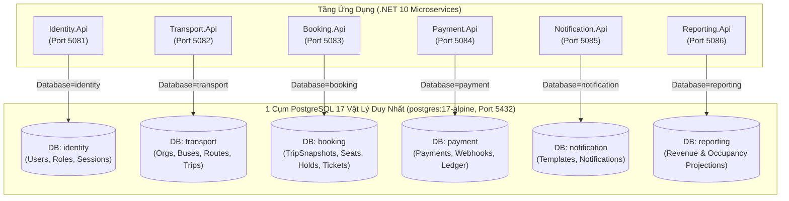
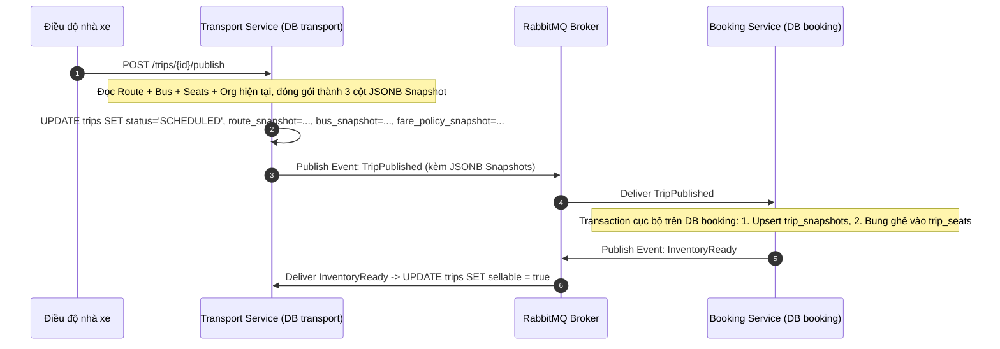
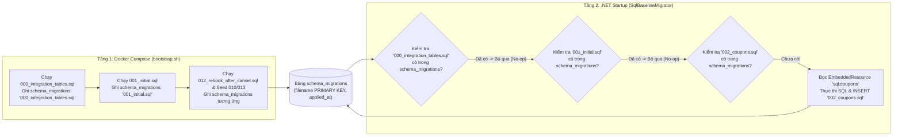

# Chương 05.1 — Kiến Trúc Database-per-Service, Quy Ước Dữ Liệu Tài Chính – Thời Gian, JSONB Snapshot & Cơ Chế Dual-Layer Migration

> **Mục tiêu tài liệu:** Giải thích từ nền tảng lý thuyết cơ bản nhất đến từng dòng lệnh SQL và C# thực tế trong dự án **BLUE Bus Ticket Platform (PBL6)** về cách tổ chức 6 cơ sở dữ liệu độc lập trên cụm PostgreSQL 17, cách bảo toàn lịch sử vé bằng JSONB Snapshot khi không có khóa ngoại liên dịch vụ, quy chuẩn lưu tiền tệ – múi giờ – xóa mềm, và cơ chế tự động chạy Migration hai tầng (`bootstrap.sh` kết hợp `SqlBaselineMigrator`).

---

## 1. Lý Thuyết Từ Con Số 0: Tại Sao Microservices Tuyệt Đối Tránh Shared Database & Giải Pháp 6 Logical Databases Trên 1 PostgreSQL 17 Cluster (ADR-005)

### 1.1. Nỗi đau kinh điển của "Shared Database Anti-pattern" (Dùng chung một cơ sở dữ liệu)

Khi mới chuyển từ kiến trúc nguyên khối (Monolith) sang Microservices, sai lầm phổ biến nhất của nhiều nhóm phát triển là tách mã nguồn C# thành 6 project API chạy trên 6 cổng khác nhau, nhưng ở tầng dưới vẫn cho cả 6 service trỏ chung vào một cơ sở dữ liệu duy nhất (ví dụ: `bus_ticket_db`) và thoải mái `JOIN` bảng của nhau. Trong ngành kiến trúc phần mềm, đây được gọi là **Shared Database Anti-pattern** — mẫu thiết kế phản kiến trúc biến Microservices thành một khối "Distributed Monolith" (Nguyên khối phân tán) mang nhược điểm của cả hai thế giới.

Nếu **BLUE Bus Ticket Platform** dùng chung 1 database cho `Identity`, `Transport`, `Booking`, `Payment`, `Notification`, và `Reporting`, hệ thống sẽ lập tức đối mặt với 4 thảm họa kỹ thuật:

1. **Khớp nối chặt ở tầng Schema (Schema Coupling & Hiệu ứng Domino):**
   Giả sử nhóm `Transport` muốn đổi cấu trúc bảng `seats` (ví dụ tách sơ đồ ghế 2 tầng hoặc đổi tên cột `seat_type`). Nếu `Booking` và `Reporting` đang viết câu lệnh `SELECT ... FROM bookings JOIN seats ...` trực tiếp vào bảng `seats`, câu lệnh `ALTER TABLE` của `Transport` sẽ làm sập tức thì API đặt vé và API báo cáo doanh thu. Không một service nào dám triển khai (deploy) độc lập nữa.
2. **Mất ranh giới chủ sở hữu dữ liệu (Unclear Data Ownership & Bypass Invariants):**
   Trong thiết kế chuẩn Domain-Driven Design (DDD), chỉ duy nhất `Booking Service` mới được quyền chuyển trạng thái ghế từ `AVAILABLE` sang `HELD` hoặc `BOOKED` sau khi kiểm tra hàng loạt quy tắc nghiệp vụ. Nếu mọi service dùng chung DB, một lập trình viên viết chức năng bên `Payment` hoặc `Admin` có thể vô tình chạy lệnh `UPDATE trip_seats SET status = 'AVAILABLE'` trực tiếp, đi đường vòng qua toàn bộ chốt chặn nghiệp vụ của `Booking` và làm hỏng tính toàn vẹn dữ liệu.
3. **Hiệu ứng "Hàng xóm ồn ào" (Noisy Neighbor antara OLTP và OLAP):**
   - `Booking` và `Payment` là tải **OLTP (Online Transaction Processing)**: cần hàng nghìn giao dịch cực ngắn (vài mili-giây), khóa dòng chính xác để giữ ghế và thu tiền.
   - `Reporting` là tải **OLAP (Online Analytical Processing)**: chạy các câu truy vấn tổng hợp `SUM()`, `GROUP BY` quét hàng trăm nghìn dòng doanh thu theo tháng/quý.
   Nếu chạy chung trên cùng các bảng giao dịch, truy vấn báo cáo của kế toán nhà xe sẽ làm tràn bộ nhớ đệm (Buffer Pool), chiếm CPU I/O và giữ khóa đọc khiến khách hàng ngoài trang chủ không thể đặt vé.
4. **Khóa ngoại liên miền gây nghẽn giao dịch (Cross-Domain Lock Contention):**
   Trong PostgreSQL, mỗi khi bạn `INSERT` hoặc `UPDATE` một dòng có `FOREIGN KEY` trỏ tới bảng cha (ví dụ `bookings.user_id REFERENCES users(id)`), PostgreSQL bắt buộc phải xin khóa `FOR KEY SHARE` lên dòng tương ứng ở bảng `users`. Nếu hàng nghìn khách đặt vé cùng lúc hoặc `Identity` đang cập nhật thông tin tài khoản (`UPDATE users`), các giao dịch ở hai miền nghiệp vụ khác nhau sẽ tự động chặn (block) lẫn nhau ở tầng vật lý.

### 1.2. Cái bẫy ở thái cực ngược lại: Dựng 6 cụm PostgreSQL Server vật lý riêng rẽ

Hiểu được tác hại của Shared Database, nếu nhóm nhảy sang thái cực ngược lại — khởi tạo **6 container / 6 máy chủ PostgreSQL 17 vật lý hoàn toàn riêng biệt** ngay từ giai đoạn MVP/Local — thì điều gì xảy ra?

- **Lãng phí RAM và tiến trình nền gấp 6 lần:** Mỗi cụm PostgreSQL instance khi khởi động đều phải cấp phát vùng bộ nhớ chung (`shared_buffers`, mặc định 128MB–2GB+), bộ nhớ làm việc (`work_mem`), cùng hàng loạt tiến trình nền bắt buộc (`postmaster`, `checkpointer`, `background writer`, `walwriter`, `autovacuum launcher`, `logical replication launcher`). Nhân 6 lần lên trên máy laptop sinh viên (hoặc server VPS vừa phải) sẽ ngốn hàng GB RAM vô ích ngay cả khi chưa có một request nào!
- **Chi phí Cloud đắt đỏ gấp 6 lần:** Trên AWS RDS hoặc Google Cloud SQL, 6 instance độc lập đồng nghĩa với việc trả tiền bản quyền hạ tầng, ổ cứng IOPS, IP tĩnh và thiết lập Backup/Monitoring nhân 6, trong khi 4/6 service (`Identity`, `Notification`, `Transport`, `Reporting`) ở giai đoạn đầu có lưu lượng ghi rất thấp.

### 1.3. Giải pháp cân bằng hoàn hảo (ADR-005): 6 Logical Databases trên 1 PostgreSQL 17 Cluster

Trong tài liệu kiến trúc [02-01-12-architecture-decisions.md](file:///C:/Users/minht/.gemini/antigravity/worktrees/PBL6/c_to_n_b/docs/system-design/02-01-system-architecture/02-01-12-architecture-decisions.md) (**ADR-005**) và [02-01-07-database-architecture.md](file:///C:/Users/minht/.gemini/antigravity/worktrees/PBL6/c_to_n_b/docs/system-design/02-01-system-architecture/02-01-07-database-architecture.md), dự án lựa chọn kiến trúc **Logical Database-per-Service trên 1 PostgreSQL 17 Cluster**:



#### Tại sao thiết kế này là "Điểm ngọt kiến trúc" (Architectural Sweet Spot) đặc biệt trên PostgreSQL?

> **Điểm khác biệt cốt tử giữa PostgreSQL và MySQL mà người thuyết trình cần nhấn mạnh:**
> Trong MySQL, `CREATE DATABASE a` và `CREATE DATABASE b` thực chất chỉ là tạo 2 `SCHEMA` — một kết nối MySQL hoàn toàn có thể viết `SELECT * FROM a.users JOIN b.bookings`.
> **Ngược lại, trong PostgreSQL, một Logical Database là một pháo đài cô lập tuyệt đối ở tầng vật lý!** Mỗi kết nối TCP của thư viện `Npgsql` bắt buộc phải gắn cố định vào đúng một database (ví dụ `Database=booking`). PostgreSQL **cấm hoàn toàn** việc viết câu lệnh SQL `JOIN`, `SELECT`, hay `FOREIGN KEY` từ database `booking` sang database `transport` (nếu cố viết `transport.public.trips`, PostgreSQL sẽ lập tức ném lỗi cú pháp `cross-database references are not implemented`).

Nhờ đặc tính kiến trúc tuyệt vời này của PostgreSQL 17:
1. **Kỷ luật Microservices được cưỡng chế 100% bởi Database Engine:** Không một thành viên nào trong nhóm có thể "ăn gian" viết `JOIN` chéo hoặc `FOREIGN KEY` chéo giữa các service, vì bản thân PostgreSQL không cho phép điều đó trên kết nối đơn.
2. **Mỗi service có lịch sử Migration độc lập:** Mỗi database sở hữu bảng `schema_migrations` riêng và bộ bảng tích hợp (`outbox_messages`, `inbox_messages`, `idempotency_records`, `audit_logs`) hoàn toàn tách biệt.
3. **Chi phí vận hành tối giản ở MVP (`docker-compose.production.yml` chỉ cần giới hạn 2 vCPU / 2GB RAM cho toàn cụm Postgres):** Chia sẻ chung một Buffer Pool và một bộ tiến trình WAL/Autovacuum.
4. **Sẵn sàng tách Server vật lý trong 30 giây không sửa 1 dòng code (Zero-Code Scale-Out):** Khi lượng đặt vé tăng vọt vào dịp Tết Nguyên Đán và cần tách riêng `booking` hoặc `reporting` ra một máy chủ AWS RDS độc lập, đội ngũ DevOps chỉ việc `pg_dump` database `booking` sang server mới và đổi biến môi trường `ConnectionStrings__Booking` trong [docker-compose.production.yml](file:///C:/Users/minht/.gemini/antigravity/worktrees/PBL6/c_to_n_b/workspace/src/infra/docker-compose.production.yml#L99). Không một dòng code C# hay câu lệnh SQL nào phải chỉnh sửa!

#### Bảng tổng hợp 6 Logical Databases trong dự án BLUE

| Logical DB | Service sở hữu | Các bảng nghiệp vụ cốt lõi (trích từ `docs/database/*/001_initial.sql`) | Đặc trưng tải & Mục tiêu tối ưu |
| :--- | :--- | :--- | :--- |
| **`identity`** | `Identity` | `users`, `roles`, `permissions`, `role_permissions`, `organization_memberships`, `user_roles`, `refresh_sessions`, `auth_challenges`, `security_audits` | Bảo mật cao, tra cứu nhanh theo `normalized_email`/`token_hash`, kiểm soát phiên đăng nhập và phân quyền RBAC đa nhà xe. |
| **`transport`** | `Transport` | `organizations`, `buses`, `seats`, `driver_profiles`, `stops`, `routes`, `route_stops`, `trips`, `driver_assignments`, `operator_resource_metadata` | Đọc nhiều (khách tìm chuyến), ghi bởi điều độ viên nhà xe; dùng chỉ mục **GiST** chống trùng lịch xe và tài xế. |
| **`booking`** | `Booking` | `trip_snapshots`, `trip_seats`, `seat_holds`, `seat_hold_items`, `bookings`, `booking_items`, `passengers`, `tickets`, `cancellation_previews`, `coupons` | **Trái tim chịu tải tranh chấp (High Contention OLTP):** khóa dòng `FOR UPDATE`, chống bán trùng ghế, khóa ngoại trì hoãn. |
| **`payment`** | `Payment` | `payments`, `payment_attempts`, `webhook_receipts`, `refunds`, `reconciliation_cases`, `booking_settlements`, `ledger_entries`, `operator_payouts`, `booking_quotes` | Chuẩn kế toán – kiểm toán khắt khe, chống xử lý trùng IPN Webhook từ SePay bằng **Advisory Lock** và Unique Constraint. |
| **`notification`** | `Notification` | `templates`, `notifications`, `delivery_attempts` | Tách hẳn khỏi luồng đặt vé chính (Out-of-band), quản lý hàng đợi gửi lại (Retry) Email/In-App theo `next_attempt_at`. |
| **`reporting`** | `Reporting` | `booking_projections`, `revenue_projections`, `occupancy_projections`, `projection_checkpoints` | **Read-Optimized Model (CQRS Projection):** chuyên phục vụ thống kê doanh thu/tỷ lệ lấp đầy ghế mà không chạm vào DB `booking`/`payment`. |

---

## 2. Toàn Vẹn Dữ Liệu Khi Không Có Foreign Key Chéo: Mẫu Thiết Kế External UUID Reference (`*_external`) & Immutable JSONB Snapshot

Khi 6 cơ sở dữ liệu tách rời nhau, câu hỏi lớn nhất mà bất kỳ giảng viên phản biện nào cũng sẽ đặt ra là:
> *"Nếu không có Foreign Key nối từ `booking` sang `transport` hay `identity`, làm sao các em liên kết dữ liệu? Và nguy hiểm hơn: nếu hôm nay khách đã mua vé chuyến Đà Nẵng – Huế giá 200.000đ trên xe 34 phòng, sáng mai nhà xe vào `Transport` sửa giá tuyến lên 300.000đ, đổi tên điểm đón, hoặc tháo bớt 4 ghế trên chiếc xe đó thành xe 30 phòng, thì vé của khách bên `Booking` có bị sai lệch hay hỏng dữ liệu lịch sử không?"*

Dự án BLUE giải quyết triệt để bài toán này bằng sự kết hợp của 2 mẫu thiết kế chuẩn công nghiệp: **External UUID Reference (`*_external`)** và **Immutable JSONB Snapshot**.

### 2.1. Quy ước hậu tố `*_external` — Tuyên ngôn biên giới ngữ cảnh ngay trên cột SQL

Hãy quan sát kỹ quy ước đặt tên cột trong các file schema SQL của dự án:
- Khi một cột tham chiếu tới một bảng **nằm cùng trong một Database**, cột được đặt tên bình thường và **bắt buộc có `REFERENCES` (Foreign Key)**:
  - Trong `transport`: `buses.organization_id uuid not null references organizations(id)`
  - Trong `booking`: `trip_seats.trip_id uuid not null references trip_snapshots(trip_id)`
- Khi một cột lưu định danh của một thực thể (Aggregate Root) **thuộc quyền sở hữu của một Service khác**, cột đó luôn được gắn hậu tố **`_external`** và **chỉ lưu kiểu `uuid` trần, không có `REFERENCES`**:
  - Trong [docs/database/booking/001_initial.sql](file:///C:/Users/minht/.gemini/antigravity/worktrees/PBL6/c_to_n_b/docs/database/booking/001_initial.sql): `organization_id_external`, `route_id_external`, `bus_id_external`, `customer_id_external`, `source_seat_id_external`, `pickup_stop_id_external`, `dropoff_stop_id_external`, `checked_in_by_external`.
  - Trong [docs/database/payment/001_initial.sql](file:///C:/Users/minht/.gemini/antigravity/worktrees/PBL6/c_to_n_b/docs/database/payment/001_initial.sql): `booking_id_external`, `customer_id_external`, `organization_id_external`, `requested_by_external`.
  - Trong [docs/database/transport/001_initial.sql](file:///C:/Users/minht/.gemini/antigravity/worktrees/PBL6/c_to_n_b/docs/database/transport/001_initial.sql): `driver_profiles.user_id_external` (trỏ sang `users.id` bên `identity`).

Ý nghĩa của hậu tố `_external` cực kỳ sâu sắc: chỉ cần nhìn vào tên cột, bất kỳ kỹ sư nào đọc DB cũng hiểu ngay **"Đây là con trỏ định danh xuyên miền (Cross-Context ID), dữ liệu gốc nằm ở Service khác; tuyệt đối không được phép giả định có thể `JOIN` sang bảng gốc của nó!"**

### 2.2. Lý thuyết `JSON` vs `JSONB` trong PostgreSQL cho người mới bắt đầu

Trước khi xem cách dự án đóng băng dữ liệu chuyến xe, ta cần hiểu tại sao PostgreSQL có hai kiểu lưu JSON là `json` và `jsonb`, và tại sao dự án dùng **`jsonb` 100%** ở mọi bảng:

| Tiêu chí | Kiểu `json` (cũ) | Kiểu `jsonb` (JSON Binary — Dự án sử dụng) |
| :--- | :--- | :--- |
| **Cách lưu trên đĩa** | Lưu nguyên chuỗi văn bản thô (bao gồm cả khoảng trắng thừa, khóa lặp). | Phân tích cú pháp (parse) ngay lúc `INSERT` thành cấu trúc cây nhị phân có thứ tự khóa và kiểu dữ liệu rõ ràng. |
| **Tốc độ đọc / truy vấn** | Chậm — mỗi lần `SELECT` một trường bên trong phải parse lại toàn bộ chuỗi JSON từ đầu. | **Cực nhanh** — nhảy thẳng tới vị trí khóa nhị phân cần đọc bằng toán tử `->` hoặc `->>` mà không cần parse lại. |
| **Đánh chỉ mục (Indexing)** | Không hỗ trợ GIN Index trực tiếp trên cấu trúc. | Hỗ trợ **GIN Index** và toán tử bao hàm **`@>`** (ví dụ lọc xe có tiện ích `["wifi", "usb"]`). |

### 2.3. Giải phẫu luồng Immutable JSONB Snapshot hai tầng (`Transport` → `Booking`)

Trong đời thực, một tờ vé xe hay một hóa đơn mua hàng là một **hợp đồng pháp lý tại thời điểm giao dịch**. Khi nhà xe bấm nút **"Xuất bản chuyến xe" (`PublishTripAsync`)** để mở bán cho hành khách, cấu hình tuyến đường, danh sách điểm dừng, sơ đồ ghế vật lý của chiếc xe và chính sách giá/hoàn hủy của chuyến đó phải được **chụp ảnh tĩnh (Snapshot)** lại.

Hãy theo dõi hành trình thực tế của bản chụp JSONB này qua từng file mã nguồn:

#### Bước 1: Đóng băng Snapshot tại `TransportService.PublishTripAsync` (khi mở bán chuyến)
Tại [TransportService.cs](file:///C:/Users/minht/.gemini/antigravity/worktrees/PBL6/c_to_n_b/workspace/src/services/transport/BusTicketPlatform.Transport.Application/TransportService.cs#L771-L797), ngay thời khắc chuyến xe chuyển từ bản nháp (`DRAFT`) sang lịch chạy chính thức (`SCHEDULED`), hệ thống đọc cấu hình hiện tại của `bus`, `route`, `organization` và tuần tự hóa thành 3 chuỗi JSON bất biến:

```csharp
// Trích từ TransportService.cs (dòng 771 - 797)
var bus = await store.GetBusAsync(orgId, trip.BusId, cancellationToken);
var route = await store.GetRouteAsync(orgId, trip.RouteId, cancellationToken);
var published = trip with
{
    Status = TripStatuses.Scheduled,
    PublishedVersion = 1,
    RouteSnapshot = JsonSerializer.Serialize(new { route!.Id, route.Name, route.Stops }),
    BusSnapshot = JsonSerializer.Serialize(new
    {
        bus!.Id,
        bus.Type,
        bus.Amenities,
        seats = bus.Seats.Select(seat => new { seat.Id, seat.Code, seat.Deck, row = seat.Row, column = seat.Column, seat.Type, seat.Active })
    }),
    FareSnapshot = JsonSerializer.Serialize(new
    {
        baseFare = trip.BaseFare,
        trip.Currency,
        policyVersion = trip.PolicyVersion,
        allowPayLater = (await store.GetOrganizationAsync(orgId, cancellationToken))!.AllowPayLater
    }),
    RowVersion = trip.RowVersion + 1
};
await store.PublishTripAsync(published, cancellationToken);
await events.TripPublishedAsync(published, correlationId, cancellationToken);
```

Ba cột `route_snapshot jsonb`, `bus_snapshot jsonb`, và `fare_policy_snapshot jsonb` được ghi xuống bảng `trips` của DB `transport`, đồng thời được bắn đi qua RabbitMQ trong sự kiện tích hợp `TripPublished`.

#### Bước 2: Sao chép sang kho ghế độc lập (`trip_snapshots` & `trip_seats`) tại DB `booking`
Khi `Booking Service` nhận được sự kiện `TripPublished`, hàm [BookingRepository.ImportTripAsync](file:///C:/Users/minht/.gemini/antigravity/worktrees/PBL6/c_to_n_b/workspace/src/services/booking/BusTicketPlatform.Booking.Infrastructure/Persistence/BookingRepository.cs#L10-L73) thực thi một Transaction nguyên tử để lưu bản sao cục bộ vào bảng `trip_snapshots` và bung từng ghế ra bảng `trip_seats`:

```csharp
// Trích từ BookingRepository.cs (dòng 17 - 31 & 51 - 70)
INSERT INTO trip_snapshots (
  trip_id, organization_id_external, route_id_external, bus_id_external, origin_stop_id_external,
  destination_stop_id_external, departure_at, arrival_at, currency, status, sellable, source_trip_version,
  route_snapshot, bus_snapshot, fare_policy_snapshot, created_at, updated_at)
VALUES (
  @id, @org, @route, @bus, @origin, @dest, @dep, @arr, @currency, @status, @sellable, @version,
  CAST(@routeSnap AS jsonb), CAST(@busSnap AS jsonb), CAST(@fareSnap AS jsonb), NOW(), NOW())
ON CONFLICT (trip_id) DO UPDATE
  SET status = EXCLUDED.status,
      sellable = EXCLUDED.sellable,
      source_trip_version = GREATEST(trip_snapshots.source_trip_version, EXCLUDED.source_trip_version),
      fare_policy_snapshot = EXCLUDED.fare_policy_snapshot,
      updated_at = NOW();
```

Và ngay bên dưới là vòng lặp khởi tạo tồn kho ghế riêng cho chuyến đó:
```sql
INSERT INTO trip_seats (
  id, trip_id, source_seat_id_external, seat_code, seat_type, deck, row_no, column_no, price, status, updated_at)
VALUES (@id, @trip, @source, @code, @type, @deck, @row, @col, @price, @status, NOW())
ON CONFLICT (trip_id, source_seat_id_external) DO NOTHING;
```



#### Hãy nhìn vào 4 lợi ích vàng của thiết kế này:
1. **Bảo toàn 100% lịch sử và hợp đồng vé:** Ngày mai nếu nhà xe vào `Transport` tăng giá tuyến, sửa danh sách trạm dừng của `routes`, hay sửa sơ đồ ghế của `buses` (thậm chí lưu ý thêm ở [TransportService.ReplaceSeatsAsync](file:///C:/Users/minht/.gemini/antigravity/worktrees/PBL6/c_to_n_b/workspace/src/services/transport/BusTicketPlatform.Transport.Application/TransportService.cs#L218) hệ thống còn chặn `BusHasActiveTripsAsync`), thì toàn bộ các chuyến đã xuất bản và các ghế trong `trip_seats` / `booking_items` bên DB `booking` **hoàn toàn miễn nhiễm**, giữ nguyên giá gốc (`price`), mã ghế (`seat_code`), và chính sách hủy vé (`policyVersion`) lúc xuất bản!
2. **Đặt vé với độ trễ bằng 0 cuộc gọi mạng chéo (Zero Synchronous Cross-Service RPC):** Khi khách hàng chọn ghế và tạo Booking, `Booking Service` không cần gọi HTTP sang `Transport Service` để hỏi *"Chuyến xe này có cho phép trả sau (`allowPayLater`) không?"* hay *"Chính sách hủy vé phiên bản mấy?"*. Nó đọc trực tiếp từ cột JSONB ngay trong DB `booking` bằng toán tử `->>` của PostgreSQL tại [BookingRepository.GetTripAsync](file:///C:/Users/minht/.gemini/antigravity/worktrees/PBL6/c_to_n_b/workspace/src/services/booking/BusTicketPlatform.Booking.Infrastructure/Persistence/BookingRepository.cs#L226-L231):
   ```sql
   SELECT trip_id, organization_id_external, origin_stop_id_external, destination_stop_id_external, departure_at,
          sellable, status, currency,
          COALESCE(fare_policy_snapshot->>'allowPayLater', 'false') = 'true',
          COALESCE(fare_policy_snapshot->>'policyVersion', 'cancel-mvp-v1'),
          NULLIF(fare_policy_snapshot->>'driverUserId', '')::uuid
   FROM trip_snapshots WHERE trip_id = @id;
   ```
   Thậm chí dù `Transport Service` có đang bảo trì hoặc restart, khách hàng vẫn xem sơ đồ ghế và đặt vé trên các chuyến đã mở bán bình thường!
3. **Chống sự kiện lặp hoặc đến sai thứ tự (Idempotency & Versioning):**
   - Hàm `GREATEST(trip_snapshots.source_trip_version, EXCLUDED.source_trip_version)` đảm bảo tiến trình version không bao giờ bị lùi ngược nếu RabbitMQ gửi lại bản tin cũ.
   - Mệnh đề `ON CONFLICT (trip_id, source_seat_id_external) DO NOTHING` trên bảng `trip_seats` đảm bảo nếu sự kiện `TripPublished` bị gửi lại (at-least-once delivery), các ghế đang được khách giữ (`HELD`) hoặc đã đặt (`BOOKED`) tuyệt đối không bị ghi đè về `AVAILABLE`!
4. **Sức mạnh truy vấn mảng JSONB với toán tử `@>`:** Ngoài Snapshot, kiểu `jsonb` còn được tận dụng ở cột `buses.amenities` (lưu danh sách tiện ích như `["wifi", "water", "blanket"]`). Trong [TransportRepository.SearchSellableAsync](file:///C:/Users/minht/.gemini/antigravity/worktrees/PBL6/c_to_n_b/workspace/src/services/transport/BusTicketPlatform.Transport.Infrastructure/Persistence/TransportRepository.cs#L664), câu lệnh lọc chuyến xe chứa đủ mọi tiện ích khách yêu cầu chỉ gói gọn trong một dòng toán tử tập hợp con `@>` cực kỳ thanh thoát của PostgreSQL:
   ```sql
   AND (@amenitiesJson::jsonb IS NULL OR b.amenities @> @amenitiesJson::jsonb)
   ```

---

## 3. Quy Ước Kiểu Dữ Liệu Chuẩn Tài Chính & Vận Tải: Tiền Tệ (`bigint`), Thời Gian (`timestamptz` UTC + `Asia/Ho_Chi_Minh`), Soft Delete & Partial Unique Index

Một cơ sở dữ liệu chuyên nghiệp khác một đồ án môn học thông thường ở cách chọn kiểu dữ liệu (Data Types) và ràng buộc kiểm tra (`CHECK` constraints). Hãy giải phẫu 4 quy ước cốt lõi xuyên suốt toàn bộ schema SQL của dự án BLUE.

### 3.1. Lưu trữ tiền tệ bằng `bigint` (VND) — Tại sao tuyệt đối cấm dùng `float` / `double`?

#### Lý thuyết gốc rễ: Sai số dấu chấm động nhị phân IEEE 754
Trong máy tính, các kiểu số thực dấu chấm động như `REAL` / `FLOAT4` (`float` trong C#) và `DOUBLE PRECISION` / `FLOAT8` (`double` trong C#) lưu giá trị dưới dạng phân số nhị phân $M \times 2^E$ theo chuẩn **IEEE 754**.
Vấn đề toán học nằm ở chỗ: phân số thập phân `0.1` ($\frac{1}{10}$) khi đổi sang hệ nhị phân là một **số thập phân vô hạn tuần hoàn**:
$$0.1_{10} = 0.000110011001100110011\ldots_2$$
Vì thanh ghi 64-bit hữu hạn phải cắt cụt chuỗi bit này, máy tính thực chất lưu một con số xấp xỉ. Hệ quả kinh điển trong mọi ngôn ngữ lập trình dùng IEEE 754 là:
- `0.1 + 0.2 == 0.30000000000000004` (khác `0.3`!)
- Khi nhân giá vé, trừ khuyến mãi, hoặc tính phí hủy vé qua hàng nghìn giao dịch, sai số `0.0000001` tích lũy sẽ làm lệch 1 đồng.

Trong cơ sở dữ liệu của **BLUE Bus Ticket Platform**, các bảng tài chính đều đặt ràng buộc đẳng thức kế toán nghiêm ngặt ở mức phần cứng lưu trữ:
- Trong [docs/database/booking/001_initial.sql](file:///C:/Users/minht/.gemini/antigravity/worktrees/PBL6/c_to_n_b/docs/database/booking/001_initial.sql#L133-L141):
  ```sql
  constraint ck_bookings_total check (
    discount_amount <= subtotal_amount
    and total_amount = subtotal_amount - discount_amount + service_fee_amount
  ),
  constraint ck_bookings_financials check (
    coalesce(cancellation_fee, 0) <= total_amount
    and coalesce(refund_amount, 0) <= total_amount
    and coalesce(cancellation_fee, 0) + coalesce(refund_amount, 0) <= total_amount
  )
  ```
- Trong [docs/database/payment/001_initial.sql](file:///C:/Users/minht/.gemini/antigravity/worktrees/PBL6/c_to_n_b/docs/database/payment/001_initial.sql#L173):
  ```sql
  constraint ck_settlement_split check (commission_amount + operator_net = gross_amount)
  ```
Chỉ cần sai số dấu chấm động làm lệch `0.01` đồng, PostgreSQL sẽ lập tức bác bỏ lệnh `INSERT`/`UPDATE` với lỗi vi phạm ràng buộc `23514` (`check_violation`)!

#### Giải pháp chuẩn Fintech trong dự án: `bigint` cho số tiền nguyên đơn vị nhỏ nhất + `numeric` cho tỷ lệ
1. **Mọi cột tiền tệ (`base_fare`, `price`, `unit_price`, `subtotal_amount`, `discount_amount`, `total_amount`, `amount`, `gross_amount`, `commission_amount`, `operator_net`) đều dùng kiểu `bigint` (số nguyên 64-bit có dấu, ánh xạ thẳng sang `long` trong C#):**
   - Đơn vị tiền tệ nhỏ nhất (Minor Unit) của Việt Nam Đồng (`VND`) là **1 đồng** (không có xu lẻ thập phân; tương tự như lưu theo đơn vị `cents` đối với USD).
   - Kiểu `bigint` lưu chính xác tuyệt đối 100% bằng phép toán số nguyên trên ALU của CPU, nhanh hơn nhiều so với kiểu thập phân phần mềm, và có miền giá trị lên tới $9.223.372.036.854.775.807$ đồng (hơn 9 tỷ tỷ VND — không bao giờ tràn số!).
   - Luôn đi kèm cột `currency char(3) not null` với biểu thức chính quy ISO-4217: `check (currency ~ '^[A-Z]{3}$')`.
2. **Các cột tỷ lệ phần trăm (`commission_rate`, `fee_rate`) dùng kiểu `numeric(p, s)` (`decimal` hệ cơ số 10 chính xác tuyệt đối):**
   - Ví dụ `organizations.commission_rate numeric(5,4) not null default 0.1000` (tức 10,00% hoa hồng sàn) và `cancellation_previews.fee_rate numeric(7,6)`.
3. **Thuật toán Cumulative Rounding (Làm tròn tích lũy) khi phân bổ khuyến mãi xuống từng ghế:**
   Giả sử khách đặt 3 ghế đồng giá `100.000đ` (`subtotal = 300.000đ`) và áp mã giảm giá cố định tối đa `cap = 50.000đ`. Nếu chia đều `50.000 / 3 = 16.666đ` cho mỗi ghế thì tổng giảm của 3 ghế chỉ là `49.998đ` — hụt mất `2đ` so với `discount_amount = 50.000đ` của đơn hàng!
   Hãy xem cách [BookingService.cs](file:///C:/Users/minht/.gemini/antigravity/worktrees/PBL6/c_to_n_b/workspace/src/services/booking/BusTicketPlatform.Booking.Application/BookingService.cs#L312-L320) giải quyết cực kỳ tinh tế bằng **Cumulative Rounding**:
   ```csharp
   // Trích từ BookingService.cs (dòng 312 - 320)
   // Cumulative rounding keeps every item discount nonnegative and preserves the exact order discount.
   long runningSubtotal = 0, allocatedDiscount = 0;
   for (var index = 0; discount > 0 && index < items.Count; index++)
   {
       runningSubtotal += items[index].UnitPrice;
       var cumulativeDiscount = (long)decimal.Floor((decimal)runningSubtotal * discount / hold.TotalAmount);
       items[index] = items[index] with { Discount = cumulativeDiscount - allocatedDiscount };
       allocatedDiscount = cumulativeDiscount;
   }
   ```
   Thử chạy tay với 3 ghế `100.000đ` và `discount = 50.000đ`:
   - Ghế 1 (`runningSubtotal = 100.000`): `cumulative = Floor(100000 * 50000 / 300000) = 16.666đ` → Ghế 1 giảm **`16.666đ`**.
   - Ghế 2 (`runningSubtotal = 200.000`): `cumulative = Floor(200000 * 50000 / 300000) = 33.333đ` → Ghế 2 giảm `33.333 - 16.666 =` **`16.667đ`**.
   - Ghế 3 (`runningSubtotal = 300.000`): `cumulative = Floor(300000 * 50000 / 300000) = 50.000đ` → Ghế 3 giảm `50.000 - 33.333 =` **`16.667đ`**.
   - **Tổng cộng:** `16.666 + 16.667 + 16.667 = 50.000đ` — khớp chính xác từng đồng, không âm, không lệch số dư!

---

### 3.2. Thời gian chuẩn quốc tế (`timestamptz` UTC) & Cạm bẫy múi giờ `Asia/Ho_Chi_Minh` khi tìm chuyến xe

#### Phân biệt `timestamp` và `timestamptz` trong PostgreSQL
- `timestamp [without time zone]`: Lưu chuỗi ngày giờ "mù múi giờ". Nếu server đặt ở Singapore (`UTC+8`) hay Mỹ (`UTC-5`), cùng một giá trị sẽ bị hiểu lệch hoàn toàn.
- `timestamptz` (`timestamp with time zone`): PostgreSQL tự động quy đổi mọi thời điểm đầu vào về chuẩn **UTC (`+00:00`)** và lưu dưới dạng số nguyên 64-bit đếm từng micro-giây kể từ mốc `2000-01-01 00:00:00 UTC`. Trong code C#, dự án luôn dùng `DateTimeOffset` và truyền `.UtcDateTime` qua `Npgsql`.

#### Cạm bẫy kinh điển lúc nửa đêm khi khách Việt Nam tìm vé theo ngày
Hãy tưởng tượng một hành khách ở Đà Nẵng mở web chọn tìm chuyến đi Huế vào ngày **`20/11/2026`**.
Nhà xe có một chuyến xe đêm khởi hành lúc **`01:30 sáng ngày 20/11/2026` (giờ Việt Nam, `UTC+7`)**.
Khi lưu vào cột `departure_at` (theo chuẩn UTC), thời điểm đó được trừ đi 7 tiếng, tức là:
- Giờ Việt Nam (`Asia/Ho_Chi_Minh`): `2026-11-20 01:30:00+07`
- Giờ lưu trong PostgreSQL (UTC): **`2026-11-19 18:30:00+00`**!

Nếu lập trình viên ngây thơ viết câu SQL tìm kiếm là:
```sql
-- SAI LẦM NGHIÊM TRỌNG: Cắt ngày trực tiếp theo giờ UTC!
WHERE t.departure_at::date = '2026-11-20'
```
Thì toàn bộ các chuyến xe chạy từ **`00:00` đến `06:59` sáng giờ Việt Nam ngày 20/11** sẽ biến mất khỏi kết quả tìm kiếm (vì ngày UTC của chúng vẫn là ngày `19/11`), còn các chuyến rạng sáng ngày `21/11` lại bị lọt nhầm vào ngày `20/11`!

#### Giải pháp kết hợp Truy vấn múi giờ + Covering Partial Expression Index trong dự án
1. Trong [TransportRepository.SearchSellableAsync](file:///C:/Users/minht/.gemini/antigravity/worktrees/PBL6/c_to_n_b/workspace/src/services/transport/BusTicketPlatform.Transport.Infrastructure/Persistence/TransportRepository.cs#L651-L657), câu truy vấn chuyển đổi rõ ràng từ mốc UTC sang múi giờ chuẩn IANA `'Asia/Ho_Chi_Minh'` trước khi ép kiểu sang `::date` và `::time`:
   ```sql
   AND (@date IS NULL OR (t.departure_at AT TIME ZONE 'Asia/Ho_Chi_Minh')::date = @date)
   AND (@timeFrom IS NULL OR (t.departure_at AT TIME ZONE 'Asia/Ho_Chi_Minh')::time >= @timeFrom)
   AND (@timeTo IS NULL OR (t.departure_at AT TIME ZONE 'Asia/Ho_Chi_Minh')::time <= @timeTo)
   ```
2. Nhưng nếu bọc hàm `(departure_at AT TIME ZONE 'Asia/Ho_Chi_Minh')::date` quanh cột, một B-Tree index thông thường trên cột `departure_at` sẽ không thể tra cứu trực tiếp theo ngày giờ địa phương. Vì thế, trong [docs/database/transport/001_initial.sql](file:///C:/Users/minht/.gemini/antigravity/worktrees/PBL6/c_to_n_b/docs/database/transport/001_initial.sql#L194-L197), dự án thiết kế một **Covering Partial Expression Index** cực kỳ đẳng cấp:
   ```sql
   create index ix_trips_public_search
     on trips (((departure_at at time zone 'Asia/Ho_Chi_Minh')::date), origin_stop_id, destination_stop_id, departure_at)
     include (organization_id, arrival_at, base_fare, currency, bus_id)
     where sellable = true and status in ('SCHEDULED','BOARDING');
   ```
   Hãy bóc tách 3 kỹ thuật PostgreSQL nâng cao hội tụ chỉ trong 4 dòng SQL này:
   - **Expression Index `((departure_at at time zone 'Asia/Ho_Chi_Minh')::date)`:** Tính sẵn ngày theo giờ Việt Nam và lưu ngay làm khóa đầu tiên của cây B-Tree.
   - **Covering Index `INCLUDE (organization_id, arrival_at, base_fare, currency, bus_id)`:** Đính kèm luôn các cột hiển thị kết quả vào nút lá (Leaf Node) của Index để PostgreSQL có thể thực hiện **Index-Only Scan** mà không cần nhảy ngược vào bảng vật lý (Heap Fetch) để đọc giá vé hay giờ đến!
   - **Partial Index `WHERE sellable = true AND status IN ('SCHEDULED','BOARDING')`:** Loại bỏ hoàn toàn hàng trăm nghìn chuyến xe đã chạy xong trong quá khứ (`COMPLETED`), bản nháp (`DRAFT`), hay đã hủy (`CANCELLED`) khỏi cây chỉ mục — giữ cho Index tìm kiếm ngoài trang chủ luôn siêu gọn nhẹ và nằm trọn trong RAM!

---

### 3.3. Soft Delete (`deleted_at`) & Nghệ thuật Partial Unique Index (`WHERE deleted_at IS NULL`)

Trong hệ thống vận tải và định danh, ta không được xóa vật lý (`DELETE FROM buses` hay `DELETE FROM users`) các xe khách, tài xế, hay người dùng đã phát sinh dữ liệu lịch sử, mà dùng **Soft Delete** thông qua cột `deleted_at timestamptz` (khi còn hoạt động thì `deleted_at IS NULL`, khi xóa mềm thì gán `deleted_at = NOW()`).

**Bài toán xung đột với ràng buộc `UNIQUE` truyền thống:**
Giả sử nhà xe Phương Trang nhập nhầm thông tin chiếc xe biển số `51B-999.99`, sau đó bấm xóa chiếc xe đó (`deleted_at = '2026-11-18 09:00:00Z'`), rồi tạo mới lại đúng chiếc xe biển số `51B-999.99`.
- Nếu ta khai báo `CONSTRAINT uq_plate UNIQUE (organization_id, normalized_plate_number)`, PostgreSQL sẽ quét toàn bộ bảng (kể cả dòng đã xóa mềm) và ném lỗi trùng khóa `23505`!
- Nhiều hệ thống cũ giải quyết xấu xí bằng cách đưa cả cột `deleted_at` vào Unique key hoặc nối chuỗi rác `51B99999_deleted_170000` làm bẩn dữ liệu gốc.

**Giải pháp chuẩn mực của PostgreSQL trong dự án BLUE — Partial Unique Index:**
PostgreSQL cho phép gắn mệnh đề `WHERE` trực tiếp vào `CREATE UNIQUE INDEX`. Hãy xem các ví dụ thực tế trong dự án:

1. **Biển số xe chỉ cần duy nhất trong phạm vi các xe chưa bị xóa của nhà xe đó** ([transport/001_initial.sql](file:///C:/Users/minht/.gemini/antigravity/worktrees/PBL6/c_to_n_b/docs/database/transport/001_initial.sql#L40-L42)):
   ```sql
   create unique index uq_buses_active_plate
     on buses (organization_id, normalized_plate_number)
     where deleted_at is null;
   ```
   *(Lưu ý thêm: ở [TransportService.cs](file:///C:/Users/minht/.gemini/antigravity/worktrees/PBL6/c_to_n_b/workspace/src/services/transport/BusTicketPlatform.Transport.Application/TransportService.cs#L968-L969), biển số `"51B-999.99"` hay `"51b 99999"` đều được chuẩn hóa qua hàm `NormalizePlate` thành `"51B99999"` lưu vào `normalized_plate_number` để chặn lách luật bằng dấu gạch ngang/khoảng trắng!)*
2. **Mã nhân viên, bằng lái và tài khoản tài xế đang hoạt động** ([transport/001_initial.sql](file:///C:/Users/minht/.gemini/antigravity/worktrees/PBL6/c_to_n_b/docs/database/transport/001_initial.sql#L79-L87)):
   ```sql
   create unique index uq_driver_profiles_license
     on driver_profiles (organization_id, license_number)
     where deleted_at is null;
   ```
3. **Email và số điện thoại người dùng chưa xóa mềm** ([identity/001_initial.sql](file:///C:/Users/minht/.gemini/antigravity/worktrees/PBL6/c_to_n_b/docs/database/identity/001_initial.sql#L23-L24)):
   ```sql
   create unique index uq_users_email on users (normalized_email) where deleted_at is null;
   create unique index uq_users_phone on users (normalized_phone) where deleted_at is null;
   ```
4. **Chỉ mục quét hàng đợi Outbox và SeatHold hết hạn siêu tốc:**
   - Trong `_shared/000_integration_tables.sql`: `create index ix_outbox_pending on outbox_messages (...) where published_at is null;` — Khi 1 triệu tin nhắn đã gửi xong (`published_at IS NOT NULL`), kích thước của `ix_outbox_pending` vẫn gần như bằng **0 byte**!
   - Trong `booking/001_initial.sql`: `create index ix_seat_holds_expiry on seat_holds (expires_at, id) where status = 'ACTIVE';` — Chỉ theo dõi đúng vài chục lệnh giữ ghế đang đếm ngược 10 phút!

### 3.4. Bổ sung đắt giá: Khóa chính `UUIDv7` (`ids.NewUuidV7()`) tối ưu cây B-Tree

Xuyên suốt mã nguồn C# (như `BookingService`, `TransportService`, `SePayPaymentStore`), mọi thực thể mới đều sinh ID bằng `ids.NewUuidV7()` / `Guid.CreateVersion7()` của .NET 10 thay vì `SERIAL` tự tăng hay `UUIDv4` ngẫu nhiên:
- **Tránh lộ thông tin kinh doanh & dễ tạo ID phía ứng dụng:** Không bị lộ tổng số vé bán ra trong ngày như `id = 1, 2, 3...`, và không cần round-trip hỏi DB xin `NEXTVAL` trước khi tạo đồ thị đối tượng cha – con (`Booking` → `BookingItem` → `Passenger`).
- **Thân thiện tuyệt đối với B-Tree của PostgreSQL:** Khác với `UUIDv4` ngẫu nhiên 122-bit làm các dòng mới chèn lung tung vào giữa cây B-Tree gây phân mảnh trang nhớ (**B-Tree Page Split & Random I/O**), **UUIDv7** đặt **48-bit Unix Timestamp tính bằng mili-giây ở ngay đầu tiên**! Nhờ vậy, các UUID sinh ra sau luôn lớn hơn UUID sinh ra trước, giúp PostgreSQL luôn chèn nối tiếp vào trang cuối bên phải của cây B-Tree mượt mà y hệt như `BIGSERIAL`!

---

## 4. Giải Phẫu Cơ Chế Dual-Layer Database Migration (`bootstrap.sh` + `SqlBaselineMigrator`)

### 4.1. Tại sao dự án dùng SQL-First Versioned Scripts (`docs/database/`) thay vì EF Core Auto-Migration?

Nhiều dự án .NET dùng `dotnet ef migrations add` để ORM tự sinh bảng. Tuy nhiên, với một hệ thống đòi hỏi kiểm soát đồng thời ở mức sâu của PostgreSQL 17 như **BLUE Bus Ticket Platform**, viết trực tiếp DDL SQL thuần trong `docs/database/` mang lại ưu thế vượt trội:
1. Khai thác trọn vẹn 100% vũ khí đặc chủng của PostgreSQL mà ORM trừu tượng hóa rất kém hoặc không hỗ trợ tự nhiên: `CREATE EXTENSION btree_gist`, `EXCLUDE USING gist (bus_id WITH =, operating_window WITH &&)`, khóa ngoại vòng trì hoãn `DEFERRABLE INITIALLY DEFERRED`, biểu thức chính quy POSIX `~ '^[A-Z]{3}$'`, và Partial Covering Expression Index.
2. Schema SQL trở thành **Single Source of Truth** minh bạch để cả DBA, Backend Developer và Automated Test cùng đọc hiểu chính xác từng ràng buộc mà không sợ ORM ngầm đổi kiểu dữ liệu.

### 4.2. Bộ 4 bảng tích hợp chuẩn hóa ở mọi Database (`_shared/000_integration_tables.sql`)

Trước khi chạy bất kỳ bảng nghiệp vụ nào, cả 6 database (`identity`, `transport`, `booking`, `payment`, `notification`, `reporting`) đều được áp dụng chung khuôn mẫu [docs/database/_shared/000_integration_tables.sql](file:///C:/Users/minht/.gemini/antigravity/worktrees/PBL6/c_to_n_b/docs/database/_shared/000_integration_tables.sql):

| Tên bảng | Vai trò kiến trúc trong mỗi Microservice | Ràng buộc / Chỉ mục nổi bật |
| :--- | :--- | :--- |
| **`outbox_messages`** | Lưu sự kiện tích hợp trong cùng một DB Transaction với dữ liệu nghiệp vụ (**Transactional Outbox Pattern - ADR-006**), đảm bảo không bao giờ xảy ra lỗi *"đã trừ tiền/xuất vé trong DB nhưng rớt mạng chưa kịp gửi tin lên RabbitMQ"*. | Partial Index `ix_outbox_pending` chỉ lọc `WHERE published_at IS NULL`. |
| **`inbox_messages`** | Ghi nhận các `message_id` mà Consumer đã xử lý thành công để chống xử lý trùng lặp khi RabbitMQ gửi lại tin nhắn (**Idempotent Consumer**). | `UNIQUE (consumer_name, message_id)`. |
| **`idempotency_records`** | Lưu dấu vân tay băm `request_hash` và kết quả phản hồi `response_snapshot jsonb` cho các HTTP POST/PUT quan trọng có gắn header `Idempotency-Key` (hiệu lực 24 giờ trong [IdempotencyStore.cs](file:///C:/Users/minht/.gemini/antigravity/worktrees/PBL6/c_to_n_b/workspace/src/services/booking/BusTicketPlatform.Booking.Infrastructure/Persistence/IdempotencyStore.cs)). | `UNIQUE (actor_scope, operation, target_reference, idempotency_key)` và trạng thái `PROCESSING` / `COMPLETED` / `FAILED_RETRYABLE`. |
| **`audit_logs`** | Nhật ký kiểm toán bất biến ghi lại ai (`actor_id_external`), làm hành động gì (`action`), trên đối tượng nào (`target_type`, `target_id`), kèm `correlation_id` xuyên suốt. | Index kép theo đối tượng và theo nhà xe (`organization_id_external, occurred_at DESC`). |

---

### 4.3. Giải phẫu Tầng Migration thứ nhất: Hạ tầng Docker (`00-create-databases.sql` & `bootstrap.sh`)

Khi khởi động cụm hạ tầng bằng `docker compose up -d --wait`, quá trình khởi tạo cơ sở dữ liệu diễn ra qua 2 bước an toàn tuyệt đối:

#### Bước 1A: Tạo 6 Logical Databases bằng mẹo `\gexec` trong `00-create-databases.sql`
Hãy nhìn vào file [workspace/src/infra/postgres/init/00-create-databases.sql](file:///C:/Users/minht/.gemini/antigravity/worktrees/PBL6/c_to_n_b/workspace/src/infra/postgres/init/00-create-databases.sql):
```sql
SELECT 'CREATE DATABASE identity'
WHERE NOT EXISTS (SELECT FROM pg_database WHERE datname = 'identity')\gexec
SELECT 'CREATE DATABASE transport'
WHERE NOT EXISTS (SELECT FROM pg_database WHERE datname = 'transport')\gexec
-- ... tương tự cho booking, payment, notification, reporting
```
> **Tại sao không viết `CREATE DATABASE IF NOT EXISTS identity` hay bọc trong khối `DO $$ BEGIN ... END $$`?**
> Vì trong PostgreSQL:
> 1. Cú pháp SQL chuẩn của PostgreSQL **không có** mệnh đề `IF NOT EXISTS` cho lệnh `CREATE DATABASE`!
> 2. Lệnh `CREATE DATABASE` không được phép chạy bên trong một khối Transaction hay hàm PL/pgSQL `DO $$ ... $$` (`CREATE DATABASE cannot run inside a transaction block`)!
> Do đó, dùng lệnh meta-command **`\gexec`** của trình khách `psql` là kỹ thuật chuẩn xác nhất của chuyên gia PostgreSQL: câu `SELECT` kiểm tra bảng hệ thống `pg_database`; nếu chưa có, nó trả về chuỗi văn bản `'CREATE DATABASE identity'`, và `\gexec` lập tức lấy chuỗi kết quả đó thực thi như một câu lệnh SQL độc lập ở cấp cao nhất!

#### Bước 1B: Container chuyên trách `db-bootstrap` chạy `bootstrap.sh`
Trong [docker-compose.yml](file:///C:/Users/minht/.gemini/antigravity/worktrees/PBL6/c_to_n_b/workspace/src/infra/docker-compose.yml#L22-L42), service `db-bootstrap` đợi `postgres` vượt qua `pg_isready`, mount thư mục `docs/database` ở chế độ chỉ đọc (`:ro`) và chạy [workspace/src/infra/postgres/bootstrap.sh](file:///C:/Users/minht/.gemini/antigravity/worktrees/PBL6/c_to_n_b/workspace/src/infra/postgres/bootstrap.sh):

```sh
# Trích từ workspace/src/infra/postgres/bootstrap.sh (dòng 4 - 36 & 62 - 64)
case "${PGHOST:-}" in
  postgres|localhost|127.0.0.1) ;;
  *)
    if [ "${ALLOW_DB_RESET:-}" != "1" ]; then
      echo "refusing bootstrap on host '${PGHOST:-}'; local/test only (postgres|localhost) or ALLOW_DB_RESET=1"
      exit 1
    fi
    ;;
esac
# ...
apply() {
  db="$1"
  file="$2"
  name="$(basename "$file")"
  psql -d "$db" -v ON_ERROR_STOP=1 -q <<SQL
CREATE TABLE IF NOT EXISTS schema_migrations (
  filename text PRIMARY KEY,
  applied_at timestamptz NOT NULL
);
SQL
  applied="$(psql -d "$db" -tA -c "SELECT 1 FROM schema_migrations WHERE filename = '$name'" || true)"
  if [ "$applied" = "1" ]; then
    echo "skip $db $name"
    return
  fi
  psql -d "$db" -v ON_ERROR_STOP=1 -f "$file"
  psql -d "$db" -v ON_ERROR_STOP=1 -c "INSERT INTO schema_migrations (filename, applied_at) VALUES ('$name', NOW())"
  echo "applied $db $name"
}
# ... chạy baseline schema + synthetic seed ...
echo "bootstrap complete"
touch /tmp/bootstrap-ok
exec sleep infinity
```

Những chi tiết kỹ thuật rất đáng giá trong `bootstrap.sh`:
- **Chốt chặn bảo vệ Production (Safety Guardrail):** Khối `case "${PGHOST:-}"` từ chối chạy ngay lập tức nếu ai đó vô tình trỏ `PGHOST` tới một địa chỉ RDS từ xa mà không truyền cờ chủ đích `ALLOW_DB_RESET=1`, tránh tai nạn đổ dữ liệu giả (`synthetic_seed`) lên môi trường thật.
- **Cờ dừng nghiêm ngặt `-v ON_ERROR_STOP=1`:** Mặc định `psql` khi gặp lỗi SQL trong file vẫn chạy tiếp các câu lệnh sau; bật `ON_ERROR_STOP=1` kết hợp `set -eu` đảm bảo hễ có 1 dòng SQL lỗi là tiến trình dừng ngay lập tức, không bao giờ ghi nhận khống vào `schema_migrations`.
- **Cơ chế báo hiệu sẵn sàng qua `/tmp/bootstrap-ok`:** Khi chạy xong toàn bộ migration và seed, script tạo file `/tmp/bootstrap-ok` để Docker Compose Healthcheck (`test -f /tmp/bootstrap-ok`) chuyển trạng thái sang `healthy`, cho phép các container API khởi động nối tiếp một cách trật tự.

---

### 4.4. Giải phẫu Tầng Migration thứ hai: Nhúng Embedded Resource & `SqlBaselineMigrator` trong C#

Câu hỏi đặt ra: *Nếu đã có `bootstrap.sh` trong Docker Compose rồi, tại sao trong mỗi project `.Infrastructure` của C# lại có thêm `SqlBaselineHostedService` và `SqlBaselineMigrator`?*

Hãy xét 2 kịch bản thực tế không đi qua container `db-bootstrap`:
1. **Chạy trực tiếp trên Windows không dùng Docker (`workspace/scripts/dev-local.ps1`):** Script PowerShell cài PostgreSQL 17 bản Windows native, chỉ chạy lệnh `CREATE DATABASE` rỗng rồi gọi `dotnet run` trực tiếp 6 API. Lúc này không hề có container `db-bootstrap` nào chạy `bootstrap.sh` cả!
2. **Chạy kiểm thử tích hợp tự động (`Testcontainers.PostgreSql` trong CI/CD):** Mỗi test suite khởi tạo một container PostgreSQL trắng tinh ngẫu nhiên trên cổng động rồi boot thẳng `WebApplicationFactory<Program>`. Bản thân ứng dụng C# phải tự biết dựng bảng cho chính nó!
3. **Các bản vá tiến hóa Schema mới của từng Service:** Ví dụ `booking` có thêm `002_coupons.sql`, `transport` có thêm `002_operator_metadata.sql`, `payment` có thêm `002_sepay.sql` và `003_legacy_payment_organization.sql`.

Hãy xem cách dự án nối trực tiếp chính file `.sql` trong thư mục `docs/database/` vào bên trong file thực thi `.dll` của C# mà **không cần copy-paste thành 2 bản SQL trùng lặp**:

#### 1. Nhúng file SQL gốc làm Tài nguyên nội tại (`EmbeddedResource`) trong `.csproj`
Trong [BusTicketPlatform.Booking.Infrastructure.csproj](file:///C:/Users/minht/.gemini/antigravity/worktrees/PBL6/c_to_n_b/workspace/src/services/booking/BusTicketPlatform.Booking.Infrastructure/BusTicketPlatform.Booking.Infrastructure.csproj#L15-L19):
```xml
<ItemGroup>
  <EmbeddedResource Include="..\..\..\..\..\docs\database\_shared\000_integration_tables.sql" LogicalName="sql.shared" />
  <EmbeddedResource Include="..\..\..\..\..\docs\database\booking\001_initial.sql" LogicalName="sql.booking" />
  <EmbeddedResource Include="..\..\..\..\..\docs\database\booking\002_coupons.sql" LogicalName="sql.coupons" />
</ItemGroup>
```
Khi biên dịch `dotnet build`, trình biên dịch MSBuild đọc thẳng file `.sql` từ `docs/database/` và đóng gói vào trong binary `.dll` dưới tên định danh logic (`sql.shared`, `sql.booking`, `sql.coupons`). Khi chạy trên Production (với filesystem `read_only: true` như trong `docker-compose.production.yml`), container API hoàn toàn không cần thư mục `docs/` bên ngoài mà vẫn có đủ 100% mã SQL!

#### 2. Tự động kích hoạt lúc khởi động qua `IHostedService` & đồng bộ bằng bảng `schema_migrations`
Khi `Booking.Api` khởi chạy, ASP.NET Core Host gọi [SqlBaselineHostedService.cs](file:///C:/Users/minht/.gemini/antigravity/worktrees/PBL6/c_to_n_b/workspace/src/services/booking/BusTicketPlatform.Booking.Infrastructure/SqlBaselineHostedService.cs) → gọi tiếp [SqlBaselineMigrator.cs](file:///C:/Users/minht/.gemini/antigravity/worktrees/PBL6/c_to_n_b/workspace/src/services/booking/BusTicketPlatform.Booking.Infrastructure/SqlBaselineMigrator.cs):

```csharp
// Trích từ SqlBaselineMigrator.cs (Booking.Infrastructure)
public async Task ApplyAsync(CancellationToken cancellationToken = default)
{
    if (!options.IsConfigured) return;

    await using var connection = new NpgsqlConnection(options.ConnectionString);
    await connection.OpenAsync(cancellationToken);
    await ExecuteAsync(connection, """
        CREATE TABLE IF NOT EXISTS schema_migrations (
          filename text PRIMARY KEY,
          applied_at timestamptz NOT NULL
        );
        """, cancellationToken);

    await ApplyFileAsync(connection, "sql.shared", "000_integration_tables.sql", cancellationToken);
    await ApplyFileAsync(connection, "sql.booking", "001_initial.sql", cancellationToken);
    await ApplyFileAsync(connection, "sql.coupons", "002_coupons.sql", cancellationToken);
}
```

### 4.5. Sơ đồ sự phối hợp nhịp nhàng (Idempotent Handshake) giữa `bootstrap.sh` và `SqlBaselineMigrator`

Điểm kết nối thần kỳ giúp hai tầng này không bao giờ giẫm chân lên nhau chính là **cấu trúc bảng `schema_migrations` và quy ước khóa chính `filename` giống hệt nhau 100%**:



- **Nếu chạy bằng Docker Compose:** `bootstrap.sh` chạy trước, áp dụng `000_integration_tables.sql`, `001_initial.sql`, `012_rebook_after_cancel.sql` và dữ liệu mẫu `010_synthetic_seed.sql`, ghi tên từng file vào bảng `schema_migrations`. Vài giây sau khi `Booking.Api` bật lên, `SqlBaselineMigrator` kiểm tra `schema_migrations`: thấy `000_integration_tables.sql` và `001_initial.sql` đã có mặt nên **bỏ qua ngay lập tức**, và chỉ chạy bổ sung tiếp `002_coupons.sql` (hoặc bên `Payment.Api` chạy tiếp `002_sepay.sql` và `003_legacy_payment_organization.sql`)!
- **Nếu chạy bằng `dev-local.ps1` hoặc `Testcontainers` (không có `bootstrap.sh`):** Bảng `schema_migrations` ban đầu trống rỗng; `SqlBaselineMigrator` tự động dựng đầy đủ `000_integration_tables.sql` → `001_initial.sql` → `002_*.sql` từ Embedded Resource bên trong `.dll` để service hoạt động độc lập hoàn toàn!

---

## 5. Góc Bảo Vệ Đồ Án: Câu Hỏi Phản Biện & Cách Trả Lời Ghi Điểm Tuyệt Đối

### Câu hỏi 1: *"Em nói hệ thống dùng kiến trúc Database-per-Service, nhưng mở `docker-compose.yml` thầy chỉ thấy đúng 1 container `postgres:17-alpine` cổng `5432`. Vậy đây có phải Database-per-Service giả cầy không?"*
- **Cách trả lời chuẩn xác:**
  *"Dạ thưa thầy/cô, theo quyết định kiến trúc **ADR-005**, nhóm em áp dụng **Logical Database-per-Service** trên một cụm PostgreSQL 17 Cluster. Trong PostgreSQL (khác hẳn với MySQL), mỗi Logical Database (`identity`, `transport`, `booking`, `payment`, `notification`, `reporting`) là một không gian catalog tách biệt hoàn toàn: mỗi kết nối `Npgsql` chỉ gắn được vào đúng 1 database và bản thân engine PostgreSQL chặn cứng mọi câu lệnh `JOIN` hay `FOREIGN KEY` xuyên database. Nhờ đó, nhóm em đạt được 100% tính cô lập dữ liệu và tính tự chủ schema của Microservices, trong khi tiết kiệm được 5 lần bộ nhớ `shared_buffers` và tiến trình nền ở giai đoạn MVP. Khi lên Production tải cao cần tách `booking` ra máy chủ vật lý riêng, nhóm chỉ cần đổi biến môi trường `ConnectionStrings__Booking` mà không phải sửa bất kỳ dòng code C# hay SQL nào ạ."*

### Câu hỏi 2: *"Khi khách hàng xem lịch sử vé đã mua từ 6 tháng trước, trong khi nhà xe đã đổi tên trạm dừng và tăng giá tuyến đường đó lên gấp đôi, làm sao hệ thống hiển thị đúng giá cũ và lộ trình cũ lúc khách mua?"*
- **Cách trả lời chuẩn xác:**
  *"Dạ chúng em giải quyết bằng mẫu thiết kế **Immutable JSONB Snapshot** kết hợp **Transactional Inventory Copy**. Ngay khoảnh khắc điều độ viên xuất bản chuyến xe ở `TransportService.PublishTripAsync`, toàn bộ thông tin tuyến đường, điểm dừng, sơ đồ ghế và chính sách giá được chụp tĩnh vào 3 cột `route_snapshot`, `bus_snapshot`, `fare_policy_snapshot` kiểu `jsonb`, rồi truyền qua sự kiện `TripPublished` sang bảng `trip_snapshots` và `trip_seats` của `Booking`. Khi khách đặt vé, đơn giá tại thời điểm đó tiếp tục được lưu cứng vào `booking_items.unit_price` kiểu `bigint`. Vì vậy mọi thay đổi về giá tuyến hay cấu trúc xe của nhà xe trong tương lai chỉ áp dụng cho các chuyến tạo mới, hoàn toàn không ảnh hưởng tới các chuyến và vé lịch sử ạ."*

### Câu hỏi 3: *"Tại sao trong bảng `buses` và `users` các em không dùng `CONSTRAINT UNIQUE` bình thường cho biển số xe và email mà lại viết `CREATE UNIQUE INDEX ... WHERE deleted_at IS NULL`?"*
- **Cách trả lời chuẩn xác:**
  *"Dạ vì hệ thống áp dụng cơ chế xóa mềm (**Soft Delete**) qua cột `deleted_at` để bảo toàn dấu vết kiểm toán. Nếu dùng `UNIQUE` thông thường trên toàn bảng, một biển số xe hoặc email sau khi đã xóa mềm (`deleted_at IS NOT NULL`) sẽ không bao giờ đăng ký lại được nữa do đụng dòng cũ vẫn nằm trên đĩa. Việc sử dụng **Partial Unique Index** với điều kiện `WHERE deleted_at IS NULL` của PostgreSQL giúp ràng buộc tính duy nhất chỉ hiệu lực trên các bản ghi đang hoạt động, vừa cho phép tái sử dụng biển số/email hợp lệ sau khi xóa mềm, vừa giữ kích thước cây chỉ mục B-Tree nhỏ gọn hơn ạ."*
