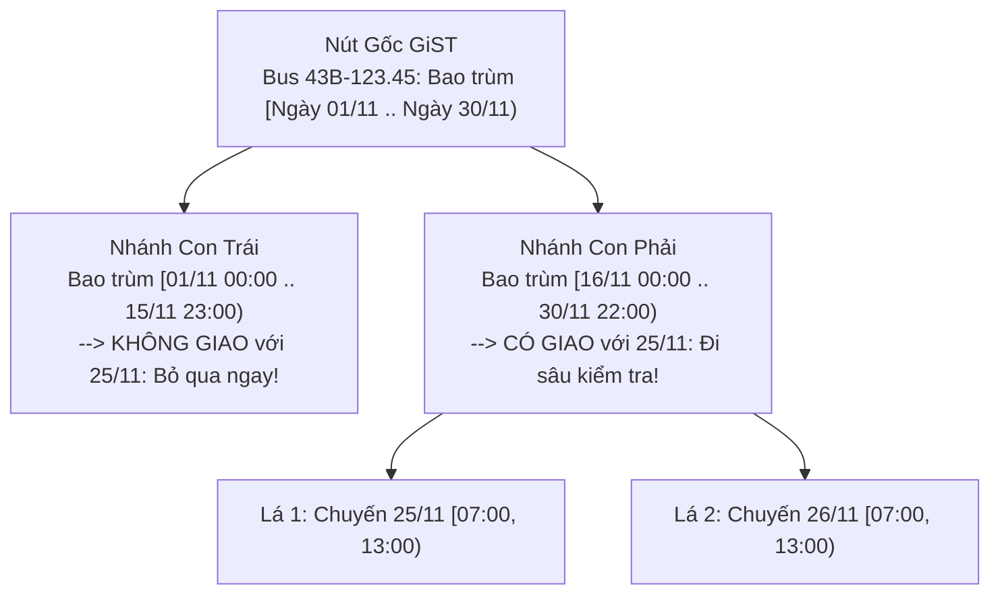
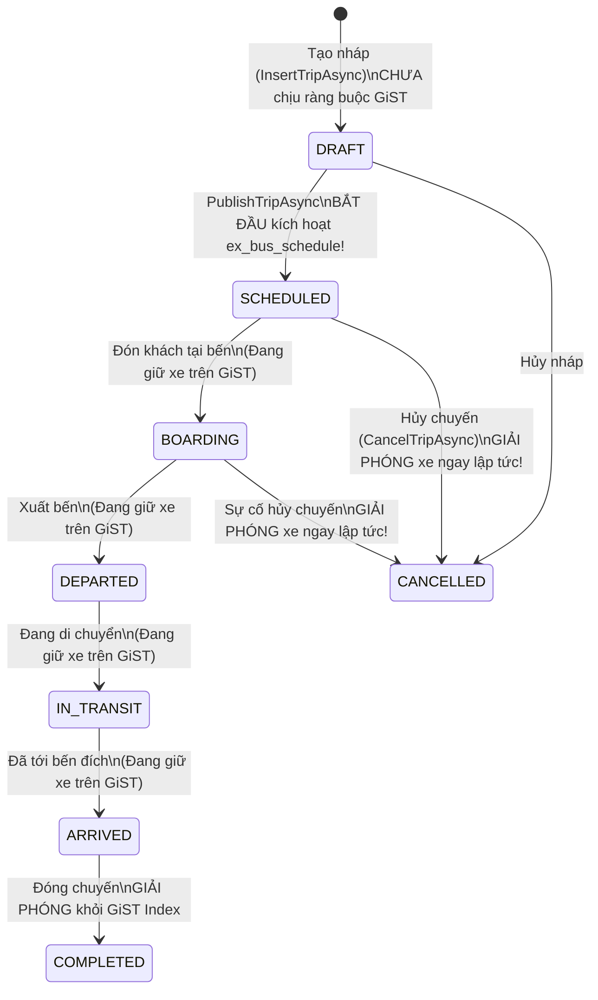
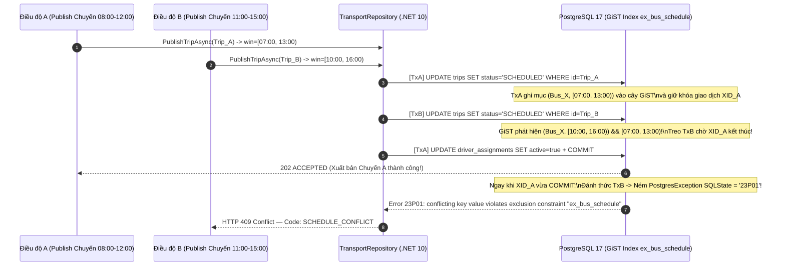

# Chương 05.2 — Chống Trùng Lịch Xe & Tài Xế Tuyệt Đối Bằng PostgreSQL `tstzrange`, Chỉ Mục `GiST` & Ràng Buộc Loại Trừ (`EXCLUDE USING gist`)

> **Mục tiêu tài liệu:** Giải thích từ con số 0 vì sao cách viết code kiểm tra trùng lịch thông thường (`SELECT` kiểm tra rồi mới `INSERT/UPDATE`) luôn thất bại dưới tải đồng thời do hiệu ứng **Write Skew** trong cơ chế MVCC của PostgreSQL, sau đó dẫn dắt người đọc làm chủ trọn bộ vũ khí nâng cao của PostgreSQL 17 gồm kiểu khoảng thời gian **`tstzrange`**, toán tử giao nhau **`&&`**, chỉ mục **`GiST`**, tiện ích mở rộng **`btree_gist`**, ràng buộc loại trừ **`EXCLUDE USING gist`**, khoảng đệm quay đầu xe **±1 giờ**, và cách bắt mã lỗi **`SQLState 23P01`** trong `TransportRepository.cs` & `TransportService.cs`.

---

## 1. Bài Toán Thực Tế & Tại Sao Kiểm Tra `IF NOT EXISTS` Trong Code C# Chắc Chắn Bị Thủng Dưới Tải Song Song?

### 1.1. Tình huống nghiệp vụ ngoài đời thực tại phòng Điều độ nhà xe

Hãy hình dung nhà xe Phương Trang trên nền tảng **BLUE Bus Ticket Platform** có chiếc xe giường nằm Limousine biển số **`43B-123.45`** và tài xế chính **Nguyễn Văn Nam**.
Vào lúc `09:00:00.000` sáng thứ Hai, có hai nhân viên điều độ (`OPERATOR_SCHEDULER`) cùng làm việc trên hai máy tính khác nhau:
- **Điều độ viên A (tại văn phòng Đà Nẵng):** Mở bán chuyến xe `T1` tuyến Đà Nẵng → Huế cho chiếc xe `43B-123.45`, chạy từ **`08:00` đến `12:00`** ngày 25/11.
- **Điều độ viên B (tại văn phòng Huế):** Đúng mili-giây đó, cũng bấm nút mở bán chuyến xe `T2` tuyến Huế → Quảng Bình cho chính chiếc xe `43B-123.45`, chạy từ **`11:00` đến `15:00`** ngày 25/11.

Rõ ràng về mặt vật lý, từ `11:00` đến `12:00`, chiếc xe `43B-123.45` đang chạy trên đèo Hải Vân hướng ra Huế, không thể nào "phân thân" có mặt ở bến xe phía Bắc Huế lúc `11:00` để đón khách đi Quảng Bình! Nếu hệ thống cho phép cả hai chuyến cùng mở bán (`SCHEDULED`), hành khách của cả hai chuyến sẽ đặt vé, thanh toán tiền thật, và đến ngày chạy sẽ xảy ra khủng hoảng vỡ trận điều hành.

### 1.2. Nền tảng lý thuyết từ gốc: MVCC và mức cô lập mặc định `READ COMMITTED` của PostgreSQL

Để hiểu vì sao hầu hết sinh viên (và cả nhiều lập trình viên đi làm) viết code chặn trùng lịch bị lỗi, ta cần hiểu trái tim của PostgreSQL hoạt động như thế nào: **MVCC (Multi-Version Concurrency Control — Kiểm soát đồng thời đa phiên bản)**.

1. **Nguyên tắc vàng của MVCC:** *"Đọc không bao giờ chặn Ghi, và Ghi không bao giờ chặn Đọc"* (*Readers never block writers, writers never block readers*).
2. **Cách MVCC hoạt động:** Khi Transaction A đang `INSERT` hoặc `UPDATE` một dòng dữ liệu nhưng **chưa gọi lệnh `COMMIT`**, phiên bản dòng mới đó vẫn "tàng hình" đối với mọi Transaction khác đang chạy song song.
3. **Mức cô lập giao dịch mặc định (`READ COMMITTED`):** Trong PostgreSQL (và `NpgsqlConnection.BeginTransactionAsync()` mặc định trong .NET), mỗi câu lệnh `SELECT` chỉ nhìn thấy ảnh chụp (Snapshot) của những dữ liệu **đã được `COMMIT` hoàn tất trước thời điểm câu lệnh `SELECT` đó bắt đầu chạy**.

### 1.3. Giải phẫu vụ tai nạn "Write Skew" (Lệch ghi) khi kiểm tra bằng `SELECT` trong C#

Giả sử một lập trình viên không biết đến `EXCLUDE USING gist`, mà viết logic kiểm tra trùng lịch xe trong C# theo lối tư duy tuần tự quen thuộc như sau:

```csharp
// MÃ GIẢ MINH HỌA CÁCH LÀM SAI LẦM PHỔ BIẾN (ANTI-PATTERN!)
var hasOverlap = await db.ExecuteScalarAsync<bool>("""
    SELECT EXISTS (
        SELECT 1 FROM trips
        WHERE bus_id = @busId
          AND status IN ('SCHEDULED', 'BOARDING', 'DEPARTED', 'IN_TRANSIT', 'ARRIVED')
          AND departure_at < @newArrival AND arrival_at > @newDeparture
    );
    """);

if (hasOverlap)
    return Conflict("Xe đã bị trùng lịch!");

// Nếu không thấy trùng -> Tiến hành cập nhật mở bán chuyến xe!
await db.ExecuteNonQueryAsync("UPDATE trips SET status = 'SCHEDULED' WHERE id = @tripId;");
await tx.CommitAsync();
```

Đoạn code trên chạy đơn luồng (1 người bấm) thì đúng 100%. Nhưng khi **Điều độ viên A** và **Điều độ viên B** cùng bấm nút cách nhau vài mili-giây trên mạng, hãy xem thảm họa **Write Skew** diễn ra trên trục thời gian thực:

```mermaid
sequenceDiagram
    autonumber
    participant TxA as Transaction A (Chuyến 08:00 - 12:00)
    participant PG as PostgreSQL 17 (MVCC - READ COMMITTED)
    participant TxB as Transaction B (Chuyến 11:00 - 15:00)

    TxA->>PG: BEGIN;
    TxB->>PG: BEGIN;
    TxA->>PG: SELECT EXISTS (... bus='43B-123.45' trùng [08:00, 12:00) ...)
    PG-->>TxA: FALSE (Chưa có chuyến nào SCHEDULED đã COMMIT!)
    TxB->>PG: SELECT EXISTS (... bus='43B-123.45' trùng [11:00, 15:00) ...)
    PG-->>TxB: FALSE (Vì TxA chưa COMMIT nên TxB không nhìn thấy!)
    Note over TxA,TxB: Cả 2 nhánh C# đều vượt qua câu lệnh if (hasOverlap)!
    TxA->>PG: UPDATE trips SET status = 'SCHEDULED' WHERE id = 'Trip_A';
    TxB->>PG: UPDATE trips SET status = 'SCHEDULED' WHERE id = 'Trip_B';
    Note over PG: Trip_A và Trip_B là 2 dòng khác nhau -> Không khóa dòng của nhau!
    TxA->>PG: COMMIT; (Thành công!)
    TxB->>PG: COMMIT; (Cũng thành công nốt!)
    Note over PG: THẢM HỌA: Xe 43B-123.45 bị mở bán 2 chuyến đè giờ nhau [11:00 - 12:00]!
```

**Tại sao các giải pháp chữa cháy thông thường đều dở?**
- **Thử dùng `UNIQUE INDEX (bus_id, departure_at)`?** Vô tác dụng! Cây B-Tree `UNIQUE` chỉ kiểm tra phép bằng tuyệt đối (`=`). `'08:00'` khác `'11:00'`, nên `UNIQUE INDEX` thấy hai giá trị khác nhau và cho qua ngay lập tức!
- **Thử dùng `SELECT ... FOR UPDATE` trên bảng `trips`?** Vẫn trượt! Nếu chiếc xe `43B-123.45` hôm đó chưa có chuyến nào đang `SCHEDULED`, câu lệnh `SELECT ... FOR UPDATE` trả về **0 dòng** — mà không có dòng nào trả về thì PostgreSQL chẳng khóa được bất cứ thứ gì ("không thể khóa bóng ma chưa tồn tại")!
- **Thử khóa độc quyền toàn bộ bảng `LOCK TABLE trips IN EXCLUSIVE MODE` hoặc khóa dòng cha `buses`?** Làm nghẽn cổ chai toàn hệ thống hoặc buộc mọi thao tác đọc/ghi xe phải xếp hàng nối đuôi nhau, biến code ứng dụng thành nơi phải nhớ quy tắc khóa thủ công (nếu một hàm khác quên gọi `SELECT ... FROM buses FOR UPDATE` thì lỗ hổng lập tức quay trở lại!).

> **Chân lý thiết kế cơ sở dữ liệu:** Bất biến dữ liệu sống còn (Data Invariant) phải được bảo vệ **ngay tại tầng Lưu trữ của Database Engine bằng Ràng buộc Khai báo (Declarative Constraint)**, chứ không bao giờ phó mặc cho câu lệnh `if` ở tầng code C#! Và vũ khí tối thượng mà PostgreSQL sinh ra cho bài toán này chính là **`EXCLUDE USING gist`**.

---

## 2. Lý Thuyết PostgreSQL Nâng Cao Cho Người Mới: Từ `tstzrange` Đến Cây Chỉ Mục `GiST` & `btree_gist`

Để đọc hiểu trọn vẹn 5 dòng SQL "nhỏ mà có võ" trong `docs/database/transport/001_initial.sql`, chúng ta hãy đi từng bậc thang kiến thức một cách thật trực quan.

### 2.1. Kiểu dữ liệu khoảng thời gian `tstzrange` (Timestamp with Time Zone Range)

Thay vì chỉ lưu rời rạc hai cột `start_time` và `end_time`, PostgreSQL cung cấp sẵn kiểu dữ liệu **Range Types** (kiểu khoảng giá trị nguyên bản), tiêu biểu nhất là **`tstzrange`** — biểu diễn một đoạn thời gian liên tục có múi giờ chuẩn UTC.

#### Quy tắc dấu ngoặc biên (Bound Inclusivity): `[` vs `)`
Trong toán học tập hợp và trong PostgreSQL:
- Ngoặc vuông **`[`** hoặc **`]`**: **Bao gồm** điểm đầu mút (Inclusive — dấu $\le$ hoặc $\ge$).
- Ngoặc tròn **`(`** hoặc **`)`**: **Không bao gồm** điểm đầu mút (Exclusive — dấu $<$ hoặc $>$).

Trong toàn bộ dự án BLUE (xem [TransportRepository.cs](file:///C:/Users/minht/.gemini/antigravity/worktrees/PBL6/c_to_n_b/workspace/src/services/transport/BusTicketPlatform.Transport.Infrastructure/Persistence/TransportRepository.cs#L475)), mọi khoảng thời gian vận hành đều được khởi tạo bằng hàm chuẩn nửa đóng – nửa mở **`'[)'`**:
```sql
tstzrange(@winStart, @winEnd, '[)')
```
Tức là tập hợp mọi thời điểm $t$ sao cho: $\text{winStart} \le t < \text{winEnd}$.

> **Tại sao bắt buộc phải dùng `'[)'` mà không dùng `'[]'` (đóng cả hai đầu)?**
> Hãy xét ví dụ cực kỳ thực tế:
> - Chuyến Sáng có khung vận hành kết thúc đúng **`13:00`**: `[07:00, 13:00)`.
> - Chuyến Chiều có khung vận hành bắt đầu đúng **`13:00`**: `[13:00, 19:00)`.
> Nếu dùng `'[]'` (`[07:00, 13:00]` và `[13:00, 19:00]`), hai khoảng này có chung đúng 1 điểm tức thời là `13:00:00.000000` → PostgreSQL sẽ báo **TRÙNG LỊCH** vô lý!
> Ngược lại, khi dùng **`'[)'`**, Chuyến Sáng sở hữu đến sát `12:59:59.999999...` (không chứa điểm `13:00`), còn Chuyến Chiều bắt đầu từ đúng `13:00`. Hai ca nối đuôi nhau hoàn hảo tuyệt đối, không hở một micro-giây nào và cũng không đè lên nhau!

#### 3 hàm kiểm tra `tstzrange` được dùng trong `001_initial.sql`:
- `isempty(operating_window)`: Kiểm tra khoảng có bị rỗng không (ví dụ `tstzrange('12:00', '12:00', '[)')` là khoảng rỗng `empty`).
- `lower(operating_window)`: Trích xuất mốc thời gian bắt đầu của khoảng.
- `upper(operating_window)`: Trích xuất mốc thời gian kết thúc của khoảng.

---

### 2.2. Toán tử giao nhau `&&` (Overlaps Operator)

Trong PostgreSQL, ký hiệu **`&&`** khi đặt giữa hai kiểu khoảng (`tstzrange && tstzrange`) không phải là phép `AND` logic như trong C#, mà là **toán tử kiểm tra giao nhau (Overlaps)**: trả về `TRUE` nếu hai khoảng thời gian có **ít nhất một thời điểm chung** ($A \cap B \neq \emptyset$).

```text
Trục thời gian:   07:00      09:00      11:00      13:00      15:00      17:00
                    |----------|----------|----------|----------|----------|
Chuyến A:           [====================)                                      -> [07:00, 11:00)
Chuyến B (Đè đuôi):            [====================)                           -> [09:00, 13:00)  => A && B = TRUE  (Bị chặn!)
Chuyến C (Nằm lọt):       [=========)                                           -> [08:00, 10:00)  => A && C = TRUE  (Bị chặn!)
Chuyến D (Nối tiếp):                      [====================)                -> [11:00, 15:00)  => A && D = FALSE (Hợp lệ!)
Chuyến E (Tách rời):                                 [====================)     -> [13:00, 17:00)  => A && E = FALSE (Hợp lệ!)
```

Chỉ với đúng 2 ký tự `&&`, PostgreSQL thay thế hoàn toàn biểu thức điều kiện dài dòng dễ nhầm lẫn `(startA < endB AND endA > startB)` và xử lý tự động mọi trường hợp biên mở/đóng, khoảng vô cực hay khoảng rỗng!

---

### 2.3. Chỉ mục `GiST` (Generalized Search Tree) là gì? Khác B-Tree ở đâu?

Tại sao PostgreSQL không dùng luôn cây **B-Tree** quen thuộc để tăng tốc toán tử `&&`?
- **Giới hạn của B-Tree:** B-Tree sắp xếp dữ liệu trên một trục thẳng 1 chiều duy nhất dựa trên thứ tự lớn – bé (`<, <=, =, >=, >`). Với các khoảng thời gian có độ dài ngắn dài khác nhau (có chuyến chạy 2 tiếng, có chuyến Bắc – Nam chạy 30 tiếng), bạn sắp xếp theo `start_time` cũng không biết `end_time` kéo dài tới đâu, mà sắp xếp theo `end_time` cũng không biết `start_time` bắt đầu từ lúc nào.
- **Sức mạnh của `GiST` (Generalized Search Tree — Cây tìm kiếm tổng quát):**
  GiST không phải là một cấu trúc đơn lẻ cố định, mà là một **khung kiến trúc cây cân bằng dạng khung bao (Bounding-Box Hierarchy, tương tự R-Tree trong không gian 2D/3D)**:
  - Mỗi **Nút lá (Leaf Node)** lưu khoảng `tstzrange` của từng chuyến xe cụ thể.
  - Mỗi **Nút cha (Internal Node)** lưu một **khoảng bao trùm cực đại (Bounding Range)** từ `min(lower)` đến `max(upper)` của tất cả các nút con bên dưới nó.
  - Khi cần kiểm tra xem có chuyến nào giao (`&&`) với `[10:00, 16:00)` không, nếu nút cha có khoảng bao trùm là `[01:00, 08:00)` (không giao với `[10:00, 16:00)`), PostgreSQL **cắt bỏ ngay lập tức cả nhánh hàng nghìn chuyến xe bên dưới** mà không cần đọc đĩa! Độ phức tạp tra cứu giảm về $O(\log N)$.



---

### 2.4. Tại sao dòng số 1 của `transport/001_initial.sql` phải cài `CREATE EXTENSION IF NOT EXISTS btree_gist;`?

Đây là câu hỏi "sát thủ" phân loại sinh viên chỉ copy code với sinh viên thực sự hiểu cơ sở dữ liệu! Hãy nhìn dòng đầu tiên của [docs/database/transport/001_initial.sql](file:///C:/Users/minht/.gemini/antigravity/worktrees/PBL6/c_to_n_b/docs/database/transport/001_initial.sql#L1):
```sql
create extension if not exists btree_gist;
```
Và nhìn xuống dòng 190–191:
```sql
alter table trips add constraint ex_bus_schedule
  exclude using gist (bus_id with =, operating_window with &&)
  where (status in ('SCHEDULED','BOARDING','DEPARTED','IN_TRANSIT','ARRIVED'));
```

**Giải thích bản chất:**
- Ta không hề muốn cấm *hai chiếc xe khác nhau* chạy cùng giờ! Xe `43B-123.45` và xe `51B-999.99` hoàn toàn được quyền chạy cùng khung giờ `[07:00, 13:00)`.
- Ta chỉ cấm khi **CẢ HAI ĐIỀU KIỆN ĐỒNG THỜI XẢY RA**:
  1. Cùng một chiếc xe: `bus_id WITH =` (toán tử bằng trên kiểu dữ liệu vô hướng `uuid`).
  2. Và khung giờ đè lên nhau: `operating_window WITH &&` (toán tử giao nhau trên kiểu khoảng `tstzrange`).
- Ràng buộc `EXCLUDE USING gist` đòi hỏi **tất cả các cột tham gia phải nằm chung trong MỘT cây chỉ mục GiST duy nhất**.
- Thế nhưng mặc định nhân lõi (core) của PostgreSQL chỉ dạy cho GiST cách đánh chỉ mục các kiểu hình học, địa lý, văn bản toàn cục và khoảng (`tstzrange`), chứ **chưa dạy cho GiST cách xử lý toán tử `=` trên các kiểu cơ bản như `uuid`, `int8`, `varchar`** (vì mặc định các kiểu đó dùng B-Tree)!
- Khi bật tiện ích mở rộng chính chủ **`btree_gist`** (có sẵn trong gói `postgresql-contrib` của image `postgres:17-alpine`), PostgreSQL nạp thêm các *GiST Operator Classes* mô phỏng hành vi B-Tree cho kiểu `uuid`. Nhờ đó, PostgreSQL tạo được một **Composite GiST Index lai ghép `(uuid, tstzrange)`**: phân nhánh theo đúng `bus_id` trước rồi khoanh vùng khoảng thời gian `operating_window` ngay bên trong từng xe!

---

### 2.5. Ràng buộc loại trừ `EXCLUDE USING gist` khép kín lỗ hổng Concurrency như thế nào?

Khác với câu lệnh `SELECT` kiểm tra trong code C# bị mù trước các Transaction chưa `COMMIT` (do MVCC), **Index Constraint ở tầng Engine PostgreSQL được phép nhìn xuyên qua MVCC (Dirty Index Scan / SnapshotDirty)**:

1. Khi **Transaction A** chạy lệnh `UPDATE trips SET status = 'SCHEDULED'` cho xe `43B-123.45` khung `[07:00, 13:00)`, PostgreSQL chèn mục chỉ mục mới vào cây `GiST` của `ex_bus_schedule` và giữ khóa giao dịch (XID Lock) trên dòng đó.
2. Đúng 1 mili-giây sau (khi A **chưa kịp `COMMIT`**), **Transaction B** chạy lệnh `UPDATE trips SET status = 'SCHEDULED'` cho cùng xe `43B-123.45` khung `[10:00, 16:00)`.
3. Khi chèn vào cây `GiST`, bộ kiểm tra Exclusion Constraint quét cây GiST bằng chế độ đặc biệt của hệ thống lưu trữ: nó **nhìn thấy ngay mục đang chờ `COMMIT` của Transaction A** có `bus_id` bằng nhau và `[07:00, 13:00) && [10:00, 16:00)` là `TRUE`!
4. Lập tức, PostgreSQL **treo (block) Transaction B đứng đợi** trên khóa giao dịch của Transaction A:
   - Nếu vài mili-giây sau Transaction A gặp lỗi và `ROLLBACK`: Transaction B tự động được đánh thức và `COMMIT` thành công!
   - Nếu Transaction A `COMMIT` thành công: ngay tích tắc đó, Transaction B bị PostgreSQL đánh thức và ném thẳng mã lỗi chuẩn SQL **`23P01` (`exclusion_violation`)**!

**Kết quả:** Triệt tiêu **100%** khả năng lọt lưới trùng lịch ở mọi kịch bản chạy song song mà không cần khóa bảng, không cần nâng Isolation Level toàn cục lên `SERIALIZABLE`!

---

## 3. Giải Phẫu Từng Dòng SQL Trong `docs/database/transport/001_initial.sql`

Bây giờ khi đã nắm vững lý thuyết `tstzrange`, `&&`, `GiST`, và `btree_gist`, chúng ta hãy mổ xẻ trực tiếp hai ràng buộc bảo vệ lịch trình xe và lịch trình tài xế trong [docs/database/transport/001_initial.sql](file:///C:/Users/minht/.gemini/antigravity/worktrees/PBL6/c_to_n_b/docs/database/transport/001_initial.sql).

### 3.1. Khiên bảo vệ thứ nhất: Chống trùng lịch phương tiện (`ex_bus_schedule` trên bảng `trips`)

Trích nguyên văn từ [docs/database/transport/001_initial.sql](file:///C:/Users/minht/.gemini/antigravity/worktrees/PBL6/c_to_n_b/docs/database/transport/001_initial.sql#L163-L192):

```sql
  departure_at timestamptz not null,
  arrival_at timestamptz not null,
  operating_window tstzrange not null,
  -- ...
  constraint ck_trips_time check (arrival_at > departure_at),
  constraint ck_trips_window check (
    not isempty(operating_window)
    and lower(operating_window) <= departure_at
    and upper(operating_window) >= arrival_at
  ),
  -- ...
  constraint ck_trips_status check (status in ('DRAFT','SCHEDULED','BOARDING','DEPARTED','IN_TRANSIT','ARRIVED','COMPLETED','CANCELLED')),
```
```sql
alter table trips add constraint ex_bus_schedule
  exclude using gist (bus_id with =, operating_window with &&)
  where (status in ('SCHEDULED','BOARDING','DEPARTED','IN_TRANSIT','ARRIVED'));
```

Hãy phân tích sự chặt chẽ đến từng chi tiết của thiết kế này:

1. **Ràng buộc bao hàm hình học `ck_trips_window`:**
   PostgreSQL không cho phép ứng dụng truyền bừa một `operating_window` nhỏ hơn thời gian chạy thực tế của chuyến xe! Ràng buộc `ck_trips_window` ép buộc:
   - Khoảng vận hành không được rỗng (`not isempty(operating_window)`).
   - Đầu mút dưới `lower(operating_window)` phải sớm hơn hoặc bằng giờ xe lăn bánh `departure_at`.
   - Đầu mút trên `upper(operating_window)` phải muộn hơn hoặc bằng giờ xe cập bến `arrival_at`.
   Nói cách khác, đoạn `[departure_at, arrival_at]` luôn phải nằm gọn bên trong lòng `operating_window`!

2. **Nghệ thuật Partial Exclusion Constraint với mệnh đề `WHERE (status in (...))`:**
   Tại sao `ex_bus_schedule` không áp lên toàn bộ mọi dòng của bảng `trips`, mà lại lọc đúng 5 trạng thái `'SCHEDULED'`, `'BOARDING'`, `'DEPARTED'`, `'IN_TRANSIT'`, `'ARRIVED'` và **cố tình bỏ qua 3 trạng thái `'DRAFT'`, `'COMPLETED'`, `'CANCELLED'`**?



   - **Tại sao bỏ qua `'DRAFT'`?** Trong thực tế nghiệp vụ điều hành vận tải, điều độ viên thường tạo hàng chục bản nháp phương án lịch chạy (Draft Plans) để cân đối xe và tài xế trước khi chốt. Khi còn ở trạng thái `'DRAFT'`, chuyến xe chưa bán vé cho ai cả, nên cho phép tồn tại nhiều bản nháp trùng giờ để điều độ viên linh hoạt chỉnh sửa. Chỉ đến khoảnh khắc quyết định bấm **"Xuất bản mở bán" (`PublishTripAsync`)** chuyển `status` sang `'SCHEDULED'`, khiên `ex_bus_schedule` mới khóa chặt lịch chiếc xe đó!
   - **Tại sao bỏ qua `'CANCELLED'`?** Giả sử chuyến xe `08:00 - 12:00` bị hủy (`status = 'CANCELLED'`) do ít khách hoặc đổi kế hoạch tuyến. Ngay lập tức dòng đó rơi ra khỏi điều kiện `WHERE` của `ex_bus_schedule`, trả tự do cho chiếc xe `43B-123.45` để điều độ viên xếp nó vào một chuyến tăng cường khác trong cùng buổi sáng hôm đó mà không bị báo lỗi trùng lịch với chuyến đã hủy!
   - **Tại sao bỏ qua `'COMPLETED'`?** Các chuyến đã kết thúc trong quá khứ không còn chiếm dụng xe ở tương lai nữa; loại chúng khỏi cây `GiST` giúp chỉ mục luôn cực kỳ nhỏ gọn dù hệ thống chạy suốt 5–10 năm!

---

### 3.2. Khiên bảo vệ thứ hai: Chống trùng lịch Tài xế (`ex_driver_schedule` trên bảng `driver_assignments`)

Trích nguyên văn từ [docs/database/transport/001_initial.sql](file:///C:/Users/minht/.gemini/antigravity/worktrees/PBL6/c_to_n_b/docs/database/transport/001_initial.sql#L201-L220):

```sql
create table driver_assignments (
  id uuid primary key,
  trip_id uuid not null references trips(id),
  driver_profile_id uuid not null references driver_profiles(id),
  assignment_role varchar(20) not null,
  assignment_window tstzrange not null,
  active boolean not null default true,
  assigned_by_external uuid not null,
  created_at timestamptz not null,
  ended_at timestamptz,
  row_version bigint not null default 0,
  constraint uq_driver_assignments_trip_role unique (trip_id, assignment_role),
  constraint ck_driver_assignments_role check (assignment_role in ('PRIMARY','ASSISTANT')),
  constraint ck_driver_assignments_window check (not isempty(assignment_window))
);

alter table driver_assignments add constraint ex_driver_schedule
  exclude using gist (driver_profile_id with =, assignment_window with &&)
  where (active = true);
```

**3 lý do sâu sắc khiến dự án tách riêng bảng `driver_assignments` thay vì đặt cột `driver_id` trực tiếp vào bảng `trips`:**
1. **Hỗ trợ tổ lái nhiều vai trò (`PRIMARY` và `ASSISTANT`):** Chuyến xe đường dài Bắc – Nam luôn cần 1 tài xế chính (`PRIMARY`) và 1 tài xế phụ (`ASSISTANT`) đổi lái. Ràng buộc `uq_driver_assignments_trip_role unique (trip_id, assignment_role)` đảm bảo mỗi vai trò trên một chuyến chỉ có đúng 1 người, còn `ex_driver_schedule` đảm bảo **dù một tài xế ngồi ghế lái chính ở chuyến A hay làm phụ lái ở chuyến B thì cũng tuyệt đối không thể trùng giờ nhau**!
2. **Lưu vết lịch sử đổi tài xế (`active = false`, `ended_at`):** Nếu trước giờ chạy tài xế Nguyễn Văn Nam báo ốm đột xuất, điều độ viên đổi sang tài xế Trần Văn Hùng: dòng phân công cũ của anh Nam chỉ cần chuyển `active = false, ended_at = NOW()` để giữ nguyên lịch sử kiểm toán (`assigned_by_external`), đồng thời anh Nam lập tức thoát khỏi `WHERE (active = true)` của `ex_driver_schedule`.
3. **Đồng bộ nhịp nhàng với trạng thái `DRAFT` của chuyến xe:** Khi chuyến xe mới ở dạng nháp (`DRAFT`), dòng `driver_assignments` được tạo sẵn với **`active = false`**; chỉ khi chuyến xe được Publish sang `SCHEDULED` thì `active` mới bật thành `true`!

---

## 4. Giải Phẫu Phối Hợp Giữa C# (`TransportService` & `TransportRepository`) Và PostgreSQL

### 4.1. Quy tắc Khoảng Đệm Quay Đầu & Nghỉ Ngơi ±1 Giờ (`AddHours(-1)` đến `AddHours(1)`)

Một điểm tinh tế rất thực tế trong mã nguồn C# của dự án: `operating_window` của xe và `assignment_window` của tài xế **không** lấy bằng đúng `[DepartureAt, ArrivalAt)`, mà luôn được **cộng thêm khoảng đệm an toàn (Turnaround & Safety Buffer) 1 giờ trước khi xuất bến và 1 giờ sau khi cập bến**!

Hãy kiểm chứng trực tiếp tại hai vị trí trong code:
1. Cho phương tiện (`operating_window`) tại [TransportRepository.BindTripCore](file:///C:/Users/minht/.gemini/antigravity/worktrees/PBL6/c_to_n_b/workspace/src/services/transport/BusTicketPlatform.Transport.Infrastructure/Persistence/TransportRepository.cs#L887-L890):
   ```csharp
   // Trích từ TransportRepository.cs (dòng 887 - 890)
   command.Parameters.AddWithValue("dep", trip.DepartureAt.UtcDateTime);
   command.Parameters.AddWithValue("arr", trip.ArrivalAt.UtcDateTime);
   command.Parameters.AddWithValue("winStart", trip.DepartureAt.UtcDateTime.AddHours(-1));
   command.Parameters.AddWithValue("winEnd", trip.ArrivalAt.UtcDateTime.AddHours(1));
   ```
2. Cho tài xế (`assignment_window`) tại [TransportService.PrepareTripDraftAsync](file:///C:/Users/minht/.gemini/antigravity/worktrees/PBL6/c_to_n_b/workspace/src/services/transport/BusTicketPlatform.Transport.Application/TransportService.cs#L664-L671):
   ```csharp
   // Trích từ TransportService.cs (dòng 664 - 671)
   var assignment = new DriverAssignmentRecord(
       ids.NewUuidV7(),
       tripId,
       driver.Id,
       "PRIMARY",
       input.DepartureAt.AddHours(-1),
       input.ArrivalAt.AddHours(1),
       actor.UserId);
   ```
3. Và ngay cả khi tạo lịch chạy lặp theo tuần (`CreateRecurringTripsAsync` tại [TransportService.cs](file:///C:/Users/minht/.gemini/antigravity/worktrees/PBL6/c_to_n_b/workspace/src/services/transport/BusTicketPlatform.Transport.Application/TransportService.cs#L577-L578)), hệ thống cũng kiểm tra sớm và thông báo rõ bằng tiếng Việt cho điều độ viên:
   ```csharp
   if (plans.Count > 0 && plan.Assignment.Start < plans[^1].Assignment.End)
       return Fail<IReadOnlyList<TripDto>>(PlatformErrors.Validation(
           "Các ngày chạy bị trùng lịch xe hoặc tài xế, gồm khoảng đệm một giờ trước và sau chuyến. Chọn các ngày cách nhau xa hơn."));
   ```

#### Ví dụ minh họa tác dụng thực tiễn của khoảng đệm ±1 giờ:
Giả sử Chuyến 1 chạy Đà Nẵng → Huế lăn bánh từ **`08:00` đến `12:00`**:
- Trong DB, `operating_window` được lưu là **`[07:00, 13:00)`**:
  - `07:00 – 08:00`: Tài xế nhận xe tại bãi, kiểm tra phanh/lốp, đưa xe vào vị trí xếp khách ở bến và xếp hành lý.
  - `12:00 – 13:00`: Xe cập bến Huế (dự phòng kẹt xe trễ 15–30 phút), trả hết hành khách, dọn vệ sinh cabin và cho tài xế nghỉ ngơi ăn trưa theo luật an toàn giao thông đường bộ.
- Nếu điều độ viên cố xếp Chuyến 2 quay đầu Huế → Đà Nẵng khởi hành lúc **`13:30` đến `17:30`**:
  - `operating_window` của Chuyến 2 sẽ là **`[12:30, 18:30)`** (vì từ `12:30` xe đã phải chuẩn bị đón khách chuyến mới).
  - PostgreSQL so sánh `[07:00, 13:00) && [12:30, 18:30)` → **GIAO NHAU trong đoạn `[12:30, 13:00)`** → **TỪ CHỐI NGAY LẬP TỨC!**
- Để hợp lệ, Chuyến 2 sớm nhất phải khởi hành lúc **`14:00`** (khi đó `operating_window` là `[13:00, 19:00)` — chạm khít điểm `13:00` với `[07:00, 13:00)` nhờ khoảng nửa mở `'[)'` nên hoàn toàn hợp lệ!).

---

### 4.2. Kích hoạt nguyên tử cả 2 khiên GiST và bắt mã lỗi `SQLState 23P01` trong `PublishTripAsync`

Hãy xem khoảnh khắc một chuyến xe được xuất bản trong [TransportRepository.PublishTripAsync](file:///C:/Users/minht/.gemini/antigravity/worktrees/PBL6/c_to_n_b/workspace/src/services/transport/BusTicketPlatform.Transport.Infrastructure/Persistence/TransportRepository.cs#L542-L583):

```csharp
// Trích từ TransportRepository.cs (dòng 542 - 583)
public async Task PublishTripAsync(TripRecord trip, CancellationToken cancellationToken)
{
    try
    {
        await using var connection = await OpenAsync(cancellationToken);
        await using var tx = await connection.BeginTransactionAsync(cancellationToken);
        await using (var command = new NpgsqlCommand("""
            UPDATE trips
            SET route_id = @route, bus_id = @bus, origin_stop_id = @origin, destination_stop_id = @dest,
                departure_at = @dep, arrival_at = @arr, operating_window = tstzrange(@winStart, @winEnd, '[)'),
                base_fare = @fare, status = @status, sellable = @sellable, published_version = @published,
                route_snapshot = CAST(@routeSnap AS jsonb), bus_snapshot = CAST(@busSnap AS jsonb),
                fare_policy_snapshot = CAST(@fareSnap AS jsonb), row_version = @version, updated_at = NOW()
            WHERE id = @id;
            """, connection, tx))
        {
            // ... gán tham số, trong đó @status = 'SCHEDULED' ...
            await command.ExecuteNonQueryAsync(cancellationToken);
        }

        await using (var assignment = new NpgsqlCommand("""
            UPDATE driver_assignments
            SET active = true, row_version = row_version + 1
            WHERE trip_id = @trip AND assignment_role = 'PRIMARY';
            """, connection, tx))
        {
            assignment.Parameters.AddWithValue("trip", trip.Id);
            await assignment.ExecuteNonQueryAsync(cancellationToken);
        }

        await tx.CommitAsync(cancellationToken);
    }
    catch (PostgresException exception) when (exception.SqlState is "23P01" or "23505")
    {
        throw new InvalidOperationException("SCHEDULE_CONFLICT", exception);
    }
}
```

Hãy theo dõi tính nguyên tử (Atomicity) tuyệt đẹp ở đây:
1. Lệnh `UPDATE trips` đầu tiên chuyển `status` từ `'DRAFT'` sang `'SCHEDULED'` → PostgreSQL lập tức kiểm tra ràng buộc **`ex_bus_schedule`**. Nếu chiếc xe đang kẹt một chuyến khác giao khung giờ `[winStart, winEnd)`, lệnh này nổ ngoại lệ `PostgresException` với `SqlState = "23P01"` ngay lập tức!
2. Nếu chiếc xe hoàn toàn rảnh, lệnh `UPDATE driver_assignments` thứ hai chuyển `active` từ `false` sang `true` → PostgreSQL lập tức kiểm tra ràng buộc **`ex_driver_schedule`**. Nếu chiếc xe rảnh nhưng **tài xế** lại đang được phân công lái một chiếc xe khác trong cùng khung giờ đó, lệnh thứ hai này cũng nổ `PostgresException` với `SqlState = "23P01"`, kéo theo toàn bộ `tx` tự động Rollback (lệnh `UPDATE trips` ở bước 1 được hoàn tác sạch sẽ, chuyến xe vẫn ở nguyên trạng thái `'DRAFT'`)!
3. Khối `catch (PostgresException exception) when (exception.SqlState is "23P01" or "23505")`:
   - Trong bảng mã lỗi chuẩn SQL / PostgreSQL (Appendix A — PostgreSQL Error Codes), lớp `23xxx` là *Integrity Constraint Violation*:
     - `23505` = `unique_violation` (vi phạm ràng buộc duy nhất, ví dụ `uq_driver_assignments_trip_role`).
     - **`23P01` = `exclusion_violation`** (mã lỗi đặc chủng chỉ xuất hiện khi vi phạm ràng buộc `EXCLUDE USING ...`!).
   - Tầng Infrastructure dịch mã lỗi kỹ thuật `23P01` thành ngoại lệ miền `"SCHEDULE_CONFLICT"`, để [TransportService.PublishTripAsync](file:///C:/Users/minht/.gemini/antigravity/worktrees/PBL6/c_to_n_b/workspace/src/services/transport/BusTicketPlatform.Transport.Application/TransportService.cs#L792-L795) bắt lấy và trả về lỗi chuẩn hóa `PlatformErrors.ScheduleConflict()` (HTTP **`409 Conflict`**, mã lỗi `"SCHEDULE_CONFLICT"`, thông điệp `"The bus or driver schedule overlaps another trip."` tại [PlatformErrors.cs](file:///C:/Users/minht/.gemini/antigravity/worktrees/PBL6/c_to_n_b/workspace/src/building-blocks/BusTicketPlatform.BuildingBlocks/Errors/PlatformErrors.cs#L33-L34)).



---

## 5. Góc Bảo Vệ Đồ Án: Câu Hỏi Phản Biện & Cách Trả Lời Ghi Điểm Tuyệt Đối

### Câu hỏi 1: *"Tại sao các em không kiểm tra trùng giờ xe bằng câu lệnh `SELECT COUNT(*) FROM trips WHERE bus_id = ... AND departure_at < @arr AND arrival_at > @dep` trong C# cho dễ hiểu, mà phải dùng `tstzrange` và `EXCLUDE USING gist` phức tạp như vậy?"*
- **Cách trả lời chuẩn xác:**
  *"Dạ thưa thầy/cô, kiểm tra bằng `SELECT COUNT(*)` trong code C# bị dính lỗi kinh điển **Write Skew (Time-of-Check to Time-of-Use)** dưới mức cô lập mặc định `READ COMMITTED` của PostgreSQL. Nếu hai điều độ viên bấm Publish hai chuyến xe giao giờ nhau ở cùng một mili-giây, cả hai câu `SELECT` đều chạy trước khi giao dịch kia kịp `COMMIT`, nên cả hai đều nhận kết quả `COUNT = 0` và cùng ghi thành công xuống DB, làm một chiếc xe bị bán vé trên hai tuyến cùng lúc. Hơn nữa, `UNIQUE INDEX` của B-Tree chỉ bắt được phép bằng (`=`) chứ không bắt được giao thoa khoảng thời gian (`&&`). Do đó, nhóm em dùng ràng buộc loại trừ **`EXCLUDE USING gist (bus_id WITH =, operating_window WITH &&)`** kết hợp extension `btree_gist` để chính Engine lưu trữ của PostgreSQL khóa và chặn đụng độ trực tiếp trên cây chỉ mục GiST, trả về mã lỗi `23P01` được ánh xạ thành HTTP `409 SCHEDULE_CONFLICT`, đảm bảo đúng đắn tuyệt đối 100% ở mọi mức tải song song ạ."*

### Câu hỏi 2: *"Nếu chuyến xe bị hỏng xe dọc đường hoặc bị hủy trước giờ chạy (`CANCELLED`), chiếc xe hay tài xế đó có bị kẹt cứng trong ràng buộc `GiST` không đi chạy chuyến thay thế được không?"*
- **Cách trả lời chuẩn xác:**
  *"Dạ hoàn toàn không bị kẹt ạ, vì nhóm em thiết kế **Partial Exclusion Constraint** có kèm điều kiện lọc trạng thái: trên bảng `trips` là `WHERE (status IN ('SCHEDULED','BOARDING','DEPARTED','IN_TRANSIT','ARRIVED'))`, và trên bảng `driver_assignments` là `WHERE (active = true)`. Nhờ vậy, khi chuyến xe đang là bản nháp (`DRAFT`), hoặc khi đã hoàn thành (`COMPLETED`), hoặc ngay khi bị hủy (`CANCELLED`), bản ghi đó tự động nằm ngoài phạm vi của chỉ mục GiST, giải phóng tức thì cả xe lẫn tài xế để điều độ sang chuyến khác ạ."*

### Câu hỏi 3: *"Ý nghĩa của ký hiệu `'[)'` trong hàm `tstzrange(@winStart, @winEnd, '[)')` và việc trừ/cộng 1 tiếng (`AddHours(-1)` / `AddHours(1)`) trong `TransportRepository` là gì?"*
- **Cách trả lời chuẩn xác:**
  *"Dạ việc trừ 1 giờ trước `DepartureAt` và cộng 1 giờ sau `ArrivalAt` tạo ra **khoảng đệm quay đầu và nghỉ ngơi an toàn (Turnaround Buffer)**: giúp xe có 1 tiếng chuẩn bị đón khách trước chuyến và 1 tiếng trả khách, dọn xe, dự phòng trễ giờ cũng như đảm bảo sức khỏe tài xế sau chuyến. Còn ký hiệu nửa đóng nửa mở **`'[)'`** (bao gồm đầu mút đầu, không bao gồm đầu mút cuối) giúp hai khoảng vận hành nối tiếp khít nhau — ví dụ ca sáng `[07:00, 13:00)` và ca chiều `[13:00, 19:00)` — không bị coi là trùng nhau tại đúng thời điểm giao ca `13:00:00` ạ."*

---

## 6. Giải Phẫu Mở Rộng: Các Kỹ Thuật Đồng Thời & SQL Nâng Cao Khác Trong `TransportRepository.cs`

Để làm chủ hoàn toàn tầng Persistence của `Transport Service`, ngoài `PublishTripAsync`, chúng ta cần nắm vững thêm 3 kỹ thuật SQL thực chiến rất đắt giá khác trong [TransportRepository.cs](file:///C:/Users/minht/.gemini/antigravity/worktrees/PBL6/c_to_n_b/workspace/src/services/transport/BusTicketPlatform.Transport.Infrastructure/Persistence/TransportRepository.cs):

### 6.1. Tạo lịch chạy lặp định kỳ hàng loạt trong 1 Transaction nguyên tử (`InsertTripsAsync` & `CreateRecurringTripsAsync`)

Trong thực tế vận hành nhà xe, điều độ viên hiếm khi tạo từng chuyến lẻ tẻ cho cả quý, mà dùng chức năng **Thiết lập lịch lặp theo thứ trong tuần** (ví dụ: Xe `43B-123.45` chạy đều đặn Thứ Hai, Thứ Tư, Thứ Sáu hằng tuần trong 3 tháng tới — tổng cộng gần 40 chuyến).

Hãy xem cách [TransportService.CreateRecurringTripsAsync](file:///C:/Users/minht/.gemini/antigravity/worktrees/PBL6/c_to_n_b/workspace/src/services/transport/BusTicketPlatform.Transport.Application/TransportService.cs#L529-L608) và [TransportRepository.InsertTripsAsync](file:///C:/Users/minht/.gemini/antigravity/worktrees/PBL6/c_to_n_b/workspace/src/services/transport/BusTicketPlatform.Transport.Infrastructure/Persistence/TransportRepository.cs#L425-L500) phối hợp bảo vệ toàn vẹn dữ liệu:

```csharp
// Trích từ TransportRepository.cs (dòng 425 - 500)
public async Task InsertTripsAsync(IReadOnlyList<TripDraftPlan> plans, CancellationToken cancellationToken, TripDraftPlan? source = null)
{
    await using var connection = await OpenAsync(cancellationToken);
    await using var tx = await connection.BeginTransactionAsync(cancellationToken);
    if (source is not null)
    {
        var trip = source.Trip;
        var assignment = source.Assignment;
        await using (var command = new NpgsqlCommand("""
            UPDATE trips
            SET route_id = @route, bus_id = @bus, origin_stop_id = @origin, destination_stop_id = @dest,
                departure_at = @dep, arrival_at = @arr, operating_window = tstzrange(@winStart, @winEnd, '[)'),
                base_fare = @fare, status = @status, sellable = @sellable, row_version = @version, updated_at = NOW()
            WHERE id = @id AND status = 'DRAFT' AND row_version = @expected;
            """, connection, tx))
        {
            BindTripCore(command, trip);
            command.Parameters.AddWithValue("version", trip.RowVersion);
            command.Parameters.AddWithValue("expected", trip.RowVersion - 1);
            if (await command.ExecuteNonQueryAsync(cancellationToken) != 1)
                throw new InvalidOperationException("VERSION_CONFLICT");
        }
        // ... cập nhật driver_assignments của bản nháp gốc ...
    }

    foreach (var plan in plans)
    {
        // Chèn tuần tự từng chuyến nháp + phân công tài xế trong CÙNG 1 Transaction!
        // ...
    }
    await tx.CommitAsync(cancellationToken);
}
```

**3 chốt chặn tinh tế trong luồng lịch lặp này:**
1. **Optimistic Concurrency ngay trên bản nháp gốc (`WHERE id = @id AND status = 'DRAFT' AND row_version = @expected`):** Nếu điều độ viên A đang dùng bản nháp gốc để nhân bản thành chuỗi lịch 3 tháng, nhưng điều độ viên B vừa sửa hoặc vừa Publish bản nháp gốc đó ở mili-giây trước, câu `UPDATE` trả về `0` dòng và ném ngay `"VERSION_CONFLICT"`, hủy bỏ toàn bộ 40 chuyến sắp sinh ra!
2. **Kiểm tra hạn bằng lái tài xế tới tận chuyến cuối cùng của chuỗi lặp (`TransportService.cs` dòng 583–588):** Một tài xế có bằng lái còn hạn hôm nay (`20/11`), nhưng sẽ hết hạn vào ngày `15/12`. Nếu tạo lịch lặp đến tháng 1 năm sau, hệ thống lấy ngày cập bến của **chuyến muộn nhất (`plans[^1].Trip.ArrivalAt`)** đối chiếu với `driver.LicenseExpiresOn`, chặn đứng nguy cơ xếp lịch cho tài xế hết hạn bằng lái ở tương lai!
3. **Kiểm tra sớm đụng độ khoảng đệm ±1 giờ giữa các ngày liền kề (`plan.Assignment.Start < plans[^1].Assignment.End`):** Đối với các chuyến Bắc – Nam kéo dài 28–30 tiếng, nếu chọn chạy 2 ngày liên tiếp Thứ Hai và Thứ Ba thì xe chưa kịp về bến đã tới giờ chạy ngày hôm sau — hệ thống phát hiện ngay trên bộ nhớ trước cả khi mở kết nối DB!

---

### 6.2. Bảo vệ toàn vẹn trạng thái động khi Xóa mềm Tài xế (`DeleteDriverAsync`) & Sửa Sơ đồ Ghế (`BusHasActiveTripsAsync`)

Khóa ngoại `FOREIGN KEY` thông thường chỉ chặn xóa vật lý (`DELETE`), nhưng không tự hiểu ngữ nghĩa xóa mềm (`deleted_at = NOW()`). Hãy xem cách dự án viết câu lệnh `UPDATE ... WHERE NOT EXISTS (...)` nguyên tử trong [TransportRepository.DeleteDriverAsync](file:///C:/Users/minht/.gemini/antigravity/worktrees/PBL6/c_to_n_b/workspace/src/services/transport/BusTicketPlatform.Transport.Infrastructure/Persistence/TransportRepository.cs#L253-L272):

```csharp
// Trích từ TransportRepository.cs (dòng 257 - 266)
UPDATE driver_profiles d
SET status = 'SUSPENDED', deleted_at = NOW(), updated_at = NOW(), row_version = row_version + 1
WHERE d.id = @id AND d.organization_id = @org
  AND (d.deleted_at IS NULL OR d.status = 'INACTIVE')
  AND NOT EXISTS (
    SELECT 1 FROM driver_assignments a JOIN trips t ON t.id = a.trip_id
    WHERE a.driver_profile_id = d.id
      AND t.status NOT IN ('COMPLETED', 'CANCELLED')
  );
```
Nhờ nhúng thẳng `AND NOT EXISTS (...)` vào bên trong câu lệnh `UPDATE` thay vì kiểm tra rời bên ngoài, nếu tài xế đang được gán cho bất kỳ chuyến xe nào chưa kết thúc (kể cả chuyến sắp chạy), câu lệnh cập nhật `0` dòng và trả về thông báo rõ ràng: *"Tài xế đang được phân công cho chuyến chưa kết thúc. Hãy đổi tài xế của chuyến trước khi xóa."*

---

### 6.3. Giải thích kỹ thuật `LEFT JOIN LATERAL` trong câu truy vấn `TripSelect`

Ở dòng 814–818 của [TransportRepository.cs](file:///C:/Users/minht/.gemini/antigravity/worktrees/PBL6/c_to_n_b/workspace/src/services/transport/BusTicketPlatform.Transport.Infrastructure/Persistence/TransportRepository.cs#L814-L818), để lấy thông tin chuyến xe kèm đúng 1 tài xế chính (`PRIMARY`) hiện hành mà không làm nhân bản dòng kết quả (row multiplication), dự án sử dụng cú pháp **`LEFT JOIN LATERAL`** đặc sản của PostgreSQL:

```sql
LEFT JOIN LATERAL (
    SELECT a.driver_profile_id FROM driver_assignments a
    WHERE a.trip_id = t.id AND a.assignment_role = 'PRIMARY' AND (a.active OR t.status = 'DRAFT')
    ORDER BY a.active DESC, a.created_at DESC, a.id DESC LIMIT 1
) da ON TRUE
```

- **Cho người mới học PostgreSQL:** Trong một `LEFT JOIN (SELECT ...)` thông thường, câu truy vấn con bên trong ngoặc **không được phép** nhìn thấy cột `t.id` hay `t.status` của bảng `trips` bên ngoài!
- Từ khóa **`LATERAL`** cho phép truy vấn con chạy giống như một vòng lặp `foreach (var t in trips)`: với mỗi chuyến xe `t`, nó nhảy vào chỉ mục `ix_driver_assignments_trip (trip_id, active)`, ưu tiên lấy dòng đang `active = true` mới nhất `LIMIT 1`. Kết quả là dù chuyến xe từng đổi tài xế 5 lần trong lịch sử, `TripSelect` luôn trả về **đúng 1 dòng duy nhất** với tốc độ cực nhanh!

---

## 7. Phòng Thí Nghiệm Thực Hành Live Demo Trên `psql` (Dùng Khi Thuyết Trình Bảo Vệ Đồ Án)

Nếu hội đồng muốn xem tận mắt PostgreSQL `GiST` chặn trùng lịch song song như thế nào mà không cần thông qua giao diện Web, bạn có thể mở **2 cửa sổ Terminal** kết nối vào container Postgres (`docker exec -it pbl6-local-postgres-1 psql -U platform -d transport`) và gõ trực tiếp kịch bản 30 giây sau đây:

### Bước chuẩn bị: Kiểm tra cấu trúc chỉ mục GiST trong DB `transport`
```sql
\d trips
-- Bạn sẽ thấy dòng hiển thị rõ ràng dưới mục Indexes:
-- "ex_bus_schedule" EXCLUDE USING gist (bus_id WITH =, operating_window WITH &&)
--     WHERE (status::text = ANY (ARRAY['SCHEDULED', 'BOARDING', 'DEPARTED', 'IN_TRANSIT', 'ARRIVED']))
```

### Bước trình diễn: Tái hiện Race Condition ở cấp độ Mili-giây giữa 2 Phiên giao dịch

| Thời điểm | Cửa sổ Terminal 1 (Điều độ viên A) | Cửa sổ Terminal 2 (Điều độ viên B) | Hiện tượng quan sát trực tiếp trên màn hình |
| :--- | :--- | :--- | :--- |
| **T1** | `BEGIN;` | `BEGIN;` | Cả 2 giao dịch cùng mở song song dưới mức `READ COMMITTED`. |
| **T2** | `INSERT INTO trips (id, organization_id, route_id, bus_id, origin_stop_id, destination_stop_id, departure_at, arrival_at, operating_window, base_fare, status, created_at, updated_at) SELECT gen_random_uuid(), organization_id, route_id, bus_id, origin_stop_id, destination_stop_id, '2027-06-01 08:00+07', '2027-06-01 12:00+07', tstzrange('2027-06-01 07:00+07', '2027-06-01 13:00+07', '[)'), 250000, 'SCHEDULED', NOW(), NOW() FROM trips LIMIT 1;` | *(Chưa gõ)* | Terminal 1 báo `INSERT 0 1` thành công nhưng **CHƯA COMMIT**! |
| **T3** | *(Giữ nguyên chưa Commit)* | Chạy lệnh `INSERT` cho cùng `bus_id` đó với giờ chạy `11:00 -> 15:00` (`operating_window = [10:00, 16:00)`). | **Con trỏ chuột ở Terminal 2 ĐỨNG YÊN (TREO CHỜ)!** Cây GiST đã phát hiện đụng độ xuyên qua MVCC và khóa cứng Terminal 2 lại! |
| **T4 (Nhánh 1)** | Gõ `COMMIT;` | *(Tự động phản hồi ngay lập tức!)* | Vừa nhấn Enter ở Terminal 1, Terminal 2 lập tức văng lỗi đỏ rực: `ERROR: conflicting key value violates exclusion constraint "ex_bus_schedule"` (`SQLState 23P01`)! |
| **T4 (Nhánh 2)** | *(Hoặc nếu ở T4 Terminal 1 gõ `ROLLBACK;`)* | *(Tự động phản hồi ngay lập tức!)* | Terminal 2 lập tức thoát chờ và báo `INSERT 0 1` thành công! |

Màn demo trực quan 4 bước này chứng minh hùng hồn không thể chối cãi trước bất kỳ hội đồng chuyên môn nào về độ vững chắc ở cấp độ Engine của kiến trúc cơ sở dữ liệu trong dự án **BLUE Bus Ticket Platform**!
