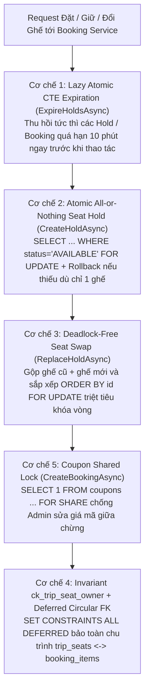
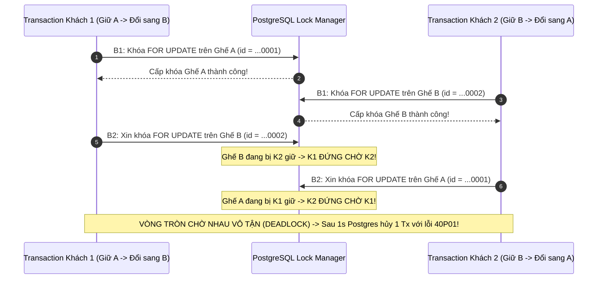
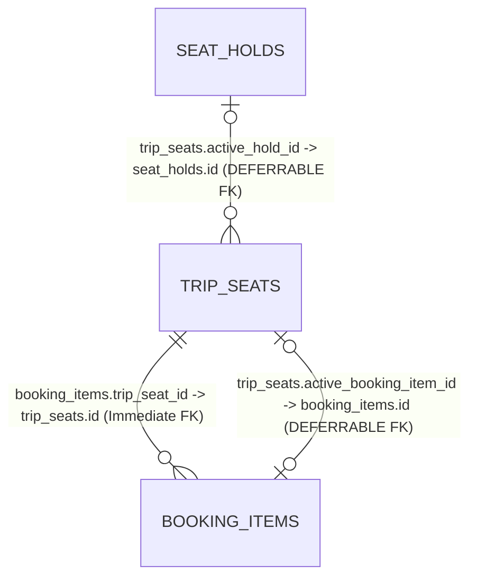

# Chương 05.3 — Chống Bán Trùng Ghế (Anti-Double-Booking): Khóa Dòng `FOR UPDATE` / `FOR SHARE`, Phòng Chống Deadlock & Khóa Ngoại Vòng Trì Hoãn (`DEFERRABLE`)

> **Mục tiêu tài liệu:** Đây là chương kỹ thuật **trọng tâm bậc nhất khi bảo vệ đồ án**. Tài liệu giải thích từ nền tảng lý thuyết **Pessimistic Locking vs Optimistic Concurrency** và cơ chế khóa dòng nội tại của PostgreSQL 17, đến giải phẫu từng dòng lệnh SQL/C# của **5 lớp lá chắn phối hợp** trong `BookingRepository.cs` (1009 dòng) và `docs/database/booking/001_initial.sql` + `012_rebook_after_cancel.sql` giúp hệ thống chịu được hàng trăm lượt bấm tranh chấp cùng một chiếc ghế ở cùng một mili-giây mà không bao giờ xảy ra lỗi bán trùng vé (Double-Booking) hay khóa chết (Deadlock).

---

## 1. Lý Thuyết Gốc Rễ: Khi Nào Dùng Khóa Bi Quan (Pessimistic Locking), Khi Nào Dùng Kiểm Soát Lạc Quan (Optimistic Concurrency)?

Trong bất kỳ hệ thống thương mại điện tử, ngân hàng hay bán vé vận tải nào, quản lý tranh chấp đồng thời (Concurrency Control) luôn xoay quanh hai trường phái kinh điển. Điểm xuất sắc của **BLUE Bus Ticket Platform** là **không dùng máy móc một kiểu khóa cho toàn hệ thống**, mà phân loại chính xác từng bài toán để áp dụng đúng vũ khí tối ưu nhất (xem [02-concurrency-idempotency.md](file:///C:/Users/minht/.gemini/antigravity/worktrees/PBL6/c_to_n_b/docs/detailed-design/03-05-error-concurrency-recovery/02-concurrency-idempotency.md)).

### 1.1. Optimistic Concurrency Control (OCC — Kiểm soát đồng thời lạc quan với `row_version`)

#### Nguyên lý hoạt động cho người mới bắt đầu
"Lạc quan" nghĩa là hệ thống giả định rằng: *Xác suất hai người cùng sửa một bản ghi quản trị tại đúng một tích tắc là khá thấp, nên lúc đọc dữ liệu lên màn hình không cần khóa dòng làm gì cả.*
Thay vào đó, mỗi bảng đều có một cột bộ đếm phiên bản **`row_version bigint not null default 0`**:
1. Khi Quản trị viên A mở form chỉnh sửa chiếc xe (hoặc chuyến xe, đơn đặt vé), API trả về dữ liệu kèm số phiên bản hiện tại, ví dụ `rowVersion = 3`.
2. Khi Quản trị viên A bấm **Lưu**, Client gửi kèm `expectedVersion = 3`.
3. Hệ thống đối chiếu với `row_version` hiện hành hoặc thực thi câu lệnh SQL có điều kiện gác cổng:
   ```sql
   UPDATE buses
   SET row_version = row_version + 1, updated_at = NOW()
   WHERE id = @id AND organization_id = @org AND row_version = @version AND deleted_at IS NULL
   ```
   *(Trích thực tế từ `TransportRepository.SetSeatPermissionAsync` — dòng 177)*
4. Nếu trong lúc A đang gõ phím trên form, Quản trị viên B đã nhanh tay lưu trước làm `row_version` trong DB nhảy lên `4`, thì câu lệnh `UPDATE ... WHERE row_version = 3` của A sẽ trả về **`0 rows affected`**! Hệ thống lập tức từ chối bằng mã lỗi chuẩn **`409 Conflict` (`VERSION_CONFLICT`)** tại [PlatformErrors.cs](file:///C:/Users/minht/.gemini/antigravity/worktrees/PBL6/c_to_n_b/workspace/src/building-blocks/BusTicketPlatform.BuildingBlocks/Errors/PlatformErrors.cs#L21-L22), ngăn chặn hoàn toàn lỗi **Lost Update (Ghi đè làm mất dữ liệu của người lưu trước)**.

#### Các vị trí áp dụng Optimistic Concurrency (`row_version`) trong dự án BLUE:
- Sửa hồ sơ nhà xe (`UpdateOrganizationAsync`), sửa thông tin xe/tài xế/tuyến đường (`UpdateBusAsync`, `SetSeatPermissionAsync`, `UpdateDriverAsync`, `UpdateRouteAsync`).
- Sửa bản nháp chuyến xe, chuyển trạng thái vận hành chuyến hoặc hủy chuyến (`UpdateTripDraftAsync`, `TransitionTripAsync`, `CancelTripAsync`).
- Hành khách xác nhận hủy vé (`BookingService.CancelAsync` dòng 451: `if (booking.RowVersion != request.ExpectedVersion) return ... VersionConflict()`).
- Cập nhật trạng thái thanh toán thông thường (`PaymentRepository.UpdatePaymentAsync` dòng 93: `WHERE id = @id AND row_version = @version`).

---

### 1.2. Pessimistic Concurrency Control (PCC — Khóa bi quan mức dòng trong PostgreSQL)

#### Tại sao giữ ghế xe Tết không dùng OCC đơn thuần mà phải dùng Khóa bi quan mức dòng (`SELECT ... FOR UPDATE`)?
Hãy tưởng tượng 00:00 đêm mở bán vé Tết tuyến TP.HCM → Đà Nẵng, có **200 hành khách cùng nhấp chuột chọn nhóm ghế tầng dưới `[1A, 1B]`** của cùng một chuyến xe.
- Thao tác giữ ghế (`CreateHoldAsync`) hoặc đổi ghế (`ReplaceHoldAsync`) không chỉ sửa 1 dòng đơn lẻ, mà là một **chuỗi giao dịch đa bảng**: kiểm tra 2–10 dòng trên `trip_seats` đều phải `AVAILABLE`, tính tổng tiền `price`, tạo bản ghi cha `seat_holds`, tạo các dòng con `seat_hold_items`, rồi cập nhật tất cả ghế sang `HELD` và gán `active_hold_id`.
- Với **Khóa bi quan mức dòng (`Row-Level Locking`)**, PostgreSQL khóa chặt đúng các dòng ghế đang bị tranh chấp ngay từ bước đọc đầu tiên trong Transaction (chỉ kéo dài 2–5 mili-giây trong mạng nội bộ giữa API và Postgres), xếp hàng tuần tự các giao dịch đến sau ở ngay nhân Database Engine để đảm bảo **đúng 1 người thắng cuộc trọn vẹn, 199 người còn lại nhận kết quả `409 SEAT_UNAVAILABLE` dứt khoát mà không bao giờ làm hỏng bất biến giữa các bảng**!

#### Bảng ma trận tương thích các chế độ khóa dòng (Row-Level Lock Modes) trong PostgreSQL 17

| Chế độ câu lệnh của Tx2 \ Khóa Tx1 đang giữ | `SELECT` thường (MVCC) | `SELECT ... FOR SHARE` (Khóa chia sẻ) | `SELECT ... FOR UPDATE` (Khóa độc quyền) |
| :--- | :---: | :---: | :---: |
| **`SELECT` thường** (Xem sơ đồ ghế) | **Chạy ngay** (Không chờ!) | **Chạy ngay** (Không chờ!) | **Chạy ngay** (Không chờ nhờ MVCC!) |
| **`SELECT ... FOR SHARE`** (Áp mã Coupon) | **Chạy ngay** | **Chạy ngay (Đọc chung song song!)** | **BỊ CHẶN (Đứng đợi Tx1 xong)** |
| **`SELECT ... FOR UPDATE` / `UPDATE` / `DELETE`** | **Chạy ngay** | **BỊ CHẶN (Đứng đợi Tx1 xong)** | **BỊ CHẶN (Xếp hàng đợi Tx1 xong)** |

> **Điểm cực hay cần nhớ khi thuyết trình:**
> Ngay cả khi Khách A đang giữ khóa `SELECT ... FOR UPDATE` trên ghế `1A` để tạo lệnh giữ ghế, hàng nghìn khách hàng khác mở trang web xem sơ đồ ghế (`ListSeatsAsync` dùng `SELECT` thường) **KHÔNG HỀ BỊ TREO DÙ CHỈ 1 MILI-GIÂY** nhờ cơ chế MVCC đọc bản chụp của PostgreSQL! Khóa `FOR UPDATE` chỉ bắt những ai **cũng định lao vào chộp chính chiếc ghế `1A` đó** phải xếp hàng mà thôi!

#### Cơ chế nội tại kỳ diệu của PostgreSQL: "EvalPlanQual — Tự động đọc lại và kiểm tra lại `WHERE` sau khi hết chờ khóa"
Một câu hỏi rất sâu về Database Internals:
> *Giả sử cả Khách A và Khách B cùng chạy câu lệnh `SELECT id, price FROM trip_seats WHERE id = 'Ghế_1A' AND status = 'AVAILABLE' FOR UPDATE` ở cùng thời điểm `t = 0ms` (lúc đó `Ghế_1A` đang `AVAILABLE`). Khách A lấy được khóa trước, Khách B đứng đợi. Đến `t = 3ms`, Khách A cập nhật `status = 'HELD'` rồi `COMMIT`. Khi Khách B được đánh thức ở `t = 3.1ms`, liệu Khách B có đọc nhầm bản chụp cũ lúc `t = 0ms` (khi ghế còn `AVAILABLE`) không?*

**Câu trả lời của PostgreSQL (dưới mức `READ COMMITTED` mặc định) là KHÔNG BAO GIỜ!**
PostgreSQL cài đặt cơ chế nội bộ mang tên **EvalPlanQual (EPQ Re-check)**:
1. Khi Khách B tỉnh dậy sau khi chờ khóa của Khách A nhả ra, PostgreSQL phát hiện dòng `Ghế_1A` đã bị Khách A sửa đổi và `COMMIT` thành phiên bản tuple mới.
2. Thay vì dùng bản chụp cũ lúc `t = 0ms`, PostgreSQL **tự động nạp phiên bản dòng mới nhất vừa được Khách A `COMMIT`** và **chạy kiểm tra lại mệnh đề `WHERE status = 'AVAILABLE'`**!
3. Vì lúc này `status` đã là `'HELD'` (`<> 'AVAILABLE'`), dòng `Ghế_1A` bị loại bỏ ngay lập tức khỏi tập kết quả trả về cho Khách B (câu `SELECT ... FOR UPDATE` của Khách B trả về **0 dòng**)!

---

## 2. Giải Phẫu 5 Cơ Chế Phối Hợp Chống Bán Trùng Ghế Trong `BookingRepository.cs` & `booking/001_initial.sql`

Theo đúng kiến trúc **ADR-008** (*"Booking DB là nguồn chống double-book; Redis chỉ hỗ trợ"*), toàn bộ sự sống còn của tồn kho ghế đặt trên 5 tầng cơ chế đan cài chặt chẽ với nhau:



Hãy đi sâu giải phẫu từng cơ chế bằng chính mã nguồn thực tế trong [BookingRepository.cs](file:///C:/Users/minht/.gemini/antigravity/worktrees/PBL6/c_to_n_b/workspace/src/services/booking/BusTicketPlatform.Booking.Infrastructure/Persistence/BookingRepository.cs)!

---

### 2.1. Cơ Chế 1 — Thu Hồi Ghế Quá Hạn Tức Thì Bằng Lazy Atomic CTE (`ExpireHoldsAsync`)

#### Vấn đề của cách dùng Cronjob nền truyền thống
Trong nghiệp vụ bán vé, khi khách chọn ghế, hệ thống giữ ghế cho khách trong **đúng 10 phút** (`ck_seat_holds_expiry check (expires_at = created_at + interval '10 minutes')`) để điền thông tin và quét QR thanh toán.
Nếu chỉ phụ thuộc vào một Background Timer / Cronjob quét định kỳ (ví dụ mỗi 30 giây hoặc 60 giây chạy 1 lần):
- Giả sử lệnh giữ ghế của Khách A hết hạn lúc `10:10:01`, nhưng đến `10:10:30` cronjob mới chạy. Nếu Khách B vào xem chuyến xe lúc `10:10:05`, Khách B vẫn thấy ghế bị xám (`HELD`) và không mua được dù thực tế ghế đó đã hết hạn 4 giây trước!
- Tệ hơn, nếu tiến trình Background Worker gặp sự cố dừng chạy, hàng loạt ghế `HELD` sẽ bị "đóng băng" vĩnh viễn không ai mua được cho tới giờ xe chạy!

#### Giải pháp của dự án BLUE: Lazy Atomic CTE Expiration ngay trên đường dẫn đọc/ghi
Trong [BookingService.cs](file:///C:/Users/minht/.gemini/antigravity/worktrees/PBL6/c_to_n_b/workspace/src/services/booking/BusTicketPlatform.Booking.Application/BookingService.cs), trước mọi thao tác nhạy cảm về tồn kho ghế (`AvailableSeatsAsync`, `GetSeatsAsync`, `CreateHoldAsync`, `ReplaceHoldAsync`, `GetHoldAsync`, `CreateBookingAsync`, `QuoteCouponAsync`), hệ thống đều gọi `await store.ExpireHoldsAsync(cancellationToken)`.

Hãy đọc từng dòng của hàm [BookingRepository.ExpireHoldsAsync](file:///C:/Users/minht/.gemini/antigravity/worktrees/PBL6/c_to_n_b/workspace/src/services/booking/BusTicketPlatform.Booking.Infrastructure/Persistence/BookingRepository.cs#L159-L200):

```csharp
// Trích từ BookingRepository.cs (dòng 159 - 200)
public async Task ExpireHoldsAsync(CancellationToken cancellationToken)
{
    await using var connection = await OpenAsync(cancellationToken);
    await using var tx = await connection.BeginTransactionAsync(cancellationToken);
    await using (var bookings = new NpgsqlCommand("""
        WITH expired_bookings AS (
          UPDATE bookings
          SET status = 'EXPIRED', updated_at = NOW(), row_version = row_version + 1
          WHERE status = 'PENDING_PAYMENT' AND expires_at <= NOW()
          RETURNING id
        ), expired_items AS (
          SELECT i.id
          FROM booking_items i
          JOIN expired_bookings b ON b.id = i.booking_id
        )
        UPDATE trip_seats s
        SET status = 'AVAILABLE', active_booking_item_id = NULL, updated_at = NOW(), row_version = row_version + 1
        FROM expired_items i
        WHERE s.active_booking_item_id = i.id;
        """, connection, tx))
    {
        await bookings.ExecuteNonQueryAsync(cancellationToken);
    }

    await using (var command = new NpgsqlCommand("""
        WITH expired AS (
          UPDATE seat_holds
          SET status = 'EXPIRED', released_at = NOW(), row_version = row_version + 1
          WHERE status = 'ACTIVE' AND expires_at <= NOW()
          RETURNING id
        )
        UPDATE trip_seats s
        SET status = 'AVAILABLE', active_hold_id = NULL, updated_at = NOW(), row_version = row_version + 1
        FROM expired
        WHERE s.active_hold_id = expired.id;
        """, connection, tx))
    {
        await command.ExecuteNonQueryAsync(cancellationToken);
    }

    await tx.CommitAsync(cancellationToken);
}
```

#### Giải thích sức mạnh của Data-Modifying CTE (`WITH ... UPDATE ... RETURNING`) trong PostgreSQL:
1. **Xử lý trọn vẹn cả 2 giai đoạn bỏ dở của khách hàng:**
   - **Khối CTE thứ nhất (`expired_bookings`):** Dành cho khách đã đi qua bước điền tên hành khách để tạo đơn `bookings` (`status = 'PENDING_PAYMENT'`, ghế đang `BOOKED`), nhưng mở trang thanh toán QR rồi tắt trình duyệt quá 10 phút (`expires_at <= NOW()`). Một câu lệnh SQL duy nhất vừa chuyển đơn sang `'EXPIRED'`, vừa lấy danh sách `booking_items` tương ứng qua mệnh đề `RETURNING id`, vừa trả tất cả ghế về `'AVAILABLE'` và xóa `active_booking_item_id = NULL`!
   - **Khối CTE thứ hai (`expired`):** Dành cho khách mới chỉ bấm chọn ghế trên sơ đồ (`seat_holds.status = 'ACTIVE'`, ghế đang `HELD`) nhưng chưa bấm tạo đơn mà bỏ đi quá 10 phút. Câu lệnh chuyển `seat_holds` sang `'EXPIRED'`, điền `released_at = NOW()` (thỏa mãn ràng buộc `ck_seat_holds_terminal_time`!), và trả ghế về `'AVAILABLE'`.
2. **Chốt chặn an toàn chủ sở hữu tuyệt đối (`WHERE s.active_hold_id = expired.id` và `WHERE s.active_booking_item_id = i.id`):**
   Câu lệnh `UPDATE trip_seats` **không bao giờ** giải phóng mù quáng theo `seat_id`, mà chỉ giải phóng nếu cột con trỏ chủ sở hữu hiện hành của chiếc ghế (`active_hold_id` / `active_booking_item_id`) **vẫn đang trỏ đúng vào bản ghi vừa hết hạn**!
3. **Hiệu năng cực nhanh nhờ Partial Index:**
   Nhờ chỉ mục `create index ix_seat_holds_expiry on seat_holds (expires_at, id) where status = 'ACTIVE'` trong `booking/001_initial.sql`, PostgreSQL không bao giờ phải quét bảng lịch sử: nếu tại giây đó không có ghế nào hết hạn, câu lệnh kiểm tra đầu mút trái của cây chỉ mục và kết thúc trong vòng vài chục micro-giây!

---

### 2.2. Cơ Chế 2 — Giữ Ghế Nguyên Tử "Được Cả Hoặc Ngã Về Không" (`CreateHoldAsync`)

Khi khách hàng chọn một danh sách ghế (từ 1 đến tối đa 10 ghế trong một lần giữ, ví dụ cặp ghế đôi `[2A, 2B]`) và bấm **"Tiếp tục"**, hàm [BookingRepository.CreateHoldAsync](file:///C:/Users/minht/.gemini/antigravity/worktrees/PBL6/c_to_n_b/workspace/src/services/booking/BusTicketPlatform.Booking.Infrastructure/Persistence/BookingRepository.cs#L254-L324) được kích hoạt:

```csharp
// Trích từ BookingRepository.cs (dòng 254 - 324)
public async Task<SeatHoldRecord?> CreateHoldAsync(SeatHoldRecord hold, IReadOnlyList<Guid> seatIds, CancellationToken cancellationToken)
{
    await using var connection = await OpenAsync(cancellationToken);
    await using var tx = await connection.BeginTransactionAsync(cancellationToken);
    await using (var lockSeats = new NpgsqlCommand("""
        SELECT id, price FROM trip_seats
        WHERE trip_id = @trip AND id = ANY(@ids) AND status = 'AVAILABLE'
        FOR UPDATE;
        """, connection, tx))
    {
        lockSeats.Parameters.AddWithValue("trip", hold.TripId);
        lockSeats.Parameters.AddWithValue("ids", seatIds.ToArray());
        await using var reader = await lockSeats.ExecuteReaderAsync(cancellationToken);
        var prices = new Dictionary<Guid, long>();
        while (await reader.ReadAsync(cancellationToken))
        {
            prices[reader.GetGuid(0)] = reader.GetInt64(1);
        }

        await reader.CloseAsync();
        if (prices.Count != seatIds.Count)
        {
            await tx.RollbackAsync(cancellationToken);
            return null;
        }

        var total = prices.Values.Sum();
        await using (var insert = new NpgsqlCommand("""
            INSERT INTO seat_holds (
              id, trip_id, customer_id_external, idempotency_key, hold_token_hash, status, total_amount, currency,
              created_at, expires_at)
            VALUES (@id, @trip, @customer, @idem, @hash, 'ACTIVE', @total, @currency, NOW(), NOW() + INTERVAL '10 minutes')
            RETURNING created_at, expires_at;
            """, connection, tx))
        {
            // ... gán tham số và lấy created_at, expires_at từ đồng hồ chuẩn NOW() của PostgreSQL ...
            foreach (var seatId in seatIds)
            {
                await using var item = new NpgsqlCommand("""
                    INSERT INTO seat_hold_items (seat_hold_id, trip_seat_id, seat_code, unit_price)
                    SELECT @hold, id, seat_code, price FROM trip_seats WHERE id = @seat;
                    """, connection, tx);
                // ... ExecuteNonQueryAsync ...
                await using var update = new NpgsqlCommand("""
                    UPDATE trip_seats SET status = 'HELD', active_hold_id = @hold, updated_at = NOW() WHERE id = @seat;
                    """, connection, tx);
                // ... ExecuteNonQueryAsync ...
            }

            await tx.CommitAsync(cancellationToken);
            var seats = await ListSeatsByIds(seatIds, cancellationToken);
            return hold with { TotalAmount = total, CreatedAt = createdAt, ExpiresAt = expires, Seats = seats };
        }
    }
}
```

#### Phân tích từng mắt xích kỹ thuật đắt giá trong `CreateHoldAsync`:
1. **Khóa độc quyền đúng các dòng ghế mục tiêu (`WHERE trip_id = @trip AND id = ANY(@ids) AND status = 'AVAILABLE' FOR UPDATE`):**
   Sử dụng chỉ mục `ix_trip_seats_inventory ON trip_seats (trip_id, status, id)`, PostgreSQL nhảy thẳng tới đúng các dòng ghế khách chọn của chuyến xe đó và đặt khóa độc quyền `FOR UPDATE`.
2. **Tại sao `if (prices.Count != seatIds.Count)` lập tức `RollbackAsync` và trả về `null`?**
   Ở tầng `BookingService.cs` (dòng 110), mảng `request.SeatIds` đã được xác thực không rỗng và không trùng lặp phần tử (`request.SeatIds.Distinct().Count() == request.SeatIds.Count`).
   Giả sử Khách 1 muốn mua 2 ghế cạnh nhau cho hai mẹ con là `[2A, 2B]`, trong khi Khách 2 chỉ mua 1 ghế `[2B]` và bấm trước 1 mili-giây:
   - Khách 1 khóa được ghế `2A` (`AVAILABLE`), nhưng đến ghế `2B` thì phải đứng chờ khóa của Khách 2.
   - Khách 2 chuyển `2B` sang `'HELD'` và `COMMIT`.
   - Cơ chế **EPQ Re-check** của PostgreSQL đánh thức Khách 1, kiểm tra lại `2B` thấy `status = 'HELD' <> 'AVAILABLE'`, nên câu `SELECT ... FOR UPDATE` của Khách 1 chỉ trả về đúng **1 dòng** là `2A` (`prices.Count == 1`), trong khi `seatIds.Count == 2`!
   - Nhờ điều kiện `prices.Count != seatIds.Count`, hệ thống lập tức gọi **`await tx.RollbackAsync(cancellationToken)`** — **nhả ngay lập tức khóa trên ghế `2A`** ra cho người khác và báo lỗi `409 SEAT_UNAVAILABLE` để Khách 1 chọn cặp ghế đôi khác, tuyệt đối không bao giờ bắt ép hai mẹ con chỉ giữ được 1 ghế lẻ!
3. **Đồng hồ thời gian chuẩn tập trung tại Database (`NOW(), NOW() + INTERVAL '10 minutes' RETURNING created_at, expires_at`):**
   Thay vì lấy giờ đồng hồ của container C# (có thể bị lệch vài giây giữa nhiều bản sao API pod do Clock Skew), thời điểm tạo và thời điểm hết hạn 10 phút được tính trực tiếp bằng hàm `NOW()` của PostgreSQL (chính là thời điểm bắt đầu Transaction) và trả ngược về C# qua `RETURNING`, đảm bảo khớp 100% đến từng micro-giây với ràng buộc `ck_seat_holds_expiry check (expires_at = created_at + interval '10 minutes')`!
4. **Bảo mật `hold_token_hash` (Zero Plaintext Secret in DB):**
   Trong `BookingService.cs` (dòng 125–135), hệ thống sinh ngẫu nhiên mật mã học 32 byte (`RandomNumberGenerator.GetBytes(32)`) thành `tokenPlain` trả về cho trình duyệt của khách, nhưng xuống DB chỉ lưu hàm băm SHA-256 `hold_token_hash`! Ngay cả khi kẻ tấn công đọc trộm được bản sao lưu bảng `seat_holds`, hắn cũng không thể khôi phục ngược ra `holdToken` để cướp phiên đặt vé đang giữ của hành khách!

---

### 2.3. Cơ Chế 3 — Triệt Tiêu 100% Deadlock Khi Đổi Ghế Bằng Thứ Tự Khóa Chuẩn Hóa (`ReplaceHoldAsync`)

#### Kịch bản thực tế sinh ra Deadlock (Khóa chết vòng tròn)
Trên giao diện chọn ghế của **BLUE Web**, sau khi Khách 1 đã chọn giữ **Ghế A** (`id = 00000000-...-0001`), khách nhìn lại sơ đồ thấy **Ghế B** (`id = 00000000-...-0002`) gần cửa sổ đẹp hơn nên bấm chuyển sang chọn **Ghế B** (gọi API `ReplaceHoldAsync`).
Trớ trêu thay, đúng vào mili-giây đó:
- **Khách 1** (đang giữ **Ghế A**) bấm đổi sang giữ **Ghế B**.
- **Khách 2** (đang giữ **Ghế B**) lại bấm đổi sang giữ **Ghế A** (hoặc chọn gộp `[Ghế B, Ghế A]`).

Hãy xem chuyện gì xảy ra nếu lập trình viên viết code ngây thơ theo kiểu *"Khóa ghế cũ đang giữ trước, rồi mới đi khóa ghế mới khách yêu cầu"* (hoặc khóa theo thứ tự mảng do Client gửi lên mà không sắp xếp):



#### Giải phẫu dòng lệnh thứ 337 "kinh điển sách giáo khoa" trong `BookingRepository.ReplaceHoldAsync`
Hãy đọc kỹ cách [BookingRepository.cs](file:///C:/Users/minht/.gemini/antigravity/worktrees/PBL6/c_to_n_b/workspace/src/services/booking/BusTicketPlatform.Booking.Infrastructure/Persistence/BookingRepository.cs#L326-L366) hóa giải hoàn toàn bài toán hóc búa này:

```csharp
// Trích từ BookingRepository.cs (dòng 326 - 366)
public async Task<SeatHoldRecord?> ReplaceHoldAsync(SeatHoldRecord hold, IReadOnlyList<Guid> seatIds, CancellationToken cancellationToken)
{
    await using var connection = await OpenAsync(cancellationToken);
    await using var tx = await connection.BeginTransactionAsync(cancellationToken);
    // Bước 1: Khóa bản ghi cha seat_holds để đảm bảo cùng 1 khách không bấm đổi ghế 2 tab song song
    await using (var guard = new NpgsqlCommand(
        "SELECT id FROM seat_holds WHERE id=@hold AND customer_id_external=@owner AND status='ACTIVE' AND expires_at>NOW() FOR UPDATE",
        connection, tx))
    {
        guard.Parameters.AddWithValue("hold", hold.Id);
        guard.Parameters.AddWithValue("owner", hold.CustomerId);
        if (await guard.ExecuteScalarAsync(cancellationToken) is null) return null;
    }

    // Bước 2: DÒNG 337 — Gộp CẢ ghế mới muốn lấy LẪN ghế cũ đang giữ, ép sắp xếp tăng dần ORDER BY id FOR UPDATE!
    var prices = new Dictionary<Guid, long>();
    await using (var locks = new NpgsqlCommand(
        "SELECT id,price,status,active_hold_id FROM trip_seats WHERE trip_id=@trip AND (id=ANY(@ids) OR active_hold_id=@hold) ORDER BY id FOR UPDATE",
        connection, tx))
    {
        locks.Parameters.AddWithValue("trip", hold.TripId);
        locks.Parameters.AddWithValue("ids", seatIds.ToArray());
        locks.Parameters.AddWithValue("hold", hold.Id);
        await using var reader = await locks.ExecuteReaderAsync(cancellationToken);
        while (await reader.ReadAsync(cancellationToken))
        {
            var id = reader.GetGuid(0);
            if (seatIds.Contains(id) && (reader.GetString(2) == "AVAILABLE"
                || reader.GetString(2) == "HELD" && !reader.IsDBNull(3) && reader.GetGuid(3) == hold.Id))
            {
                prices[id] = reader.GetInt64(1);
            }
        }
    }
    if (prices.Count != seatIds.Count) return null;

    // Bước 3: Hoán đổi ghế nguyên tử trong 1 batch SQL duy nhất
    await using (var update = new NpgsqlCommand("""
        UPDATE trip_seats SET status='AVAILABLE',active_hold_id=NULL,updated_at=NOW(),row_version=row_version+1 WHERE active_hold_id=@hold AND NOT(id=ANY(@ids));
        DELETE FROM seat_hold_items WHERE seat_hold_id=@hold;
        INSERT INTO seat_hold_items(seat_hold_id,trip_seat_id,seat_code,unit_price) SELECT @hold,id,seat_code,price FROM trip_seats WHERE id=ANY(@ids) AND trip_id=@trip;
        UPDATE trip_seats SET status='HELD',active_hold_id=@hold,updated_at=NOW(),row_version=row_version+1 WHERE id=ANY(@ids) AND trip_id=@trip;
        UPDATE seat_holds SET total_amount=@total WHERE id=@hold;
        """, connection, tx))
    {
        // ... gán tham số và thực thi ...
    }
    await tx.CommitAsync(cancellationToken);
    return hold with { TotalAmount = prices.Values.Sum(), Seats = await ListSeatsByIds(seatIds, cancellationToken) };
}
```

#### Tại sao mệnh đề `WHERE ... (id=ANY(@ids) OR active_hold_id=@hold) ORDER BY id FOR UPDATE` triệt tiêu 100% Deadlock?
Theo lý thuyết hệ điều hành của **Edward G. Coffman (1971)**, Deadlock chỉ có thể xảy ra khi hội đủ 4 điều kiện đồng thời, trong đó điều kiện thứ 4 là **Circular Wait (Chờ đợi vòng tròn)**. Cách duy nhất để phá hủy vĩnh viễn Circular Wait là áp đặt một **Thứ tự toàn phần nghiêm ngặt (Strict Total Ordering)** lên tất cả các tài nguyên cần khóa:

- Tập ghế cần thao tác của Khách 1 là `{Ghế A, Ghế B}`. Nhờ **`ORDER BY id`**, PostgreSQL bắt buộc phải khóa **`Ghế A` (`...0001`) trước**, rồi mới xin khóa **`Ghế B` (`...0002`) sau**.
- Tập ghế cần thao tác của Khách 2 cũng là `{Ghế B, Ghế A}`. Bất chấp mảng `@ids` từ trình duyệt gửi lên ngược thứ tự là `[Ghế B, Ghế A]`, mệnh đề **`ORDER BY id`** trong PostgreSQL vẫn ép Khách 2 phải xin khóa **`Ghế A` (`...0001`) trước**, rồi mới xin khóa **`Ghế B` (`...0002`) sau**!
- Kết quả khi chạy song song ở cùng 1 mili-giây:
  - Khách 1 chiếm được khóa `Ghế A` trước → Khách 2 lập tức đứng đợi ngay tại cửa `Ghế A` (chưa hề giữ khóa `Ghế B`!).
  - Khách 1 đi tiếp lấy khóa `Ghế B` (hoặc kiểm tra thấy `Ghế B` đang `HELD` bởi `hold` của Khách 2 nên `prices.Count != seatIds.Count` và thoát ra nhả khóa ngay sau `0.5ms`), sau đó Khách 2 mới vào thực thi tuần tự!
  - **Không bao giờ tồn tại vòng tròn chờ đợi — Xác suất Deadlock giảm về đúng 0%!**

> **3 chi tiết nghiệp vụ cực kỳ sắc sảo khác trong `ReplaceHoldAsync`:**
> 1. **Cho phép giữ lại một phần ghế cũ và lấy thêm ghế mới (dòng 346):** Nếu khách đang giữ `[1A, 1B]` và bấm chọn thêm `1C` (tập mới là `[1A, 1B, 1C]`), ghế `1A, 1B` đang có `status == "HELD"` nhưng vì `active_hold_id == hold.Id` (chính là của người khách đó!) nên vẫn hợp lệ, chỉ cần `1C` là `"AVAILABLE"`!
> 2. **Chỉ nhả những ghế thực sự bị bỏ đi (dòng 351):** `WHERE active_hold_id=@hold AND NOT(id=ANY(@ids))` — các ghế giữ nguyên như `1A, 1B` không bị nhả về `AVAILABLE` dù chỉ trong 1 micro-giây!
> 3. **Không gia hạn lại `expires_at` (dòng 355 chỉ `UPDATE seat_holds SET total_amount=@total`):** Nếu mỗi lần đổi ghế lại cộng thêm 10 phút mới, kẻ xấu (bot) có thể viết script cứ 9 phút 50 giây lại gọi `ReplaceHoldAsync` để chiếm giữ ghế suốt cả ngày không trả tiền! Giữ nguyên `expires_at` gốc chặn đứng hoàn toàn chiêu trò găm ghế này!

---

### 2.4. Cơ Chế 4 — Bất Biến Chủ Sở Hữu (`ck_trip_seat_owner`), Bài Toán Bán Lại Ghế Sau Hủy Vé (`012_rebook_after_cancel.sql`) & Khóa Ngoại Vòng Trì Hoãn (`DEFERRABLE INITIALLY DEFERRED`)

Đây là phần thiết kế Schema sâu sắc nhất của dự án BLUE — nơi phân biệt một hệ thống thực chiến với một bài tập CRUD đơn giản.

#### A. Máy trạng thái phần cứng trên từng chiếc ghế (`ck_trip_seat_owner`)
Hãy nhìn vào bảng `trip_seats` trong [docs/database/booking/001_initial.sql](file:///C:/Users/minht/.gemini/antigravity/worktrees/PBL6/c_to_n_b/docs/database/booking/001_initial.sql#L47-L53):

```sql
  constraint ck_trip_seat_status check (status in ('AVAILABLE','HELD','BOOKED','DISABLED')),
  constraint ck_trip_seat_owner check (
    (status = 'AVAILABLE' and active_hold_id is null and active_booking_item_id is null) or
    (status = 'HELD' and active_hold_id is not null and active_booking_item_id is null) or
    (status = 'BOOKED' and active_hold_id is null and active_booking_item_id is not null) or
    (status = 'DISABLED' and active_hold_id is null and active_booking_item_id is null)
  )
```

Bảng chân trị (Truth Table) này khóa chặt mọi khả năng dữ liệu rơi vào trạng thái "nửa nạc nửa mỡ" do lỗi code:

| `status` của ghế | `active_hold_id` | `active_booking_item_id` | Ý nghĩa bất biến được PostgreSQL bảo chứng |
| :--- | :---: | :---: | :--- |
| `'AVAILABLE'` | Bắt buộc `NULL` | Bắt buộc `NULL` | Ghế trống hoàn toàn, sẵn sàng cho khách chọn. |
| `'HELD'` | Bắt buộc **`NOT NULL`** | Bắt buộc `NULL` | Ghế đang tạm giữ 10 phút bởi đúng 1 `seat_holds`. |
| `'BOOKED'` | Bắt buộc `NULL` | Bắt buộc **`NOT NULL`** | Ghế đã thuộc về đúng 1 `booking_items` (đã chuyển hóa khỏi Hold!). |
| `'DISABLED'` | Bắt buộc `NULL` | Bắt buộc `NULL` | Ghế bị nhà xe khóa kỹ thuật, không bán. |

Không bao giờ có chuyện một chiếc ghế mang trạng thái `'BOOKED'` mà lại quên xóa `active_hold_id`, hoặc mang trạng thái `'AVAILABLE'` mà vẫn còn dính `active_booking_item_id`!

#### B. Tại sao phải có tham chiếu hai chiều và file migration `012_rebook_after_cancel.sql`?
Một câu hỏi rất hay: *Tại sao không bỏ cột `active_booking_item_id` trên `trip_seats` đi, mà chỉ cần đặt `UNIQUE (trip_seat_id)` trên bảng `booking_items` để mỗi ghế chỉ được đặt 1 lần?*

Hãy suy nghĩ tới **nghiệp vụ Hủy vé và Bán lại ghế (Cancel & Rebook)**:
1. Sáng thứ Hai, Anh Minh mua ghế `1A` (`booking_items` dòng `Item_1` có `trip_seat_id = Ghế_1A`).
2. Chiều thứ Hai, Anh Minh bận việc đột xuất nên vào hệ thống bấm **Hủy vé (`CancelAsync`)** và chịu phí hủy 10%.
   - Theo nguyên tắc kế toán tài chính, **tuyệt đối cấm chạy `DELETE FROM booking_items WHERE id = 'Item_1'`**! Dòng `Item_1` bắt buộc phải nằm lại vĩnh viễn trong bảng `booking_items` để lưu chứng từ đơn giá gốc, tính phí hủy `cancellation_fee` và đối soát tiền hoàn `refund_amount`.
3. Tối thứ Hai, Chị Lan vào tìm chuyến xe đó, thấy ghế `1A` đã trống trở lại nên đặt mua ghế `1A` (tạo dòng `Item_2` mới trong `booking_items` cũng có `trip_seat_id = Ghế_1A`).
4. Nếu trên bảng `booking_items` có ràng buộc cứng `UNIQUE (trip_seat_id)`, lệnh đặt vé của Chị Lan sẽ **NỔ LỖI TRÙNG KHÓA NGAY LẬP TỨC** vì dòng lịch sử `Item_1` của Anh Minh vẫn còn đó!

Đó chính là lý do ra đời của bản migration [docs/database/booking/012_rebook_after_cancel.sql](file:///C:/Users/minht/.gemini/antigravity/worktrees/PBL6/c_to_n_b/docs/database/booking/012_rebook_after_cancel.sql) và dòng chú thích tại `booking/001_initial.sql` (dòng 172):
```sql
-- Trích từ docs/database/booking/012_rebook_after_cancel.sql
-- After cancel, the same trip seat may be sold again. History stays on booking_items.
alter table booking_items drop constraint if exists uq_booking_items_trip_seat;
```
Nhờ thiết kế này:
- Bảng `booking_items` lưu **toàn bộ lịch sử giao dịch theo thời gian** của chiếc ghế (1 `trip_seats` có thể xuất hiện trong nhiều `booking_items` lịch sử đã hủy/hết hạn).
- Còn bảng `trip_seats` thông qua cột **`active_booking_item_id`** nắm giữ **quyền sở hữu duy nhất đang còn hiệu lực (Single Live Owner)** tại thời điểm hiện tại! Khi Anh Minh hủy vé ([BookingRepository.CancelAsync](file:///C:/Users/minht/.gemini/antigravity/worktrees/PBL6/c_to_n_b/workspace/src/services/booking/BusTicketPlatform.Booking.Infrastructure/Persistence/BookingRepository.cs#L711-L716)), hệ thống chỉ việc đặt `trip_seats.status = 'AVAILABLE', active_booking_item_id = NULL` — lịch sử của Anh Minh còn nguyên 100%, và Chị Lan mua lại ghế `1A` mượt mà!

#### C. Nghịch lý Khóa Ngoại Vòng ("Con gà và Quả trứng") & Lời giải `DEFERRABLE INITIALLY DEFERRED`

Khi `booking_items` có khóa ngoại trỏ tới `trip_seats(id)` VÀ `trip_seats` cũng có khóa ngoại `active_booking_item_id` trỏ ngược sang `booking_items(id)` (tương tự `trip_seats.active_hold_id` trỏ sang `seat_holds(id)`), chúng tạo thành một **Khóa ngoại hai chiều (Bidirectional / Circular Foreign Key)**:



Mặc định trong SQL, mọi ràng buộc `FOREIGN KEY` là **`NOT DEFERRABLE` (Kiểm tra tức thời ngay cuối mỗi câu lệnh đơn lẻ)**. Nếu dùng khóa ngoại mặc định, bạn sẽ rơi vào thế bế tắc khi cập nhật hoặc xóa/thay thế tham chiếu chéo giữa các bảng trong một giao dịch phức tạp.

Vì vậy, ở cuối file [docs/database/booking/001_initial.sql](file:///C:/Users/minht/.gemini/antigravity/worktrees/PBL6/c_to_n_b/docs/database/booking/001_initial.sql#L257-L265), dự án khai báo hai khóa ngoại chiều ngược là **`DEFERRABLE INITIALLY DEFERRED`**:

```sql
alter table trip_seats
  add constraint fk_trip_seats_active_hold
  foreign key (active_hold_id) references seat_holds(id)
  deferrable initially deferred;

alter table trip_seats
  add constraint fk_trip_seats_active_booking_item
  foreign key (active_booking_item_id) references booking_items(id)
  deferrable initially deferred;
```

Và trong hàm [BookingRepository.CreateBookingAsync](file:///C:/Users/minht/.gemini/antigravity/worktrees/PBL6/c_to_n_b/workspace/src/services/booking/BusTicketPlatform.Booking.Infrastructure/Persistence/BookingRepository.cs#L431-L521), hệ thống chủ động phát lệnh `SET CONSTRAINTS ALL DEFERRED;` ngay đầu chuỗi biến đổi trạng thái:

```csharp
// Trích từ BookingRepository.cs (dòng 431 - 521)
await using (var deferred = new NpgsqlCommand("SET CONSTRAINTS ALL DEFERRED;", connection, tx))
{
    await deferred.ExecuteNonQueryAsync(cancellationToken);
}
// 1. Chuyển Hold từ ACTIVE -> CONSUMED (chỉ đúng 1 request thắng cuộc nếu khách bấm đúp 2 lần!)
await using (var consume = new NpgsqlCommand("""
    UPDATE seat_holds SET status = 'CONSUMED', consumed_at = NOW() WHERE id = @id AND status = 'ACTIVE';
    """, connection, tx))
{
    consume.Parameters.AddWithValue("id", holdId);
    if (await consume.ExecuteNonQueryAsync(cancellationToken) != 1)
    {
        await tx.RollbackAsync(cancellationToken);
        return null;
    }
}
// 2. Tạo bản ghi cha bookings (được bảo vệ kép bởi uq_bookings_hold UNIQUE (seat_hold_id))
await using (var insert = new NpgsqlCommand("INSERT INTO bookings (...) VALUES (...);", connection, tx)) { ... }

// 3. Tạo từng dòng booking_items và chuyển chủ sở hữu trên trip_seats từ Hold sang BookingItem
foreach (var item in items)
{
    await using var itemCmd = new NpgsqlCommand("""
        INSERT INTO booking_items (id, booking_id, trip_seat_id, source_seat_id_external, seat_code, unit_price, discount_amount, line_total, created_at)
        VALUES (@id, @booking, @seat, @source, @code, @price, @discount, @price - @discount, NOW());
        UPDATE trip_seats SET status = 'BOOKED', active_hold_id = NULL, active_booking_item_id = @id, updated_at = NOW()
        WHERE id = @seat;
        """, connection, tx);
    // ... ExecuteNonQueryAsync ...
}
// 4. Tạo hành khách passengers -> Cuối cùng gọi COMMIT (lúc này mọi Deferred Constraints được kiểm tra tổng thể!)
await tx.CommitAsync(cancellationToken);
```

**Ý nghĩa của `DEFERRABLE INITIALLY DEFERRED` + `SET CONSTRAINTS ALL DEFERRED`:**
- Trong suốt quá trình chạy các câu lệnh trung gian bên trong `tx` (dù ta `UPDATE trip_seats SET active_booking_item_id = @id` trước rồi mới `INSERT INTO booking_items` sau, hay chuyển trạng thái liên hoàn giữa `seat_holds`, `bookings`, `booking_items`, `trip_seats`), PostgreSQL **tạm hoãn kiểm tra các ràng buộc khóa ngoại trì hoãn**.
- Đúng tại thời khắc gọi **`await tx.CommitAsync(cancellationToken)`**, trước khi ghi xác nhận xuống đĩa WAL, PostgreSQL mới đem toàn bộ bức tranh cuối cùng ra đối chiếu tất cả khóa ngoại! Nếu có bất kỳ tham chiếu nào bị đứt gãy (mã lỗi `23503` `foreign_key_violation`), hoặc trùng đơn (`23505` `unique_violation`), hoặc sai công thức tiền/trạng thái (`23514` `check_violation`), khối `catch (PostgresException exception) when (exception.SqlState is "23505" or "23514" or "23503")` ở dòng 517 sẽ lập tức `RollbackAsync` toàn bộ về trạng thái nguyên vẹn!

---

### 2.5. Cơ Chế 5 — Khóa Đọc Chia Sẻ Trên Mã Giảm Giá (`SELECT ... FOR SHARE` — Chống Admin Sửa Khuyến Mãi Giữa Chừng)

Hãy nhìn lên ngay đầu hàm `CreateBookingAsync` tại [BookingRepository.cs](file:///C:/Users/minht/.gemini/antigravity/worktrees/PBL6/c_to_n_b/workspace/src/services/booking/BusTicketPlatform.Booking.Infrastructure/Persistence/BookingRepository.cs#L417-L430):

```csharp
// Trích từ BookingRepository.cs (dòng 417 - 430)
if (booking.CouponCode is not null)
{
    // Lock the rule until commit: an admin cannot change its terms mid-booking.
    await using var couponCheck = new NpgsqlCommand("""
        SELECT 1 FROM coupons WHERE code=@coupon AND active AND starts_at<=NOW() AND expires_at>NOW()
          AND (organization_id IS NULL OR organization_id=@org) AND minimum<=@subtotal
          AND LEAST(cap, FLOOR(@subtotal::numeric * percent / 100)::bigint)=@discount FOR SHARE;
        """, connection, tx);
    couponCheck.Parameters.AddWithValue("coupon", booking.CouponCode);
    couponCheck.Parameters.AddWithValue("org", booking.OrganizationId);
    couponCheck.Parameters.AddWithValue("subtotal", booking.Subtotal);
    couponCheck.Parameters.AddWithValue("discount", booking.Discount);
    if (await couponCheck.ExecuteScalarAsync(cancellationToken) is null) throw new CouponUnavailableException();
}
```

#### Tại sao ở đây dùng `FOR SHARE` mà KHÔNG dùng `FOR UPDATE` (và cũng không dùng `SELECT` thường)?
Hãy so sánh 3 lựa chọn để thấy trình độ tinh tế của câu lệnh 4 dòng này:
1. **Nếu chỉ dùng `SELECT` thường (không khóa):**
   Ở mili-giây 1, `BookingService` đọc mã `SUMMER20` (giảm 20%) tính ra giảm `40.000đ`. Ở mili-giây 2, Admin sàn bấm tắt mã `SUMMER20` (`active = false`) hoặc giảm xuống còn 5% và `COMMIT` xong. Ở mili-giây 3, Transaction đặt vé của khách vẫn hồn nhiên ghi đơn giảm `40.000đ` với mã đã bị thu hồi!
2. **Nếu dùng `SELECT ... FOR UPDATE` (Khóa độc quyền):**
   Một mã khuyến mãi toàn sàn như `TET2026` có thể được **500 hành khách ở 500 chuyến xe khác nhau** áp dụng cùng một giây! Nếu dùng `FOR UPDATE`, 500 giao dịch đặt vé vốn chẳng liên quan gì đến ghế của nhau lại bị **tắc nghẽn xếp hàng nối đuôi nhau trên đúng 1 dòng của bảng `coupons`**!
3. **Khi dùng `SELECT ... FOR SHARE` (Khóa đọc chia sẻ) kèm tính lại công thức ngay trong SQL:**
   - **Giữa 500 hành khách với nhau:** Nhớ lại bảng ma trận khóa ở Mục 1.2 — **`FOR SHARE` hoàn toàn tương thích với `FOR SHARE`**! Cả 500 hành khách đều lấy được khóa chia sẻ đồng thời trong 0ms chờ đợi, tốc độ đặt vé song song đạt tối đa!
   - **Giữa Hành khách và Admin sàn (`SaveCouponAsync`):** Nếu đúng lúc khách đang ở giữa Transaction tạo đơn mà Admin gọi `INSERT INTO coupons ... ON CONFLICT (code) DO UPDATE ...`, câu lệnh `UPDATE` của Admin bắt buộc phải chờ cho các khóa `FOR SHARE` đang chạy (vài mili-giây) `COMMIT` xong xuôi mới được đổi điều khoản mã!
   - **Và nếu Admin đã kịp `COMMIT` sửa phần trăm hoặc tắt mã ngay trước khi `CreateBookingAsync` bắt đầu:** Mệnh đề `AND LEAST(cap, FLOOR(@subtotal::numeric * percent / 100)::bigint) = @discount` đối chiếu trực tiếp công thức giảm giá trong DB mới nhất với con số `@discount` lúc báo giá; thấy lệch là trả về `null` → ném `CouponUnavailableException` → báo khách *"Mã giảm giá vừa thay đổi hoặc hết hạn. Vui lòng áp dụng lại mã."* cực kỳ minh bạch!

---

## 3. Bảng Tổng Hợp Ma Trận Phòng Thủ Concurrency & Góc Hỏi – Đáp Bảo Vệ Đồ Án

### 3.1. Ma trận tóm tắt mọi kịch bản tranh chấp trên DB `booking`

| Tình huống tranh chấp thực tế | Chốt chặn kỹ thuật trong `BookingRepository.cs` & Schema SQL | Kết quả trả về cho người thua cuộc |
| :--- | :--- | :--- |
| **100 khách cùng bấm giữ ghế `1A` cùng lúc** | `SELECT id, price FROM trip_seats WHERE ... AND status = 'AVAILABLE' FOR UPDATE` + PostgreSQL EPQ Re-check + `prices.Count != seatIds.Count` | `tx.RollbackAsync()` → HTTP `409 Conflict` (`SEAT_UNAVAILABLE`). |
| **Khách giữ ghế rồi tắt trình duyệt không mua** | `ExpireHoldsAsync` chạy CTE nguyên tử thu hồi cả `bookings (PENDING_PAYMENT)` và `seat_holds (ACTIVE)` khi `expires_at <= NOW()`. | Ghế tự động trở về `AVAILABLE` ngay khi có bất kỳ ai xem sơ đồ ghế hoặc đặt vé. |
| **Khách 1 giữ A đổi sang B, Khách 2 giữ B đổi sang A** | `SELECT ... WHERE trip_id=@trip AND (id=ANY(@ids) OR active_hold_id=@hold) ORDER BY id FOR UPDATE` (dòng 337). | Thứ tự khóa luôn là `A -> B`, **0% Deadlock**, 1 người báo `SEAT_UNAVAILABLE`. |
| **Khách mở 2 tab bấm "Xác nhận đặt vé" từ cùng 1 `holdToken`** | `UPDATE seat_holds SET status = 'CONSUMED' WHERE id = @id AND status = 'ACTIVE'` (`affected == 1`) + `uq_bookings_hold UNIQUE (seat_hold_id)`. | Tab thứ 2 nhận `affected == 0` → `RollbackAsync()`, không bao giờ đẻ ra 2 Booking. |
| **Khách hủy vé xong, người khác vào mua lại đúng ghế đó** | Bỏ `uq_booking_items_trip_seat` (`012_rebook_after_cancel.sql`), quản lý chủ sở hữu sống qua `trip_seats.active_booking_item_id` + `DEFERRABLE` FK. | Lịch sử đơn cũ giữ nguyên 100%, người mới mua lại ghế thành công. |
| **Thanh toán đến trễ sau khi đơn vừa hết hạn 10 phút** | `ApplyPaidAsync` (dòng 570–574) kiểm tra `status = 'PENDING_PAYMENT' AND expires_at > NOW()` và ghế vẫn trỏ đúng `i.id`. | Trả về `false` → `BookingService` bắn sự kiện `RefundRequested` (`PAYMENT_AFTER_BOOKING_CLOSED`) hoàn tiền tự động cho khách! |

---

### 3.2. Câu hỏi phản biện của Hội đồng & Cách trả lời xuất sắc

#### Câu hỏi 1: *"Giả sử 50 người cùng bấm mua 1 ghế cuối cùng trên xe. Em giải thích chính xác bên trong PostgreSQL điều gì xảy ra để chỉ 1 người mua được, 49 người kia bị từ chối mà không bán lố?"*
- **Cách trả lời chuẩn xác:**
  *"Dạ thưa thầy/cô, trong `BookingRepository.CreateHoldAsync`, nhóm em mở Transaction và chạy câu lệnh `SELECT id, price FROM trip_seats WHERE trip_id = @trip AND id = ANY(@ids) AND status = 'AVAILABLE' FOR UPDATE`. Khi 50 kết nối chạm vào dòng ghế đó cùng lúc, Lock Manager của PostgreSQL cấp khóa dòng độc quyền (`Row-Level Exclusive Lock`) cho giao dịch đầu tiên (Tx1) và xếp 49 giao dịch còn lại vào hàng đợi của dòng đó. Tx1 kiểm tra đủ số ghế, tạo `seat_holds`, đổi `trip_seats.status = 'HELD'` rồi `COMMIT` trong khoảng 2–3ms. Ngay khi Tx1 `COMMIT`, PostgreSQL đánh thức Tx2 và kích hoạt cơ chế **EvalPlanQual**: đọc lại phiên bản dòng mới nhất vừa `COMMIT` và kiểm tra lại điều kiện `WHERE status = 'AVAILABLE'`. Vì trạng thái ghế lúc này đã là `'HELD'`, câu `SELECT` của Tx2 trả về 0 dòng (`prices.Count != seatIds.Count`), code C# lập tức `RollbackAsync` và trả về HTTP `409 SEAT_UNAVAILABLE`. Quá trình tương tự diễn ra tuần tự trong vài mili-giây cho 48 người còn lại, cộng thêm ràng buộc phần cứng `ck_trip_seat_owner` ở tầng bảng nên tuyệt đối không thể bán trùng ghế ạ."*

#### Câu hỏi 2: *"Tại sao trong `CreateBookingAsync` các em phải chạy lệnh `SET CONSTRAINTS ALL DEFERRED;`? Nếu xóa dòng đó đi thì chuyện gì xảy ra?"*
- **Cách trả lời chuẩn xác:**
  *"Dạ vì để vừa giữ nguyên lịch sử `booking_items` sau khi khách hủy vé (phục vụ hoàn tiền/kiểm toán theo `012_rebook_after_cancel.sql`), vừa cho phép bán lại ghế đó cho khách mới, nhóm em thiết kế tham chiếu hai chiều: `booking_items.trip_seat_id` trỏ tới `trip_seats(id)` và `trip_seats.active_booking_item_id` trỏ ngược lại `booking_items(id)` với thuộc tính `DEFERRABLE INITIALLY DEFERRED`. Lệnh `SET CONSTRAINTS ALL DEFERRED;` yêu cầu PostgreSQL hoãn việc kiểm tra khóa ngoại cho đến đúng thời điểm gọi `tx.CommitAsync()`, giúp các bước trung gian chuyển giao quyền sở hữu ghế từ `active_hold_id` sang `active_booking_item_id` diễn ra mượt mà không bị lỗi thứ tự chèn/cập nhật vòng tròn, trong khi tại thời điểm `COMMIT` toàn bộ tính toàn vẹn tham chiếu vẫn được kiểm chứng 100% ạ."*

#### Câu hỏi 3: *"Khi nào có thể xảy ra Deadlock trong hệ thống đặt vé và nhóm em đã phòng chống nó ở dòng code nào?"*
- **Cách trả lời chuẩn xác:**
  *"Dạ Deadlock xảy ra khi hai giao dịch khóa nhiều dòng theo thứ tự ngược nhau — điển hình nhất là ở chức năng Đổi ghế (`ReplaceHoldAsync`): Khách 1 đang giữ ghế A muốn đổi sang B, cùng lúc Khách 2 đang giữ ghế B muốn đổi sang A. Nhóm em đã triệt tiêu hoàn toàn Deadlock tại dòng 337 của `BookingRepository.cs` bằng cách gộp chung cả ghế cũ đang giữ lẫn ghế mới muốn lấy vào cùng một câu lệnh và ép sắp xếp theo khóa chính: `WHERE trip_id=@trip AND (id=ANY(@ids) OR active_hold_id=@hold) ORDER BY id FOR UPDATE`. Vì mọi giao dịch đều luôn khóa ghế theo đúng một chiều tăng dần của `UUID`, điều kiện chờ vòng tròn (Circular Wait) không bao giờ hình thành được ạ."*

---

## 4. Giải Phẫu Các Luồng Đồng Thời Trọng Yếu Còn Lại Trong `BookingRepository.cs` (Hoàn Tất Bức Tranh 1.009 Dòng Code)

Để bao quát trọn vẹn 100% file [BookingRepository.cs](file:///C:/Users/minht/.gemini/antigravity/worktrees/PBL6/c_to_n_b/workspace/src/services/booking/BusTicketPlatform.Booking.Infrastructure/Persistence/BookingRepository.cs), chúng ta cần nắm thêm 3 luồng biến đổi trạng thái nguyên tử tiếp nối sau khi đơn đặt vé được tạo ra: **Xuất vé khi thanh toán (`ApplyPaidAsync`)**, **Hủy chuyến diện rộng từ nhà xe (`ApplyTripStatusAsync`)**, và **Soát vé QR lên xe chống vé giả/quét đúp (`CheckInAsync`)**.

### 4.1. Xuất Vé Điện Tử + Ghi Transactional Outbox Nguyên Tử Khi Thanh Toán (`ApplyPaidAsync` — Dòng 559–642)

Khi `Payment Service` báo tin khách đã chuyển tiền thành công qua sự kiện `PaymentSucceeded` (hoặc khi khách chọn kênh trả sau `PAY_LATER`), hàm [BookingRepository.ApplyPaidAsync](file:///C:/Users/minht/.gemini/antigravity/worktrees/PBL6/c_to_n_b/workspace/src/services/booking/BusTicketPlatform.Booking.Infrastructure/Persistence/BookingRepository.cs#L559-L642) thực thi một giao dịch khép kín gồm 3 pha:

```csharp
// Trích từ BookingRepository.cs (dòng 564 - 579)
await using (var update = new NpgsqlCommand("""
    UPDATE bookings
    SET status = CASE WHEN payment_channel = 'PREPAID' THEN 'PAID' ELSE status END,
        paid_at = CASE WHEN payment_channel = 'PREPAID' THEN NOW() ELSE paid_at END,
        updated_at = NOW(), row_version = row_version + 1
    WHERE id = @id AND (
      (payment_channel = 'PREPAID' AND status = 'PENDING_PAYMENT' AND expires_at > NOW())
      OR (payment_channel = 'PAY_LATER' AND status = 'CONFIRMED'
        AND NOT EXISTS (SELECT 1 FROM tickets WHERE booking_id = @id)))
      AND NOT EXISTS (SELECT 1 FROM booking_items i JOIN trip_seats s ON s.id = i.trip_seat_id
        WHERE i.booking_id = @id AND (s.status <> 'BOOKED' OR s.active_booking_item_id IS DISTINCT FROM i.id));
    """, connection, tx))
{
    update.Parameters.AddWithValue("id", bookingId);
    if (await update.ExecuteNonQueryAsync(cancellationToken) == 0) return false;
}
```

#### Tại sao mệnh đề `WHERE` trong câu lệnh `UPDATE bookings` này được ví như "Lá chắn thép cuối cùng"?
1. **Chặn kích hoạt đơn đã hết hạn (`expires_at > NOW()`):** Nếu tiền thanh toán về chậm đúng giây đơn hàng vừa hết hạn 10 phút, `ExecuteNonQueryAsync` trả về `0` → hàm trả về `false` → `BookingService.ApplyPaymentSucceededAsync` (dòng 496–502) lập tức phát sự kiện `RefundRequested` với lý do `"PAYMENT_AFTER_BOOKING_CLOSED"` để hoàn trả tiền tự động cho khách!
2. **Chặn phát hành trùng vé cho đơn `PAY_LATER` (`AND NOT EXISTS (SELECT 1 FROM tickets WHERE booking_id = @id)`):** Đảm bảo mỗi đơn trả sau chỉ được sinh vé đúng 1 lần duy nhất.
3. **Xác minh quyền sở hữu ghế lần chót (`s.status <> 'BOOKED' OR s.active_booking_item_id IS DISTINCT FROM i.id`):** Toán tử `IS DISTINCT FROM` của PostgreSQL là phiên bản so sánh `<>` an toàn với giá trị `NULL` (*NULL-safe inequality*). Nếu vì bất kỳ lý do hủy chuyến hay hết hạn nào mà dù chỉ 1 ghế trong đơn không còn trỏ đúng vào `booking_items.id` của đơn này, toàn bộ việc xuất vé bị chặn đứng ngay lập tức!
4. **Ghi đồng thời Vé (`tickets`) và Sự kiện Outbox (`outbox_messages`) bằng `jsonb_build_object` ngay trong cùng Transaction (dòng 600–640):**
   Thay vì `COMMIT` vé xong rồi mới gửi RabbitMQ (có nguy cơ rớt mạng làm khách trả tiền rồi mà không nhận được Email vé và `Reporting` không ghi nhận doanh thu), câu lệnh dòng 620–639 dựng thẳng gói tin JSON chuẩn của 2 sự kiện `BookingPaid` và `TicketIssued` bằng hàm nội tại `jsonb_build_object(...)` của PostgreSQL rồi chèn vào `outbox_messages` trước khi gọi `tx.CommitAsync()`!

---

### 4.2. Giải Phóng Diện Rộng Khi Nhà Xe Khởi Hành Hoặc Hủy Chuyến (`ApplyTripStatusAsync` — Dòng 75–157)

Khi nhận sự kiện `TripStatusChanged` từ `Transport Service`, hàm [BookingRepository.ApplyTripStatusAsync](file:///C:/Users/minht/.gemini/antigravity/worktrees/PBL6/c_to_n_b/workspace/src/services/booking/BusTicketPlatform.Booking.Infrastructure/Persistence/BookingRepository.cs#L75-L157) xử lý dây chuyền hoàn toàn bằng các câu lệnh tập hợp (Set-Based SQL) trong 1 Transaction:
- **Khi xe lăn bánh rời bến (`status` chuyển sang `'DEPARTED'` — không còn là `'SCHEDULED'` hay `'BOARDING'`):**
  Tự động thu hồi toàn bộ các lệnh giữ ghế đang treo dở (`seat_holds.status = 'ACTIVE'`) chuyển thành `'RELEASED'` và trả ghế về `'AVAILABLE'` bằng CTE `WITH released_holds AS (...)`.
- **Khi nhà xe buộc phải hủy chuyến (`status == "CANCELLED"`):**
  1. Hủy toàn bộ vé đã phát hành (`ISSUED`, `CHECKED_IN` → `CANCELLED`).
  2. Giải phóng toàn bộ ghế đã đặt trên chuyến đó (`active_booking_item_id = NULL`, `status = 'AVAILABLE'`).
  3. Cập nhật tất cả đơn hàng của chuyến: nếu khách đã trả tiền trước (`payment_channel = 'PREPAID' AND status = 'PAID'`), tự động chuyển sang **`'REFUND_PENDING'`** với **phí hủy bằng 0 (`cancellation_fee = 0`) và hoàn trả 100% tiền vé (`refund_amount = total_amount`)** vì lỗi hủy chuyến thuộc về nhà xe!

---

### 4.3. Chống Quét Đúp Mã QR Vé Lên Xe (`CheckInAsync` — Dòng 774–785)

Tại cửa xe khách ở bến, giả sử một kẻ gian chụp màn hình mã QR vé điện tử rồi gửi cho 2 người đứng ở 2 hàng soát vé cho tài xế và phụ xe cùng bấm quét ở một thời điểm. Hãy nhìn câu lệnh vỏn vẹn 4 dòng trong [BookingRepository.CheckInAsync](file:///C:/Users/minht/.gemini/antigravity/worktrees/PBL6/c_to_n_b/workspace/src/services/booking/BusTicketPlatform.Booking.Infrastructure/Persistence/BookingRepository.cs#L774-L785):

```sql
UPDATE tickets
SET status = 'CHECKED_IN', checked_in_at = NOW(), checked_in_by_external = @actor, row_version = row_version + 1
WHERE id = @id AND status = 'ISSUED';
```

Nhờ khóa dòng tự động của lệnh `UPDATE` kết hợp cơ chế **EPQ Re-check** trên điều kiện `AND status = 'ISSUED'` và ràng buộc kiểm tra thời gian `ck_tickets_state_time` trong `booking/001_initial.sql` (dòng 224–230), máy quét đầu tiên cập nhật thành công `1` dòng, còn máy quét thứ hai chạm vào mili-giây kế tiếp thấy `status` đã là `'CHECKED_IN'` nên không thỏa điều kiện và bị báo lỗi ngay **`409 TICKET_ALREADY_CHECKED_IN`**!

---

### 4.4. Kịch Bản Thực Hành Live Demo Trên `psql` Chứng Minh Khóa Dòng `FOR UPDATE` Khi Bảo Vệ Đồ Án

Để trình diễn trực tiếp sức mạnh chống Double-Booking của DB `booking`, mở **2 cửa sổ Terminal** kết nối vào database `booking` (`docker exec -it pbl6-local-postgres-1 psql -U platform -d booking`):

1. **Terminal 1 (Khách hàng A chọn ghế trống đầu tiên):**
   ```sql
   BEGIN;
   -- Lấy 1 ghế đang AVAILABLE và khóa độc quyền FOR UPDATE
   SELECT id, seat_code, price, status
   FROM trip_seats
   WHERE status = 'AVAILABLE'
   LIMIT 1
   FOR UPDATE;
   -- Giả sử trả về ghế id = 'xxxxxxxx-xxxx-xxxx-xxxx-xxxxxxxxxxxx', seat_code = '1A'
   ```
2. **Terminal 2 (Khách hàng B bấm chọn đúng chiếc ghế `'1A'` đó cùng lúc):**
   ```sql
   BEGIN;
   SELECT id, seat_code, price, status
   FROM trip_seats
   WHERE id = 'xxxxxxxx-xxxx-xxxx-xxxx-xxxxxxxxxxxx' AND status = 'AVAILABLE'
   FOR UPDATE;
   -- QUAN SÁT: Terminal 2 lập tức ĐỨNG ĐỢI khóa của Terminal 1!
   -- (Trong khi đó, nếu mở Terminal 3 gõ SELECT thường không có FOR UPDATE thì vẫn hiển thị sơ đồ ghế ngay lập tức 0ms!)
   ```
3. **Quay lại Terminal 1 mô phỏng Khách A giữ ghế thành công rồi Rollback thử nghiệm (hoặc Commit với SeatHold hợp lệ):**
   - Ngay khi Terminal 1 cập nhật `status = 'HELD'` (kèm `active_hold_id`) và `COMMIT`, Terminal 2 lập tức tỉnh dậy và trả về **`(0 rows)`** — chứng minh trực quan cơ chế **EvalPlanQual** của PostgreSQL đã đọc lại trạng thái mới và loại bỏ ghế `'1A'`, ngăn chặn tuyệt đối việc bán trùng ghế!
