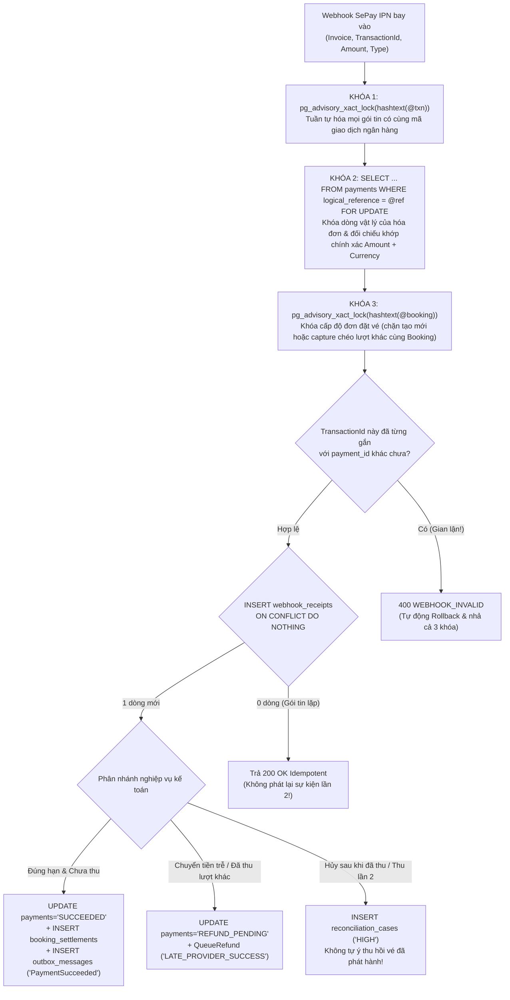
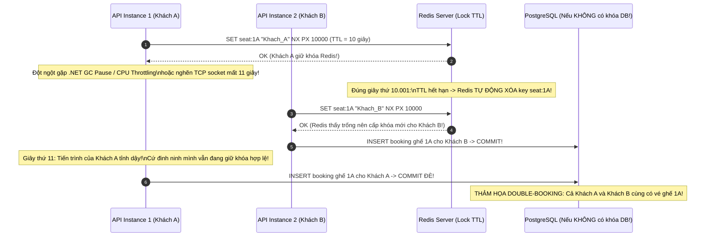
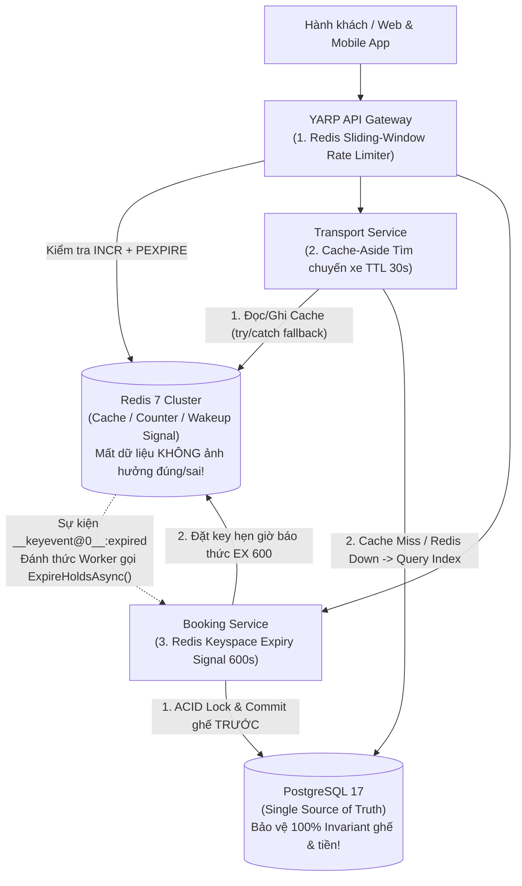

# Chương 05.4 — Khóa Tư Vấn PostgreSQL (`pg_advisory_xact_lock`) Trong Thanh Toán SePay & Câu Chuyện Kiến Trúc Thực Tế Về Redis

> **Mục tiêu tài liệu:** Tài liệu gồm hai phần trọng điểm:
> - **Phần A** giải thích từ con số 0 khái niệm **Transaction-Scoped Advisory Lock (`pg_advisory_xact_lock`)** của PostgreSQL 17 — loại khóa nằm hoàn toàn trong bộ nhớ RAM giúp khóa ngay cả những thực thể *chưa tồn tại trên đĩa* — và giải phẫu từng dòng **Bộ 3 Khóa Liên Hoàn** trong `SePayPaymentStore.cs` & `PaymentRepository.cs`.
> - **Phần B** trình bày toàn diện, khách quan và trung thực 100% về **Redis** trong dự án **BLUE Bus Ticket Platform**: từ lý thuyết Redis/Redlock, lý do sâu xa vì sao **ADR-008** bác bỏ việc dùng Redis Lock để giữ ghế (tránh thảm họa Split-Brain / GC Pause), hiện trạng thực tế của Redis trong thư mục `workspace/` ở bản MVP, đến bản thiết kế kỹ thuật chi tiết để tích hợp Redis ở giai đoạn Scale-up hậu MVP.

---

## Phần A — Khóa Tư Vấn Giao Dịch (`pg_advisory_xact_lock`) & Bộ 3 Khóa Liên Hoàn Trong Thanh Toán

### 1. Lý Thuyết Từ Con Số 0: Khóa Tư Vấn (Advisory Lock) Là Gì Và Giải Quyết Lỗ Hổng Nào Mà `FOR UPDATE` Bó Tay?

#### 1.1. Điểm mù chí mạng của khóa dòng `SELECT ... FOR UPDATE`
Ở Chương 05.3, chúng ta đã thấy sức mạnh tuyệt vời của `SELECT ... FOR UPDATE` trên bảng `trip_seats` vì **toàn bộ 34 chiếc ghế của chuyến xe đã được tạo sẵn thành 34 dòng vật lý trên đĩa** ngay từ lúc xuất bản chuyến (`ImportTripAsync`). Có dòng vật lý sẵn thì PostgreSQL mới có chỗ để gắn khóa!

Nhưng sang đến `Payment Service`, hãy xét **2 bài toán thực tế nơi dòng dữ liệu cần khóa CHƯA HỀ TỒN TẠI trong bảng**:

1. **Bài toán 1 — Khách hàng bấm đúp "Thanh toán ngay" ở cùng một mili-giây (`PaymentRepository.InsertPaymentAsync`):**
   Trong bản migration [002_sepay.sql](file:///C:/Users/minht/.gemini/antigravity/worktrees/PBL6/c_to_n_b/docs/database/payment/002_sepay.sql#L11-L13), dự án đã chủ đích gỡ bỏ ràng buộc cứng `uq_payments_booking` (`ALTER TABLE payments DROP CONSTRAINT uq_payments_booking;`). Lý do rất thực tế: nếu khách mở cổng thanh toán lần 1 nhưng hủy hoặc lỗi thẻ (`FAILED` / `CANCELLED`), hệ thống phải giữ lại dòng lịch sử thất bại đó để kiểm toán, đồng thời cho phép khách tạo **lượt thanh toán lần 2** cho cùng `booking_id_external` đó!
   - Nhưng khi không còn `UNIQUE (booking_id_external)`, nếu ở lần đầu tiên (khi bảng `payments` chưa có bất kỳ dòng nào của đơn `Booking_X`), khách sốt ruột nhấp đúp chuột 2 lần gửi 2 request tạo thanh toán cùng lúc:
   - Câu lệnh `SELECT 1 FROM payments WHERE booking_id_external = @booking AND status NOT IN ('FAILED','CANCELLED')` của cả 2 request đều thấy **0 dòng**! Dùng `FOR UPDATE` lên tập kết quả 0 dòng thì **chẳng khóa được gì cả**! Cả hai cùng `INSERT` thành công → sinh ra 2 hóa đơn `PENDING` song song cho cùng 1 đơn đặt vé!

2. **Bài toán 2 — Cổng thanh toán SePay / Ngân hàng bắn lặp 2 gói tin IPN Webhook ở cùng một mili-giây (`SePayPaymentStore.ApplySePayAsync`):**
   Khi khách quét mã VietQR chuyển khoản thành công, hệ thống SePay gửi HTTP POST Webhook thông báo biến động số dư kèm mã giao dịch ngân hàng `TransactionId` (ví dụ `"TXN_998877"`).
   - Do độ trễ mạng hoặc cơ chế retry nhanh của cổng thanh toán, 2 gói tin Webhook mang cùng `"TXN_998877"` (hoặc nguy hiểm hơn: kẻ tấn công có thông tin xác thực thử gửi `"TXN_998877"` vào 2 mã hóa đơn `Invoice_1` và `Invoice_2` khác nhau cùng lúc!) đập vào `Payment.Api` tại đúng một thời điểm khi bảng `webhook_receipts` **chưa có dòng nào mang mã `"TXN_998877"`**.
   - Làm sao bắt mọi luồng xử lý cùng một `TransactionId` (hoặc cùng một `BookingId`) phải xếp hàng tuần tự từng người một ngay cả khi chưa có dòng dữ liệu nào trên đĩa?

#### 1.2. Cơ chế hoạt động của PostgreSQL Advisory Lock (`pg_advisory_xact_lock`)

PostgreSQL cung cấp một tính năng đẳng cấp mang tên **Advisory Locks (Khóa tư vấn / Khóa định danh cấp ứng dụng)**:
- **Bản chất vật lý:** Thay vì khóa một bảng (Table Lock) hay khóa một dòng trên đĩa (Row/Tuple Lock), PostgreSQL cho phép ứng dụng truyền vào **một con số nguyên (32-bit `integer` hoặc 64-bit `bigint`)** và đặt khóa trực tiếp lên con số đó bên trong **bảng băm bộ nhớ chia sẻ (Shared Memory Lock Table) trên RAM của PostgreSQL Server**!
- **Tại sao gọi là "Advisory" (Tư vấn)?** Vì PostgreSQL không tự áp đặt nó khi `SELECT`/`INSERT` thông thường; chính các hàm ứng dụng C# chủ động "thỏa thuận" với nhau: *"Trước khi đụng vào nghiệp vụ của đơn hàng X, tất cả chúng ta đều phải xin khóa trên con số băm của X!"*.
- **Tốc độ siêu thanh & Không rác đĩa:** Vì nằm 100% trên RAM của nhân PostgreSQL, thao tác lấy và nhả Advisory Lock diễn ra trong vài micro-giây, không ghi bẩn trang dữ liệu (Zero Tuple Bloat), không tốn công dọn dẹp của `AUTOVACUUM`!

#### 1.3. Phân biệt sống còn: `pg_advisory_lock` (Session) vs `pg_advisory_xact_lock` (Transaction)

PostgreSQL có hai họ hàm Advisory Lock, và việc dự án BLUE chọn **`pg_advisory_xact_lock`** là cực kỳ chuẩn xác trong môi trường `.NET Npgsql Connection Pooling`:

| Đặc điểm | `pg_advisory_lock(key)` (Cấp Phiên - Session) | `pg_advisory_xact_lock(key)` (Cấp Giao dịch - Dự án dùng!) |
| :--- | :--- | :--- |
| **Thời điểm nhả khóa** | Giữ mãi cho đến khi gọi thủ công `pg_advisory_unlock(key)` hoặc đóng hẳn TCP socket. | **Tự động nhả 100% ngay khi Transaction `COMMIT` hoặc `ROLLBACK`!** |
| **Rủi ro với Connection Pool (`Npgsql`)** | **Rất nguy hiểm:** Trong .NET, `await connection.DisposeAsync()` không đóng socket thật mà trả kết nối về Pool! Nếu code văng Exception quên `unlock`, khóa bị treo vĩnh viễn làm tê liệt đơn hàng! | **An toàn tuyệt đối 100%:** Dù code C# thành công, hay văng Exception, hay sập container API, hễ Transaction kết thúc là PostgreSQL tự thu hồi khóa ngay lập tức! |

Và để biến một chuỗi chữ bất kỳ (như mã giao dịch `"TXN_998877"` hay chuỗi GUID `BookingId.ToString()`) thành con số nguyên đưa vào hàm khóa, PostgreSQL cung cấp sẵn hàm băm cực nhanh ngay trong nhân C là **`hashtext(text) -> integer`**:
```sql
SELECT pg_advisory_xact_lock(hashtext(@booking));
```

---

### 2. Giải Phẫu Từng Dòng Mã Nguồn Thực Tế: `InsertPaymentAsync` & Bộ 3 Khóa Liên Hoàn Trong `SePayPaymentStore.ApplySePayAsync`

#### 2.1. Chốt chặn chống tạo đúp hóa đơn thanh toán trong `PaymentRepository.InsertPaymentAsync`
Hãy xem cách [PaymentRepository.cs](file:///C:/Users/minht/.gemini/antigravity/worktrees/PBL6/c_to_n_b/workspace/src/services/payment/BusTicketPlatform.Payment.Infrastructure/Persistence/PaymentRepository.cs#L51-L80) dập tắt hoàn toàn lỗi khách bấm đúp nút thanh toán:

```csharp
// Trích từ PaymentRepository.cs (dòng 51 - 80)
public async Task InsertPaymentAsync(PaymentRecord payment, CancellationToken cancellationToken)
{
    await using var connection = await OpenAsync(cancellationToken);
    await using var tx = await connection.BeginTransactionAsync(cancellationToken);
    // 1. Xin khóa tư vấn trên con số băm của BookingId trong RAM PostgreSQL!
    await using (var locked = new NpgsqlCommand("SELECT pg_advisory_xact_lock(hashtext(@booking))", connection, tx))
    {
        locked.Parameters.AddWithValue("booking", payment.BookingId.ToString());
        await locked.ExecuteScalarAsync(cancellationToken);
    }
    // 2. Khi đã giữ khóa độc quyền theo BookingId, kiểm tra WHERE NOT EXISTS an toàn tuyệt đối 100%!
    await using var command = new NpgsqlCommand("""
        INSERT INTO payments (
          id, booking_id_external, customer_id_external, organization_id_external, provider, logical_reference, amount, currency, status, expires_at, created_at, updated_at, return_uri, checkout_method)
        SELECT @id, @booking, @customer, @org, @provider, @ref, @amount, @currency, @status, @expires, NOW(), NOW(), @return, @method
        WHERE NOT EXISTS (SELECT 1 FROM payments WHERE booking_id_external = @booking AND status NOT IN ('FAILED','CANCELLED'));
        """, connection, tx);
    // ... gán tham số và ExecuteNonQueryAsync ...
    await tx.CommitAsync(cancellationToken);
}
```
Khi 2 request cho cùng `Booking_X` bay vào cùng mili-giây: Request 1 lấy được `pg_advisory_xact_lock(hashtext('Booking_X'))`, Request 2 bị treo đợi ngay dòng 58. Request 1 thấy chưa có dòng active nào nên `INSERT` hóa đơn `PENDING` và `COMMIT` (tự động nhả khóa). Ngay tích tắc đó Request 2 được đánh thức, câu `WHERE NOT EXISTS` nhìn thấy dòng `PENDING` vừa `COMMIT` của Request 1 nên chèn **0 dòng** — vừa cho phép tạo lại thanh toán sau khi `FAILED`/`CANCELLED`, vừa đảm bảo tại mọi thời điểm chỉ có tối đa **1 hóa đơn đang mở** cho mỗi Booking!

---

#### 2.2. Giải phẫu "Bộ 3 Khóa Liên Hoàn" (Triple-Lock Choreography) trong `SePayPaymentStore.ApplySePayAsync`

Xử lý Webhook tiền thật từ cổng thanh toán ngân hàng (**SePay**) là nơi nhạy cảm nhất về mặt tài chính của toàn dự án. Hãy đọc kỹ từng bước trong hàm [SePayPaymentStore.ApplySePayAsync](file:///C:/Users/minht/.gemini/antigravity/worktrees/PBL6/c_to_n_b/workspace/src/services/payment/BusTicketPlatform.Payment.Infrastructure/Persistence/SePayPaymentStore.cs#L12-L122):

```csharp
// Trích từ SePayPaymentStore.cs (dòng 12 - 60)
public async Task<Result> ApplySePayAsync(SePayNotification notification, string payloadHash, Guid correlationId, CancellationToken cancellationToken)
{
    await using var connection = await OpenAsync(cancellationToken);
    await using var tx = await connection.BeginTransactionAsync(cancellationToken);

    // [KHÓA SỐ 1]: Advisory Lock theo mã giao dịch ngân hàng (TransactionId)
    await using (var transactionLock = new NpgsqlCommand("SELECT pg_advisory_xact_lock(hashtext(@txn))", connection, tx))
    {
        transactionLock.Parameters.AddWithValue("txn", notification.TransactionId);
        await transactionLock.ExecuteScalarAsync(cancellationToken);
    }

    // [KHÓA SỐ 2]: Row-Level Exclusive Lock (FOR UPDATE) trên dòng hóa đơn vật lý trong bảng payments
    PaymentRecord payment;
    await using (var command = new NpgsqlCommand("SELECT " + PaymentCols + " FROM payments WHERE logical_reference = @ref FOR UPDATE", connection, tx))
    {
        command.Parameters.AddWithValue("ref", notification.Invoice);
        await using var reader = await command.ExecuteReaderAsync(cancellationToken);
        if (!await reader.ReadAsync(cancellationToken)) return Result.Failure(PlatformErrors.NotFound());
        payment = ReadPayment(reader);
    }
    if (payment.Provider != "SEPAY" || payment.Amount != notification.Amount || payment.Currency != notification.Currency)
        return Result.Failure(PlatformErrors.WebhookInvalid());

    // [KHÓA SỐ 3]: Advisory Lock theo mã đơn đặt vé (BookingId) — đồng bộ với InsertPaymentAsync!
    await using (var bookingLock = new NpgsqlCommand("SELECT pg_advisory_xact_lock(hashtext(@booking))", connection, tx))
    {
        bookingLock.Parameters.AddWithValue("booking", payment.BookingId.ToString());
        await bookingLock.ExecuteScalarAsync(cancellationToken);
    }

    // Chốt chặn chống dùng 1 mã giao dịch ngân hàng thanh toán cho 2 hóa đơn khác nhau
    await using (var bound = new NpgsqlCommand(
        "SELECT 1 FROM webhook_receipts WHERE provider = 'SEPAY' AND provider_transaction_id = @txn AND payment_id <> @payment LIMIT 1",
        connection, tx))
    {
        bound.Parameters.AddWithValue("txn", notification.TransactionId);
        bound.Parameters.AddWithValue("payment", payment.Id);
        if (await bound.ExecuteScalarAsync(cancellationToken) is not null) return Result.Failure(PlatformErrors.WebhookInvalid());
    }

    // Ghi biên lai Webhook bất biến (Idempotency bằng SHA-256 + ON CONFLICT DO NOTHING)
    var receipt = payment.LogicalReference + ":" + notification.Type + ":" + notification.TransactionId;
    receipt = Convert.ToHexString(System.Security.Cryptography.SHA256.HashData(System.Text.Encoding.UTF8.GetBytes(receipt)));
    await using (var insert = new NpgsqlCommand("""
        INSERT INTO webhook_receipts (id, provider, external_event_id, payment_id, provider_transaction_id, payload_hash, signature_valid,
            status, received_at, verified_at, processed_at)
        VALUES (gen_random_uuid(), 'SEPAY', @event, @payment, @txn, @hash, true, 'PROCESSED', NOW(), NOW(), NOW())
        ON CONFLICT (provider, external_event_id) DO NOTHING;
        """, connection, tx))
    {
        // ... Nếu đã xử lý biên lai này rồi (affected == 0) -> trả về Result.Success() ngay lập tức!
        if (await insert.ExecuteNonQueryAsync(cancellationToken) == 0) return Result.Success();
    }
```



#### Tại sao phải đủ cả 3 tầng khóa mà thiếu 1 trong 3 đều có khe hở?
1. **Thiếu Khóa 1 (`hashtext(@txn)`):** Hai request giả mạo gửi cùng 1 `TransactionId` vào 2 hóa đơn `Invoice_A` và `Invoice_B` khác nhau sẽ khóa 2 dòng `payments` khác nhau (vượt qua Khóa 2), khóa 2 `BookingId` khác nhau (vượt qua Khóa 3), và cả hai cùng chạy qua câu `SELECT 1 FROM webhook_receipts WHERE provider_transaction_id = @txn` trước khi bên kia kịp `INSERT`! Có Khóa 1 đứng đầu cửa, mọi request mang cùng `@txn` bị ép đi hàng một, dập tắt 100% kịch bản dùng 1 giao dịch ngân hàng thanh toán cho 2 đơn vé!
2. **Thiếu Khóa 2 (`FOR UPDATE` trên `payments`):** Một luồng khác (như luồng hoàn tiền `QueueSePayRefundAsync` dòng 128 hoặc `UpdatePaymentAsync`) chỉ biết `payment.Id` mà không biết `@txn` của ngân hàng có thể sửa đổi trạng thái `payments` song song gây mất cập nhật.
3. **Thiếu Khóa 3 (`hashtext(@booking)`):** Một đơn `Booking` có thể có lượt thanh toán cũ bị timeout nhưng tiền ngân hàng đi đường vòng báo về chậm đúng lúc khách vừa bấm tạo lượt thanh toán mới (`InsertPaymentAsync`) và quét mã lần 2! Khóa 3 bắt cả hai lượt thanh toán của cùng `BookingId` phải xếp hàng tuần tự để biến `alreadyCaptured` (dòng 65) phát hiện chính xác lượt nào đến trước được cấp vé (`SUCCEEDED`), lượt nào đến sau tự động được chuyển thẳng vào hàng đợi hoàn tiền cho khách (`LATE_PROVIDER_SUCCESS` — dòng 84)!

> **Điểm sáng thiết kế tài chính chuyên nghiệp (dòng 66–119 của `SePayPaymentStore.cs`):**
> - **Không bao giờ làm mất tiền của khách khi chuyển khoản trễ (`late`):** Nếu khách quét QR ở phút thứ 9:58 nhưng ngân hàng nghẽn mạng đến phút 10:05 mới báo tiền về (khi đơn đã hết hạn), hệ thống vẫn ghi nhận biên lai tiền thật, tính toán bảng quyết toán `booking_settlements`, đặt trạng thái `REFUND_PENDING` và tự động gọi `QueueRefund(..., "LATE_PROVIDER_SUCCESS")` để trả lại đủ số tiền cho hành khách!
> - **Không bao giờ âm thầm hủy vé đã xuất khi gặp sự kiện bất thường:** Nếu cổng thanh toán gửi lệnh `TRANSACTION_VOID` sau khi vé đã xuất (`VOID_AFTER_CAPTURE`), hệ thống mở ngay hồ sơ đối soát mức độ nghiêm trọng cao (`reconciliation_cases` với `severity = 'HIGH'`) để kế toán sàn xử lý thủ công thay vì tự động xóa vé làm hành khách bơ vơ tại bến xe!

---

## Phần B — Câu Chuyện Toàn Diện, Chuyên Sâu & Trung Thực 100% Về Redis Trong Dự Án BLUE

Khi đi bảo vệ đồ án tốt nghiệp hoặc phỏng vấn kỹ sư Backend, giảng viên mở file `docker-compose.yml` thấy có container **`redis:7-alpine`** chạy ở cổng `6379` chắc chắn sẽ hỏi hai câu cực kỳ sắc bén:
1. *"Trong dự án này các em đang dùng Redis vào việc gì ở trong code C#?"*
2. *"Tại sao các em không dùng Redis Distributed Lock để khóa giữ ghế xe trong 10 phút cho nhanh mà lại khóa trực tiếp trong PostgreSQL?"*

Nắm vững toàn bộ Phần B dưới đây sẽ giúp bạn biến khoảnh khắc này thành màn trình diễn tư duy kiến trúc hệ thống phân tán xuất sắc nhất buổi bảo vệ!

---

### 3. Lý Thuyết Từ Con Số 0: Redis Là Gì, Cơ Chế TTL & Khóa Phân Tán (`SET NX EX` / Redlock) Hoạt Động Như Thế Nào?

#### 3.1. Redis dưới góc nhìn kiến trúc máy tính
**Redis** (*Remote Dictionary Server*) là một hệ quản trị cấu trúc dữ liệu lưu trữ chính trên **bộ nhớ khả biến RAM (In-Memory Data Structure Store)**, khác với PostgreSQL lưu trữ chính trên ổ cứng SSD/NVMe kèm vùng đệm RAM:
- **Tốc độ phản hồi dưới 1 mili-giây (`< 0.1ms`):** Vì mọi thao tác đọc/ghi diễn ra trực tiếp trên con trỏ bộ nhớ RAM và vòng lặp sự kiện xử lý lệnh của Redis chạy **Đơn luồng (Single-threaded Event Loop với I/O Multiplexing `epoll`)**, các lệnh gửi tới Redis luôn được thực thi tuần tự từng lệnh một mà không tốn chi phí chuyển ngữ cảnh luồng (Context Switch) của CPU.
- **Đa dạng cấu trúc dữ liệu nguyên bản:** Không chỉ có chuỗi `String`, Redis hỗ trợ sẵn `Hash` (bảng băm), `List`, `Set`, `Sorted Set (ZSET)` (tập hợp sắp xếp theo điểm số — rất hay dùng cho bảng xếp hạng hoặc Rate Limiting), `Stream`, và `Pub/Sub`.
- **Cơ chế bền vững hóa xuống đĩa (Persistence):** Vì RAM sẽ mất sạch khi cúp điện, Redis cung cấp chế độ **AOF (Append-Only File)** qua cờ `--appendonly yes` — ghi nối tiếp các lệnh thay đổi dữ liệu xuống file nhật ký trên ổ cứng (mặc định đồng bộ xuống đĩa mỗi 1 giây một lần — `appendfsync everysec`).
- **Cơ chế tự hủy theo thời gian sống (TTL — Time-To-Live):** Mọi key trong Redis đều có thể gắn đồng hồ đếm ngược (ví dụ `EX 600` = tự động biến mất sau đúng 600 giây = 10 phút).

#### 3.2. Cách nhiều tài liệu trên mạng dạy làm "Giữ ghế bằng Redis Lock"
Nhìn thấy tính năng đơn luồng + tự hủy TTL `600 giây` của Redis quá giống với yêu cầu *"Giữ ghế xe trong 10 phút"*, hàng loạt bài hướng dẫn trên mạng dạy cách viết chức năng giữ ghế bằng câu lệnh nguyên tử của Redis:
```text
SET lock:trip:T1:seat:1A "user_123_random_token" NX EX 600
```
- **`NX` (*Not Exists*):** Chỉ ghi thành công và trả về `OK` nếu key `lock:trip:T1:seat:1A` hiện chưa tồn tại trên RAM của Redis. Nếu người khác đã đặt trước, Redis trả về `(nil)` ngay lập tức!
- **`EX 600` (*Expire*):** Tự động xóa key sau 600 giây nếu khách không thanh toán.
- Và để chống trường hợp 1 máy chủ Redis bị hỏng, tác giả Redis đề xuất thêm thuật toán **Redlock**: ứng dụng đi xin khóa `SET NX EX` đồng thời trên 5 máy chủ Redis độc lập; nếu lấy được khóa trên tối thiểu quá bán ($\ge 3/5$ máy chủ) trong vài mili-giây thì coi như giữ khóa thành công.

Nghe qua thì tưởng chừng hoàn hảo! Vậy **tại sao các kiến trúc sư hệ thống hàng đầu thế giới và chính tài liệu ADR-008 của dự án BLUE lại nghiêm cấm dùng Redis Lock làm chốt chặn chống bán trùng ghế?**

---

### 4. Giải Phẫu Chuyên Sâu (Martin Kleppmann & ADR-008): 4 Lỗ Hổng Chí Mạng Khiến Redis Lock Gây Ra Double-Booking!

Trong cuốn sách kinh điển *Designing Data-Intensive Applications (DDIA)* và bài nghiên cứu nổi tiếng *"How to do distributed locking"*, Giáo sư **Martin Kleppmann** (Đại học Cambridge) đã chứng minh toán học rằng: **Dùng khóa phân tán có TTL (như Redis `SET NX EX` hoặc Redlock) để bảo vệ tính đúng đắn (Correctness) của dữ liệu ghi sang một Database khác mà không có cơ chế kiểm chứng tại chính Database đó chắc chắn sẽ bị lọt lưới!**

Hãy phân tích 4 kịch bản thảm họa thực tế:

#### Lỗ hổng 1: Tạm dừng thu gom rác bộ nhớ (GC Pause) / Nghẽn mạng làm khóa Redis tự nhả trước khi DB kịp Commit!



Bản chất vấn đề nằm ở chỗ: **Redis tự động tịch thu khóa dựa trên thời gian trôi qua, nhưng tiến trình C# đang bị treo không hề biết khóa của mình đã hết hạn!** Nếu PostgreSQL bên dưới không tự có khóa dòng `FOR UPDATE` và ràng buộc trạng thái của riêng nó, câu lệnh ghi muộn của Instance 1 vẫn đâm thẳng xuống đĩa thành công!

#### Lỗ hổng 2: Nhân bản bất đồng bộ (Asynchronous Replication Failover) & Mất dữ liệu đuôi AOF
- Để đạt tốc độ cực cao, Redis nhân bản dữ liệu từ node **Master** sang node **Replica** theo cơ chế **bất đồng bộ (Asynchronous)**: Master trả lời `OK` cho ứng dụng ngay khi vừa ghi vào RAM của mình, rồi sau đó mới gửi bản sao sang Replica.
- Nếu Khách A vừa nhận `OK` giữ ghế `1A` trên Master, đúng 2 mili-giây sau Master mất điện đột ngột trước khi kịp đồng bộ dòng `seat:1A` sang Replica → Hệ thống điều phối bầu Replica lên làm Master mới. Trên RAM của Master mới lúc này **hoàn toàn không có key `seat:1A`** → Khách B vào giữ ghế `1A` được cấp `OK` ngay lập tức!
- Ngay cả khi chạy 1 node Redis đơn lẻ với `--appendonly yes` (mặc định `appendfsync everysec`), nếu container hoặc máy chủ vật lý sập nguồn đột ngột, tối đa **1 giây dữ liệu vừa ghi trong vùng đệm OS Page Cache chưa kịp `fsync` xuống đĩa sẽ bốc hơi vĩnh viễn**!

#### Lỗ hổng 3: Không có giao dịch nguyên tử liên hệ thống (Dual-Write / Partial Failure)
Trong dự án BLUE, một lệnh đặt vé phải kiểm tra đồng thời nhiều ghế (`[1A, 1B, 1C]`), kiểm tra mã giảm giá `coupons`, tạo `bookings`, `booking_items`, `passengers` và `outbox_messages`.
- Trong PostgreSQL, tất cả nằm gọn trong **1 ACID Transaction duy nhất**: thành công tất cả hoặc `Rollback` sạch sẽ 100% trong 1 lệnh.
- Nếu trạng thái giữ ghế nằm ở Redis còn đơn hàng nằm ở PostgreSQL, khi mạng chập chờn giữa hai bước, hệ thống liên tục rơi vào cảnh **"Ghế ma" (Zombie Locks)** — DB đã rollback vì sai Coupon nhưng lệnh `DEL` gửi sang Redis bị rớt mạng khiến chiếc ghế bị khóa oan không ai mua được!

#### Lỗ hổng 4: Nhảy đồng hồ hệ thống (Clock Drift / NTP Step)
Cơ chế tính thời điểm hết hạn TTL phụ thuộc vào đồng hồ thời gian trên máy chủ chạy Redis. Khi dịch vụ đồng bộ giờ mạng `NTP` hiệu chỉnh bước nhảy thời gian, các key có TTL có thể bị xóa sớm hoặc muộn bất thường.

> **Quyết định Kiến trúc Bất di Bất dịch — ADR-008 của dự án BLUE:**
> Chính vì 4 lý do cốt tử trên, tại [02-01-12-architecture-decisions.md](file:///C:/Users/minht/.gemini/antigravity/worktrees/PBL6/c_to_n_b/docs/system-design/02-01-system-architecture/02-01-12-architecture-decisions.md#L68-L75) (**ADR-008**) và bảng *Rejected Alternatives* (dòng 155), nhóm thiết kế đã chốt nguyên tắc vàng:
> - **PostgreSQL (`booking` DB) là nguồn chân lý duy nhất (Single Source of Truth) chống Double-Booking** thông qua Transaction ACID, khóa dòng `SELECT ... FOR UPDATE`, và ràng buộc `ck_trip_seat_owner`.
> - **Redis tuyệt đối không bao giờ được nắm quyền phán quyết ai là chủ sở hữu ghế hay trạng thái thanh toán.** Dù toàn bộ cụm Redis có sập nguồn hay bị xóa trắng RAM (`FLUSHALL`), tính đúng đắn 100% của vé và tiền vẫn không suy suyển!

---

### 5. Hiện Trạng Thực Tế & Trung Thực 100% Về Redis Trong Thư Mục `workspace/` Ở Bản MVP Hôm Nay

Khi báo cáo trước hội đồng chấm đồ án, một kỹ sư bản lĩnh luôn nắm rõ đến từng dòng cấu hình cái gì **đã dựng sẵn ở hạ tầng** và cái gì **được hoãn chủ đích sang giai đoạn sau MVP**. Dưới đây là bức tranh kiểm toán mã nguồn chính xác tuyệt đối 100% của `workspace/`:

#### 5.1. Những nơi Redis ĐÃ HIỆN DIỆN sẵn sàng trong Hạ tầng & Tài liệu
1. **Docker Compose Local ([workspace/src/infra/docker-compose.yml](file:///C:/Users/minht/.gemini/antigravity/worktrees/PBL6/c_to_n_b/workspace/src/infra/docker-compose.yml#L66-L79)):**
   ```yaml
   redis:
     image: redis:7-alpine
     command: ["redis-server", "--appendonly", "yes"]
     ports:
       - "6379:6379"
     volumes:
       - redis-data:/data
     healthcheck:
       test: ["CMD", "redis-cli", "ping"]
       interval: 5s
       timeout: 3s
       retries: 20
     networks: [platform]
   ```
2. **Docker Compose Production Overlay ([workspace/src/infra/docker-compose.production.yml](file:///C:/Users/minht/.gemini/antigravity/worktrees/PBL6/c_to_n_b/workspace/src/infra/docker-compose.production.yml#L52-L58)):**
   Đã được thiết kế chuẩn bảo mật Production: đóng toàn bộ port public (`ports: !reset []`), bật `restart: unless-stopped`, và giới hạn tài nguyên chặt chẽ (`cpus: "0.50"`, `memory: 256M`).
3. **Kịch bản khởi chạy máy trạm Windows ([workspace/scripts/dev-local.ps1](file:///C:/Users/minht/.gemini/antigravity/worktrees/PBL6/c_to_n_b/workspace/scripts/dev-local.ps1#L91-L99)):**
   Tự động kiểm tra cổng `6379`, cài đặt gói `Redis.Redis` qua `winget` nếu máy chưa có, bật dịch vụ và đợi `Wait-Port 6379 "Redis"`.
4. **Tài liệu Hạ tầng ([workspace/src/infra/README.md](file:///C:/Users/minht/.gemini/antigravity/worktrees/PBL6/c_to_n_b/workspace/src/infra/README.md#L65)):**
   Ghi nhận rõ ràng lộ trình:
   `| redis | 6379 | Booking hold/cache later |`

#### 5.2. Hiện trạng trong Mã nguồn C# (`.NET 10`) bản MVP 2.0
- Kiểm tra tệp quản lý thư viện tập trung [workspace/Directory.Packages.props](file:///C:/Users/minht/.gemini/antigravity/worktrees/PBL6/c_to_n_b/workspace/Directory.Packages.props) và toàn bộ mã nguồn của 6 Microservices cùng `BusTicketPlatform.Gateway`:
  - **Không có** thư viện `StackExchange.Redis` hay `Microsoft.Extensions.Caching.StackExchangeRedis`.
  - **Không có** biến môi trường `ConnectionStrings__Redis` nào được truyền vào các container API trong `docker-compose.production.yml`, và **chưa có bất kỳ dòng code C# nào mở kết nối tới cổng `6379` trong bản MVP hiện tại**.
- **Tại sao điều này hoàn toàn nhất quán với thiết kế hệ thống?**
  Theo **ADR-015 (MVP Scope Freeze)** và **ADR-008**, mục tiêu tối thượng của giai đoạn MVP là xây dựng và kiểm chứng hoàn chỉnh 100% các luồng nghiệp vụ bắt buộc (`MUST`) với độ tin cậy dữ liệu tuyệt đối dựa trên PostgreSQL 17 (Covering Partial Index `ix_trips_public_search`, Lazy CTE `ExpireHoldsAsync`, Row Locks, Advisory Locks) và RabbitMQ Outbox/Inbox. Việc dựng sẵn container `redis:7-alpine` ở tầng hạ tầng giúp môi trường Docker/Local cố định cấu trúc mạng ngay từ Sprint 0 mà tránh được lỗi "Tối ưu hóa sớm làm phức tạp hóa luồng dữ liệu" (*Premature Optimization*).

---

### 6. Bản Thiết Kế Tích Hợp Redis Chuẩn Xác Ở Giai Đoạn Scale-Up Hậu MVP

Nếu lưu lượng truy cập tăng gấp 50–100 lần vào cao điểm mở bán vé Tết (hàng chục nghìn lượt tìm chuyến mỗi giây), chúng ta sẽ kích hoạt container `redis:7-alpine` đang chờ sẵn kia như thế nào để **vừa giảm 90% tải đọc cho PostgreSQL, vừa tuân thủ tuyệt đối ADR-008**?

Theo đúng định hướng tại Mục 4 của [02-01-07-database-architecture.md](file:///C:/Users/minht/.gemini/antigravity/worktrees/PBL6/c_to_n_b/docs/system-design/02-01-07-database-architecture.md#L62-L70), Redis sẽ đảm nhiệm **3 vai trò phụ trợ an toàn (Fail-Safe Auxiliary Roles)**:



#### 6.1. Vai trò 1 — Mô hình Cache-Aside có Graceful Degradation cho Tìm kiếm Chuyến xe (`Transport Service`)
Trên thực tế vận hành sàn vé xe, cứ **1.000 lượt gọi `GET /api/v1/trips` (tìm kiếm, lọc giá, đổi ngày xem giờ chạy)** mới có **1 lượt gọi `POST /holds` (bấm chọn ghế)**.
- **Quy ước đặt tên Key có phiên bản (Namespaced & Versioned Key):**
  `blue:transport:v1:trips:search:{date}:{originNorm}:{destNorm}:{queryHash}`
- **Thời gian sống (TTL) ngắn kết hợp Xóa Cache theo Sự kiện (Event-Driven Invalidation):**
  - Lưu kết quả JSON của `TripPageDto` vào Redis với `TTL = 30 giây`.
  - Mỗi khi `Transport` phát sự kiện `TripPublished`, `TripStatusChanged`, `TripCancelled` (hoặc nhận tín hiệu thay đổi chỗ trống), xóa các key theo ngày/tuyến tương ứng.
- **Nguyên tắc sống còn — Graceful Degradation (Suy giảm mượt mà khi Redis lỗi):**
  ```csharp
  // Mẫu tích hợp chuẩn ADR-008 cho TransportService.SearchAsync (Giai đoạn Scale-up)
  try
  {
      var cached = await redisDb.StringGetAsync(cacheKey);
      if (cached.HasValue)
          return Result<TripPageDto>.Success(JsonSerializer.Deserialize<TripPageDto>(cached!)!);
  }
  catch (RedisException ex)
  {
      // TUYỆT ĐỐI KHÔNG NÉM LỖI RA NGOÀI! Chỉ ghi log cảnh báo và đọc thẳng PostgreSQL!
      logger.LogWarning(ex, "Redis cache unavailable, degrading gracefully to PostgreSQL.");
  }

  var result = await SearchFromPostgresAsync(query, cancellationToken); // Dùng ix_trips_public_search
  // Ghi ngược vào Redis dưới dạng best-effort (bọc try/catch tương tự)
  ```
  Nhờ khối `try/catch` này, khi Redis hoạt động bình thường nó gánh 95% lượng truy vấn đọc; khi Redis bảo trì hoặc sập nguồn, hệ thống tự động chuyển về đọc chỉ mục `ix_trips_public_search` của PostgreSQL mà khách hàng không gặp bất kỳ màn hình lỗi `500` nào!

#### 6.2. Vai trò 2 — Bộ giới hạn tần suất phân tán (Distributed Rate Limiter) tại YARP API Gateway
Khi triển khai Production nhiều container `BusTicketPlatform.Gateway` chạy song song sau Load Balancer, nếu một kẻ tấn công dùng dàn Bot gọi liên tục vào API giữ ghế `POST /api/v1/trips/{id}/holds` để găm sạch ghế xe của đối thủ cạnh tranh, bộ đếm Rate Limit nằm trên RAM cục bộ của từng container Gateway sẽ bị chia nhỏ và kém chính xác.
- Tích hợp Redis bằng một **Lua Script nguyên tử** (`EVALSHA`) ngay tại Middleware của `Gateway`:
  - Key: `blue:ratelimit:hold:user:{userId}` (ví dụ tối đa **5 yêu cầu tạo Hold / 60 giây** cho mỗi tài khoản khách hàng) và `blue:ratelimit:search:ip:{ipHash}` (ví dụ **60 yêu cầu / 60 giây** cho mỗi địa chỉ IP).
  - Ngăn chặn tận gốc tấn công cào dữ liệu (Scraping), dò mật khẩu (Brute-force), và găm ghế hàng loạt (Inventory Hoarding) ngay từ vòng ngoài cùng trước khi request kịp đi vào mạng nội bộ!

#### 6.3. Vai trò 3 — Tín hiệu Đánh thức Thu hồi Ghế Sớm (Redis Keyspace Expiry Signal)
Hiện tại ở MVP, `ExpireHoldsAsync` chạy theo cơ chế **Lazy Evaluation** (chỉ thu hồi ghế hết hạn khi có một request mới chạm vào chuyến xe). Vậy nếu một khách giữ 5 ghế lúc `23:00` đêm rồi tắt máy đi ngủ, và suốt từ `23:10` đến `23:30` không có ai vào xem chuyến xe đó, thì bảng báo cáo tỷ lệ lấp đầy `occupancy_projections` bên `Reporting` chưa biết 5 ghế đó đã rảnh trở lại cho tới khi có người truy cập!
- **Cách dùng Redis hỗ trợ đúng chuẩn ADR-008:**
  1. Sau khi `BookingRepository.CreateHoldAsync` đã **`COMMIT` thành công xuống PostgreSQL**, ứng dụng gửi thêm một lệnh siêu nhẹ sang Redis:
     `SET blue:booking:hold:wakeup:{holdId} "1" EX 600`
  2. Bật cấu hình `notify-keyspace-events Ex` trên Redis. Đúng giây thứ 600 khi key biến mất, Redis bắn thông điệp Pub/Sub qua kênh `__keyevent@0__:expired`.
  3. Một Background Worker của `Booking Service` lắng nghe kênh này: vừa nhận tín hiệu là gọi ngay `await store.ExpireHoldsAsync(ct)` trên PostgreSQL và phát sự kiện cập nhật số ghế trống!
  4. **Sự kết hợp hoàn hảo:**
     - Nếu Redis chạy tốt: ghế được dọn dẹp và cập nhật báo cáo đúng từng giây mà **không cần vòng lặp `while(true)` quét bảng PostgreSQL mỗi giây gây tốn CPU**!
     - Nếu Redis rớt gói tin Pub/Sub (vì Redis Pub/Sub là *fire-and-forget*) hoặc Redis bị khởi động lại: **Chẳng sao cả!** Ngay khi hành khách tiếp theo mở xem sơ đồ ghế hoặc bấm đặt vé, câu lệnh `ExpireHoldsAsync` sẵn có trên đường dẫn đọc/ghi của PostgreSQL lập tức thu hồi chính xác 100% các ghế quá hạn!

---

## 7. Góc Bảo Vệ Đồ Án: Câu Hỏi Phản Biện & Cách Trả Lời Ghi Điểm Tuyệt Đối

### Câu hỏi 1: *"Hàm `pg_advisory_xact_lock(hashtext(@txn))` trong `SePayPaymentStore.cs` khác gì với `SELECT ... FOR UPDATE`? Tại sao các em phải dùng cả hai trong cùng một hàm xử lý Webhook?"*
- **Cách trả lời chuẩn xác:**
  *"Dạ thưa thầy/cô, `SELECT ... FOR UPDATE` là khóa vật lý cấp dòng trên đĩa — nó chỉ khóa được khi dòng dữ liệu đã tồn tại sẵn trong bảng (như bản ghi `payments` của hóa đơn đó). Tuy nhiên, khi cổng SePay bắn 2 gói tin IPN Webhook trùng nhau ở cùng một mili-giây, hoặc khi có hành vi bất thường dùng cùng một mã giao dịch ngân hàng `TransactionId` gửi cho 2 hóa đơn khác nhau, thì bản ghi trong bảng `webhook_receipts` **chưa hề tồn tại**, nên `FOR UPDATE` không có dòng nào để khóa. Nhóm em dùng **`pg_advisory_xact_lock(hashtext(@txn))`** để khóa trực tiếp trên giá trị băm 32-bit của `TransactionId` ngay trong bảng băm RAM của PostgreSQL nhằm tuần tự hóa mọi gói tin cùng mã giao dịch ngay từ đầu hàm; sau đó khóa `FOR UPDATE` dòng `payments` và khóa tiếp `pg_advisory_xact_lock(hashtext(@booking))` để đồng bộ với hàm `InsertPaymentAsync`. Đặc biệt, vì dùng biến thể cấp giao dịch (`_xact_lock`) thay vì cấp phiên (`pg_advisory_lock`), cả 3 khóa đều tự động nhả 100% ngay khi `COMMIT` hoặc `ROLLBACK`, tuyệt đối không bao giờ gây rò rỉ khóa trong `Npgsql` Connection Pool ạ."*

### Câu hỏi 2: *"Thầy thấy trong `docker-compose.yml` có khai báo container `redis:7-alpine`, nhưng tìm trong code C# không thấy gọi Redis. Tại sao lại như vậy? Và tại sao các em không dùng Redis để khóa giữ ghế xe 10 phút?"*
- **Cách trả lời trung thực, đĩnh đạc & ghi điểm 10:**
  *"Dạ thưa thầy/cô, em xin trả lời thẳng thắn và đầy đủ cả hai ý ạ:*
  *Thứ nhất, về hiện trạng thực tế: Trong bản **MVP 2.0** hiện tại, container `redis:7-alpine` được nhóm em cấu hình sẵn trong `docker-compose.yml` và `dev-local.ps1` để chuẩn hóa kiến trúc mạng hạ tầng ngay từ Sprint 0 (như đã chú thích rõ là `'Booking hold/cache later'` trong `infra/README.md`), nhưng ở tầng code C# nhóm em chưa cài `StackExchange.Redis` theo đúng quyết định đóng băng phạm vi **ADR-015**, tập trung hoàn thiện độ tin cậy giao dịch trên PostgreSQL 17 và RabbitMQ.*
  *Thứ hai, về lý do kiến trúc: Theo quyết định **ADR-008**, kể cả khi tích hợp Redis ở giai đoạn Scale-up, nhóm em **tuyệt đối không dùng Redis Distributed Lock làm nguồn chân lý để giữ ghế**. Lý do là Redis nhân bản bất đồng bộ (Async Replication) và thu hồi khóa theo đồng hồ TTL: nếu tiến trình C# gặp GC Pause hoặc nghẽn mạng làm TTL trên Redis hết hạn trước khi DB kịp Commit, hoặc khi Redis Master failover sang Replica chưa kịp đồng bộ khóa, hai khách hàng sẽ cùng lấy được khóa và gây ra thảm họa **Double-Booking** (đúng như phân tích kinh điển của Martin Kleppmann). Vì vậy, quyền sở hữu ghế bắt buộc phải do Transaction ACID và khóa dòng `FOR UPDATE` của PostgreSQL quyết định; còn Redis ở giai đoạn Scale-up sẽ được dùng cho 3 mục đích an toàn là: **Cache-Aside có fallback** cho API tìm chuyến xe, **Distributed Rate Limiter** trên YARP Gateway chống bot găm ghế, và **Keyspace Expiry Signal** để đánh thức sớm tiến trình dọn ghế quá hạn ạ."*
