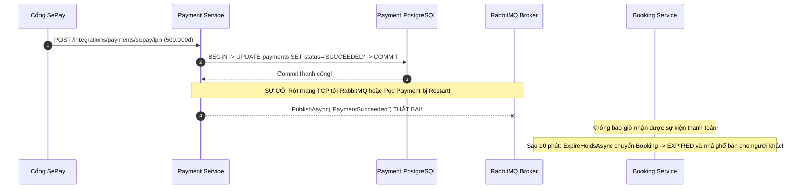
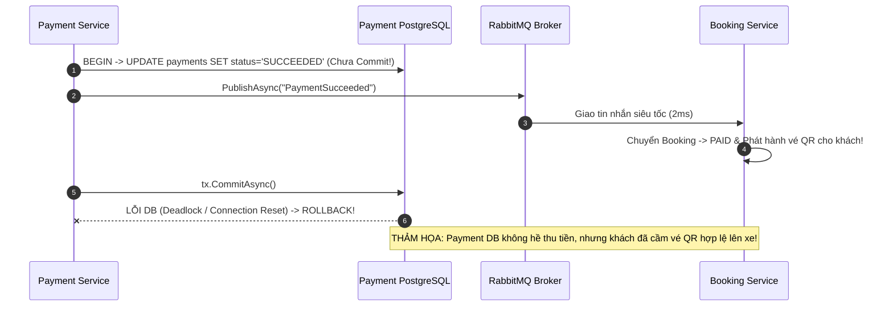
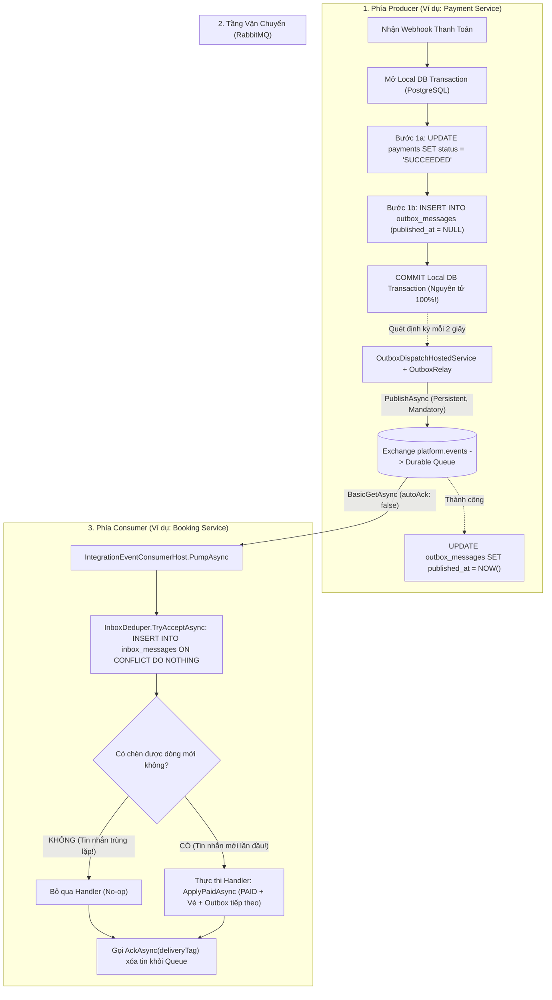

# Chương 06 — Bài 02: Bài Toán Ghi Kép (Dual-Write) & Giải Phẫu Transactional Outbox / Idempotent Inbox

> **Mục tiêu bài học**: Hiểu sâu sắc vì sao việc vừa lưu Database vừa bắn tin nhắn lên RabbitMQ lại là một trong những cái bẫy nguy hiểm nhất của lập trình hệ thống phân tán (**Dual-Write Problem**); nắm vững định lý bất khả thi của **"Exactly-Once Delivery"** qua mạng và công thức vàng **ADR-006** kết hợp **Transactional Outbox + Durable Broker + Idempotent Inbox = Effectively-Once Processing**; giải phẫu từng dòng lệnh SQL và C# trong `000_integration_tables.sql`, `RabbitMqSmokeBus.cs`, `OutboxRelay.cs`, `OutboxDispatchHostedService.cs`, `InboxDeduper.cs`, `IntegrationEventConsumerHost.cs`; và đặc biệt là phần **đối chiếu trung thực giữa Thiết kế Lý tưởng với Mã nguồn Thực tế MVP** (bao gồm 2 hàm giao dịch nguyên tử 100% tại `SePayPaymentStore.ApplySePayAsync` và `BookingRepository.ApplyPaidAsync`).

---

## 1. Giải Phẫu Bài Toán Ghi Kép (The Dual-Write Problem)

Khi một Microservice xử lý xong một yêu cầu nghiệp vụ (ví dụ: `Payment Service` nhận Webhook báo khách vừa chuyển khoản thành công 500.000đ), nó buộc phải cập nhật trạng thái ở **HAI hệ thống hạ tầng hoàn toàn độc lập**:
1. **Cơ sở dữ liệu PostgreSQL (`payment_db`)**: Cập nhật `UPDATE payments SET status = 'SUCCEEDED'` và ghi nhận doanh thu vào `booking_settlements`.
2. **Message Broker RabbitMQ (`platform.events`)**: Phát sự kiện `PaymentSucceeded` để `Booking Service` xuất vé QR và `Notification Service` báo tin cho khách.

Vấn đề cốt tử nằm ở chỗ: **PostgreSQL chạy trên kết nối TCP cổng `5432`, còn RabbitMQ chạy trên kết nối TCP cổng `5672`**. Chúng không chia sẻ chung một bộ quản lý giao dịch cục bộ (Local ACID Transaction). Khi viết code C# thông thường, bạn buộc phải gọi một thằng trước, một thằng sau. Và **dù bạn chọn thứ tự nào, hệ thống cũng sẽ dính lỗi nghiêm trọng khi xảy ra sự cố phần cứng hoặc mạng!**

Hãy chứng minh bằng hai kịch bản tai họa thực tế dưới đây.

### 1.1. Sai lầm kinh điển số 1: `Commit Database` trước -> `Publish RabbitMQ` sau

Đây là cách viết tự nhiên nhất mà 90% lập trình viên mới vào nghề đều viết:

```csharp
// ❌ PHẢN MẪU 1 (ANTI-PATTERN): Commit DB xong mới gọi thẳng RabbitMQ
await using var tx = await connection.BeginTransactionAsync();
await UpdatePaymentStatusToSucceededAsync(connection, tx, paymentId);
await tx.CommitAsync(); // <--- Bước 1: Đã chốt cứng vào đĩa cứng PostgreSQL!

// ⚡ ĐIỂM CHẾT (CRASH WINDOW): Mất điện container, K8s OOMKill, hoặc đứt mạng tới RabbitMQ!
await rabbitMqBus.PublishAsync(paymentSucceededEvent, "payment.payment.succeeded.v1"); // <--- Bước 2: KHÔNG BAO GIỜ CHẠY!
```

Hãy nhìn chuỗi thảm họa diễn ra trong tích tắc qua biểu đồ trình tự:



**Hậu quả nghiệp vụ thảm khốc (Silent Event Loss — Mất sự kiện âm thầm)**:
- Trong `Payment DB`, giao dịch đã mang trạng thái `SUCCEEDED` (tiền thật trong tài khoản ngân hàng của khách đã bị trừ 500.000đ).
- Nhưng vì tin nhắn `PaymentSucceeded` chỉ nằm trên RAM của `Payment Service` và bốc hơi khi sập nguồn/mất mạng, `Booking Service` hoàn toàn mù tịt!
- Đúng 10 phút sau, hàm dọn dẹp hết hạn của `Booking Service` thấy đơn vẫn ở trạng thái `PENDING_PAYMENT` quá giờ `expires_at` nên tự động đánh dấu đơn `EXPIRED` và **mở lại cặp ghế đó bán cho hành khách khác**! Khách hàng vừa mất tiền vừa không có vé lên xe, gọi điện khiếu nại tổng đài trong sự hỗn loạn!

---

### 1.2. Sai lầm kinh điển số 2: `Publish RabbitMQ` trước -> `Commit Database` sau

Thấy Sai lầm 1 nguy hiểm quá, lập trình viên thử đảo ngược thứ tự: *"Hay là mình gửi tin nhắn lên RabbitMQ cho chắc ăn trước, nếu gửi thành công rồi mình mới Commit Database?"*

```csharp
// ❌ PHẢN MẪU 2 (ANTI-PATTERN): Publish RabbitMQ trước khi Commit DB
await using var tx = await connection.BeginTransactionAsync();
await UpdatePaymentStatusToSucceededAsync(connection, tx, paymentId);

// Bước 1: Đẩy tin nhắn lên RabbitMQ khi Transaction DB vẫn chưa Commit!
await rabbitMqBus.PublishAsync(paymentSucceededEvent, "payment.payment.succeeded.v1");

// ⚡ ĐIỂM CHẾT: Đúng lúc gọi Commit thì PostgreSQL báo Deadlock, Đầy ổ đĩa, hoặc đứt kết nối!
await tx.CommitAsync(); // <--- Ném NpgsqlException -> PostgreSQL tự động ROLLBACK!
```

Hãy xem thảm họa ngược lại xảy ra nhanh đến mức nào:



**Hậu quả nghiệp vụ thảm khốc (Phantom Event — Sự kiện Ma)**:
- Tin nhắn một khi đã rời khỏi card mạng đi vào RabbitMQ thì **không có nút "Thu hồi (Undo/Rollback)"**!
- RabbitMQ giao tin nhắn chỉ mất 2 mili-giây; `Booking Service` lập tức xuất vé điện tử hợp lệ gửi cho khách.
- Trong khi đó, giao dịch tại `Payment PostgreSQL` bị `ROLLBACK` về như chưa từng xảy ra. Hệ thống vừa phát vé miễn phí cho một giao dịch không tồn tại trên sổ cái kế toán!
- *Ghi chú thêm*: Kể cả khi bạn đặt lệnh `PublishAsync` nằm kẹp giữa `BeginTransaction` và `Commit`, bạn còn gây ra một tác hại hiệu năng kép: kết nối PostgreSQL phải **ngậm khóa dòng (`FOR UPDATE` Row Lock)** đứng chờ mạng RabbitMQ phản hồi, làm nghẽn toàn bộ cơ sở dữ liệu khi mạng chập chờn!

---

## 2. Công Thức Vàng Của Hệ Thống Phân Tán (ADR-006): Tại Sao "Exactly-Once" Trên Mạng Là Bất Khả Thi?

### 2.1. Nghịch lý "Hai Vị Tướng" (Two Generals' Problem) và ảo tưởng về Exactly-Once Delivery

Khi học hệ thống phân tán, nhiều người đặt câu hỏi: *"Tại sao RabbitMQ không làm luôn một chế độ cấu hình `Delivery = ExactlyOnce` (Giao đúng 1 lần duy nhất, không thiếu không thừa) cho lập trình viên đỡ vất vả?"*

Câu trả lời đến từ định lý toán học kinh điển **Bài toán Hai Vị Tướng (Two Generals' Problem)** trên kênh truyền không tin cậy:
- Giả sử `Outbox Worker` gửi gói tin sự kiện `E1` sang `RabbitMQ` qua mạng TCP và ngồi chờ gói xác nhận `ACK` quay về.
- `RabbitMQ` đã nhận được `E1`, lưu xuống đĩa cứng an toàn, và gửi trả gói `ACK` về cho `Outbox Worker`.
- Nhưng đúng lúc gói `ACK` đang bay trên dây cáp mạng về phía `Outbox Worker` thì **mạng bị rớt 1 giây**!
- Lúc này, đứng ở góc nhìn của `Outbox Worker` (bị Timeout không thấy `ACK`), nó **hoàn toàn không thể phân biệt được 2 khả năng**:
  1. Gói `E1` bị rớt trên đường đi -> RabbitMQ chưa hề nhận được `E1`.
  2. RabbitMQ đã nhận được `E1` rồi, chỉ có gói `ACK` trên đường quay về bị rớt!

Trước sự bất định không thể giải quyết này, hệ thống chỉ được chọn 1 trong 2 thái cực truyền tải vật lý:
- **At-Most-Once (Tối đa 1 lần — Bắn và Quên)**: Không bao giờ gửi lại khi mất `ACK`. Chấp nhận **mất tin nhắn** (không thể chấp nhận trong thanh toán/bán vé!).
- **At-Least-Once (Ít nhất 1 lần — Kiên trì gửi lại đến khi nhận được ACK)**: Hễ nghi ngờ chưa tới là gửi lại bản sao của `E1`. Đảm bảo **100% không bao giờ mất tin nhắn**, nhưng đổi lại hệ thống bắt buộc phải chấp nhận thực tế rằng **Consumer chắc chắn sẽ có lúc nhận được cùng một tin nhắn `E1` từ 2 lần trở lên!**

### 2.2. Công thức Vàng đạt "Effectively-Once Processing" trong ADR-006

Thay vì theo đuổi ảo tưởng *Exactly-Once Delivery* trên đường truyền mạng, [ADR-006](file:///C:/Users/minht/.gemini/antigravity/worktrees/PBL6/c_to_n_b/docs/system-design/02-01-system-architecture/02-01-12-architecture-decisions.md#L52-L58) của BLUE Bus Ticket Platform thiết lập công thức bất biến:

$$\underbrace{\text{Transactional Outbox}}_{\text{Không mất sự kiện sau Commit DB}} + \underbrace{\text{Durable Queue + Manual Ack}}_{\text{Không mất tin trên RabbitMQ}} + \underbrace{\text{Idempotent Inbox + State Guards}}_{\text{Khử trùng lặp 100\% tại Consumer}} = \mathbf{\text{Effectively-Once Processing}}$$

Hãy xem toàn bộ chu trình khép kín biến bài toán Ghi Kép giữa hai hệ thống khác nhau (DB + RabbitMQ) thành **hai giao dịch cục bộ an toàn nối tiếp nhau**:



### 2.3. Kiểm chứng Bảng 4 Cửa Sổ Sự Cố (Crash Windows Analysis)

Để thấy vẻ đẹp chặt chẽ của mô hình này, hãy thử "rút phích cắm điện" máy chủ ở **bất kỳ mili-giây nào** trong sơ đồ trên:

| Thời điểm sập nguồn / đứt mạng | Trạng thái hệ thống ngay lúc sập | Cơ chế tự phục hồi tự động khi sống lại |
|---|---|---|
| **Window 1**: Sập ngay *trước* lệnh `COMMIT` của Producer | PostgreSQL tự động `ROLLBACK` cả dòng `payments` lẫn dòng `outbox_messages`. RabbitMQ chưa nhận gì cả. | Nhất quán tuyệt đối 100%: Không thu tiền cũng không có sự kiện ma nào phát đi. SePay sẽ gửi lại Webhook sau ít phút. |
| **Window 2**: Sập ngay *sau* lệnh `COMMIT` của Producer (trước khi `OutboxRelay` kịp chạy) | Dữ liệu nghiệp vụ đã `COMMIT` VÀ dòng sự kiện đã nằm an toàn trên đĩa cứng bảng `outbox_messages` với `published_at IS NULL`. | Ngay khi container khởi động lại (hoặc ở chu kỳ 2 giây kế tiếp), `OutboxRelay.LoadPendingAsync` tìm thấy dòng `published_at IS NULL` và đẩy bù lên RabbitMQ -> **Không bao giờ mất sự kiện!** |
| **Window 3**: `OutboxRelay` vừa đẩy tin lên RabbitMQ xong nhưng sập *trước* khi kịp chạy `MarkPublishedAsync` | RabbitMQ đã nhận tin nhắn lần 1, nhưng trong DB cột `published_at` vẫn là `NULL`. | Ở chu kỳ sau, `OutboxRelay` đọc lại dòng đó và đẩy lên RabbitMQ **lần thứ 2** (cùng `eventId`). Tại Consumer, lần 1 đã ghi `eventId` vào `inbox_messages`, nên khi lần 2 bay tới, `ON CONFLICT DO NOTHING` chặn đứng -> **Không bao giờ xuất vé 2 lần!** |
| **Window 4**: Consumer chạy xong nghiệp vụ và ghi `inbox_messages` rồi nhưng sập *trước* khi gọi `BasicAck` | Vì `autoAck: false`, RabbitMQ thấy kết nối TCP đứt khi chưa `Ack` nên trả tin nhắn về Queue và giao lại cho Consumer mới. | Consumer mới đọc được tin nhắn giao lại, gọi `InboxDeduper.TryAcceptAsync` thấy `eventId` đã tồn tại trong `inbox_messages` -> Bỏ qua Handler và gọi ngay `AckAsync` để dọn sạch hàng đợi! |

---

## 3. Giải Phẫu Chi Tiết Từng Tệp SQL & C# Trong `BuildingBlocks.Messaging`

Bây giờ chúng ta sẽ mở từng tệp mã nguồn thực tế tạo nên bộ khung Messaging dùng chung cho toàn bộ 6 Microservices tại `workspace/src/building-blocks/BusTicketPlatform.BuildingBlocks.Messaging/`.

### 3.1. Cấu trúc Bảng SQL `outbox_messages` và `inbox_messages` (`000_integration_tables.sql`)

Mỗi cơ sở dữ liệu của từng Microservice (`identity`, `transport`, `booking`, `payment`, `notification`, `reporting`) đều sở hữu bản sao độc lập của hai bảng kỹ thuật được định nghĩa chuẩn hóa tại [000_integration_tables.sql](file:///C:/Users/minht/.gemini/antigravity/worktrees/PBL6/c_to_n_b/docs/database/_shared/000_integration_tables.sql#L1-L34):

```sql
-- Template: each service owns and applies an equivalent migration in its own database/schema.

create table outbox_messages (
  id uuid primary key,
  message_type varchar(120) not null,
  schema_version integer not null check (schema_version > 0),
  aggregate_id uuid not null,
  aggregate_version bigint,
  payload jsonb not null,
  correlation_id uuid not null,
  causation_id varchar(128),
  occurred_at timestamptz not null,
  published_at timestamptz,
  attempt_count integer not null default 0 check (attempt_count >= 0),
  next_attempt_at timestamptz,
  last_error_code varchar(80)
);

create index ix_outbox_pending
  on outbox_messages (coalesce(next_attempt_at, occurred_at), occurred_at)
  where published_at is null;

create table inbox_messages (
  id uuid primary key,
  consumer_name varchar(120) not null,
  message_id varchar(128) not null,
  message_type varchar(120) not null,
  schema_version integer not null check (schema_version > 0),
  payload_hash varchar(128) not null,
  received_at timestamptz not null,
  processed_at timestamptz not null,
  constraint uq_inbox_consumer_message unique (consumer_name, message_id)
);
```

Hãy chú ý **3 chi tiết thiết kế Database bậc thầy** trong đoạn SQL ngắn gọn này:
1. **Partial Index `ix_outbox_pending ... WHERE published_at IS NULL`**:
   - Giả sử sau 1 năm vận hành, bảng `outbox_messages` chứa **5.000.000 dòng** đã gửi thành công (`published_at IS NOT NULL`) và chỉ có **3 dòng** vừa mới sinh ra đang chờ gửi (`published_at IS NULL`).
   - Nếu đánh B-Tree Index thông thường trên toàn bảng, cây chỉ mục sẽ khổng lồ và tốn RAM. Nhờ mệnh đề lọc **`WHERE published_at IS NULL`**, PostgreSQL chỉ lưu đúng 3 dòng chưa gửi vào chỉ mục `ix_outbox_pending`! Ngay khi `MarkPublishedAsync` cập nhật `published_at = NOW()`, dòng đó tự động biến mất khỏi index. Nhờ vậy, vòng lặp quét mỗi 2 giây của `OutboxRelay` luôn đạt tốc độ dưới **0.1 mili-giây** bất chấp bảng lớn cỡ nào!
2. **Kiểu dữ liệu `payload jsonb not null`**:
   - Dùng `jsonb` (JSON nhị phân của PostgreSQL) thay vì `text` giúp PostgreSQL kiểm tra tính hợp lệ cú pháp JSON ngay lúc `INSERT`, hỗ trợ xây dựng JSON trực tiếp ngay trong câu SQL bằng `jsonb_build_object(...)` (như trong `BookingRepository.ApplyPaidAsync`), và cho phép DevOps truy vấn lọc nhanh theo trường bên trong payload khi cần đối soát sự cố.
3. **Khóa Duy Nhất Phức Hợp `UNIQUE (consumer_name, message_id)` trên `inbox_messages`**:
   - Tại sao không đặt `UNIQUE (message_id)` đơn lẻ? Hãy xét `Booking Service`: dịch vụ này đăng ký tới **2 Consumer khác nhau** (`"booking-trip"` và `"booking-payment"`) cùng ghi vào chung một `booking_db`. Hoặc trong một kiến trúc Modular Monolith / Integration Test nơi hai consumer logic cùng lắng nghe một sự kiện trên một schema DB: nếu chỉ khóa theo `message_id`, consumer thứ nhất vừa nhận xong sẽ vô tình chặn mất consumer thứ hai! Khóa theo cặp `(consumer_name, message_id)` đảm bảo tính cô lập hoàn hảo cho từng Consumer độc lập.

---

### 3.2. Bộ Giao Tiếp AMQP Bất Đồng Bộ: `IEventPublisher.cs` & `RabbitMqSmokeBus.cs`

Đầu tiên, giao diện [IEventPublisher.cs](file:///C:/Users/minht/.gemini/antigravity/worktrees/PBL6/c_to_n_b/workspace/src/building-blocks/BusTicketPlatform.BuildingBlocks.Messaging/IEventPublisher.cs) tách biệt hoàn toàn logic quét bảng Outbox khỏi thư viện `RabbitMQ.Client` vật lý (nhờ đó trong Unit/Integration Test có thể dễ dàng tiêm `ThrowingPublisher` giả lập sập mạng!):

```csharp
namespace BusTicketPlatform.BuildingBlocks.Messaging;

public interface IEventPublisher
{
    Task PublishAsync(EventMessage message, string routingKey, CancellationToken cancellationToken);
}
```

Và lớp triển khai thực tế [RabbitMqSmokeBus.cs](file:///C:/Users/minht/.gemini/antigravity/worktrees/PBL6/c_to_n_b/workspace/src/building-blocks/BusTicketPlatform.BuildingBlocks.Messaging/RabbitMqSmokeBus.cs) (sử dụng `RabbitMQ.Client` `v7.1.2` thuần Async):

```csharp
using System.Text.Json;
using RabbitMQ.Client;

namespace BusTicketPlatform.BuildingBlocks.Messaging;

public sealed class RabbitMqSmokeBus : IEventPublisher, IAsyncDisposable
{
    private readonly IConnection _connection;
    private readonly IChannel _channel;

    private RabbitMqSmokeBus(IConnection connection, IChannel channel)
    {
        _connection = connection;
        _channel = channel;
    }

    public static async Task<RabbitMqSmokeBus> ConnectAsync(string amqpUri, CancellationToken cancellationToken)
    {
        var factory = new ConnectionFactory { Uri = new Uri(amqpUri) };
        var connection = await factory.CreateConnectionAsync(cancellationToken);
        var channel = await connection.CreateChannelAsync(cancellationToken: cancellationToken);
        return new RabbitMqSmokeBus(connection, channel);
    }

    public async Task PublishAsync(EventMessage message, string routingKey, CancellationToken cancellationToken)
    {
        var body = JsonSerializer.SerializeToUtf8Bytes(message, EventMessageJson.Options);
        var properties = new BasicProperties
        {
            MessageId = message.EventId.ToString(),
            Type = message.EventType,
            ContentType = "application/json",
            ContentEncoding = "utf-8",
            DeliveryMode = DeliveryModes.Persistent,
            CorrelationId = message.CorrelationId.ToString(),
            Headers = new Dictionary<string, object?> { ["schema-version"] = message.Version }
        };

        await _channel.BasicPublishAsync(
            Topology.EventsExchange,
            routingKey,
            mandatory: true,
            basicProperties: properties,
            body: body,
            cancellationToken: cancellationToken);
    }

    public async Task<(ulong DeliveryTag, string? Type, ReadOnlyMemory<byte> Body)?> GetAsync(string queue, CancellationToken cancellationToken)
    {
        var result = await _channel.BasicGetAsync(queue, autoAck: false, cancellationToken);
        if (result is null)
        {
            return null;
        }

        return (result.DeliveryTag, result.BasicProperties.Type, result.Body);
    }

    public Task AckAsync(ulong deliveryTag, CancellationToken cancellationToken) =>
        _channel.BasicAckAsync(deliveryTag, multiple: false, cancellationToken).AsTask();

    public Task RejectAsync(ulong deliveryTag, bool requeue, CancellationToken cancellationToken) =>
        _channel.BasicNackAsync(deliveryTag, multiple: false, requeue, cancellationToken).AsTask();

    public async ValueTask DisposeAsync()
    {
        await _channel.DisposeAsync();
        await _connection.DisposeAsync();
    }
}
```

**Giải phẫu các quyết định kỹ thuật đắt giá trong `RabbitMqSmokeBus.cs`**:
- **`JsonSerializer.SerializeToUtf8Bytes`**: Serialize thẳng từ object C# ra mảng byte UTF-8 mà không tạo chuỗi `string` UTF-16 trung gian trên Heap, tiết kiệm bộ nhớ GC cho dịch vụ chạy nền 24/7.
- **`multiple: false` trong `BasicAckAsync` và `BasicNackAsync`**: Chỉ xác nhận hoặc từ chối **đúng duy nhất một tin nhắn** tương ứng với `deliveryTag` đó, tuyệt đối không vô tình xác nhận dây chuyền các tin nhắn trước đó trên cùng Channel.
- **Thứ tự dọn dẹp trong `DisposeAsync()`**: Luôn đóng `_channel.DisposeAsync()` trước rồi mới đóng `_connection.DisposeAsync()` theo đúng chuẩn vòng đời giao thức AMQP 0-9-1.

---

### 3.3. Trái Tim Của Phía Phát Tin: `OutboxRelay.cs` & `OutboxDispatchHostedService.cs`

Sau khi dữ liệu nghiệp vụ và bản ghi `outbox_messages` đã nằm yên trong PostgreSQL, ai sẽ là người mang bức thư đó đi gửi cho RabbitMQ? Đó chính là cặp đôi `OutboxDispatchHostedService` (vòng lặp thời gian chạy nền của ASP.NET Core) và `OutboxRelay` (bộ máy truy vấn & cập nhật trạng thái Outbox).

Hãy đọc trọn vẹn [OutboxDispatchHostedService.cs](file:///C:/Users/minht/.gemini/antigravity/worktrees/PBL6/c_to_n_b/workspace/src/building-blocks/BusTicketPlatform.BuildingBlocks.Messaging/OutboxDispatchHostedService.cs):

```csharp
using Microsoft.Extensions.Configuration;
using Microsoft.Extensions.Hosting;
using Microsoft.Extensions.Logging;

namespace BusTicketPlatform.BuildingBlocks.Messaging;

public sealed class OutboxDispatchHostedService(
    OutboxRelay relay,
    IConfiguration configuration,
    ILogger<OutboxDispatchHostedService> logger) : BackgroundService
{
    protected override async Task ExecuteAsync(CancellationToken stoppingToken)
    {
        var uri = configuration["Messaging:AmqpUri"];
        if (string.IsNullOrWhiteSpace(uri))
        {
            return;
        }

        await using var bus = await RabbitMqSmokeBus.ConnectAsync(uri, stoppingToken);
        logger.LogInformation("Outbox dispatcher connected to RabbitMQ");
        while (!stoppingToken.IsCancellationRequested)
        {
            try
            {
                await relay.PublishPendingAsync(bus, stoppingToken);
            }
            catch (Exception exception) when (exception is not OperationCanceledException)
            {
                logger.LogError(exception, "Outbox dispatch cycle failed");
            }

            await Task.Delay(TimeSpan.FromSeconds(2), stoppingToken);
        }
    }
}
```

Và toàn bộ 88 dòng của [OutboxRelay.cs](file:///C:/Users/minht/.gemini/antigravity/worktrees/PBL6/c_to_n_b/workspace/src/building-blocks/BusTicketPlatform.BuildingBlocks.Messaging/OutboxRelay.cs):

```csharp
using System.Text.Json;
using Npgsql;

namespace BusTicketPlatform.BuildingBlocks.Messaging;

public sealed class OutboxRelay(string connectionString)
{
    public async Task<(int Published, int Failed)> PublishPendingAsync(
        IEventPublisher publisher,
        CancellationToken cancellationToken)
    {
        if (string.IsNullOrWhiteSpace(connectionString))
        {
            return (0, 0);
        }

        var published = 0;
        var failed = 0;
        foreach (var row in await LoadPendingAsync(cancellationToken))
        {
            try
            {
                var message = JsonSerializer.Deserialize<EventMessage>(row.Payload, EventMessageJson.Options)
                    ?? throw new InvalidOperationException("Outbox payload is empty.");
                await publisher.PublishAsync(message, OutboxRouting.KeyFor(message.EventType), cancellationToken);
                await MarkPublishedAsync(row.Id, cancellationToken);
                published++;
            }
            catch
            {
                await MarkFailedAsync(row.Id, cancellationToken);
                failed++;
            }
        }

        return (published, failed);
    }

    private async Task<List<(Guid Id, string Payload)>> LoadPendingAsync(CancellationToken cancellationToken)
    {
        await using var connection = new NpgsqlConnection(connectionString);
        await connection.OpenAsync(cancellationToken);
        await using var command = new NpgsqlCommand("""
            SELECT id, payload::text
            FROM outbox_messages
            WHERE published_at IS NULL
              AND (next_attempt_at IS NULL OR next_attempt_at <= NOW())
            ORDER BY occurred_at
            LIMIT 20;
            """, connection);
        await using var reader = await command.ExecuteReaderAsync(cancellationToken);
        var rows = new List<(Guid Id, string Payload)>();
        while (await reader.ReadAsync(cancellationToken))
        {
            rows.Add((reader.GetGuid(0), reader.GetString(1)));
        }

        return rows;
    }

    private async Task MarkPublishedAsync(Guid id, CancellationToken cancellationToken)
    {
        await using var connection = new NpgsqlConnection(connectionString);
        await connection.OpenAsync(cancellationToken);
        await using var command = new NpgsqlCommand("""
            UPDATE outbox_messages
            SET published_at = NOW(), last_error_code = NULL, next_attempt_at = NULL
            WHERE id = @id;
            """, connection);
        command.Parameters.AddWithValue("id", id);
        await command.ExecuteNonQueryAsync(cancellationToken);
    }

    private async Task MarkFailedAsync(Guid id, CancellationToken cancellationToken)
    {
        await using var connection = new NpgsqlConnection(connectionString);
        await connection.OpenAsync(cancellationToken);
        await using var command = new NpgsqlCommand("""
            UPDATE outbox_messages
            SET attempt_count = attempt_count + 1,
                last_error_code = 'PUBLISH_FAILED',
                next_attempt_at = NOW()
            WHERE id = @id;
            """, connection);
        command.Parameters.AddWithValue("id", id);
        await command.ExecuteNonQueryAsync(cancellationToken);
    }
}
```

**Phân tích từng bước hoạt động của `OutboxRelay`**:
1. **Lấy lô 20 tin nhắn cũ nhất (`LoadPendingAsync`)**:
   - Điều kiện `WHERE published_at IS NULL AND (next_attempt_at IS NULL OR next_attempt_at <= NOW())` khớp khít với Partial Index `ix_outbox_pending` đã tạo trong SQL.
   - `ORDER BY occurred_at`: Đảm bảo tính thứ tự nhân quả (FIFO) — ví dụ đơn hàng sinh ra `BookingCreated` lúc `10:00:01` và `BookingPaid` lúc `10:00:02` sẽ luôn được đẩy đi đúng thứ tự tạo trước đi trước!
   - `LIMIT 20`: Giới hạn kích thước mỗi lô (Batch Size = 20) để tránh đọc hàng vạn chuỗi JSON lớn lên RAM cùng lúc nếu RabbitMQ vừa mới sống dậy sau thời gian bảo trì dài.
2. **Xử lý từng tin độc lập trong vòng `foreach`**:
   - Nếu gửi thành công dòng thứ 1 nhưng đến dòng thứ 2 RabbitMQ rớt mạng: dòng thứ 1 đã được `MarkPublishedAsync` (`published_at = NOW()`, xóa sạch `last_error_code`), còn dòng thứ 2 nhảy vào `catch` gọi `MarkFailedAsync` tăng bộ đếm `attempt_count = attempt_count + 1` và ghi dấu `last_error_code = 'PUBLISH_FAILED'`.
3. **Bằng chứng sống trong Integration Test (`MessagingSmokeTests.Outbox_retries_after_publish_failure`)**:
   Tại [MessagingSmokeTests.cs](file:///C:/Users/minht/.gemini/antigravity/worktrees/PBL6/c_to_n_b/workspace/src/tests/messaging/BusTicketPlatform.Messaging.IntegrationTests/MessagingSmokeTests.cs#L90-L115), nhóm viết bài kiểm thử với PostgreSQL 17 thật + RabbitMQ 4.1 thật qua Testcontainers để chứng minh cơ chế tự phục hồi:
   - Lần 1: Gọi `PublishPendingAsync(new ThrowingPublisher())` giả lập Broker chết -> Trả về `(Published: 0, Failed: 1)`, tin nhắn vẫn nằm nguyên trong bảng `outbox_messages`.
   - Lần 2: Kết nối `RabbitMqSmokeBus` thật và gọi lại `PublishPendingAsync(bus)` -> Trả về `(Published: 1, Failed: 0)` và Consumer đầu bên kia nhận được nguyên vẹn gói tin `UserRegistered` hợp lệ Schema 100%!

---

### 3.4. Trái Tim Của Phía Nhận Tin: `InboxDeduper.cs` & `IntegrationEventConsumerHost.cs`

Ở chiều ngược lại, làm sao một Microservice có thể lắng nghe nhiều Queue cùng lúc, tự động khử trùng lặp (Deduplication) bằng PostgreSQL và tự động đẩy tin nhắn lỗi sang kho cách ly DLQ? Tất cả nằm gọn trong 2 tệp dưới đây.

Đầu tiên là bộ lọc chống trùng lặp nguyên tử [InboxDeduper.cs](file:///C:/Users/minht/.gemini/antigravity/worktrees/PBL6/c_to_n_b/workspace/src/building-blocks/BusTicketPlatform.BuildingBlocks.Messaging/InboxDeduper.cs):

```csharp
using Npgsql;

namespace BusTicketPlatform.BuildingBlocks.Messaging;

public sealed class InboxDeduper(string connectionString)
{
    public async Task<bool> TryAcceptAsync(
        string consumerName,
        Guid messageId,
        string messageType,
        string payloadHash,
        CancellationToken cancellationToken)
    {
        if (string.IsNullOrWhiteSpace(connectionString))
        {
            return true;
        }

        await using var connection = new NpgsqlConnection(connectionString);
        await connection.OpenAsync(cancellationToken);
        await using var command = new NpgsqlCommand("""
            INSERT INTO inbox_messages (
              id, consumer_name, message_id, message_type, schema_version, payload_hash, received_at, processed_at)
            VALUES (
              @id, @consumer, @messageId, @type, 1, @hash, NOW(), NOW())
            ON CONFLICT ON CONSTRAINT uq_inbox_consumer_message DO NOTHING
            RETURNING id;
            """, connection);
        command.Parameters.AddWithValue("id", Guid.CreateVersion7());
        command.Parameters.AddWithValue("consumer", consumerName);
        command.Parameters.AddWithValue("messageId", messageId.ToString());
        command.Parameters.AddWithValue("type", messageType);
        command.Parameters.AddWithValue("hash", payloadHash);
        var inserted = await command.ExecuteScalarAsync(cancellationToken);
        return inserted is not null;
    }
}
```

> [!IMPORTANT]
> **Tại sao `InboxDeduper` dùng `INSERT ... ON CONFLICT DO NOTHING RETURNING id` thay vì `SELECT COUNT(*)` rồi mới `INSERT`?**
> Nếu bạn viết 2 câu lệnh rời nhau (`if (!Exists) Insert()`), khi 2 container Consumer vô tình nhận được 2 bản sao của cùng 1 tin nhắn đúng cùng một mili-giây, cả hai lệnh `SELECT` đều trả về `0` (chưa tồn tại) -> Cả hai cùng nhảy vào chạy logic nghiệp vụ trước khi một bên kịp `INSERT` (lỗi kinh điển **TOCTOU — Time-of-Check to Time-of-Use Race Condition**)!
> Ngược lại, câu lệnh đơn `INSERT ... ON CONFLICT ON CONSTRAINT uq_inbox_consumer_message DO NOTHING RETURNING id;` được bộ máy khóa chỉ mục B-Tree của PostgreSQL bảo vệ nguyên tử ở cấp độ hạt nhân DB:
> - Luồng đến trước chèn thành công -> `RETURNING id` trả về UUID vừa chèn -> `inserted is not null` là **`true`** -> Được phép chạy Handler!
> - Luồng đến sau đụng ràng buộc `uq_inbox_consumer_message` -> `DO NOTHING` không văng Exception mà trả về `null` -> `inserted is not null` là **`false`** -> Dừng ngay tức khắc!

Tiếp theo, hãy đọc trọn vẹn [IntegrationEventConsumerHost.cs](file:///C:/Users/minht/.gemini/antigravity/worktrees/PBL6/c_to_n_b/workspace/src/building-blocks/BusTicketPlatform.BuildingBlocks.Messaging/IntegrationEventConsumerHost.cs):

```csharp
using Microsoft.Extensions.Configuration;
using Microsoft.Extensions.DependencyInjection;
using Microsoft.Extensions.Hosting;
using Microsoft.Extensions.Logging;

namespace BusTicketPlatform.BuildingBlocks.Messaging;

public sealed record EventSubscription(
    string Queue,
    string ConsumerName,
    string InboxConnectionString,
    IReadOnlyList<string> RoutingKeys,
    Func<IServiceProvider, EventMessage, CancellationToken, Task> Handle);

public static class MessagingHostExtensions
{
    public static IServiceCollection AddEventSubscription(this IServiceCollection services, EventSubscription subscription)
    {
        services.AddSingleton(subscription);
        services.TryAddEventConsumerHost();
        return services;
    }

    private static void TryAddEventConsumerHost(this IServiceCollection services)
    {
        if (services.Any(descriptor => descriptor.ImplementationType == typeof(IntegrationEventConsumerHost)))
        {
            return;
        }

        services.AddHostedService<IntegrationEventConsumerHost>();
    }
}

public sealed class IntegrationEventConsumerHost(
    IEnumerable<EventSubscription> subscriptions,
    IServiceProvider services,
    IConfiguration configuration,
    ILogger<IntegrationEventConsumerHost> logger) : BackgroundService
{
    protected override async Task ExecuteAsync(CancellationToken stoppingToken)
    {
        var uri = configuration["Messaging:AmqpUri"];
        var list = subscriptions.ToArray();
        if (string.IsNullOrWhiteSpace(uri) || list.Length == 0)
        {
            return;
        }

        await using var bus = await RabbitMqSmokeBus.ConnectAsync(uri, stoppingToken);
        foreach (var subscription in list)
        {
            await bus.EnsureConsumerAsync(subscription.Queue, subscription.RoutingKeys, stoppingToken);
        }

        logger.LogInformation("Event consumers bound: {Queues}", string.Join(", ", list.Select(item => item.Queue)));
        await Task.WhenAll(list.Select(subscription => PumpAsync(bus, subscription, stoppingToken)));
    }

    private async Task PumpAsync(RabbitMqSmokeBus bus, EventSubscription subscription, CancellationToken stoppingToken)
    {
        var inbox = new InboxDeduper(subscription.InboxConnectionString);
        while (!stoppingToken.IsCancellationRequested)
        {
            try
            {
                var delivered = await bus.GetAsync(subscription.Queue, stoppingToken);
                if (delivered is null)
                {
                    await Task.Delay(TimeSpan.FromSeconds(1), stoppingToken);
                    continue;
                }

                EventMessage? message = null;
                try
                {
                    message = System.Text.Json.JsonSerializer.Deserialize<EventMessage>(delivered.Value.Body.Span, EventMessageJson.Options);
                    if (message is not null)
                    {
                        var hash = Convert.ToHexString(System.Security.Cryptography.SHA256.HashData(delivered.Value.Body.Span));
                        if (await inbox.TryAcceptAsync(subscription.ConsumerName, message.EventId, message.EventType, hash, stoppingToken))
                        {
                            await subscription.Handle(services, message, stoppingToken);
                        }
                    }

                    await bus.AckAsync(delivered.Value.DeliveryTag, stoppingToken);
                }
                catch (Exception exception) when (exception is not OperationCanceledException)
                {
                    logger.LogError(exception, "Failed handling {Type} on {Queue}", message?.EventType ?? delivered.Value.Type, subscription.Queue);
                    await bus.RejectAsync(delivered.Value.DeliveryTag, requeue: false, stoppingToken);
                }
            }
            catch (Exception exception) when (exception is not OperationCanceledException)
            {
                logger.LogError(exception, "Consume loop failed for {Queue}", subscription.Queue);
                await Task.Delay(TimeSpan.FromSeconds(2), stoppingToken);
            }
        }
    }
}
```

**Giải phẫu 5 cơ chế hoạt động tinh xảo trong `IntegrationEventConsumerHost.cs`**:
1. **Mẫu đăng ký DI tích lũy (`AddEventSubscription` + `TryAddEventConsumerHost`)**:
   - Trong [BookingInfrastructureExtensions.cs](file:///C:/Users/minht/.gemini/antigravity/worktrees/PBL6/c_to_n_b/workspace/src/services/booking/BusTicketPlatform.Booking.Infrastructure/BookingInfrastructureExtensions.cs#L33-L44), `Booking Service` gọi `services.AddEventSubscription(...)` **2 lần** cho 2 hàng đợi khác nhau (`booking.trip-events.q` và `booking.payment-events.q`).
   - DI Container của `.NET` gom cả 2 bản ghi `EventSubscription` thành `IEnumerable<EventSubscription> subscriptions` tiêm vào **duy nhất một** `IntegrationEventConsumerHost`, rồi dùng `Task.WhenAll(...)` khởi chạy 2 vòng lặp `PumpAsync` song song!
2. **Băm nội dung `SHA256.HashData(delivered.Value.Body.Span)`**:
   - Tính mã băm SHA-256 trực tiếp trên `ReadOnlySpan<byte>` của gói tin gốc trước khi chạy Handler để lưu vào cột `payload_hash` của bảng `inbox_messages`, phục vụ kiểm toán chống giả mạo dữ liệu (Tamper Audit).
3. **Tại sao khi tin nhắn bị trùng (`TryAcceptAsync == false`), code VẪN gọi `await bus.AckAsync(...)` ở dòng 87?**:
   - Đây là câu hỏi bẫy rất hay khi phỏng vấn! Nếu phát hiện tin nhắn trùng mà bạn không `Ack` (hoặc lại đi `Nack`), tin nhắn trùng đó sẽ nằm lì trong Queue hoặc bị tống oan sang DLQ! Hành vi chuẩn mực là: **Bỏ qua `subscription.Handle(...)` để không lặp lại tác dụng phụ, rồi gọi `AckAsync` báo cho RabbitMQ xóa bản sao thừa đó đi.** (Được kiểm chứng tự động tại [IntegrationEventConsumerTests.cs](file:///C:/Users/minht/.gemini/antigravity/worktrees/PBL6/c_to_n_b/workspace/src/tests/messaging/BusTicketPlatform.Messaging.IntegrationTests/IntegrationEventConsumerTests.cs#L59-L65): bắn `TripPublished` 2 lần với cùng `EventId`, biến đếm `hits[0]` vẫn bằng đúng `1`!).
4. **Hai tầng `try-catch` lồng nhau bảo vệ tiến trình chạy nền bất tử**:
   - **`try-catch` bên trong (dòng 75–93)**: Bắt mọi lỗi xảy ra khi xử lý **một tin nhắn cụ thể** (JSON hỏng, lỗi logic, DB constraint) -> Ghi log lỗi chi tiết kèm `EventType` và gọi `RejectAsync(..., requeue: false)` tống cổ tin nhắn lỗi đó sang `platform.dlx -> booking.trip-events.dlq` (được chứng minh tự động trong [MessagingSmokeTests.cs](file:///C:/Users/minht/.gemini/antigravity/worktrees/PBL6/c_to_n_b/workspace/src/tests/messaging/BusTicketPlatform.Messaging.IntegrationTests/MessagingSmokeTests.cs#L78-L88)).
   - **`try-catch` bên ngoài (dòng 65–99)**: Bắt các lỗi ở cấp độ hạ tầng kênh truyền (ví dụ `GetAsync` thất bại tạm thời), nghỉ 2 giây (`Task.Delay(2s)`) tránh spam log rồi tiếp tục vòng lặp mà không làm sập `BackgroundService` của toàn bộ Web API!
5. **Phòng thủ chiều sâu 2 lớp (Defense-in-Depth Idempotency)**:
   Không chỉ dựa vào mỗi bảng `inbox_messages`, ngay bên trong câu lệnh SQL nghiệp vụ của từng Consumer cũng được gài khóa chống trùng lặp lần thứ 2 (phòng trường hợp Producer vô tình phát 2 sự kiện có `EventId` khác nhau cho cùng một trạng thái):
   - **Booking**: `BookingService.ApplyPaymentSucceededAsync` kiểm tra `if (booking.Status == "PAID") return Result.Success();`, và câu SQL `ApplyPaidAsync` chặn cứng `WHERE ... status = 'PENDING_PAYMENT'`.
   - **Booking Import Trip**: `INSERT INTO trip_seats ... ON CONFLICT (trip_id, source_seat_id_external) DO NOTHING`.
   - **Notification**: `INSERT INTO notifications ... ON CONFLICT (source_message_id, user_id_external) DO NOTHING` ([NotificationRepository.cs](file:///C:/Users/minht/.gemini/antigravity/worktrees/PBL6/c_to_n_b/workspace/src/services/notification/BusTicketPlatform.Notification.Infrastructure/Persistence/NotificationRepository.cs#L17)).
   - **Reporting**: `INSERT INTO booking_projections ... ON CONFLICT (booking_id) DO UPDATE` dùng hàm `GREATEST(...)` không bao giờ ghi lùi số tiền hoàn ([ReportingRepository.cs](file:///C:/Users/minht/.gemini/antigravity/worktrees/PBL6/c_to_n_b/workspace/src/services/reporting/BusTicketPlatform.Reporting.Infrastructure/Persistence/ReportingRepository.cs#L51-L58)).

---

## 4. Phân Tích Trung Thực: Thiết Kế Chuẩn Lý Tưởng vs Mã Nguồn Thực Thi MVP

Một sinh viên xuất sắc khi đứng trước hội đồng bảo vệ đồ án không bao giờ nói *"Code của em hoàn hảo không tì vết"*, mà phải chỉ ra rành mạch **những điểm cốt lõi đã làm chuẩn 100% Atomic** và **những điểm đã chủ động đơn giản hóa hợp lý cho phạm vi MVP kèm hướng nâng cấp Production**.

### 4.1. Hai điểm "Kim Cương" trong Code đã triển khai 100% Atomic Single-Transaction Outbox

Hãy mở hai đoạn code quan trọng bậc nhất toàn hệ thống — nơi xử lý **tiền thật từ ngân hàng SePay** và nơi **chốt đơn phát hành vé điện tử QR** — để thấy nhóm đã nhúng thẳng lệnh `INSERT INTO outbox_messages` vào **cùng một đối tượng `NpgsqlTransaction tx`** với dữ liệu nghiệp vụ:

#### Điểm Atomic chuẩn mực số 1: `SePayPaymentStore.ApplySePayAsync` (Payment Service)
Tại [SePayPaymentStore.cs](file:///C:/Users/minht/.gemini/antigravity/worktrees/PBL6/c_to_n_b/workspace/src/services/payment/BusTicketPlatform.Payment.Infrastructure/Persistence/SePayPaymentStore.cs#L14-L121), toàn bộ quá trình xử lý IPN ngân hàng diễn ra trong **duy nhất một `NpgsqlTransaction tx`**:

```csharp
await using var connection = await OpenAsync(cancellationToken);
await using var tx = await connection.BeginTransactionAsync(cancellationToken);
// 1. Khóa Advisory Lock theo TransactionId & BookingId chống 2 luồng IPN đua nhau
// 2. INSERT INTO webhook_receipts ... ON CONFLICT (provider, external_event_id) DO NOTHING
// 3. UPDATE payments SET status = 'SUCCEEDED' + INSERT INTO booking_settlements (cùng tx!)
// 4. Ghi thẳng sự kiện PaymentSucceeded vào bảng outbox_messages trên CÙNG tx!
var message = new EventMessage(Guid.CreateVersion7(), "PaymentSucceeded", 1, DateTimeOffset.UtcNow, "payment", correlationId,
    payment.Id, JsonSerializer.SerializeToElement(new { bookingId = payment.BookingId, paymentId = payment.Id, amount = payment.Amount, currency = payment.Currency }));
await using var outbox = new NpgsqlCommand("""
    INSERT INTO outbox_messages (id, message_type, schema_version, aggregate_id, payload, correlation_id, occurred_at, attempt_count)
    VALUES (@id, 'PaymentSucceeded', 1, @aggregate, CAST(@payload AS jsonb), @correlation, NOW(), 0);
    """, connection, tx);
// ... gán tham số ...
await outbox.ExecuteNonQueryAsync(cancellationToken);

// 5. CHỐT NGUYÊN TỬ TẤT CẢ HOẶC KHÔNG GÌ CẢ!
await tx.CommitAsync(cancellationToken);
```

Không một khe hở Dual-Write nào có thể tồn tại ở đây: hoặc cả 4 bảng (`webhook_receipts`, `payments`, `booking_settlements`, `outbox_messages`) cùng được ghi xuống đĩa cứng PostgreSQL, hoặc cả 4 cùng `ROLLBACK`!

#### Điểm Atomic chuẩn mực số 2: `BookingRepository.ApplyPaidAsync` (Booking Service)
Tại [BookingRepository.cs](file:///C:/Users/minht/.gemini/antigravity/worktrees/PBL6/c_to_n_b/workspace/src/services/booking/BusTicketPlatform.Booking.Infrastructure/Persistence/BookingRepository.cs#L559-L642), khi chốt thanh toán và sinh vé QR, toàn bộ 3 bước cũng nằm chung trong **duy nhất một `NpgsqlTransaction tx`**:
1. `UPDATE bookings SET status = 'PAID', paid_at = NOW()` (kèm điều kiện canh gác ghế `s.status = 'BOOKED'`).
2. Vòng lặp `INSERT INTO tickets (...) VALUES (..., 'ISSUED', NOW())` sinh mã vé `TK...` và `qr_token_hash`.
3. Vòng lặp chèn trực tiếp cả 2 sự kiện **`BookingPaid`** và **`TicketIssued`** vào `outbox_messages` ngay trên PostgreSQL bằng hàm `jsonb_build_object(...)` gắn chặt với `tx`, rồi mới gọi `await tx.CommitAsync(cancellationToken)` ở dòng 640!

---

### 4.2. Bảng Đối Chiếu Toàn Diện: Những Điểm Đơn Giản Hóa Có Chủ Đích Ở Bản MVP & Lộ Trình Production

Ở một số luồng khác trong MVP, nhóm sử dụng lớp tiện ích `OutboxWriter.EnqueueAsync` (ví dụ tại [Booking/OutboxWriter.cs](file:///C:/Users/minht/.gemini/antigravity/worktrees/PBL6/c_to_n_b/workspace/src/services/booking/BusTicketPlatform.Booking.Infrastructure/OutboxWriter.cs)) mở một kết nối `NpgsqlConnection` độc lập ngay sau khi hàm Repository vừa `Commit`. Bảng dưới đây phân tích trung thực sự đánh đổi giữa **Tài liệu Thiết kế Đầy đủ** và **Mã nguồn Thực tế MVP**:

| Hạng mục kỹ thuật | Đặc tả Thiết kế Chuẩn Production (`docs/system-design` & `detailed-design`) | Hiện trạng Mã nguồn MVP (`workspace/src`) | Lý do Đánh đổi ở MVP & Giải pháp Nâng cấp Production |
|---|---|---|---|
| **1. Phạm vi Transaction khi ghi Outbox** | Mọi lệnh ghi nghiệp vụ và `outbox_messages` đều nằm chung 1 DB Transaction. | - **Đã 100% chung `NpgsqlTransaction`**: `SePayPaymentStore.ApplySePayAsync` và `BookingRepository.ApplyPaidAsync`.<br/>- **Mở kết nối riêng (`OutboxWriter`)**: `RegisterAsync`, `PublishTripAsync`, `CreateBookingAsync`, `CancelAsync`, `HandleWebhookAsync` (VNPay). | Giúp giữ interface tầng `Application` (`IBookingRepository`, `IBookingEvents`) tách rời, không bị rò rỉ đối tượng `NpgsqlTransaction` của thư viện `Npgsql` lên tầng nghiệp vụ. Ở luồng HTTP, nếu sập giữa `store` và `events`, client gọi lại với `Idempotency-Key` hoặc Admin đối soát. **Hướng nâng cấp**: Áp mẫu `Ambient DbTransaction / IUnitOfWork` truyền cùng connection+tx xuống cả Repository và `OutboxWriter`. |
| **2. Chống đụng độ khi chạy nhiều bản sao `OutboxRelay` & Backoff** | Worker dùng `FOR UPDATE SKIP LOCKED`, Publisher Confirm tường minh và giãn cách mũ (Exponential Backoff) cho `next_attempt_at`. | `LoadPendingAsync` dùng `SELECT ... LIMIT 20` đơn giản; khi lỗi đặt `next_attempt_at = NOW()` để thử lại ngay sau chu kỳ `Task.Delay(2s)`. | Trong triển khai Docker Compose 1 replica/service của PBL6, chỉ có đúng 1 `OutboxDispatchHostedService` đọc bảng `outbox_messages` của DB đó nên không xảy ra tranh chấp. **Hướng nâng cấp khi scale K8s nhiều Pod**: Đổi câu lệnh thành `UPDATE outbox_messages SET next_attempt_at = NOW() + INTERVAL '30 seconds' WHERE id IN (SELECT id ... FOR UPDATE SKIP LOCKED) RETURNING id, payload` và tính giãn cách `POWER(2, LEAST(attempt_count, 6))` giây. |
| **3. Phạm vi Transaction của `InboxDeduper` + `Handler`** | Ghi `inbox_messages` và chạy `Handler` nằm chung 1 DB Transaction; `Ack` sau khi `Commit`. | `InboxDeduper.TryAcceptAsync` thực thi `INSERT INTO inbox_messages` trên kết nối riêng ngay *trước* khi gọi `await subscription.Handle(...)`. | Nếu `TryAcceptAsync` vừa chèn xong mà `Handle` bên dưới ném Exception (ví dụ DB tạm thời timeout), tin nhắn bị đẩy vào `booking.trip-events.dlq`; khi Operator muốn Replay từ DLQ sẽ cần xóa dòng `message_id` tương ứng trong `inbox_messages` (hoặc nâng cấp gộp `TryAcceptAsync` vào chung `NpgsqlTransaction` với Handler). |
| **4. Cơ chế Retry Tier (`5s -> 30s -> 5m`) vs Đẩy thẳng DLQ** | Tài liệu [07-retry-dlq.md](file:///C:/Users/minht/.gemini/antigravity/worktrees/PBL6/c_to_n_b/docs/system-design/02-08-rabbitmq-event-flow/07-retry-dlq.md) thiết kế 3 hàng đợi TTL chờ `5s`, `30s`, `5m` trên `platform.retry` trước khi sang DLQ riêng từng queue. | `definitions.json` đã tạo sẵn `platform.retry` và 1 kho chung `booking.trip-events.dlq` bind `#` từ `platform.dlx`. `IntegrationEventConsumerHost.cs` gọi thẳng `RejectAsync(requeue: false)` đưa tin lỗi vào `booking.trip-events.dlq`. | Chiến lược **Fail-Fast to Quarantine DLQ** ở MVP giúp tránh tuyệt đối vòng lặp vô tận (`requeue: true`), gom toàn bộ tin lỗi về một queue duy nhất `booking.trip-events.dlq` để dễ quan sát trên giao diện `15672` khi demo và kiểm thử tự động (`MessagingSmokeTests`). |
| **5. Chia sẻ `IChannel` giữa nhiều vòng lặp `PumpAsync`** | Mỗi luồng tiêu thụ đồng thời sở hữu một `IChannel` riêng biệt và dùng `AsyncEventingBasicConsumer` đẩy sự kiện kèm `BasicQos(prefetchCount)`. | `IntegrationEventConsumerHost` dùng polling `BasicGetAsync` mỗi 1 giây khi rảnh và chia sẻ `RabbitMqSmokeBus` cho các subscription của service đó (5/6 services chỉ có 0 hoặc 1 subscription; riêng Booking có 2). | Với lưu lượng MVP, polling `BasicGetAsync` cực kỳ ổn định và dễ đọc hiểu. Khi tải cao hàng nghìn msg/s trên Production, chỉ cần tách mỗi vòng `PumpAsync` gọi `connection.CreateChannelAsync()` riêng và chuyển sang `BasicConsumeAsync` + `BasicQosAsync(prefetchCount: 10)`. |

---

## 5. Câu Hỏi Vấn Đáp Thực Chiến Trước Hội Đồng (Q&A Bài 02)

### Câu 1: *"Tại sao dự án có dùng Redis 7 rồi mà không lưu danh sách `message_id` đã xử lý vào Redis (`SETNX` với TTL 24h) thay cho bảng PostgreSQL `inbox_messages` cho nhanh?"*
- **Trả lời**: Đây là nguyên tắc kiến trúc cốt lõi tương tự **ADR-008**: Redis là bộ nhớ đệm trên RAM, dữ liệu có thể bị xóa khi hết TTL, bị trục xuất (Eviction) khi đầy RAM hoặc mất dữ liệu chưa kịp fsync khi Redis failover. Nếu lưu Inbox trên Redis với TTL 24h, giả sử một tin nhắn bị kẹt trong DLQ đến ngày hôm sau Operator mới phát lại (Replay), hoặc Redis vừa restart mất key, Consumer sẽ xử lý lại sự kiện đó lần thứ 2 (xuất vé đúp hoặc hoàn tiền đúp)! Ngược lại, bảng `inbox_messages` nằm ngay trong cùng PostgreSQL với dữ liệu nghiệp vụ, bền vững vĩnh viễn trên đĩa cứng ACID và không tạo thêm một điểm phụ thuộc hạ tầng mới trên đường găng tiêu thụ tin nhắn.

### Câu 2: *"Điều gì xảy ra nếu RabbitMQ container bị sập hoàn toàn trong 10 phút trong lúc khách hàng vẫn đang đăng ký tài khoản hoặc thanh toán qua SePay?"*
- **Trả lời**:
  1. Các API ghi dữ liệu (`RegisterAsync`, `SePayIpnAsync`) **vẫn trả về thành công bình thường** vì chúng chỉ ghi vào PostgreSQL (bao gồm bảng `outbox_messages` với `published_at IS NULL`), hoàn toàn không gọi mạng tới RabbitMQ trong luồng HTTP!
  2. Trong suốt 10 phút RabbitMQ sập, `OutboxDispatchHostedService` hoặc `OutboxRelay` gặp lỗi kết nối sẽ bắt ngoại lệ, ghi log lỗi, tăng `attempt_count` trong `MarkFailedAsync` và kiên nhẫn đợi chu kỳ 2 giây tiếp theo.
  3. Ngay khi RabbitMQ sống lại, các dòng `published_at IS NULL` được `OutboxRelay` quét theo thứ tự `occurred_at` và đẩy bù lên RabbitMQ đầy đủ 100%, không mất một sự kiện nào! (Đã có bài test tự động `MessagingSmokeTests.Outbox_retries_after_publish_failure` và `Reconnects_after_broker_restart` kiểm chứng).

### Câu 3: *"Hãy chỉ rõ trong bảng `outbox_messages`, khi nào cột `published_at` có giá trị và tại sao index `ix_outbox_pending` lại có mệnh đề `WHERE published_at IS NULL`?"*
- **Trả lời**: Lúc mới chèn vào bảng, `published_at` mang giá trị `NULL`. Chỉ sau khi `OutboxRelay` gọi `publisher.PublishAsync(...)` đẩy tin lên RabbitMQ thành công không văng lỗi, hàm `MarkPublishedAsync` mới chạy lệnh `UPDATE outbox_messages SET published_at = NOW()`. Mệnh đề `WHERE published_at IS NULL` biến `ix_outbox_pending` thành một **PostgreSQL Partial Index** — chỉ lập chỉ mục cho những tin nhắn đang chờ gửi (thường chỉ vài dòng đến vài chục dòng), bỏ qua hoàn toàn hàng triệu dòng lịch sử đã gửi xong, giúp câu lệnh polling mỗi 2 giây không bao giờ bị chậm đi theo thời gian vận hành!

---

> **Bước tiếp theo**: Khi đã có trong tay "đường ray xe lửa không bao giờ mất tin và không bao giờ xử lý trùng" nhờ **Outbox + RabbitMQ + Inbox**, làm thế nào để 6 Microservices phối hợp nhịp nhàng thực hiện các quy trình nghiệp vụ phức tạp kéo dài qua nhiều bước và tự động **hoàn tiền bù trừ (Compensation)** khi tiền khách chuyển về trễ sau khi ghế đã hết hạn? Hãy bước sang bài học đỉnh cao nhất của Chương 06: [Bài 03: Ba Luồng Saga Choreography Cốt Lõi & Cơ Chế Giao Dịch Bù Trừ (Compensation)](file:///C:/Users/minht/.gemini/antigravity/worktrees/PBL6/c_to_n_b/docs/cam-nang-thuyet-trinh-toan-dien/06-rabbitmq-outbox-inbox-va-saga/03-3-luong-saga-choreography-va-co-che-bu-tru.md)!
