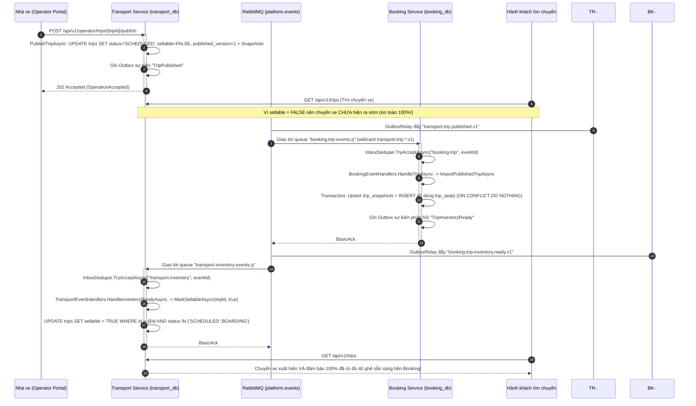
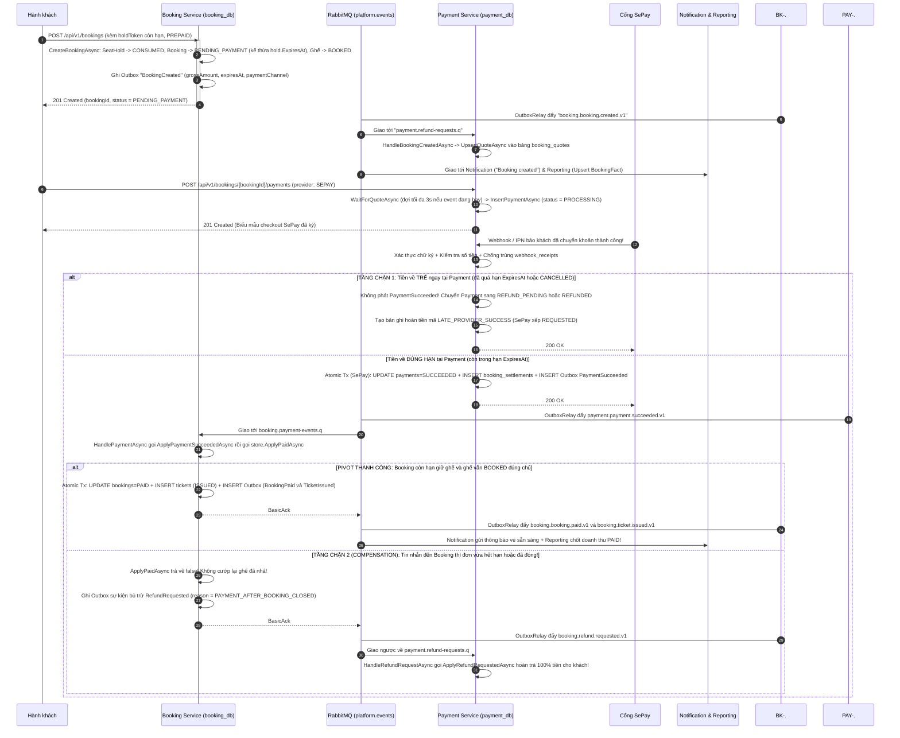
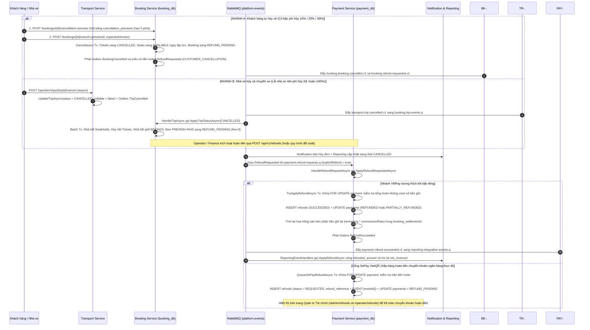

# Chương 06 — Bài 03: Giải Phẫu 3 Luồng Saga Choreography Cốt Lõi & Cơ Chế Giao Dịch Bù Trừ (Compensation)

> **Mục tiêu bài học**: Nắm vững từ nền tảng lý thuyết **Saga Pattern** (Hector Garcia-Molina, 1987) vì sao các hệ thống Microservices hiện đại từ bỏ giao dịch hai pha **2PC / XA** để chuyển sang mô hình **Saga Choreography (ADR-007)**; phân biệt rạch ròi giữa **Compensatable**, **Pivot** và **Retriable Transactions**; đi sâu vào từng dòng code C# và câu lệnh SQL của **3 Luồng Saga Cốt Lõi** trong **BLUE Bus Ticket Platform**: (1) Saga Mở Bán Chuyến Xe 2 Pha (`Transport <-> Booking`), (2) Saga Đặt Vé, Thanh Toán & Hai Tầng Bù Trừ Tiền Về Trễ (`LATE_PROVIDER_SUCCESS` & `PAYMENT_AFTER_BOOKING_CLOSED`), và (3) Saga Hủy Vé / Hủy Chuyến & Xử lý hoàn tiền SePay.

---

## 1. Lý Thuyết Nền Tảng: Từ Nỗi Đau Giao Dịch Phân Tán (2PC) Đến Saga Pattern (ADR-007)

### 1.1. Khi `BEGIN ... COMMIT` không còn cứu được bạn nữa

Ở hệ thống Monolith dùng chung một cơ sở dữ liệu duy nhất, mọi quy trình phức tạp — chẳng hạn *"Ghi nhận thanh toán 500.000đ + Đổi trạng thái đơn sang PAID + Tạo 2 vé QR + Cộng doanh thu báo cáo"* — đều có thể nhét chung vào một khối giao dịch cục bộ:

```sql
BEGIN;
  UPDATE payments SET status = 'SUCCEEDED' WHERE id = ...;
  UPDATE bookings SET status = 'PAID' WHERE id = ...;
  INSERT INTO tickets ...;
  UPDATE revenue_summary ...;
COMMIT; -- Hoặc thành công tất cả, hoặc ROLLBACK tất cả!
```

Nhưng ngay khi chúng ta tách hệ thống thành **6 Microservices với 6 cơ sở dữ liệu độc lập (Database-per-Service — ADR-005)**:
- Bảng `trips` nằm ở `transport_db`.
- Bảng `bookings`, `trip_seats`, `tickets` nằm ở `booking_db`.
- Bảng `payments`, `refunds`, `booking_settlements` nằm ở `payment_db`.
- Bảng `notifications` nằm ở `notification_db`.
- Bảng `revenue_projections` nằm ở `reporting_db`.

Không một câu lệnh `BEGIN ... COMMIT` đơn lẻ nào của PostgreSQL có thể vươn tay khóa cùng lúc 5 database này! Vậy giới khoa học máy tính từng giải quyết bài toán này như thế nào, và tại sao giải pháp cổ điển lại thất bại trong kiến trúc Microservices hiện đại?

---

### 1.2. Tại sao KHÔNG dùng Giao dịch 2 Pha (Two-Phase Commit — 2PC / XA)?

Trong thập niên 1990–2000, chuẩn **XA / Two-Phase Commit (2PC)** đặt ra một **Bộ điều phối trung tâm (Transaction Coordinator)** bắt tất cả các Database tham gia trải qua 2 pha đồng bộ:
- **Pha 1 (Prepare / Voting Phase)**: Coordinator hỏi từng DB: *"Các anh đã khóa chặt các dòng dữ liệu liên quan và sẵn sàng Commit chưa?"*. Cả `payment_db` và `booking_db` phải **ngậm chặt khóa dòng (Exclusive Row Lock)** trên đĩa và trả lời `YES`.
- **Pha 2 (Commit / Abort Phase)**: Chỉ khi 100% các bên đều hô `YES`, Coordinator mới phát lệnh `COMMIT` cho tất cả. Nếu chỉ 1 bên hô `NO` hoặc hết giờ chờ (Timeout), Coordinator phát lệnh `ROLLBACK` toàn cục.

Trên lý thuyết nghe rất đẹp, nhưng trong thực tế hệ thống đặt vé trực tuyến lưu lượng cao, [ADR-007](file:///C:/Users/minht/.gemini/antigravity/worktrees/PBL6/c_to_n_b/docs/system-design/02-01-system-architecture/02-01-12-architecture-decisions.md#L60-L67) loại bỏ thẳng thừng 2PC vì **4 tử huyệt không thể khắc phục**:

1. **Khóa tài nguyên liên mạng gây tê liệt hiệu năng (Cross-Network Lock Contention)**:
   Trong suốt thời gian gói tin mạng bay qua lại ở Pha 1 và Pha 2, dòng ghế trên bảng `trip_seats` và dòng đơn hàng trên bảng `bookings` bị khóa cứng không ai đọc/ghi được. Độ trễ mạng tăng từ `0.2ms` lên `50ms` sẽ làm thông lượng (Throughput) của Database sụt giảm hàng chục lần!
2. **Giao thức chặn (Blocking Protocol) & Điểm chết đơn lẻ (Single Point of Failure)**:
   Nếu Coordinator bị mất điện đúng vào tích tắc sau khi các DB đã trả lời `YES` ở Pha 1 nhưng chưa nhận được phán quyết Pha 2, các dòng dữ liệu đó rơi vào trạng thái **"Trêo lơ lửng (In-doubt Transaction)"** — không tự nhả khóa được cho đến khi Coordinator hồi phục!
3. **Bất khả thi tuyệt đối với Cổng Thanh Toán Bên Ngoài (SePay và ngân hàng)**:
   Đây là lý do thực tế đanh thép nhất! Khi khách hàng quét mã QR chuyển tiền thật từ App Vietcombank qua NAPAS/SePay vào tài khoản nhà xe, **ngân hàng bên ngoài đời nào hỗ trợ giao thức 2PC/XA cho hệ thống của bạn khóa sổ cái của họ!** Tiền đã chảy vào tài khoản là bất biến; nếu sau đó không cấp được vé, cách duy nhất trên đời là thực hiện một **Giao dịch Hoàn tiền (Refund)**!
4. **Phá vỡ triết lý cô lập Microservices**:
   Nếu để `Notification DB` hay `Reporting DB` tham gia vào 2PC, chỉ cần DB báo cáo bảo trì là khách hàng không thể thanh toán vé xe.

---

### 1.3. Bản chất của Saga Pattern & Phân loại 3 Nhóm Bước Giao Dịch

Năm 1987, hai nhà khoa học **Hector Garcia-Molina** và **Kenneth Salem** tại Đại học Princeton công bố bài báo kinh điển về **Saga**:
> Thay vì gộp mọi thứ vào một giao dịch khổng lồ khóa chặt toàn hệ thống, hãy bẻ nhỏ quy trình thành một chuỗi các **Giao dịch cục bộ độc lập** $T_1, T_2, \dots, T_n$. Mỗi giao dịch cục bộ $T_i$ tự `COMMIT` ngay lập tức trên Database riêng của nó và nhả khóa ngay! Nếu bước $T_k$ ở giữa chuỗi bị thất bại nghiệp vụ, hệ thống sẽ chạy ngược các **Giao dịch Bù trừ (Compensating Transactions)** $C_{k-1}, \dots, C_1$ để hoàn tác về mặt ngữ nghĩa kinh doanh!

> [!IMPORTANT]
> **Hiểu đúng bản chất "Giao dịch Bù trừ (Compensation)" vs "Database Rollback"**:
> - `ROLLBACK` trong SQL là "xóa sạch dấu vết như chưa từng có chuyện gì xảy ra".
> - `Compensation` trong Saga **KHÔNG BAO GIỜ xóa (`DELETE`) dữ liệu lịch sử**! Ví dụ: Khách đã trả 500.000đ (`Payment SUCCEEDED`), nhưng đơn vé đã hết hạn không cấp được ghế. Hệ thống tuyệt đối không xóa dòng `Payment` đó đi, mà giữ nguyên dấu vết đã thu 500.000đ rồi **tạo thêm một dòng đối ứng mới trong bảng `refunds` trị giá 500.000đ** kèm mã lý do `PAYMENT_AFTER_BOOKING_CLOSED`! Nhờ vậy sổ cái kế toán khớp 100% từng đồng ra vào với sao kê ngân hàng!

Trong một luồng Saga chuẩn, các bước luôn được chia làm **3 loại** xoay quanh điểm bản lề:
1. **Compensatable Transactions (Các bước có thể bù trừ)**: Nằm trước hoặc tại thời điểm thu tiền — nếu bước sau thất bại, ta có kịch bản bù trừ rõ ràng (ví dụ: đã thu tiền ở `Payment` nhưng không chốt được ghế ở `Booking` -> Bù trừ bằng `RefundRequested`).
2. **Pivot Transaction (Bước Bản lề — Điểm không quay đầu)**: Bước quyết định Saga thành công hay chuyển sang nhánh bù trừ! Trong luồng mua vé trả trước, **`BookingRepository.ApplyPaidAsync`** (kiểm tra ghế + đổi đơn sang `PAID` + xuất vé QR) chính là **Pivot Transaction**:
   - Nếu bước này trả về `false` -> Chuyển sang nhánh bù trừ hoàn tiền!
   - Một khi bước này đã `COMMIT` thành công -> Khách đã chính thức sở hữu vé hợp lệ!
3. **Retriable Transactions (Các bước chỉ tiến về phía trước sau Bản lề)**: Các bước diễn ra *sau* Pivot như `Notification` gửi thông báo vé hoặc `Reporting` cộng doanh thu. Nếu `Notification` lỗi tạm thời, hệ thống **TUYỆT ĐỐI KHÔNG hủy vé hay hoàn tiền của khách**, mà chỉ thử lại/xử lý lại tin nhắn thông báo cho tới khi thành công ([04-saga-compensation.md](file:///C:/Users/minht/.gemini/antigravity/worktrees/PBL6/c_to_n_b/docs/detailed-design/03-05-error-concurrency-recovery/04-saga-compensation.md#L11-L12))!

---

### 1.4. Saga Choreography (Vũ đạo phân tán) vs Saga Orchestration (Nhạc trưởng trung tâm)

Có hai cách tổ chức một Saga trong Microservices:

| Tiêu chí so sánh | Saga Orchestration (Nhạc trưởng trung tâm) | Saga Choreography (Vũ đạo phân tán — Chọn theo ADR-007) |
|---|---|---|
| **Cơ chế điều phối** | Có một dịch vụ "Nhạc trưởng" đứng giữa (ví dụ `CheckoutSagaOrchestrator`) ra lệnh tuần tự: *"Payment thu tiền đi!"* -> nhận kết quả -> *"Booking xuất vé đi!"* -> nhận kết quả -> *"Notification gửi mail đi!"*. | Không có nhạc trưởng trung tâm! Mỗi dịch vụ tự hoàn thành phần việc của mình, phát **Integration Event** lên `platform.events`, và các dịch vụ liên quan tự lắng nghe để múa bước tiếp theo (hoặc phát sự kiện bù trừ). |
| **Độ phụ thuộc (Coupling)** | Nhạc trưởng phải biết tất cả các dịch vụ con; dễ phình to thành "God Service" chứa lẫn lộn logic của nhiều miền. | **Phân tách cực tốt (Loose Coupling)**: `Payment` không cần gọi trực tiếp `Booking`; `Booking` không hề biết sự tồn tại của `Reporting` hay `Notification`. |
| **Điểm nghẽn & Sẵn sàng** | Nếu dịch vụ Orchestrator gặp sự cố, toàn bộ quy trình đứng hình. | Không có điểm chết điều phối trung tâm; mỗi dịch vụ tiến triển độc lập qua Outbox + Durable Queue. |
| **Độ phức tạp theo quy mô bước** | Mạnh khi quy trình cực dài (10–15 bước rẽ nhánh chằng chịt như chuỗi cung ứng logistics quốc tế). | **Tối ưu tuyệt đối cho các quy trình 2–4 bước rõ ràng** như Mở bán chuyến xe, Thanh toán đặt vé và Hủy hoàn tiền! |
| **Cách khắc phục nhược điểm khó theo dõi của Choreography** | Trạng thái tập trung sẵn ở bảng của Orchestrator. | Dự án khắc phục bằng: (1) gắn xuyên suốt **`CorrelationId`** vào mọi `EventMessage` và `outbox_messages`, (2) lưu trạng thái trung gian rõ ràng trên chính thực thể miền (`sellable = false`, `PENDING_PAYMENT`, `REFUND_PENDING`), và (3) mở bảng `reconciliation_cases` cho trường hợp bất thường! |

---

## 2. SAGA SỐ 1: Mở Bán Chuyến Xe 2 Pha (`Transport Service` <-> `Booking Service`)

### 2.1. Câu hỏi cốt tử: Tại sao không bật `sellable = true` ngay khi Nhà xe bấm "Publish Trip"?

Hãy xét tình huống thực tế sau: Quản trị viên nhà xe Phương Trang tạo xong bản nháp chuyến xe Đà Nẵng -> Huế (40 ghế giường nằm) bên **Transport Service** và bấm nút **"Xuất bản mở bán (Publish Trip)"**.
- Dữ liệu gốc của chuyến xe (`trips`) nằm ở `transport_db` (phục vụ khách hàng tìm kiếm chuyến xe tại `GET /api/v1/trips`).
- Nhưng danh sách 40 ô ghế vật lý để khách bấm giữ chỗ (`trip_seats` + `trip_snapshots`) lại phải nằm ở `booking_db` của **Booking Service** (để khóa dòng chống đặt trùng ghế theo **ADR-008**)!

**Điều gì xảy ra nếu `Transport Service` ngây thơ cập nhật luôn `status = 'SCHEDULED', sellable = true` ngay trong hàm `PublishTripAsync`?**
1. Giây thứ `00.010`: Chuyến xe lập tức xuất hiện trên trang chủ tìm kiếm của khách hàng vì `sellable = true`.
2. Giây thứ `00.200`: Một hành khách nhanh tay bấm vào chuyến xe đó để xem sơ đồ ghế (`GET /api/v1/trips/{tripId}/seats` gọi sang `Booking Service`).
3. Nhưng `OutboxDispatchHostedService` của `Transport` quét định kỳ mỗi **2 giây**, nên lúc `00.200` sự kiện `TripPublished` vẫn còn đang nằm trong `transport_db.outbox_messages`, chưa sang tới `Booking Service`!
4. **Kết quả**: `Booking Service` trả về **`404 Not Found`** ngay trước mặt khách hàng cho một chuyến xe vừa hiện rành rành trên màn hình tìm kiếm!

Để triệt tiêu hoàn toàn khoảng trống bất nhất này (Race Window), hệ thống thiết kế **Saga Bắt Tay Khứ Hồi 2 Pha (Two-Step Handshake Saga)**:



### 2.2. Giải phẫu Code C# Thực Thi Từng Mắt Xích Của Saga Mở Bán Chuyến

1. **Bước 1 — Chốt Snapshot bất biến & Giữ `sellable = false` tại `TransportService.PublishTripAsync`** ([TransportService.cs](file:///C:/Users/minht/.gemini/antigravity/worktrees/PBL6/c_to_n_b/workspace/src/services/transport/BusTicketPlatform.Transport.Application/TransportService.cs#L748-L799)):
   - Khi chuyến xe đang ở `DRAFT` (`Sellable = false`), hàm `PublishTripAsync` chụp ảnh tĩnh toàn bộ lộ trình (`RouteSnapshot`), sơ đồ ghế xe tại thời điểm xuất bản (`BusSnapshot`), giá vé cơ sở và chính sách `allowPayLater` của nhà xe (`FareSnapshot`), đổi `Status = TripStatuses.Scheduled` nhưng **giữ nguyên `Sellable = false`**, kích hoạt phân công tài xế (`active = true` kèm kiểm tra chống trùng lịch xe/tài xế bằng PostgreSQL Exclusion Constraint `23P01`), rồi gọi `events.TripPublishedAsync(published, correlationId, cancellationToken)`.

2. **Bước 2 — Dựng kho ghế lũy đẳng tại `BookingEventHandlers` -> `BookingService` -> `BookingRepository.ImportTripAsync`**:
   - [BookingEventHandlers.cs](file:///C:/Users/minht/.gemini/antigravity/worktrees/PBL6/c_to_n_b/workspace/src/services/booking/BusTicketPlatform.Booking.Infrastructure/BookingEventHandlers.cs#L9-L21) hứng tin nhắn từ `booking.trip-events.q` và gọi `ImportPublishedTripAsync`.
   - `BookingService.ParseSeats` bóc tách mảng `seats` từ `BusSnapshot` JSON và áp giá `baseFare` từ `FarePolicySnapshot`, chuyển cờ `active ? "AVAILABLE" : "DISABLED"` cho từng ghế.
   - [BookingRepository.cs](file:///C:/Users/minht/.gemini/antigravity/worktrees/PBL6/c_to_n_b/workspace/src/services/booking/BusTicketPlatform.Booking.Infrastructure/Persistence/BookingRepository.cs#L10-L73) mở `NpgsqlTransaction`:
     - Upsert `trip_snapshots` với khóa chống sự kiện đến trễ: `source_trip_version = GREATEST(trip_snapshots.source_trip_version, EXCLUDED.source_trip_version)`.
     - Chèn từng ghế với khóa chống nhân đôi ghế khi retry: `INSERT INTO trip_seats ... ON CONFLICT (trip_id, source_seat_id_external) DO NOTHING;`.
   - Ngay sau khi `Commit`, dòng 61 của `BookingService.cs` phát sự kiện hồi báo:
     ```csharp
     await events.InventoryReadyAsync(message.TripId, correlationId, cancellationToken);
     ```

3. **Bước 3 — Mở khóa bán công khai tại `TransportEventHandlers.HandleInventoryReadyAsync`**:
   - Tin nhắn `TripInventoryReady` đi theo routing key `booking.trip-inventory.ready.v1` vào hàng đợi `transport.inventory-events.q`.
   - [TransportEventHandlers.cs](file:///C:/Users/minht/.gemini/antigravity/worktrees/PBL6/c_to_n_b/workspace/src/services/transport/BusTicketPlatform.Transport.Infrastructure/TransportEventHandlers.cs#L9-L22) gọi `MarkInventoryReadyAsync(tripId)`, thực thi câu lệnh SQL có điều kiện bảo vệ trạng thái tại [TransportRepository.cs](file:///C:/Users/minht/.gemini/antigravity/worktrees/PBL6/c_to_n_b/workspace/src/services/transport/BusTicketPlatform.Transport.Infrastructure/Persistence/TransportRepository.cs#L783-L793):
     ```sql
     UPDATE trips SET sellable = @sellable, updated_at = NOW()
     WHERE id = @id AND status IN ('SCHEDULED','BOARDING');
     ```
   - *Chú ý tinh tế*: Tại sao phải có `AND status IN ('SCHEDULED', 'BOARDING')`? Phòng trường hợp nhà xe vừa bấm Publish xong lại lập tức bấm **Hủy chuyến (`CANCELLED`)** ngay trong 1 giây đó! Nếu `TripInventoryReady` bay về muộn sau khi chuyến đã `CANCELLED`, câu điều kiện `WHERE` này ngăn chặn tuyệt đối việc vô tình mở bán lại một chuyến xe đã hủy!

---

## 3. SAGA SỐ 2: Đặt Vé, Thanh Toán & Cơ Chế Bù Trừ 2 Tầng Khi Tiền Về Trễ (`Booking` <-> `Payment` -> `Notification` & `Reporting`)

Đây là luồng Saga quan trọng nhất, nơi tiền thật của khách hàng giao thoa với tài nguyên hữu hạn (ghế xe khách) dưới áp lực đếm ngược 10 phút giữ chỗ (`SeatHold`).

> [!NOTE]
> **Nhánh đi tắt dành cho `PAY_LATER` (Thanh toán sau khi lên xe)**:
> Trong [BookingService.CreateBookingAsync](file:///C:/Users/minht/.gemini/antigravity/worktrees/PBL6/c_to_n_b/workspace/src/services/booking/BusTicketPlatform.Booking.Application/BookingService.cs#L291-L335), nếu nhà xe cho phép trả sau (`trip.AllowPayLater == true`) và khách chọn `paymentChannel == "PAY_LATER"`, đơn đặt chỗ được tạo ngay ở trạng thái **`CONFIRMED`**, phát sự kiện `BookingCreated`, và gọi thẳng `await store.ApplyPaidAsync(created.Id, [], cancellationToken, correlationId)` ngay tại dòng 332 để **phát hành luôn vé điện tử QR (`TicketIssued`) tại chỗ** mà không cần đi vòng qua `Payment Service` (sàn cũng không thu hoa hồng trên đơn nhà xe tự thu tiền mặt!).
> Toàn bộ luồng Saga đa bước dưới đây áp dụng cho kênh chủ lực **`PREPAID` (Thanh toán trực tuyến trả trước qua SePay VietQR)**.

### 3.1. Sơ Đồ Trình Tự Toàn Cảnh Saga Đặt Vé — Thanh Toán — Bù Trừ



---

### 3.2. Giải Phẫu Kỹ Thuật Đường Hạnh Phúc (Happy Path)

#### Mắt xích 1: Đồng bộ Báo giá (`BookingQuote`) & Kỹ thuật `WaitForQuoteAsync` chống độ trễ bất đồng bộ
Vì `Payment Service` không được phép đọc chéo sang `booking_db` (**ADR-005**), làm sao khi khách gọi `POST /api/v1/bookings/{bookingId}/payments`, `Payment Service` biết đơn hàng đó thuộc về ai, tổng tiền bao nhiêu, có phải `PREPAID` không và hết hạn lúc mấy giờ?
- Nhờ sự kiện `BookingCreated` (`booking.booking.created.v1`) được bind thẳng vào `payment.refund-requests.q`! `PaymentEventHandlers.HandleBookingCreatedAsync` gọi `IngestBookingCreatedAsync` lưu bản tóm tắt vào bảng cục bộ `booking_quotes` của `payment_db`.
- **Nhưng nhỡ khách hàng thao tác cực nhanh trên giao diện (Frontend vừa nhận `201 Created` từ `Booking` liền gọi ngay `POST .../payments` sau 50ms, trong khi `OutboxRelay` của `Booking` mất tới 2 giây mới đẩy `BookingCreated` sang `Payment`) thì sao?**
  Nếu `Payment Service` kiểm tra `GetQuoteAsync` thấy `null` mà trả ngay lỗi `404 Not Found`, khách hàng sẽ bị văng lỗi vô lý! Hãy xem giải pháp cực kỳ tinh tế tại [PaymentService.cs](file:///C:/Users/minht/.gemini/antigravity/worktrees/PBL6/c_to_n_b/workspace/src/services/payment/BusTicketPlatform.Payment.Application/PaymentService.cs#L465-L479):

```csharp
private async Task<BookingQuote?> WaitForQuoteAsync(Guid bookingId, CancellationToken cancellationToken)
{
    for (var attempt = 0; attempt < 15; attempt++)
    {
        var quote = await store.GetQuoteAsync(bookingId, cancellationToken);
        if (quote is not null)
        {
            return quote;
        }

        await Task.Delay(TimeSpan.FromMilliseconds(200), cancellationToken);
    }

    return await store.GetQuoteAsync(bookingId, cancellationToken);
}
```

Hàm `WaitForQuoteAsync` kiên nhẫn chờ tối đa `15 lần x 200ms = 3 giây` (lớn hơn chu kỳ 2 giây của `OutboxDispatchHostedService`). Ngay khoảnh khắc tin nhắn `BookingCreated` vừa cập bến `payment_db`, vòng lặp thoát ra ngay lập tức và tạo phiên thanh toán mượt mà cho người dùng!

#### Mắt xích 2: Chốt Thanh toán, Chia Hoa Hồng Sàn & Khóa Chống Đua Nhau tại `SePayPaymentStore`
Khi SePay bắn IPN `ORDER_PAID` tới `/integrations/payments/sepay/ipn`, hàm `ApplySePayAsync` ([SePayPaymentStore.cs](file:///C:/Users/minht/.gemini/antigravity/worktrees/PBL6/c_to_n_b/workspace/src/services/payment/BusTicketPlatform.Payment.Infrastructure/Persistence/SePayPaymentStore.cs#L12-L99)) thực hiện chuỗi bảo vệ cấp độ ngân hàng:
1. Khóa tư vấn cấp giao dịch `SELECT pg_advisory_xact_lock(hashtext(@txn))` và `pg_advisory_xact_lock(hashtext(@booking))` để tuần tự hóa tuyệt đối nếu SePay bắn 2 request IPN song song cách nhau 1ms.
2. Kiểm tra một mã giao dịch ngân hàng `TransactionId` không bao giờ được dùng để gạch nợ cho hai hóa đơn khác nhau (dòng 38–43).
3. Chèn biên lai `webhook_receipts ... ON CONFLICT (provider, external_event_id) DO NOTHING`: nếu bằng `0` (IPN trùng lặp) thì trả `200 OK` thoát ngay.
4. Cập nhật `payments.status = 'SUCCEEDED'` đồng thời tính ngay quyết toán vào bảng `booking_settlements`:
   - `gross_amount = p.amount` (tổng thu khách).
   - `commission_amount = ROUND(p.amount * q.commission_rate)` (hoa hồng nền tảng, mặc định `10%`).
   - `operator_net = p.amount - ROUND(p.amount * q.commission_rate)` (số tiền thực nhận của nhà xe `90%`).
5. Ghi nguyên tử sự kiện `PaymentSucceeded` vào `outbox_messages` trong cùng `tx`.

#### Mắt xích 3: Bước Bản Lề (Pivot Transaction) với 4 Chốt Canh Gác SQL trong `BookingRepository.ApplyPaidAsync`
Khi `BookingEventHandlers.HandlePaymentAsync` nhận được `PaymentSucceeded`, trước tiên `BookingService.ApplyPaymentSucceededAsync` kiểm tra khớp tuyệt đối số tiền và loại tiền tệ (`message.Amount != booking.Total || message.Currency != booking.Currency`). Sau đó, câu lệnh SQL trái tim tại [BookingRepository.cs](file:///C:/Users/minht/.gemini/antigravity/worktrees/PBL6/c_to_n_b/workspace/src/services/booking/BusTicketPlatform.Booking.Infrastructure/Persistence/BookingRepository.cs#L564-L579) thực thi:

```sql
UPDATE bookings
SET status = CASE WHEN payment_channel = 'PREPAID' THEN 'PAID' ELSE status END,
    paid_at = CASE WHEN payment_channel = 'PREPAID' THEN NOW() ELSE paid_at END,
    updated_at = NOW(), row_version = row_version + 1
WHERE id = @id AND (
  (payment_channel = 'PREPAID' AND status = 'PENDING_PAYMENT' AND expires_at > NOW())
  OR (payment_channel = 'PAY_LATER' AND status = 'CONFIRMED'
    AND NOT EXISTS (SELECT 1 FROM tickets WHERE booking_id = @id)))
  AND NOT EXISTS (SELECT 1 FROM booking_items i JOIN trip_seats s ON s.id = i.trip_seat_id
    WHERE i.booking_id = @id AND (s.status <> 'BOOKED' OR s.active_booking_item_id IS DISTINCT FROM i.id));
```

Hãy đọc kỹ **4 chốt canh gác bất biến** trong mệnh đề `WHERE` cho đơn `PREPAID`:
1. `status = 'PENDING_PAYMENT'`: Đơn chưa bị hủy hoặc hết hạn.
2. `expires_at > NOW()`: Thời điểm chốt vé tại Database phải còn nằm trong thời hạn 10 phút giữ ghế.
3. `s.status = 'BOOKED'`: Mọi ghế thuộc đơn hàng vẫn phải đang ở trạng thái khóa `BOOKED`.
4. `s.active_booking_item_id IS NOT DISTINCT FROM i.id`: Quyền sở hữu từng chiếc ghế đó vẫn thuộc về chính xác dòng `booking_items` của đơn hàng này (chưa bao giờ bị nhả ra bán cho khách hàng khác!).

Chỉ khi thỏa mãn đồng thời cả 4 điều kiện, `ExecuteNonQueryAsync` mới trả về `1`, tiến hành sinh các dòng vé `tickets` kèm mã `TK...` và ghi nguyên tử 2 sự kiện `BookingPaid` + `TicketIssued` vào `outbox_messages`!

---

### 3.3. Giải Phẫu Chuyên Sâu: Kịch Bản Bù Trừ 2 Tầng Khi Tiền Về Trễ (Late Payment Compensation)

Trong đời thực tại Việt Nam, tình huống đau đầu nhất của mọi sàn bán vé là:
> Khách hàng giữ ghế lúc `10:00:00` (`expires_at = 10:10:00`). Đến `10:09:40`, khách mới mở App Ngân hàng quét mã VietQR chuyển khoản 500.000đ. Do nghẽn mạng chuyển mạch liên ngân hàng cuối tuần, đến tận **`10:11:15`** tiền mới báo có vào tài khoản và SePay bắn IPN về hệ thống. Lúc này đã quá hạn 1 phút 15 giây — ghế số `1A` của khách rất có thể đã được hệ thống nhả ra lúc `10:10:00` và đã bị hành khách khác mua mất lúc `10:10:30`!

**Tuyệt đối không được cấp trùng ghế (Double-Booking), cũng tuyệt đối không được "ỉm" mất 500.000đ của khách!** Hệ thống giải quyết bài toán này bằng **Phòng tuyến Bù trừ Kép 2 Tầng**:

#### Tầng Chặn Bù Trừ Số 1: Chặn ngay tại cửa ngõ `Payment Service` (`LATE_PROVIDER_SUCCESS`)
- **Trường hợp SePay** ([SePayPaymentStore.cs](file:///C:/Users/minht/.gemini/antigravity/worktrees/PBL6/c_to_n_b/workspace/src/services/payment/BusTicketPlatform.Payment.Infrastructure/Persistence/SePayPaymentStore.cs#L62-L85)):
  Ngay khi nhận IPN `ORDER_PAID`, hệ thống tính biến kiểm tra:
  ```csharp
  var late = alreadyCaptured || payment.ExpiresAt <= DateTimeOffset.UtcNow || payment.Status is "CANCELLED" or "FAILED";
  ```
  Nếu `late == true` (giao dịch đã quá hạn `ExpiresAt`, đã bị khách bấm hủy trước đó, hoặc đã có một giao dịch khác thanh toán thành công cho cùng Booking này rồi):
  - `Payment Service` vẫn ghi nhận sự thật là tiền đã vào cổng (`provider_order_reference = @txn, succeeded_at = NOW()`), nhưng đặt ngay trạng thái `payments.status = 'REFUND_PENDING'` thay vì `'SUCCEEDED'`.
  - **Không phát sự kiện `PaymentSucceeded` sang Booking!**
  - Gọi ngay trong cùng Transaction hàm `QueueRefund(connection, tx, payment, "LATE-" + payment.Id.ToString("N"), payment.Amount, "LATE_PROVIDER_SUCCESS", Guid.Empty, cancellationToken)` để tự động mở yêu cầu hoàn trả 100% số tiền với mã lý do `LATE_PROVIDER_SUCCESS`!
  - *(Đặc biệt hơn nữa ở dòng 106–119)*: Nếu có hiện tượng cực hiếm là ngân hàng báo `TRANSACTION_VOID` *sau* khi vé đã phát hành, hoặc khách chuyển khoản đúp 2 lần trên cùng một payment (`ADDITIONAL_CAPTURE`), code tự động mở một hồ sơ đối soát khẩn cấp vào bảng `reconciliation_cases` với mức cảnh báo `severity = 'HIGH'` để kế toán xử lý, tuyệt đối không âm thầm hủy vé của khách đang ngồi trên xe!

- **Nhánh VNPay tương thích, tắt mặc định** ([PaymentService.cs](file:///C:/Users/minht/.gemini/antigravity/worktrees/PBL6/c_to_n_b/workspace/src/services/payment/BusTicketPlatform.Payment.Application/PaymentService.cs#L279-L287)):
  Nếu `DateTimeOffset.UtcNow >= payment.ExpiresAt || payment.Status is "CANCELLED" or "FAILED"`, hệ thống lập tức khởi tạo `RefundRecord` với mã lý do `"LATE_PROVIDER_SUCCESS"`, thực thi `TryApplyRefundAsync` chuyển thẳng trạng thái sang `REFUNDED`, đảo ngược hoa hồng sàn trong `booking_settlements` về `0` và phát sự kiện `RefundSucceeded`!

#### Tầng Chặn Bù Trừ Số 2: Chặn tại `Booking Service` khi tin nhắn bay qua mạng đúng ranh giới hết hạn (`PAYMENT_AFTER_BOOKING_CLOSED`)
Giả sử một trường hợp biên tinh vi hơn (Boundary Race Condition):
- Webhook tới `Payment Service` lúc `10:09:59.500` -> Lúc này `now < 10:10:00.000` (vẫn còn hạn `0.5 giây`!), nên Tầng Chặn 1 cho qua hợp lệ và phát sự kiện `PaymentSucceeded` vào Outbox!
- Mất `1.8 giây` để `OutboxRelay` quét và đẩy qua RabbitMQ. Khi `BookingEventHandlers.HandlePaymentAsync` nhận được tin nhắn thì đồng hồ đã điểm **`10:10:01.300`** (quá hạn `1.3 giây`!).

Hãy xem đoạn code bù trừ kinh điển tại [BookingService.cs](file:///C:/Users/minht/.gemini/antigravity/worktrees/PBL6/c_to_n_b/workspace/src/services/booking/BusTicketPlatform.Booking.Application/BookingService.cs#L481-L504):

```csharp
public async Task<Result> ApplyPaymentSucceededAsync(PaymentSucceededMessage message, Guid correlationId, CancellationToken cancellationToken)
{
    var booking = await store.GetBookingAsync(message.BookingId, cancellationToken);
    if (booking is null)
    {
        return Result.Failure(PlatformErrors.NotFound());
    }

    if (booking.Status == "PAID")
    {
        return Result.Success();
    }

    if (booking.PaymentChannel != "PREPAID" || message.Amount != booking.Total || message.Currency != booking.Currency)
        return Result.Failure(PlatformErrors.PaymentNotAllowed());

    if (!await store.ApplyPaidAsync(booking.Id, [], cancellationToken, correlationId))
    {
        var current = await store.GetBookingAsync(booking.Id, cancellationToken);
        if (current?.Status != "PAID")
            await events.RefundRequestedAsync(booking.Id, message.PaymentId, message.Amount, message.Currency,
                "PAYMENT_AFTER_BOOKING_CLOSED", correlationId, cancellationToken);
    }
    return Result.Success();
}
```

**Phân tích vẻ đẹp của đoạn code 6 dòng cuối**:
1. Vì lúc `10:10:01.300` điều kiện `expires_at > NOW()` trong `ApplyPaidAsync` không còn thỏa mãn (hoặc một luồng `ExpireHoldsAsync` / `CancelTripAsync` vừa đóng đơn trước đó), `store.ApplyPaidAsync(...)` trả về **`false`** mà không đụng chạm gì tới ghế xe!
2. Để loại trừ khả năng `ApplyPaidAsync` trả về `false` chỉ vì một luồng đồng thời khác vừa mới chuyển đơn sang `PAID` trước đó 1ms, hàm đọc kiểm tra lại `current?.Status != "PAID"`.
3. Xác nhận chắc chắn đơn không thể cấp vé nữa, `Booking Service` phát ngược sự kiện bù trừ **`RefundRequested`** (`booking.refund.requested.v1`) mang đầy đủ `bookingId`, `paymentId`, toàn bộ `message.Amount` và mã lý do **`"PAYMENT_AFTER_BOOKING_CLOSED"`**!
4. Sự kiện này đi qua `platform.events` -> lọt vào `payment.refund-requests.q` -> `PaymentEventHandlers.HandleRefundRequestAsync` bắt lấy -> kích hoạt `PaymentService.ApplyRefundRequestedAsync` hoàn trả đủ 100% số tiền cho hành khách! Vòng lặp Saga khép lại an toàn tuyệt đối mà không cần bất kỳ giao dịch 2PC nào!

---

## 4. Saga hủy vé, hủy chuyến và hoàn tiền

### 4.1. Sơ Đồ Trình Tự Toàn Cảnh Hai Luồng Hủy & Hai Cơ Chế Hoàn Tiền



---

### 4.2. Nguyên Tắc Thiết Kế Bất Biến Khi Hủy Vé: "Thu Hồi Vé & Nhả Ghế Trước — Hoàn Tiền Sau"

Hãy nhìn vào [BookingRepository.CancelAsync](file:///C:/Users/minht/.gemini/antigravity/worktrees/PBL6/c_to_n_b/workspace/src/services/booking/BusTicketPlatform.Booking.Infrastructure/Persistence/BookingRepository.cs#L697-L745) và tài liệu đặc tả [04-saga-compensation.md](file:///C:/Users/minht/.gemini/antigravity/worktrees/PBL6/c_to_n_b/docs/detailed-design/03-05-error-concurrency-recovery/04-saga-compensation.md#L16-L22):
- Ngay khi khách bấm xác nhận hủy hợp lệ (trước giờ xe chạy tối thiểu 2 tiếng, `PreviewId` còn hạn 5 phút và khớp `RowVersion`), `BookingRepository.CancelAsync` lập tức chuyển `tickets.status = 'CANCELLED'`, trả ghế `trip_seats.status = 'AVAILABLE'` để hành khách khác mua được ngay, và đặt `bookings.status = 'REFUND_PENDING'`.
- **Nếu sau đó cổng thanh toán hoàn tiền bị chậm hoặc gặp lỗi tạm thời, hệ thống CÓ KHÔI PHỤC LẠI VÉ (`ISSUED`) CHO KHÁCH KHÔNG? TUYỆT ĐỐI KHÔNG!**
  Tại sao? Vì chiếc ghế `1A` vừa nhả ra đã có thể được bán ngay cho hành khách mới sau đó 3 giây rồi! Nếu thấy hoàn tiền lỗi mà tự ý bật lại vé cũ của khách trước, trên chuyến xe sẽ có 2 người cầm 2 vé hợp lệ ngồi chung 1 ghế! Thay vào đó, vé đã hủy giữ nguyên trạng thái `CANCELLED`, còn nghĩa vụ tài chính nằm ở trạng thái `REFUND_PENDING` để hệ thống/kế toán xử lý hoàn tiền đến cùng cho khách!

### 4.3. So Sánh Hủy Đơn Cá Nhân vs Nhà Xe Hủy Chuyến Hàng Loạt (`TripCancelled`)

Khi nhà xe gặp sự cố bất khả kháng (xe hỏng, bão lũ tắc đường) và gọi `TransportService.CancelTripAsync`, sự kiện `TripCancelled` (`transport.trip.cancelled.v1`) bay sang `BookingEventHandlers.HandleTripAsync` và kích hoạt giao dịch lô trong [BookingRepository.ApplyTripStatusAsync](file:///C:/Users/minht/.gemini/antigravity/worktrees/PBL6/c_to_n_b/workspace/src/services/booking/BusTicketPlatform.Booking.Infrastructure/Persistence/BookingRepository.cs#L110-L156):

```sql
UPDATE bookings
SET status = CASE
      WHEN payment_channel = 'PREPAID' AND status = 'PAID' THEN 'REFUND_PENDING'
      ELSE 'CANCELLED'
    END,
    cancelled_at = NOW(),
    cancellation_fee = 0,
    refund_amount = CASE WHEN payment_channel = 'PREPAID' AND status = 'PAID' THEN total_amount ELSE 0 END,
    updated_at = NOW(),
    row_version = row_version + 1
WHERE trip_id = @trip
  AND status IN ('PENDING_PAYMENT', 'CONFIRMED', 'PAID');
```

Sự đối lập về quy tắc tài chính rất rõ ràng:
- **Khách tự hủy (`CancelAsync`)**: Áp biểu phí phạt theo sát giờ khởi hành (`CancellationPolicy`: hủy trước `>= 24h` phạt `10%`, từ `6h..24h` phạt `20%`, từ `2h..6h` phạt `30%`). Khách chỉ nhận phần chênh lệch `refund = eligible - fee`.
- **Nhà xe hủy chuyến (`ApplyTripStatusAsync`)**: Lỗi thuộc về đơn vị vận tải nên đặt cứng **`cancellation_fee = 0`** và **`refund_amount = total_amount`** (hoàn trả **100%** cho mọi đơn `PREPAID` đã `PAID`, bất kể lúc hủy chỉ còn cách giờ xe chạy 15 phút!). Sau đó, quản trị viên tài chính (`PLATFORM_FINANCE` / `OPERATOR_FINANCE`) sử dụng danh sách đơn `REFUND_PENDING` và API `POST /api/v1/refunds` (`PaymentService.CreateRefundAsync`) để phát lệnh hoàn tiền có kiểm soát.

---

### 4.4. Hoàn tiền SePay và nhánh tương thích cũ

Một chi tiết cực kỳ đắt giá trong [PaymentEventHandlers.cs](file:///C:/Users/minht/.gemini/antigravity/worktrees/PBL6/c_to_n_b/workspace/src/services/payment/BusTicketPlatform.Payment.Infrastructure/PaymentEventHandlers.cs#L86-L88) là cách Consumer phân biệt hai sự kiện cùng chảy vào `payment.refund-requests.q`:

```csharp
return services.GetRequiredService<PaymentService>()
    .ApplyRefundRequestedAsync(
        bookingId,
        paymentId,
        amount,
        currency,
        reason,
        cancellationToken,
        "EVENT-" + message.EventId.ToString("N"),
        explicitRefund: message.EventType == "RefundRequested");
```

Tại sao phải truyền cờ `explicitRefund: message.EventType == "RefundRequested"` và truyền `"EVENT-" + message.EventId.ToString("N")`? Hãy nhìn vào bên trong `PaymentService.ApplyRefundRequestedAsync` ([PaymentService.cs](file:///C:/Users/minht/.gemini/antigravity/worktrees/PBL6/c_to_n_b/workspace/src/services/payment/BusTicketPlatform.Payment.Application/PaymentService.cs#L405-L452)):

#### 1. Đối với cổng SePay VietQR (`payment.Provider == "SEPAY"`):
- Khi khách hủy vé, `BookingService.CancelAsync` phát đồng thời **cả 2 sự kiện**: `BookingCancelled` (với `amount` không nằm ở root mà là `refundedAmount = 0` trong `BookingFactPayload`) VÀ `RefundRequested` (mang chính xác số tiền cần hoàn `amount = preview.Refund`).
- Nhờ dòng kiểm tra `if (!explicitRefund) return;` (dòng 425), `SePay` **bỏ qua hoàn toàn sự kiện thông báo `BookingCancelled`** (nếu không bỏ qua, `amount == 0` sẽ bị hiểu nhầm là hoàn 100% `payment.Amount`, làm mất khoản phí hủy vé!) và **chỉ thực thi khi nhận đúng lệnh `RefundRequested` tường minh**!
- Hơn thế nữa, bản chất của **SePay** ngoài đời thực là cổng đọc biến động số dư chuyển khoản ngân hàng qua mã QR (NAPAS 247) — SePay không giữ ví tiền trung gian và không có API tự động trích tiền ngược từ tài khoản ngân hàng doanh nghiệp trả về khách! Vì vậy, code xử lý **trung thực 100% với nghiệp vụ ngân hàng thực tế** qua câu lệnh CTE chống vượt trần trong [SePayPaymentStore.cs](file:///C:/Users/minht/.gemini/antigravity/worktrees/PBL6/c_to_n_b/workspace/src/services/payment/BusTicketPlatform.Payment.Infrastructure/Persistence/SePayPaymentStore.cs#L148-L157):
  ```sql
  WITH inserted AS (
    INSERT INTO refunds (id, payment_id, booking_id_external, requested_by_external, refund_reference, amount, currency,
        reason_code, status, created_at, updated_at)
    SELECT gen_random_uuid(), @payment, @booking, @by, @reference, @amount, @currency, @reason, 'REQUESTED', NOW(), NOW()
    WHERE @amount > 0 AND @amount <= (SELECT amount FROM payments WHERE id = @payment) -
        COALESCE((SELECT SUM(amount) FROM refunds WHERE payment_id = @payment AND status IN ('REQUESTED','PROCESSING','SUCCEEDED')), 0)
    ON CONFLICT (payment_id, refund_reference) DO NOTHING RETURNING id
  )
  UPDATE payments SET status = 'REFUND_PENDING', updated_at = NOW(), row_version = row_version + 1
  WHERE id = @payment AND status IN ('SUCCEEDED','PARTIALLY_REFUNDED','REFUND_PENDING') AND EXISTS (SELECT 1 FROM inserted);
  ```
  - Bản ghi hoàn tiền được xếp hàng an toàn ở trạng thái **`REQUESTED`** với mã tham chiếu lũy đẳng `EVENT-<EventId>`.
  - Công thức `amount <= payment.amount - SUM(refunds)` ngay trong mệnh đề `WHERE` đảm bảo **dù có bắn 10 lệnh hoàn tiền song song cũng không bao giờ tổng tiền hoàn vượt quá số tiền gốc khách đã đóng dù chỉ 1 đồng!**

#### 2. Đối với nhánh VNPay tương thích khi bật riêng (`payment.Provider == "VNPAY_SANDBOX"`):
Trong môi trường mô phỏng tự động, `PaymentRepository.TryApplyRefundAsync` ([PaymentRepository.cs](file:///C:/Users/minht/.gemini/antigravity/worktrees/PBL6/c_to_n_b/workspace/src/services/payment/BusTicketPlatform.Payment.Infrastructure/Persistence/PaymentRepository.cs#L197-L280)) thực hiện trọn gói trong 1 `NpgsqlTransaction`:
1. Khóa dòng `SELECT ... FROM payments WHERE id = @id FOR UPDATE;`.
2. Tính số tiền giữ lại sau khi hoàn: `var remaining = payment.Amount - refunded - refund.Amount;`.
   - Nếu `remaining == 0` (hoàn 100%, ví dụ tiền về trễ): `payments.status = 'REFUNDED'`.
   - Nếu `remaining > 0` (khách tự hủy chịu phí phạt 10%/20%/30%): `payments.status = 'PARTIALLY_REFUNDED'`.
3. **Đảo ngược & Tính lại Hoa hồng sàn công bằng trong `booking_settlements`** (dòng 264–276):
   ```csharp
   var commission = (long)decimal.Round(remaining * commissionRate, 0, MidpointRounding.AwayFromZero);
   // UPDATE booking_settlements SET gross_amount = @remaining, commission_amount = @commission, operator_net = @remaining - @commission ...
   ```
   - *Ví dụ minh họa thực tế*: Đơn vé `300.000đ` (`commissionRate = 10%`), lúc mới thu tiền sàn hưởng `30.000đ`, nhà xe hưởng `270.000đ`. Khi khách hủy trước 10 tiếng (phí phạt 20% = `60.000đ`, hoàn cho khách `240.000đ`), số tiền thực giữ lại là `remaining = 60.000đ`. Câu lệnh trên tự động cập nhật lại hoa hồng sàn xuống đúng `10% x 60.000đ = 6.000đ` và phần bồi thường hủy vé thuộc về nhà xe là `54.000đ`! Nếu hoàn 100% (`remaining = 0`), hoa hồng sàn tự động về `0đ`!
4. Sau khi `Commit`, `Payment` phát sự kiện `RefundSucceeded` (`payment.refund.succeeded.v1`) sang `Reporting Service`, nơi `ReportingRepository.ApplyRefundAsync` cộng dồn `refunded_amount` và trừ lùi `net_revenue` trên bảng báo cáo doanh thu!

---

## 5. Câu Hỏi Vấn Đáp Thực Chiến Trước Hội Đồng (Q&A Bài 03)

### Câu 1: *"Giả sử khách đặt vé `PREPAID`, vừa chuyển khoản SePay xong là nhận được thông báo thanh toán thành công, nhưng đúng lúc đó `Notification Service` bị lỗi chết container thì hệ thống có hoàn tiền lại cho khách không?"*
- **Trả lời**: **Tuyệt đối KHÔNG!** Trong kiến trúc Saga, bước `BookingRepository.ApplyPaidAsync` (chốt đơn `PAID` và phát hành vé `tickets`) là **Pivot Transaction (Bước Bản lề)**. Khi bước này đã `Commit`, khách hàng đã sở hữu vé điện tử hợp lệ (có thể mở trang *Vé của tôi* trên Web/App để lấy mã QR lên xe bình thường!). Các bước phía sau như `Notification Service` gửi thông báo hay `Reporting Service` cập nhật biểu đồ thuộc nhóm **Retriable Transactions** — chúng hoàn toàn tách rời khỏi giao dịch tiền/ghế và sẽ tự động chạy bù từ hàng đợi `notification.integration-events.q` khi container `Notification` sống lại.

### Câu 2: *"Tại sao trong hệ thống có tới HAI nơi kiểm tra thanh toán trễ (`LATE_PROVIDER_SUCCESS` ở Payment và `PAYMENT_AFTER_BOOKING_CLOSED` ở Booking)? Bỏ bớt một trong hai có được không?"*
- **Trả lời**: Không thể bỏ bất kỳ tầng nào vì mỗi tầng bảo vệ một biên giới khác nhau:
  - **Tầng 1 (`LATE_PROVIDER_SUCCESS` tại Payment)**: Chặn ngay 99% các trường hợp khách chuyển khoản trễ nhiều phút sau khi phiên thanh toán đã hết hạn, giúp không phải bắn sự kiện `PaymentSucceeded` thừa thãi sang làm phiền `Booking` và `Notification` (tránh gửi nhầm thông báo *"Payment received"* rồi lại hoàn tiền!).
  - **Tầng 2 (`PAYMENT_AFTER_BOOKING_CLOSED` tại Booking)**: Là chốt chặn cuối cùng tại **nguồn sự thật duy nhất của ghế và đơn hàng (`booking_db` — ADR-008)**, xử lý 1% các ca biên khi lúc Webhook chạm vào `Payment` thì còn hạn vài trăm mili-giây, nhưng khi tin nhắn qua Outbox + RabbitMQ sang tới `Booking` thì đơn vừa hết hạn (hoặc chuyến xe vừa bị Nhà xe bấm hủy ngay giây đó!). Hai tầng hợp lại đảm bảo **0% rủi ro mất tiền khách và 0% rủi ro cấp trùng ghế**.

### Câu 3: *"Khi Nhà xe bấm Hủy chuyến xe (`CancelTripAsync`), tại sao `Transport Service` không gọi thẳng sang `Payment Service` bảo hoàn tiền luôn, mà sự kiện `TripCancelled` phải đi vòng qua `Booking Service`?"*
- **Trả lời**: Theo nguyên tắc phân định ranh giới **Bounded Context (ADR-001 & ADR-005)**, `Transport Service` chỉ biết thông tin chiếc xe, tài xế và giờ chạy — nó hoàn toàn **không biết trên chuyến xe đó có bao nhiêu hành khách đã đặt vé, đơn nào là `PREPAID`, đơn nào là `PAY_LATER`, đơn nào đã `PAID` hay đơn nào khách đã tự hủy trước đó rồi**! Chỉ có `Booking Service` mới nắm giữ danh sách `bookings` và `tickets` của chuyến xe đó để thu hồi vé, nhả ghế và xác định chính xác từng đơn `PREPAID + PAID` cần hoàn 100% (`cancellation_fee = 0, refund_amount = total_amount`).

---

## Tổng Kết Chương 06

Qua trọn bộ 3 bài chuyên sâu của **Chương 06**, bạn đã nắm trọn từ lý thuyết nền tảng đến từng dòng code thực thi của trái tim bất đồng bộ trong **BLUE Bus Ticket Platform**:
1. **[Bài 01](file:///C:/Users/minht/.gemini/antigravity/worktrees/PBL6/c_to_n_b/docs/cam-nang-thuyet-trinh-toan-dien/06-rabbitmq-outbox-inbox-va-saga/01-ly-thuyet-event-driven-va-topology-rabbitmq.md)**: Giải quyết bệnh phụ thuộc thời gian & sập dây chuyền của HTTP bằng **RabbitMQ 4.1 (`bus-ticket` vhost, 4 Topic Exchanges, 8 Durable Queues, 21 kênh định tuyến và phong bì chuẩn `EventMessage`)**.
2. **[Bài 02](file:///C:/Users/minht/.gemini/antigravity/worktrees/PBL6/c_to_n_b/docs/cam-nang-thuyet-trinh-toan-dien/06-rabbitmq-outbox-inbox-va-saga/02-bai-toan-dual-write-va-transactional-outbox-inbox.md)**: Xóa bỏ bài toán Ghi Kép (Dual-Write) bằng công thức vàng **Transactional Outbox (`OutboxRelay`) + Durable Queue (`RabbitMqSmokeBus`) + Idempotent Inbox (`InboxDeduper` + `IntegrationEventConsumerHost`) = Effectively-Once Processing**.
3. **[Bài 03](file:///C:/Users/minht/.gemini/antigravity/worktrees/PBL6/c_to_n_b/docs/cam-nang-thuyet-trinh-toan-dien/06-rabbitmq-outbox-inbox-va-saga/03-3-luong-saga-choreography-va-co-che-bu-tru.md)**: Điều phối nhịp nhàng 6 cơ sở dữ liệu độc lập không cần 2PC bằng **3 Luồng Saga Choreography** và cơ chế **Giao dịch Bù trừ 2 Tầng** bảo vệ từng chiếc ghế và từng đồng tiền của hành khách!
