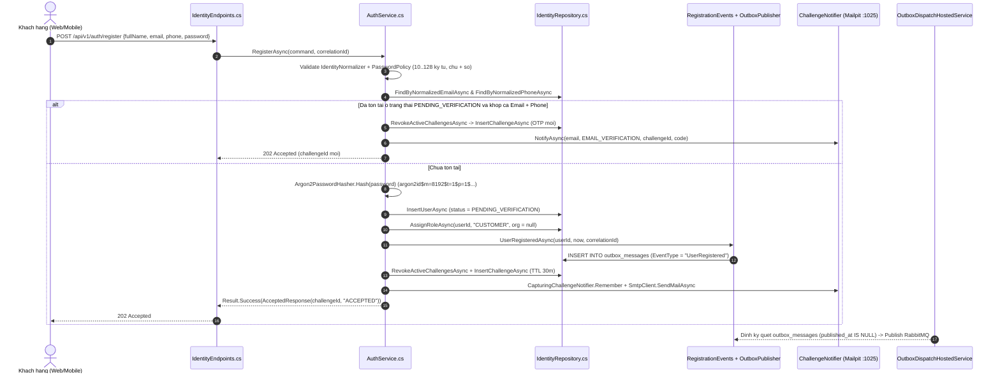
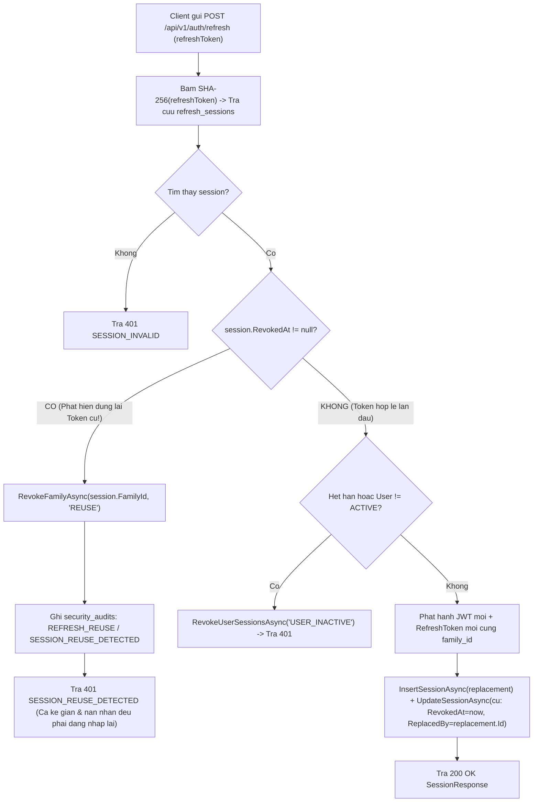

# 01. Giải Phẫu Chi Tiết Identity Service (`Port 5081` — DB `identity`)

> [!IMPORTANT]
> **Identity Service** là "người gác cổng định danh và phân quyền" của toàn bộ nền tảng **BLUE Bus Ticket Platform**. Không chỉ cấp phát JWT và quản lý mật khẩu bằng thuật toán **Argon2id**, service này còn quản lý mô hình phân quyền đa thuê bao (**Multi-tenant RBAC**), cơ chế xoay vòng phiên đăng nhập chống đánh cắp token (**Refresh Token Family Rotation**), kiểm chứng tức thời phiên bản quyền hạn (`AuthorizationVersion`), và gửi mã OTP xác thực qua **SMTP / Mailpit**.

---

## 1. Tổng Quan Trách Nhiệm & Kiến Trúc Nội Bộ

### 1.1. Thông số định danh hệ thống

| Thuộc tính | Giá trị cấu hình thực tế | Ý nghĩa kiến trúc |
| :--- | :--- | :--- |
| **Tên Microservice** | `BusTicketPlatform.Identity` (`identity-service`) | Quản lý danh tính, xác thực, phiên đăng nhập, vai trò và thành viên nhà xe |
| **Cổng HTTP nội bộ / Dev** | `5081` | Định tuyến qua NGINX Gateway dưới tiền tố `/api/v1/auth`, `/api/v1/users`, `/api/v1/operator/staff`, `/api/v1/admin` |
| **Cơ sở dữ liệu riêng** | PostgreSQL DB `identity` | Cô lập hoàn toàn mật khẩu băm, phiên đăng nhập và nhật ký bảo mật khỏi các DB nghiệp vụ khác |
| **Thuật toán băm mật khẩu** | `Argon2id` (`m=8192`, `t=1`, `p=1`, salt 16 bytes, hash 32 bytes) | Chống tấn công dò mật khẩu bằng GPU/ASIC nhờ tiêu tốn bộ nhớ có chủ đích |
| **Chuẩn Access Token** | JWT `HMAC-SHA256` (`Issuer: busticket-identity`, `Audience: busticket`, TTL `900s`) | Xác thực phi trạng thái tại 5 service vệ tinh, kết hợp kiểm tra trạng thái sống (`OnTokenValidated`) tại chính Identity |
| **Sự kiện phát ra (Outbox)** | `UserRegistered` (Version `1`, Routing key `identity.user-registered`) | Thông báo bất đồng bộ qua RabbitMQ khi khách hàng hoàn tất bước đăng ký ban đầu |
| **Kênh gửi OTP** | `ChallengeNotifier` (`SmtpClient` tới Mailpit port `1025` + `CapturingChallengeNotifier`) | Gửi mã xác minh 6 chữ số cho xác thực email và đặt lại mật khẩu |

### 1.2. Cây thư mục đầy đủ của 4 Project con

Mã nguồn của Identity Service đặt tại `workspace/src/services/identity/` và tuân thủ chặt chẽ kiến trúc phân tầng **Clean / Hexagonal Architecture** gồm 4 project `.csproj`:

```text
workspace/src/services/identity/
├── BusTicketPlatform.Identity.Api/                     # Tầng Giao vận HTTP (Minimal APIs, JWT Middleware, Idempotency)
│   ├── Program.cs                                      # Khởi tạo DI, cấu hình JwtBearer + OnTokenValidated check ver/status
│   ├── IdentityEndpoints.cs                            # Nhóm API cốt lõi: /auth/*, /users/me, /admin/users/*, /admin/organizations/*
│   ├── CustomerPreferencesEndpoints.cs                 # API /users/me/preferences (JSONB + chặn SVG XSS bằng WebP Base64 Regex)
│   ├── IdentityOperatorStaffEndpoints.cs               # API /operator/staff/* dành cho Quản trị viên Nhà xe quản lý nhân sự nội bộ
│   ├── AdminUserEndpoints.cs                           # API POST/PATCH /admin/users tạo mới và sửa hồ sơ nhân sự cấp sàn
│   ├── HttpResults.cs                                  # Extension chuyển đổi Result<T> -> HTTP Response & WithIdempotency(...)
│   ├── appsettings.json                                # Cấu hình kết nối DB, JWT Issuer/Audience, SMTP Mailpit
│   └── appsettings.Development.json
│
├── BusTicketPlatform.Identity.Application/             # Tầng Nghiệp vụ Ứng dụng (Use Cases, Ports, DTOs)
│   ├── AuthService.cs                                  # Luồng Register, Verify, Resend, Login, Refresh, Logout, Forgot/Reset Password
│   ├── ProfileService.cs                               # Xem/Cập nhật hồ sơ cá nhân (ExpectedVersion, tách luồng đổi Email chờ verify)
│   ├── AdminIdentityService.cs                         # Quản trị danh sách User, khóa/mở tài khoản, gán Role, quản lý Membership
│   ├── Contracts.cs                                    # Toàn bộ Command, DTO phản hồi và Record ánh xạ dữ liệu
│   ├── Ports.cs                                        # Các Interface: IIdentityRepository, IPasswordHasher, ITokenService, IChallengeNotifier...
│   ├── IdentityErrors.cs                               # Bảng mã lỗi miền định danh chuẩn hóa (AppError -> HTTP Status)
│   └── AssemblyMarker.cs
│
├── BusTicketPlatform.Identity.Domain/                  # Tầng Miền Cốt lõi (Quy tắc bất biến không phụ thuộc hạ tầng)
│   ├── IdentityNormalizer.cs                           # Regex kiểm tra E.164 Phone, Email, chuẩn hóa chữ hoa NormalizedEmail
│   ├── PasswordPolicy.cs                               # Chính sách mật khẩu: độ dài 10..128 ký tự, bắt buộc có cả chữ cái và chữ số
│   ├── UserStatuses.cs                                 # Hằng số trạng thái UserStatuses, ChallengeTypes, ChallengeStatuses, RoleCodes
│   └── AssemblyMarker.cs
│
└── BusTicketPlatform.Identity.Infrastructure/          # Tầng Hạ tầng Kỹ thuật (PostgreSQL Npgsql, Argon2, JWT, SMTP, Outbox)
    ├── IdentityInfrastructureExtensions.cs             # Đăng ký toàn bộ Singleton/HostedService vào DI Container
    ├── IdentityDatabaseOptions.cs                      # Đọc ConnectionStrings:Identity
    ├── SqlBaselineMigrator.cs                          # Tự động chạy 000_integration_tables.sql, 001_initial.sql & tạo customer_preferences
    ├── SqlBaselineHostedService.cs                     # HostedService kích hoạt migration ngay khi container khởi động
    ├── OutboxPublisher.cs                              # Ghi bảng outbox_messages và đẩy batch 20 sự kiện chưa gửi sang Broker
    ├── RegistrationEvents.cs                           # Đóng gói sự kiện UserRegistered vào OutboxPublisher
    ├── InboxDeduper.cs                                 # Chống xử lý trùng sự kiện đến trên bảng inbox_messages
    ├── PostgresHealthCheck.cs                          # Kiểm tra sức khỏe kết nối DB cho endpoint /health/ready
    ├── Persistence/
    │   ├── IdentityRepository.cs                       # Toàn bộ câu lệnh SQL thuần (Npgsql) thao tác trên 9 bảng miền định danh
    │   └── IdempotencyStore.cs                         # Lưu vết Idempotency-Key (TTL 24 giờ) chống thực thi lặp request nhạy cảm
    └── Security/
        ├── Argon2PasswordHasher.cs                     # Cài đặt Argon2id + so sánh hằng thời gian FixedTimeEquals
        ├── JwtTokenService.cs                          # Đóng gói JWT Access Token + sinh Refresh Token ngẫu nhiên 32 bytes
        └── ChallengeNotifier.cs                        # Gửi mail OTP qua SMTP/Mailpit + lưu bộ nhớ đệm CapturingChallengeNotifier
```

> [!TIP]
> **Tại sao dùng Npgsql thuần thay vì ORM nặng (như EF Core)?**
> Toàn bộ `IdentityRepository.cs` sử dụng `NpgsqlCommand` với câu lệnh SQL tường minh. Cách tiếp cận này giúp lập trình viên kiểm soát chính xác từng khóa chỉ mục một phần (*Partial Unique Index*), từng phép cập nhật nguyên tử `row_version = row_version + 1`, và giảm thiểu độ trễ khởi động của container microservice.

---

## 2. Thiết Kế Cơ Sở Dữ Liệu & Sơ Đồ ERD (`identity` DB)

Khi khởi động, [SqlBaselineMigrator.cs](file:///C:/Users/minht/.gemini/antigravity/worktrees/PBL6/c_to_n_b/workspace/src/services/identity/BusTicketPlatform.Identity.Infrastructure/SqlBaselineMigrator.cs#L17-L33) thực thi tuần tự:
1. Tạo bảng theo dõi `schema_migrations`.
2. Áp dụng [000_integration_tables.sql](file:///C:/Users/minht/.gemini/antigravity/worktrees/PBL6/c_to_n_b/docs/database/_shared/000_integration_tables.sql) tạo **4 bảng hạ tầng tích hợp** (`outbox_messages`, `inbox_messages`, `idempotency_records`, `audit_logs`).
3. Áp dụng [001_initial.sql](file:///C:/Users/minht/.gemini/antigravity/worktrees/PBL6/c_to_n_b/docs/database/identity/001_initial.sql) tạo **9 bảng miền định danh cốt lõi** kèm dữ liệu mồi (10 vai trò, 37 quyền hạn).
4. Thực thi lệnh bổ sung tạo bảng thứ **10** của miền nghiệp vụ là `customer_preferences`.

### 2.1. Sơ đồ Thực thể — Liên kết (Mermaid ERD) của 10 bảng nghiệp vụ

```mermaid
erDiagram
    users ||--o| customer_preferences : "owns_preferences"
    users ||--o{ organization_memberships : "joins_tenant"
    users ||--o{ user_roles : "assigned_roles"
    roles ||--o{ user_roles : "granted_to_users"
    roles ||--o{ role_permissions : "contains"
    permissions ||--o{ role_permissions : "belongs_to"
    users ||--o{ refresh_sessions : "maintains_sessions"
    refresh_sessions ||--o| refresh_sessions : "replaced_by"
    users ||--o{ auth_challenges : "receives_otp"
    users ||--o{ security_audits : "targeted_in_audit"

    users {
        uuid id PK "UUIDv7 dinh danh nguoi dung"
        varchar full_name "NOT NULL, 2..150 ky tu"
        varchar email "NOT NULL, email goc giu nguyen chu hoa/thuong"
        varchar normalized_email "NOT NULL, UPPERCASE, Partial UQ khi deleted_at IS NULL"
        varchar phone "NOT NULL, dinh dang E.164 (+84...)"
        varchar normalized_phone "NOT NULL, Partial UQ khi deleted_at IS NULL"
        varchar password_hash "NOT NULL, chuoi Argon2id"
        varchar status "PENDING_VERIFICATION | ACTIVE | LOCKED | DISABLED"
        timestamptz email_verified_at "Thoi diem xac minh OTP thanh cong"
        int failed_login_count "DEFAULT 0, CHECK >= 0"
        timestamptz lockout_until "Thoi diem het khoa tam thoi"
        bigint authorization_version "DEFAULT 0, tang khi doi quyen/mat khau/status"
        timestamptz created_at "NOT NULL"
        timestamptz updated_at "NOT NULL"
        timestamptz deleted_at "Soft delete timestamp"
        bigint row_version "DEFAULT 0, Optimistic Concurrency Control"
    }

    customer_preferences {
        uuid user_id PK "FK -> users(id)"
        jsonb preferences "NOT NULL: province, avatar WebP base64, journey, reminder, offers"
        timestamptz updated_at "NOT NULL DEFAULT NOW()"
    }

    roles {
        uuid id PK "UUID"
        varchar code "UNIQUE NOT NULL (CUSTOMER, DRIVER, OPERATOR_*, PLATFORM_*)"
        varchar scope "PLATFORM | TENANT | OWN"
        varchar description "Mo ta vai tro"
        boolean system_role "DEFAULT true"
        timestamptz created_at "NOT NULL"
    }

    permissions {
        uuid id PK "UUID"
        varchar code "UNIQUE NOT NULL (vd: tenant.trip.publish)"
        varchar scope "PLATFORM | TENANT | REPORT"
        varchar resource "Ten tai nguyen (trip, bus, booking...)"
        varchar action "Hanh dong (read, manage, publish...)"
        timestamptz created_at "NOT NULL"
    }

    role_permissions {
        uuid role_id PK "FK -> roles(id) ON DELETE CASCADE"
        uuid permission_id PK "FK -> permissions(id) ON DELETE CASCADE"
    }

    organization_memberships {
        uuid id PK "UUIDv7"
        uuid user_id FK "NOT NULL -> users(id)"
        uuid organization_id_external "NOT NULL, tham chieu logic sang transport.organizations"
        varchar status "ACTIVE | SUSPENDED | ENDED"
        timestamptz started_at "NOT NULL"
        timestamptz ended_at "NULL hoac >= started_at"
        timestamptz created_at "NOT NULL"
        timestamptz updated_at "NOT NULL"
        bigint row_version "DEFAULT 0, khoa lac quan"
    }

    user_roles {
        uuid id PK "UUIDv7"
        uuid user_id FK "NOT NULL -> users(id)"
        uuid role_id FK "NOT NULL -> roles(id)"
        uuid organization_id_external "NULL neu la Platform/Own role, UUID neu la Tenant role"
        boolean active "DEFAULT true (soft-revoke bang active=false)"
        timestamptz created_at "NOT NULL"
        timestamptz ended_at "Thoi diem thu hoi quyen"
    }

    refresh_sessions {
        uuid id PK "UUIDv7 (khop voi claim sid trong JWT)"
        uuid user_id FK "NOT NULL -> users(id)"
        uuid family_id "NOT NULL, nhom chuoi xoay vong Refresh Token"
        varchar token_hash "UNIQUE NOT NULL, SHA-256 cua Refresh Token"
        timestamptz issued_at "NOT NULL"
        timestamptz expires_at "NOT NULL, CHECK > issued_at (14 ngay)"
        timestamptz revoked_at "Thoi diem thu hoi / xoay vong"
        uuid replaced_by_session_id FK "Tro toi phien ke tiep khi xoay vong"
        varchar revoke_reason "ROTATED | REUSE | LOGOUT | PASSWORD_RESET | ..."
        varchar user_agent_hash "Bam User-Agent (tuy chon)"
        varchar ip_hash "Bam IP (tuy chon)"
    }

    auth_challenges {
        uuid id PK "UUIDv7 (challengeId tra ve cho client)"
        uuid user_id FK "-> users(id)"
        varchar target_normalized "Email dich viet hoa"
        varchar challenge_type "EMAIL_VERIFICATION | PASSWORD_RESET"
        varchar token_hash "UNIQUE NOT NULL, SHA-256(challengeId:code)"
        varchar status "ACTIVE | CONSUMED | EXPIRED | REVOKED"
        int failed_attempts "DEFAULT 0, toi da 5 lan thu sai"
        timestamptz created_at "NOT NULL"
        timestamptz expires_at "NOT NULL, +30 phut"
        timestamptz consumed_at "Thoi diem su dung thanh cong"
        bigint row_version "DEFAULT 0"
    }

    security_audits {
        uuid id PK "UUIDv7"
        uuid actor_id "Nguoi thuc hien (NULL neu khach chua dang nhap)"
        uuid target_user_id "Nguoi bi tac dong"
        varchar action "LOGIN, LOGIN_FAILED, REGISTER_VERIFIED, PASSWORD_RESET..."
        varchar result "SUCCEEDED | DENIED | ALLOWED | SUCCESS"
        varchar reason_code "Ma ly do hoac SHA-256 fingerprint khi rate-limit"
        uuid correlation_id "NOT NULL, truy vet xuyen service"
        jsonb safe_metadata "DEFAULT '{}'::jsonb, khong chua PII nhay cam"
        timestamptz occurred_at "NOT NULL"
    }
```



### 2.2. Giải thích chi tiết từng bảng, cột và ràng buộc toàn vẹn (10 bảng nghiệp vụ + 5 bảng hạ tầng)

#### Bảng 1: `users` — Thực thể gốc lưu trữ định danh người dùng
- **Khóa chính & Định danh**: `id (uuid PK)` được sinh bằng `UuidV7IdGenerator` (có thứ tự thời gian, tối ưu phân trang B-Tree).
- **Cặp cột chuẩn hóa (`email`/`normalized_email`, `phone`/`normalized_phone`)**: Lưu bản gốc để hiển thị giao diện và bản chuẩn hóa (`UPPERCASE` đối với email, định dạng `+[1-9][0-9]{7,14}` đối với điện thoại) để tra cứu không phân biệt hoa thường.
- **Partial Unique Index thông minh**:
  - `uq_users_email ON users (normalized_email) WHERE deleted_at IS NULL`
  - `uq_users_phone ON users (normalized_phone) WHERE deleted_at IS NULL`
  - Thiết kế này cho phép nếu sau này một tài khoản bị xóa mềm (`deleted_at IS NOT NULL`), email/số điện thoại đó vẫn có thể đăng ký lại mà không vi phạm khóa duy nhất!
- **Kiểm soát đăng nhập sai & Khóa tài khoản**: `failed_login_count` (`CHECK >= 0`) đếm số lần nhập sai liên tiếp; khi chạm ngưỡng `5`, `status` chuyển sang `'LOCKED'` và `lockout_until` đặt `+15 phút` (hoặc `+50 năm` nếu khóa cưỡng bức bởi Admin).
- **Hai cột phiên bản tách biệt**:
  - `row_version`: Phục vụ **Optimistic Concurrency Control** (`ExpectedVersion`) khi nhiều tab hoặc Admin cùng sửa hồ sơ.
  - `authorization_version`: Tăng thêm `1` mỗi khi đổi mật khẩu, đổi trạng thái tài khoản hoặc thay đổi vai trò cấp sàn. Mọi JWT cũ mang claim `ver` nhỏ hơn `authorization_version` sẽ bị từ chối ngay lập tức tại `OnTokenValidated` dù chưa hết hạn 15 phút!

#### Bảng 2: `roles` — Danh mục 10 vai trò chuẩn của hệ thống
- Ràng buộc `ck_roles_scope CHECK (scope IN ('PLATFORM','TENANT','OWN'))` phân chia rõ 3 tầng quyền hạn:
  - **`OWN`**: `CUSTOMER` — Khách đặt vé thông thường, chỉ thao tác trên dữ liệu của chính mình.
  - **`TENANT`**: `DRIVER` (Tài xế), `OPERATOR_ADMIN` (Quản trị nhà xe), `OPERATOR_SCHEDULER` (Điều độ lịch xe), `OPERATOR_OPERATIONS` (Vận hành chuyến & soát vé), `OPERATOR_FINANCE` (Kế toán nhà xe).
  - **`PLATFORM`**: `PLATFORM_ADMIN` (Quản trị hệ thống), `PLATFORM_SUPPORT` (Chăm sóc khách hàng sàn), `PLATFORM_FINANCE` (Đối soát & tài chính sàn), `PLATFORM_AUDITOR` (Kiểm toán chỉ đọc).

#### Bảng 3 & 4: `permissions` và `role_permissions` — Ma trận 37 quyền hạn chi tiết
- Mỗi quyền trong `permissions` có mã dạng `<scope>.<resource>.<action>` (ví dụ `tenant.trip.publish`, `platform.payment.reconcile`), đảm bảo duy nhất trên cả `code` lẫn bộ ba `(scope, resource, action)`.
- Bảng nối `role_permissions (role_id, permission_id)` gán tường minh từng quyền cho từng vai trò (ví dụ `OPERATOR_ADMIN` nhận mọi quyền `tenant.%` và `report.%.read`, trong khi `DRIVER` chỉ nhận 5 quyền: đọc chuyến, đọc manifest, validate vé, check-in vé và cập nhật vận hành chuyến).

#### Bảng 5: `organization_memberships` — Liên kết Nhân sự thuộc Nhà xe (Multi-tenant)
- Do kiến trúc **Database-per-Service**, bảng `organizations` nằm ở DB `transport`, nên cột `organization_id_external (uuid NOT NULL)` đóng vai trò khóa ngoại logic (External ID) không tạo ràng buộc FK cứng xuyên DB.
- **Ràng buộc thời gian & trạng thái**: `status IN ('ACTIVE','SUSPENDED','ENDED')` và `ended_at IS NULL OR ended_at >= started_at`.
- **Partial Unique Index**: `uq_membership_active ON organization_memberships (user_id, organization_id_external) WHERE status IN ('ACTIVE','SUSPENDED')` ngăn việc thêm trùng một nhân sự vào cùng một nhà xe khi hồ sơ cũ đang hoạt động hoặc tạm đình chỉ, nhưng vẫn lưu được lịch sử các đợt làm việc cũ đã `ENDED`.

#### Bảng 6: `user_roles` — Gán vai trò theo Ngữ cảnh Sàn hoặc Ngữ cảnh Nhà xe
- Lưu vết lịch sử gán quyền thay vì xóa vật lý (`DELETE`): khi thay thế quyền (`ReplaceUserRolesAsync`), code cập nhật `active = false, ended_at = NOW()` cho các dòng cũ rồi chèn dòng mới `active = true`.
- Hai Partial Unique Index tách biệt cho 2 ngữ cảnh:
  1. `uq_user_platform_role_active (user_id, role_id) WHERE active AND organization_id_external IS NULL` (quyền cấp sàn / khách hàng).
  2. `uq_user_tenant_role_active (user_id, role_id, organization_id_external) WHERE active AND organization_id_external IS NOT NULL` (quyền trong từng nhà xe cụ thể).

#### Bảng 7: `refresh_sessions` — Quản lý Phiên và Gia phả Refresh Token (`family_id`)
- Không bao giờ lưu chuỗi Refresh Token thô xuống đĩa! Chỉ lưu `token_hash` (`SHA-256` dạng Hex 64 ký tự, `UNIQUE`).
- Cột `family_id` gom nhóm mọi phiên sinh ra từ cùng một lần đăng nhập gốc; cột tự tham chiếu `replaced_by_session_id` tạo thành danh sách liên kết đơn truy vết toàn bộ chuỗi xoay vòng token trong suốt 14 ngày.

#### Bảng 8: `auth_challenges` — Thử thách OTP xác thực Email & Quên mật khẩu
- Lưu mã OTP 6 chữ số dưới dạng băm có muối gắn chặt với ID thử thách: `token_hash = SHA256("{challengeId:N}:{code}")`. Nhờ vậy, kể cả khi hai người dùng ngẫu nhiên nhận cùng mã `123456`, giá trị `token_hash` trong DB vẫn hoàn toàn khác nhau và thỏa mãn ràng buộc `UNIQUE`!
- Giới hạn thời gian sống 30 phút (`expires_at > created_at`) và đếm `failed_attempts` để tự động chuyển sang `'REVOKED'` ngay lần nhập sai thứ 5.

#### Bảng 9: `security_audits` — Nhật ký Kiểm toán Bảo mật & Chống Spam (Rate Limiting)
- Vừa là sổ cái pháp lý lưu mọi biến động nhạy cảm (`LOGIN`, `LOGIN_FAILED`, `REGISTER_VERIFIED`, `PASSWORD_RESET`, `USER_ROLES`...), vừa được tận dụng cực kỳ khéo léo làm bộ đếm **Sliding-Window Rate Limiter** trong DB cho các API `resend-verification` và `forgot-password` (tối đa 5 yêu cầu / 15 phút trên mỗi dấu vân tay email băm `SHA-256`).

#### Bảng 10: `customer_preferences` — Tùy chọn Cá nhân & Ảnh đại diện An toàn
- Khởi tạo trực tiếp trong `SqlBaselineMigrator.cs` với khóa chính `user_id` tham chiếu `users(id)` (quan hệ `1 - 0..1`).
- Cột `preferences (jsonb)` lưu tỉnh thành mặc định (`province`), ảnh đại diện mã hóa `data:image/webp;base64,...` (`avatar`), và 3 công tắc nhận thông báo (`journey`, `reminder`, `offers`).

#### Nhóm 5 bảng hạ tầng dùng chung (`000_integration_tables.sql` + `schema_migrations`)
| Tên bảng | Khóa chính / Ràng buộc nổi bật | Vai trò trong Identity Service |
| :--- | :--- | :--- |
| `schema_migrations` | `filename (text PK)` | Đảm bảo mỗi script SQL (`000_...`, `001_...`) chỉ chạy đúng một lần duy nhất |
| `outbox_messages` | `id (uuid PK)`, partial index `ix_outbox_pending WHERE published_at IS NULL` | Lưu sự kiện `UserRegistered` bền vững trước khi `OutboxDispatchHostedService` đẩy lên RabbitMQ |
| `inbox_messages` | `UNIQUE (consumer_name, message_id)` | Bảng chuẩn từ template tích hợp chống tiêu thụ trùng thông điệp |
| `idempotency_records` | `UNIQUE (actor_scope, operation, target_reference, idempotency_key)` | Chống gửi đúp cho 7 API thay đổi trạng thái (`verify`, `resend`, `refresh`, `logout`, `forgot`, `reset`, `addMembership`, `adminCreateUser`) |
| `audit_logs` | `id (uuid PK)`, index theo `target` & `organization_id_external` | Bảng chuẩn kiểm toán đa dịch vụ theo quy ước nền tảng |

---

## 3. Danh Mục Đầy Đủ Toàn Bộ HTTP Endpoints

Identity Service cung cấp tổng cộng **22 HTTP Endpoints nghiệp vụ** (chia làm 4 phân khu chức năng) cùng nhóm endpoints vận hành sức khỏe (`/health/*`, `/openapi/*`).

### 3.1. Nhóm 1 — Xác thực & Quản lý Phiên (`/api/v1/auth/*`)

| Phương thức & Đường dẫn | Yêu cầu Auth | Idempotency-Key | Request Body / Claims | HTTP Thành công & Phản hồi | Nghiệp vụ cốt lõi |
| :--- | :--- | :--- | :--- | :--- | :--- |
| `POST /api/v1/auth/register` | Công khai (`AllowAnonymous`) | Không | `RegisterRequest(fullName, email, phone, password)` | `202 Accepted` -> `AcceptedResponse(operationId, "ACCEPTED")` | Tạo user `PENDING_VERIFICATION`, gán role `CUSTOMER`, ghi Outbox `UserRegistered`, gửi OTP 6 số qua email |
| `POST /api/v1/auth/verify` | Công khai | **Bắt buộc** (`16..200` ký tự) | `VerificationRequest(challengeId, code)` | `200 OK` -> `SessionResponse(accessToken, refreshToken, ...)` | Kiểm tra OTP hằng thời gian, kích hoạt `ACTIVE` (hoặc áp dụng email mới), cấp ngay phiên JWT |
| `POST /api/v1/auth/resend-verification` | Công khai | **Bắt buộc** | `EmailRequest(email)` | `202 Accepted` -> `AcceptedResponse` | Rate-limit 5 lần/15 phút; thu hồi OTP cũ và gửi mã mới (trả `202` giả lập nếu email không tồn tại để chống dò tài khoản) |
| `POST /api/v1/auth/login` | Công khai | Không | `LoginRequest(identifier, password)` | `200 OK` -> `SessionResponse` | Đăng nhập bằng Email hoặc SĐT; kiểm tra Argon2id; khóa 15 phút nếu sai 5 lần liên tiếp |
| `POST /api/v1/auth/refresh` | Công khai (dùng Refresh Token) | **Bắt buộc** | `RefreshRequest(refreshToken)` | `200 OK` -> `SessionResponse` | Xoay vòng Refresh Token mới cùng `family_id`; thu hồi toàn bộ họ phiên nếu phát hiện dùng lại token cũ |
| `POST /api/v1/auth/logout` | `Bearer JWT` (`sub`, `sid`) | **Bắt buộc** | Lấy `userId` & `sessionId` từ JWT | `204 No Content` | Thu hồi toàn bộ `refresh_sessions` đang mở của người dùng với lý do `LOGOUT` |
| `POST /api/v1/auth/forgot-password` | Công khai | **Bắt buộc** | `EmailRequest(email)` | `202 Accepted` -> `AcceptedResponse` | Rate-limit 5 lần/15 phút; phát hành thử thách `PASSWORD_RESET` qua email (chống lộ danh sách email) |
| `POST /api/v1/auth/reset-password` | Công khai | **Bắt buộc** | `ResetPasswordRequest(challengeId, code, newPassword)` | `204 No Content` | Kiểm tra chính sách mật khẩu & OTP, cập nhật Argon2id hash, tăng `authorization_version`, thu hồi mọi phiên cũ |

### 3.2. Nhóm 2 — Hồ sơ Cá nhân & Tùy chọn Khách hàng (`/api/v1/users/me/*`)

| Phương thức & Đường dẫn | Yêu cầu Auth | Idempotency-Key | Request Body | HTTP Thành công & Phản hồi | Nghiệp vụ cốt lõi |
| :--- | :--- | :--- | :--- | :--- | :--- |
| `GET /api/v1/users/me` | `Bearer JWT` | Không | Không | `200 OK` -> `UserProfileDto` | Trả thông tin cá nhân, danh sách `roles`, `organizationMemberships` và `rowVersion` hiện tại |
| `PATCH /api/v1/users/me` | `Bearer JWT` | Không (dùng `ExpectedVersion`) | `UpdateProfileRequest(fullName?, email?, phone?, expectedVersion)` | `200 OK` (`UserProfileDto`) hoặc `202 Accepted` (`AcceptedResponse`) | Đối chiếu `ExpectedVersion`; cập nhật ngay Họ tên & SĐT; nếu đổi `Email` thì giữ email cũ, gửi OTP tới email mới và trả `202 Accepted` |
| `GET /api/v1/users/me/preferences` | `Bearer JWT` | Không | Không | `200 OK` -> `Preferences` | Đọc JSONB tùy chọn tỉnh thành, avatar, cài đặt thông báo (trả mặc định nếu chưa có bản ghi) |
| `PUT /api/v1/users/me/preferences` | `Bearer JWT` | Không | `Preferences(province, avatar, journey, reminder, offers)` | `200 OK` -> `Preferences` | Chặn SVG XSS bằng Regex chỉ cho phép `data:image/webp;base64,...` dưới `200,000` ký tự; `UPSERT` vào `customer_preferences` |

### 3.3. Nhóm 3 — Quản lý Nhân sự Nội bộ Nhà xe (`/api/v1/operator/staff/*`)

| Phương thức & Đường dẫn | Vai trò yêu cầu | Request Body | HTTP Thành công | Nghiệp vụ cốt lõi |
| :--- | :--- | :--- | :--- | :--- |
| `GET /api/v1/operator/staff` | `OPERATOR_ADMIN` hoặc `PLATFORM_ADMIN` + có claim `org` | Không | `200 OK` (Mảng nhân sự kèm User info & `rowVersion`) | Liệt kê toàn bộ nhân sự thuộc nhà xe hiện tại trong token (`ctx.User.OrganizationId()`) |
| `POST /api/v1/operator/staff` | `OPERATOR_ADMIN` hoặc `PLATFORM_ADMIN` + có claim `org` | `OperatorStaffInput(fullName, email, phone, role?)` | `201 Created` | Tạo tài khoản nhân viên mới (mật khẩu ngẫu nhiên 48 bytes) hoặc gán quyền nếu đã thuộc tổ chức; chặn chiếm dụng email của tài khoản ngoài tổ chức (`409`) |
| `PATCH /api/v1/operator/staff/{id:guid}` | `OPERATOR_ADMIN` hoặc `PLATFORM_ADMIN` + có claim `org` | `OperatorStaffUpdate(role, status, expectedVersion)` | `200 OK` | Đổi vai trò nội bộ (`DRIVER`, `OPERATOR_*`) hoặc tạm ngưng (`SUSPENDED`); kiểm tra `ExpectedVersion`; chặn hạ quyền `OPERATOR_ADMIN` cuối cùng; thu hồi phiên đăng nhập của nhân viên bị sửa |

### 3.4. Nhóm 4 — Quản trị Hệ thống Cấp Sàn (`/api/v1/admin/*`)

| Phương thức & Đường dẫn | Vai trò yêu cầu | Idempotency-Key | Request Body / Query | HTTP Thành công | Nghiệp vụ cốt lõi |
| :--- | :--- | :--- | :--- | :--- | :--- |
| `GET /api/v1/admin/users` | `PLATFORM_ADMIN` | Không | Query `?page=0&size=20` (`size` kẹp trong `1..100`) | `200 OK` -> `UserPageDto` | Phân trang danh sách toàn bộ người dùng chưa xóa mềm (`ORDER BY created_at DESC`) |
| `POST /api/v1/admin/users` | `PLATFORM_ADMIN` | **Bắt buộc** | `AdminUserProfileInput(fullName, email, phone, expectedVersion)` | `201 Created` -> `UserProfileDto` | Tạo hồ sơ nhân sự ở trạng thái `ACTIVE` ngay lập tức, chuẩn hóa SĐT `0[35789]xxxxxxxx -> +84...` |
| `GET /api/v1/admin/users/{userId:guid}` | `PLATFORM_ADMIN` | Không | Path `userId` | `200 OK` -> `UserProfileDto` | Xem chi tiết hồ sơ, vai trò sàn và danh sách nhà xe trực thuộc của một người dùng |
| `PATCH /api/v1/admin/users/{id:guid}` | `PLATFORM_ADMIN` | Không (`ExpectedVersion`) | `AdminUserProfileInput(fullName, email, phone, expectedVersion)` | `200 OK` -> `UserProfileDto` | Sửa trực tiếp Họ tên/Email/SĐT bằng câu lệnh `UPDATE ... WHERE id=@id AND row_version=@version`; đặt lại `email_verified_at = NULL` nếu đổi email |
| `PATCH /api/v1/admin/users/{userId:guid}/status` | `PLATFORM_ADMIN` | Không (`ExpectedVersion`) | `VersionedStatusRequest(status, reason, expectedVersion)` | `200 OK` -> `UserProfileDto` | Khóa (`LOCKED` 50 năm), vô hiệu hóa (`DISABLED`) hoặc mở lại (`ACTIVE`); cấm tự khóa chính mình & cấm khóa `PLATFORM_ADMIN` cuối cùng |
| `PUT /api/v1/admin/users/{userId:guid}/roles` | `PLATFORM_ADMIN` | Không (`ExpectedVersion`) | `ReplaceRolesRequest(roleCodes, reason, expectedVersion)` | `200 OK` -> `UserProfileDto` | Thay thế vai trò cấp sàn trong giao dịch SQL, tăng `authorization_version` và thu hồi toàn bộ phiên cũ |
| `GET /api/v1/admin/organizations/{organizationId:guid}/members` | `PLATFORM_ADMIN` | Không | Path `organizationId` | `200 OK` -> `IReadOnlyList<MembershipDto>` | Xem danh sách thành viên và vai trò của một nhà xe bất kỳ |
| `POST /api/v1/admin/organizations/{organizationId:guid}/members` | `PLATFORM_ADMIN` | **Bắt buộc** | `MembershipInput(userId, roleCodes, status, reason, expectedVersion)` | `201 Created` -> `MembershipDto` | Gán một tài khoản có sẵn vào tổ chức nhà xe kèm danh sách vai trò `TENANT` |
| `PATCH /api/v1/admin/organizations/{organizationId:guid}/members/{membershipId:guid}` | `PLATFORM_ADMIN` | Không (`ExpectedVersion`) | `MembershipInput(...)` | `200 OK` -> `MembershipDto` | Cập nhật trạng thái (`ACTIVE`/`SUSPENDED`/`ENDED`) và vai trò thành viên nhà xe; tự thu hồi phiên nếu không còn `ACTIVE` |

---

## 4. Giải Phẫu Luồng Xử Lý Nghiệp Vụ & Truy Vết Mã Nguồn

### 4.1. Luồng Đăng ký, Phát sự kiện Outbox & Gửi OTP qua Mailpit (`RegisterAsync` -> `VerifyAsync`)



#### Các chi tiết kỹ thuật đắt giá trong mã nguồn:
1. **Xử lý thông minh khi khách bấm Đăng ký lại (`Idempotent UX Retry`)**:
   Tại [AuthService.cs](file:///C:/Users/minht/.gemini/antigravity/worktrees/PBL6/c_to_n_b/workspace/src/services/identity/BusTicketPlatform.Identity.Application/AuthService.cs#L52-L63), nếu người dùng từng đăng ký nửa chừng rồi tắt trình duyệt (tài khoản đang `PENDING_VERIFICATION`), khi họ nhập lại đúng cặp `email` + `phone` đó, hệ thống **không báo lỗi `409 Conflict` gây bực bội**, mà tự động thu hồi mã OTP cũ và phát hành mã OTP mới thông qua `IssueChallengeAsync`. Ngược lại, nếu trùng email/SĐT với tài khoản đã `ACTIVE` hoặc lệch thông tin, hệ thống ghi `security_audits ("REGISTER_REJECTED", "DENIED", "IDENTITY_IN_USE")` và trả lỗi `409 IDENTITY_ALREADY_USED`.
2. **Định dạng chuỗi băm Argon2id tự mô tả**:
   Tại [Argon2PasswordHasher.cs](file:///C:/Users/minht/.gemini/antigravity/worktrees/PBL6/c_to_n_b/workspace/src/services/identity/BusTicketPlatform.Identity.Infrastructure/Security/Argon2PasswordHasher.cs#L10-L39), mật khẩu được băm bằng `Konscious.Security.Cryptography.Argon2id` với `Salt` ngẫu nhiên 16 bytes, `MemorySize = 8192` (8 MB RAM/lần băm), `Iterations = 1`, `DegreeOfParallelism = 1` và đóng gói thành chuỗi chuẩn 6 phần tử phân cách bởi dấu `\$`:
   `argon2id$m=8192$t=1$p=1$<Base64Salt>$<Base64Hash32Bytes>`. Khi xác thực (`Verify`), hàm giải mã `salt` để dẫn xuất lại khóa và dùng `CryptographicOperations.FixedTimeEquals(expected, actual)` để triệt tiêu hoàn toàn nguy cơ tấn công đo thời gian phản hồi (*Timing Side-Channel Attack*).
3. **Cơ chế Outbox tách rời giao dịch gửi thông điệp**:
   Khi tạo user mới, [RegistrationEvents.cs](file:///C:/Users/minht/.gemini/antigravity/worktrees/PBL6/c_to_n_b/workspace/src/services/identity/BusTicketPlatform.Identity.Infrastructure/RegistrationEvents.cs#L9-L28) tạo gói tin `EventMessage(EventType: "UserRegistered", Producer: "identity-service")` và gọi [OutboxPublisher.cs](file:///C:/Users/minht/.gemini/antigravity/worktrees/PBL6/c_to_n_b/workspace/src/services/identity/BusTicketPlatform.Identity.Infrastructure/OutboxPublisher.cs#L9-L57) chèn trực tiếp vào bảng `outbox_messages`. Tiến trình nền `OutboxDispatchHostedService` (sử dụng `OutboxRelay` của `BuildingBlocks.Messaging`) sẽ quét tối đa 20 dòng `published_at IS NULL` mỗi nhịp để đẩy lên RabbitMQ theo routing key `OutboxRouting.KeyFor("UserRegistered")`. Nếu RabbitMQ tạm ngắt kết nối, `attempt_count` tăng lên và lưu `last_error_code`, đảm bảo không bao giờ mất sự kiện.
4. **Cơ chế kép của `ChallengeNotifier` (Vừa gửi SMTP thật, vừa hỗ trợ kiểm thử tự động 0ms)**:
   Tại [ChallengeNotifier.cs](file:///C:/Users/minht/.gemini/antigravity/worktrees/PBL6/c_to_n_b/workspace/src/services/identity/BusTicketPlatform.Identity.Infrastructure/Security/ChallengeNotifier.cs#L44-L90):
   - Bước 1: Nếu `CaptureChallenges = true` (mặc định bật ở môi trường Dev/Test), mã OTP được lưu vào `ConcurrentDictionary` của `CapturingChallengeNotifier` (`IChallengeMailbox`) để các bài Integration Test đọc trực tiếp mã OTP trong bộ nhớ mà không cần mở kết nối POP3/HTTP sang mail server.
   - Bước 2: Nếu `Smtp:Host` được cấu hình (trong Docker Compose trỏ tới container **Mailpit** ở cổng `1025`), `SmtpClient` gửi email chứa cả mã OTP 6 số lẫn đường dẫn bấm trực tiếp `{FrontendBaseUrl}/verify-email?challengeId=...&email=...` (hoặc `/reset-password`). Đặc biệt, khối `try / catch` ở dòng 86 chỉ ghi `LogWarning` nếu SMTP gặp sự cố tạm thời chứ không làm sập giao dịch DB, cho phép người dùng bấm `resend-verification` ngay sau đó.
5. **Một hàm `VerifyAsync` phục vụ 2 kịch bản nghiệp vụ**:
   Tại [AuthService.cs](file:///C:/Users/minht/.gemini/antigravity/worktrees/PBL6/c_to_n_b/workspace/src/services/identity/BusTicketPlatform.Identity.Application/AuthService.cs#L87-L118), dòng 102–104 kiểm tra cực gọn:
   ```csharp
   var email = user.Status == UserStatuses.Active
       ? challenge.TargetNormalized.ToLowerInvariant()
       : user.Email;
   ```
   - Nếu tài khoản đang `PENDING_VERIFICATION` (đăng ký mới): giữ nguyên `user.Email` ban đầu và chuyển trạng thái sang `ACTIVE`.
   - Nếu tài khoản đã `ACTIVE` (khách hàng đổi email trong mục Hồ sơ cá nhân): chính thức ghi đè `Email` và `NormalizedEmail` bằng địa chỉ email mới lưu trong `challenge.TargetNormalized`!

---

### 4.2. Luồng Đăng nhập, Khóa Tạm Thời & Kiểm Chứng Phiên Tức Thời (`LoginAsync` & `OnTokenValidated`)

1. **Đăng nhập đa định danh (`Email` hoặc `Phone`)**:
   [IdentityRepository.cs](file:///C:/Users/minht/.gemini/antigravity/worktrees/PBL6/c_to_n_b/workspace/src/services/identity/BusTicketPlatform.Identity.Infrastructure/Persistence/IdentityRepository.cs#L18-L27) kiểm tra xem chuỗi `identifier` có chứa ký tự `'@'` hay không: nếu có thì chuẩn hóa chữ hoa tìm theo `normalized_email`, ngược lại tìm theo `normalized_phone`.
2. **Tự động mở khóa khi hết thời gian phạt (`Auto-Unlock`) & Đếm lỗi khóa 15 phút**:
   Trong [AuthService.cs](file:///C:/Users/minht/.gemini/antigravity/worktrees/PBL6/c_to_n_b/workspace/src/services/identity/BusTicketPlatform.Identity.Application/AuthService.cs#L157-L178):
   - Nếu `Status == LOCKED` và `LockoutUntil` là `null` (khóa vô thời hạn) hoặc vẫn lớn hơn `clock.UtcNow` -> từ chối ngay với mã `423 Locked` (`ACCOUNT_LOCKED`).
   - Nếu `LockoutUntil <= clock.UtcNow` -> tự động phục hồi bộ nhớ `Status = ACTIVE, FailedLoginCount = 0, LockoutUntil = null` trước khi kiểm tra mật khẩu.
   - Nếu sai mật khẩu (hoặc tài khoản đang `PENDING_VERIFICATION` / `DISABLED`), biến `failures = user.FailedLoginCount + 1`. Khi `failures >= 5` (`LockoutThreshold`), tài khoản bị chuyển sang `LOCKED` trong đúng `15 phút` (`LockoutMinutes`).
3. **Cấu trúc Claims bên trong JWT Access Token (`JwtTokenService.cs`)**:
   Khi đăng nhập hoặc xác thực OTP thành công, [JwtTokenService.cs](file:///C:/Users/minht/.gemini/antigravity/worktrees/PBL6/c_to_n_b/workspace/src/services/identity/BusTicketPlatform.Identity.Infrastructure/Security/JwtTokenService.cs#L23-L57) tổng hợp cả vai trò cấp sàn (`GetRoleCodesAsync`) lẫn toàn bộ vai trò của các nhà xe đang `ACTIVE` (`TokenRolesAsync` & `TokenOrgAsync`), rồi ký `HMAC-SHA256` tạo JWT sống 900 giây (15 phút) chứa các claims:
   - `sub`: `user.Id` (UUID người dùng)
   - `jti`: `Guid.CreateVersion7()` (định danh duy nhất của từng JWT)
   - `sid`: `sessionId` (khớp khóa chính bảng `refresh_sessions`)
   - `ver`: `user.AuthorizationVersion` (phiên bản quyền hạn hiện hành)
   - `org`: `organizationId` (nếu nhân sự thuộc một nhà xe đang `ACTIVE`)
   - `http://schemas.microsoft.com/ws/2008/06/identity/claims/role`: danh sách mã vai trò (`CUSTOMER`, `OPERATOR_ADMIN`, `DRIVER`, v.v.)
4. **Chốt chặn `OnTokenValidated` chống dùng Access Token đã bị tước quyền**:
   Điểm yếu kinh điển của JWT thông thường là khi Admin khóa tài khoản hoặc hạ quyền nhân viên, Access Token cũ vẫn còn hạn thêm tối đa 15 phút. Tại [Program.cs](file:///C:/Users/minht/.gemini/antigravity/worktrees/PBL6/c_to_n_b/workspace/src/services/identity/BusTicketPlatform.Identity.Api/Program.cs#L46-L66), Identity Service khắc phục triệt để bằng hook `JwtBearerEvents.OnTokenValidated`:
   - Đọc `sub` (`userId`) và `ver` (`tokenVersion`) từ JWT.
   - Truy vấn nhanh `repository.FindByIdAsync(userId)` và kiểm tra:
     `user is null || user.Status != UserStatuses.Active || user.AuthorizationVersion != tokenVersion`
   - Nếu nhân viên vừa đổi mật khẩu (`ResetPasswordAsync`), vừa bị khóa (`ChangeStatusAsync`), hoặc vừa bị thay đổi vai trò (`ReplaceRolesAsync`), cột `authorization_version` trong DB đã tăng thêm `1` -> token cũ lập tức bị `context.Fail("The access token has been revoked.")` trả về `401 Unauthorized` ngay ở giây tiếp theo!

---

### 4.3. Cơ chế Refresh Token Rotation & Phát Hiện Đánh Cắp Phiên (`RefreshAsync`)



Tại [AuthService.cs](file:///C:/Users/minht/.gemini/antigravity/worktrees/PBL6/c_to_n_b/workspace/src/services/identity/BusTicketPlatform.Identity.Application/AuthService.cs#L186-L234), cơ chế **Refresh Token Reuse Detection** theo chuẩn OAuth 2.0 Security Best Current Practice hoạt động cực kỳ chặt chẽ:
- Mỗi lần gọi `/refresh` hợp lệ, phiên cũ không bị xóa khỏi DB mà được đánh dấu `revoked_at = NOW(), revoke_reason = 'ROTATED', replaced_by_session_id = <newId>`, đồng thời phiên mới kế thừa nguyên vẹn `family_id` của phiên gốc.
- Giả sử kẻ tấn công đánh cắp được Refresh Token `RT_1`:
  - Nếu kẻ gian dùng `RT_1` trước để lấy `RT_2`, đến khi trình duyệt thật của nạn nhân tự động mang `RT_1` đi làm mới -> hệ thống thấy `RT_1.RevokedAt != null`!
  - Ngay lập tức dòng 202 kích hoạt `users.RevokeFamilyAsync(session.FamilyId, "REUSE", ...)` vô hiệu hóa luôn cả `RT_2` trong tay kẻ tấn công, chặn đứng hoàn toàn cuộc chiếm đoạt phiên!

---

### 4.4. Bảo vệ Toàn vẹn Dữ liệu Hồ sơ, Chống Stored XSS & Quy tắc An toàn Quản trị

1. **Khóa lạc quan (`ExpectedVersion`) & Đổi Email hai pha trong `ProfileService.cs`**:
   - Mọi lệnh `PATCH /api/v1/users/me` bắt buộc truyền `expectedVersion`. Nếu `user.RowVersion != command.ExpectedVersion`, service trả ngay `409 VERSION_CONFLICT`.
   - Khi người dùng vừa đổi `FullName`/`Phone` vừa nhập `Email` mới: `ProfileService` lưu ngay `FullName` và `Phone` mới (tăng `RowVersion`), nhưng **chưa sửa cột `email` trong bảng `users`**. Thay vào đó, nó gọi `auth.IssueEmailChangeAsync(...)` gửi OTP tới hộp thư mới và trả mã `202 Accepted` để giao diện bật khung nhập OTP xác nhận chủ sở hữu email mới.
2. **Chặn đứng tấn công SVG Stored XSS trong `CustomerPreferencesEndpoints.cs`**:
   Nhiều hệ thống cho phép upload ảnh đại diện dạng Data URI (`data:image/...`) dễ bị kẻ tấn công chèn `data:image/svg+xml;base64,...` chứa mã độc `<script>` thực thi trong trình duyệt. Tại [CustomerPreferencesEndpoints.cs](file:///C:/Users/minht/.gemini/antigravity/worktrees/PBL6/c_to_n_b/workspace/src/services/identity/BusTicketPlatform.Identity.Api/CustomerPreferencesEndpoints.cs#L30-L32), endpoint kiểm tra nghiêm ngặt:
   - Độ dài chuỗi `Avatar <= 200_000` ký tự (~150 KB ảnh nén).
   - Bắt buộc khớp biểu thức chính quy: `^data:image/webp;base64,[A-Za-z0-9+/=]+$`. Mọi định dạng SVG, HTML hay chuỗi Base64 chứa ký tự lạ đều bị từ chối với `400 VALIDATION_ERROR`.
3. **Chốt chặn chống "tự khóa hệ thống" (Anti-Lockout Guardrails) ở cả cấp Sàn và cấp Nhà xe**:
   - **Cấp Sàn (`AdminIdentityService.cs`)**:
     - `if (command.ActorId == command.UserId)` -> Cấm `PLATFORM_ADMIN` tự khóa tài khoản hoặc tự thay đổi vai trò của chính mình (`403 ACCESS_DENIED`).
     - `CountPlatformAdminsAsync() <= 1` -> Nếu hệ thống chỉ còn đúng **1** quản trị viên sàn đang `ACTIVE`, mọi nỗ lực khóa hoặc gỡ quyền `PLATFORM_ADMIN` của người đó đều bị chặn đứng!
   - **Cấp Nhà xe (`IdentityOperatorStaffEndpoints.cs` dòng 27)**:
     - Kiểm tra tương tự trong phạm vi tổ chức: nếu nhân sự bị hạ quyền hoặc chuyển sang `SUSPENDED` là `OPERATOR_ADMIN` đang hoạt động duy nhất còn lại của nhà xe (`members.Count(m => m.Status == "ACTIVE" && m.RoleCodes.Contains("OPERATOR_ADMIN")) <= 1`), API trả về `409 Conflict`: *"Cần giữ ít nhất một quản trị viên đang hoạt động."*
     - Ngay sau khi đổi vai trò hoặc đình chỉ nhân sự nhà xe, dòng 28 gọi ngay `RevokeUserSessionsAsync(m.UserId, "MEMBERSHIP_CHANGED", ...)` buộc nhân viên đó phải đăng nhập lại để nhận bộ claims `role`/`org` mới.

---

## 5. Bảng Mã Lỗi Chuẩn (`IdentityErrors`) & Cơ Chế Idempotency

Mọi lỗi nghiệp vụ trong Identity Service đều được bọc qua phong bì chuẩn `ErrorEnvelope` kèm `correlationId` để truy vết xuyên suốt từ NGINX Gateway xuống log backend:

| Mã lỗi (`ErrorCodes`) | HTTP Status | Nguồn phát sinh điển hình | Cách xử lý phía Client |
| :--- | :--- | :--- | :--- |
| `VALIDATION_ERROR` | `400 Bad Request` | Sai định dạng Email, SĐT E.164 (`+84...`), tên `< 2` ký tự, hoặc `Idempotency-Key` ngoài khoảng `16..200` ký tự | Hiển thị lỗi ngay tại trường nhập liệu (`details.field`) |
| `IDEMPOTENCY_KEY_REQUIRED` | `400 Bad Request` | Thiếu header `Idempotency-Key` ở các API `verify`, `refresh`, `logout`, `forgot-password`, `reset-password`... | Tự động sinh UUIDv4/v7 gắn vào header `Idempotency-Key` |
| `AUTHENTICATION_REQUIRED` | `401 Unauthorized` | Thiếu Bearer Token hoặc token đã bị thu hồi qua `AuthorizationVersion` | Chuyển sang gọi `/api/v1/auth/refresh` hoặc về trang Đăng nhập |
| `INVALID_CREDENTIALS` | `401 Unauthorized` | Sai Email/SĐT, sai mật khẩu, hoặc tài khoản chưa kích hoạt OTP (`PENDING_VERIFICATION`) | Thông báo thông tin đăng nhập chưa chính xác |
| `SESSION_INVALID` | `401 Unauthorized` | Refresh Token không tồn tại, hết hạn 14 ngày, hoặc tài khoản không còn `ACTIVE` | Xóa phiên cục bộ, yêu cầu đăng nhập lại |
| `SESSION_REUSE_DETECTED` | `401 Unauthorized` | Phát hiện dùng lại Refresh Token đã xoay vòng (nghi vấn lộ token) | Xóa phiên, cảnh báo bảo mật và yêu cầu đăng nhập lại |
| `ACCESS_DENIED` | `403 Forbidden` | Thiếu role `PLATFORM_ADMIN`, tự khóa chính mình, hoặc cố xóa Admin cuối cùng | Ẩn nút thao tác hoặc báo không đủ thẩm quyền |
| `NOT_FOUND` | `404 Not Found` | Không tìm thấy `userId` hoặc `membershipId` | Làm mới danh sách dữ liệu |
| `IDENTITY_ALREADY_USED` | `409 Conflict` | Email hoặc SĐT đã thuộc về tài khoản khác | Gợi ý đăng nhập hoặc dùng chức năng Quên mật khẩu |
| `VERSION_CONFLICT` | `409 Conflict` | `ExpectedVersion` gửi lên khác `row_version` hiện tại trong DB | Tải lại bản ghi mới nhất và yêu cầu người dùng xác nhận lại |
| `IDEMPOTENCY_CONFLICT` | `409 Conflict` | Dùng lại cùng một `Idempotency-Key` nhưng thay đổi nội dung JSON body (`SHA-256` khác nhau) | Sinh `Idempotency-Key` mới cho payload mới |
| `IDEMPOTENCY_IN_PROGRESS` | `409 Conflict` | Request gốc mang cùng `Idempotency-Key` vẫn đang ở trạng thái `PROCESSING` | Đợi ngắn rồi thử lại với cùng khóa |
| `VERIFICATION_EXPIRED` | `410 Gone` | Mã OTP đã quá hạn 30 phút (`expires_at <= UtcNow`) | Gợi ý bấm "Gửi lại mã xác minh" (`resend-verification`) |
| `VERIFICATION_INVALID` | `422 Unprocessable` | Nhập sai mã OTP, sai loại thử thách, hoặc đã nhập sai quá 5 lần (`REVOKED`) | Kiểm tra lại mã 6 số hoặc yêu cầu cấp mã mới |
| `PASSWORD_POLICY_VIOLATION` | `422 Unprocessable` | Mật khẩu ngắn hơn 10 ký tự, dài hơn 128 ký tự, hoặc thiếu chữ cái / chữ số | Hiển thị quy tắc mật khẩu tối thiểu 10 ký tự gồm cả chữ và số |
| `ACCOUNT_LOCKED` | `423 Locked` | Nhập sai mật khẩu 5 lần liên tiếp (khóa 15 phút) hoặc bị Admin khóa | Thông báo thời gian chờ mở khóa hoặc liên hệ CSKH |
| `RATE_LIMITED` | `429 Too Many Requests` | Gửi quá 5 yêu cầu `resend-verification` hoặc `forgot-password` trong 15 phút | Đọc header `Retry-After: 900` (giây) để đếm ngược trên UI |
