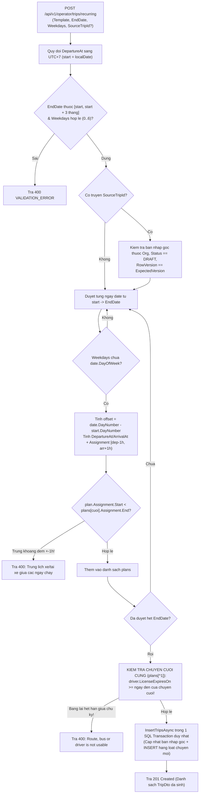
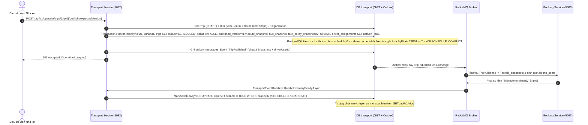
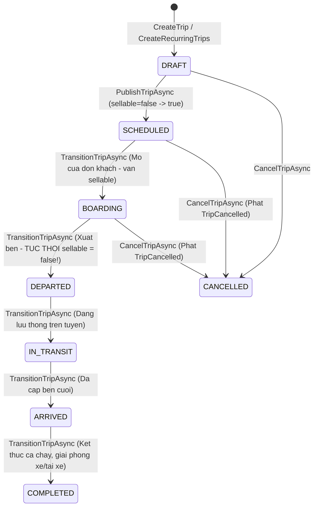

# 02. Giải Phẫu Chi Tiết Transport Service (`Port 5082` — DB `transport`)

> [!IMPORTANT]
> **Transport Service** là "trái tim điều độ vận tải và danh mục chuyến xe" của nền tảng **BLUE Bus Ticket Platform**. Service này quản lý toàn bộ vòng đời tài nguyên của từng Nhà xe (**Multi-tenant Operator Inventory**): Tổ chức pháp nhân, Đội xe & Sơ đồ ghế 2 tầng, Hồ sơ & tệp đính kèm bằng lái Tài xế, Tuyến đường & Điểm đón/trả trung gian, Lịch chạy đơn lẻ hoặc lặp định kỳ 3 tháng, đóng băng Snapshot khi mở bán, và vận hành trạng thái chuyến xe theo thời gian thực.

---

## 1. Tổng Quan Trách Nhiệm & Kiến Trúc Nội Bộ

### 1.1. Thông số định danh hệ thống

| Thuộc tính | Giá trị cấu hình thực tế | Ý nghĩa kiến trúc |
| :--- | :--- | :--- |
| **Tên Microservice** | `BusTicketPlatform.Transport` (`transport`) | Quản lý danh mục nhà xe, đội xe, tài xế, lộ trình, lịch chạy và tìm kiếm chuyến công khai |
| **Cổng HTTP nội bộ / Dev** | `5082` | Tiếp nhận truy vấn công khai `/api/v1/trips`, `/api/v1/explore/routes` và quản trị `/api/v1/operator/*`, `/api/v1/admin/organizations/*`, `/api/v1/driver/*` |
| **Cơ sở dữ liệu riêng** | PostgreSQL DB `transport` (kích hoạt `btree_gist`) | Sử dụng ràng buộc loại trừ không-thời gian **GiST Exclusion Constraint** chống trùng lịch xe và tài xế ngay ở tầng Engine CSDL |
| **Sự kiện phát ra (Outbox)** | `TripPublished`, `TripCancelled`, `TripStatusChanged` | Đồng bộ tức thời sang `Booking` (tạo kho ghế), `Notification` (báo khách) và `Reporting` |
| **Sự kiện lắng nghe (Inbox)** | `TripInventoryReady` (từ `Booking Service`) | Bật cờ `trips.sellable = true` chỉ sau khi `Booking` đã khởi tạo xong sơ đồ ghế thực tế |
| **Lưu trữ mở rộng** | `operator_resource_metadata` (`JSONB` <= 128 KB) & `operator_driver_files` (`BYTEA` <= 10 MB) | Lưu hồ sơ pháp lý nhà xe, ảnh xe/tuyến đường và bản scan GPLX tài xế (JPEG/PNG/PDF) không cần phụ thuộc S3 bên ngoài khi chạy local/sandbox |

### 1.2. Cây thư mục đầy đủ của 4 Project con

Mã nguồn đặt tại `workspace/src/services/transport/` gồm 4 project phân tầng rõ rệt:

```text
workspace/src/services/transport/
├── BusTicketPlatform.Transport.Api/                    # Tầng Giao vận HTTP (Minimal APIs, RBAC & Tenant Context)
│   ├── Program.cs                                      # Khởi tạo DI, PlatformJwt, HealthChecks, đăng ký 3 cụm Endpoints
│   ├── TransportEndpoints.cs                           # 30 HTTP Endpoints cốt lõi: Search, Explore, Admin Orgs, Operator Fleet/Route/Trip, Driver
│   ├── AdminOrganizationProfiles.cs                    # GET/PATCH /api/v1/admin/organizations/{id}/profile (gộp bảng organizations + JSONB pháp lý)
│   ├── TransportOperatorMetadata.cs                    # API /operator/resource-metadata/{kind} (JSONB ảnh/mô tả) & /operator/driver-files (upload GPLX 10MB)
│   ├── appsettings.json
│   └── appsettings.Development.json
│
├── BusTicketPlatform.Transport.Application/            # Tầng Nghiệp vụ Ứng dụng (Domain Workflows & Validation)
│   ├── TransportService.cs                             # Hơn 1.000 dòng xử lý toàn bộ nghiệp vụ: Đội xe, Tài xế, Tuyến, Chuyến lặp, Mở bán, Chuyển trạng thái
│   ├── Contracts.cs                                    # Định nghĩa Actor, DTOs, TripSearchQuery, ITransportRepository, ITransportEvents
│   └── AssemblyMarker.cs
│
├── BusTicketPlatform.Transport.Domain/                 # Tầng Hằng số & Quy tắc Miền Vận tải
│   ├── Roles.cs                                        # Hằng số Roles (PLATFORM_ADMIN, OPERATOR_*, DRIVER), OrganizationStatuses, TripStatuses (8 trạng thái)
│   └── AssemblyMarker.cs
│
└── BusTicketPlatform.Transport.Infrastructure/         # Tầng Hạ tầng Kỹ thuật (PostgreSQL, Outbox, RabbitMQ Consumer)
    ├── TransportInfrastructureExtensions.cs            # Kết nối DB, OutboxRelay, IntegrationEventConsumerHost lắng nghe TripInventoryReady
    ├── TransportDatabaseOptions.cs                     # Cấu hình chuỗi kết nối ConnectionStrings:Transport
    ├── SqlBaselineMigrator.cs                          # Tự động chạy 000_integration_tables.sql, 001_initial.sql, 002_operator_metadata.sql
    ├── SqlBaselineHostedService.cs                     # HostedService chạy migration lúc khởi động
    ├── OutboxWriter.cs                                 # Ghi sự kiện tích hợp vào bảng outbox_messages
    ├── TransportEvents.cs                              # Đóng gói payload TripPublished (kèm 3 JSON snapshots + driverUserId), TripCancelled, TripStatusChanged
    ├── TransportEventHandlers.cs                       # Xử lý sự kiện TripInventoryReady -> gọi MarkInventoryReadyAsync(tripId)
    ├── PostgresHealthCheck.cs
    └── Persistence/
        ├── TransportRepository.cs                      # Gần 1.100 dòng SQL Npgsql tối ưu cao (GiST range, LATERAL JOIN, JSONB @>, AT TIME ZONE)
        └── IdempotencyStore.cs                         # Chống gửi trùng lệnh tạo/cập nhật vận tải trên bảng idempotency_records
```

---

## 2. Thiết Kế Cơ Sở Dữ Liệu & Sơ Đồ ERD (`transport` DB)

Hệ cơ sở dữ liệu `transport` gồm **11 bảng nghiệp vụ** (9 bảng vận tải cốt lõi trong [001_initial.sql](file:///C:/Users/minht/.gemini/antigravity/worktrees/PBL6/c_to_n_b/docs/database/transport/001_initial.sql) + 2 bảng siêu dữ liệu/tệp đính kèm trong [002_operator_metadata.sql](file:///C:/Users/minht/.gemini/antigravity/worktrees/PBL6/c_to_n_b/docs/database/transport/002_operator_metadata.sql)) cùng **5 bảng hạ tầng tích hợp** (`schema_migrations`, `outbox_messages`, `inbox_messages`, `idempotency_records`, `audit_logs`).

### 2.1. Sơ đồ Thực thể — Liên kết (Mermaid ERD) của 11 bảng nghiệp vụ

```mermaid
erDiagram
    organizations ||--o{ buses : "owns_fleet"
    buses ||--o{ seats : "has_seat_layout"
    organizations ||--o{ driver_profiles : "employs_drivers"
    organizations ||--o{ stops : "manages_custom_stops"
    organizations ||--o{ routes : "operates_routes"
    stops ||--o{ routes : "origin_or_destination"
    routes ||--o{ route_stops : "ordered_waypoints"
    stops ||--o{ route_stops : "referenced_as_stop"
    organizations ||--o{ trips : "schedules_trips"
    routes ||--o{ trips : "instantiated_by"
    buses ||--o{ trips : "assigned_vehicle"
    trips ||--o{ driver_assignments : "crewed_by"
    driver_profiles ||--o{ driver_assignments : "takes_duty"
    organizations ||--o{ operator_resource_metadata : "stores_ext_jsonb"
    organizations ||--o{ operator_driver_files : "stores_license_scans"

    organizations {
        uuid id PK "UUIDv7 dinh danh nha xe (Tenant ID)"
        varchar code "UNIQUE NOT NULL (vd: FUTA, THANHBUOI)"
        varchar name "NOT NULL, ten thuong hieu hien thi"
        varchar legal_name "Ten phap nhan dang ky kinh doanh"
        varchar support_email "Email CSKH nha xe"
        varchar support_phone "Hotline nha xe"
        varchar status "ACTIVE | SUSPENDED | INACTIVE"
        boolean allow_pay_later "DEFAULT false, cho phep giu ve tra sau"
        numeric commission_rate "NUMERIC(5,4) DEFAULT 0.1000 (0..1)"
        timestamptz created_at "NOT NULL"
        timestamptz updated_at "NOT NULL"
        bigint row_version "DEFAULT 0"
    }

    buses {
        uuid id PK "UUIDv7"
        uuid organization_id FK "NOT NULL -> organizations(id)"
        varchar plate_number "Bien so hien thi (vd: 51B-123.45)"
        varchar normalized_plate_number "Chu hoa chi gom chu & so (51B12345), Partial UQ theo org"
        varchar display_name "Ten goi xe"
        varchar bus_type "LIMOUZINE | SLEEPER | SEATER..."
        jsonb amenities "DEFAULT '[]'::jsonb (wifi, usb, blanket, ac...)"
        int seat_count "NOT NULL, CHECK > 0"
        varchar status "ACTIVE | MAINTENANCE | INACTIVE"
        timestamptz deleted_at "Soft delete khi ngung hoat dong"
        bigint row_version "DEFAULT 0"
    }

    seats {
        uuid id PK "UUIDv7"
        uuid bus_id FK "NOT NULL -> buses(id)"
        varchar code "Ma ghe (1A, A01, B12...), UQ (bus_id, code)"
        smallint deck "Tang 1 hoac 2 (CHECK BETWEEN 1 AND 2)"
        smallint row_no "So hang > 0"
        smallint column_no "So cot > 0, UQ (bus_id, deck, row_no, column_no)"
        varchar seat_type "STANDARD | VIP | SLEEPER"
        boolean active "DEFAULT true (false = khoa ghe khong ban)"
        bigint row_version "DEFAULT 0"
    }

    driver_profiles {
        uuid id PK "UUIDv7"
        uuid organization_id FK "NOT NULL -> organizations(id)"
        uuid user_id_external "Tham chieu logic sang identity.users(id)"
        varchar employee_code "EMP-..., Partial UQ theo org"
        varchar license_number "So GPLX, Partial UQ theo org"
        date license_expires_on "Ngay het han bang lai"
        varchar status "ACTIVE | SUSPENDED | INACTIVE | EXPIRED"
        timestamptz deleted_at "Soft delete khi xoa tai xe"
        bigint row_version "DEFAULT 0"
    }

    stops {
        uuid id PK "UUIDv7"
        uuid organization_id FK "NULL = ben xe dung chung, UUID = diem don rieng nha xe"
        varchar code "Ma ben ST-..."
        varchar name "Ten ben xe / van phong"
        varchar address "Dia chi chi tiet"
        varchar province_code "Ma tinh thanh"
        numeric latitude "NUMERIC(9,6) -90..90"
        numeric longitude "NUMERIC(9,6) -180..180"
        varchar status "ACTIVE | INACTIVE"
    }

    routes {
        uuid id PK "UUIDv7"
        uuid organization_id FK "NOT NULL -> organizations(id)"
        varchar code "RT-..., UQ (organization_id, code)"
        varchar name "Ten tuyen duong"
        uuid origin_stop_id FK "NOT NULL -> stops(id)"
        uuid destination_stop_id FK "NOT NULL -> stops(id), CHECK <> origin_stop_id"
        int default_duration_minutes "NOT NULL, CHECK > 0"
        numeric distance_km "NUMERIC(9,2) > 0"
        varchar status "DRAFT | ACTIVE | INACTIVE"
        bigint row_version "DEFAULT 0"
    }

    route_stops {
        uuid id PK "UUIDv7"
        uuid route_id FK "NOT NULL -> routes(id) ON DELETE CASCADE"
        uuid stop_id FK "NOT NULL -> stops(id)"
        int sequence_no "Thu tu lien tuc 0..N, UQ (route_id, sequence_no)"
        varchar stop_role "ORIGIN | INTERMEDIATE | DESTINATION"
        int arrival_offset_minutes "Phut lech so voi gio xuat ben"
        int departure_offset_minutes "CHECK >= arrival_offset_minutes"
        boolean pickup_allowed "DEFAULT true"
        boolean dropoff_allowed "DEFAULT true"
    }

    trips {
        uuid id PK "UUIDv7"
        uuid organization_id FK "NOT NULL -> organizations(id)"
        uuid route_id FK "NOT NULL -> routes(id)"
        uuid bus_id FK "NOT NULL -> buses(id)"
        uuid origin_stop_id FK "NOT NULL -> stops(id)"
        uuid destination_stop_id FK "NOT NULL -> stops(id)"
        timestamptz departure_at "Gio khoi hanh"
        timestamptz arrival_at "Gio den (> departure_at)"
        tstzrange operating_window "Khoang [dep - 1h, arr + 1h), GiST EXCLUDE ex_bus_schedule"
        bigint base_fare "Gia ve co so VND >= 0"
        char currency "DEFAULT 'VND'"
        varchar status "DRAFT | SCHEDULED | BOARDING | DEPARTED | IN_TRANSIT | ARRIVED | COMPLETED | CANCELLED"
        boolean sellable "Chi true khi status IN (SCHEDULED, BOARDING) & Booking san sang"
        bigint published_version "Phien ban mo ban (1)"
        jsonb route_snapshot "Dong bang lo trinh luc Publish"
        jsonb bus_snapshot "Dong bang so do ghe & tien ich luc Publish"
        jsonb fare_policy_snapshot "Dong bang gia, chinh sach huy & allowPayLater"
        bigint row_version "DEFAULT 0"
    }

    driver_assignments {
        uuid id PK "UUIDv7"
        uuid trip_id FK "NOT NULL -> trips(id)"
        uuid driver_profile_id FK "NOT NULL -> driver_profiles(id)"
        varchar assignment_role "PRIMARY | ASSISTANT, UQ (trip_id, assignment_role)"
        tstzrange assignment_window "Khoang [dep - 1h, arr + 1h), GiST EXCLUDE ex_driver_schedule"
        boolean active "false khi DRAFT, true khi Publish"
        uuid assigned_by_external "Nguoi dieu phoi (identity userId)"
        bigint row_version "DEFAULT 0"
    }

    operator_resource_metadata {
        uuid organization_id PK "FK -> organizations(id)"
        text resource_kind PK "buses | drivers | routes | organization"
        uuid resource_id PK "ID cua bus/driver/route/org tuong ung"
        jsonb data "Toi da 128KB: anh chuyen xe/xe, taxId, dia chi phap nhan, fileId GPLX..."
        timestamptz updated_at "DEFAULT NOW()"
    }

    operator_driver_files {
        uuid id PK "UUID"
        uuid organization_id FK "NOT NULL -> organizations(id)"
        text name "Ten file goc tu header X-File-Name (1..255 ky tu)"
        text content_type "image/jpeg | image/png | application/pdf"
        bytea content "Du lieu nhi phan 1 byte .. 10 MB (10485760 bytes)"
        timestamptz created_at "DEFAULT NOW()"
    }
```



### 2.2. Những Ràng Buộc Vật Lý Cấp Cao Nhất Trong DB `transport`

1. **Extension `btree_gist` và Cặp Ràng Buộc Loại Trừ Không-Thời Gian (`EXCLUDE USING gist`)**:
   Đây là điểm sáng kỹ thuật bậc thầy trong [001_initial.sql](file:///C:/Users/minht/.gemini/antigravity/worktrees/PBL6/c_to_n_b/docs/database/transport/001_initial.sql#L190-L219). Nếu chỉ kiểm tra trùng lịch bằng lệnh `SELECT` trong C#, hai điều độ viên bấm mở bán cùng lúc 2 chuyến dùng chung 1 chiếc xe sẽ lọt qua (lỗi *Time-of-Check to Time-of-Use / Read Skew*). PostgreSQL chặn đứng hoàn toàn ở tầng vật lý bằng toán tử giao nhau khoảng thời gian `&&` trên kiểu `tstzrange`:
   - **Chống phân thân Xe khách (`ex_bus_schedule`)**:
     ```sql
     ALTER TABLE trips ADD CONSTRAINT ex_bus_schedule
       EXCLUDE USING gist (bus_id WITH =, operating_window WITH &&)
       WHERE (status IN ('SCHEDULED','BOARDING','DEPARTED','IN_TRANSIT','ARRIVED'));
     ```
   - **Chống phân thân Tài xế (`ex_driver_schedule`)**:
     ```sql
     ALTER TABLE driver_assignments ADD CONSTRAINT ex_driver_schedule
       EXCLUDE USING gist (driver_profile_id WITH =, assignment_window WITH &&)
       WHERE (active = true);
     ```
   - Trong [TransportRepository.cs](file:///C:/Users/minht/.gemini/antigravity/worktrees/PBL6/c_to_n_b/workspace/src/services/transport/BusTicketPlatform.Transport.Infrastructure/Persistence/TransportRepository.cs#L889-L890), `operating_window` và `assignment_window` luôn được cộng khoảng đệm an toàn **1 giờ trước giờ khởi hành** và **1 giờ sau giờ đến** (`[departure_at - 1h, arrival_at + 1h)`), đảm bảo xe và tài xế có thời gian quay đầu/nghỉ ngơi tối thiểu giữa hai chuyến!
   - Khi chuyến còn là bản nháp (`DRAFT`), `trips.status = 'DRAFT'` và `driver_assignments.active = false` nên điều độ viên thoải mái nháp nhiều phương án lịch chạy. Chỉ khi bấm **Publish**, cả hai điều kiện `WHERE` mới bật sáng và nếu trùng lịch, PostgreSQL ném mã lỗi `SqlState = 23P01` được bắt gọn thành `409 SCHEDULE_CONFLICT`!

2. **Covering Partial Index theo Múi Giờ Việt Nam (`ix_trips_public_search`)**:
   ```sql
   CREATE INDEX ix_trips_public_search
     ON trips (((departure_at AT TIME ZONE 'Asia/Ho_Chi_Minh')::date), origin_stop_id, destination_stop_id, departure_at)
     INCLUDE (organization_id, arrival_at, base_fare, currency, bus_id)
     WHERE sellable = true AND status IN ('SCHEDULED','BOARDING');
   ```
   Index chỉ đánh trên tập chuyến đang mở bán (`sellable = true`), tính sẵn ngày theo múi giờ `'Asia/Ho_Chi_Minh'`, và nhúng sẵn (`INCLUDE`) các cột giá vé, nhà xe, giờ đến ngay trong lá B-Tree để phục vụ hàng nghìn lượt tìm kiếm trang chủ cực nhanh.

3. **Hai bảng mở rộng linh hoạt (`operator_resource_metadata` & `operator_driver_files`)**:
   - Thay vì phải sửa schema bảng `organizations`, `buses`, `routes`, `driver_profiles` mỗi khi giao diện cổng Nhà xe / Admin bổ sung trường hiển thị mới, bảng `operator_resource_metadata` dùng khóa chính tổ hợp `(organization_id, resource_kind, resource_id)` lưu tài liệu `JSONB` tối đa **128 KB**:
     - Với `resource_kind = 'organization'`: [AdminOrganizationProfiles.cs](file:///C:/Users/minht/.gemini/antigravity/worktrees/PBL6/c_to_n_b/workspace/src/services/transport/BusTicketPlatform.Transport.Api/AdminOrganizationProfiles.cs#L34-L36) lưu hồ sơ pháp lý doanh nghiệp gồm **Tên pháp nhân (`legalName`), Mã số thuế (`taxId`), Địa chỉ trụ sở (`address`), Người đại diện liên hệ (`contactName`)** và nối JSON không ghi đè mất trường cũ bằng toán tử PostgreSQL `data = operator_resource_metadata.data || EXCLUDED.data`.
     - Với `resource_kind IN ('buses', 'routes', 'drivers')`: [TransportOperatorMetadata.cs](file:///C:/Users/minht/.gemini/antigravity/worktrees/PBL6/c_to_n_b/workspace/src/services/transport/BusTicketPlatform.Transport.Api/TransportOperatorMetadata.cs#L32-L42) lưu danh sách URL/base64 ảnh nội thất xe, ảnh bìa chuyến/tuyến đường, ghi chú bảo dưỡng và tham chiếu ID tệp bằng lái tài xế. Câu lệnh `INSERT ... SELECT ... WHERE EXISTS(SELECT 1 FROM {table} WHERE id=@id AND organization_id=@org)` đảm bảo nhà xe A tuyệt đối không thể gắn metadata vào ID tài nguyên của nhà xe B!
   - Bảng `operator_driver_files` lưu trực tiếp tệp nhị phân (`bytea`) của ảnh chụp / bản scan PDF Giấy phép lái xe tài xế với ràng buộc cứng ở cả tầng C# lẫn tầng SQL `CHECK (octet_length(content) BETWEEN 1 AND 10485760)` (**tối đa đúng 10 MB**) và whitelist cứng 3 kiểu MIME `image/jpeg`, `image/png`, `application/pdf`.

---

## 3. Danh Mục Đầy Đủ Toàn Bộ HTTP Endpoints (37 Endpoints)

### 3.1. Nhóm Công Khai — Khám phá & Tìm kiếm Chuyến xe (`Public Search & Explore`)

| Phương thức & Đường dẫn | Auth | Tham số Query / Path | HTTP Thành công & Phản hồi | Nghiệp vụ cốt lõi |
| :--- | :--- | :--- | :--- | :--- |
| `GET /api/v1/explore/routes` | Công khai | Không | `200 OK` -> `IReadOnlyList<ExploreRouteDto>` | Trả tối đa 500 cặp điểm đi - điểm đến đang có chuyến mở bán trong tương lai, kèm tổng số chuyến (`tripCount`) và số nhà xe khai thác (`operatorCount`) |
| `GET /api/v1/trips` | Công khai | `origin`, `destination`, `departureDate`, `passengerCount` (`1..10`), `minPrice`, `maxPrice`, `departureTimeFrom`, `departureTimeTo`, `organizationId`, `busType`, `pickupStopId`, `dropoffStopId`, `amenities` (phân cách dấu phẩy), `sort`, `page`, `size` (`<=100`) | `200 OK` -> `TripPageDto` | Bộ máy tìm kiếm chuyến xe đa điều kiện; ẩn hoàn toàn `routeId`, `busId`, `driverId` nội bộ trên JSON công khai |
| `GET /api/v1/trips/{tripId:guid}` | Công khai | Path `tripId` | `200 OK` -> `TripDto` | Xem thông tin chi tiết một chuyến xe kèm `allowPayLater`, giá vé, tiện ích và danh sách điểm dừng |
| `GET /api/v1/trips/{tripId:guid}/stops` | Công khai | Path `tripId` | `200 OK` -> `IReadOnlyList<TripStopDto>` | Lấy danh sách điểm đón/trả theo thứ tự `sequence_no` của chuyến xe để khách chọn lúc đặt vé |

### 3.2. Nhóm Quản trị Sàn — Tổ chức Nhà xe & Hồ sơ Pháp lý (`/api/v1/admin/*`)

| Phương thức & Đường dẫn | Vai trò | Idempotency-Key | Request Body | HTTP Thành công | Nghiệp vụ cốt lõi |
| :--- | :--- | :--- | :--- | :--- | :--- |
| `POST /api/v1/admin/organizations` | `PLATFORM_ADMIN` | **Bắt buộc** | `OrganizationInput(code, name, contactEmail, contactPhone, allowPayLater, expectedVersion)` | `201 Created` -> `OrganizationDto` | Khởi tạo nhà xe mới ở trạng thái `ACTIVE` với tỷ lệ hoa hồng sàn mặc định `10%` (`0.1000m`) |
| `GET /api/v1/admin/organizations` | `PLATFORM_ADMIN` | Không | Không | `200 OK` -> `IReadOnlyList<OrganizationDto>` | Liệt kê tất cả nhà xe trên sàn theo thứ tự bảng chữ cái |
| `GET /api/v1/admin/organizations/{organizationId:guid}` | `PLATFORM_ADMIN` (hoặc nhân sự cùng `org`) | Không | Path `organizationId` | `200 OK` -> `OrganizationDto` | Xem thông tin cấu hình vận hành của một nhà xe |
| `GET /api/v1/admin/organizations/{id:guid}/profile` | `PLATFORM_ADMIN` | Không | Path `id` | `200 OK` (JSON hợp nhất) | `LEFT JOIN` bảng `organizations` với `operator_resource_metadata` để đọc trọn bộ hồ sơ pháp lý (`legalName`, `taxId`, `address`, `contactName`) |
| `PATCH /api/v1/admin/organizations/{id:guid}/profile` | `PLATFORM_ADMIN` | Không (`ExpectedVersion`) | `AdminOrganizationProfile(...)` | `200 OK` | Giao dịch SQL 2 bước: cập nhật bảng `organizations` (kiểm tra `row_version`) + trộn JSONB pháp lý vào `operator_resource_metadata` |

### 3.3. Nhóm Cổng Nhà Xe — Đội xe, Tài xế, Tuyến đường & Chuyến xe (`/api/v1/operator/*`)

| Phân mục | Phương thức & Đường dẫn | Vai trò Nhà xe (`org` claim bắt buộc) | Idempotency-Key | HTTP Thành công & Nghiệp vụ chính |
| :--- | :--- | :--- | :--- | :--- |
| **Tổ chức** | `GET /api/v1/operator/organization` | Mọi nhân sự thuộc `org` | Không | `200 OK` — Đọc cấu hình nhà xe của chính mình (gồm cờ `allowPayLater`, `commissionRate`) |
| **Tổ chức** | `PATCH /api/v1/operator/organization` | `OPERATOR_ADMIN` | Không (`ExpectedVersion`) | `200 OK` — Cập nhật tên thương hiệu, hotline, email CSKH và bật/tắt `allowPayLater` |
| **Đội xe** | `GET /api/v1/operator/buses` | `OPERATOR_ADMIN`, `SCHEDULER`, `OPERATIONS`, `DRIVER` | Không | `200 OK` — Danh sách xe chưa xóa mềm kèm toàn bộ sơ đồ ghế 2 tầng (`Seats`) |
| **Đội xe** | `POST /api/v1/operator/buses` | `OPERATOR_ADMIN`, `OPERATOR_SCHEDULER` | **Bắt buộc** | `201 Created` — Thêm xe mới (`plateNumber` chuẩn hóa chữ-số chống trùng biển số trong cùng nhà xe), tạo sẵn ghế mẫu `1A` |
| **Đội xe** | `PATCH /api/v1/operator/buses/{busId:guid}` | `OPERATOR_ADMIN`, `OPERATOR_SCHEDULER` | Không (`ExpectedVersion`) | `200 OK` — Đổi biển số, loại xe, danh sách tiện ích JSONB (`amenities`) |
| **Đội xe** | `POST /api/v1/operator/buses/{busId:guid}/deactivate` | `OPERATOR_ADMIN`, `OPERATOR_SCHEDULER` | **Bắt buộc** | `200 OK` — Ngừng khai thác xe (`status = INACTIVE`, đánh dấu `deleted_at = NOW()`) |
| **Sơ đồ ghế** | `PUT /api/v1/operator/buses/{busId:guid}/seats` | `OPERATOR_ADMIN`, `OPERATOR_SCHEDULER` | **Bắt buộc** | `200 OK` — Thay thế toàn bộ sơ đồ ghế (`deck`, `row`, `column`, `type`); **chặn sửa nếu xe đang có chuyến hoạt động** |
| **Sơ đồ ghế** | `PATCH /api/v1/operator/buses/{busId:guid}/seats/{code}/permission` | `OPERATOR_ADMIN`, `OPERATOR_SCHEDULER` | **Bắt buộc** | `200 OK` — Khóa/Mở bán từng ghế lẻ (`active = enabled`) đồng thời tăng `buses.row_version` trong cùng transaction |
| **Tài xế** | `GET /api/v1/operator/drivers` | `ReadRoles` | Không | `200 OK` — Liệt kê hồ sơ tài xế kèm mã nhân viên `EMP-...` và hạn bằng lái |
| **Tài xế** | `POST /api/v1/operator/drivers` | `OPERATOR_ADMIN`, `OPERATOR_SCHEDULER` | **Bắt buộc** | `201 Created` — Tạo hồ sơ tài xế gắn với `userId`; tự gán trạng thái `EXPIRED` nếu ngày hết hạn GPLX ở quá khứ |
| **Tài xế** | `PATCH /api/v1/operator/drivers/{driverId:guid}` | `OPERATOR_ADMIN`, `OPERATOR_SCHEDULER` | Không (`ExpectedVersion`) | `200 OK` — Cập nhật số GPLX, ngày hết hạn (tự tính lại `ACTIVE`/`EXPIRED`) |
| **Tài xế** | `POST /api/v1/operator/drivers/{driverId:guid}/deactivate` | `OPERATOR_ADMIN`, `OPERATOR_SCHEDULER` | **Bắt buộc** | `200 OK` — Tạm ngưng tài xế (`INACTIVE`) |
| **Tài xế** | `POST /api/v1/operator/drivers/{driverId:guid}/activate` | `OPERATOR_ADMIN`, `OPERATOR_SCHEDULER` | **Bắt buộc** | `200 OK` — Khôi phục `ACTIVE` (**chặn `409` nếu GPLX đã hết hạn**) |
| **Tài xế** | `DELETE /api/v1/operator/drivers/{driverId:guid}` | `OPERATOR_ADMIN`, `OPERATOR_SCHEDULER` | **Bắt buộc** | `200 OK` — Xóa mềm tài xế (`deleted_at = NOW()`); **chặn `409` nếu tài xế đang được phân công cho chuyến chưa hoàn tất/hủy** |
| **Tuyến đường** | `GET /api/v1/operator/routes` | `ReadRoles` | Không | `200 OK` — Liệt kê tuyến đường kèm mảng điểm đón/trả `Stops` |
| **Tuyến đường** | `POST /api/v1/operator/routes` | `OPERATOR_ADMIN`, `OPERATOR_SCHEDULER` | **Bắt buộc** | `201 Created` — Tự động `UpsertStopAsync` điểm đầu/cuối và tạo 2 `route_stops` (`ORIGIN` offset `0`, `DESTINATION` offset `duration`) |
| **Tuyến đường** | `PATCH /api/v1/operator/routes/{routeId:guid}` | `OPERATOR_ADMIN`, `OPERATOR_SCHEDULER` | Không (`ExpectedVersion`) | `200 OK` — Sửa tên tuyến, bến đầu/cuối, cự ly km và thời gian hành trình |
| **Tuyến đường** | `PUT /api/v1/operator/routes/{routeId:guid}/stops` | `OPERATOR_ADMIN`, `OPERATOR_SCHEDULER` | Không | `200 OK` — Thay thế danh sách trạm dừng; bắt buộc `sequence` liên tục `0..N-1` và `offsetMinutes` không giảm |
| **Tuyến đường** | `POST /api/v1/operator/routes/{routeId:guid}/deactivate` | `OPERATOR_ADMIN`, `OPERATOR_SCHEDULER` | **Bắt buộc** | `200 OK` — Ngừng khai thác tuyến (`status = INACTIVE`) |
| **Chuyến xe** | `GET /api/v1/operator/trips` | `ReadRoles` | Không | `200 OK` (`TripPageDto`) — Danh sách chuyến của nhà xe (có trả thêm `routeId`, `busId`, `driverId`) |
| **Chuyến xe** | `POST /api/v1/operator/trips` | `OPERATOR_ADMIN`, `OPERATOR_SCHEDULER` | **Bắt buộc** | `201 Created` — Tạo chuyến nháp `DRAFT` + phân công tài xế `PRIMARY` (`active = false`) |
| **Chuyến xe** | `POST /api/v1/operator/trips/recurring` | `OPERATOR_ADMIN`, `OPERATOR_SCHEDULER` | **Bắt buộc** | `201 Created` — Sinh hàng loạt chuyến nháp lặp theo các thứ trong tuần (tối đa 3 tháng) trong 1 giao dịch nguyên tử |
| **Chuyến xe** | `PATCH /api/v1/operator/trips/{tripId:guid}` | `OPERATOR_ADMIN`, `OPERATOR_SCHEDULER` | Không (`ExpectedVersion`) | `200 OK` — Sửa thông tin chuyến khi còn ở trạng thái `DRAFT` |
| **Chuyến xe** | `POST /api/v1/operator/trips/{tripId:guid}/publish` | `OPERATOR_ADMIN`, `OPERATOR_SCHEDULER` | **Bắt buộc** | `202 Accepted` — Chuyển `DRAFT -> SCHEDULED`, chụp 3 JSON snapshots, bật `driver_assignments.active = true`, phát sự kiện `TripPublished` |
| **Chuyến xe** | `POST /api/v1/operator/trips/{tripId:guid}/cancel` | `OPERATOR_ADMIN`, `OPERATOR_OPERATIONS` | **Bắt buộc** | `202 Accepted` — Hủy chuyến (`CANCELLED`, `sellable = false`) và phát sự kiện `TripCancelled` để hoàn vé/báo khách |
| **Chuyến xe** | `POST /api/v1/operator/trips/{tripId:guid}/status-transitions` | `OPERATOR_ADMIN`, `OPERATOR_OPERATIONS`, `DRIVER` (đúng chuyến) | **Bắt buộc** | `200 OK` — Chuyển trạng thái vận hành tuần tự `SCHEDULED -> BOARDING -> DEPARTED -> IN_TRANSIT -> ARRIVED -> COMPLETED` |
| **Chuyến xe** | `DELETE /api/v1/operator/trips/{tripId:guid}` | Đã đăng nhập | Không | `405 Method Not Allowed` — Chủ đích từ chối xóa cứng chuyến xe để bảo toàn lịch sử đối soát |

### 3.4. Nhóm Metadata Nhà xe, Tệp Bằng lái Tài xế, Lịch Tài xế & Nội bộ

| Phương thức & Đường dẫn | Phân quyền | HTTP Thành công | Nghiệp vụ cốt lõi |
| :--- | :--- | :--- | :--- |
| `GET /api/v1/operator/resource-metadata/{kind}` | Nhân sự có claim `org` (`kind` thuộc `buses\|drivers\|routes\|organization`) | `200 OK` (`Dictionary<Guid, JsonElement>`) | Đọc toàn bộ metadata mở rộng (ảnh xe, ảnh tuyến, thông tin bổ sung tài xế) của nhà xe |
| `PUT /api/v1/operator/resource-metadata/{kind}/{id:guid}` | `OPERATOR_ADMIN`, `OPERATOR_SCHEDULER`, `PLATFORM_ADMIN` + `org` | `200 OK` | Lưu JSON object (`<= 131,072` ký tự) sau khi kiểm chứng tài nguyên `id` thực sự thuộc `org` |
| `POST /api/v1/operator/driver-files` | `OPERATOR_ADMIN`, `OPERATOR_SCHEDULER`, `PLATFORM_ADMIN` + `org` | `201 Created` (`{id, name, type, size}`) | Upload stream nhị phân (`jpeg`/`png`/`pdf`, `1B..10MB`, header `X-File-Name`) vào bảng `operator_driver_files` |
| `GET /api/v1/operator/driver-files/{id:guid}` | Nhân sự cùng `org` | `200 OK` (`Results.File`) | Tải xuống hoặc xem trực tiếp tệp đính kèm bằng lái tài xế (cô lập chặt theo `organization_id`) |
| `DELETE /api/v1/operator/driver-files/{id:guid}` | `OPERATOR_ADMIN`, `OPERATOR_SCHEDULER`, `PLATFORM_ADMIN` + `org` | `204 No Content` | Xóa tệp đính kèm bằng lái khỏi CSDL |
| `GET /api/v1/driver/assignments` | Tài xế đã đăng nhập | `200 OK` -> `IReadOnlyList<DriverAssignmentDto>` | Tài xế xem danh sách ca chạy đang `active = true` gắn với `user_id_external = UserId` của mình |
| `POST /internal/trips/{tripId:guid}/inventory-ready` | Endpoint nội bộ liên service | `202 Accepted` | Bật `trips.sellable = true` (dự phòng/hỗ trợ đồng bộ song song với sự kiện RabbitMQ `TripInventoryReady`) |

---

## 4. Giải Phẫu Sâu 4 Cơ Chế Nghiệp Vụ Trọng Tâm Của Transport Service

### 4.1. Bộ Máy Tìm Kiếm Chuyến Xe Đa Bộ Lọc (`SearchSellableAsync`)

Khi khách hàng lọc chuyến trên trang tìm kiếm, `GET /api/v1/trips` gọi `TransportService.SearchAsync` (kiểm tra `passengerCount` trong `1..10`, `size <= 100` và whitelist 6 kiểu sắp xếp) rồi chuyển xuống [TransportRepository.cs](file:///C:/Users/minht/.gemini/antigravity/worktrees/PBL6/c_to_n_b/workspace/src/services/transport/BusTicketPlatform.Transport.Infrastructure/Persistence/TransportRepository.cs#L642-L711). Hãy mổ xẻ câu lệnh SQL 14 tầng lọc cực kỳ tinh tế tại đây:

```sql
t.sellable = true AND t.status IN ('SCHEDULED','BOARDING')
  AND o.name IS NOT NULL
  AND lower(os.name) LIKE lower(@origin)
  AND lower(ds.name) LIKE lower(@dest)
  AND t.departure_at > NOW()
  AND (@date IS NULL OR (t.departure_at AT TIME ZONE 'Asia/Ho_Chi_Minh')::date = @date)
  AND t.base_fare >= COALESCE(@minPrice, 0)
  AND t.base_fare <= COALESCE(@maxPrice, 9223372036854775807)
  AND (@org IS NULL OR t.organization_id = @org)
  AND (@busType IS NULL OR b.bus_type = @busType)
  AND (@timeFrom IS NULL OR (t.departure_at AT TIME ZONE 'Asia/Ho_Chi_Minh')::time >= @timeFrom)
  AND (@timeTo IS NULL OR (t.departure_at AT TIME ZONE 'Asia/Ho_Chi_Minh')::time <= @timeTo)
  AND (@pickup IS NULL OR EXISTS (
        SELECT 1 FROM route_stops rs
        WHERE rs.route_id = t.route_id AND rs.stop_id = @pickup AND rs.pickup_allowed))
  AND (@dropoff IS NULL OR EXISTS (
        SELECT 1 FROM route_stops rs
        WHERE rs.route_id = t.route_id AND rs.stop_id = @dropoff AND rs.dropoff_allowed))
  AND (@amenitiesJson::jsonb IS NULL OR b.amenities @> @amenitiesJson::jsonb)
  AND b.seat_count >= @passengers
```

#### Phân tích kỹ thuật từng mệnh đề lọc & sắp xếp:
1. **Điều kiện mở bán kép (`t.sellable = true AND t.status IN ('SCHEDULED','BOARDING') AND t.departure_at > NOW()`)**:
   - Không bao giờ hiển thị chuyến `DRAFT`, chuyến đã lăn bánh (`DEPARTED`), chuyến đã hủy, hoặc chuyến vừa mới bấm Publish nhưng `Booking Service` chưa dựng xong sơ đồ ghế (`sellable` vẫn đang `false`).
2. **Xử lý chuẩn xác Múi giờ Việt Nam (`AT TIME ZONE 'Asia/Ho_Chi_Minh'`) cho cả Ngày lẫn Khung giờ**:
   - Mọi cột `timestamptz` trong PostgreSQL lưu ở chuẩn UTC. Một chuyến xe khởi hành lúc `01:30 sáng ngày 20/11 giờ Việt Nam` thực chất lưu trong DB là `18:30 ngày 19/11 UTC`!
   - Nếu lập trình viên ngây thơ viết `t.departure_at::date = @date`, khách tìm vé ngày `20/11` sẽ bị mất toàn bộ các chuyến xe đêm từ `00:00` đến `06:59` sáng! Phép ép kiểu `(t.departure_at AT TIME ZONE 'Asia/Ho_Chi_Minh')::date` và `::time` giải quyết triệt để bài toán lệch múi giờ cho cả bộ lọc ngày đi (`departureDate`) lẫn bộ lọc khung giờ sáng/chiều/tối (`departureTimeFrom` .. `departureTimeTo`).
3. **Lọc Điểm Đón / Điểm Trả trung gian bằng `EXISTS` trên `route_stops`**:
   - Một tuyến *Sài Gòn -> Đà Lạt* có thể đi qua hàng chục điểm dừng dọc Quốc lộ 20. Khi khách lọc cụ thể một văn phòng/bến đón (`pickupStopId`) hoặc điểm xuống (`dropoffStopId`), câu truy vấn con `EXISTS` kiểm tra đồng thời trạm đó nằm trên lộ trình (`rs.route_id = t.route_id`) **VÀ** được nhà xe cấp phép đón (`rs.pickup_allowed = true`) hoặc trả (`rs.dropoff_allowed = true`).
4. **Toán tử bao hàm tập hợp JSONB (`b.amenities @> @amenitiesJson::jsonb`)**:
   - Tham số query `?amenities=wifi,usb,blanket` được tách thành mảng JSON `["wifi","usb","blanket"]`. Toán tử `@>` (JSONB Containment) của PostgreSQL kiểm tra mảng `b.amenities` của chiếc xe có **chứa đầy đủ tất cả** tiện ích mà khách yêu cầu hay không (chứ không chỉ khớp 1 tiện ích rời rạc), không cần tạo bảng phụ nhiều-nhiều `bus_amenities`!
5. **6 chế độ sắp xếp & Khóa phá hòa tất định (`ORDER BY {order}, t.id`)**:
   - Hỗ trợ `PRICE_ASC`, `PRICE_DESC`, `DEPARTURE_ASC` (mặc định), `DEPARTURE_DESC`, `DURATION_ASC` (`(t.arrival_at - t.departure_at) ASC`), và `DURATION_DESC`.
   - Việc nối thêm `, t.id` vào cuối mệnh đề `ORDER BY` là kỹ thuật bắt buộc trong phân trang `OFFSET / LIMIT`: khi 2 chuyến xe có cùng giá vé `250.000đ` hoặc cùng xuất bến lúc `22:00`, thứ tự giữa trang 1 và trang 2 luôn cố định tuyệt đối, không bao giờ xảy ra hiện tượng lặp dòng hoặc sót dòng khi chuyển trang!
6. **Bảo mật thông tin nội bộ Nhà xe bằng `[JsonIgnore(WhenWritingNull)]`**:
   - Trong `Contracts.cs` dòng 50–55, ba thuộc tính `RouteId`, `BusId`, `DriverId` của `TripDto` mặc định mang giá trị `null` khi gọi từ API công khai `SearchAsync` / `GetPublicTripAsync`, nên trình tuần tự JSON tự động lược bỏ chúng. Chỉ khi nhân sự nhà xe gọi `GET /api/v1/operator/trips` (`ListOperatorTripsAsync`), ba trường này mới được gán giá trị để phục vụ form chỉnh sửa lịch xe trên cổng Operator!

---

### 4.2. Thuật Toán Tạo Lịch Chuyến Lặp Theo Thứ Trong Tuần (`CreateRecurringTripsAsync`)

Thực tế vận hành nhà xe tuyến cố định không bao giờ nhập tay từng chuyến cho 90 ngày liên tiếp. Endpoint `POST /api/v1/operator/trips/recurring` tại [TransportService.cs](file:///C:/Users/minht/.gemini/antigravity/worktrees/PBL6/c_to_n_b/workspace/src/services/transport/BusTicketPlatform.Transport.Application/TransportService.cs#L529-L608) giải quyết bài toán nhân bản lịch chạy định kỳ với **5 chốt chặn kỹ thuật cực kỳ chặt chẽ**:



#### Tại sao thiết kế của `CreateRecurringTripsAsync` rất đáng học hỏi?
1. **Quy đổi thứ trong tuần theo giờ địa phương Việt Nam (`UTC+7`)**:
   Dòng 535 chuyển `template.DepartureAt.ToOffset(TimeSpan.FromHours(7))` trước khi lấy `start` và kiểm tra `(int)date.DayOfWeek` (`0 = Chủ Nhật .. 6 = Thứ Bảy`). Nếu dùng trực tiếp `UtcDateTime`, một chuyến xe khởi hành lúc `05:00 sáng Thứ Hai (VN)` sẽ bị hiểu nhầm là `22:00 tối Chủ Nhật (UTC)` và sinh sai toàn bộ lịch chạy trong tuần!
2. **Giới hạn chân trời lập lịch tối đa 3 tháng (`EndDate <= start.AddMonths(3)`)**:
   Ngăn điều độ viên vô tình truyền năm `2099` tạo ra hàng chục nghìn bản ghi làm nghẽn giao dịch CSDL.
3. **Tái sử dụng mượt mà bản nháp đầu tiên (`SourceTripId`)**:
   Nếu điều độ viên vừa tạo 1 chuyến nháp đơn lẻ rồi quyết định biến nó thành lịch lặp thứ Hai - Tư - Sáu, `SourceTripId` cho phép cập nhật ngay bản nháp gốc ở ngày `offset == 0` (kèm kiểm tra `ExpectedVersion` chống ghi đè) và chỉ `INSERT` các ngày phát sinh tiếp theo trong cùng một `NpgsqlTransaction` (`InsertTripsAsync`).
4. **Phát hiện sớm va chạm hành trình xuyên ngày (`plan.Assignment.Start < plans[^1].Assignment.End`)**:
   Ví dụ tuyến Bắc - Nam *Sài Gòn -> Hà Nội* kéo dài `30 giờ`, nhưng điều độ viên lại tích chọn chạy liên tiếp cả Thứ Hai và Thứ Ba cho cùng 1 xe và 1 tài xế! Dòng 577 so sánh ngay thời điểm bắt đầu nhận ca của chuyến sau (`DepartureAt - 1h`) với thời điểm kết thúc ca của chuyến liền trước (`ArrivalAt + 1h`) và báo lỗi tiếng Việt rõ ràng ngay trong bộ nhớ trước khi chạm tới CSDL.
5. **Kiểm tra hạn Bằng lái Tài xế tới tận chuyến cuối cùng trong chuỗi 3 tháng (Dòng 582–588)**:
   Giả sử hôm nay là `01/11`, bằng lái tài xế hết hạn ngày `15/12`, còn nhà xe tạo lịch lặp tới `31/01` năm sau:
   - Chuyến đầu tiên (`01/11`) vượt qua `PrepareTripDraftAsync` vì bằng lái vẫn còn hạn.
   - Các chuyến từ thứ 2 trở đi được nhân bản nhanh trong RAM từ `plans[0]` để tránh gọi lại DB `3 × 90 = 270` lần (tối ưu hiệu năng `O(1)` truy vấn kiểm tra!).
   - Sau vòng lặp, dòng 585 lấy **chuyến cuối cùng `last = plans[^1].Trip`** (có ngày đến muộn nhất) chạy qua `PrepareTripDraftAsync` để kiểm tra `driver.LicenseExpiresOn < DateOnly.FromDateTime(last.ArrivalAt.UtcDateTime)`. Vì ngày đến là tính chất đơn điệu tăng, nếu bằng lái còn hạn ở chuyến cuối cùng thì chắc chắn hợp lệ cho **100% các chuyến đứng trước nó**! Một tối ưu vừa chặt chẽ về toán học, vừa tiết kiệm hàng trăm câu truy vấn DB!

---

### 4.3. Quy Trình Mở Bán Hai Pha & Đóng Băng Snapshot (`PublishTripAsync`)

Khi điều độ viên bấm **Mở bán** (`POST /api/v1/operator/trips/{tripId}/publish`), hệ thống không chỉ đơn giản đổi một cột `status`, mà thực hiện vũ đạo bất đồng bộ (**Asynchronous Choreography**) gồm 4 bước giữa `Transport` và `Booking`:



**Tại sao phải đóng băng 3 cột JSONB Snapshot (`route_snapshot`, `bus_snapshot`, `fare_policy_snapshot`)?**
Sau khi chuyến xe ngày Tết đã mở bán và có 20 hành khách mua vé, nhà xe có thể vào danh mục cấu hình sửa tên tuyến đường, tắt cờ `allowPayLater` của tổ chức, hoặc cập nhật tiện ích xe cho các tháng sau. Nhờ chụp lại nguyên trạng lộ trình, danh sách ghế (`Id, Code, Deck, Row, Column, Type, Active`) và chính sách giá/hủy (`baseFare, currency, policyVersion: "cancel-mvp-v1", allowPayLater`) ngay thời điểm `PublishTripAsync`, mọi giao dịch đặt vé và hoàn hủy của chuyến đó luôn bám sát hợp đồng thương mại lúc mở bán!

---

### 4.4. Máy Trạng Thái Vận Hành Chuyến Xe & Quyền Tài Xế (`TransitionTripAsync`)



Tại [TransportService.cs](file:///C:/Users/minht/.gemini/antigravity/worktrees/PBL6/c_to_n_b/workspace/src/services/transport/BusTicketPlatform.Transport.Application/TransportService.cs#L825-L859) và dòng `942–950`, hàm `TransitionTripAsync` thực thi 4 quy tắc cốt lõi:
1. **Chỉ cho phép chuyển tiến đơn hướng tuần tự (`IsAllowedTransition`)**:
   - `SCHEDULED -> BOARDING -> DEPARTED -> IN_TRANSIT -> ARRIVED -> COMPLETED`.
   - Mọi nỗ lực nhảy cóc (như `SCHEDULED -> COMPLETED`) hoặc lùi trạng thái (`DEPARTED -> BOARDING`) đều bị từ chối bằng mã lỗi `INVALID_STATE_TRANSITION`.
2. **Phân quyền theo Tài nguyên cho Tài xế (`Resource-Based Authorization`)**:
   - Nếu người gọi có vai trò `OPERATOR_ADMIN` hoặc `OPERATOR_OPERATIONS`: được phép chuyển trạng thái cho mọi chuyến thuộc nhà xe của mình.
   - Nếu người gọi **chỉ có vai trò `DRIVER`** (`driverOnly` ở dòng 843): hệ thống truy vấn `store.IsDriverAssignedToTripAsync(actor.UserId, tripId)` kiểm tra bảng `driver_assignments JOIN driver_profiles` xem tài xế đó có thực sự đang được phân công (`active = true`) lái đúng chuyến xe `tripId` này hay không! Tài xế xe A không bao giờ bấm "Xuất bến" nhầm sang chuyến của tài xế xe B trong cùng nhà xe.
3. **Tự động ngắt mở bán ngay khi xe lăn bánh**:
   - Dòng 854 tính lại cờ mở bán: `var sellable = request.TargetStatus is TripStatuses.Scheduled or TripStatuses.Boarding && trip.Sellable;`
   - Khi xe chuyển sang `BOARDING` (đang đón khách tại bến), khách đặt vé sát giờ vẫn mua được ghế trống còn lại. Ngay khoảnh khắc tài xế bấm chuyển sang `DEPARTED`, `sellable` lập tức hạ xuống `false` (đồng thời thỏa mãn ràng buộc SQL `ck_trips_sellable`) và sự kiện `TripStatusChanged` được bắn sang `Booking Service` để khóa sơ đồ bán vé.
4. **Giải phóng khóa GiST khi hoàn tất chuyến (`COMPLETED` / `CANCELLED`)**:
   - Nhớ lại mệnh đề `WHERE` của `ex_bus_schedule`: `status IN ('SCHEDULED','BOARDING','DEPARTED','IN_TRANSIT','ARRIVED')`. Khi chuyến xe cán đích chuyển sang `COMPLETED` (hoặc bị hủy sang `CANCELLED`), khoảng thời gian `operating_window` tự động được rút khỏi chỉ mục loại trừ GiST nếu lịch xe cần điều chỉnh sớm hơn dự kiến.

---

## 5. Tổng Hợp Các Chốt Chặn Toàn Vẹn Đội Xe & Tuyến Đường

Để tránh làm hỏng dữ liệu liên kết đang vận hành, `TransportService` và `TransportRepository` cài đặt hàng loạt chốt chặn nghiệp vụ thực tế:

| Thao tác của Nhà xe | Chốt chặn bảo vệ trong Code / SQL | Thông báo / Mã lỗi trả về |
| :--- | :--- | :--- |
| Đổi sơ đồ ghế xe (`PUT /buses/{busId}/seats`) | `BusHasActiveTripsAsync(busId)`: kiểm tra có chuyến nào thuộc xe đang ở trạng thái khác `DRAFT`, `CANCELLED`, `COMPLETED` không | `400 VALIDATION_ERROR`: *"Seat layout cannot change while the bus has active trips."* |
| Thêm xe trùng biển số (`51B-123.45` vs `51b 12345`) | Hàm `NormalizePlate` lọc chỉ giữ chữ và số viết hoa (`51B12345`) + Partial Unique Index `uq_buses_active_plate` bắt `SqlState == 23505` | `409 RESOURCE_CONFLICT`: *"The bus plate number is already in use."* |
| Xóa tài xế (`DELETE /drivers/{driverId}`) | `DeleteDriverAsync` dùng câu lệnh `UPDATE ... WHERE NOT EXISTS (SELECT 1 FROM driver_assignments a JOIN trips t ... WHERE t.status NOT IN ('COMPLETED','CANCELLED'))` | `409 RESOURCE_CONFLICT`: *"Tài xế đang được phân công cho chuyến chưa kết thúc. Hãy đổi tài xế của chuyến trước khi xóa."* |
| Kích hoạt lại tài xế (`POST /drivers/{driverId}/activate`) | Kiểm tra `driver.LicenseExpiresOn < DateOnly.FromDateTime(DateTime.UtcNow)` | `409 RESOURCE_CONFLICT`: *"Giấy phép lái xe đã hết hạn. Cập nhật ngày hết hạn trước khi khôi phục."* |
| Cập nhật danh sách trạm dừng (`PUT /routes/{routeId}/stops`) | Bắt buộc `>= 2` trạm, tên không trùng nhau, `Sequence` liên tục `0, 1, ..., N-1`, và `OffsetMinutes` tăng dần không giảm | `400 VALIDATION_ERROR`: *"Route stop sequence and offsets must be contiguous and increasing."* |
| Xóa cứng chuyến xe (`DELETE /operator/trips/{tripId}`) | `RejectHardDeleteAsync` chặn thẳng ở tầng Endpoint | `405 Method Not Allowed`: *"Hard deletion is not supported; cancel or deactivate the resource instead."* |
