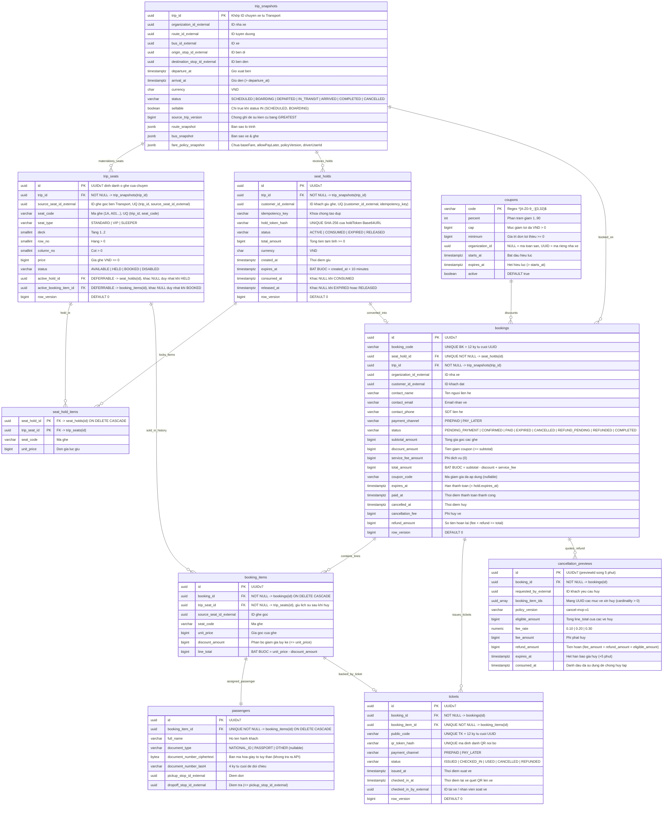
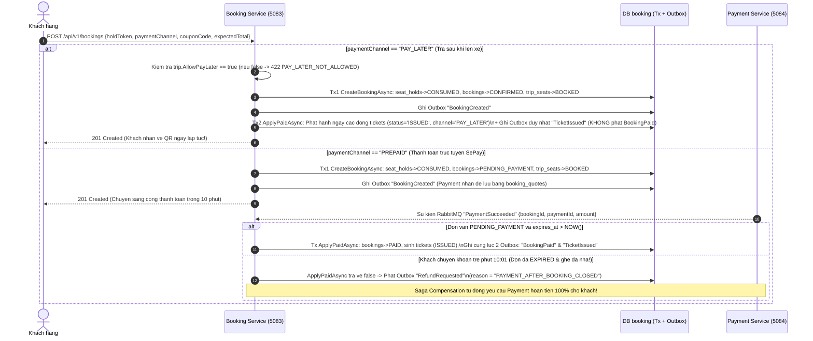

# 03. Giải Phẫu Chi Tiết Booking Service (`Port 5083` — DB `booking`)

> [!IMPORTANT]
> **Booking Service** là tâm điểm giao dịch thương mại và kiểm soát đồng thời (**High-Concurrency Inventory Engine**) của toàn bộ dự án **BLUE Bus Ticket Platform**. Đây là nơi giải quyết bài toán khó nhất của hệ thống bán vé: hàng trăm hành khách cùng bấm chọn một ghế trống trong cùng một mili-giây, giữ chỗ có thời hạn 10 phút, tính toán mã giảm giá không lệch dù chỉ 1 đồng lẻ, phát hành vé QR chống giả mạo bằng chữ ký mật mã `HMAC-SHA256`, tra cứu vé khách vãng lai không cần tài khoản, và bù trừ Saga hoàn tiền tự động khi thanh toán đến trễ.

---

## 1. Tổng Quan Trách Nhiệm & Kiến Trúc Nội Bộ

### 1.1. Thông số định danh hệ thống

| Thuộc tính | Giá trị cấu hình thực tế | Ý nghĩa kiến trúc |
| :--- | :--- | :--- |
| **Tên Microservice** | `BusTicketPlatform.Booking` (`booking`) | Quản lý tồn kho ghế theo chuyến, giữ ghế tạm thời, đơn đặt vé, mã giảm giá, phát hành vé QR, hoàn hủy và soát vé lên xe |
| **Cổng HTTP nội bộ / Dev** | `5083` | Phục vụ các cụm `/api/v1/trips/*/seats`, `/api/v1/seat-holds/*`, `/api/v1/coupons/*`, `/api/v1/bookings/*`, `/api/v1/tickets/*`, `/api/v1/operator/trips/*/manifest` |
| **Cơ sở dữ liệu riêng** | PostgreSQL DB `booking` | Sử dụng `SELECT ... FOR UPDATE`, `FOR SHARE`, và ràng buộc khóa ngoại trì hoãn `DEFERRABLE INITIALLY DEFERRED` |
| **Sự kiện lắng nghe (Inbox)** | `TripPublished`, `TripStatusChanged`, `TripCancelled` (từ `Transport`); `PaymentSucceeded` (từ `Payment`) | Tự chủ 100% bản sao chuyến xe (`trip_snapshots`) và kích hoạt xuất vé khi nhận xác nhận thanh toán |
| **Sự kiện phát ra (Outbox)** | `TripInventoryReady`, `BookingCreated`, `BookingPaid`, `TicketIssued`, `BookingCancelled`, `RefundRequested` | Điều phối chuỗi Saga xuyên suốt sang `Transport`, `Payment`, `Notification` và `Reporting` |
| **Bảo mật chống cào dữ liệu** | Fixed-Window Rate Limiter `ticket-lookup` (`40 req / 1 phút -> HTTP 429`) + `TicketLookupToken` nhị phân 75 ký tự | Bảo vệ luồng tra cứu vé công khai bằng Mã đặt chỗ + SĐT/Email khỏi tấn công vét cạn |

### 1.2. Cây thư mục đầy đủ của 4 Project con

Mã nguồn đặt tại `workspace/src/services/booking/` gồm 4 project:

```text
workspace/src/services/booking/
├── BusTicketPlatform.Booking.Api/                      # Tầng Giao vận HTTP (Minimal APIs, Rate Limiter, Idempotency)
│   ├── Program.cs                                      # Cấu hình DI, PlatformJwt, RateLimiter "ticket-lookup" (40/phút), HealthChecks
│   ├── BookingEndpoints.cs                             # Định nghĩa toàn bộ 24 HTTP Endpoints (Public, Customer, Operator, Driver, Admin, Internal)
│   ├── appsettings.json
│   └── appsettings.Development.json
│
├── BusTicketPlatform.Booking.Application/              # Tầng Nghiệp vụ Ứng dụng (Trái tim xử lý đặt vé & vé điện tử)
│   ├── BookingService.cs                               # Gần 800 dòng: Giữ ghế, Coupon lũy kế, Tạo đơn PREPAID/PAY_LATER, Hủy 2 bước, Quét QR Check-in
│   ├── Contracts.cs                                    # Toàn bộ DTO, Record, IBookingRepository, IBookingEvents & CancellationPolicy (10%/20%/30%)
│   ├── TicketQr.cs                                     # Sinh & kiểm tra vé QR định dạng BT1.<ticketIdHex>.<HMACSHA256> hằng thời gian
│   ├── TicketLookupToken.cs                            # Đóng gói token tra cứu 56 bytes (Guid + UnixExpiry + HMAC-SHA256) Base64URL 75 ký tự
│   └── AssemblyMarker.cs
│
├── BusTicketPlatform.Booking.Domain/                   # Tầng Miền Đặt vé
│   └── AssemblyMarker.cs
│
└── BusTicketPlatform.Booking.Infrastructure/           # Tầng Hạ tầng Kỹ thuật (PostgreSQL Npgsql, Outbox, Event Consumers)
    ├── BookingInfrastructureExtensions.cs              # Đăng ký Repository, OutboxRelay, Consumer lắng nghe sự kiện Transport & Payment
    ├── BookingDatabaseOptions.cs                       # Cấu hình ConnectionStrings:Booking
    ├── SqlBaselineMigrator.cs                          # Chạy 000_integration_tables.sql, 001_initial.sql, 002_coupons.sql
    ├── SqlBaselineHostedService.cs
    ├── OutboxWriter.cs                                 # Ghi sự kiện tích hợp vào bảng outbox_messages
    ├── BookingEvents.cs                                # Đóng gói các sự kiện BookingCreated, BookingCancelled, RefundRequested, TripInventoryReady...
    ├── BookingEventHandlers.cs                         # Nhận TripPublished, TripStatusChanged, TripCancelled, PaymentSucceeded
    ├── PostgresHealthCheck.cs
    └── Persistence/
        ├── BookingRepository.cs                        # Hơn 1.000 dòng SQL giao dịch nguyên tử: khóa ghế FOR UPDATE, phát hành vé & Outbox cùng Tx
        ├── CouponRepository.cs                         # Partial class của BookingRepository quản lý bảng coupons
        └── IdempotencyStore.cs                         # Lưu vết Idempotency-Key chống tạo đúp giữ ghế, đặt vé, hủy vé và check-in
```

---

## 2. Thiết Kế Cơ Sở Dữ Liệu & Sơ Đồ ERD (`booking` DB)

Cơ sở dữ liệu `booking` sở hữu **10 bảng nghiệp vụ** (khởi tạo từ [001_initial.sql](file:///C:/Users/minht/.gemini/antigravity/worktrees/PBL6/c_to_n_b/docs/database/booking/001_initial.sql), [002_coupons.sql](file:///C:/Users/minht/.gemini/antigravity/worktrees/PBL6/c_to_n_b/docs/database/booking/002_coupons.sql) và tinh chỉnh bán lại ghế sau hủy tại [012_rebook_after_cancel.sql](file:///C:/Users/minht/.gemini/antigravity/worktrees/PBL6/c_to_n_b/docs/database/booking/012_rebook_after_cancel.sql)) cùng **5 bảng hạ tầng tích hợp** (`schema_migrations`, `outbox_messages`, `inbox_messages`, `idempotency_records`, `audit_logs`).

### 2.1. Sơ đồ Thực thể — Liên kết (Mermaid ERD) của 10 bảng nghiệp vụ



### 2.2. Giải thích các Ràng Buộc Bất Biến Đáng Giá Nhất Của DB `booking`

1. **Bất biến Chủ sở hữu Ghế (`ck_trip_seat_owner` trên `trip_seats`)**:
   PostgreSQL cưỡng chế mối quan hệ 1-1 tuyệt đối giữa cột `status` và 2 con trỏ sở hữu hiện hành:
   - Khi `AVAILABLE` hoặc `DISABLED`: cả `active_hold_id` và `active_booking_item_id` bắt buộc bằng `NULL`.
   - Khi `HELD`: bắt buộc có `active_hold_id` và `active_booking_item_id IS NULL`.
   - Khi `BOOKED`: bắt buộc `active_hold_id IS NULL` và có `active_booking_item_id`.
   Nhờ ràng buộc này, **không bao giờ tồn tại lỗi một chiếc ghế vừa đang được khách A giữ chỗ vừa đã bán cho khách B**, hoặc ghế đã hủy vé nhưng quên xóa con trỏ sở hữu!

2. **Khóa ngoại tham chiếu vòng trì hoãn (`DEFERRABLE INITIALLY DEFERRED`) & Khả năng Bán lại ghế sau khi Hủy (`012_rebook_after_cancel.sql`)**:
   - Bảng `booking_items` trỏ tới `trip_seats(id)`, trong khi `trip_seats.active_booking_item_id` lại trỏ ngược về `booking_items(id)`! Bằng cách khai báo 2 khóa ngoại `fk_trip_seats_active_hold` và `fk_trip_seats_active_booking_item` là `DEFERRABLE INITIALLY DEFERRED` và bật `SET CONSTRAINTS ALL DEFERRED;` ở đầu giao dịch `CreateBookingAsync`, PostgreSQL cho phép thực hiện mượt mà chuỗi chuyển đổi `seat_holds (CONSUMED) -> INSERT booking_items -> UPDATE trip_seats (BOOKED)` rồi kiểm chứng toàn bộ ràng buộc ngay thời điểm `COMMIT`.
   - Khi khách hàng hủy vé (`CancelAsync`), dòng lịch sử trong `booking_items` vẫn được giữ nguyên để phục vụ đối soát kế toán, còn cột `trip_seats.active_booking_item_id` được trả về `NULL` và `status = 'AVAILABLE'`. Tập lệnh `012_rebook_after_cancel.sql` gỡ bỏ ràng buộc duy nhất cũ trên `booking_items(trip_seat_id)` để chiếc ghế đó lập tức có thể bán lại cho hành khách mới trên cùng chuyến xe!

3. **Bảo vệ dữ liệu CCCD/Hộ chiếu hành khách (`passengers`)**:
   - Ràng buộc `ck_passengers_document_pair` đảm bảo nếu có truyền `document_type` (`NATIONAL_ID`, `PASSPORT`, `OTHER`) thì số giấy tờ được lưu vào cột nhị phân `document_number_ciphertext (bytea)` và trích 4 ký tự cuối vào `document_number_last4`.
   - Đặc biệt, tại [BookingRepository.cs](file:///C:/Users/minht/.gemini/antigravity/worktrees/PBL6/c_to_n_b/workspace/src/services/booking/BusTicketPlatform.Booking.Infrastructure/Persistence/BookingRepository.cs#L916-L938), hàm `LoadPassengers` chủ đích **không bao giờ `SELECT` cột `document_number_ciphertext`** và trả `DocumentNumber: null` ra ngoài `BookingDto`, ngăn rò rỉ số định danh cá nhân qua JSON API.

4. **Đẳng thức Kế toán cứng trên `bookings`, `booking_items` và `cancellation_previews`**:
   - Trên `bookings`: `total_amount = subtotal_amount - discount_amount + service_fee_amount` và `coalesce(cancellation_fee, 0) + coalesce(refund_amount, 0) <= total_amount`.
   - Trên `booking_items`: `line_total = unit_price - discount_amount` (`discount_amount <= unit_price`).
   - Trên `cancellation_previews`: `fee_amount + refund_amount = eligible_amount`.

---

## 3. Danh Mục Đầy Đủ Toàn Bộ HTTP Endpoints (24 Endpoints)

| Phân nhóm | Phương thức & Đường dẫn | Phân quyền / Giới hạn | Idempotency-Key | HTTP Thành công & Nghiệp vụ cốt lõi |
| :--- | :--- | :--- | :--- | :--- |
| **Tồn kho ghế** | `GET /api/v1/trips/availability?ids=...` | Công khai | Không | `200 OK` (`Dictionary<Guid, int>`) — Dọn dẹp các phiên giữ ghế hết hạn (`ExpireHoldsAsync`) rồi đếm nhanh số ghế `AVAILABLE` cho tối đa 100 chuyến cùng lúc |
| **Sơ đồ ghế** | `GET /api/v1/trips/{tripId:guid}/seats` | `Bearer JWT` | Không | `200 OK` -> `TripSeatListDto` — Trả danh sách toàn bộ ghế theo thứ tự `(deck, row_no, column_no)` kèm trạng thái thực và `serverTime` đồng bộ đồng hồ đếm ngược |
| **Giữ ghế** | `POST /api/v1/trips/{tripId:guid}/seat-holds` | `CUSTOMER` | **Bắt buộc** | `201 Created` -> `SeatHoldDto` — Khóa `FOR UPDATE` từ `1..10` ghế trong đúng **10 phút**, trả `holdToken` ngẫu nhiên 32 bytes Base64URL |
| **Giữ ghế** | `GET /api/v1/seat-holds/{**holdToken}` | Chủ sở hữu `hold` | Không | `200 OK` -> `SeatHoldDto` — Đọc lại giỏ ghế đang giữ và thời điểm hết hạn `expiresAt` |
| **Giữ ghế** | `PUT /api/v1/seat-holds/{**holdToken}` | `CUSTOMER` (chủ `hold`) | **Bắt buộc** | `200 OK` -> `SeatHoldDto` — Đổi tập ghế đang giữ (thêm/bớt ghế trên sơ đồ) nguyên tử không cần tạo phiên giữ mới |
| **Giữ ghế** | `DELETE /api/v1/seat-holds/{**holdToken}` | Chủ sở hữu `hold` | **Bắt buộc** | `204 No Content` — Chủ động nhả ghế về `AVAILABLE` ngay khi khách thoát trang thanh toán |
| **Mã giảm giá** | `GET /api/v1/trips/{tripId:guid}/coupons` | Công khai | Không | `200 OK` -> `IReadOnlyList<CouponDto>` — Liệt kê tối đa 20 mã giảm giá đang hiệu lực (mã toàn sàn `organization_id IS NULL` + mã riêng của nhà xe khai thác chuyến đó) |
| **Mã giảm giá** | `POST /api/v1/coupons/quote` | `Bearer JWT` (chủ `hold`) | Không | `200 OK` -> `CouponQuoteDto` — Tính thử số tiền giảm và tổng thanh toán ròng trên giỏ ghế `holdToken` hiện tại |
| **Mã giảm giá** | `PUT /api/v1/admin/coupons` | `PLATFORM_ADMIN` | Không | `200 OK` -> `CouponDto` — Tạo mới hoặc cập nhật (`UPSERT`) quy tắc mã giảm giá (`percent 1..90%`, `cap`, `minimum`, `organizationId`) |
| **Đơn đặt vé** | `POST /api/v1/bookings` | `CUSTOMER` (chủ `hold`) | **Bắt buộc** | `201 Created` -> `BookingDto` — Chuyển `seat_hold` thành đơn đặt vé (`PREPAID -> PENDING_PAYMENT`, `PAY_LATER -> CONFIRMED` & xuất vé ngay) |
| **Đơn đặt vé** | `GET /api/v1/bookings` | `Bearer JWT` | Không | `200 OK` -> `BookingPageDto` — Lịch sử đặt vé của khách hàng hiện tại |
| **Đơn đặt vé** | `GET /api/v1/bookings/{bookingId:guid}` | Chủ đơn / Nhân sự cùng `org` / `PLATFORM_ADMIN`, `SUPPORT` | Không | `200 OK` -> `BookingDto` — Chi tiết đơn đặt vé và danh sách hành khách |
| **Đơn đặt vé** | `GET /api/v1/admin/bookings` | `PLATFORM_ADMIN`, `PLATFORM_SUPPORT` | Không | `200 OK` -> `BookingPageDto` — Tra cứu đơn đặt vé toàn sàn |
| **Đơn đặt vé** | `GET /api/v1/operator/bookings` | `OPERATOR_ADMIN`, `OPERATOR_OPERATIONS` | Không | `200 OK` -> `BookingPageDto` — Tra cứu đơn đặt vé riêng của nhà xe đang đăng nhập |
| **Hoàn hủy vé** | `POST /api/v1/bookings/{bookingId:guid}/cancellation-preview` | Chủ đơn | Không | `200 OK` -> `CancellationPreviewDto` — Báo giá phí phạt hủy (`10%`/`20%`/`30%`) và tiền hoàn lại, khóa báo giá trong **5 phút** |
| **Hoàn hủy vé** | `POST /api/v1/bookings/{bookingId:guid}/cancel` | Chủ đơn | **Bắt buộc** | `202 Accepted` -> `OperationAccepted` — Xác nhận hủy theo `previewId` + `expectedVersion`, nhả ghế về `AVAILABLE` và phát `RefundRequested` nếu có hoàn tiền |
| **Vé điện tử** | `GET /api/v1/bookings/{bookingId:guid}/tickets` | Chủ đơn / Nhân sự cùng `org` / Admin | Không | `200 OK` -> `IReadOnlyList<TicketDto>` — Danh sách vé của đơn (chỉ đính kèm chuỗi `qrPayload` nếu người gọi là chính khách mua và vé đang `ISSUED`) |
| **Vé điện tử** | `GET /api/v1/tickets` | `Bearer JWT` | Không | `200 OK` -> `TicketPageDto` — Ví vé điện tử của khách hàng |
| **Vé điện tử** | `GET /api/v1/tickets/{ticketId:guid}` | Chủ vé / Nhân sự cùng `org` / Admin | Không | `200 OK` -> `TicketDto` — Xem chi tiết 1 vé điện tử |
| **Tra cứu khách lẻ** | `POST /api/v1/tickets/lookup` | Công khai + RateLimit `40/phút` (`Cache-Control: no-store`) | Không | `200 OK` -> `TicketLookupAccess` — Nhập `bookingCode` (hoặc `publicCode` vé) + Email/SĐT liên hệ -> cấp `TicketLookupToken` sống **14 phút** |
| **Tra cứu khách lẻ** | `GET /api/v1/tickets/lookup/{code}` | Header `X-Ticket-Lookup-Token` (`Cache-Control: no-store`) | Không | `200 OK` -> `TicketLookupDetail` — Giải mã token 75 ký tự để trả chi tiết vé & mã QR mà không cần đăng nhập tài khoản |
| **Soát vé & Phơi chuyến** | `GET /api/v1/operator/trips/{tripId:guid}/manifest` | `OPERATOR_ADMIN`, `OPERATIONS`, `DRIVER` (đúng chuyến), `PLATFORM_ADMIN` | Không | `200 OK` -> `ManifestDto` — Xuất danh sách hành khách trên chuyến theo thứ tự mã ghế |
| **Soát vé & Phơi chuyến** | `POST /api/v1/tickets/validate` | `DRIVER` (đúng chuyến), `OPERATOR_ADMIN`, `OPERATIONS`, `PLATFORM_ADMIN` | Không | `200 OK` -> `TicketValidationDto` — Quét thử mã QR kiểm tra tính hợp lệ (`Valid: true/false`, `ReasonCode`) không làm đổi trạng thái vé |
| **Soát vé & Phơi chuyến** | `POST /api/v1/tickets/{ticketId:guid}/check-in` | `DRIVER` (đúng chuyến), `OPERATOR_ADMIN`, `OPERATIONS`, `PLATFORM_ADMIN` | **Bắt buộc** | `200 OK` -> `TicketDto` — Đóng dấu hành khách đã lên xe (`ISSUED -> CHECKED_IN`), ghi nhận `checked_in_at` và `checked_in_by_external` |
| **Nội bộ (Internal)** | `POST /internal/trips/published` & `/internal/payments/succeeded` | Endpoint tích hợp nội bộ | Không | `202` / `200` — Cổng đồng bộ nội bộ song hành cùng consumer RabbitMQ |

---

## 4. Giải Phẫu Sâu Các Thuật Toán & Luồng Nghiệp Vụ Cốt Lõi

### 4.1. Kiểm Soát Tranh Chấp Giữ Ghế (`SELECT ... FOR UPDATE` & Chống Deadlock)

1. **Dọn dẹp hết hạn tức thời bằng Common Table Expression (`ExpireHoldsAsync`)**:
   Thay vì phụ thuộc duy nhất vào một CronJob chạy mỗi phút (có thể bị trễ vài chục giây khiến ghế đã hết hạn 10 phút vẫn chưa kịp nhả cho người sau), trước mọi thao tác đọc sơ đồ ghế, giữ ghế hoặc tạo đơn, `BookingService` đều gọi [BookingRepository.ExpireHoldsAsync](file:///C:/Users/minht/.gemini/antigravity/worktrees/PBL6/c_to_n_b/workspace/src/services/booking/BusTicketPlatform.Booking.Infrastructure/Persistence/BookingRepository.cs#L159-L200). Hai câu lệnh CTE `WITH expired_bookings AS (...) UPDATE trip_seats ...` và `WITH expired AS (...) UPDATE trip_seats ...` thu hồi toàn bộ các đơn `PENDING_PAYMENT` và phiên `seat_holds` quá hạn `NOW()`, trả trạng thái ghế về `AVAILABLE` ngay trong vài mili-giây!
2. **Khóa hàng bi quan (`FOR UPDATE`) trong `CreateHoldAsync`**:
   Khi 50 khách cùng bấm giữ ghế `A01`, câu lệnh đầu tiên trong transaction ([BookingRepository.cs](file:///C:/Users/minht/.gemini/antigravity/worktrees/PBL6/c_to_n_b/workspace/src/services/booking/BusTicketPlatform.Booking.Infrastructure/Persistence/BookingRepository.cs#L258-L278)) là:
   ```sql
   SELECT id, price FROM trip_seats
   WHERE trip_id = @trip AND id = ANY(@ids) AND status = 'AVAILABLE'
   FOR UPDATE;
   ```
   PostgreSQL xếp hàng tuần tự các giao dịch chạm vào ghế `A01`. Giao dịch thắng cuộc đầu tiên chuyển `status = 'HELD'`; 49 giao dịch đến sau ngay khi mở khóa sẽ thấy `prices.Count != seatIds.Count` (do ghế không còn `'AVAILABLE'`), tự động `Rollback` và trả về `409 SEAT_UNAVAILABLE`.
3. **Sắp xếp thứ tự khóa (`ORDER BY id FOR UPDATE`) chống Deadlock trong `ReplaceHoldAsync`**:
   Khi khách hàng đang giữ ghế `1A` muốn đổi sang ghế `1B` đúng lúc một khách khác đang giữ `1B` lại bấm đổi sang `1A`, nếu khóa ghế theo thứ tự mảng gửi từ trình duyệt sẽ gây ra **Deadlock vòng tròn**! Tại dòng 337 của `BookingRepository.cs`:
   ```sql
   SELECT id, price, status, active_hold_id FROM trip_seats
   WHERE trip_id = @trip AND (id = ANY(@ids) OR active_hold_id = @hold)
   ORDER BY id FOR UPDATE
   ```
   Mệnh đề `ORDER BY id` ép mọi giao dịch luôn khóa các dòng `trip_seats` theo đúng một chiều tăng dần của UUID, triệt tiêu 100% nguy cơ Deadlock ở tầng CSDL!

---

### 4.2. Giải Phẫu Thuật Toán Giảm Giá Coupon & Phân Bổ Làm Tròn Lũy Kế (`cumulativeDiscount`)

Đây là đoạn thuật toán tinh tế bậc nhất của `Booking Service` nằm tại [BookingService.cs](file:///C:/Users/minht/.gemini/antigravity/worktrees/PBL6/c_to_n_b/workspace/src/services/booking/BusTicketPlatform.Booking.Application/BookingService.cs#L28) và [dòng 312–320](file:///C:/Users/minht/.gemini/antigravity/worktrees/PBL6/c_to_n_b/workspace/src/services/booking/BusTicketPlatform.Booking.Application/BookingService.cs#L312-L320):

```csharp
public static long CouponDiscount(CouponDto coupon, long subtotal) =>
    Math.Min(coupon.Cap, (long)decimal.Floor((decimal)subtotal * coupon.Percent / 100));

// ... Bên trong CreateBookingAsync (dòng 312 - 320):
// Cumulative rounding keeps every item discount nonnegative and preserves the exact order discount.
long runningSubtotal = 0, allocatedDiscount = 0;
for (var index = 0; discount > 0 && index < items.Count; index++)
{
    runningSubtotal += items[index].UnitPrice;
    var cumulativeDiscount = (long)decimal.Floor((decimal)runningSubtotal * discount / hold.TotalAmount);
    items[index] = items[index] with { Discount = cumulativeDiscount - allocatedDiscount };
    allocatedDiscount = cumulativeDiscount;
}
```

#### Tại sao chia đều đơn thuần (`discount / N`) sẽ gây thảm họa kế toán & sập Ràng buộc SQL?
Giả sử hành khách đặt **3 ghế** đồng giá `100.000 đ/ghế` (`hold.TotalAmount = 300.000 đ`), áp dụng mã giảm giá có trần `Cap = 10.000 đ` -> Tổng giảm giá toàn đơn là `discount = 10.000 đ`, khách thực trả `bookings.total_amount = 290.000 đ`.
Vì hệ thống cho phép **hủy từng vé lẻ** (`PreviewAsync` tính tiền hoàn dựa trên `tickets.UnitPrice`, chính là cột `booking_items.line_total = unit_price - discount_amount`), ta bắt buộc phải phân bổ `10.000 đ` này xuống từng dòng `booking_items`:
- **Cách làm sai 1 (Chia nguyên làm tròn xuống từng ghế)**: `Floor(10.000 / 3) = 3.333 đ/ghế`.
  - Tổng giảm giá 3 vé = `3.333 × 3 = 9.999 đ` (lệch `1 đ` so với `bookings.discount_amount = 10.000 đ`).
  - Hậu quả nghiêm trọng: Mỗi vé có `line_total = 100.000 - 3.333 = 96.667 đ`. Nếu sau đó nhà xe hủy chuyến hoặc khách hủy cả 3 vé, tổng giá trị hoàn gốc `eligible = 96.667 × 3 = 290.001 đ > bookings.total_amount (290.000 đ)`! Khi chạy `CancelAsync`, PostgreSQL sẽ **ném ngoại lệ nổ tung giao dịch** vì vi phạm ràng buộc cứng `ck_bookings_financials`: `coalesce(cancellation_fee, 0) + coalesce(refund_amount, 0) <= total_amount`!
- **Cách làm sai 2 (Làm tròn Half-Up từng ghế)**: Giả sử `discount = 20.000 đ` chia 3 ghế -> `Round(20.000 / 3) = 6.667 đ/ghế` -> Tổng giảm = `20.001 đ` (vượt quá tổng giảm đơn hàng `1 đ`).

#### Chứng minh sự hoàn hảo của Thuật toán Làm tròn Lũy kế (`Cumulative Rounding`)
Thuật toán không chia lẻ từng phần tử độc lập, mà tính **tổng mức giảm lũy kế kỳ vọng từ ghế đầu tiên đến ghế thứ $k$**:
$$\text{cumulativeDiscount}_k = \left\lfloor \frac{\sum_{j=0}^{k} \text{UnitPrice}_j \times \text{discount}}{\text{TotalAmount}} \right\rfloor, \quad \text{Discount}_k = \text{cumulativeDiscount}_k - \text{cumulativeDiscount}_{k-1}$$

Hãy chạy bảng truy vết từng vòng lặp cho ví dụ **3 ghế × `100.000 đ` = `300.000 đ`, `discount = 10.000 đ`**:

| Chỉ số `index` | `UnitPrice` | `runningSubtotal` | Phép tính `cumulativeDiscount` | `item.Discount` (`cumulative - allocated`) | `line_total` của vé | `allocatedDiscount` sau vòng lặp |
| :---: | :---: | :---: | :--- | :---: | :---: | :---: |
| `0` (Ghế 1) | `100.000` | `100.000` | `Floor(100.000 × 10.000 / 300.000) = 3.333` | `3.333 - 0 = 3.333 đ` | `96.667 đ` | `3.333` |
| `1` (Ghế 2) | `100.000` | `200.000` | `Floor(200.000 × 10.000 / 300.000) = 6.666` | `6.666 - 3.333 = 3.333 đ` | `96.667 đ` | `6.666` |
| `2` (Ghế 3) | `100.000` | `300.000` | `Floor(300.000 × 10.000 / 300.000) = 10.000` | `10.000 - 6.666 = 3.334 đ` | `96.666 đ` | `10.000` |
| **Tổng cộng** | **`300.000`** | — | — | **`10.000 đ` (Khớp 100%!)** | **`290.000 đ` (Khớp `bookings.total_amount`!)** | — |

Ba tính chất toán học bất biến được bảo toàn trong **mọi trường hợp** (kể cả giỏ ghế hỗn hợp có giá khác nhau như 1 ghế Thường `150.000đ` + 2 ghế Limousine `220.000đ`):
1. Ở phần tử cuối cùng ($k = n - 1$), luôn có $\text{runningSubtotal} = \text{hold.TotalAmount}$, suy ra $\text{cumulativeDiscount}_{n-1} = \lfloor \text{discount} \rfloor = \text{discount}$. Tổng sai số làm tròn bằng **0 tuyệt đối**!
2. Vì $\text{discount} \le \text{hold.TotalAmount}$, mức chênh lệch $\text{Discount}_k$ luôn không âm và không bao giờ vượt quá `UnitPrice` của chính ghế đó (thỏa mãn `ck_booking_items_total`).
3. **Khóa chia sẻ `FOR SHARE` chống sửa điều kiện Coupon giữa chừng**: Tại [BookingRepository.cs](file:///C:/Users/minht/.gemini/antigravity/worktrees/PBL6/c_to_n_b/workspace/src/services/booking/BusTicketPlatform.Booking.Infrastructure/Persistence/BookingRepository.cs#L417-L430), ngay trong transaction tạo đơn, SQL kiểm tra lại `SELECT 1 FROM coupons WHERE ... AND LEAST(cap, FLOOR(@subtotal::numeric * percent / 100)::bigint) = @discount FOR SHARE;`. Nếu đúng mili-giây đó Admin tắt coupon hoặc hạ phần trăm giảm giá, truy vấn trả `null` -> ném `CouponUnavailableException` yêu cầu khách báo giá lại ngay lập tức!

---

### 4.3. So Sánh Luồng `PREPAID` vs `PAY_LATER` & Bù Trừ Saga Thanh Toán Trễ



Điểm nhấn kiến trúc cực kỳ quan trọng ở dòng `496–502` của `BookingService.cs`:
- Trong thế giới thực với chuyển khoản VietQR (SePay), khách hàng có thể mở ứng dụng ngân hàng lúc phút thứ `09:55`, nhưng mạng liên ngân hàng xử lý chậm khiến IPN báo về lúc phút `10:05` — khi `ExpireHoldsAsync` đã đánh dấu đơn `EXPIRED` và có thể đã bán ghế đó cho người khác!
- Nhờ điều kiện canh gác chặt trong `ApplyPaidAsync` (`WHERE status = 'PENDING_PAYMENT' AND expires_at > NOW() AND NOT EXISTS (... s.active_booking_item_id IS DISTINCT FROM i.id)`), hệ thống **không bao giờ xuất trùng vé trên ghế đã bán lại**, đồng thời tự động phát sự kiện bù trừ `RefundRequested` với lý do `"PAYMENT_AFTER_BOOKING_CLOSED"` để `Payment Service` lập hồ sơ hoàn trả tiền cho khách!

---

### 4.4. Nghiệp Vụ Hủy Vé Hai Bước (`PreviewAsync` -> `CancelAsync`) & Biểu Phí Bậc Thang

Tại `Contracts.cs` (`CancellationPolicy.For`, dòng `115–139`) và `BookingService.cs` (`PreviewAsync` / `CancelAsync`, dòng `382–479`), quy trình tự hủy vé của hành khách được thiết kế thành 2 bước tách biệt để minh bạch tuyệt đối về tài chính:

| Khoảng thời gian còn lại trước `DepartureAt` | Tỷ lệ phí hủy (`PREPAID`) | Quyền tự hủy trên Web/App | Tiền hoàn lại (`RefundAmount`) |
| :--- | :---: | :---: | :--- |
| **Từ 24 giờ trở lên** (`hours >= 24`) | **`10%`** (`0.10m`) | Cho phép | `eligible - HalfUp(eligible * 0.10)` |
| **Từ 6 giờ đến dưới 24 giờ** (`6 <= hours < 24`) | **`20%`** (`0.20m`) | Cho phép | `eligible - HalfUp(eligible * 0.20)` |
| **Từ 2 giờ đến dưới 6 giờ** (`2 <= hours < 6`) | **`30%`** (`0.30m`) | Cho phép | `eligible - HalfUp(eligible * 0.30)` |
| **Dưới 2 giờ trước giờ xuất bến** (`hours < 2`) | — | **Khóa tự hủy** (`400 VALIDATION_ERROR`) | Phải liên hệ trực tiếp quầy/hotline |

- Với đơn `PAY_LATER`: khách chưa đóng tiền nên `fee = 0`, `refund = 0`, đơn chuyển thẳng sang `CANCELLED` mà không phát `RefundRequested`.
- Với đơn `PREPAID`: bản ghi `cancellation_previews` có hiệu lực khóa tỷ lệ phí trong **5 phút** (`DateTimeOffset.UtcNow.AddMinutes(5)`). Khi khách bấm xác nhận `POST /cancel` kèm `previewId`, hệ thống đánh dấu `consumed_at = NOW()` (chống dùng lại báo giá cũ khi chuyến xe đã trôi sang khung phạt cao hơn!), chuyển vé sang `CANCELLED`, nhả ghế về `AVAILABLE`, chuyển đơn sang `REFUND_PENDING` và phát cặp sự kiện `BookingCancelled` + `RefundRequested`.
- **Trường hợp Nhà xe chủ động hủy chuyến (`TripCancelled`)**: Trong `BookingRepository.ApplyTripStatusAsync` (dòng `110–154`), lỗi thuộc về phía nhà xe nên hệ thống đặt `cancellation_fee = 0` và `refund_amount = total_amount` (**hoàn tiền 100% không khấu trừ phí** cho toàn bộ đơn `PAID`)!

---

### 4.5. Giải Phẫu Mật Mã Học Vé QR, Tra Cứu Khách Lẻ & Soát Vé Lên Xe (`CheckInAsync`)

1. **Cấu trúc chuỗi QR chống làm giả (`TicketQr.cs`)**:
   - Chuỗi mã hóa trong ảnh QR có định dạng: `BT1.<ticketId32Hex>.<HMACSHA256_64Hex>`.
   - Chữ ký `MAC` được tính bằng `HMACSHA256(SigningKey, ticketId.ToString("N"))` và kiểm tra bằng `CryptographicOperations.FixedTimeEquals`. Kẻ gian dù biết quy tắc mã vé `TK...` hay `ticketId` cũng không thể tự vẽ mã QR giả để qua mặt máy quét của tài xế nếu không có `SigningKey` bí mật trên server!
   - Hơn nữa, `MapTicket` chỉ sinh `QrPayload` khi `ticket.CustomerId == actor.UserId && ticket.Status == "ISSUED"` — ngay cả nhân viên CSKH xem vé cũng không thấy chuỗi bí mật QR của khách, và vé đã `CHECKED_IN` / `CANCELLED` sẽ tự ẩn mã QR trên ứng dụng.
2. **Token nhị phân phi trạng thái cho Khách vãng lai (`TicketLookupToken.cs`)**:
   - Khách mua vé muốn mở nhanh vé trên điện thoại người thân mà không cần đăng nhập: gọi `POST /api/v1/tickets/lookup` (giới hạn `40 lần/phút`) với `bookingCode` (hoặc `publicCode` vé) kèm SĐT/Email liên hệ (hàm `MatchesContact` tự động quy chuẩn cả `+849...`, `849...` và `09...` về cùng dạng 10 chữ số).
   - Server đóng gói mảng nhị phân **56 bytes** không cần lưu DB: `[16 bytes BookingId] + [8 bytes BigEndian UnixExpiry (+14 phút)] + [32 bytes HMAC-SHA256 với domain-separation salt "blue-ticket-lookup-v1"]`, mã hóa Base64URL đúng **75 ký tự** trả về cho trình duyệt gắn vào header `X-Ticket-Lookup-Token`.
3. **Luồng Tài xế Quét QR & Nhập Mã Dự Phòng (`ValidateAsync` -> `CheckInAsync` Idempotent)**:
   - Tại bến xe thiếu sáng hoặc camera điện thoại mờ, hàm `ResolveScannedAsync` (dòng `750–766`) hỗ trợ **4 tầng phân giải linh hoạt**: (1) Xác thực chữ ký `BT1.<id>.<mac>` chuẩn -> (2) Tìm theo băm `SHA-256` -> (3) Nhập tay mã in trên vé `public_code` (`TK...`) -> (4) Tìm theo `UUID`.
   - Hàm `CanCheckInAsync` kiểm tra kép: vé phải thuộc đúng `tripId` đang mở trên màn hình soát vé, thuộc đúng `OrganizationId` của nhà xe, và nếu người quét chỉ có quyền `DRIVER` thì bắt buộc `trip.DriverUserId == actor.UserId` (chính tài xế được phân công lái chuyến đó mới được bấm soát vé!).
   - Tính **Idempotent (Bất biến khi bấm đúp)** của `CheckInAsync`: Ở cửa xe sóng 3G/4G chập chờn, tài xế rất dễ bấm nút "Xác nhận lên xe" 2 lần liên tiếp. Tầng Endpoint bọc `WithIdempotency(store, "booking", "check-in", ticketId, ...)` trả lại nguyên vẹn kết quả `200 OK` của lần bấm đầu tiên nếu dùng cùng `Idempotency-Key`; còn nếu một nhân viên thứ hai quét lại cùng chiếc vé đó bằng request mới, chốt chặn kép `RowVersion != ExpectedVersion` (`409 VERSION_CONFLICT`) và `ticket.Status != "ISSUED"` (`409 TICKET_ALREADY_CHECKED_IN`) lập tức phát cảnh báo vé đã sử dụng!

---

## 5. Ma Trận Chuyển Trạng Thái & Bảng Tra Cứu Nhanh Mã Lỗi Booking Service

### 5.1. Ma trận Vòng đời Đơn đặt vé (`bookings.status`) theo Kênh thanh toán

Để phục vụ việc tra cứu nhanh khi kiểm thử hoặc vấn đáp trước Hội đồng, bảng dưới đây tổng hợp toàn bộ đường đi hợp lệ được bảo vệ bởi hai ràng buộc `ck_bookings_channel_status` và `ck_bookings_terminal_time`:

| Trạng thái nguồn | Sự kiện / Hành động kích hoạt | Trạng thái đích (`PREPAID`) | Trạng thái đích (`PAY_LATER`) | Tác động lên Ghế (`trip_seats`) & Vé (`tickets`) |
| :--- | :--- | :--- | :--- | :--- |
| *(Chưa tạo đơn)* | `CreateBookingAsync` | `PENDING_PAYMENT` | `CONFIRMED` (+ xuất vé `ISSUED` ngay) | `seat_holds -> CONSUMED`; `trip_seats -> BOOKED` |
| `PENDING_PAYMENT` | Nhận `PaymentSucceeded` còn hạn | `PAID` (ghi `paid_at = NOW()`) | *(Không áp dụng)* | Sinh `tickets (ISSUED)`, phát `BookingPaid` & `TicketIssued` |
| `PENDING_PAYMENT` | Quá 10 phút (`ExpireHoldsAsync`) | `EXPIRED` | *(Không áp dụng)* | Tự động trả `trip_seats -> AVAILABLE` |
| `PENDING_PAYMENT` | Nhà xe hủy chuyến (`TripCancelled`) | `CANCELLED` | *(Không áp dụng)* | Trả `trip_seats -> AVAILABLE`, `refund_amount = 0` |
| `CONFIRMED` | Khách tự hủy (`CancelAsync`) hoặc `TripCancelled` | *(Không áp dụng)* | `CANCELLED` (`fee = 0`, `refund = 0`) | `tickets -> CANCELLED`, trả `trip_seats -> AVAILABLE` |
| `PAID` | Khách tự hủy (`CancelAsync`) trước giờ chạy `>= 2h` | `REFUND_PENDING` (`fee = 10/20/30%`) | *(Không áp dụng)* | `tickets -> CANCELLED`, trả `trip_seats -> AVAILABLE`, phát `RefundRequested` |
| `PAID` | Nhà xe hủy chuyến (`TripCancelled`) | `REFUND_PENDING` (`fee = 0`, hoàn `100%`) | *(Không áp dụng)* | `tickets -> CANCELLED`, trả `trip_seats -> AVAILABLE` |
| `EXPIRED` / `CANCELLED` | Tiền về trễ (`ApplyPaymentSucceededAsync`) | Giữ nguyên trạng thái đóng | *(Không áp dụng)* | Không xuất vé; phát bù trừ `RefundRequested ("PAYMENT_AFTER_BOOKING_CLOSED")` |

### 5.2. Bảng Mã Lỗi Nghiệp Vụ Đặc Thù Của Booking Service

| Mã lỗi (`ErrorCodes`) | HTTP Status | Điều kiện kích hoạt trong `BookingService.cs` | Ý nghĩa xử lý phía Giao diện |
| :--- | :---: | :--- | :--- |
| `TRIP_NOT_SELLABLE` | `409` / `422` | `trip is null \|\| !trip.Sellable` khi giữ ghế hoặc đổi ghế | Chuyến xe đã đóng bán hoặc vừa lăn bánh, điều hướng khách chọn chuyến khác |
| `SEAT_UNAVAILABLE` | `409 Conflict` | `CreateHoldAsync`, `ReplaceHoldAsync` hoặc `CreateBookingAsync` không khóa đủ số ghế yêu cầu | Có hành khách khác vừa nhanh tay giữ trước 1 trong các ghế đã chọn; tải lại sơ đồ ghế |
| `SEAT_HOLD_EXPIRED` | `410` / `409` | `hold.Status != "ACTIVE" \|\| hold.ExpiresAt <= UtcNow` khi báo giá coupon hoặc tạo đơn | Hết 10 phút đếm ngược giữ chỗ; yêu cầu chọn lại ghế |
| `PAY_LATER_NOT_ALLOWED` | `422 Unprocessable` | Khách chọn `PAY_LATER` trên chuyến xe của nhà xe tắt `allowPayLater` | Chỉ hiển thị phương thức thanh toán trả trước (`PREPAID`) |
| `PRICE_MISMATCH` | `409 Conflict` | `request.ExpectedTotal != netTotal` (giá vé hoặc mức giảm coupon thay đổi so với màn hình khách đang xem) | Cập nhật lại tổng tiền mới và xin xác nhận lại từ khách |
| `PREVIEW_STALE` | `409 Conflict` | `CancellationPreview` đã quá 5 phút, đã sử dụng (`ConsumedAt != null`) hoặc sai chủ đơn | Gọi lại `POST /cancellation-preview` để nhận mức phí hủy mới nhất theo giờ hiện tại |
| `TICKET_ALREADY_CHECKED_IN` | `409 Conflict` | Quét `CheckInAsync` lần 2 bằng request mới trên vé có `status != "ISSUED"` | Cảnh báo đỏ trên máy quét tài xế: vé đã lên xe hoặc đã bị hủy |
| *(Rate Limiter)* | `429 Too Many Requests` | Vượt quá `40` lượt tra cứu `/api/v1/tickets/lookup` trong 1 phút | Chặn dò mã đặt chỗ hàng loạt |
