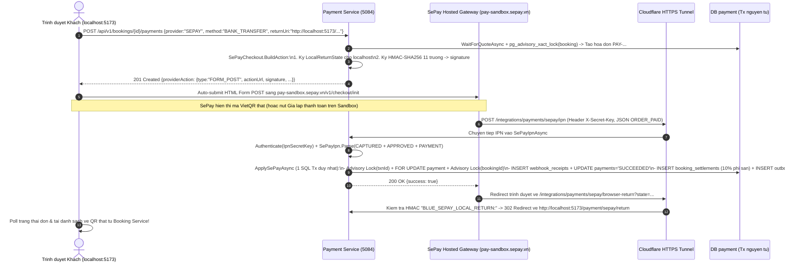

# 04. Payment Service — SePay, thanh toán và đối soát

> [!IMPORTANT]
> **Payment Service** xử lý checkout SePay, xác nhận IPN, thu hộ và hoàn tiền. Báo giá từ Booking được đồng bộ vào `booking_quotes`.

---

## 1. Tổng Quan Trách Nhiệm & Kiến Trúc Nội Bộ

### 1.1. Thông số định danh hệ thống

| Thuộc tính | Giá trị cấu hình thực tế | Ý nghĩa kiến trúc |
| :--- | :--- | :--- |
| **Tên Microservice** | `BusTicketPlatform.Payment` (`payment`) | Khởi tạo giao dịch thanh toán, xác thực IPN/Webhook chữ ký số, quản lý hoàn tiền, tính hoa hồng sàn và quyết toán nhà xe |
| **Cổng HTTP nội bộ / Dev** | `5084` | Gateway định tuyến API thanh toán và IPN SePay vào Payment Service. |
| **Cơ sở dữ liệu riêng** | PostgreSQL DB `payment` | Lưu trữ độc lập hóa đơn thanh toán, biên lai webhook, yêu cầu hoàn tiền, sổ cái đối soát và kỳ chi trả nhà xe |
| **Cổng thanh toán của stack hiện tại** | `SEPAY` | Checkout tại trang SePay, xác thực IPN bằng `X-Secret-Key`. |
| **Sự kiện lắng nghe (Inbox)** | `BookingCreated`, `RefundRequested`, `BookingCancelled` (từ `Booking Service`) | Tự động nạp báo giá đơn hàng (`booking_quotes`) và tiếp nhận lệnh hoàn tiền bất đồng bộ |
| **Sự kiện phát ra (Outbox)** | `PaymentSucceeded`, `RefundSucceeded` | Kích hoạt `Booking` xuất vé điện tử QR và cập nhật mô hình đọc doanh thu bên `Reporting` / thông báo bên `Notification` |

### 1.2. Cây thư mục đầy đủ của Payment Service

```text
workspace/src/services/payment/
├── BusTicketPlatform.Payment.Api/                      # Tầng Giao vận HTTP (Minimal APIs, Idempotency & Checkout Recovery)
│   ├── Program.cs                                      # Khởi tạo DI, PlatformJwt, HealthChecks, MapPaymentEndpoints
│   ├── PaymentEndpoints.cs                             # 19 HTTP Endpoints: Checkout, Refunds, Settlements, Payouts, SePay IPN/Return, VNPay Webhook
│   ├── appsettings.json
│   └── appsettings.Development.json
│
├── BusTicketPlatform.Payment.Application/              # Tầng Nghiệp vụ Thanh toán & Mật mã Cổng Thanh Toán
│   ├── PaymentService.cs                               # Điều phối Checkout, WaitForQuoteAsync, VNPay Webhook, Refunds, Settlements & Payouts
│   ├── SePayCheckout.cs                                # Ký Base64 HMAC-SHA256 11 trường chuẩn SePay + Cầu nối LocalReturnState cho localhost
│   ├── SePayIpn.cs                                     # Bộ phân tích & kiểm chứng chặt chẽ JSON IPN (ORDER_PAID / TRANSACTION_VOID)
│   ├── VnPayCheckout.cs                                # Chuẩn hóa tham số vnp_* (nhân 100), ký & kiểm tra HMAC-SHA512 chuẩn VNPay 2.1.0
│   └── AssemblyMarker.cs
│
├── BusTicketPlatform.Payment.Domain/                   # Tầng Miền Thanh toán
│   └── AssemblyMarker.cs
│
└── BusTicketPlatform.Payment.Infrastructure/           # Tầng Hạ tầng Kỹ thuật (PostgreSQL, Advisory Locks, Outbox, Consumers)
    ├── PaymentInfrastructureExtensions.cs              # Đăng ký SePayOptions, VnPayOptions, OutboxRelay, Consumer lắng nghe Booking events
    ├── PaymentDatabaseOptions.cs                       # Cấu hình ConnectionStrings:Payment
    ├── SqlBaselineMigrator.cs                          # Chạy 000_integration_tables.sql, 001_initial.sql, 002_sepay.sql, 003_legacy_payment_organization.sql
    ├── SqlBaselineHostedService.cs
    ├── OutboxWriter.cs
    ├── PaymentEvents.cs                                # Đóng gói sự kiện PaymentSucceeded & RefundSucceeded
    ├── PaymentEventHandlers.cs                         # Bắt sự kiện BookingCreated -> IngestBookingCreatedAsync & RefundRequested -> ApplyRefundRequestedAsync
    ├── PostgresHealthCheck.cs
    └── Persistence/
        ├── PaymentRepository.cs                        # Partial class phần 1: Quotes, Payments (pg_advisory_xact_lock), Refunds, Settlements, Payouts
        ├── SePayPaymentStore.cs                        # Partial class phần 2: Giao dịch nguyên tử ApplySePayAsync, QueueSePayRefundAsync & Reconciliation
        └── IdempotencyStore.cs                         # Cài đặt IIdempotencyStore + ICheckoutRequestRecovery.AbandonCheckoutAsync

```

---

## 2. Thiết Kế Cơ Sở Dữ Liệu & Sơ Đồ ERD (`payment` DB)

Cơ sở dữ liệu `payment` trải qua 3 bước tiến hóa lược đồ mượt mà ([001_initial.sql](file:///C:/Users/minht/.gemini/antigravity/worktrees/PBL6/c_to_n_b/docs/database/payment/001_initial.sql) -> [002_sepay.sql](file:///C:/Users/minht/.gemini/antigravity/worktrees/PBL6/c_to_n_b/docs/database/payment/002_sepay.sql) mở rộng nhà cung cấp `'SEPAY'` & cho phép tạo hóa đơn thử lại trên cùng booking khi lần đầu thất bại -> [003_legacy_payment_organization.sql](file:///C:/Users/minht/.gemini/antigravity/worktrees/PBL6/c_to_n_b/docs/database/payment/003_legacy_payment_organization.sql) chuẩn hóa bảng `booking_quotes` và quyền sở hữu nhà xe). Tổng cộng DB gồm **9 bảng nghiệp vụ** (7 bảng trọng tâm đang vận hành trực tiếp + 2 bảng mở rộng kiểm toán chi tiết `payment_attempts`, `ledger_entries`) và **5 bảng hạ tầng tích hợp**.

### 2.1. Sơ đồ Thực thể — Liên kết (Mermaid ERD)

```mermaid
erDiagram
    booking_quotes ||--o{ payments : "prices_and_authorizes"
    payments ||--o{ payment_attempts : "tracks_attempts"
    payments ||--o{ webhook_receipts : "verified_by_ipn"
    payments ||--o{ refunds : "partially_or_fully_refunded"
    payments ||--o{ reconciliation_cases : "flags_discrepancies"
    payments ||--o| booking_settlements : "settled_into"
    booking_settlements ||--o{ ledger_entries : "records_double_entry"
    booking_quotes ||--o| booking_settlements : "provides_commission_rate"

    booking_quotes {
        uuid booking_id PK "ID don hang tu su kien BookingCreated"
        uuid customer_id "ID khach hang so huu don"
        uuid organization_id "ID nha xe huong doanh thu"
        bigint amount "Tong tien khach phai tra (> 0)"
        char currency "VND"
        varchar payment_channel "PREPAID"
        numeric commission_rate "NUMERIC(5,4) mac dinh 0.1000 (10%)"
        timestamptz expires_at "Han chot thanh toan cua seat_hold"
    }

    payments {
        uuid id PK "UUIDv7"
        uuid booking_id_external "Tham chieu don hang (cho phep tao lai neu don cu FAILED/CANCELLED)"
        uuid customer_id_external "ID khach thanh toan"
        uuid organization_id_external "ID nha xe"
        varchar provider "SEPAY | VNPAY_SANDBOX"
        varchar logical_reference "UNIQUE ma hoa don PAY-..."
        bigint amount "So tien giao dich (> 0)"
        char currency "VND"
        varchar status "PENDING | PROCESSING | SUCCEEDED | FAILED | CANCELLED | REFUND_PENDING | PARTIALLY_REFUNDED | REFUNDED"
        varchar provider_order_reference "Ma giao dich phia SePay"
        text return_uri "URL quay ve sau thanh toan"
        varchar checkout_method "BANK_TRANSFER | NAPAS_BANK_TRANSFER | CARD..."
        timestamptz expires_at "Thoi diem het han hoa don"
        timestamptz succeeded_at "Thoi diem thu tien thanh cong"
        bigint row_version "DEFAULT 0"
    }

    webhook_receipts {
        uuid id PK "UUID"
        varchar provider "SEPAY | VNPAY_SANDBOX"
        varchar external_event_id "UQ (provider, external_event_id) chong xu ly trung IPN"
        uuid payment_id FK "-> payments(id)"
        varchar provider_transaction_id "Chong 1 giao dich ngan hang tra cho 2 hoa don!"
        varchar payload_hash "SHA-256 toan bo noi dung IPN"
        boolean signature_valid "Ket qua kiem tra HMAC / Secret Key"
        varchar status "RECEIVED | VERIFIED | PROCESSED | REJECTED"
        timestamptz received_at "Thoi diem nhan"
        timestamptz processed_at "Thoi diem hoan tat"
    }

    refunds {
        uuid id PK "UUIDv7"
        uuid payment_id FK "NOT NULL -> payments(id)"
        uuid booking_id_external "ID don hang"
        uuid requested_by_external "Nguoi yeu cau (Guid.Empty neu tu su kien he thong)"
        varchar refund_reference "UQ (payment_id, refund_reference) chong hoan trung"
        bigint amount "So tien hoan (> 0)"
        char currency "VND"
        varchar reason_code "CUSTOMER_CANCELLATION | LATE_PROVIDER_SUCCESS | PAYMENT_AFTER_BOOKING_CLOSED..."
        varchar status "REQUESTED | PROCESSING | SUCCEEDED | FAILED"
        timestamptz succeeded_at "Khac NULL duy nhat khi SUCCEEDED"
        bigint row_version "DEFAULT 0"
    }

    booking_settlements {
        uuid id PK "UUIDv7"
        uuid booking_id_external "UNIQUE — moi don hang 1 dong quyet toan"
        uuid organization_id_external "ID nha xe"
        uuid payment_id FK "-> payments(id)"
        varchar payment_channel "PREPAID | PAY_LATER"
        bigint gross_amount "Doanh thu gop con giu lai (>= 0)"
        numeric commission_rate "0.1000 (10%)"
        bigint commission_amount "Hoa hong san thu (>= 0)"
        bigint operator_net "Thuc nhan cua nha xe (BAT BUOC commission + net = gross)"
        varchar collection_status "UNCOLLECTED | COLLECTED | REFUNDED | NOSHOW_WRITTEN_OFF"
        bigint row_version "DEFAULT 0"
    }

    operator_payouts {
        uuid id PK "UUIDv7"
        uuid organization_id_external "ID nha xe nhan chi tra"
        date period_start "Tu ngay"
        date period_end "Den ngay (>= period_start)"
        char currency "VND"
        bigint payable_amount "So tien quyet toan ky nay"
        varchar status "PENDING | SENT | FAILED"
        timestamptz transferred_at "Khac NULL khi SENT"
        bigint row_version "DEFAULT 0"
    }

    reconciliation_cases {
        uuid id PK "UUID"
        uuid payment_id FK "-> payments(id)"
        varchar provider "SEPAY | VNPAY_SANDBOX"
        varchar discrepancy_key "Partial UQ theo provider khi OPEN/INVESTIGATING"
        varchar discrepancy_type "VOID_AFTER_CAPTURE | ADDITIONAL_CAPTURE..."
        varchar status "OPEN | INVESTIGATING | RESOLVED | IGNORED"
        varchar severity "LOW | MEDIUM | HIGH | CRITICAL"
        jsonb details "Nguyen ban thong bao gay lech doi soat"
        timestamptz opened_at "Thoi diem phat hien"
        timestamptz resolved_at "Thoi diem ke toan xu ly xong"
    }

    payment_attempts {
        uuid id PK "UUID"
        uuid payment_id FK "-> payments(id)"
        int attempt_no "UQ (payment_id, attempt_no)"
        varchar provider "Nha cung cap"
        varchar provider_transaction_id "Partial UQ"
        varchar status "CREATED | REDIRECTED | SUCCEEDED | FAILED | EXPIRED"
    }

    ledger_entries {
        uuid id PK "UUID"
        uuid settlement_id FK "-> booking_settlements(id)"
        varchar entry_type "GATEWAY_CAPTURE | COMMISSION_ACCRUED | OPERATOR_PAYABLE | REFUND_CUSTOMER..."
        bigint amount "Gia tri but toan"
        timestamptz occurred_at "Thoi diem hach toan"
    }
```



### 2.2. Những Quyết Định Thiết Kế Lược Đồ Sâu Sắc Trong `001` & `002_sepay.sql`

- **Tại sao `002_sepay.sql` gỡ bỏ `uq_payments_booking` trên bảng `payments`?**
  Ban đầu mỗi `booking_id_external` chỉ được có 1 dòng `payments`. Nhưng trên thực tế, khách hàng mở cổng thanh toán lần 1 có thể bấm "Hủy" (`CANCELLED`) hoặc thẻ báo lỗi (`FAILED`) khi thời gian giữ ghế 10 phút vẫn còn 7 phút! Bằng cách gỡ khóa duy nhất cứng và thay bằng truy vấn có khóa tư vấn `pg_advisory_xact_lock(hashtext(@booking))` kèm điều kiện `WHERE NOT EXISTS (SELECT 1 FROM payments WHERE booking_id_external = @booking AND status NOT IN ('FAILED','CANCELLED'))`, hệ thống vừa **lưu giữ trọn vẹn lịch sử các lần thanh toán lỗi để kiểm toán**, vừa cho phép cấp mã hóa đơn `PAY-...` mới tinh cho lần thử lại!
- **Ràng buộc Đẳng thức Chia Doanh thu (`ck_settlement_split`)**:
  Trên bảng `booking_settlements`, PostgreSQL kiểm tra cứng `commission_amount + operator_net = gross_amount` trên từng dòng ghi và cập nhật, đảm bảo phép chia phần trăm hoa hồng không bao giờ sinh ra hay làm bốc hơi 1 đồng nào.

---

## 3. Danh Mục Đầy Đủ Toàn Bộ 19 HTTP Endpoints

| Phân nhóm | Phương thức & Đường dẫn | Phân quyền / Xác thực | Idempotency-Key | HTTP Thành công & Nghiệp vụ cốt lõi |
| :--- | :--- | :--- | :--- | :--- |
| **Cấu hình Cổng** | `GET /api/v1/payment-methods` | Công khai | Không | `200 OK` — Báo trạng thái `configured` của SePay, môi trường (`sandbox`/`production`) và danh sách phương thức được bật (`BANK_TRANSFER`, `NAPAS_BANK_TRANSFER`, `CARD`) |
| **Khởi tạo Checkout** | `POST /api/v1/bookings/{bookingId:guid}/payments` | `Bearer JWT` (chủ đơn) | **Bắt buộc** (có `AbandonCheckoutAsync` tự hồi phục khi lỗi mạng/DB) | `201 Created` -> `PaymentDto` — Đợi báo giá `WaitForQuoteAsync`, tạo hóa đơn `PAY-...`, trả về `providerAction` (`FORM_POST` cho SePay hoặc `REDIRECT` cho VNPay) |
| **Tra cứu Payment** | `GET /api/v1/bookings/{bookingId:guid}/payments` | Chủ đơn / Kế toán & Admin Nhà xe / Tài chính Sàn | Không | `200 OK` -> `IReadOnlyList<PaymentDto>` — Lịch sử các lần thanh toán của một đơn đặt vé |
| **Tra cứu Payment** | `GET /api/v1/payments/{paymentId:guid}` | Chủ đơn / Kế toán & Admin Nhà xe / Tài chính Sàn | Không | `200 OK` -> `PaymentDto` — Kiểm tra trạng thái hóa đơn hiện tại |
| **Hủy Checkout** | `POST /api/v1/payments/{paymentId:guid}/cancel` | Chủ đơn | **Bắt buộc** | `202 Accepted` — Hủy phiên thanh toán đang `PENDING`/`PROCESSING` (chặn hủy nếu đã `SUCCEEDED`) |
| **Hoàn tiền** | `POST /api/v1/refunds` | `PLATFORM_ADMIN`, `PLATFORM_FINANCE`, `OPERATOR_ADMIN`, `OPERATOR_FINANCE` | **Bắt buộc** | `202 Accepted` — Tạo lệnh hoàn tiền chủ động (xếp hàng `REQUESTED` với SePay; thực thi ngay `SUCCEEDED` với VNPay Sandbox) |
| **Hoàn tiền** | `GET /api/v1/refunds/{refundId:guid}` & `/api/v1/operator/refunds/{refundId:guid}` | Chủ đơn / Nhân sự tài chính cùng `org` / Sàn | Không | `200 OK` -> `RefundDto` — Xem chi tiết tiến độ một khoản hoàn tiền |
| **Quản trị & Tra cứu** | `GET /api/v1/admin/payments` | `PLATFORM_ADMIN`, `PLATFORM_FINANCE`, `OPERATOR_ADMIN`, `OPERATOR_FINANCE` | Không | `200 OK` -> `PaymentPageDto` — Phân trang giao dịch (tự động lọc theo `OrganizationId` nếu người gọi là phía Nhà xe) |
| **Quản trị & Tra cứu** | `GET /api/v1/admin/refunds` & `/api/v1/operator/refunds` | Tài chính Sàn / Tài chính Nhà xe | Không | `200 OK` -> `RefundPageDto` — Phân trang danh sách các khoản hoàn tiền |
| **Quyết toán Sàn** | `GET /api/v1/operator/settlements` | `OPERATOR_ADMIN`, `OPERATOR_FINANCE` | Không | `200 OK` -> `SettlementPageDto` — Nhà xe xem bảng kê doanh thu gộp, phí sàn 10% và thực nhận của tổ chức mình |
| **Quyết toán Sàn** | `GET /api/v1/admin/settlements` | `PLATFORM_ADMIN`, `PLATFORM_FINANCE` | Không | `200 OK` -> `SettlementPageDto` — Kế toán sàn đối soát doanh thu toàn bộ các nhà xe |
| **Chi trả Nhà xe** | `POST /api/v1/admin/payouts` | `PLATFORM_ADMIN`, `PLATFORM_FINANCE` | Không | `201 Created` -> `OperatorPayoutDto` — Lập lệnh chi trả định kỳ (`periodStart .. periodEnd`, trạng thái `PENDING`) cho đối tác nhà xe |
| **Tích hợp SePay** | `POST /integrations/payments/sepay/ipn` | Header `X-Secret-Key` (`<= 64 KB` JSON) | Chống trùng bằng `webhook_receipts` | `200 OK` (`{success: true}`) — Cổng nhận IPN Server-to-Server từ SePay qua HTTPS / Cloudflare Tunnel |
| **Tích hợp SePay** | `GET /integrations/payments/sepay/browser-return?state=...` | Chữ ký `HMAC-SHA256` trên `state` (`Cache-Control: no-store`) | Không | `302 Redirect` — Cầu nối an toàn đưa trình duyệt từ domain HTTPS công khai về lại phiên `http://localhost:5173` khi dev/test Sandbox |
| **VNPay tương thích** | `POST /integrations/payments/{provider}/webhooks` | Chữ ký `HMAC-SHA512` (`vnp_SecureHash`) + `vnp_TmnCode` | Chống trùng bằng `webhook_receipts` | `204 No Content` — Callback VNPay khi bật cấu hình riêng |
| **VNPay tương thích** | `GET /integrations/payments/{provider}/return` | Chữ ký `HMAC-SHA512` trên query `vnp_*` | Chống trùng bằng `webhook_receipts` | `302 Redirect` về `vnp_ReturnUrl` |
| **Nội bộ (Internal)** | `POST /internal/quotes` | Endpoint tích hợp nội bộ | Không | `204 No Content` — Ghi trực tiếp `booking_quotes` cho kịch bản kiểm thử tích hợp |

---

## 4. Tại Sao `Payment` Không Gọi HTTP Sang `Booking` Hỏi Giá Mà Dùng `booking_quotes` + `WaitForQuoteAsync`?

Trong nhiều đồ án microservice thông thường, khi khách bấm `POST /bookings/{id}/payments`, `Payment Service` thường mở một `HttpClient` gọi ngược sang `GET http://booking-api:5083/api/v1/bookings/{id}` để hỏi *"Đơn này bao nhiêu tiền, của khách nào, đã hết hạn chưa?"*. Cách làm đó mắc **3 điểm yếu chí mạng**:
1. **Temporal Coupling (Phụ thuộc sống-còn đồng bộ)**: Nếu `Booking Service` đang khởi động lại hoặc quá tải vài giây, luồng thanh toán sập theo ngay lập tức.
2. **Độ trễ dây chuyền & Nghẽn Thread Pool**: Mỗi request thanh toán tốn gấp đôi băng thông mạng nội bộ và socket.
3. **Rủi ro bảo mật định giá**: Tuyệt đối không bao giờ được tin số tiền `amount` do trình duyệt gửi lên; nguồn chân lý phải đến từ thông điệp miền do chính `Booking` phát hành.

### Giải pháp Kiến trúc Hướng Sự Kiện + Đợi Thông Minh (`WaitForQuoteAsync`)
1. Ngay khi khách tạo đơn `PREPAID`, `Booking Service` phát sự kiện `BookingCreated` mang theo `bookingId`, `customerId`, `organizationId`, `grossAmount` (tổng tiền thực thu sau giảm giá coupon), `currency` và `expiresAt`.
2. `PaymentEventHandlers.HandleBookingCreatedAsync` hứng sự kiện này và `UPSERT` ngay vào bảng cục bộ **`booking_quotes`** trong DB `payment`.
3. **Xử lý tinh tế bài toán Race Condition mili-giây (`WaitForQuoteAsync`)**:
   Trên giao diện Web hiện đại, ngay khi `POST /api/v1/bookings` vừa trả `201 Created`, trình duyệt lập tức gọi tiếp `POST /api/v1/bookings/{bookingId}/payments` chỉ sau `10–30ms`! Đôi khi tiến trình `OutboxDispatchHostedService` (quét mỗi vài trăm ms) + RabbitMQ cần `100–300ms` để đẩy `BookingCreated` tới bảng `booking_quotes`.
   Hãy xem cách [PaymentService.cs](file:///C:/Users/minht/.gemini/antigravity/worktrees/PBL6/c_to_n_b/workspace/src/services/payment/BusTicketPlatform.Payment.Application/PaymentService.cs#L465-L479) hóa giải hoàn toàn độ trễ Eventual Consistency này mà không cần gọi HTTP sang `Booking`:
   ```csharp
   private async Task<BookingQuote?> WaitForQuoteAsync(Guid bookingId, CancellationToken cancellationToken)
   {
       for (var attempt = 0; attempt < 15; attempt++)
       {
           var quote = await store.GetQuoteAsync(bookingId, cancellationToken);
           if (quote is not null)
           {
               return quote;
           }

           await Task.Delay(TimeSpan.FromMilliseconds(200), cancellationToken);
       }

       return await store.GetQuoteAsync(bookingId, cancellationToken);
   }
   ```
   - Nếu `booking_quotes` đã có sẵn: vòng lặp thoát ngay ở `attempt = 0` trong **1ms**!
   - Nếu RabbitMQ đang trên đường vận chuyển gói tin: hàm kiên nhẫn kiểm tra lại mỗi `200ms` (tối đa `15 × 200ms = 3 giây`). Ngay khi consumer ghi xong dòng quote ở mili-giây thứ 200, request tiếp tục trơn tru 100%, người dùng không hề cảm nhận bất kỳ lỗi `404 Not Found` giả tạo nào!

---

## 5. Checkout và IPN SePay

### 5.1. Luồng thanh toán qua SePay



#### Năm kỹ thuật bảo mật và chống lỗi xuất sắc trong tích hợp SePay:

1. **Tách biệt hai khóa bí mật & Quy tắc ký 11 trường bất biến (`SePayCheckout.cs` dòng 28–36)**:
   - Hệ thống tách rời hoàn toàn `SePay:SecretKey` (dùng ký form khởi tạo đơn hàng) và `SePay:IpnSecretKey` (cấu hình trong mục IPN của Dashboard SePay). Khi nhận IPN, hàm `Authenticate` băm `SHA-256` cả hai chuỗi trước khi đưa vào `CryptographicOperations.FixedTimeEquals` để không bao giờ lộ độ dài khóa bí mật qua thời gian so sánh!
   - Khi ký form gửi sang SePay, SePay quy định thứ tự ghép nối nghiêm ngặt (không sắp xếp ABC như VNPay!):
     `order_amount, merchant, currency, operation, order_description, order_invoice_number, customer_id, payment_method, success_url, error_url, cancel_url` (bỏ qua trường rỗng hoặc `"0"`, nối bằng dấu phẩy `,`, không URL-encode). Hai trường điều khiển giao diện `type = "FORM_POST"` và `actionUrl` chỉ được nhét vào dictionary **sau khi đã tính xong `signature`** (dòng 66–69) để frontend biết cách render form mà không làm hỏng chữ ký gửi sang SePay!

2. **Cầu nối `browser-return` ký HMAC cho `localhost` (Giải bài toán SePay chặn callback nội bộ)**:
   - Máy chủ SePay kiểm tra rất gắt: `success_url`, `error_url`, `cancel_url` bắt buộc phải là tên miền công khai `https://...` (`!uri.IsLoopback`). Nếu lập trình viên đang chạy giao diện React tại `http://localhost:5173` (nơi lưu phiên đăng nhập LocalStorage/Cookie của khách), sau khi thanh toán xong SePay nhảy về domain Cloudflare Tunnel `https://abc.trycloudflare.com` thì trình duyệt sẽ bị mất phiên đăng nhập ở `localhost:5173`!
   - Tại [SePayCheckout.cs](file:///C:/Users/minht/.gemini/antigravity/worktrees/PBL6/c_to_n_b/workspace/src/services/payment/BusTicketPlatform.Payment.Application/SePayCheckout.cs#L43-L50) & [dòng 77–95](file:///C:/Users/minht/.gemini/antigravity/worktrees/PBL6/c_to_n_b/workspace/src/services/payment/BusTicketPlatform.Payment.Application/SePayCheckout.cs#L77-L95), khi chạy ở môi trường `sandbox` và phát hiện `ReturnUri` là `IsLocalOrigin` (`localhost` / `127.0.0.1`), backend đóng gói đối tượng `LocalReturnState(BookingId, Origin, Expiry +24h)` thành chuỗi Base64URL `payload`, ký `HMAC-SHA256` với tiền tố tách miền `"BLUE_SEPAY_LOCAL_RETURN:" + payload` rồi truyền làm tham số `?state=<payload>.<sig>` trên URL công khai `/integrations/payments/sepay/browser-return`.
   - Khi SePay đẩy trình duyệt về endpoint này, backend kiểm tra chữ ký HMAC, kiểm tra hạn sống và xác minh chặt `IsLocalOrigin(local)` (tuyệt đối không thể bị lợi dụng làm lỗ hổng **Open Redirect** sang trang lừa đảo bên ngoài!), rồi trả `302 Redirect` kèm `Referrer-Policy: no-referrer` đưa khách về đúng `http://localhost:5173/payment/sepay/return?bookingId=...`!

3. **Bộ lọc trạng thái kép trong `SePayIpn.Parse` (`SePayIpn.cs`)**:
   - Chỉ chấp nhận 2 loại sự kiện `ORDER_PAID` hoặc `TRANSACTION_VOID` trên tiền tệ `VND` nguyên dương.
   - Kiểm tra chéo `order.order_amount == transaction.transaction_amount` và với `ORDER_PAID` bắt buộc thỏa đồng thời cả 3 cờ: `order_status == "CAPTURED"`, `transaction_status == "APPROVED"`, và `transaction_type == "PAYMENT"`. Mọi URL redirect trên trình duyệt hoàn toàn **không có quyền xác nhận thanh toán** — chỉ có gói IPN vượt qua chốt này mới được ghi nhận thu tiền!

4. **Giao dịch SQL Nguyên Tử 4-trong-1 & Chống Tái Sử Dụng Giao Dịch (`SePayPaymentStore.cs`)**:
   Trong `ApplySePayAsync` (dòng `12–122`):
   - **Khóa 3 tầng**: `pg_advisory_xact_lock(hashtext(@txn))` -> `SELECT ... FROM payments WHERE logical_reference = @ref FOR UPDATE` -> `pg_advisory_xact_lock(hashtext(@booking))`.
   - **Chống dùng 1 giao dịch ngân hàng thanh toán cho 2 hóa đơn**: Truy vấn dòng `38` kiểm tra `SELECT 1 FROM webhook_receipts WHERE provider = 'SEPAY' AND provider_transaction_id = @txn AND payment_id <> @payment`. Dù ai đó có được `IpnSecretKey` và gửi lại mã giao dịch ngân hàng cũ gắn vào hóa đơn mới cũng bị từ chối ngay với `WEBHOOK_INVALID`!
   - **4 bảng cùng `COMMIT` hoặc cùng `ROLLBACK`**: `webhook_receipts` + `payments` + `booking_settlements` + `outbox_messages (PaymentSucceeded)` nằm trọn trong một `NpgsqlTransaction`. Nếu ghi Outbox gặp sự cố mạng DB, biên lai `webhook_receipts` cũng được rollback để lần retry IPN tiếp theo của SePay phục hồi sạch sẽ 100%!

5. **Mở Hồ sơ Đối soát `reconciliation_cases` cho `VOID_AFTER_CAPTURE` & `ADDITIONAL_CAPTURE` (Dòng 106–119)**:
   - Nếu khách chưa thanh toán (`PENDING`/`PROCESSING`) mà nhận `TRANSACTION_VOID` -> đơn giản chuyển `payments.status = 'CANCELLED'`.
   - Nhưng điều gì xảy ra nếu hóa đơn **đã thu tiền thành công (`SUCCEEDED`) và vé QR đã phát hành cho khách**, sau đó cổng thanh toán bất ngờ bắn về một thông báo `TRANSACTION_VOID` (hủy giao dịch sau khi đã gạch nợ) hoặc một gói `ORDER_PAID` thứ hai có mã `TransactionId` khác (khách quét nhầm chuyển khoản 2 lần cho cùng 1 đơn)?
   - Hệ thống **tuyệt đối không tự ý hủy vé của hành khách đang chuẩn bị lên xe**, mà tự động chèn một hồ sơ cảnh báo mức độ cao (`severity = 'HIGH'`, `status = 'OPEN'`) vào bảng **`reconciliation_cases`** với mã lệch `VOID_AFTER_CAPTURE` hoặc `ADDITIONAL_CAPTURE` kèm nguyên bản JSON `notification` để bộ phận Tài chính Sàn (`PLATFORM_FINANCE`) kiểm tra sao kê và xử lý nghiệp vụ!

---

### 5.2. Tương thích VNPay và kiểm thử

Backend còn `VnPayCheckout.cs` và nhánh `VNPAY_SANDBOX`, tắt mặc định trong cấu hình hiện tại. Các bộ test có thể cấp cấu hình riêng. Đọc `SePayFlowTests.cs` và `SePayBookingFlowTests.cs` để xem các ca tích hợp hiện hành. Khi demo, dùng [SePay Sandbox](../../implementation/sepay-integration.md).

---

## 6. Giải Phẫu Nghiệp Vụ Kế Toán Sàn (`booking_settlements`, Hoa Hồng 10%, Hoàn Tiền & `operator_payouts`)

### 6.1. Hạch toán Hoa hồng Sàn 10% ngay thời điểm Thu tiền (`COLLECTED`)

Mỗi tổ chức nhà xe có tỷ lệ chiết khấu sàn `commission_rate` (mặc định **`0.1000` tức `10%`**, lưu kèm trong `booking_quotes`). Ngay khi giao dịch thanh toán chuyển sang `SUCCEEDED`:
- **Phí hoa hồng sàn (`commission_amount`)**:
  $$\text{commission\_amount} = \text{Round}(\text{gross\_amount} \times \text{commission\_rate},\ \text{AwayFromZero})$$
- **Thực nhận của Nhà xe (`operator_net`)**:
  $$\text{operator\_net} = \text{gross\_amount} - \text{commission\_amount}$$

*Ví dụ minh họa*: Khách thanh toán đơn vé `290.000 đ` (`gross_amount = 290.000`), tỷ lệ hoa hồng `10%`:
- Sàn BLUE ghi nhận `commission_amount = 29.000 đ`.
- Công nợ phải trả cho Nhà xe `operator_net = 261.000 đ`.
- Trạng thái thu hộ: `collection_status = 'COLLECTED'` (`29.000 + 261.000 = 290.000`, thỏa mãn `ck_settlement_split`).

### 6.2. Đảo ngược Hoa hồng tương ứng khi Hoàn tiền một phần hoặc toàn phần (`TryApplyRefundAsync`)

Khi khách hủy vé chịu phí phạt `10%` trên đơn `290.000 đ` -> khách được hoàn `refund.Amount = 261.000 đ`, còn lại `29.000 đ` phí hủy giữ lại (`remaining = payment.Amount - refunded - refund.Amount`).
Tại [PaymentRepository.cs](file:///C:/Users/minht/.gemini/antigravity/worktrees/PBL6/c_to_n_b/workspace/src/services/payment/BusTicketPlatform.Payment.Infrastructure/Persistence/PaymentRepository.cs#L197-L280), hàm `TryApplyRefundAsync` khóa dòng `payments ... FOR UPDATE`, kiểm tra tổng tiền hoàn lũy kế không bao giờ vượt quá số tiền gốc (`refunded + refund.Amount <= payment.Amount`), rồi tự động tính lại bảng quyết toán trên phần tiền giữ lại `remaining`:
1. Nếu hoàn **một phần** (`remaining = 29.000 đ > 0`):
   - `payments.status` chuyển thành `'PARTIALLY_REFUNDED'`.
   - `booking_settlements` cập nhật: `gross_amount = 29.000 đ`, `commission_amount = Round(29.000 × 0.10) = 2.900 đ`, `operator_net = 26.100 đ`, `collection_status = 'COLLECTED'`. Như vậy sàn tự động trả lại `26.100 đ` tiền hoa hồng tương ứng với phần vé đã hoàn, chỉ thu đúng `10%` trên khoản phí hủy thực giữ!
2. Nếu hoàn **toàn bộ 100%** (`remaining = 0`, ví dụ nhà xe hủy chuyến hoặc thanh toán đến trễ):
   - `payments.status = 'REFUNDED'`, `refunded_at = NOW()`.
   - `booking_settlements`: `gross_amount = 0`, `commission_amount = 0`, `operator_net = 0`, `collection_status = 'REFUNDED'`.

> [!NOTE]
> **Nguyên tắc "Trung thực Tài chính" (Financial Honesty) đối với SePay (`QueueSePayRefundAsync`)**:
> Trong luồng hoàn tiền SePay của PBL6, tại [SePayPaymentStore.cs](file:///C:/Users/minht/.gemini/antigravity/worktrees/PBL6/c_to_n_b/workspace/src/services/payment/BusTicketPlatform.Payment.Infrastructure/Persistence/SePayPaymentStore.cs#L138-L166), khi nhận sự kiện `RefundRequested`, hệ thống tạo bản ghi `refunds` ở trạng thái **`REQUESTED`** và chuyển `payments.status` sang **`REFUND_PENDING`** (không bao giờ giả mạo thành `SUCCEEDED` chỉ để làm đẹp giao diện khi tiền thật chưa rời tài khoản!). Lưu ý thêm ở `PaymentEventHandlers.cs` dòng `87`: riêng với SePay, chỉ sự kiện tường minh `RefundRequested` (đã trừ phí hủy hợp lệ bên Booking) mới xếp hàng hoàn tiền (`explicitRefund: message.EventType == "RefundRequested"`), sự kiện `BookingCancelled` đơn lẻ không thể bị lạm dụng để đòi hoàn 100% lách phí hủy!

### 6.3. Quản lý Kỳ Chi trả Nhà xe (`operator_payouts`) & Hồi phục Lỗi Checkout (`AbandonCheckoutAsync`)

- **Kỳ chi trả đối tác (`POST /api/v1/admin/payouts`)**: Định kỳ tuần/tháng, bộ phận `PLATFORM_FINANCE` đối chiếu tổng `operator_net` của các `booking_settlements` đang `COLLECTED` theo từng `organization_id_external` và lập phiếu chi `operator_payouts (period_start, period_end, payable_amount, status = 'PENDING')` để giải ngân về tài khoản ngân hàng pháp nhân của nhà xe.
- **Hồi phục thông minh `AbandonCheckoutAsync` khi gặp sự cố giữa chừng**:
  Tại `PaymentEndpoints.CreateAsync` (dòng `68–83`), nếu luồng tạo thanh toán vừa ghi dấu `idempotency_records (processing_state = 'PROCESSING')` nhưng gặp lỗi kết nối DB thoáng qua trước khi tạo xong hóa đơn, khối `catch` gọi ngay `recovery.AbandonCheckoutAsync(...)` xóa đúng bản ghi `PROCESSING` mang cặp `(key, hash)` đó. Nhờ vậy, khi người dùng bấm lại nút "Thanh toán", họ không bị kẹt cứng suốt 24 giờ ở lỗi `409 IDEMPOTENCY_IN_PROGRESS` mà lập tức lấy lại hoặc tạo mới hóa đơn an toàn dưới sự bảo vệ của `pg_advisory_xact_lock`!

---

## 7. Kịch Bản Đối Chứng Thực Tế & Bảng Phòng Thủ Lỗi Thanh Toán (Defense Cheat Sheet)

### 7.1. Minh chứng Kiểm thử SePay Sandbox Thực tế (Qua Cloudflare Tunnel & RabbitMQ Sống)

Theo hồ sơ kiểm chứng tại [sepay-integration.md](file:///C:/Users/minht/.gemini/antigravity/worktrees/PBL6/c_to_n_b/docs/implementation/sepay-integration.md#L94-L113), luồng thanh toán SePay của dự án không chỉ dừng ở lý thuyết hay mock test mà đã được xác minh đầu-cuối (End-to-End) với máy chủ SePay Sandbox thật:
1. Khởi chạy hạ tầng bằng lệnh `.\scripts\start-sepay-local.ps1` tự động bật cụm Docker microservices kèm tiến trình **Cloudflare Quick Tunnel** và cập nhật động `CUSTOMER_PUBLIC_ORIGIN`.
2. Trên giao diện khách hàng thật (`http://localhost:5173`), tạo đơn đặt ghế `2B` trị giá `150.000 VND` (`bookingId = 01a1e2f2-710b-753e-ac7b-6d07ea57650d`), trình duyệt tự động POST form đã ký sang `https://pay-sandbox.sepay.vn/v1/checkout/init`.
3. Khi xác nhận thanh toán trên cổng SePay Sandbox:
   - Gói tin IPN JSON đi xuyên qua Cloudflare Tunnel vào `/integrations/payments/sepay/ipn` với header `X-Secret-Key`.
   - Trong cùng 1 giao dịch PostgreSQL của DB `payment`: `webhook_receipts` chuyển `PROCESSED`, `payments` chuyển `SUCCEEDED`, `booking_settlements` ghi nhận `COLLECTED` (`150.000 VND`, hoa hồng sàn `15.000 VND`, nhà xe nhận `135.000 VND`), và sự kiện `PaymentSucceeded` ghi vào `outbox_messages`.
   - RabbitMQ vận chuyển `PaymentSucceeded` sang `Booking Service` -> đơn chuyển `PAID`, phát hành vé điện tử `TK18DA882C142D` có mã QR hợp lệ, xuất hiện đồng thời trên API Danh sách hành khách (`Manifest`) của Nhà xe và bảng chiếu `Reporting Service` (`150.000 VND`, 1 ghế)!
   - Trình duyệt đi qua cầu nối `/integrations/payments/sepay/browser-return?state=...` quay về đúng phiên `http://localhost:5173/payment/sepay/return` và hiển thị vé QR mà không tin mù quáng bất kỳ tham số query URL nào!

### 7.2. Bảng Tổng Hợp 10 Kịch Bản Tấn Công / Sự Cố & Cách Payment Service Hóa Giải

| # | Kịch bản bất thường / Tấn công giả định | Chốt chặn kỹ thuật trong mã nguồn `Payment Service` | Kết quả bảo vệ |
| :-: | :--- | :--- | :--- |
| 1 | Kẻ gian tự gõ URL `/payment/sepay/return?bookingId=...&status=success` trên trình duyệt hòng lấy vé miễn phí | Giao diện chỉ dùng `bookingId` để gọi API xác thực đọc vé thật; backend chỉ xuất vé khi nhận IPN Server-to-Server có `X-Secret-Key` hợp lệ | Trạng thái vẫn là `PENDING_PAYMENT`, không có bất kỳ vé nào được sinh ra |
| 2 | Sửa số tiền form POST từ `300.000đ` xuống `10.000đ` bằng DevTools trước khi gửi sang SePay | Chữ ký `signature` (`HMAC-SHA256`) / `vnp_SecureHash` (`HMAC-SHA512`) bị gãy ngay tại cổng thanh toán; đồng thời khi IPN quay về, `ApplySePayAsync` đối chiếu `payment.Amount != notification.Amount` | Từ chối ngay ở cả phía cổng thanh toán lẫn phía IPN (`WEBHOOK_INVALID`) |
| 3 | Lợi dụng `/integrations/payments/sepay/browser-return?state=...` để chuyển hướng khách sang web lừa đảo (Open Redirect) | `TryReadLocalReturn` kiểm tra chữ ký `HMAC-SHA256("BLUE_SEPAY_LOCAL_RETURN:"...)`, hạn sống Unix timestamp và ép cứng `IsLocalOrigin(local)` | Trả lỗi `400 VALIDATION_ERROR` cho mọi domain không phải loopback hợp lệ |
| 4 | SePay bắn lặp 5 gói IPN giống hệt nhau cùng một mili-giây do timeout mạng | `pg_advisory_xact_lock(hashtext(@txn))` + `INSERT INTO webhook_receipts ... ON CONFLICT (provider, external_event_id) DO NOTHING` | Chỉ gói đầu tiên chạy nghiệp vụ & phát 1 sự kiện `PaymentSucceeded`; 4 gói sau trả `200 OK` rỗng an toàn |
| 5 | Dùng lại `TransactionId` thật của một đơn `150.000đ` cũ để giả mạo IPN cho đơn `150.000đ` mới | Truy vấn `SELECT 1 FROM webhook_receipts WHERE provider='SEPAY' AND provider_transaction_id=@txn AND payment_id<>@payment` (dòng `38` `SePayPaymentStore.cs`) | Bắt quả tang giao dịch đã gắn với hóa đơn khác -> từ chối `WEBHOOK_INVALID` |
| 6 | Khách hàng mở 2 tab bấm nút "Thanh toán" cùng lúc cho 1 booking | `pg_advisory_xact_lock(hashtext(@booking))` trong `InsertPaymentAsync` + `WHERE NOT EXISTS (... status NOT IN ('FAILED','CANCELLED'))` | Chỉ tạo đúng **1** hóa đơn `PAY-...` duy nhất, tab thứ hai nhận lại chính hóa đơn đó |
| 7 | Đứt kết nối DB đúng lúc đang tạo hóa đơn khiến khóa `Idempotency-Key` kẹt ở `PROCESSING` | Khối `catch` trong `PaymentEndpoints.CreateAsync` kích hoạt `AbandonCheckoutAsync` xóa bản ghi `PROCESSING` bị treo | Khách bấm lại nút Thanh toán là chạy thông suốt ngay lập tức |
| 8 | Khách quét mã VietQR lúc phút `09:58` nhưng ngân hàng báo Có lúc phút `10:03` (khi ghế đã hết hạn 10 phút) | Biến `late = payment.ExpiresAt <= UtcNow` bật sáng -> chuyển `payments.status = 'REFUND_PENDING'` và gọi `QueueRefund(..., "LATE_PROVIDER_SUCCESS")` | Không xuất vé chồng lên ghế người khác; tự động lập phiếu chờ hoàn tiền 100% |
| 9 | Giao dịch đã `SUCCEEDED` và khách đã nhận vé, nhưng cổng thanh toán gửi thêm `TRANSACTION_VOID` hoặc thu đúp lần 2 | Nhánh `else` trong `ApplySePayAsync` (dòng `106–119`) mở `reconciliation_cases` mức `HIGH` (`VOID_AFTER_CAPTURE` / `ADDITIONAL_CAPTURE`) | Bảo vệ hành khách không bị hủy vé oan giữa đường; cảnh báo tức thời cho Kế toán Sàn đối soát |
| 10 | Khách hủy đơn có phí phạt `20%`, nhưng có gói tin `BookingCancelled` bay đến song song với `RefundRequested` | Với SePay, `PaymentEventHandlers` truyền `explicitRefund: message.EventType == "RefundRequested"`, phớt lờ `BookingCancelled` không mang số tiền khấu trừ | Chỉ xếp hàng hoàn đúng số tiền sau khi đã trừ `20%` phí hủy theo báo giá `CancellationPreview` |
