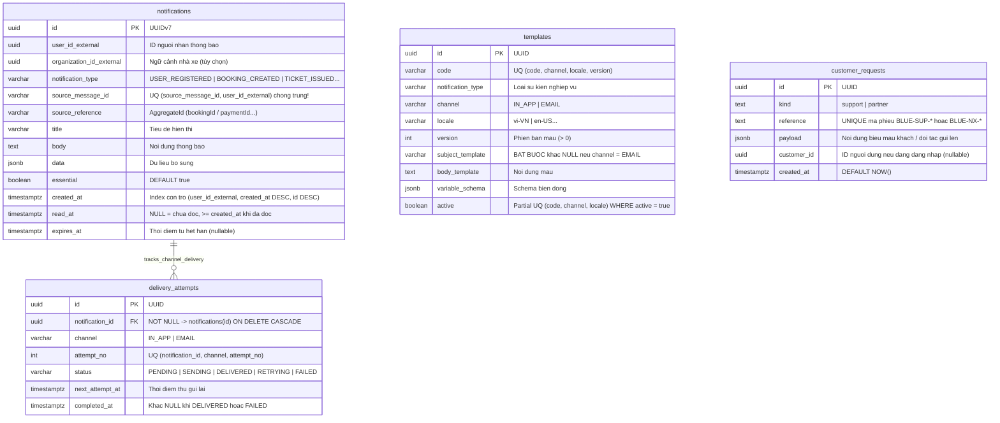
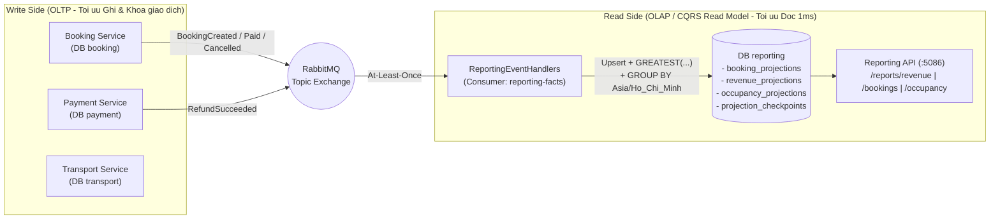
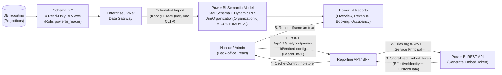

# 05. Giải Phẫu Chi Tiết Notification Service (`5085`), Reporting Service (`5086`), Lý Thuyết CQRS & Power BI Embedded

> [!IMPORTANT]
> Chương cuối của bộ giải phẫu Backend đi sâu vào cặp đôi dịch vụ hậu cần bất đồng bộ ở rìa phải kiến trúc hướng sự kiện: **Notification Service (`Port 5085`)** — trung tâm hộp thư thông báo In-App phân trang con trỏ tốc độ cao và tiếp nhận phiếu yêu cầu khách hàng/đối tác; cùng **Reporting Service (`Port 5086`)** — minh họa sống động nhất của mẫu thiết kế **CQRS Read Model** chống sự kiện đảo thứ tự trong hệ phân tán, đặt nền móng trực tiếp cho kiến trúc phân tích đa chiều **Power BI Embedded (`ADR-018`)**.

---

# PHẦN A — NOTIFICATION SERVICE (`Port 5085` — DB `notification`)

## 1. Tổng Quan Trách Nhiệm & Cây Thư Mục Notification Service

### 1.1. Thông số định danh hệ thống

| Thuộc tính | Giá trị cấu hình thực tế | Ý nghĩa kiến trúc |
| :--- | :--- | :--- |
| **Tên Microservice** | `BusTicketPlatform.Notification` (`notification`) | Hộp thư thông báo cá nhân hóa trong ứng dụng (In-App Inbox) và cổng tiếp nhận biểu mẫu liên hệ CSKH / đăng ký đối tác nhà xe |
| **Cổng HTTP nội bộ / Dev** | `5085` | Phục vụ `/api/v1/notifications*` và `/api/v1/customer-requests/*` |
| **Cơ sở dữ liệu riêng** | PostgreSQL DB `notification` | Tối ưu hóa cho truy vấn dòng thời gian người dùng bằng chỉ mục con trỏ giảm dần `(user_id_external, created_at DESC, id DESC)` |
| **Sự kiện Fan-out lắng nghe** | `UserRegistered`, `BookingCreated`, `BookingPaid`, `BookingCancelled`, `TicketIssued`, `PaymentSucceeded` | Tự động chuyển hóa các cột mốc nghiệp vụ ở `Identity`, `Booking`, `Payment` thành thông báo người dùng mà không làm chậm giao dịch gốc |
| **Chống Spam Biểu mẫu** | Fixed-Window Rate Limiter `customer-requests` (`30 req / 1 phút`) | Bảo vệ các endpoint công khai gửi yêu cầu hỗ trợ & hợp tác nhà xe |

### 1.2. Cây thư mục đầy đủ của 4 Project con

```text
workspace/src/services/notification/
├── BusTicketPlatform.Notification.Api/                 # Tầng Giao vận HTTP
│   ├── Program.cs                                      # Cấu hình DI, PlatformJwt, RateLimiter (30/phút), định tuyến 5 HTTP Endpoints
│   ├── CustomerRequests.cs                             # Xử lý biểu mẫu Hỗ trợ (BLUE-SUP-*) và Đối tác Nhà xe (BLUE-NX-*)
│   ├── appsettings.json
│   └── appsettings.Development.json
│
├── BusTicketPlatform.Notification.Application/         # Tầng Nghiệp vụ Ứng dụng
│   ├── NotificationService.cs                          # IngestAsync, ListAsync (kẹp limit 1..100), MarkReadAsync
│   └── AssemblyMarker.cs
│
├── BusTicketPlatform.Notification.Domain/              # Tầng Miền Thông báo
│   └── AssemblyMarker.cs
│
└── BusTicketPlatform.Notification.Infrastructure/      # Tầng Hạ tầng Kỹ thuật (PostgreSQL, RabbitMQ Fan-out Consumer)
    ├── NotificationInfrastructureExtensions.cs         # Đăng ký EventSubscription "notification-events" gắn 6 Routing Keys
    ├── NotificationDatabaseOptions.cs                  # Cấu hình ConnectionStrings:Notification
    ├── SqlBaselineMigrator.cs                          # Chạy 000_integration_tables.sql, 001_initial.sql, 002_customer_requests.sql
    ├── SqlBaselineHostedService.cs
    ├── NotificationEventHandlers.cs                    # Bóc tách userId/customerId từ 6 loại sự kiện và đẩy vào NotificationService
    ├── OutboxWriter.cs
    ├── PostgresHealthCheck.cs
    └── Persistence/
        ├── NotificationRepository.cs                   # SQL chống trùng ON CONFLICT & phân trang Keyset Cursor (created_at < @cursor)
        └── IdempotencyStore.cs
```

---

## 2. Sơ Đồ ERD & Đối Chiếu Schema SQL vs Thực Tế Vận Hành MVP (`notification` DB)

Cơ sở dữ liệu `notification` gồm **4 bảng nghiệp vụ** (khởi tạo từ [001_initial.sql](file:///C:/Users/minht/.gemini/antigravity/worktrees/PBL6/c_to_n_b/docs/database/notification/001_initial.sql) và [002_customer_requests.sql](file:///C:/Users/minht/.gemini/antigravity/worktrees/PBL6/c_to_n_b/docs/database/notification/002_customer_requests.sql)) cùng **5 bảng hạ tầng tích hợp**.



> [!NOTE]
> **Điểm khác biệt minh bạch giữa Thiết kế CSDL (`001_initial.sql`) và Code Runtime MVP hiện tại**:
> Khi bảo vệ đồ án, cần nắm rõ ranh giới giữa phần đã hoàn thiện vận hành và phần mở rộng đã chuẩn bị sẵn lược đồ:
> 1. **Hai bảng đang hoạt động trực tiếp 100% trong Runtime**:
>    - Bảng **`notifications`**: Hứng toàn bộ 6 luồng sự kiện từ RabbitMQ, phục vụ chuông thông báo trên Header Web/Mobile.
>    - Bảng **`customer_requests`**: Lưu toàn bộ phiếu yêu cầu hỗ trợ khách hàng và đăng ký mở gian hàng đối tác nhà xe.
> 2. **Hai bảng đã dựng sẵn Schema chuẩn mực cho giai đoạn sau MVP (`templates` & `delivery_attempts`)**:
>    - Trong code hiện tại, [NotificationEventHandlers.cs](file:///C:/Users/minht/.gemini/antigravity/worktrees/PBL6/c_to_n_b/workspace/src/services/notification/BusTicketPlatform.Notification.Infrastructure/NotificationEventHandlers.cs#L19-L28) biên dịch tiêu đề và nội dung thông báo trực tiếp bằng biểu thức `switch` gọn nhẹ trong C#, chưa đọc mẫu động từ bảng `templates` và chưa chạy background worker gửi email hàng loạt qua bảng `delivery_attempts` (các email khẩn cấp mang tính bảo mật như OTP đăng ký/quên mật khẩu đã được `ChallengeNotifier` của `Identity Service` gửi trực tiếp qua SMTP/Mailpit). Việc tạo sẵn `templates` (có Partial Unique Index đảm bảo chỉ 1 version đang `active`) và `delivery_attempts` giúp hệ thống sẵn sàng nâng cấp lên đa kênh Email/Push mà không cần migration phá vỡ cấu trúc bảng!

---

## 3. Bảng Danh Mục HTTP Endpoints & Giải Phẫu Kỹ Thuật Notification Service

### 3.1. Toàn bộ 5 HTTP Endpoints của Notification Service

| Phương thức & Đường dẫn | Phân quyền / Rate Limit | Tham số / Body | HTTP Thành công & Phản hồi | Nghiệp vụ cốt lõi |
| :--- | :--- | :--- | :--- | :--- |
| `GET /api/v1/notifications` | `Bearer JWT` | Query `?cursor=<ISO-8601>&limit=20` (`1..100`) | `200 OK` -> `NotificationPageDto(items, nextCursor)` | Phân trang con trỏ **Keyset Cursor Pagination** lấy thông báo mới nhất trước của người dùng |
| `PATCH /api/v1/notifications/{notificationId:guid}/read` | `Bearer JWT` (đúng `user_id_external`) | Path `notificationId` | `200 OK` -> `NotificationDto` (`404` nếu không thuộc user) | Đánh dấu đã đọc bất biến: `SET read_at = COALESCE(read_at, NOW()) RETURNING ...` (giữ nguyên mốc đọc lần đầu nếu bấm lặp) |
| `POST /api/v1/customer-requests/support` | Công khai (hoặc kèm JWT) + RateLimit `30/phút` | `SupportInput(email, message)` (`message` dài `10..2000` ký tự) | `201 Created` -> `{ reference: "BLUE-SUP-..." }` | Lưu phiếu yêu cầu CSKH kèm `customer_id` (nếu đang đăng nhập) và cấp mã tra cứu `BLUE-SUP-<12Hex>` |
| `POST /api/v1/customer-requests/partner` | Công khai (hoặc kèm JWT) + RateLimit `30/phút` | `PartnerInput(operator, contact, phone, email, route)` | `201 Created` -> `{ reference: "BLUE-NX-..." }` | Kiểm tra SĐT Việt Nam `^(?:\+84\|0)[0-9]{9}$`, lưu hồ sơ đăng ký đối tác nhà xe với mã `BLUE-NX-<12Hex>` |
| `POST /internal/notifications` | Endpoint tích hợp nội bộ | `IngestNotification` | `204 No Content` | Cổng chèn thông báo trực tiếp cho kiểm thử tích hợp |

### 3.2. Cơ chế Fan-out 6 Sự kiện & Chống Trùng Hai Lớp (Dual-Layer Deduplication)

Tại `NotificationInfrastructureExtensions.cs`, queue `notification-events` đăng ký nhận 6 routing keys từ Topic Exchange của RabbitMQ (`UserRegistered`, `BookingCreated`, `BookingPaid`, `BookingCancelled`, `TicketIssued`, `PaymentSucceeded`). Hàm `NotificationEventHandlers.TryUserId` thông minh tìm cả thuộc tính `"userId"` (từ `Identity`) lẫn `"customerId"` (từ `Booking` / `Payment`) để định tuyến về đúng hộp thư người nhận.

Vì RabbitMQ vận hành theo ngữ nghĩa **At-Least-Once Delivery** (một sự kiện có thể được gửi lại nếu mạng chập chờn trước khi kịp `ACK`), hệ thống bảo vệ hộp thư khách hàng không bao giờ hiện 2 thông báo giống hệt nhau bằng **2 lớp khiên độc lập**:
1. **Lớp 1 — Khử trùng ở Tầng Hạ tầng Messaging (`InboxDeduper` trong `IntegrationEventConsumerHost.cs` dòng 81)**:
   Trước khi gọi vào handler nghiệp vụ, `inbox.TryAcceptAsync("notification-events", message.EventId, ...)` chèn vào bảng `inbox_messages` với ràng buộc `UNIQUE (consumer_name, message_id)`. Nếu `EventId` đã từng xử lý thành công, consumer bỏ qua ngay và `AckAsync` gói tin.
2. **Lớp 2 — Khử trùng ở Tầng Bảng Nghiệp vụ (`NotificationRepository.InsertAsync` dòng 17)**:
   ```sql
   INSERT INTO notifications (id, user_id_external, notification_type, source_message_id, source_reference, title, body, data, created_at)
   VALUES (@id, @user, @type, @source, @ref, @title, @body, '{}'::jsonb, NOW())
   ON CONFLICT (source_message_id, user_id_external) DO NOTHING;
   ```
   Ngay cả khi ai đó dọn dẹp bảng `inbox_messages` định kỳ hoặc gọi song song qua `/internal/notifications` với cùng `source_message_id`, ràng buộc `uq_notifications_source_user` vẫn đảm bảo mỗi sự kiện gốc chỉ tạo ra tối đa **1 thông báo duy nhất** cho mỗi người dùng!

### 3.3. Tại sao dùng Keyset Cursor Pagination (`created_at < @cursor`) thay vì `OFFSET / LIMIT`?

Hãy nhìn câu truy vấn phân trang tại [NotificationRepository.cs](file:///C:/Users/minht/.gemini/antigravity/worktrees/PBL6/c_to_n_b/workspace/src/services/notification/BusTicketPlatform.Notification.Infrastructure/Persistence/NotificationRepository.cs#L33-L50):

```sql
SELECT id, notification_type, title, body, source_reference, read_at IS NOT NULL, created_at
FROM notifications
WHERE user_id_external = @user AND (@cursor::timestamptz IS NULL OR created_at < @cursor)
ORDER BY created_at DESC, id DESC
LIMIT @limit;
```
Và cách tính con trỏ trang kế tiếp ở dòng `50`:
`items.Count == limit ? items[^1].CreatedAt.ToString("O") : null`

**Hai lý do kiến trúc khiến Keyset Cursor vượt trội hoàn toàn so với `OFFSET / LIMIT` trên bảng thông báo lớn**:
1. **Độ phức tạp thời gian `O(log N)` thay vì suy thoái tuyến tính `O(N)`**:
   Với `OFFSET 50000 LIMIT 20`, PostgreSQL vẫn phải đọc qua đủ `50.020` dòng trên chỉ mục, kiểm tra visibility (MVCC) rồi vứt bỏ `50.000` dòng đầu tiên — càng cuộn sâu càng chậm! Ngược lại, với mệnh đề `WHERE user_id_external = @user AND created_at < @cursor` kết hợp đúng chỉ mục phức hợp `ix_notifications_user_cursor (user_id_external, created_at DESC, id DESC)`, cây B-Tree nhảy thẳng (`Index Seek`) đến đúng vị trí `@cursor` và nhặt 20 dòng kế tiếp trong `< 1ms` dù bảng có chứa 50 triệu dòng!
2. **Không bị lỗi "nhảy lặp thông báo" (Page Drift) khi có thông báo mới đổ về**:
   Khi người dùng đang đọc Trang 1 (20 thông báo đầu), đúng lúc đó hệ thống bắn thêm 2 thông báo mới (`PaymentSucceeded` & `TicketIssued`) chèn lên đỉnh danh sách. Nếu dùng `OFFSET 20 LIMIT 20` để tải Trang 2, 2 thông báo cuối của Trang 1 bị đẩy tụt xuống vị trí 21–22 và **xuất hiện lặp lại một lần nữa ở đầu Trang 2**! Còn với Keyset Cursor neo cứng vào mốc thời gian `created_at < items[^1].CreatedAt`, trang tiếp theo luôn nối tiếp chính xác từ thông báo cuối cùng người dùng vừa nhìn thấy!

---

# PHẦN B — REPORTING SERVICE (`Port 5086` — DB `reporting`), LÝ THUYẾT CQRS & POWER BI EMBEDDED

## 4. Giải Thích Từ Con Số 0: Mẫu Kiến Trúc CQRS Read Model Trong Hệ Thống 6 Database Tách Rời

### 4.1. Bài toán bế tắc nếu không có CQRS trong Microservices

Trong một ứng dụng nguyên khối (Monolith) dùng chung 1 cơ sở dữ liệu duy nhất, khi Giám đốc Nhà xe mở trang Dashboard yêu cầu biểu đồ *"Doanh thu ròng, tổng tiền hoàn, phí hủy và số đơn thành công theo từng ngày của từng nhà xe"*, lập trình viên chỉ việc viết một câu SQL `JOIN` 4 bảng: `organizations JOIN trips JOIN bookings JOIN payments GROUP BY date`.

Nhưng trong nền tảng **BLUE Bus Ticket Platform**, để đảm bảo tính tự trị và chống lỗi dây chuyền, dữ liệu được phân tách vật lý vào **6 PostgreSQL Database độc lập** (**Database-per-Service**):
- Tên nhà xe, tuyến đường, sức chứa xe nằm trong DB **`transport` (`:5082`)**.
- Đơn đặt vé, số lượng ghế, trạng thái vé nằm trong DB **`booking` (`:5083`)**.
- Giao dịch thu tiền thực tế, khoản hoàn trả nằm trong DB **`payment` (`:5084`)**.

**Tại sao ta tuyệt đối không thể `JOIN` trực tiếp hoặc ghép bằng vòng lặp HTTP API?**
1. **Không thể `JOIN` xuyên Database**: PostgreSQL không cho phép viết câu lệnh `SELECT ... JOIN` trực tiếp giữa hai database riêng biệt (`booking` và `payment`). Dùng `postgres_fdw` (Foreign Data Wrapper) để nối chéo ở tầng DB là phản mẫu kiến trúc (*Distributed Monolith Anti-pattern*) vì bất kỳ thay đổi cột nội bộ nào của `Booking` cũng làm sập `Reporting`!
2. **Ghép dữ liệu qua HTTP (`API Composition`) sập ngay khi dữ liệu lớn**: Để tính tổng doanh thu 30 ngày gồm 50.000 đơn hàng, nếu trình duyệt gọi API kéo 50.000 dòng JSON từ `Booking` rồi nối với 50.000 dòng JSON từ `Payment` trên RAM để cộng tổng, phản hồi sẽ mất hàng chục giây và làm cạn kiệt CPU/Connection Pool của chính hai dịch vụ đang bán vé trực tiếp!

### 4.2. Lời giải CQRS (Command Query Responsibility Segregation) của Reporting Service

**CQRS** tách biệt hoàn toàn **Mô hình Ghi giao dịch (Write / Command Model)** và **Mô hình Đọc phân tích (Read / Query Model)**:



- **Bên Ghi (`Booking`, `Payment`, `Transport`)**: Chỉ tập trung khóa ghế, thu tiền, kiểm tra ràng buộc toàn vẹn và phát sự kiện miền (`Domain/Integration Events`) ra RabbitMQ.
- **Bên Đọc (`Reporting Service` — Port `5086`)**: Đăng ký queue `reporting-facts` hứng các mẫu routing key đại diện `booking.booking.*.v1`, `payment.payment.*.v1`, `payment.refund.*.v1`. Mỗi khi có biến động đơn hàng hoặc hoàn tiền, `Reporting` tính toán trước và lưu kết quả đã làm phẳng (*Denormalized & Pre-aggregated*) vào các bảng **Projection** trong DB `reporting`.
- Khi Nhà xe hoặc Admin mở Dashboard gọi `GET /api/v1/reports/revenue`, `Reporting Service` chỉ việc đọc thẳng vài chục dòng ngày đã cộng sẵn từ `revenue_projections` với tốc độ **`< 2ms`**, dù `Booking` hay `Payment` có đang bảo trì thì trang báo cáo vẫn hoạt động bình thường!

---

## 5. Cây Thư Mục, Sơ Đồ ERD & HTTP Endpoints Của Reporting Service (`5086`)

### 5.1. Cây thư mục đầy đủ của 4 Project con

```text
workspace/src/services/reporting/
├── BusTicketPlatform.Reporting.Api/                    # Tầng Giao vận HTTP
│   ├── Program.cs                                      # Định nghĩa 4 HTTP Endpoints (/reports/revenue, /bookings, /occupancy & /internal/...)
│   ├── appsettings.json
│   └── appsettings.Development.json
│
├── BusTicketPlatform.Reporting.Application/            # Tầng Nghiệp vụ Báo cáo & Cô lập Đa thuê bao
│   ├── ReportingService.cs                             # Kiểm tra quyền CanRead + tự động áp Scope(actor) cô lập theo OrganizationId
│   └── AssemblyMarker.cs
│
├── BusTicketPlatform.Reporting.Domain/                 # Tầng Miền Báo cáo
│   └── AssemblyMarker.cs
│
└── BusTicketPlatform.Reporting.Infrastructure/         # Tầng Hạ tầng Projector & Lưu trữ Read Model
    ├── ReportingInfrastructureExtensions.cs            # Đăng ký queue "reporting-facts" lắng nghe wildcard booking.* & payment.*
    ├── ReportingDatabaseOptions.cs
    ├── SqlBaselineMigrator.cs                          # Chạy 000_integration_tables.sql & 001_initial.sql
    ├── SqlBaselineHostedService.cs
    ├── ReportingEventHandlers.cs                       # Chuyển đổi BookingCreated/Paid/Cancelled & RefundSucceeded thành lệnh chiếu
    ├── OutboxWriter.cs
    ├── PostgresHealthCheck.cs
    └── Persistence/
        ├── ReportingRepository.cs                      # Trái tim SQL CQRS: UpsertBookingAsync, ApplyRefundAsync & 3 hàm Query báo cáo
        └── IdempotencyStore.cs
```

### 5.2. Sơ đồ ERD của 4 bảng Read Model trong DB `reporting`

```mermaid
erDiagram
    booking_projections {
        uuid booking_id PK "ID don hang goc"
        varchar booking_code "UNIQUE ma don BK..."
        uuid organization_id_external "Tenant ID (nha xe)"
        uuid customer_id_external "ID khach dat"
        uuid trip_id_external "ID chuyen xe"
        varchar route_name "Ten tuyen duong lam phang"
        timestamptz departure_at "Gio khoi hanh"
        varchar status "PENDING_PAYMENT | CONFIRMED | PAID | CANCELLED | REFUND_PENDING | REFUNDED..."
        varchar payment_channel "PREPAID | PAY_LATER"
        int seat_count "So ghe > 0"
        bigint gross_amount "Tong gia tri don >= 0"
        bigint cancellation_fee "Phi huy (chong lui bang GREATEST)"
        bigint refunded_amount "Tien da hoan (chong lui bang GREATEST)"
        bigint net_amount "BAT BUOC = gross_amount - refunded_amount"
        timestamptz booked_at "Thoi diem dat don"
        timestamptz data_as_of "Moc do tuoi du lieu"
    }

    revenue_projections {
        uuid organization_id_external PK "Phan khoa 1: Nha xe"
        date period_date PK "Phan khoa 2: Ngay theo mui gio Asia/Ho_Chi_Minh"
        char currency PK "Phan khoa 3: VND"
        bigint gross_revenue "Tong doanh thu gop trong ngay >= 0"
        bigint refund_amount "Tong tien hoan trong ngay >= 0"
        bigint cancellation_fee "Tong phi phat huy >= 0"
        bigint platform_commission "Hoa hong san >= 0"
        bigint operator_payable "Khoan phai tra nha xe >= 0"
        bigint net_revenue "BAT BUOC = gross_revenue - refund_amount"
        int paid_booking_count "So don thanh cong >= 0"
        int cancelled_booking_count "So don huy >= 0"
        timestamptz data_as_of "Moc cap nhat gan nhat"
    }

    occupancy_projections {
        uuid trip_id PK "ID chuyen xe"
        uuid organization_id_external "ID nha xe"
        uuid route_id_external "ID tuyen"
        varchar route_name "Ten tuyen"
        timestamptz departure_at "Gio khoi hanh"
        varchar status "Trang thai chuyen"
        int capacity "Tong suc chua > 0"
        int available_count "Ghe trong (available + held + booked <= capacity)"
        int held_count "Ghe dang giu"
        int booked_count "Ghe da dat"
        int checked_in_count "Khach da len xe (<= booked_count)"
        timestamptz data_as_of "Moc cap nhat"
    }

    projection_checkpoints {
        varchar projection_name PK "Ten luong chieu"
        varchar consumer_name "Ten consumer"
        varchar last_message_id "Su kien cuoi cung da xu ly"
        timestamptz last_occurred_at "Thoi gian phat sinh su kien"
        timestamptz last_processed_at "Thoi gian chieu xong"
        varchar status "RUNNING | DEGRADED | REBUILDING | STOPPED"
        int lag_seconds "Do tre tinh bang giay >= 0"
    }
```



### 5.3. Danh mục đầy đủ 4 HTTP Endpoints & Cơ chế Tự động Cô lập Nhà xe (`Scope(actor)`)

| Phương thức & Đường dẫn | Vai trò yêu cầu (`CanRead`) | Query Parameters | HTTP Thành công & Phản hồi | Cơ chế cô lập dữ liệu (`Scope`) |
| :--- | :--- | :--- | :--- | :--- |
| `GET /api/v1/reports/revenue` | `PLATFORM_ADMIN`, `PLATFORM_FINANCE`, `OPERATOR_ADMIN`, `OPERATOR_FINANCE` | `from`, `to` (`from < to`), `timezone` | `200 OK` -> `ReportDto` (`metric: gross_revenue`) | Nếu là Admin/Finance Sàn -> `orgId = null` (xem toàn sàn); nếu là Nhà xe -> ép cứng `orgId = actor.OrganizationId` |
| `GET /api/v1/reports/bookings` | 4 vai trò trên | `from`, `to`, `timezone` | `200 OK` -> `ReportDto` (`metric: booking_count`) | Tự động lọc `WHERE (@org::uuid IS NULL OR organization_id_external = @org)` |
| `GET /api/v1/reports/occupancy` | 4 vai trò trên | `from`, `to`, `timezone` | `200 OK` -> `ReportDto` (`metric: booked_count`) | Tự động lọc công suất chuyến theo `organization_id_external` của nhà xe |
| `POST /internal/projections/bookings` | Endpoint tích hợp nội bộ | Body `BookingFact` | `204 No Content` | Bơm trực tiếp dữ liệu sự kiện đặt vé trong kiểm thử tích hợp |

---

## 6. Giải Phẫu Hai Câu Lệnh SQL Siêu Đẳng Trong `ReportingRepository.cs`

### 6.1. Chống Lỗi Đảo Thứ Tự Sự Kiện (`Out-of-Order Events`) bằng `GREATEST(...)` & Quy Đổi Ngày Doanh Thu Theo Giờ Việt Nam

Trong mạng phân tán qua RabbitMQ (đặc biệt khi nhận sự kiện từ **2 producer khác nhau** là `Booking Service` và `Payment Service`), **thứ tự gói tin đến không bao giờ được đảm bảo tuyệt đối**!
Hãy tưởng tượng kịch bản thực tế sau:
1. Lúc `10:00:00`, khách thanh toán xong -> `Booking` phát `BookingPaid` (`refunded_amount = 0`, `status = 'PAID'`), nhưng worker mạng của `Booking` bị khựng nhẹ 2 giây.
2. Lúc `10:00:01`, khách đổi ý hủy vé ngay hoặc đơn hết hạn -> `Payment` xử lý hoàn tiền xong và bắn `RefundSucceeded (amount = 200.000đ)` đến `Reporting` **trước**! Bảng `booking_projections` ghi nhận `refunded_amount = 200.000`, `status = 'REFUNDED'`.
3. Lúc `10:00:02`, gói tin `BookingPaid` đến muộn (`refunded_amount = 0`, `status = 'PAID'`) mới đập vào `Reporting`! Nếu viết `ON CONFLICT DO UPDATE SET status = EXCLUDED.status, refunded_amount = EXCLUDED.refunded_amount` ngây thơ, gói tin cũ sẽ **xóa sạch 200.000đ tiền đã hoàn về `0` và kéo ngược đơn đã `REFUNDED` về lại `PAID`**, làm sai lệch hoàn toàn báo cáo tài chính!

Hãy xem cách [ReportingRepository.cs](file:///C:/Users/minht/.gemini/antigravity/worktrees/PBL6/c_to_n_b/workspace/src/services/reporting/BusTicketPlatform.Reporting.Infrastructure/Persistence/ReportingRepository.cs#L43-L80) hóa giải triệt để trong `UpsertBookingAsync`:

```sql
INSERT INTO booking_projections ( ... )
VALUES ( ... )
ON CONFLICT (booking_id) DO UPDATE SET
  status = CASE
    WHEN booking_projections.refunded_amount > 0 AND EXCLUDED.refunded_amount = 0 THEN booking_projections.status
    ELSE EXCLUDED.status END,
  cancellation_fee = GREATEST(booking_projections.cancellation_fee, EXCLUDED.cancellation_fee),
  refunded_amount = GREATEST(booking_projections.refunded_amount, EXCLUDED.refunded_amount),
  net_amount = EXCLUDED.gross_amount - GREATEST(booking_projections.refunded_amount, EXCLUDED.refunded_amount),
  updated_at = NOW(), data_as_of = NOW();
```

**Ba kỹ thuật vàng trong khối lệnh này**:
1. **Tính chất đơn điệu tăng (`Monotonicity`) với hàm `GREATEST(...)`**: Trong vòng đời của một đơn vé, `cancellation_fee` và `refunded_amount` chỉ có thể tăng lên chứ không bao giờ giảm đi. Dùng `GREATEST(cũ, mới)` biến phép cập nhật thành một **CRDT (Conflict-free Replicated Data Type)** — dù `BookingCreated`, `BookingPaid`, `BookingCancelled` và `RefundSucceeded` đến theo bất kỳ hoán vị thứ tự nào, kết quả hội tụ cuối cùng vẫn chính xác 100%!
2. **Bảo vệ trạng thái hoàn tiền (`CASE WHEN refunded_amount > 0 ...`)**: Ngăn gói tin cũ mang `EXCLUDED.refunded_amount = 0` ghi đè lùi trạng thái của một đơn đã ghi nhận hoàn tiền.
3. **Tái tổng hợp bất biến theo ngày Việt Nam `(booked_at AT TIME ZONE 'Asia/Ho_Chi_Minh')::date`**:
   Ngay nửa dưới câu lệnh (dòng `59–79`), thay vì cộng dồn mù quáng `gross_revenue = gross_revenue + @gross` (rất dễ nhân đôi doanh thu nếu gặp sự kiện cập nhật trạng thái), SQL tính lại tổng `SUM(...)` trực tiếp từ các dòng `booking_projections` của nhà xe đó trong đúng ngày `(booked_at AT TIME ZONE 'Asia/Ho_Chi_Minh')::date` rồi `ON CONFLICT (organization_id_external, period_date, currency) DO UPDATE`. Nhờ vậy:
   - Một đơn đặt lúc `23:45 tối ngày 18/11 giờ Việt Nam` (`16:45 ngày 18/11 UTC`) và một đơn đặt lúc `00:30 sáng ngày 19/11 giờ Việt Nam` (`17:30 ngày 18/11 UTC`) được phân tách chuẩn xác vào ngày kế toán `18/11` và `19/11` theo giờ Hà Nội / TP.HCM!
   - Phép chiếu hoàn toàn **Idempotent** (chạy lại 10 lần vẫn ra đúng một con số doanh thu duy nhất).

### 6.2. Kẹp Trần An Toàn Bằng CTE Chuỗi Trong `ApplyRefundAsync` (Dòng 8–37)

Khi sự kiện `RefundSucceeded` từ `Payment Service` bay sang (chỉ mang `bookingId` và số tiền hoàn từng đợt `amount`), câu lệnh CTE 3 tầng trong `ApplyRefundAsync` hoạt động như một chiếc đồng hồ cơ chính xác:
```sql
WITH current AS (
  SELECT booking_id, refunded_amount AS old_refunded
  FROM booking_projections WHERE booking_id = @booking FOR UPDATE
), changed AS (
  UPDATE booking_projections b
  SET refunded_amount = LEAST(b.gross_amount, current.old_refunded + @amount),
      net_amount = b.gross_amount - LEAST(b.gross_amount, current.old_refunded + @amount),
      status = CASE WHEN current.old_refunded + @amount >= b.gross_amount THEN 'REFUNDED' ELSE b.status END,
      data_as_of = NOW(), updated_at = NOW()
  FROM current WHERE b.booking_id = current.booking_id
  RETURNING b.organization_id_external, (b.booked_at AT TIME ZONE 'Asia/Ho_Chi_Minh')::date AS period_date,
            b.currency, LEAST(@amount, b.gross_amount - current.old_refunded) AS applied
)
UPDATE revenue_projections r
SET refund_amount = r.refund_amount + changed.applied,
    net_revenue = r.gross_revenue - (r.refund_amount + changed.applied), ...
```
Hàm `LEAST(@amount, b.gross_amount - current.old_refunded) AS applied` đảm bảo dù có lỗi dữ liệu thượng nguồn thì tổng tiền hoàn trên báo cáo cũng không bao giờ vượt quá `gross_amount` (giữ vững ràng buộc `ck_booking_projection_amount` và `ck_revenue_projection_net`).

> [!WARNING]
> **Nhận diện trung thực khoảng trống hiện tại của `occupancy_projections` & `projection_checkpoints`**:
> - Đối với **`occupancy_projections`**: Hệ thống đã hoàn thiện bảng CSDL (`001_initial.sql`), dữ liệu mồi kiểm thử (`011_seed_occupancy.sql`) và luồng đọc API `GET /api/v1/reports/occupancy`. Tuy nhiên, `ReportingEventHandlers.cs` hiện mới nối tự động luồng sự kiện cho `booking_projections` và `revenue_projections`, **chưa đăng ký consumer lắng nghe `TripPublished` / `TicketIssued` / Check-in để tự động tăng giảm `available_count`, `booked_count`, `checked_in_count` theo thời gian thực**.
> - Đối với **`projection_checkpoints`**: Bảng đã được tạo sẵn để theo dõi độ trễ `lag_seconds` và phục vụ trang `Data Freshness` của Power BI, hiện tại việc chống xử lý trùng sự kiện đang do bảng `inbox_messages` đảm nhiệm trực tiếp.

---

## 7. Kiến Trúc Mở Rộng Hậu MVP — Power BI Embedded (`ADR-018`)

Theo tài liệu thiết kế chi tiết [03-08-power-bi-analytics/README.md](file:///C:/Users/minht/.gemini/antigravity/worktrees/PBL6/c_to_n_b/docs/detailed-design/03-08-power-bi-analytics/README.md) (`FR-REPORT-004`, trạng thái `Proposed` cho giai đoạn hậu MVP), toàn bộ `Reporting Service` và `reporting` DB hôm nay được thiết kế có chủ đích để cắm trực tiếp lớp phân tích quản trị **Microsoft Power BI Embedded** mà không làm xáo trộn bất kỳ microservice giao dịch nào:



### Bốn trụ cột thiết kế của Power BI Embedded trong dự án BLUE:

1. **Mô hình nhúng *App-Owns-Data (Embed for your customers)* dùng Service Principal**:
   - Các chủ nhà xe và kế toán nhà xe đăng nhập bằng chính tài khoản của `Identity Service` hiện tại — họ **không cần mua bản quyền Power BI Pro hay tạo tài khoản Microsoft riêng**.
   - Backend sử dụng chứng chỉ của **Microsoft Entra Service Principal** gọi Power BI REST API để xin `embedToken` ngắn hạn chỉ có quyền `View` (không lưu xuống `localStorage`, header `Cache-Control: no-store`, tự xin cấp mới trước khi hết hạn). Tuyệt đối không dùng chế độ công khai *Publish to web* vì chế độ đó làm lộ số liệu kinh doanh ra Internet!

2. **Chế độ dữ liệu *Import Mode* trên các *BI Views* chỉ đọc với tài khoản `powerbi_reader`**:
   - Power BI **nghiêm cấm kết nối trực tiếp** vào `identity`, `transport`, `booking`, `payment`, và cũng không đọc thẳng tên cột nội bộ của bảng projection.
   - Thay vào đó, `Reporting` cung cấp 4 View hợp đồng ổn định trong schema `bi`: `bi.vw_fact_revenue_daily`, `bi.vw_fact_booking`, `bi.vw_fact_trip_occupancy`, và `bi.vw_projection_freshness` (loại bỏ sạch 100% PII như email, SĐT, CCCD, mã QR).
   - Tài khoản PostgreSQL `powerbi_reader` chỉ được cấp quyền `SELECT` trên đúng 4 View này (không có quyền ghi/xóa/DDL) và đồng bộ theo lịch qua **Import Mode** (tương lai bật *Incremental Refresh*). Nhờ vậy, dù 100 nhà xe cùng bấm lọc/drill-down liên tục trên biểu đồ Power BI, tải truy vấn nằm hoàn toàn trên bộ nhớ VertiPaq của Power BI chứ không dội một câu SQL nào xuống PostgreSQL!

3. **Mô hình đa chiều *Star Schema* chuẩn xác về Độ mịn (*Grain*) & Tiền tệ**:
   - Gồm 7 bảng chiều (`DimDate`, `DimOrganization`, `DimRoute`, `DimCurrency`, `DimPaymentChannel`, `DimBookingStatus`, `DimTripStatus`) lọc một chiều (`1:*`) vào 3 bảng sự kiện (`FactRevenueDaily`, `FactBooking`, `FactTripOccupancy`).
   - Tuân thủ kỷ luật dữ liệu nghiêm ngặt: không nối giả `DimRoute` vào `FactRevenueDaily` (vì `revenue_projections` có độ mịn theo *Nhà xe / Ngày / Tiền tệ*), không cộng chéo nhiều loại tiền tệ, và tách bạch rõ đơn `PAY_LATER` khỏi doanh thu thực thu qua cổng nền tảng.

4. **Cô lập Đa thuê bao tuyệt đối bằng *Dynamic Row-Level Security (RLS)***:
   - Làm sao dùng chung **1 Semantic Model duy nhất** cho hàng trăm nhà xe mà **Nhà xe Phương Trang không bao giờ nhìn thấy dù chỉ 1 đồng doanh thu của Nhà xe Thành Bưởi**?
   - Semantic Model định nghĩa 2 vai trò loại trừ nhau hoàn toàn:
     - **`PlatformViewer`**: Không lọc tổ chức — chỉ cấp khi JWT người gọi là quản trị/tài chính cấp Sàn có đủ quyền `report.*.read`.
     - **`TenantViewer`**: Áp dụng bộ lọc bảo mật mức dòng bằng biểu thức DAX:
       ```dax
       DimOrganization[OrganizationId] = CUSTOMDATA()
       ```
   - Khi kế toán của Nhà xe A mở báo cáo, Backend tự trích xuất `OrganizationId` từ JWT đã xác thực (tuyệt đối **không bao giờ nhận `organizationId` từ JSON body của trình duyệt gửi lên**!), đóng gói vào `EffectiveIdentity(Username = actorId, Roles = ["TenantViewer"], CustomData = actor.OrganizationId.ToString())` khi gọi Power BI tạo `embedToken`.
   - Nếu thiếu thông tin định danh hoặc thiếu `EffectiveIdentity`, hệ thống áp dụng nguyên tắc **Fail-Closed** (từ chối cấp token ngay lập tức, không bao giờ trả về token "xem toàn sàn" làm phương án dự phòng!). Nhờ sự kết hợp giữa kiểm tra quyền ở Backend và Dynamic RLS ngay trong lõi Semantic Model, ranh giới dữ liệu giữa các nhà xe được bảo vệ bằng hai lớp khóa độc lập tuyệt đối an toàn.

---

## 8. Tổng Kết Đối Chiếu Luồng Sự Kiện Giữa Notification (`5085`) & Reporting (`5086`)

Để khép lại bức tranh toàn cảnh 6 Microservices, bảng dưới đây đặt cạnh nhau cách hai dịch vụ tiêu thụ sự kiện ở hạ nguồn xử lý từng thông điệp tích hợp từ hệ thống:

| Sự kiện gốc trên RabbitMQ | Nguồn phát (`Producer`) | Hành động tại `Notification Service (:5085)` | Hành động tại `Reporting Service (:5086)` |
| :--- | :--- | :--- | :--- |
| `UserRegistered` | `Identity (:5081)` | Tạo thông báo In-App `USER_REGISTERED`: *"Welcome to BusTicket"* cho `userId` | Bỏ qua (Reporting không lưu thông tin cá nhân người dùng) |
| `BookingCreated` | `Booking (:5083)` | Tạo thông báo `BOOKING_CREATED`: *"Your booking was created."* cho `customerId` | `UpsertBookingAsync`: Khởi tạo dòng `booking_projections` & cập nhật `revenue_projections` (nếu đơn `PAY_LATER` đã `CONFIRMED`) |
| `PaymentSucceeded` | `Payment (:5084)` | Tạo thông báo `PAYMENT_SUCCEEDED`: *"Your payment was successful."* | Bỏ qua trực tiếp (chờ sự kiện chuẩn hóa `BookingPaid` từ `Booking` để đủ ngữ cảnh chuyến/ghế) |
| `BookingPaid` | `Booking (:5083)` | Tạo thông báo `BOOKING_PAID`: *"Payment for your booking succeeded."* | `UpsertBookingAsync`: Chuyển `status = 'PAID'`, cộng doanh thu vào ngày Việt Nam `(booked_at AT TIME ZONE 'Asia/Ho_Chi_Minh')::date` |
| `TicketIssued` | `Booking (:5083)` | Tạo thông báo `TICKET_ISSUED`: *"Your tickets are ready."* | *(Điểm mở rộng hậu MVP để cập nhật `occupancy_projections.booked_count`)* |
| `BookingCancelled` | `Booking (:5083)` | Tạo thông báo `BOOKING_CANCELLED`: *"Your booking was cancelled."* | `UpsertBookingAsync`: Ghi nhận trạng thái hủy, giữ an toàn `cancellation_fee` & `refunded_amount` bằng `GREATEST(...)`, tăng `cancelled_booking_count` |
| `RefundSucceeded` | `Payment (:5084)` | *(Không đăng ký routing key)* | `ApplyRefundAsync`: Khóa `FOR UPDATE` cộng dồn `refunded_amount` (kẹp trần `LEAST`), hạ `net_amount` và khấu trừ tương ứng `revenue_projections.net_revenue` |
