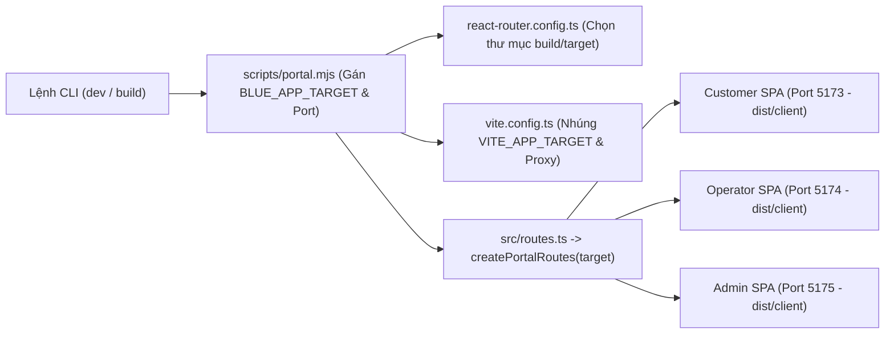
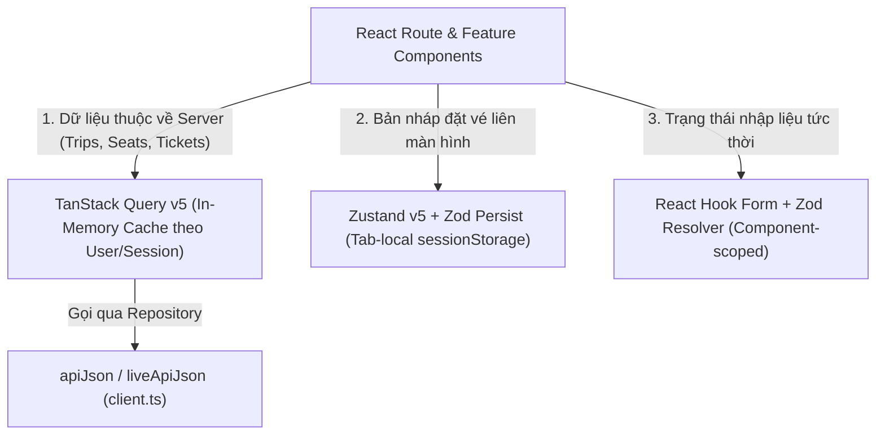
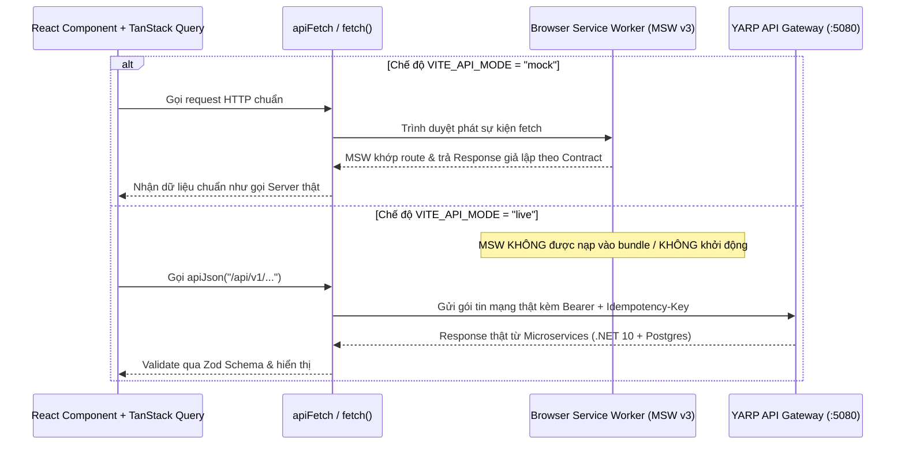
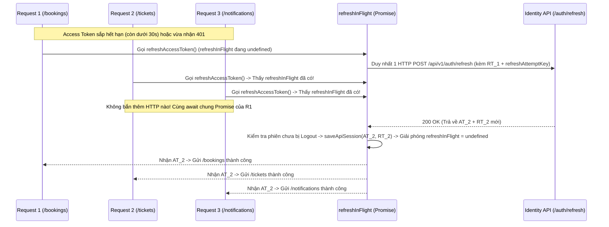

# Bài 01: Kiến Trúc Frontend React 19 — 1 Codebase Biên Dịch 3 Cổng Độc Lập, MSW v3 & Tầng Live API Chống Đua Lệnh

> **Mục tiêu bài học:** Bài viết này dẫn dắt bạn đi từ con số 0 (ngay cả khi chưa từng làm việc với Monorepo, React Router v7/v8 SPA Mode, Mock Service Worker hay cơ chế xoay vòng Refresh Token) đến việc nắm trọn vẹn từng dòng code thực tế trong thư mục `workspace/src/apps/web/` của dự án **BLUE Bus Ticket Platform (PBL6)**. Đọc xong bài này, bạn có thể tự tin giải thích trước Hội đồng tại sao dự án vừa chạy mượt mà khi trình diễn độc lập không cần Backend, vừa đấu nối an toàn tuyệt đối với hệ thống Microservices thật.

---

## 1. Bối Cảnh Bài Toán: Tại Sao Không Làm "Một Web Ôm Tất Cả"?

Trong một nền tảng đặt vé xe khách liên tỉnh quy mô thực tế (như Vexere hay redBus), người dùng truy cập bằng trình duyệt Web được chia thành **3 nhóm vai trò hoàn toàn khác biệt**:

1. **Hành khách (`Customer` — cổng `5173`):** Tìm chuyến xe, xem sơ đồ giường nằm, giữ ghế, điền thông tin hành khách, thanh toán SePay, tra cứu vé điện tử QR và yêu cầu hủy vé/hoàn tiền. Cần giao diện bắt mắt, tải nhanh, chuẩn SEO và tối ưu cho cả màn hình điện thoại `360px`.
2. **Nhà xe / Điều hành viên (`Operator` — cổng `5174`):** Quản lý đội xe, sơ đồ ghế, tài xế, tuyến đường, tạo và xuất bản lịch chạy (`Publish Trip`), xuất danh sách hành khách lên xe (`Passenger Manifest`), đối soát doanh thu (`Settlements`). Cần giao diện bàn làm việc (Workspace) nhiều bảng biểu.
3. **Quản trị viên nền tảng (`Platform Admin` — cổng `5175`):** Quản lý các tổ chức nhà xe, phân quyền nhân sự, giám sát toàn bộ đơn đặt vé, giao dịch thanh toán, xử lý hoàn tiền và đối soát toàn sàn.

Nếu bạn gom cả 3 nhóm này vào chung **một ứng dụng Single-Page Application (SPA) duy nhất** khi triển khai lên Production, bạn sẽ vướng ngay 2 điểm yếu chí mạng:
- **Phình to gói tải (Bundle Bloat):** Hành khách mở điện thoại bằng mạng 4G chập chờn chỉ để mua 1 tấm vé, nhưng trình duyệt lại phải tải kèm hàng trăm KB cấu hình định tuyến và biểu mẫu quản trị của Admin/Operator.
- **Lộ bề mặt tấn công (Attack Surface Exposure):** Chỉ cần mở F12 xem mã nguồn JavaScript trên trang khách hàng, kẻ tấn công có thể dò ra toàn bộ danh sách đường dẫn nội bộ (`/admin/payouts`, `/operator/settlements`), cấu trúc form và các API quản trị nhạy cảm.

Ngược lại, nếu tách thành **3 dự án React rời rạc hoàn toàn** (copy-paste 3 repo hoặc 3 thư mục độc lập), nhóm phát triển sẽ rơi vào cơn ác mộng bảo trì: sửa một kiểu dữ liệu `Booking`, đổi chuẩn `ApiError`, hay nâng cấp nút bấm `Button` cũng phải sửa ở 3 nơi!

Giải pháp kiến trúc của dự án **BLUE** là kết hợp tinh hoa của cả hai hướng: **Duy trì 1 nguồn mã duy nhất (Single Source of Truth) tại `src/apps/web`, nhưng dùng cơ chế định tuyến theo mục tiêu biên dịch (`BLUE_APP_TARGET`) để xuất xưởng ra 3 ứng dụng SPA vật lý hoàn toàn tách biệt!**

---

## 2. Kiến Trúc Frontend Monorepo (`npm workspaces` + `pnpm`)

### 2.1. Khái niệm Monorepo cho người mới bắt đầu

Hãy hình dung **Monorepo** giống như một khu tổ hợp công nghiệp có chung hàng rào và kho vật tư: thay vì để Web ở một kho Git, Mobile ở một kho Git khác, và thư viện gọi API ở kho thứ ba, tất cả cùng chung sống trong thư mục `workspace/`.

Hãy xem file cấu hình gốc tại [workspace/package.json](file:///C:/Users/minht/.gemini/antigravity/worktrees/PBL6/c_to_n_b/workspace/package.json):

```json
{
  "name": "busticket-platform",
  "private": true,
  "workspaces": [
    "src/apps/*",
    "src/packages/*"
  ],
  "scripts": {
    "dev:customer": "npm run dev --prefix src/apps/customer-web",
    "build:web": "npm run build --prefix src/apps/customer-web && npm run build --prefix src/apps/operator-web && npm run build --prefix src/apps/admin-web",
    "build:mobile": "npm run typecheck -w @busticket/mobile && npm run build:android -w @busticket/mobile",
    "dev:host": "powershell -File scripts/dev-host.ps1",
    "dev:docker": "powershell -File scripts/dev-docker.ps1",
    "dev:operator": "npm run dev --prefix src/apps/operator-web",
    "dev:admin": "npm run dev --prefix src/apps/admin-web"
  }
}
```

Cấu trúc này chia không gian làm hai tầng rõ rệt:
- **`src/packages/*` (Các gói thư viện dùng chung):** Gồm `@busticket/api-client` và `@busticket/ui` (chứa bảng màu, khoảng cách, bo góc chuẩn thương hiệu BLUE).
- **`src/apps/*` (Các ứng dụng đầu cuối):** Gồm `mobile` (React Native Expo), `web` (trái tim mã nguồn React 19), và 3 gói vỏ điều phối cổng: `customer-web`, `operator-web`, `admin-web`.

Riêng bên trong `src/apps/web`, dự án khóa cứng trình quản lý gói **`pnpm@10.34.7`** và **`Node.js 24.22.0`** trong `engines` và `packageManager` ([workspace/src/apps/web/package.json](file:///C:/Users/minht/.gemini/antigravity/worktrees/PBL6/c_to_n_b/workspace/src/apps/web/package.json)). `pnpm` sử dụng cơ chế liên kết cứng (hard-link) từ một kho lưu trữ toàn cục trên ổ cứng kết hợp cây thư mục symlink chặt chẽ, giúp ngăn chặn lỗi *"Phantom Dependencies"* (code vô tình `import` được thư viện phụ thuộc bắc cầu không khai báo trong `package.json`) và cài đặt cực nhanh trong Docker (`pnpm install --frozen-lockfile`).

---

### 2.2. Giải phẫu cơ chế `portal.mjs` + `BLUE_APP_TARGET` + `createPortalRoutes`

Khi mở thư mục `workspace/src/apps/`, nhiều bạn mới đọc code sẽ thắc mắc: *"Tại sao `customer-web`, `operator-web`, `admin-web` gần như rỗng mà chỉ có mỗi file `package.json` 12 dòng?"*

Hãy nhìn vào [workspace/src/apps/customer-web/package.json](file:///C:/Users/minht/.gemini/antigravity/worktrees/PBL6/c_to_n_b/workspace/src/apps/customer-web/package.json) (tương tự cho `operator-web` và `admin-web`):

```json
{
  "name": "@blue/customer-web",
  "version": "1.0.0",
  "private": true,
  "type": "module",
  "scripts": {
    "dev": "node ../web/scripts/portal.mjs customer dev",
    "build": "node ../web/scripts/portal.mjs customer build",
    "preview": "node ../web/scripts/portal.mjs customer preview",
    "typecheck": "node ../web/scripts/portal.mjs customer typecheck"
  }
}
```

Ba thư mục `customer-web`, `operator-web`, `admin-web` chính là **3 điểm vào (Entrypoint Shells)** đại diện cho 3 sản phẩm độc lập. Khi bạn gõ `npm run dev:customer`, `npm run dev:operator` hay `npm run build:web`, mọi lệnh đều hội tụ về trình điều phối [workspace/src/apps/web/scripts/portal.mjs](file:///C:/Users/minht/.gemini/antigravity/worktrees/PBL6/c_to_n_b/workspace/src/apps/web/scripts/portal.mjs):

```js
const [target, command = "dev", ...extra] = process.argv.slice(2);
const ports = { customer: 5173, operator: 5174, admin: 5175 };
if (
  !(target in ports) ||
  !["dev", "build", "preview", "typecheck"].includes(command)
) {
  throw new Error(
    "Usage: portal.mjs customer|operator|admin dev|build|preview|typecheck",
  );
}
const cwd = fileURLToPath(new URL("..", import.meta.url));
const env = {
  ...process.env,
  BLUE_APP_TARGET: target,
};
```

Hãy theo dõi dây chuyền **4 mắt xích** biến biến môi trường `BLUE_APP_TARGET` thành 3 ứng dụng tách biệt hoàn toàn:



#### Mắt xích 1: Cấp cổng cố định & Xuất bản gói tĩnh riêng (`portal.mjs`)
- Khi chạy `dev`: `portal.mjs` gọi `@react-router/dev/bin.cjs dev --host 127.0.0.1 --port <5173|5174|5175> --strictPort`. Cờ `--strictPort` đảm bảo nếu cổng `5174` đang bận, tiến trình báo lỗi ngay lập tức chứ không tự nhảy sang cổng khác làm lệch cấu hình CORS của API Gateway!
- Khi chạy `build`: Sau khi React Router biên dịch xong vào `web/build/<target>/client`, `portal.mjs` tự động sao chép toàn bộ tài nguyên tĩnh sang `../<target>-web/dist/client`:
  ```js
  if (command === "build") {
    const destination = resolve(cwd, `../${target}-web/dist/client`);
    await mkdir(destination, { recursive: true });
    await cp(resolve(cwd, `build/${target}/client`), destination, {
      recursive: true,
    });
    console.log(`Built independent ${target} web at ${destination}`);
  }
  ```

#### Mắt xích 2: Cấu hình chế độ SPA & Tách thư mục Build ([react-router.config.ts](file:///C:/Users/minht/.gemini/antigravity/worktrees/PBL6/c_to_n_b/workspace/src/apps/web/react-router.config.ts))
```ts
import type { Config } from "@react-router/dev/config";

export default {
  appDirectory: "src",
  buildDirectory:
    process.env.BLUE_APP_TARGET && process.env.BLUE_APP_TARGET !== "all"
      ? `build/${process.env.BLUE_APP_TARGET}`
      : "build",
  prerender: process.env.VITE_API_MODE === "live" ? false : ["/"],
  ssr: false,
} satisfies Config;
```
- **`ssr: false` (SPA Mode):** Thay vì cần một Node.js Server chạy 24/7 để render HTML cho mỗi request, toàn bộ ứng dụng được biên dịch thành các file tĩnh (`.html`, `.js`, `.css`) có thể phục vụ siêu nhẹ qua Nginx (`nginx-unprivileged`).
- **`prerender` thông minh:** Ở chế độ `mock` (bản demo tĩnh), trang chủ `/` được kết xuất trước (Static Pre-rendering) thành file `index.html` có sẵn nội dung SEO, kèm `__spa-fallback.html` cho các đường dẫn động. Ở chế độ `live`, hệ thống tắt prerender (`false`) để dùng một tài liệu SPA duy nhất tránh đóng băng dữ liệu giả vào lúc build Docker.

#### Mắt xích 3: Nhúng hằng số lúc biên dịch & Định tuyến Proxy ([vite.config.ts](file:///C:/Users/minht/.gemini/antigravity/worktrees/PBL6/c_to_n_b/workspace/src/apps/web/vite.config.ts))
```ts
define: {
  "import.meta.env.VITE_APP_TARGET": JSON.stringify(
    process.env.BLUE_APP_TARGET ?? "customer",
  ),
  "import.meta.env.VITE_API_MODE": JSON.stringify(
    process.env.VITE_API_MODE ?? env.VITE_API_MODE ?? "mock",
  ),
},
server: {
  proxy: {
    "/api/v1": {
      target:
        process.env.API_PROXY_TARGET ||
        env.API_PROXY_TARGET ||
        "http://localhost:5080",
      changeOrigin: true,
    },
  },
},
```
Khi chạy local ở cổng `5173`, mọi lời gọi `/api/v1/...` từ trình duyệt đều cùng origin `http://127.0.0.1:5173/api/v1/...` và được Vite Dev Server chuyển tiếp ngầm sang API Gateway ở `http://localhost:5080`, giúp quá trình phát triển không bị vướng lỗi CORS.

#### Mắt xích 4: Cắt tỉa cây Route ngay từ gốc ([src/routes.ts](file:///C:/Users/minht/.gemini/antigravity/worktrees/PBL6/c_to_n_b/workspace/src/apps/web/src/routes.ts) & [src/app/portalRoutes.ts](file:///C:/Users/minht/.gemini/antigravity/worktrees/PBL6/c_to_n_b/workspace/src/apps/web/src/app/portalRoutes.ts))

Đây chính là phép màu quan trọng nhất! Trong React Router Framework Mode, trình đóng gói Vite/Rollup đọc file `src/routes.ts` tại **thời điểm biên dịch (Build-time)** để biết cần đưa những file `.tsx` nào vào gói JavaScript cuối cùng. Hãy xem `createPortalRoutes(target)`:

```ts
export type PortalTarget = "customer" | "operator" | "admin" | "all";

/** all is reserved for the regression harness; release apps select a single target. */
export function createPortalRoutes(target: PortalTarget): RouteConfigEntry[] {
  if (target === "all") return allRoutes;
  const root =
    allRoutes[target === "operator" ? 0 : target === "customer" ? 1 : 2];
  if (target === "customer") return [root];
  return [
    index("./routes/portal/index.tsx"),
    route("/login", "./routes/portal/login.tsx"),
    layout("./routes/portal/guard.tsx", [root]),
    route("*", "./routes/not-found.tsx"),
  ];
}
```

Hãy phân tích điều gì xảy ra khi `BLUE_APP_TARGET=customer`:
1. Mảng `allRoutes` có 3 phần tử gốc: `[0]` là nhánh Operator (`/operator/*`), `[1]` là nhánh Customer (`/`, `/trips`, `/booking/*`, `/payment/*`...), `[2]` là nhánh Admin (`/admin/*`).
2. Khi `target === "customer"`, hàm `createPortalRoutes("customer")` **chỉ trả về duy nhất `[allRoutes[1]]`**.
3. Vì `allRoutes[0]` (Operator) và `allRoutes[2]` (Admin) không hề được trả về trong cấu hình route của bản build Customer, Rollup **không bao giờ biên dịch hay đóng gói** bất kỳ màn hình Admin hay Operator nào vào thư mục `customer-web/dist/client`!
4. Nếu một người dùng trên cổng Customer (`5173`) cố tình gõ `/admin/organizations` hay `/operator/trips` lên thanh địa chỉ, ứng dụng rơi thẳng vào `route("*", "./routes/not-found.tsx")` ("Không tìm thấy trang"), và trong tab Network tuyệt đối không tồn tại bất kỳ chunk JS nào của trang quản trị! (Điều này thậm chí được kiểm chứng tự động bằng Playwright trong `tests/portals/separate-portals.spec.ts`).
5. Riêng với `operator` và `admin`, hàm bọc thêm trang đăng nhập nhân sự độc lập (`/login` -> `./routes/portal/login.tsx`) và lớp bảo vệ cổng (`./routes/portal/guard.tsx`), còn giá trị `"all"` chỉ dành riêng cho bộ kiểm thử hồi quy nội bộ khi cần chạy toàn bộ route trên một dev server duy nhất.

---

## 3. Hệ Sinh Thái Công Nghệ & Triết Lý Phân Tách 3 Tầng Trạng Thái (State Ownership)

### 3.1. Bảng tổng hợp Stack công nghệ hiện đại

Trong [workspace/src/apps/web/package.json](file:///C:/Users/minht/.gemini/antigravity/worktrees/PBL6/c_to_n_b/workspace/src/apps/web/package.json), mọi thư viện đều được ghim phiên bản chính xác (Exact Pinning — không dùng dấu `^` hay `~` trôi nổi) để đảm bảo máy của mọi thành viên và container CI/CD chạy giống hệt nhau 100%:

| Phân lớp | Thư viện & Phiên bản | Lý do lựa chọn kỹ thuật |
|---|---|---|
| **UI Core & Typing** | `react@19.3.1` + `typescript@5.9.3` | Tận dụng `startTransition`, concurrent rendering mượt mà của React 19 và chế độ `strict` cấm `any` tùy tiện. |
| **Build & Routing** | `vite@8.3.4` + `react-router@8.4.0` | Khởi động dev server tức thì với ESM, tự động tách code theo từng route (Lazy Route Modules) và sinh kiểu `typegen` tự động. |
| **Styling & A11y UI** | `tailwindcss@4.3.3` + `@radix-ui/*` + `@phosphor-icons/react` | Kết hợp CSS Variables theo hệ màu BLUE, BEM cho component phức tạp, và Radix UI đảm bảo bẫy tiêu điểm bàn phím (Focus Trap), chuẩn trợ năng WCAG. |
| **Server State** | `@tanstack/react-query@5.104.4` | Quản lý vòng đời dữ liệu bất đồng bộ từ API: tự động cache, khử trùng lặp request, làm mới ngầm và phân tách cache theo người dùng. |
| **Client Draft State** | `zustand@5.0.15` | Lưu trữ gọn nhẹ bản nháp đặt vé xuyên qua nhiều màn hình (`Chọn ghế -> Hành khách -> Xác nhận -> Thanh toán`), đồng bộ vào `sessionStorage`. |
| **Form & Schema** | `react-hook-form@7.90.0` + `zod@4.6.7` | Quản lý form hiệu năng cao bằng uncontrolled inputs và kiểm tra dữ liệu đầu vào/đầu ra chặt chẽ bằng Zod v4. |
| **API Mocking** | `msw@3.0.3` | Chặn bắt HTTP ở tầng Service Worker chuẩn Web Fetch API mà không cần sửa code gọi API của ứng dụng. |

---

### 3.2. Phân Tách Rạch Ròi 3 Loại State: Chấm Dứt Căn Bệnh "Nhét Tất Cả Vào Store"

Một sai lầm phổ biến của sinh viên khi làm React là tạo một cái Store toàn cục (Redux hoặc Zustand) rồi nhét tất cả mọi thứ vào đó: từ danh sách chuyến xe lấy trên mạng về, trạng thái `isLoading`, cho tới từng ký tự người dùng đang gõ vào ô Họ Tên. Cách làm đó khiến dữ liệu nhanh chóng bị cũ (stale), lệch với cơ sở dữ liệu thật và gây re-render toàn trang.

Trong kiến trúc **BLUE**, quyền sở hữu trạng thái (State Ownership) được chia làm **3 vùng bất khả xâm phạm**:



#### Vùng 1: Server State với `TanStack Query v5` ([AppProviders.tsx](file:///C:/Users/minht/.gemini/antigravity/worktrees/PBL6/c_to_n_b/workspace/src/apps/web/src/app/AppProviders.tsx) & [liveRequest.ts](file:///C:/Users/minht/.gemini/antigravity/worktrees/PBL6/c_to_n_b/workspace/src/apps/web/src/shared/api/liveRequest.ts))
- Trong `AppProviders.tsx`, `QueryClient` được cấu hình mặc định:
  - `queries: { retry: 1, staleTime: 30_000 }`: Dữ liệu đọc về được coi là tươi mới trong 30 giây, nếu lỗi mạng thoáng qua chỉ thử lại tự động 1 lần.
  - **`mutations: { retry: 0 }`**: Mọi thao tác ghi (giữ ghế, tạo đơn, thanh toán, hủy vé) **tuyệt đối không tự động retry mù quáng** ở tầng QueryClient để tránh tạo đơn kép (chỉ cho phép thử lại có kiểm soát kèm `Idempotency-Key` ở tầng HTTP Client).
- Đặc biệt, hãy xem cách tạo Query Key trong `src/shared/api/liveRequest.ts`:
  ```ts
  export function liveQueryKey(...parts: unknown[]): readonly unknown[] {
    const session = readApiSession();
    return ["live-api", session?.user.id, session?.sessionId, ...parts];
  }
  ```
  Việc đưa cả `session?.user.id` và `session?.sessionId` vào đầu mảng khóa cache đảm bảo: nếu Khách hàng A đăng xuất và Khách hàng B đăng nhập ngay trên cùng tab đó, dữ liệu vé hay đơn hàng cũ trong bộ nhớ RAM của Khách hàng A **không bao giờ bị hiển thị nhầm** sang cho Khách hàng B!

#### Vùng 2: Tab-Scoped Client Draft State với `Zustand v5` ([bookingDraftStore.ts](file:///C:/Users/minht/.gemini/antigravity/worktrees/PBL6/c_to_n_b/workspace/src/apps/web/src/features/booking/store/bookingDraftStore.ts))
Khi hành khách chọn 2 ghế `A01, A02` ở màn hình `/booking/:sessionId/seats`, chuyển sang màn hình nhập tên hành khách `/booking/:sessionId/passengers`, rồi sang màn hình rà soát `/booking/:sessionId/review`, dữ liệu bản nháp này chưa tạo thành đơn chính thức trên Server nhưng cần sống sót nếu người dùng lỡ bấm F5 tải lại trang.

Hãy xem những kỹ thuật phòng thủ bậc thầy trong `bookingDraftStore.ts`:
1. **Dùng `sessionStorage` thay vì `localStorage`:** Trong trình duyệt, `localStorage` dùng chung cho mọi tab cùng tên miền. Nếu hành khách mở 2 tab để đặt 2 chuyến xe khác nhau cho gia đình (một chuyến đi Đà Lạt, một chuyến đi Nha Trang), `localStorage` sẽ làm 2 tab ghi đè đè bẹp dữ liệu ghế của nhau! Ngược lại, `window.sessionStorage` **cô lập riêng cho từng Tab trình duyệt**, vừa giữ được bản nháp khi F5 trong tab đó, vừa không đụng chạm tới tab bên cạnh.
2. **Chịu lỗi môi trường chặn lưu trữ (Graceful Storage Degradation):** Hàm bọc `browserStorage` đặt `try/catch` quanh mọi lệnh đọc/ghi `sessionStorage`. Nếu người dùng bật chế độ ẩn danh khắt khe chặn bộ nhớ trình duyệt, ứng dụng không sập trắng màn hình mà vẫn giữ bản nháp hoạt động bình thường trên RAM của trang hiện tại.
3. **Kiểm định bằng Zod ngay khi khôi phục (`readPersistedDraft`):**
   ```ts
   function readPersistedDraft(
     value: unknown,
     storage: StateStorage,
   ): BookingDraft | null {
     const parsed = persistedDraftSchema.safeParse(value);
     if (
       parsed.success &&
       ((!isMockApi && !parsed.data.draft.bookingId) ||
         Date.parse(parsed.data.draft.expiresAt) > Date.now())
     ) {
       const draft = parsed.data.draft;
       if (isMockApi && !draft.bookingId && draft.selectedSeatIds.length > 0) {
         draft.passengerCount = draft.selectedSeatIds.length;
       }
       return draft;
     }
     void storage.removeItem(BOOKING_DRAFT_STORAGE_KEY);
     return null;
   }
   ```
   Dữ liệu đọc từ `sessionStorage` lên được coi là dữ liệu không đáng tin cậy (`unknown`). Nếu người dùng sửa tay JSON trong DevTools hoặc phiên nháp đã quá hạn `expiresAt`, `persistedDraftSchema.safeParse` sẽ loại bỏ và xóa sạch khóa rác ngay lập tức!
4. **Bảo toàn `bookingAttemptKey` qua các lần cập nhật (`withAttemptKey`):** Khi hành khách đã bấm tạo đơn một lần nhưng mạng chập chờn, mã `bookingAttemptKey` gắn với `sessionId` hiện tại được giữ nguyên trong bản nháp để lần bấm thử lại gửi đúng cùng một `Idempotency-Key` lên Backend.

#### Vùng 3: Form State & Validation với `React Hook Form + Zod v4`
Các biểu mẫu lớn (như danh sách thông tin hành khách theo từng ghế, biểu mẫu đăng ký tài khoản, biểu mẫu hủy vé) được quản lý cục bộ bằng `useForm` kết hợp `@hookform/resolvers` và schema `zod`. Không bao giờ đồng bộ từng nhát gõ phím (`onChange`) lên Zustand — chỉ khi người dùng bấm "Tiếp tục" và vượt qua toàn bộ quy tắc kiểm tra của Zod (định dạng số điện thoại Việt Nam, email, độ dài mật khẩu), dữ liệu sạch mới được ghi một lần vào `setContact` / `setPassengers` của bản nháp.

---

## 4. Hệ Thống Route Guards: Ba Lớp Canh Cổng Điều Hướng Thông Minh

Trước khi đi vào từng Guard, chúng ta phải khắc cốt ghi tâm nguyên tắc bảo mật được ghi rõ trong [ARCHITECTURE.md](file:///C:/Users/minht/.gemini/antigravity/worktrees/PBL6/c_to_n_b/workspace/src/apps/web/docs/technical/ARCHITECTURE.md):

> **Nguyên tắc sống còn:** *Client Route Guard ở Frontend chỉ phục vụ trải nghiệm điều hướng giao diện (UX Navigation), tuyệt đối KHÔNG phải là lớp bảo mật thay thế Server!* Mọi quyền hạn thực sự luôn do Backend kiểm tra qua chữ ký JWT và quyền sở hữu bản ghi (`ownership`).

Dự án định nghĩa các Layout Guard bọc quanh các nhóm route nhạy cảm trong `portalRoutes.ts`:

### 4.1. `AdminRoute` & `CustomerSessionRoute`: Phân biệt rõ `Chưa Hydrate`, `401 Chưa Đăng Nhập` và `403 Sai Vai Trò`

Hãy xem [AdminRoute.tsx](file:///C:/Users/minht/.gemini/antigravity/worktrees/PBL6/c_to_n_b/workspace/src/apps/web/src/app/guards/AdminRoute.tsx) và [CustomerSessionRoute.tsx](file:///C:/Users/minht/.gemini/antigravity/worktrees/PBL6/c_to_n_b/workspace/src/apps/web/src/app/guards/CustomerSessionRoute.tsx):

```tsx
export function CustomerSessionRoute(): ReactElement {
  const { session, isHydrated } = useAccountSession(),
    location = useLocation();
  if (!isHydrated) return <GuardLoading />;
  if (!session?.token)
    return (
      <Navigate
        replace
        to={ROUTES.login}
        state={{
          from: safeIntendedRedirect(
            location.pathname + location.search,
            "customer",
          ),
        }}
      />
    );
  if (session.role !== "customer")
    return (
      <PageState
        title="403 — Không có quyền truy cập"
        description="Trang này dành cho tài khoản khách hàng mô phỏng."
        action={<Link to={ROUTES.home}>Về trang chủ</Link>}
      />
    );
  return <Outlet />;
}
```

Ba nhánh xử lý ở đây giải quyết 3 lỗi kinh điển thường gặp ở các SPA:
1. **Chống nháy chuyển hướng sai khi F5 (`!isHydrated`):** Trong tích tắc đầu tiên khi trình duyệt nạp trang, React chưa kịp đọc `sessionStorage`. Nếu kiểm tra `!session` ngay lập tức, người dùng đang đăng nhập mà bấm F5 sẽ bị đá văng ra trang `/login`! Nhờ biến cờ `isHydrated`, Guard hiển thị `<GuardLoading />` chờ khôi phục phiên xong rồi mới quyết định.
2. **Bảo vệ chống lỗ hổng Open Redirect (`safeIntendedRedirect`):** Khi chưa đăng nhập, Guard lưu lại địa chỉ người dùng định vào (`location.pathname + location.search`) qua hàm lọc `safeIntendedRedirect(...)` trước khi chuyển tới `/login`. Hàm này chỉ cho phép đường dẫn nội bộ hợp lệ thuộc đúng cổng đó, ngăn chặn kẻ xấu lừa người dùng bấm link kiểu `//evil-phishing.com` để sau khi đăng nhập xong bị chuyển hướng ra web độc hại!
3. **Tách biệt `401` (Redirect sang Login) và `403` (Render màn hình Từ chối quyền):** Nếu một tài khoản `admin` đi lạc vào trang cá nhân của `customer` (hoặc ngược lại `customer` vào `AdminRoute`), nếu ta chuyển hướng về `/login` sẽ gây vòng lặp vô tận (vì họ đã đăng nhập rồi!). Thay vào đó, Guard dừng lại và hiển thị rõ trạng thái **`403 — Không có quyền truy cập`** kèm nút về trang chủ.

---

### 4.2. `BookingSessionRoute`: Canh Gác Phiên Giữ Ghế Có Đếm Ngược Thời Gian Thực

Trong luồng đặt vé (`/booking/:sessionId/seats`, `passengers`, `review`, và `/payment/:bookingId/*`), người dùng không thể nhảy cóc vào trang thanh toán nếu chưa chọn ghế hoặc phiên nháp đã hết hạn. Hãy xem [BookingSessionRoute.tsx](file:///C:/Users/minht/.gemini/antigravity/worktrees/PBL6/c_to_n_b/workspace/src/apps/web/src/app/guards/BookingSessionRoute.tsx):

```tsx
export function BookingSessionRoute(): ReactElement {
  const { sessionId, bookingId } = useParams();
  const location = useLocation();
  const draft = useBookingDraftStore(selectBookingSession);
  const isHydrated = useBookingDraftHydration();
  const nowMs = useSessionClock(draft?.expiresAt);
  // Live checkout reloads the booking from BE; ownership is enforced by its JWT API.
  if (!isMockApi && bookingId) return <Outlet />;
  const hasMatchingRoute =
    draft &&
    (sessionId
      ? draft.sessionId === sessionId
      : Boolean(bookingId && draft.bookingId === bookingId));
  if (!isHydrated || nowMs === null) return <GuardLoading />;
  const expiryMs = draft ? Date.parse(draft.expiresAt) : Number.NaN;
  const enforceExpiry = isMockApi;
  // ...
  if (
    !hasMatchingRoute ||
    !draft ||
    !Number.isFinite(expiryMs) ||
    (enforceExpiry && expiryMs <= nowMs && !canShowExpiredSeatState)
  ) {
    return <Navigate replace to={`${ROUTES.trips}?reason=expired`} />;
  }
  return <Outlet />;
}
```

Điểm cực kỳ tinh tế nằm ở sự phối hợp giữa chế độ **Mock** và **Live**:
- Ở chế độ **Mock**, phiên giữ ghế được mô phỏng hoàn toàn trên trình duyệt nên `useSessionClock(draft?.expiresAt)` đếm ngược từng giây; ngay khi `expiryMs <= nowMs` ở trang hành khách hoặc review, Guard lập tức điều hướng về `/trips?reason=expired` để thông báo phiên giữ chỗ đã hết hạn (riêng tại trang `/seats`, nó cho phép hiển thị hộp thoại hết hạn tại chỗ để khách chọn lại ghế).
- Ở chế độ **Live (`!isMockApi`)**, khi khách hàng đã tạo xong đơn thật (`bookingId` đã có trên URL `/payment/:bookingId/sepay`) hoặc mở lại đơn chờ thanh toán từ mục *"Vé của tôi"*, dòng `if (!isMockApi && bookingId) return <Outlet />;` cho phép đi thẳng vào trang thanh toán **kể cả khi bản nháp local đã bị xóa sau khi đóng trình duyệt**! Trang thanh toán sẽ tải trực tiếp hạn chót thực tế (`expiresAt`) từ Backend về và để Backend thực thi quyền sở hữu qua JWT.

---

## 5. Giải Phẫu Cơ Chế Dual-Mode API (`VITE_API_MODE=mock` vs `live`) & MSW v3

### 5.1. MSW (Mock Service Worker) hoạt động như thế nào cho người mới?

Khi làm đồ án nhóm hoặc phát triển sản phẩm lớn, nếu Frontend cứ phải đợi Backend viết xong Database, RabbitMQ, Docker rồi mới có API để ghép giao diện thì tiến độ sẽ bị đình trệ nghiêm trọng. Nhưng nếu viết câu lệnh `if (isMock) return fakeData` rải rác khắp các component React thì code sẽ nát vụn và không kiểm tra được tầng mạng (`fetch`, JSON parsing, HTTP status codes `400/401/409`, TanStack Query).

**MSW (Mock Service Worker v3)** giải quyết bài toán này ở **tầng trình duyệt**:
1. MSW đăng ký một file **Service Worker** thật (`public/mockServiceWorker.js`) đứng chắn ngay giữa tab trình duyệt và card mạng của hệ điều hành.
2. Code React của bạn vẫn gọi `fetch("/api/v1/trips?...")` thật 100%, vẫn gửi Header, Body, Query String thật.
3. Service Worker bắt lấy gói tin `fetch` đó, chuyển ngược lên bộ định tuyến giả lập (`handlers` trong `src/mocks/browser.ts`), chạy logic kiểm tra dữ liệu, lưu trạng thái in-memory (giữ ghế, tạo vé, hủy vé...) rồi trả về đối tượng `Response` chuẩn HTTP (`200`, `201`, `409 Conflict`...).



---

### 5.2. Cách khởi động có điều kiện & Tối ưu Bundle (`enableMocking.ts` & `entry.client.tsx`)

Hãy xem 3 file ngắn gọn nhưng cực kỳ sắc bén điều khiển cơ chế này:

1. **[src/shared/api/config.ts](file:///C:/Users/minht/.gemini/antigravity/worktrees/PBL6/c_to_n_b/workspace/src/apps/web/src/shared/api/config.ts):**
   ```ts
   /** Standalone demos work without a backend. Live integration is an explicit opt-in. */
   export const isMockApi =
     import.meta.env.MODE === "test" || import.meta.env.VITE_API_MODE !== "live";

   export const apiBaseUrl = (import.meta.env.VITE_API_BASE_URL ?? "").replace(
     /\/$/,
     "",
   );
   ```
2. **[src/app/enableMocking.ts](file:///C:/Users/minht/.gemini/antigravity/worktrees/PBL6/c_to_n_b/workspace/src/apps/web/src/app/enableMocking.ts):**
   ```ts
   import { isMockApi } from "@/shared/api/config";
   export async function enableMocking(): Promise<void> {
     if (!isMockApi || typeof window === "undefined") return;

     const { worker } = await import("@/mocks/browser");
     await worker.start({ onUnhandledFrame: "bypass", quiet: true });
   }
   ```
3. **[src/entry.client.tsx](file:///C:/Users/minht/.gemini/antigravity/worktrees/PBL6/c_to_n_b/workspace/src/apps/web/src/entry.client.tsx):**
   ```tsx
   async function startClient(): Promise<void> {
     await enableMocking();

     startTransition(() => {
       hydrateRoot(
         document,
         <StrictMode>
           <HydratedRouter />
         </StrictMode>,
       );
     });
   }
   ```

Tại sao phải `await enableMocking()` **trước khi** gọi `hydrateRoot(...)`?
- Nếu render cây React trước khi Service Worker kịp kích hoạt xong, các `useQuery` chạy ngay lúc mở trang đầu tiên sẽ bắn request ra mạng trước khi MSW kịp đón lõng, dẫn tới lỗi `404 Not Found` chớp nhoáng! Chờ `worker.start(...)` hoàn tất mới hydrate đảm bảo **100% request từ giây đầu tiên đều được bắt gọn**.
- Quan trọng hơn nữa: Nhờ dùng **`await import("@/mocks/browser")` (Dynamic Import)** kết hợp hằng số biên dịch `VITE_API_MODE="live"`, ở bản build Production Live, nhánh `if (!isMockApi) return;` giúp trình duyệt **không bao giờ tải** hàng ngàn dòng dữ liệu mẫu (`fixtures`, `mockDb`, `msw/browser`) về máy khách hàng thật!

---

### 5.3. Tại Sao Ở Chế Độ `live` Tuyệt Đối Không Âm Thầm Fallback Về Mock?

Một cám dỗ rất nguy hiểm khi ghép nối Frontend - Backend là viết kiểu:
```ts
// ❌ PHẢN MẪU NGUY HIỂM TUYỆT ĐỐI CẤM TRONG DỰ ÁN NÀY:
try {
  return await fetchLiveTrips();
} catch {
  return mockTripsFixture; // Âm thầm trả dữ liệu giả khi API lỗi!
}
```
Tại sao dự án **BLUE** nghiêm cấm hành vi này (ghi rõ ngay dòng đầu [BACKEND_INTEGRATION.md](file:///C:/Users/minht/.gemini/antigravity/worktrees/PBL6/c_to_n_b/workspace/src/apps/web/docs/technical/BACKEND_INTEGRATION.md): *"Frontend mặc định gọi API thật. Không tự chuyển sang dữ liệu giả khi dịch vụ lỗi"*)?
1. **Thảm họa dữ liệu ma (Ghost Data Hazard):** Hãy tưởng tượng dịch vụ `Booking` hoặc `Gateway` gặp sự cố mạng 5 giây. Nếu trang tìm chuyến âm thầm rơi về dữ liệu giả (`mock`), hành khách sẽ nhìn thấy một chuyến xe không hề tồn tại trong PostgreSQL, chọn ghế ảo, chuyển khoản tiền thật hoặc tưởng mình đã đặt vé thành công rồi xách vali ra bến xe!
2. **Che giấu lỗi tích hợp (Masking Production Bugs):** Nếu API thật đổi tên trường hoặc trả lỗi `500`, việc fallback về mock khiến cả lập trình viên lẫn QA tưởng tính năng vẫn chạy ngon lành, làm lọt lỗi nghiêm trọng lên môi trường thật.
3. **Trung thực với người dùng (Honest Unavailable State):** Trong `client.ts` và `error.ts`, thậm chí những đường dẫn mà UI bản thiết kế cũ có nhưng Backend chưa mở API công khai (như `/locations`, `/auth/oauth`, `/booking-sessions`) cũng chủ động ném lỗi tường minh `501 FEATURE_UNAVAILABLE` để giao diện hiển thị component `UnavailablePage.tsx` đàng hoàng, thay vì bịa ra thành công giả!

---

## 6. Giải Phẫu Chuyên Sâu Tầng HTTP Client (`client.ts`, `session.ts`, `liveRequest.ts`)

Toàn bộ giao tiếp giữa 3 cổng Web ở chế độ `live` với hệ thống Backend C# đều đi qua một đường ống duy nhất tại `src/shared/api/`. Hãy mổ xẻ từng cơ chế kỹ thuật đắt giá bên trong!

### 6.1. Quản lý Session theo Tab & Đồng bộ Giao diện ([session.ts](file:///C:/Users/minht/.gemini/antigravity/worktrees/PBL6/c_to_n_b/workspace/src/apps/web/src/shared/api/session.ts))

Khi người dùng đăng nhập qua `/api/v1/auth/login`, Backend trả về cặp `accessToken` (JWT ngắn hạn, ví dụ 15 phút / `900s`), `refreshToken` (dùng 1 lần để xoay vòng), `sessionId` (UUIDv7) và thông tin `user` kèm danh sách `roles`.

Trong `session.ts`, dữ liệu này được kiểm tra nghiêm ngặt bằng `backendSessionSchema` (Zod) và lưu vào `window.sessionStorage`:
- `KEY = "blue-api-session"`: Lưu trọn vẹn phiên thật kèm mốc hết hạn tính sẵn bằng mili-giây `expiresAt: Date.now() + input.expiresIn * 1000`.
- `UI_KEY = "blue-mock-session"`: Chuyển đổi role (`PLATFORM_ADMIN` -> `"admin"`, còn lại -> `"customer"`) sang định dạng chuẩn của các hook giao diện và phát sự kiện `window.dispatchEvent(new StorageEvent("storage", { key: UI_KEY }))` để thanh điều hướng (Header, Avatar Menu) cập nhật tức thì mà không cần sửa lại toàn bộ các component UI đã viết trước đó!
- Khi đăng xuất (`clearApiSession()`), hàm không chỉ xóa token mà còn **quét sạch toàn bộ dấu vết phiên làm việc** trong `sessionStorage`: xóa `blue-booking-draft`, xóa mọi khóa `blue-live-booking:*`, `blue-live-request:*`, `blue-live-operator-*`.

> **Góc nhìn kiến trúc bảo mật:** Tài liệu `BACKEND_INTEGRATION.md` cũng thẳng thắn ghi nhận: lưu JWT trong `sessionStorage` an toàn hơn `localStorage` (tự hủy khi đóng tab, cô lập giữa các tab), nhưng nếu trang web dính lỗ hổng XSS thì JavaScript vẫn đọc được. Do đó dự án bật CSP/XSS hardening và gom toàn bộ lệnh đọc/ghi token vào đúng 1 file `session.ts` — nếu sau này nâng cấp Backend sang mô hình **BFF + `HttpOnly; Secure; SameSite` Cookie**, ta chỉ cần sửa đúng tầng `client.ts`/`session.ts` mà không phải đụng vào bất kỳ trang giao diện nào!

---

### 6.2. Hàng rào Phòng thủ trong `apiFetch` & `apiJson` ([client.ts](file:///C:/Users/minht/.gemini/antigravity/worktrees/PBL6/c_to_n_b/workspace/src/apps/web/src/shared/api/client.ts))

Hãy đọc kỹ hàm `apiFetch` từ dòng 77 đến 146 của `client.ts`:

```ts
export async function apiFetch(
  path: string | URL,
  options: ApiOptions = {},
): Promise<Response> {
  const value = String(path);
  if (isMockApi) return globalThis.fetch(path, options);
  if (
    !value.startsWith("/api/v1/") ||
    value.includes("\\") ||
    value.includes("#")
  )
    throw new ApiError("INVALID_API_PATH", 0, "Đường dẫn API không hợp lệ.");
```

Tại sao phải chặn cứng `!value.startsWith("/api/v1/") || value.includes("\\") || value.includes("#")`?
- **Chống rò rỉ JWT sang máy chủ lạ (Token Exfiltration Prevention):** Giả sử một biến đầu vào bị thao túng thành `"https://attacker.com/steal"` hoặc `"//attacker.com"` hoặc dùng dấu gạch chéo ngược `"\\"` đánh lừa trình phân tích URL. Nếu `apiFetch` nối chuỗi mù quáng và gắn header `Authorization: Bearer <accessToken>`, trình duyệt sẽ dâng tận tay JWT của người dùng cho server của tin tặc! Kiểm tra tiền tố `/api/v1/` bắt buộc mọi request chỉ được đi về đúng API Gateway của hệ thống.
- **Tẩy rửa Header giả & Gắn vết truy vết (`X-Correlation-ID`):**
  ```ts
  headers.delete("X-Mock-Session-Token");
  headers.delete("X-Ticket-Access-Token");
  headers.set("Accept", "application/json");
  headers.set("X-Correlation-ID", crypto.randomUUID());
  ```
  Mỗi request bắn ra đều mang một mã định danh `X-Correlation-ID` duy nhất. Khi Backend trả lỗi qua `ErrorEnvelope`, hàm `responseError` trong [error.ts](file:///C:/Users/minht/.gemini/antigravity/worktrees/PBL6/c_to_n_b/workspace/src/apps/web/src/shared/api/error.ts) bóc tách `correlationId` để người dùng hoặc kỹ sư vận hành có thể tra cứu chính xác dòng log tương ứng giữa hàng triệu dòng log trên 6 Microservices!
- **Timeout cứng 20 giây kết hợp Hủy yêu cầu khi chuyển trang (`AbortSignal.any`):**
  ```ts
  signal: init.signal
    ? AbortSignal.any([init.signal, AbortSignal.timeout(20_000)])
    : AbortSignal.timeout(20_000),
  ```
  Nếu người dùng bấm chuyển sang trang khác (TanStack Query hủy `init.signal`) **hoặc** mạng treo quá 20 giây (`AbortSignal.timeout(20_000)`), kết nối lập tức được ngắt gọn gàng, không bao giờ để nút bấm quay vòng vô tận!

---

### 6.3. Cơ chế Bất Biến `Idempotency-Key` Chống Trừ Tiền / Tạo Đơn Kép ([liveRequest.ts](file:///C:/Users/minht/.gemini/antigravity/worktrees/PBL6/c_to_n_b/workspace/src/apps/web/src/shared/api/liveRequest.ts))

Trong mạng di động thực tế, chuyện gì xảy ra khi khách hàng bấm *"Xác nhận đặt vé"*, gói tin `POST /api/v1/bookings` đã tới Backend và tạo đơn xong xuôi, nhưng đúng lúc gói tin phản hồi đang bay về thì thang máy mất sóng? Khách hàng thấy báo *"Lỗi kết nối"*, bèn tải lại trang và bấm *"Xác nhận đặt vé"* lần nữa!

Nếu tạo một UUID ngẫu nhiên mới ở mỗi lần bấm, Backend sẽ tưởng đây là 2 đơn hàng khác nhau. Hãy xem cách hàm `liveApiJson` trong `liveRequest.ts` giải quyết bài toán này một cách siêu việt:

```ts
export async function liveApiJson<T>(
  path: string,
  schema: { parse(value: unknown): T },
  options: NonNullable<Parameters<typeof apiJson>[2]> & { idempotent?: boolean } = {},
): Promise<T> {
  const { idempotent, ...request } = options;
  if (!idempotent || isMockApi) return apiJson(path, schema, request);
  const session = readApiSession();
  const fingerprint = JSON.stringify([session?.user.id, request.method, path, request.body]);
  const bytes = await crypto.subtle.digest("SHA-256", new TextEncoder().encode(fingerprint));
  const digest = Array.from(new Uint8Array(bytes), value => value.toString(16).padStart(2, "0")).join("");
  const storageKey = `blue-live-request:${digest}`;
  let key: string;
  try {
    key = sessionStorage.getItem(storageKey) ?? crypto.randomUUID();
    sessionStorage.setItem(storageKey, key);
  } catch {
    throw new ApiError("STORAGE_UNAVAILABLE", 0, "Không lưu được mã yêu cầu. Vui lòng cho phép lưu trữ rồi thử lại.");
  }
  const result = await apiJson(path, schema, { ...request, idempotencyKey: key });
  try { sessionStorage.removeItem(storageKey); } catch { /* Replay remains safe. */ }
  return result;
}
```

Hãy chiêm ngưỡng vẻ đẹp kỹ thuật của 15 dòng code này:
1. Hệ thống gom `[user.id, method, path, body]` thành một chuỗi dấu vân tay, rồi băm một chiều bằng **Web Crypto API (`SHA-256`)** ra chuỗi hex `digest`. (Tuyệt đối không lưu nội dung `body` nhạy cảm dạng rõ vào `sessionStorage`!).
2. Trước khi gửi mạng, nó kiểm tra `sessionStorage` xem khóa `blue-live-request:<digest>` đã tồn tại chưa. Chưa có thì sinh `crypto.randomUUID()` rồi lưu lại.
3. Nếu mạng đứt giữa chừng (ném ngoại lệ ở `await apiJson`), dòng `removeItem(storageKey)` ở dưới chưa chạy tới! Khi người dùng bấm lại (kể cả sau khi F5 tải lại trang) với cùng thông tin đơn hàng đó, hàm băm ra đúng `digest` cũ, lấy lại đúng `Idempotency-Key` cũ gửi lên Backend — Backend nhận ra khóa quen thuộc và trả lại ngay kết quả đơn hàng đã tạo trước đó thay vì tạo đơn trùng!
4. Chỉ khi nhận được phản hồi thành công rõ ràng từ Backend, `storageKey` mới được xóa đi.

---

### 6.4. Thuật Toán Single-Flight 401 Token Refresh: Khắc Tinh Của Lỗi `SESSION_REUSE_DETECTED`

Đây là điểm sáng kỹ thuật đắt giá nhất mà Hội đồng chấm đồ án rất thích hỏi sâu!

#### Bài toán thực tế (Tại sao Refresh Token thông thường sẽ nổ tung khi tải trang?)
Ở phía Backend (`Identity Service`), để chống đánh cắp phiên, hệ thống áp dụng chuẩn bảo mật cao nhất của OAuth2: **Refresh Token Rotation kèm Reuse Detection (Phát hiện tái sử dụng)**. Cụ thể (được chứng minh trong `AuthFlowTests.cs`):
- Mỗi `refreshToken` (ví dụ `RT_1`) **chỉ được phép đổi lấy cặp token mới đúng 1 lần**. Khi đổi thành công, Backend cấp `RT_2` và đánh dấu `RT_1` là đã sử dụng.
- Nếu có bất kỳ ai đem `RT_1` cũ kỹ đó gửi lên `/api/v1/auth/refresh` **lần thứ hai** (với một `Idempotency-Key` khác), Backend lập tức kết luận: *"Có kẻ trộm đã đánh cắp `RT_1`!"*, trả về lỗi **`401 SESSION_REUSE_DETECTED`** và **hủy diệt toàn bộ họ phiên đăng nhập (kể cả `RT_2` hợp lệ vừa cấp)** để bảo vệ tài khoản!

Bây giờ hãy nhìn sang phía Frontend: Giả sử quản trị viên hoặc khách hàng để tab mở 16 phút khiến `accessToken` vừa hết hạn, rồi bấm vào trang Dashboard. Trang này đồng thời bắn **5 request song song** (`GET /users/me`, `GET /bookings`, `GET /tickets`, `GET /notifications`, `GET /payments`).
- Nếu mỗi request thấy token hết hạn (hoặc nhận `401`) đều tự mình gọi `POST /api/v1/auth/refresh` với `RT_1`:
  - Request số 1 đến trước -> Đổi `RT_1` thành `RT_2` thành công.
  - Request số 2, 3, 4, 5 đến chậm hơn vài mili-giây vẫn cầm `RT_1` -> Backend hét lên **`SESSION_REUSE_DETECTED`**, thu hồi sạch sẽ cả `RT_2` và đá văng người dùng ra màn hình đăng nhập!

#### Lời giải Single-Flight trong `client.ts` & `session.ts`

Hãy xem cách [client.ts](file:///C:/Users/minht/.gemini/antigravity/worktrees/PBL6/c_to_n_b/workspace/src/apps/web/src/shared/api/client.ts) hóa giải hoàn toàn cuộc đua lệnh này bằng biến khóa đơn luồng `refreshInFlight`:

```ts
let refreshInFlight: Promise<string> | undefined;
export async function refreshAccessToken(): Promise<string> {
  if (refreshInFlight) return refreshInFlight;
  const session = readApiSession();
  if (!session)
    throw new ApiError("AUTHENTICATION_REQUIRED", 401, "Vui lòng đăng nhập.");
  refreshInFlight = (async () => {
    const response = await globalThis.fetch(
      `${apiBaseUrl}/api/v1/auth/refresh`,
      {
        method: "POST",
        headers: {
          "Content-Type": "application/json",
          "Idempotency-Key": refreshAttemptKey(session.sessionId),
        },
        body: JSON.stringify({ refreshToken: session.refreshToken }),
        signal: AbortSignal.timeout(20_000),
      },
    );
    // Never let a late refresh restore a signed-out or replaced session.
    if (readApiSession()?.refreshToken !== session.refreshToken)
      throw new ApiError("SESSION_CHANGED", 401, "Phiên đăng nhập đã thay đổi.");
    if (!response.ok) {
      if (response.status === 401 || response.status === 403) clearApiSession();
      throw await responseError(response);
    }
    const next = backendSessionSchema.parse(await response.json());
    if (readApiSession()?.refreshToken !== session.refreshToken)
      throw new ApiError("SESSION_CHANGED", 401, "Phiên đăng nhập đã thay đổi.");
    return saveApiSession(next).accessToken;
  })()
    .finally(() => {
      refreshInFlight = undefined;
    });
  return refreshInFlight;
}
```

Hãy nhìn vào sơ đồ tuần tự dưới đây để thấy rõ 4 lớp bảo vệ phối hợp nhịp nhàng như thế nào:



Bốn chốt chặn tinh vi bên trong cơ chế này gồm:
1. **Làm mới chủ động trước 30 giây (`Proactive Pre-Expiry Refresh`):** Dòng `if (session && session.expiresAt <= Date.now() + 30_000) await refreshAccessToken();` trong `apiFetch` chủ động xin token mới khi token cũ còn dưới 30 giây tuổi thọ, giúp đa số request không bao giờ phải chịu chi phí đi lại 2 vòng do lỗi `401`.
2. **Hợp nhất luồng gọi (`if (refreshInFlight) return refreshInFlight`):** Request đầu tiên khởi tạo Promise gọi `/api/v1/auth/refresh` và gán ngay vào biến module `refreshInFlight` (trước khi `await` nhường luồng Event Loop!). Bốn request đến sau thấy `refreshInFlight` khác `undefined` sẽ **nhận lại chính tham chiếu Promise đó** và nằm chờ. Kết quả: **5 request song song chỉ sinh ra đúng 1 gói tin mạng `/auth/refresh` duy nhất!** Khối `.finally(() => { refreshInFlight = undefined; })` đảm bảo khi lượt làm mới kết thúc (dù thành công hay thất bại), ổ khóa được mở lại cho tương lai.
3. **Tránh làm mới thừa khi Retry sau `401`:** Giả sử 2 request đã lỡ bay đi cùng `AT_1` và cùng nhận `401` trả về lệch nhau:
   ```ts
   const current = readApiSession();
   const token =
     current && current.accessToken !== session.accessToken
       ? current.accessToken
       : await refreshAccessToken();
   response = await send(token); // At most one retry, preserving body and idempotency key.
   ```
   Nếu lúc Request 2 nhận `401` mà Request 1 đã kịp đổi sang `AT_2` mới trong `sessionStorage` (`current.accessToken !== session.accessToken`), Request 2 **lấy luôn `AT_2` có sẵn dùng ngay** mà không thèm gọi `refreshAccessToken()` nữa! Và nó chỉ thử lại tối đa 1 lần duy nhất, giữ nguyên vẹn `body` và `Idempotency-Key` ban đầu.
4. **Chống "Bóng ma Hồi sinh Phiên" sau khi Đăng xuất (`Session Changed Guard`):** Giả sử một lượt `/auth/refresh` đang bay trên mạng mất 2 giây, nhưng ở giây thứ 1 người dùng bấm nút **Đăng xuất** (`clearApiSession()`). Nếu giây thứ 2 gói tin `/auth/refresh` bay về và tự tiện gọi `saveApiSession(next)`, người dùng đã bấm đăng xuất bỗng nhiên... bị đăng nhập trở lại! Nhờ câu kiểm tra kép `if (readApiSession()?.refreshToken !== session.refreshToken) throw new ApiError("SESSION_CHANGED", ...)`, gói tin refresh đến muộn bị vứt bỏ ngay lập tức! Cộng thêm `refreshAttemptKey(session.sessionId)` lưu cố định trong `sessionStorage` cho đến khi xoay token xong, ngay cả khi mạng rớt làm mất gói phản hồi của chính lệnh `/auth/refresh`, lần gọi lại vẫn gửi cùng `Idempotency-Key` nên không bao giờ kích hoạt nhầm `SESSION_REUSE_DETECTED`!

---

## 7. Cẩm Nang Phản Biện Trước Hội Đồng (Q&A Thực Chiến)

| Câu hỏi từ Giảng viên / Hội đồng | Cách trả lời gãy gọn, đúng trọng tâm mã nguồn |
|---|---|
| **Câu 1:** *"Nhóm có 3 cổng Customer, Operator, Admin dùng chung thư mục `src/apps/web`. Vậy khi build trang Customer cho khách hàng, người ta mở DevTools có dò được code của trang Admin không?"* | **Trả lời:** Dạ hoàn toàn **KHÔNG** ạ. Khi build từng cổng qua `scripts/portal.mjs`, biến `BLUE_APP_TARGET` được truyền vào `src/routes.ts` và hàm `createPortalRoutes(target)` cắt tỉa mảng route ngay tại thời điểm biên dịch (Build-time). Bản build `customer` chỉ nạp nhánh route khách hàng; Vite/Rollup không hề biên dịch hay xuất bất kỳ chunk JavaScript nào của Admin hay Operator sang `customer-web/dist/client`. Nhóm em có cả bài test Playwright `separate-portals.spec.ts` kiểm chứng truy cập chéo trả về Not Found. |
| **Câu 2:** *"Tại sao nhóm dùng cả TanStack Query, Zustand lẫn React Hook Form? Dùng một mình Zustand hoặc Redux cho gọn không được sao?"* | **Trả lời:** Dạ việc tách 3 công cụ giúp phân định rõ **State Ownership**: (1) `TanStack Query` chuyên trị **Server State** (tự quản lý cache, staleTime 30s, hủy request khi rời trang và phân tách cache theo `user.id + sessionId`); (2) `Zustand` chỉ giữ **Booking Draft State** liên màn hình trong `sessionStorage` của riêng từng tab kèm kiểm định Zod; (3) `React Hook Form + Zod` xử lý **Form State** cục bộ không gây re-render toàn cục. Nhờ vậy code không bị đồng bộ thủ công chồng chéo và không bao giờ hiển thị dữ liệu cũ lệch với Server. |
| **Câu 3:** *"Khi Access Token hết hạn mà trang Web gọi nhiều API cùng lúc, hệ thống xử lý thế nào để không bắt người dùng đăng nhập lại?"* | **Trả lời:** Dạ Backend của nhóm áp dụng **Refresh Token Rotation kèm Reuse Detection** — nếu gửi cùng một Refresh Token 2 lần khác khóa sẽ bị khóa cả phiên (`SESSION_REUSE_DETECTED`). Do đó ở `src/shared/api/client.ts`, nhóm cài đặt cơ chế **Single-Flight Refresh** qua biến `refreshInFlight`: request đầu tiên tạo Promise gọi `/api/v1/auth/refresh`, mọi request đồng thời đến sau đều `await` chung đúng Promise đó, kết hợp `refreshAttemptKey` lưu theo `sessionId` và kiểm tra chống khôi phục phiên nếu người dùng đã bấm Logout giữa chừng. |
| **Câu 4:** *"Nếu chạy demo cho Hội đồng mà mạng hội trường mất kết nối tới cổng thanh toán hoặc không bật kịp Docker thì sao?"* | **Trả lời:** Dạ kiến trúc hỗ trợ 2 chế độ tách bạch qua `VITE_API_MODE`: ở chế độ `mock`, **MSW v3** chặn bắt request ở tầng Service Worker trình duyệt theo đúng đặc tả OpenAPI, cho phép trình diễn mượt mà toàn bộ kịch bản đặt ghế, thanh toán, hủy vé độc lập. Còn khi bật `VITE_API_MODE=live` kết nối Docker Backend, MSW bị gỡ bỏ hoàn toàn và tuyệt đối không có chuyện tự động trả dữ liệu giả khi API thật báo lỗi, đảm bảo tính toàn vẹn nghiệp vụ 100%. |
