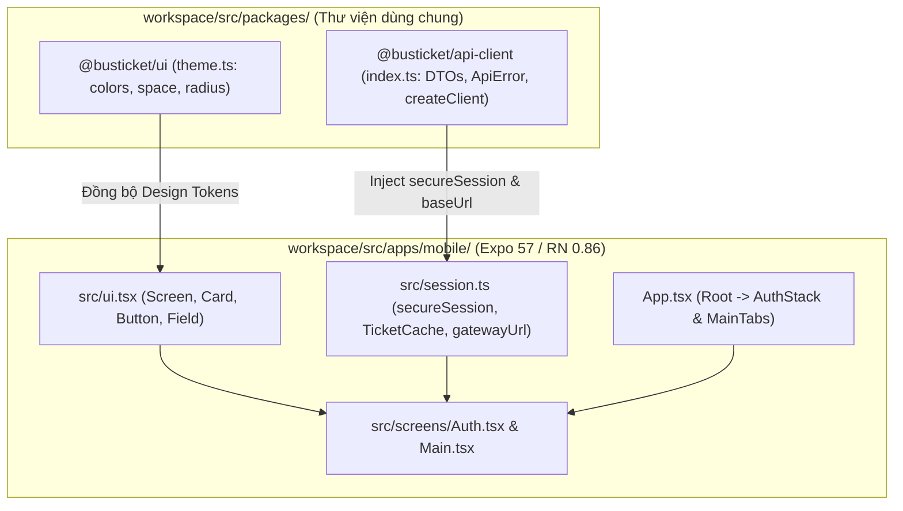
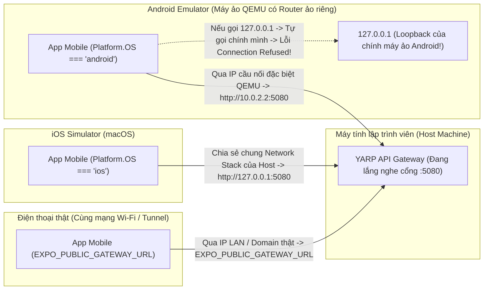
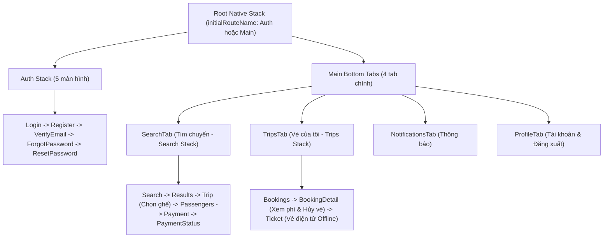
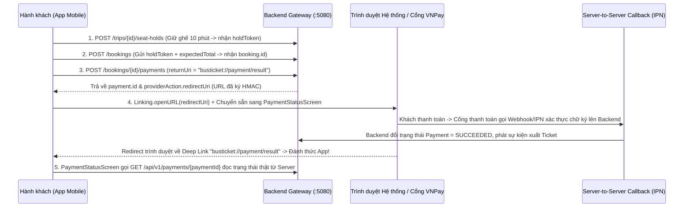

# Bài 02: Ứng Dụng Mobile React Native (Expo 57) — Chia Sẻ SDK Đa Nền Tảng, Bảo Mật Keychain/Keystore & Vé Điện Tử Offline

> **Mục tiêu bài học:** Bài viết này giúp bạn nắm vững từ nền tảng lý thuyết phát triển ứng dụng di động đa nền tảng với **React Native 0.86 & Expo SDK 57** đến từng dòng mã nguồn thực tế trong `workspace/src/packages/` và `workspace/src/apps/mobile/`. Bạn sẽ hiểu trọn vẹn cách Mobile App chia sẻ 100% hợp đồng kiểu dữ liệu với hệ sinh thái Monorepo, cách giải quyết bẫy mạng `10.0.2.2` trên máy ảo Android, bảo vệ JWT bằng phần cứng mã hóa `expo-secure-store`, lưu đệm vé điện tử khi mất sóng 4G tại bến xe và khép kín vòng đời thanh toán qua Deep Link `busticket://`.

---

## 1. Kiến Trúc React Native 0.86 & Expo SDK 57 Dành Cho Người Mới

### 1.1. React Native khác gì Web chạy trong trình duyệt (WebView)?

Nếu bạn đã quen viết React trên trình duyệt Web (`<div>`, `<span>`, `<input>`, CSS), khi bước sang **React Native**, điều quan trọng đầu tiên cần hiểu là: **Ứng dụng Mobile trong dự án này KHÔNG phải là một trang web nhét vào khung trình duyệt ẩn (WebView)!**

- Khi bạn viết `<View>`, `<Text>`, `<TextInput>`, `<Pressable>`, `<ScrollView>` trong `workspace/src/apps/mobile/`, React Native ánh xạ trực tiếp chúng thành **các thành phần giao diện gốc (Native UI Views)** của hệ điều hành: `UIView` trên iOS và `android.view.View` trên Android.
- Bố cục được tính toán bằng động cơ **Yoga Layout Engine** (chuẩn Flexbox với hướng mặc định trên Mobile là `flexDirection: "column"` từ trên xuống dưới, khác với Web mặc định là `"row"`), mang lại tốc độ cuộn 60–120 FPS mượt mà và cảm giác chạm tự nhiên của một ứng dụng cài từ App Store / Google Play.
- **Expo SDK 57 (`expo@~57.0.31` + `react-native@0.86.3` + `react@19.2.3`)** đóng vai trò là bộ khung chuẩn hóa phần cứng (Native Runtime & Modules): thay vì phải mở Xcode viết từng dòng Swift/Objective-C hay mở Android Studio viết Kotlin để truy cập vùng nhớ mã hóa của chip bảo mật hay đăng ký lược đồ đường dẫn sâu (Deep Link Scheme), chúng ta cấu hình tập trung qua [app.json](file:///C:/Users/minht/.gemini/antigravity/worktrees/PBL6/c_to_n_b/workspace/src/apps/mobile/app.json) và gọi các gói chính chủ `expo-secure-store`, `expo-linking`, `expo-status-bar`.

---

### 1.2. Chia Sẻ Gói Nội Bộ (`@busticket/ui` & `@busticket/api-client`) Trong Monorepo

Hãy nhìn vào mục `dependencies` trong [workspace/src/apps/mobile/package.json](file:///C:/Users/minht/.gemini/antigravity/worktrees/PBL6/c_to_n_b/workspace/src/apps/mobile/package.json):

```json
{
  "name": "@busticket/mobile",
  "version": "0.0.1",
  "private": true,
  "scripts": {
    "start": "expo start",
    "android": "expo start --android",
    "ios": "expo start --ios",
    "typecheck": "tsc --noEmit",
    "build:android": "expo export --platform android --output-dir dist"
  },
  "dependencies": {
    "@busticket/api-client": "*",
    "@busticket/ui": "*",
    "@react-navigation/bottom-tabs": "^7.4.0",
    "@react-navigation/native": "^7.1.0",
    "@react-navigation/native-stack": "^7.3.0",
    "expo": "~57.0.31",
    "expo-linking": "~57.0.13",
    "expo-secure-store": "~57.0.4",
    "expo-status-bar": "~57.0.1",
    "react": "19.2.3",
    "react-native": "0.86.3"
  }
}
```

Nhờ khai báo `"workspaces": ["src/apps/*", "src/packages/*"]` ở gốc `workspace/package.json`, npm tự động liên kết (symlink) 2 gói nội bộ vào thẳng `node_modules` của ứng dụng Mobile mà không cần phải đẩy lên kho npm công cộng:



#### Gói thứ nhất: `@busticket/ui` — Đồng nhất nhận diện thương hiệu (Design Tokens)
Xem file [workspace/src/packages/ui/theme.ts](file:///C:/Users/minht/.gemini/antigravity/worktrees/PBL6/c_to_n_b/workspace/src/packages/ui/theme.ts):

```ts
export const colors = {
  brand900: "#0c2340",
  brand700: "#16375f",
  action700: "#ff6a00",
  action100: "#fff1e6",
  accent700: "#f5b942",
  success700: "#0f7a4a",
  warning700: "#9a6700",
  danger700: "#c4332a",
  neutral950: "#142033",
  neutral700: "#5b6b82",
  neutral300: "#d7dee8",
  neutral100: "#eef2f7",
  surface: "#ffffff",
  background: "#f4f6fb",
  focus: "#ff6a00",
} as const;

export const space = { 1: 4, 2: 8, 3: 12, 4: 16, 6: 24, 8: 32, 12: 48 } as const;
export const radius = { sm: 10, md: 16, lg: 24 } as const;
```

Tại sao không chia sẻ luôn thẻ `<button>` HTML giữa Web và Mobile, mà lại chia sẻ **Design Tokens (`colors`, `space`, `radius`)**?
- Trên Web, nút bấm là thẻ `<button className="...">` định dạng bằng CSS (`px`, `rem`). Trên React Native, nút bấm là `<Pressable>` định dạng bằng `StyleSheet.create(...)` với con số điểm ảnh độc lập mật độ (Density-independent Pixels — `dp`).
- Bằng cách trích xuất các hằng số thiết kế nguyên tử (`brand900: "#0c2340"`, cam hành động `action700: "#ff6a00"`, thang khoảng cách bội số của 4px) vào `@busticket/ui/theme`, file [mobile/src/ui.tsx](file:///C:/Users/minht/.gemini/antigravity/worktrees/PBL6/c_to_n_b/workspace/src/apps/mobile/src/ui.tsx) xây dựng bộ nguyên mẫu chuẩn mực cho di động (`Screen`, `Title`, `Muted`, `ErrorText`, `Field`, `Button`, `Card`).
- Chú ý chi tiết chuẩn mực UX di động trong `mobile/src/ui.tsx`: cả `input` và `button` đều được ép `minHeight: 44` (`44dp`) và gắn `accessibilityRole="button"` — đáp ứng đúng tiêu chuẩn vùng chạm ngón tay tối thiểu `44x44pt` của Apple Human Interface Guidelines!

---

## 2. Giải Phẫu Gói SDK `@busticket/api-client` (`packages/api-client/src/index.ts`)

File [workspace/src/packages/api-client/src/index.ts](file:///C:/Users/minht/.gemini/antigravity/worktrees/PBL6/c_to_n_b/workspace/src/packages/api-client/src/index.ts) (dài 448 dòng) là một SDK TypeScript hoàn chỉnh, không phụ thuộc bất kỳ thư viện bên thứ ba nặng nề nào (Zero External Dependencies), chạy được trên cả trình duyệt Web, Node.js test runner lẫn động cơ Hermes của React Native!

Hãy mổ xẻ **4 trụ cột thiết kế** bên trong file này:

### 2.1. Ánh xạ 1:1 Hợp đồng Kiểu Dữ Liệu từ OpenAPI & C# Domain

Từ dòng 1 đến dòng 170, SDK định nghĩa tường minh toàn bộ các thực thể cốt lõi của nền tảng:
- **Xác thực & Phân quyền:** `Session`, `UserProfile`, `Membership`, `UserPage` (có trường `rowVersion: number` phục vụ kiểm soát đồng thời lạc quan — Optimistic Concurrency).
- **Vận tải & Tồn kho ghế:** `Money`, `TripStop`, `Trip`, `TripPage`, `Seat`, `SeatHold` (gồm `holdToken`, `expiresAt`, `serverTime` để đồng bộ lệch đồng hồ máy khách).
- **Đặt vé, Vé điện tử & Tài chính:** `Booking`, `Ticket` (`publicCode`, `qrPayload`, `checkedInAt`), `Payment` (`providerAction?.redirectUri`), `Refund`, `Settlement`, `Payout`, `NotificationItem`.

Nhờ `export type ApiClient = ReturnType<typeof createClient>;`, bất kỳ màn hình nào gọi `api.createHold(...)` hay `api.previewCancel(...)` đều được trình biên dịch TypeScript (`tsc --noEmit`) kiểm tra từng tên trường ngay lúc gõ phím — nếu truyền thiếu `expectedVersion` hay sai kiểu `seatIds`, lệnh `npm run build:mobile` sẽ chặn đứng ngay lập tức!

---

### 2.2. Đảo ngược Phụ thuộc Lưu trữ (`SessionStore` Dependency Injection)

Web có `window.sessionStorage` (đồng bộ), còn React Native hoàn toàn không có `window.sessionStorage` mà dùng bộ nhớ mã hóa bất đồng bộ của hệ điều hành. Nếu viết cứng `sessionStorage.getItem(...)` bên trong SDK, ứng dụng Mobile sẽ báo lỗi crash ngay khi mở!

Vì vậy, `@busticket/api-client` thiết kế giao diện trừu tượng `SessionStore` cực kỳ thanh thoát:

```ts
export type SessionStore = {
  read(): Session | null;
  write(session: Session | null): void;
};

export function createClient(options: { baseUrl?: string; session: SessionStore }) {
  // ...
}
```

SDK không cần biết token được cất ở đâu — nó chỉ nhận vào một đối tượng tuân thủ hợp đồng `SessionStore` (`read` và `write`). Khi chạy trên Web có thể truyền `browserSession`, khi chạy trong Unit Test có thể truyền biến nhớ tạm trên RAM, còn khi chạy trên Mobile (`mobile/src/session.ts`) ta truyền vào `secureSession` nối với `expo-secure-store`!

---

### 2.3. Sinh khóa `Idempotency-Key` Đa Môi Trường & Chuẩn hóa `ErrorEnvelope`

Hãy xem hàm `idempotencyKey()` và `parse<T>()` trong `packages/api-client/src/index.ts`:

```ts
function idempotencyKey() {
  const nativeUuid = (globalThis as { crypto?: { randomUUID?: () => string } }).crypto?.randomUUID?.();
  if (nativeUuid) return nativeUuid.replaceAll("-", "") + "00";
  const random = Array.from({ length: 4 }, () => Math.floor(Math.random() * 0x1_0000_0000).toString(16).padStart(8, "0")).join("");
  return random + "00";
}
```

- **Tại sao cần nhánh dự phòng (Fallback) cho `crypto.randomUUID()`?** Trên trình duyệt hiện đại và Node 24, `globalThis.crypto.randomUUID()` có sẵn; nhưng trên một số phiên bản runtime JavaScript nhúng trên thiết bị di động (Hermes), đối tượng Web `crypto` có thể chưa được polyfill đầy đủ. Hàm kiểm tra an toàn bằng Optional Chaining `?.()` và tự động sinh chuỗi hex 34 ký tự hợp lệ nếu thiếu, đảm bảo không bao giờ sập trên điện thoại thật!
- **Tự động bảo vệ các lệnh ghi (`idempotent: true`):** Trong hàm `request<T>`, bất cứ endpoint thay đổi trạng thái nào được đánh dấu `idempotent: true` (như `verify`, `createHold`, `createBooking`, `previewCancel`, `cancelBooking`, `createPayment`, `checkIn`...) đều được tự động đính kèm header `"Idempotency-Key"`. Nếu request bị gọi lại sau khi tự động làm mới token 401 (`headers.get("Idempotency-Key") ?? idempotencyKey()`), khóa cũ trong `init.headers` vẫn được bảo toàn.
- **Bóc tách chuẩn `ErrorEnvelope` của Backend:**
  ```ts
  export type ErrorEnvelope = {
    error: { code: string; message: string; correlationId: string; details?: Record<string, unknown> };
  };
  ```
  Khi HTTP status khác `2xx`, hàm `parse<T>` tự động đọc JSON lỗi chuẩn từ YARP Gateway / Microservices và ném ra thực thể `new ApiError(response.status, err?.error?.code ?? "HTTP_ERROR", ...)`. Ở tầng giao diện (`Auth.tsx`), chỉ cần một dòng gọn gàng `error instanceof ApiError ? `${error.code}: ${error.message}` : ...` là hiển thị được ngay mã lỗi nghiệp vụ chuẩn xác (ví dụ `SEAT_ALREADY_HELD`, `INVALID_CREDENTIALS`, `BOOKING_EXPIRED`).

---

### 2.4. Tự động Single-Flight Refresh ngay trong SDK Mobile

Ngay bên trong `createClient` (dòng 251–256), SDK cũng tích hợp sẵn cơ chế chống đua lệnh làm mới token cho Mobile:

```ts
if (response.status === 401 && init.auth !== false && session?.refreshToken) {
  inflightRefresh ??= refresh().finally(() => {
    inflightRefresh = null;
  });
  if (await inflightRefresh) return request<T>(path, init);
}
```
Toán tử gán hợp nhất null **`inflightRefresh ??= ...`** đảm bảo nếu màn hình `TripScreen` trên Mobile gọi song song `Promise.all([api.getTrip(...), api.getSeats(...)])` đúng lúc Access Token hết hạn, cả hai lệnh cùng đợi duy nhất 1 lượt gọi `/api/v1/auth/refresh`, lưu cặp token mới vào `secureSession.write(...)`, rồi tự động gọi lại 2 API lấy chuyến và sơ đồ ghế mà hành khách không hề hay biết!

---

## 3. Giải Phẫu Hạ Tầng Mạng, Bảo Mật Phần Cứng & Điều Hướng (`session.ts` & `App.tsx`)

Hãy đọc trọn vẹn 50 dòng tinh gọn nhưng chứa đựng 3 quyết định kiến trúc cốt tử của Mobile trong [workspace/src/apps/mobile/src/session.ts](file:///C:/Users/minht/.gemini/antigravity/worktrees/PBL6/c_to_n_b/workspace/src/apps/mobile/src/session.ts):

```ts
import { createClient, type Session, type SessionStore, type Ticket } from "@busticket/api-client";
import * as SecureStore from "expo-secure-store";
import { Platform } from "react-native";

const SESSION_KEY = "busticket.session.mobile";
const TICKET_KEY = "busticket.tickets.mobile";

let cached: Session | null = null;

async function readJson<T>(key: string): Promise<T | null> {
  const raw = await SecureStore.getItemAsync(key);
  return raw ? (JSON.parse(raw) as T) : null;
}

export async function hydrateSession(): Promise<Session | null> {
  cached = await readJson<Session>(SESSION_KEY);
  return cached;
}

export const secureSession: SessionStore = {
  read: () => cached,
  write: (session) => {
    cached = session;
    if (session) {
      void SecureStore.setItemAsync(SESSION_KEY, JSON.stringify(session));
    } else {
      void SecureStore.deleteItemAsync(SESSION_KEY);
    }
  },
};

export type TicketCache = { tickets: Ticket[]; lastSyncedAt: string };

export async function loadTicketCache(): Promise<TicketCache | null> {
  return readJson<TicketCache>(TICKET_KEY);
}

export async function saveTicketCache(tickets: Ticket[]): Promise<TicketCache> {
  const cache: TicketCache = { tickets, lastSyncedAt: new Date().toISOString() };
  await SecureStore.setItemAsync(TICKET_KEY, JSON.stringify(cache));
  return cache;
}

export function gatewayUrl() {
  if (process.env.EXPO_PUBLIC_GATEWAY_URL) return process.env.EXPO_PUBLIC_GATEWAY_URL;
  if (Platform.OS === "android") return "http://10.0.2.2:5080";
  return "http://127.0.0.1:5080";
}

export const api = createClient({ baseUrl: gatewayUrl(), session: secureSession });
```

---

### 3.1. Giải Mã Bài Toán Địa Chỉ Localhost Trên Di Động (`10.0.2.2` vs `127.0.0.1`)

Đây là "cái bẫy đầu đời" khiến 90% người mới học React Native mất cả buổi chiều không hiểu sao gọi API thất bại! Hãy nhìn hàm `gatewayUrl()` ở dòng 44–48:

```ts
export function gatewayUrl() {
  if (process.env.EXPO_PUBLIC_GATEWAY_URL) return process.env.EXPO_PUBLIC_GATEWAY_URL;
  if (Platform.OS === "android") return "http://10.0.2.2:5080";
  return "http://127.0.0.1:5080";
}
```

Tại sao trên iOS dùng `127.0.0.1:5080` được, còn trên Android lại bắt buộc đổi thành `10.0.2.2:5080`?



- **iOS Simulator:** Không phải là một máy ảo phần cứng tách rời hoàn toàn mà là tiến trình mô phỏng dùng chung trực tiếp ngăn xếp mạng (Network Stack) với máy chủ macOS. Vì vậy `127.0.0.1:5080` bên trong iOS Simulator chính là cổng `5080` trên máy tính của bạn.
- **Android Emulator (QEMU):** Là một máy ảo Linux thực thụ chạy sau một bộ định tuyến ảo (Virtual Router / Firewall) riêng biệt! Bên trong máy ảo Android, `127.0.0.1` hay `localhost` trỏ về **giao diện mạng nội bộ của riêng chiếc điện thoại ảo đó** (nơi chẳng có API Gateway nào đang chạy cả!). QEMU dành riêng địa chỉ IP đặc biệt **`10.0.2.2`** làm bí danh (alias) trỏ ngược ra giao diện loopback `127.0.0.1` của máy tính Host Windows/macOS.
- **Điện thoại vật lý cắm cáp / quét QR Expo Go hoặc Bản Production:** Cả `127.0.0.1` lẫn `10.0.2.2` đều không tới được máy tính. Khi đó, chỉ cần đặt biến môi trường `EXPO_PUBLIC_GATEWAY_URL=http://192.168.1.x:5080` (hoặc tên miền HTTPS thật khi xuất bản), câu lệnh `if (process.env.EXPO_PUBLIC_GATEWAY_URL)` ở dòng đầu tiên sẽ được ưu tiên cao nhất!

---

### 3.2. Tại Sao Không Dùng `AsyncStorage` Mà Bắt Buộc Dùng `expo-secure-store`?

Trên nhiều bài hướng dẫn React Native cũ trên mạng, người ta hay chỉ cách lưu JWT vào `@react-native-async-storage/async-storage`. Trong một ứng dụng thương mại có giao dịch tài chính như đặt vé xe, **lưu token vào `AsyncStorage` là một lỗ hổng bảo mật nghiêm trọng (OWASP Mobile Top 10 — M9: Insecure Data Storage)**:
- `AsyncStorage` thực chất chỉ ghi chuỗi văn bản **không mã hóa (Plaintext)** xuống tệp SQLite hoặc tệp XML trong thư mục dữ liệu ứng dụng. Trên một chiếc điện thoại Android bị bật chế độ gỡ lỗi ADB backup, bị cài phần mềm độc hại trên máy đã Root/Jailbreak, hoặc bị trích xuất bộ nhớ vật lý khi mất máy, kẻ xấu có thể đọc trộm nguyên xi `refreshToken` và chiếm đoạt tài khoản!
- Ngược lại, **`expo-secure-store`** lưu trữ cặp khóa-giá trị thông qua phần cứng bảo mật cấp hệ điều hành:
  - **Trên iOS:** Mã hóa và lưu trực tiếp vào **Keychain Services** (được bảo vệ bởi vi xử lý **Secure Enclave**).
  - **Trên Android:** Tạo khóa đối xứng AES bên trong **Android Keystore System** (được hậu thuẫn bởi chip phần cứng **TEE / StrongBox** không thể xuất khóa ra ngoài), sau đó mã hóa dữ liệu trước khi ghi xuống ổ cứng.

#### Kỹ thuật Cầu nối In-Memory Cache + Async Hydration (`session.ts` & `App.tsx`)
Có một bài toán kỹ thuật rất hay ở đây: `expo-secure-store` phải giao tiếp qua cầu nối Native (JSI / Native Module) tới chip mã hóa nên hàm đọc của nó là **bất đồng bộ (`Promise`)**: `SecureStore.getItemAsync(...)`. Trong khi đó, `SessionStore.read()` của SDK dùng chung lại là hàm **đồng bộ** để đọc tức thì trên từng request mà không tốn chi phí giải mã phần cứng lặp đi lặp lại 50 lần/phút.

Dự án giải quyết cực kỳ gọn gàng bằng mô hình **Boot-time Hydration + Write-Through Cache**:
1. Trong [App.tsx](file:///C:/Users/minht/.gemini/antigravity/worktrees/PBL6/c_to_n_b/workspace/src/apps/mobile/App.tsx) (dòng 87–95):
   ```tsx
   export function App() {
     const [ready, setReady] = useState(false);
     const [signedIn, setSignedIn] = useState(false);
     useEffect(() => {
       hydrateSession()
         .then((session) => setSignedIn(Boolean(session)))
         .finally(() => setReady(true));
     }, []);
     if (!ready) return <View style={styles.loading}><ActivityIndicator size="large" color="#ff6a00" /></View>;
     return (
       <NavigationContainer>
         <StatusBar style="dark" />
         <Root.Navigator initialRouteName={signedIn ? "Main" : "Auth"} screenOptions={{ headerShown: false }}>
           <Root.Screen name="Auth" component={AuthNavigator} />
           <Root.Screen name="Main" component={MainNavigator} />
         </Root.Navigator>
       </NavigationContainer>
     );
   }
   ```
2. Lúc người dùng vừa chạm mở App, màn hình chờ hiển thị vòng xoay cam `#ff6a00` trong vài chục mili-giây để `hydrateSession()` giải mã phiên từ `SecureStore` nạp vào biến RAM `cached`.
3. Từ giây đó trở đi, mọi lời gọi `secureSession.read()` đọc thẳng từ biến `cached` trên RAM với tốc độ `0ms`! Và mỗi khi đăng nhập mới, xoay vòng Refresh Token 401 hay đăng xuất, `secureSession.write(session)` cập nhật đồng thời cả biến `cached` lẫn ghi xuyên xuống `SecureStore.setItemAsync` / `deleteItemAsync`!

---

### 3.3. Kiến Trúc Cây Điều Hướng Đa Tầng (`React Navigation v7`)

Trong `App.tsx`, hệ thống điều hướng không xếp phẳng tất cả màn hình vào một danh sách hỗn độn, mà phân cấp thành **5 bộ điều hướng lồng nhau (Nested Navigators)** có kiểm tra kiểu tham số chặt chẽ bằng TypeScript (`RootParamList`, `AuthStackParamList`, `MainTabParamList`, `SearchStackParamList`, `TripsStackParamList`):



Tại sao phải lồng `SearchNavigator` và `TripsNavigator` bên trong từng Tab của `BottomTabNavigator`?
- Nhờ mỗi Tab sở hữu một ngăn xếp lịch sử (`NativeStack`) riêng biệt, khi hành khách đang chọn ghế ở bước 3 (`TripScreen`) mà sực nhớ muốn mở tab *"Thông báo"* (`NotificationsTab`) kiểm tra tin khuyến mãi, rồi bấm quay lại tab *"Tìm chuyến"*, **màn hình chọn ghế và ghế đang chọn vẫn nằm nguyên ở đó**, không hề bị reset về trang tìm kiếm ban đầu!

---

## 4. Giải Phẫu Luồng Nghiệp Vụ Di Động: Xác Thực, Offline Ticket Cache & Deep Link Thanh Toán

### 4.1. Luồng Xác thực OTP Chống Dò Quét Tài Khoản ([Auth.tsx](file:///C:/Users/minht/.gemini/antigravity/worktrees/PBL6/c_to_n_b/workspace/src/apps/mobile/src/screens/Auth.tsx))

Trong `src/screens/Auth.tsx`, luồng Đăng ký (`RegisterScreen -> VerifyEmailScreen`) và Quên mật khẩu (`ForgotPasswordScreen -> ResetPasswordScreen`) bám sát thiết kế bảo mật chống rò rỉ danh tính (Anti-Enumeration) của Backend:
- Khi gọi `await api.register({ fullName, email, phone, password })` hoặc `await api.forgotPassword(email)`, Backend không trả ngay JWT hay tiết lộ email này đã tồn tại hay chưa, mà trả về `202 Accepted` kèm mã tiến trình `{ operationId }`.
- Màn hình điều hướng ngay sang `VerifyEmail` / `ResetPassword` với tham số `{ challengeId: result.operationId }`, nơi người dùng nhập mã OTP nhận qua email để hoàn tất xác minh một cách lũy đẳng (`idempotent: true`).

---

### 4.2. Cơ Chế Offline Ticket Cache (`TicketCache`): Giải Quyết Bài Toán Mất Sóng 4G Tại Bến Xe

Hãy đặt mình vào trải nghiệm đời thực của hành khách đi xe giường nằm tại Việt Nam:
> Hành khách mua vé ở nhà bằng Wi-Fi rất mượt. Nhưng đến 22h đêm ra tầng hầm bến xe hoặc điểm đón dọc quốc lộ, sóng 4G tụt về vạch 0 hoặc nghẽn mạng cục bộ. Ngay lúc phụ xe cầm đèn pin hỏi: *"Vé của anh ghế số mấy, mã đặt chỗ bao nhiêu?"*, nếu ứng dụng Mobile chỉ biết quay vòng tròn rồi báo *"Network Error"* trắng xóa thì hành khách sẽ rơi vào cảnh hoảng loạn không thể lên xe!

Hãy xem cách dự án **BLUE** giải quyết trọn vẹn bài toán này qua sự kết hợp giữa `BookingDetailScreen` (dòng 177) và `TicketScreen` (dòng 199–204) trong [Main.tsx](file:///C:/Users/minht/.gemini/antigravity/worktrees/PBL6/c_to_n_b/workspace/src/apps/mobile/src/screens/Main.tsx):

```tsx
// 1. Khi có mạng và mở chi tiết đơn đặt vé (dòng 177): tự động đồng bộ vé xuống bộ nhớ mã hóa!
const reload = () =>
  Promise.all([api.getBooking(route.params.bookingId), api.listTickets()])
    .then(([nextBooking, page]) => {
      setBooking(nextBooking);
      const mine = page.items.filter((ticket) => ticket.bookingId === route.params.bookingId);
      setTickets(mine);
      void saveTicketCache(mine);
    })
    .catch((reason) => setError(errorMessage(reason)));

// 2. Khi mở màn hình Vé điện tử (dòng 199–204): Network-First kèm SecureStore Offline Fallback!
export function TicketScreen({ route }: NativeStackScreenProps<TripsStackParamList, "Ticket">) {
  const [ticket, setTicket] = useState<Ticket | null>(null);
  const [offline, setOffline] = useState(false);
  useEffect(() => {
    api.getTicket(route.params.ticketId)
      .then((next) => {
        setTicket(next);
        void saveTicketCache([next]);
      })
      .catch(async () => {
        const cache = await loadTicketCache();
        setTicket(cache?.tickets.find((item) => item.id === route.params.ticketId) ?? null);
        setOffline(true);
      });
  }, [route.params.ticketId]);

  return (
    <Screen>
      <Title>Vé điện tử</Title>
      {offline ? <Muted>Bản lưu offline — kiểm tra lại khi có mạng.</Muted> : null}
      <Card>
        <Text style={styles.ticketCode}>{ticket?.publicCode ?? "Đang tải…"}</Text>
        <Text style={styles.route}>Ghế {ticket?.seatCode ?? "—"}</Text>
        <Muted>{ticket?.passengerName ?? ""} · {ticket?.status ?? ""}</Muted>
      </Card>
    </Screen>
  );
}
```

#### Tại sao thiết kế Offline Cache này vừa thông minh về UX, vừa an toàn tuyệt đối về nghiệp vụ?

Hãy phân tích **4 nguyên tắc vàng** đằng sau cơ chế này:
1. **Chiến lược Network-First, Cache-Fallback (Ưu tiên mạng trước, dự phòng bộ nhớ sau):** Khác với dữ liệu tĩnh, trạng thái vé có thể thay đổi (ví dụ vé vừa bị hủy hoặc nhà xe đổi ghế). Do đó, `TicketScreen` **luôn thử gọi `api.getTicket(ticketId)` lên Server trước**. Nếu có mạng, nó hiển thị bản mới nhất từ Server và làm tươi luôn bản lưu trong `SecureStore` kèm dấu thời gian `lastSyncedAt`. Chỉ khi lời gọi mạng thất bại (`.catch`), nó mới mở két sắt `loadTicketCache()` tìm đúng vé theo `id` để hiển thị cứu nguy cho hành khách!
2. **Vé điện tử cũng được cất trong `SecureStore` chứ không để lộ thiên:** Trong đối tượng `Ticket` có chứa `publicCode`, họ tên hành khách và đặc biệt là chuỗi mã vạch có chữ ký mật mã **`qrPayload` (`BT1.<ticketId>.<hmac>`)**. Việc lưu `TicketCache` trong `expo-secure-store` ngăn chặn các ứng dụng rác khác trên điện thoại đọc trộm mã QR vé của người dùng.
3. **Minh bạch trạng thái giao diện (`offline` Banner):** Khi hiển thị từ bộ nhớ đệm, ứng dụng bật cờ `setOffline(true)` và gắn dòng cảnh báo rõ ràng ngay đầu màn hình: *"Bản lưu offline — kiểm tra lại khi có mạng."* Hành khách biết chắc chắn đây là bản lưu lần đồng bộ gần nhất.
4. **Ranh giới bất đối xứng chống gian lận vé giả (Offline Display vs Online Driver Check-in):**
   - **Phía Hành khách:** Được phép mở xem vé và đưa mã `publicCode` / `qrPayload` ở chế độ Offline khi mất sóng.
   - **Phía Tài xế / Phụ xe soát vé:** Bắt buộc xác minh trực tuyến với Server thông qua `api.validateTicket({ tripId, scannedToken })` và `api.checkIn(ticketId, { tripId, scannedToken, expectedVersion })`!
   - **Tại sao?** Giả sử một kẻ gian mua vé xong, lưu cache offline (hoặc chụp màn hình mã QR), sau đó lên Web bấm **Hủy vé nhận hoàn tiền**, rồi ra bến xe bật chế độ máy bay đưa bản lưu offline ra định đi xe miễn phí! Hoặc 2 người cùng cầm chung 1 ảnh chụp mã QR lên xe! Khi máy quét của Tài xế gọi `POST /api/v1/tickets/{ticketId}/check-in` lên Backend, Server kiểm tra chữ ký HMAC `BT1.*`, kiểm tra trạng thái thực tế trong PostgreSQL (`CANCELLED` sẽ bị từ chối ngay!) và tăng `rowVersion` đánh dấu `checkedInAt` để người thứ hai quét lại cùng mã đó lập tức bị chặn đứng!

---

### Thanh toán trên mobile và luồng tương thích
> **Trạng thái hiện tại:** Customer Web dùng SePay. Mobile vẫn gửi `VNPAY_SANDBOX` trong `Main.tsx`. Với cấu hình mặc định tắt VNPay, luồng trả trước trên màn này cần được chuyển sang SePay trước khi demo.

Trên Customer Web, khi chuyển sang cổng thanh toán SePay rồi quay lại, tất cả diễn ra ngay trong một tab trình duyệt qua URL `https://...`. Nhưng trên ứng dụng di động gốc (Native App), cổng thanh toán ngân hàng nằm trên trình duyệt bên ngoài (Safari / Chrome Custom Tabs). Làm sao trình duyệt biết đường mở ngược lại đúng ứng dụng **BusTicket** của chúng ta sau khi khách quẹt thẻ xong?

Câu trả lời nằm ở **Custom URL Scheme (`Deep Linking`)** khai báo tại dòng 5 của [workspace/src/apps/mobile/app.json](file:///C:/Users/minht/.gemini/antigravity/worktrees/PBL6/c_to_n_b/workspace/src/apps/mobile/app.json):

```json
{
  "expo": {
    "name": "BusTicket",
    "slug": "busticket-mobile",
    "scheme": "busticket",
    "ios": { "bundleIdentifier": "vn.busticket.customer" },
    "android": { "package": "vn.busticket.customer" }
  }
}
```

Khi cài ứng dụng lên iOS hoặc Android, hệ điều hành ghi nhận vào bảng định tuyến toàn cục: *"Mọi đường dẫn bắt đầu bằng tiền tố `busticket://` đều thuộc quyền sở hữu của gói `vn.busticket.customer`!"*

Hãy theo dõi trọn vẹn chu trình 5 bước từ lúc chạm chọn ghế đến lúc xác nhận thanh toán trong `Main.tsx`:



Hãy đọc đoạn code thực tế tại `PaymentScreen` và `PaymentStatusScreen` ([Main.tsx](file:///C:/Users/minht/.gemini/antigravity/worktrees/PBL6/c_to_n_b/workspace/src/apps/mobile/src/screens/Main.tsx#L140-L164)):

```tsx
export function PaymentScreen({ route, navigation }: NativeStackScreenProps<SearchStackParamList, "Payment">) {
  const [error, setError] = useState<string | null>(null);
  return (
    <Screen>
      <Title>Thanh toán an toàn</Title>
      <Muted>Ứng dụng mở cổng VNPay sandbox. Trạng thái chỉ đổi sau callback đã xác minh.</Muted>
      <ErrorText>{error}</ErrorText>
      <Button title="Mở VNPay" onPress={async () => {
        try {
          const payment = await api.createPayment(route.params.bookingId, {
            provider: "VNPAY_SANDBOX",
            method: "VNPAY_QR",
            returnUri: "busticket://payment/result",
          });
          if (payment.providerAction?.redirectUri) await Linking.openURL(payment.providerAction.redirectUri);
          navigation.navigate("PaymentStatus", { paymentId: payment.id });
        } catch (reason) { setError(errorMessage(reason)); }
      }} />
    </Screen>
  );
}

export function PaymentStatusScreen({ route }: NativeStackScreenProps<SearchStackParamList, "PaymentStatus">) {
  const [payment, setPayment] = useState<Payment | null>(null);
  const [error, setError] = useState<string | null>(null);
  const reload = () => api.getPayment(route.params.paymentId).then(setPayment).catch((reason) => setError(errorMessage(reason)));
  useEffect(() => { void reload(); }, [route.params.paymentId]);
  // ...
}
```

**Bài học bảo mật sống còn (Zero-Trust đối với Deep Link Return URL):**
Tại sao khi Deep Link `busticket://payment/result?status=success` quay về ứng dụng, App **TUYỆT ĐỐI KHÔNG đọc tham số `?status=success` trên Deep Link để kết luận đã trả tiền**, mà lại gọi ngược `api.getPayment(route.params.paymentId)` lên Server?
- Bởi vì bất kỳ ứng dụng nào khác trên điện thoại (hoặc chính người dùng gõ vào trình duyệt Safari dòng chữ `busticket://payment/result?vnp_ResponseCode=00`) đều có thể giả mạo cú mở Deep Link đó trong 1 giây!
- Bằng cách chỉ dùng Deep Link làm tín hiệu chuyển quyền điều khiển về lại cửa sổ App, còn trạng thái thật bắt buộc truy vấn từ `GET /api/v1/payments/{paymentId}` (nơi Backend chỉ cập nhật sau khi đã xác minh chữ ký mật mã HMAC-SHA512 / IPN Secret từ cổng thanh toán), ứng dụng Mobile loại bỏ 100% nguy cơ giả mạo kết quả thanh toán phía client!

---

### 4.4. Luồng Hủy Vé 2 Bước & Kiểm Soát Đồng Thời Lạc Quan (`rowVersion`)

Hãy xem thêm hàm `requestCancellation()` trong `BookingDetailScreen` (`Main.tsx` dòng 179–194):
1. **Bước 1 (`api.previewCancel(booking.id, ticketIds)`):** Ứng dụng không bao giờ tự nhân phần trăm tính phí hủy trên điện thoại (vì đồng hồ điện thoại của khách có thể bị chỉnh lùi giờ để né mốc phạt phí hủy sát giờ xe chạy!). Nó gửi danh sách vé cần hủy lên Server để Server tính chính xác `fee`, `refundAmount` theo giờ chuẩn UTC và chính sách `cancel-mvp-v1`, trả về một `previewId` có hạn sử dụng ngắn.
2. **Bước 2 (`Alert.alert` + `api.cancelBooking` kèm `expectedVersion: booking.rowVersion`):** Hộp thoại gốc của iOS/Android hiển thị rõ số tiền phí hủy và số tiền được hoàn lại. Chỉ khi khách bấm nút đỏ `"Hủy vé"`, App mới gửi `previewId` kèm `expectedVersion: booking.rowVersion`. Nếu trong lúc khách đang phân vân nhìn hộp thoại mà chuyến xe vừa khởi hành hoặc nhân viên tổng đài vừa can thiệp vào đơn khiến `rowVersion` trong DB tăng lên, Backend sẽ từ chối với lỗi `409 Conflict` thay vì ghi đè mù quáng!

---

## 5. Cẩm Nang Phản Biện Trước Hội Đồng (Q&A Thực Chiến Mảng Mobile)

| Câu hỏi từ Giảng viên / Hội đồng | Cách trả lời gãy gọn, đúng trọng tâm mã nguồn |
|---|---|
| **Câu 1:** *"Tại sao giữa Web và Mobile, nhóm chia sẻ `@busticket/api-client` và `theme.ts` mà không dùng chung luôn toàn bộ component giao diện?"* | **Trả lời:** Dạ trên Web dùng DOM HTML + Tailwind CSS tối ưu cho chuột, bàn phím và SEO, còn trên Mobile dùng Native Views (`UIView` / `android.view.View`) + `StyleSheet` tối ưu thao tác chạm `44dp` và điều hướng Stack/Tabs gốc. Việc chia sẻ **100% tầng SDK gọi API (`@busticket/api-client`)** và **Design Tokens (`@busticket/ui/theme.ts`)** giúp đồng bộ tuyệt đối hợp đồng dữ liệu và màu sắc thương hiệu mà không làm giảm chất lượng UX đặc thù của từng nền tảng ạ. |
| **Câu 2:** *"Khi chạy thử trên máy ảo Android, tại sao trong `session.ts` nhóm lại viết cứng IP `http://10.0.2.2:5080`?"* | **Trả lời:** Dạ đây là cơ chế định tuyến của máy ảo Android QEMU: trong Android Emulator, `127.0.0.1` trỏ về chính thiết bị ảo chứ không phải máy tính đang chạy Docker Gateway. Địa chỉ `10.0.2.2` là cổng cầu nối đặc biệt của QEMU trỏ ra loopback của máy chủ Host. Còn trên iOS Simulator dùng chung network stack nên gọi `127.0.0.1:5080`, và khi chạy trên điện thoại thật hoặc Production thì ưu tiên đọc biến `EXPO_PUBLIC_GATEWAY_URL` ở dòng trên cùng ạ. |
| **Câu 3:** *"Nếu lưu vé offline trên điện thoại như vậy, hành khách mua vé xong bật chế độ máy bay đưa vé offline cho tài xế xem rồi nhờ người nhà ở nhà bấm hủy vé lấy lại tiền thì sao?"* | **Trả lời:** Dạ nhóm đã thiết kế bất đối xứng để chặn triệt để kịch bản này: `TicketCache` trong `expo-secure-store` chỉ giúp hành khách tra cứu số ghế, mã vé khi đứng ở tầng hầm bến xe mất sóng và luôn gắn nhãn *"Bản lưu offline"*. Còn thiết bị soát vé lên xe của Tài xế/Phụ xe bắt buộc gọi API trực tuyến `/api/v1/tickets/validate` và `/check-in` kèm chữ ký `BT1.*` và `expectedVersion` để đối chiếu trạng thái thực tế trong PostgreSQL. Nếu vé đã hủy ở nhà, máy quét của tài xế sẽ báo vé không hợp lệ ngay lập tức ạ! |
| **Câu 4:** *"Nếu kẻ xấu tự tạo một đường link `busticket://payment/result?success=true` bấm trên điện thoại để đánh lừa App là đã thanh toán xong thì có lấy được vé không?"* | **Trả lời:** Dạ hoàn toàn không thể ạ! Deep Link `busticket://payment/result` chỉ có nhiệm vụ duy nhất là chuyển màn hình từ trình duyệt quay về cửa sổ ứng dụng. Màn hình `PaymentStatusScreen` không đọc bất kỳ tham số nào trên URL đó mà gọi trực tiếp `GET /api/v1/payments/{paymentId}` kèm JWT lên Server. Phía Server chỉ phát hành vé khi nhận được Webhook/IPN có chữ ký mật mã hợp lệ từ chính máy chủ cổng thanh toán. |
