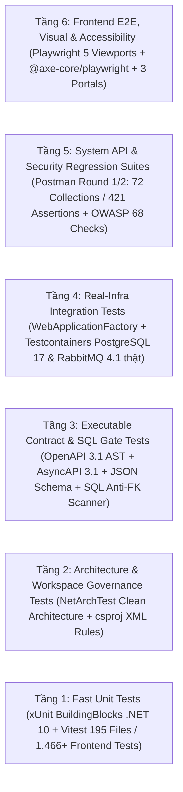
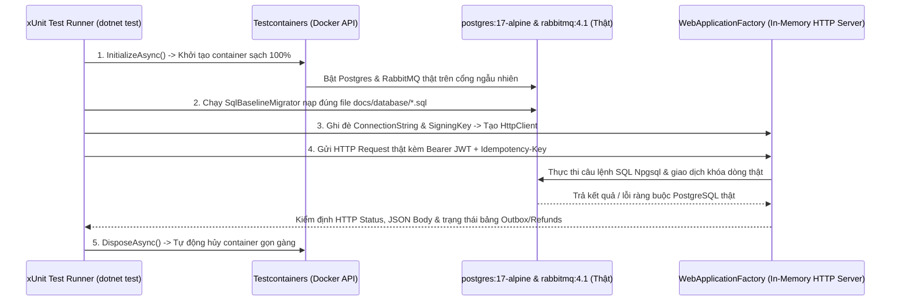

# Bài 04: Chiến Lược Kiểm Thử Toàn Diện (6-Layer Testing Pyramid) — Từ NetArchTest, Testcontainers Đến Playwright & Axe-Core

> **Mục tiêu bài học:** Bài viết này giúp bạn thấu hiểu tại sao một hệ thống đặt vé phân tán không thể chỉ dựa vào việc *"mở Postman bấm thử bằng tay"*, đồng thời dẫn bạn đi xuyên suốt **6 tầng kiểm thử tự động thực tế** đang bảo vệ dự án **BLUE Bus Ticket Platform (PBL6)**. Kể cả khi bạn chưa từng nghe tới `NetArchTest`, `YamlDotNet AST`, `Testcontainers`, hay `@axe-core/playwright`, bạn sẽ đọc hiểu tường tận từng bài test thực tế trong `workspace/src/tests/` và `workspace/src/apps/web/tests/`.

---

## 1. Lý Thuyết Nền Tảng: Tại Sao Chỉ Test Bằng Tay Trên Postman Sẽ Thất Bại Trước Hệ Thống Thực Tế?

Khi làm đồ án môn học nhỏ (CRUD đơn giản trên 1 Database), sinh viên thường kiểm thử theo quy trình thủ công: sửa code -> bật app -> mở Postman bấm gửi vài request `happy path` -> thấy trả về `200 OK` là yên tâm nộp bài.

Tuy nhiên, trong một nền tảng **Microservices giao dịch tài chính & giữ chỗ thời gian thực** như **BLUE Bus Ticket Platform**, kiểm thử thủ công bất lực hoàn toàn trước **4 loại thảm họa ngầm**:

1. **Lỗi tranh chấp đồng thời tính bằng mili-giây (Concurrency & Race Conditions):** Con người không thể cầm 2 con chuột bấm chính xác cùng một mili-giây để kiểm tra xem chuyện gì xảy ra khi 2 hành khách cùng đổi sang giữ ghế `A03`, hay khi khách hàng thanh toán SePay thành công đúng tích tắc đơn đặt vé vừa chạm mốc hết hạn giữ chỗ!
2. **Lỗi lệch hợp đồng bất đồng bộ (Asynchronous Schema Drift):** `Transport Service` sửa code đổi tên trường trong sự kiện `TripPublished`. Khi test lẻ `Transport` trên Postman vẫn báo `200 OK` xanh mượt, nhưng bên kia chiến tuyến `Booking Service` đọc sự kiện từ RabbitMQ bị lỗi giải tuần tự hóa (Deserialization Error) khiến ghế không bao giờ được mở bán!
3. **Lỗi thoái hóa kiến trúc theo thời gian (Architectural Erosion):** Khi gấp gáp chạy deadline, một thành viên vô tình `using Microsoft.EntityFrameworkCore` ngay trong tầng `Domain`, hoặc nối trực tiếp `<ProjectReference>` từ `Booking` sang `Payment`, biến hệ thống Microservices Clean Architecture thành một đống bòng bong phụ thuộc chéo (Big Ball of Mud).
4. **Lỗi vỡ bố cục di động & rào cản trợ năng (Responsive Overflow & Accessibility Regression):** Sửa một dòng CSS trên màn hình rộng `1920px` trông rất đẹp, nhưng trên điện thoại `360px` nút *"Thanh toán"* lại bị tràn ra ngoài mép phải không tài nào bấm được, hoặc hộp thoại hủy vé làm kẹt bàn phím của người khiếm thị.

---

### Toàn Cảnh Kim Tự Tháp 6 Tầng Kiểm Thử Của Dự Án BLUE

Thay vì trông chờ vào may mắn, dự án xây dựng một **Kim tự tháp Kiểm thử 6 Tầng (6-Layer Testing Pyramid)** kết hợp nguyên lý **Shift-Left Testing** (bắt lỗi càng sớm, càng sát lúc gõ code thì chi phí sửa càng rẻ):



| Tầng kiểm thử | Công cụ chủ lực | Tốc độ chạy | Đối tượng bị bắt gọn |
|---|---|---|---|
| **1. Unit Tests** | `xUnit` (.NET 10) & `Vitest 5 + Testing Library` | Vài mili-giây / bài | Logic thuần túy: `Result<T>`, `ErrorMapper`, che giấu PII trong log, Zod schemas, hooks, UI components. |
| **2. Architecture Tests** | `NetArchTest.Rules` + `System.Xml.Linq` | `< 1 giây` | Vi phạm Clean Architecture 4 tầng, nối chéo giữa 6 services, sai phiên bản `.NET`, sai quản lý gói tập trung. |
| **3. Contract & SQL Gates** | `YamlDotNet` + `JsonSchema.Net` | `< 2 giây` | Trùng `operationId`, thiếu `ErrorEnvelope`, lệch schema 20 sự kiện RabbitMQ, khóa ngoại chéo giữa các DB. |
| **4. Real-Infra Integration** | `WebApplicationFactory` + `Testcontainers` | Vài giây / cụm (Docker thật) | Tranh chấp giữ ghế, xoay vòng JWT `SESSION_REUSE_DETECTED`, Outbox/Inbox/DLQ, bù trừ hoàn tiền SePay IPN. |
| **5. API Regression Suites** | `Postman CLI` (`outputs/pbl6-round2/`, `workspace/postman/`) | 1–3 phút toàn sàn | Kiểm chứng hộp đen từ ngoài cổng YARP Gateway `:5080`, quét 68 điểm cuối bảo mật OWASP. |
| **6. E2E, Visual & A11y** | `Playwright` + `@axe-core/playwright` | Vài phút trên đa trình duyệt | Đứt gãy hành trình người dùng trên 3 cổng độc lập, tràn màn hình `360px`–`1920px`, vi phạm WCAG nghiêm trọng. |

---

## 2. Tầng 1 — Backend Unit Tests (`BuildingBlocks.UnitTests`)

Trong kiến trúc 6 Microservices, thư viện nền `BusTicketPlatform.BuildingBlocks` là "xương sống" được mọi dịch vụ dùng chung. Nếu xương sống có lỗi (ví dụ rò rỉ mật khẩu ra log hay đánh rơi mã truy vết `CorrelationId`), cả 6 dịch vụ sẽ nhiễm lỗi đồng loạt!

Bộ kiểm thử tại `workspace/src/tests/building-blocks/BusTicketPlatform.BuildingBlocks.UnitTests/` bảo vệ từng viên gạch nền móng với thời gian chạy chỉ vài chục mili-giây:

### 2.1. Bảo vệ mẫu thiết kế `Result<T>` & Chống rò rỉ thông tin nhạy cảm qua `ErrorMapper`

Xem [ResultTests.cs](file:///C:/Users/minht/.gemini/antigravity/worktrees/PBL6/c_to_n_b/workspace/src/tests/building-blocks/BusTicketPlatform.BuildingBlocks.UnitTests/ResultTests.cs) và [ErrorMapperTests.cs](file:///C:/Users/minht/.gemini/antigravity/worktrees/PBL6/c_to_n_b/workspace/src/tests/building-blocks/BusTicketPlatform.BuildingBlocks.UnitTests/ErrorMapperTests.cs):

```csharp
[Fact]
public void Unknown_exception_maps_to_internal_error()
{
    var correlationId = Guid.CreateVersion7();
    var error = ErrorMapper.FromUnknown(new InvalidOperationException("secret"), correlationId);

    Assert.Equal(ErrorCodes.InternalError, error.Code);
    Assert.Equal(500, error.StatusCode);
    Assert.DoesNotContain("secret", error.Message, StringComparison.Ordinal);
}
```

Bài test nhỏ gọn này khóa chặt một quy tắc bảo mật sống còn theo chuẩn **OWASP API Security**: khi có một ngoại lệ hệ thống bất ngờ xảy ra (ví dụ lỗi chuỗi kết nối chứa mật khẩu DB hay đường dẫn nội bộ `"secret"`), `ErrorMapper.FromUnknown` bắt buộc chuyển thành mã chuẩn `500 INTERNAL_ERROR` kèm `correlationId` để tra log nội bộ, và **`Assert.DoesNotContain("secret", error.Message)`** đảm bảo không bao giờ phơi bày chi tiết ngoại lệ thô ra phản hồi JSON cho khách hàng!

### 2.2. Kiểm chứng Che giấu Dữ liệu Nhạy cảm (`LogRedaction`) & Định danh `UUIDv7` (`CorrelationMiddleware`)

Xem [LogRedactionTests.cs](file:///C:/Users/minht/.gemini/antigravity/worktrees/PBL6/c_to_n_b/workspace/src/tests/building-blocks/BusTicketPlatform.BuildingBlocks.UnitTests/LogRedactionTests.cs) và [CorrelationMiddlewareTests.cs](file:///C:/Users/minht/.gemini/antigravity/worktrees/PBL6/c_to_n_b/workspace/src/tests/building-blocks/BusTicketPlatform.BuildingBlocks.UnitTests/CorrelationMiddlewareTests.cs):

```csharp
[Fact]
public void Redacts_password_email_and_token_keys()
{
    var redacted = LogRedaction.Redact(new Dictionary<string, object?>
    {
        ["userId"] = "01990a00-0000-7000-8000-000000000002",
        ["email"] = "seed.customer@example.test",
        ["password"] = "secret-value",
        ["accessToken"] = "jwt-value"
    });

    Assert.Equal("01990a00-0000-7000-8000-000000000002", redacted["userId"]);
    Assert.Equal(LogRedaction.MaskValue, redacted["email"]);
    Assert.Equal(LogRedaction.MaskValue, redacted["password"]);
    Assert.Equal(LogRedaction.MaskValue, redacted["accessToken"]);
}
```

- `LogRedactionTests` chứng minh rằng khi ghi log có cấu trúc (Structured Logging), mã định danh kỹ thuật `userId` được giữ nguyên để gỡ lỗi, nhưng mọi trường nhạy cảm (`email`, `password`, `accessToken`) tự động bị thay thế bằng chuỗi mặt nạ `MaskValue`!
- `CorrelationMiddlewareTests` chứng minh: nếu cổng Web gửi sẵn header `X-Correlation-ID` hợp lệ thì hệ thống giữ nguyên để nối mạch truy vết từ trình duyệt xuyên suốt tới Database; nếu request bên ngoài không gửi kèm, Middleware tự động sinh mới mã **`UUIDv7` (`resolved.Version == 7`)** có thứ tự thời gian tăng dần!

---

## 3. Tầng 2 — Architecture Tests (`NetArchTest`): Cảnh Sát Tự Động Canh Gác Clean Architecture

### 3.1. Architecture Test là gì cho người chưa từng gặp?

Thông thường, quy tắc kiến trúc (như *"Tầng Domain không được biết tới Entity Framework hay ASP.NET"*) chỉ được viết trên giấy Word hoặc dặn miệng nhau trong buổi họp. Khi dự án lên tới gần trăm projects C#, kiểm tra bằng mắt (Code Review) chắc chắn sẽ bỏ sót!

**Architecture Tests** biến các quy tắc kiến trúc trừu tượng thành **code kiểm thử thực thi tự động bằng kỹ thuật Phản xạ mã máy (Assembly Reflection) và Phân tích cây XML `.csproj`**. Ai viết sai ranh giới kiến trúc, lệnh `dotnet test` sẽ báo đỏ ngay lập tức!

---

### 3.2. Canh gác 4 Tầng Clean Architecture trên cả 6 Services ([LayerDependencyTests.cs](file:///C:/Users/minht/.gemini/antigravity/worktrees/PBL6/c_to_n_b/workspace/src/tests/architecture/BusTicketPlatform.ArchitectureTests/LayerDependencyTests.cs))

Hãy xem cách thư viện `NetArchTest.Rules` quét đồng loạt cả 6 Microservices thông qua `[Theory]`:

```csharp
public static TheoryData<Type, string> Services() => new()
{
    { typeof(Identity.Domain.AssemblyMarker), "Identity" },
    { typeof(Transport.Domain.AssemblyMarker), "Transport" },
    { typeof(Booking.Domain.AssemblyMarker), "Booking" },
    { typeof(Payment.Domain.AssemblyMarker), "Payment" },
    { typeof(Notification.Domain.AssemblyMarker), "Notification" },
    { typeof(Reporting.Domain.AssemblyMarker), "Reporting" }
};

[Theory]
[MemberData(nameof(Services))]
public void Domain_does_not_reference_host_stack(Type domainMarker, string service)
{
    var result = Types.InAssembly(domainMarker.Assembly)
        .ShouldNot()
        .HaveDependencyOnAny(
            "Microsoft.AspNetCore",
            "Microsoft.EntityFrameworkCore",
            "Npgsql",
            "Yarp.ReverseProxy",
            $"BusTicketPlatform.{service}.Application",
            $"BusTicketPlatform.{service}.Infrastructure",
            $"BusTicketPlatform.{service}.Api")
        .GetResult();
    Assert.True(result.IsSuccessful, Format(result));
}
```

Bộ luật thép trong `LayerDependencyTests.cs` khóa cứng chiều mũi tên phụ thuộc của Clean Architecture:
1. **`Domain` hoàn toàn tinh khiết:** Cấm chạm vào bất kỳ công nghệ hạ tầng nào (`AspNetCore`, `EntityFrameworkCore`, trình điều khiển PostgreSQL `Npgsql`, `Yarp`) và cấm tham chiếu ngược ra các tầng ngoài (`Application`, `Infrastructure`, `Api`).
2. **`Application` độc lập hạ tầng:** Chỉ được phép biết `Domain`, cấm biết tới `Infrastructure` hay `Api`.
3. **`BuildingBlocks` không bị ô nhiễm ngược:** Hàm `Building_blocks_do_not_reference_bounded_contexts()` cấm gói nền tảng dùng chung tham chiếu ngược lên bất kỳ 1 trong 6 dịch vụ nghiệp vụ hay `Gateway`.

---

### 3.3. Cấm Tham Chiếu Chéo Giữa Các Services & Khóa Kỷ Luật `.csproj` ([ProjectReferenceTests.cs](file:///C:/Users/minht/.gemini/antigravity/worktrees/PBL6/c_to_n_b/workspace/src/tests/architecture/BusTicketPlatform.ArchitectureTests/ProjectReferenceTests.cs))

Hãy đọc 3 bài kiểm tra cực kỳ sắc sảo dùng `XDocument` đọc thẳng mã nguồn mọi tệp `.csproj` trong `ProjectReferenceTests.cs`:

1. **`Services_do_not_project_reference_other_services()` — Chống "Monolith Đội Lốt Microservices":**
   ```csharp
   foreach (var reference in refs)
   {
       var normalized = reference!.Replace('\\', '/');
       if (!normalized.Contains("/services/", StringComparison.OrdinalIgnoreCase))
           continue;

       Assert.Contains($"/{owner}/", normalized, StringComparison.OrdinalIgnoreCase);
   }
   ```
   Nếu một lập trình viên đang code trong `src/services/booking/` mà lén thêm `<ProjectReference Include="..\..\payment\...\Payment.Domain.csproj" />`, bài test này phát hiện ra đường dẫn chứa `/services/` nhưng không thuộc `/booking/` và đánh trượt ngay! Sáu Microservices được cô lập biên dịch 100%, chỉ giao tiếp với nhau qua HTTP Gateway hoặc sự kiện RabbitMQ.
2. **`Workspace_pins_net10_and_projects_do_not_override_it()`:** Đảm bảo `Directory.Build.props` khóa cứng `<TargetFramework>net10.0</TargetFramework>` và không có bất kỳ project con nào tụt lại ở `net8.0` hay `net9.0`.
3. **`Package_versions_are_centralized()`:** Đảm bảo **Central Package Management (`Directory.Packages.props`)** được tuân thủ tuyệt đối — không một file `.csproj` nào được phép tự ghi thuộc tính `Version="..."` trên thẻ `<PackageReference>`, loại bỏ hoàn toàn xung đột phiên bản thư viện NuGet giữa các dịch vụ!

---

## 4. Tầng 3 — Executable Contract & SQL Gate Tests (`BusTicketPlatform.ContractTests`)

Nếu Tầng 2 canh gác kiến trúc code C#, thì Tầng 3 canh gác các tệp đặc tả hợp đồng (`docs/contracts/`) và kịch bản cơ sở dữ liệu (`docs/database/`). Hãy mổ xẻ [ContractGateTests.cs](file:///C:/Users/minht/.gemini/antigravity/worktrees/PBL6/c_to_n_b/workspace/src/tests/contracts/BusTicketPlatform.ContractTests/ContractGateTests.cs) và [MessageSchemaTests.cs](file:///C:/Users/minht/.gemini/antigravity/worktrees/PBL6/c_to_n_b/workspace/src/tests/contracts/BusTicketPlatform.ContractTests/MessageSchemaTests.cs):

### 4.1. Phân Tích Cây Cú Pháp (AST) Của OpenAPI 3.1 & AsyncAPI 3.1

Thay vì chỉ kiểm tra chuỗi sơ sài, `ContractGateTests.cs` nạp toàn bộ tệp YAML vào cây nút đối tượng `YamlStream` (`YamlMappingNode` / `YamlScalarNode`) của `YamlDotNet` để kiểm tra cấu trúc ngữ nghĩa:
- **Tính duy nhất của `operationId`:** Trích xuất toàn bộ `operationId` trong `platform-mvp.openapi.yaml`, đảm bảo có đầy đủ các thao tác MVP (`>= 60` active operations, thực tế là 77) và không có bất kỳ 2 đường dẫn nào trùng tên hàm sinh mã (`ids.Count == ids.Distinct().Count()`). Thậm chí dự án còn có bài test đối chứng âm tính (`Duplicate_operation_id_fixture_fails_uniqueness`) nạp một file YAML cố tình sai (`Fixtures/invalid-openapi.yaml`) để chứng minh bộ bắt lỗi hoạt động thật chứ không phải luôn báo xanh giả!
- **Mọi API HTTP đều bắt buộc có Phản hồi Lỗi Chuẩn (`ErrorEnvelope`):**
  ```csharp
  var responses = Assert.IsType<YamlMappingNode>(operation.Children[new YamlScalarNode("responses")]);
  Assert.True(responses.Children.TryGetValue(new YamlScalarNode("default"), out var fallback),
      $"{pathEntry.Key} {operationEntry.Key} has no default error response.");
  var reference = Assert.IsType<YamlMappingNode>(fallback).Children[new YamlScalarNode("$ref")];
  Assert.Equal("#/components/responses/Error", ((YamlScalarNode)reference).Value);
  ```
  Duyệt qua từng đường dẫn và từng phương thức `GET/POST/PUT/PATCH/DELETE` — chỉ cần 1 API quên khai báo `default: $ref: '#/components/responses/Error'`, bài test chỉ đích danh đường dẫn đó ngay lập tức!
- **Khóa chặt 20 Sự kiện AsyncAPI & Kiểm định JSON Schema:** `AsyncApi_has_twenty_send_operations()` đảm bảo danh mục `platform-mvp.asyncapi.yaml` có đúng 20 thao tác gửi sự kiện chuẩn AsyncAPI `3.1.0`, kết hợp cùng `MessageSchemaTests.cs` dùng `Json.Schema` kiểm tra mẫu thông điệp hợp lệ và từ chối thông điệp thiếu trường bắt buộc.

---

### 4.2. Máy Quét Kịch Bản SQL Chống Khóa Ngoại Xuyên Database & Lệnh Phá Hủy

Hãy nhìn hai hàm kiểm tra cực kỳ thực tế ở dòng 85–122 của `ContractGateTests.cs`:

```csharp
[Fact]
public void Sql_baselines_exist_per_service_without_cross_database_fk()
{
    var database = Path.Combine(RepoRoot(), "docs", "database");
    var services = new[] { "identity", "transport", "booking", "payment", "notification", "reporting" };
    foreach (var service in services)
    {
        var sql = File.ReadAllText(Path.Combine(database, service, "001_initial.sql"));
        Assert.False(string.IsNullOrWhiteSpace(sql));
        foreach (var other in services.Where(s => s != service))
        {
            Assert.DoesNotContain($"references {other}.", sql, StringComparison.OrdinalIgnoreCase);
        }
    }
    // ...
    Assert.DoesNotContain("@gmail.com", identitySeed, StringComparison.OrdinalIgnoreCase);
}

[Fact]
public void Sql_baselines_do_not_use_destructive_or_cross_database_commands()
{
    foreach (var file in Directory.GetFiles(database, "*.sql", SearchOption.AllDirectories))
    {
        var sql = File.ReadAllText(file);
        Assert.DoesNotContain("drop database", sql, StringComparison.OrdinalIgnoreCase);
        Assert.DoesNotContain("pg_terminate_backend", sql, StringComparison.OrdinalIgnoreCase);
        Assert.DoesNotContain("dblink", sql, StringComparison.OrdinalIgnoreCase);
        Assert.DoesNotContain("postgres_fdw", sql, StringComparison.OrdinalIgnoreCase);
    }
}
```

Bộ quét này bảo vệ 3 ranh giới vàng của cơ sở dữ liệu phân tán:
1. **Không có Khóa ngoại hoặc Cầu nối xuyên Database:** Cấm tuyệt đối `REFERENCES <other_service>.` cũng như các tiện ích nối bảng xuyên DB của PostgreSQL (`dblink`, `postgres_fdw`). Mỗi service chỉ biết dữ liệu trong DB của chính nó!
2. **Không có Lệnh Phá hủy trong Migration:** Cấm `DROP DATABASE` hay `pg_terminate_backend` lọt vào kịch bản khởi tạo tự động.
3. **An toàn Dữ liệu Mồi (Synthetic Seed Hygiene):** Bắt buộc toàn bộ email mẫu trong `010_synthetic_seed.sql` phải dùng tên miền dành riêng cho kiểm thử theo chuẩn IETF RFC 2606 (`@example.test`) và cấm tuyệt đối `@gmail.com` — đảm bảo dù ai cấu hình nhầm SMTP thật cũng không bao giờ gửi thư rác làm phiền người dân có địa chỉ Gmail trùng tên!

---

## 5. Tầng 4 — Real-Infrastructure Integration Tests (`WebApplicationFactory` + `Testcontainers`)

### 5.1. Tại Sao Dự Án Từ Chối "Mock Database" Mà Dùng `Testcontainers` Chạy Docker Thật?

Khi viết Integration Test trong .NET, nhiều dự án sinh viên chọn giải pháp dễ dãi là thay PostgreSQL bằng `EF Core InMemoryDatabase` hoặc viết `Mock<IBookingRepository>`. Cách làm đó chứa đựng một lỗ hổng chí mạng: **Bộ nhớ giả lập trên RAM KHÔNG HỀ hiểu SQL thật của PostgreSQL!**
- `InMemoryDatabase` không kiểm tra khóa ngoại, không biết câu lệnh khóa dòng chống tranh chấp `SELECT ... FOR UPDATE`, không hiểu kiểu `jsonb`, không biết Unique Constraint chống giữ trùng 1 ghế của 2 người, và càng không biết cơ chế định tuyến Dead-Letter Exchange của RabbitMQ! Test báo xanh 100% trên máy lập trình viên nhưng vừa chạy với PostgreSQL thật đã nổ lỗi SQL Syntax hoặc Race Condition!

Để kiểm thử trung thực 100% như môi trường Production, toàn bộ 8 dự án `*.IntegrationTests` trong `workspace/src/tests/` sử dụng cặp đôi công nghệ chuẩn công nghiệp hiện đại nhất của hệ sinh thái .NET:
1. **`Testcontainers` (`Testcontainers.PostgreSql` & `Testcontainers.RabbitMq`):** Ngay khi bạn gõ lệnh `dotnet test`, mã C# tự động gọi Docker Engine khởi chạy một container **`postgres:17-alpine`** và **`rabbitmq:4.1-management-alpine` thật 100%** trên các cổng ngẫu nhiên không đụng độ, tự động chạy `SqlBaselineMigrator` nạp đúng các tệp `.sql` thực tế, và tự động xóa sạch container (`DisposeAsync`) ngay khi bài test kết thúc!
2. **`WebApplicationFactory<Program>` (`Microsoft.AspNetCore.Mvc.Testing`):** Khởi chạy toàn bộ ống dẫn HTTP thật của dịch vụ ASP.NET Core (Routing, JWT Authentication Middleware, Authorization Policies, Correlation Middleware, JSON Serialization, Minimal APIs) ngay trong bộ nhớ và trỏ chuỗi kết nối thẳng vào container PostgreSQL vừa bật!



---

### 5.2. Giải Phẫu Các Bài Kiểm Thử Nghiệp Vụ & Bảo Mật Cốt Tử

#### A. Chống Tranh Chấp Đổi Ghế & Lách Luật Gia Hạn (`SeatHoldReplacementTests.cs`)
Trong [SeatHoldReplacementTests.cs](file:///C:/Users/minht/.gemini/antigravity/worktrees/PBL6/c_to_n_b/workspace/src/tests/booking/BusTicketPlatform.Booking.Api.IntegrationTests/SeatHoldReplacementTests.cs), bài test `Replacement_is_atomic_owned_and_does_not_extend_the_original_deadline` dựng 2 khách hàng (`owner` giữ ghế 0, `other` giữ ghế 2) và chứng minh liên hoàn **4 bất biến nghiệp vụ**:
1. **Bảo vệ quyền sở hữu (`404 Not Found`):** Khi khách `other` cố tình lấy `holdToken` của `owner` để gọi `PUT /api/v1/seat-holds/{token}`, hệ thống từ chối bằng `404` (ẩn luôn sự tồn tại của mã giữ chỗ đối với người lạ — chuẩn chống lỗi OWASP BOLA!).
2. **Tính nguyên tử khi xung đột ghế (`409 Conflict` + Rollback an toàn):** Khi `owner` yêu cầu đổi sang giữ cặp `[ghế 0, ghế 2]` (trong đó ghế 2 đang thuộc về `other`), hệ thống trả `409 Conflict`, **VÀ ghế 0 cũ của `owner` vẫn còn nguyên vẹn không bị mất** (`Assert.Single(unchanged)`).
3. **Đổi ghế hợp lệ thành công (`200 OK`):** Khi `owner` đổi sang `[ghế 0, ghế 1]` đang trống, cả 2 ghế được cập nhật đồng bộ.
4. **Cấm lách luật giữ ghế vĩnh viễn (`expiresAt` bất biến):** Dòng kiểm định đắt giá nhất `Assert.Equal(held.Body.GetProperty("expiresAt").GetString(), replaced.Body.GetProperty("expiresAt").GetString());` chứng minh việc đổi ghế **tuyệt đối không làm mới lại đồng hồ 10 phút** — ngăn chặn kẻ gian viết bot cứ 9 phút 50 giây lại bấm đổi qua đổi lại giữa 2 ghế để chiếm giữ chỗ ngồi suốt cả ngày mà không trả tiền!

---

#### B. Kiểm Chứng Đầy Đủ Xoay Vòng Refresh Token & Thu Hồi Cả Họ Phiên (`AuthFlowTests.cs`)
Trong [AuthFlowTests.cs](file:///C:/Users/minht/.gemini/antigravity/worktrees/PBL6/c_to_n_b/workspace/src/tests/identity/BusTicketPlatform.Identity.Api.IntegrationTests/AuthFlowTests.cs) (dòng 51–77), bài test chứng minh chính xác lý do tại sao ở Bài 01 chúng ta phải viết Single-Flight Refresh ở Frontend:

```csharp
var rotated = await IdentityTestData.SendAsync(
    client, HttpMethod.Post, "/api/v1/auth/refresh",
    new { refreshToken = refresh }, idempotency: IdentityTestData.IdempotencyKey());
Assert.Equal(HttpStatusCode.OK, rotated.Response.StatusCode);
var nextRefresh = rotated.Body.GetProperty("refreshToken").GetString();
Assert.NotEqual(refresh, nextRefresh);

var reuse = await IdentityTestData.SendAsync(
    client, HttpMethod.Post, "/api/v1/auth/refresh",
    new { refreshToken = refresh }, idempotency: IdentityTestData.IdempotencyKey());
Assert.Equal(HttpStatusCode.Unauthorized, reuse.Response.StatusCode);
Assert.Equal("SESSION_REUSE_DETECTED", reuse.Body.GetProperty("error").GetProperty("code").GetString());

var familyDead = await IdentityTestData.SendAsync(
    client, HttpMethod.Post, "/api/v1/auth/refresh",
    new { refreshToken = nextRefresh }, idempotency: IdentityTestData.IdempotencyKey());
Assert.Equal(HttpStatusCode.Unauthorized, familyDead.Response.StatusCode);
```

Hãy nhìn 3 bước kiểm định: (1) Xoay vòng lần đầu sinh ra `nextRefresh != refresh`; (2) Cố tình gửi lại `refresh` cũ -> Nhận ngay `401 SESSION_REUSE_DETECTED`; (3) Thử dùng `nextRefresh` (vốn vừa được cấp hợp lệ trước đó!) -> **Cũng bị từ chối `401` (`familyDead`)** vì cả cây gia phả phiên đã bị vô hiệu hóa tức thì để chặn tin tặc! Thêm vào đó, bài test `[Trait("Category", "SecurityAudit")]` ngay bên dưới còn chứng minh Access Token sau khi gọi `/auth/logout` cũng lập tức mất khả năng đọc `/api/v1/users/me`.

---

#### C. Kiểm Thử Độ Bền Thông Điệp: Outbox Retry, Inbox Dedupe, DLQ & RabbitMQ Restart (`MessagingSmokeTests.cs`)
Hãy xem [MessagingSmokeTests.cs](file:///C:/Users/minht/.gemini/antigravity/worktrees/PBL6/c_to_n_b/workspace/src/tests/messaging/BusTicketPlatform.Messaging.IntegrationTests/MessagingSmokeTests.cs) — nơi hệ thống tra tấn hạ tầng RabbitMQ thật bằng **3 kịch bản sự cố khắc nghiệt**:
1. **`Publish_consume_dedupes_and_poison_goes_to_dlq`:**
   - Gửi sự kiện `UserRegistered`, kiểm tra khớp `platform-message.schema.json`, băm `SHA256` nội dung và gọi `inbox.TryAcceptAsync(...)` -> Lần 1 trả về `true` (chấp nhận xử lý).
   - Phát lặp lại y hệt gói tin đó lần 2 (mô phỏng mạng gửi đúp At-Least-Once Delivery) -> `inbox.TryAcceptAsync(...)` trả về **`false`** (chặn đứng xử lý trùng lặp ở tầng Inbox PostgreSQL!).
   - Bắn một thông điệp độc hại sai loại (`EventType = "NotARealEvent"`), Consumer gọi `bus.RejectAsync(poison.DeliveryTag, requeue: false)` -> Kiểm chứng gói tin **không bị kẹt lặp vô tận làm nghẽn hàng đợi chính**, mà tự động chảy sang hàng đợi tử thần **`identity.smoke.dlq` (Dead-Letter Queue)** để kỹ sư điều tra!
2. **`Outbox_retries_after_publish_failure`:** Xếp thông điệp vào bảng `outbox_messages`, giả lập RabbitMQ đang chết bằng `ThrowingPublisher` (`Published == 0, Failed >= 1`). Sau đó nối lại với RabbitMQ thật và gọi `PublishPendingAsync(bus)` -> Thông điệp được vớt lên gửi đi thành công không mất 1 byte!
3. **`Reconnects_after_broker_restart`:** Đang chạy bình thường thì ra lệnh **`await _fixture.Rabbit.StopAsync()` rồi `StartAsync()`** (khởi động lại nóng container RabbitMQ!) -> Chứng minh hệ thống tự kết nối lại, khai báo lại Topology bền vững và gửi nhận thông điệp thông suốt!

---

#### D. Đỉnh Cao Kiểm Thử Liên Dịch Vụ & Giao Dịch Bù Trừ Saga (`SePayBookingFlowTests.cs`)
Bài test [SePayBookingFlowTests.cs](file:///C:/Users/minht/.gemini/antigravity/worktrees/PBL6/c_to_n_b/workspace/src/tests/payment/BusTicketPlatform.Payment.Api.IntegrationTests/SePayBookingFlowTests.cs) khởi chạy đồng thời cả **`Booking.Api`** lẫn **`Payment.Api`** trên 2 database tách biệt của PostgreSQL và chạy ma trận `[Theory]` 4 tổ hợp `(bookingExpiresBeforeEvent: false/true, withCoupon: false/true)`:

1. **Kịch bản Chuẩn (Khách thanh toán đúng hạn, có hoặc không áp mã giảm giá `BLUE20` giảm 20% tối đa 50.000đ):**
   - Xuất bản chuyến xe 2 ghế `A01, A02` (giá gốc `300.000đ`, áp mã `BLUE20` còn `250.000đ`) -> Giữ ghế -> Tạo đơn `PREPAID` -> Chuyển sự kiện `BookingCreated` từ bảng `outbox_messages` sang `Payment`.
   - Tạo lệnh thanh toán `SEPAY` -> Kiểm tra khi chưa trả tiền thì số vé phát hành bằng `0`.
   - Giả lập máy chủ SePay bắn Webhook `POST /integrations/payments/sepay/ipn` kèm khóa bí mật `X-Secret-Key` và trạng thái `ORDER_PAID`.
   - Cố tình ném sự kiện `PaymentSucceeded` vào `BookingEventHandlers.HandlePaymentAsync` **2 lần liên tiếp** để ép kiểm tra tính lũy đẳng -> Kết quả vẫn chỉ sinh ra **đúng 2 vé điện tử** có đầy đủ `qrPayload` và tổng giá vé khớp khít số tiền thực thu `payable`!
   - Kiểm tra bảo mật chéo: một tài khoản khách lạ (`stranger`) thử đọc `/bookings/{id}/tickets` bị chặn `404 NotFound`; tài khoản nhà xe (`OPERATOR_ADMIN`) lấy được đúng danh sách hành khách `manifest` 2 người.
   - Cuối cùng thực hiện `cancellation-preview` -> `cancel` -> ném lặp sự kiện `RefundRequested` **2 lần liên tiếp** sang `Payment` -> Truy vấn trực tiếp bảng SQL `SELECT COUNT(*), SUM(amount) FROM refunds` xác nhận **chỉ có đúng 1 lệnh hoàn tiền duy nhất (`COUNT = 1`)** với số tiền khớp từng đồng!

2. **Kịch bản Biên Sống Còn (`bookingExpiresBeforeEvent = true` — Tiền về muộn sau khi đơn vừa hết hạn!):**
   - Chuyện gì xảy ra trong đời thực nếu khách mở mã QR SePay ở phút thứ 9 giây 59, đến phút 10 giây 05 ngân hàng mới chuyển tiền xong và bắn IPN về, trong khi ở phút 10 giây 00 đơn đặt vé trên `Booking` đã hết hạn và nhả ghế cho người khác mua mất?
   - Trong bài test (dòng 81–99), hệ thống cập nhật lùi `expires_at = NOW() - INTERVAL '1 minute'` trên DB `Booking` trước khi nhận sự kiện `PaymentSucceeded`.
   - Kết quả được chứng minh bằng code: `Booking` phát hiện đơn đã quá hạn nên **tuyệt đối không phát hành vé đè lên ghế** (`Assert.Equal(0, tickets.GetArrayLength())`), đồng thời tự động phát sự kiện bù trừ Saga **`RefundRequested`** ngược lại cho `Payment` để chuyển giao dịch sang trạng thái **`REFUND_PENDING`**, bảo vệ cả nhà xe (không bán lố ghế — Overbooking) lẫn khách hàng (không bị mất oan tiền chuyển khoản muộn)!

---

## 6. Tầng 5 — API Regression & Security Suites (Postman Round 1, Round 2 & OWASP Gate)

Bên cạnh bộ kiểm thử C# tích hợp theo dịch vụ, dự án còn duy trì lịch sử kiểm thử hộp đen toàn hệ thống từ phía ngoài cổng YARP Gateway (`http://localhost:5080`).

Theo hồ sơ lưu trữ tại [outputs/pbl6-round2/README.md](file:///C:/Users/minht/.gemini/antigravity/worktrees/PBL6/c_to_n_b/outputs/pbl6-round2/README.md) và [round2-summary.json](file:///C:/Users/minht/.gemini/antigravity/worktrees/PBL6/c_to_n_b/outputs/pbl6-round2/round2-summary.json):
- Chiến dịch kiểm thử tự động **PBL6 API Postman Round 2** đã thực thi liên hoàn **72 bộ kịch bản (Collections)** với tổng cộng **421 mệnh đề kiểm định (Assertions)** phủ khắp mọi ngóc ngách nghiệp vụ: xác thực & hết hạn token, giữ ghế cạnh tranh (`ConcurrentHold`), không cho chiếm giữ chỗ ngoại lai (`ForeignHold`), thanh toán trả sau lũy đẳng (`PayLaterIdempotency`), cách ly đa nhà xe (`CrossTenant`), xung đột lịch tài xế (`DriverScheduleConflict`), chống tiêm mã & giới hạn tốc độ (`SecurityRateInjection`).
- Tỷ lệ vượt qua tăng vọt từ mốc nền **Round 1 (`78.76%` — `330/419` assertions)** lên **Round 2 (`85.51%` — `360/421` assertions)**, đồng thời chỉ ra chính xác các điểm lệch hợp đồng và bảo mật còn tồn đọng để nhóm thực hiện đợt **Kiểm toán OWASP API ngày 16/11** và chuyển hóa toàn bộ các kịch bản phức tạp vào bộ C# `Testcontainers` ổn định tuyệt đối.
- Hiện tại, thư mục [workspace/postman/README.md](file:///C:/Users/minht/.gemini/antigravity/worktrees/PBL6/c_to_n_b/workspace/postman/README.md) giữ lại **3 bộ Postman tinh nhuệ chuyên dụng**:
  1. `BLUE_OWASP_Protected_Endpoints.postman_collection.json`: Bắn **68 phép thử truy cập thiếu xác thực** xuyên qua Gateway để đảm bảo không một API nội bộ hay quản trị nào bị bỏ quên `[Authorize]`.
  2. `BLUE_Coupons.postman_collection.json`: Kiểm chứng báo giá khuyến mãi trực tiếp.
  3. `BLUE_SePay.postman_collection.json`: Kịch bản kiểm thử hộp đen cho Checkout & IPN SePay trên môi trường DB tách biệt.

---

## 7. Tầng 6 — Frontend Unit, Multi-Viewport Visual & E2E Accessibility Tests (`Vitest` + `Playwright` + `Axe-Core`)

Không chỉ Backend được bọc thép, tầng Frontend Web trong `workspace/src/apps/web/` sở hữu một lưới kiểm thử tự động đồ sộ bậc nhất cho một dự án quy mô lớn:

### 7.1. `195` Tệp Kiểm Thử Vitest (`1.466+` Tests) & Cổng Kiểm Tra Bản Build Tĩnh (`verify-static-build.mjs`)
- Ngay trong `workspace/src/apps/web/src/`, có tới **195 file `*.test.ts` / `*.test.tsx` (hơn 1.466 bài kiểm thử đơn vị và tích hợp component)** chạy trên `Vitest 5` + `@testing-library/react` + `@testing-library/user-event`! Mọi thành phần từ `client.test.ts`, `enableMocking.test.ts`, `portalRoutes.test.ts`, `AdminRoute.test.tsx`, `BookingSessionRoute.live.test.tsx` đến từng nguyên tử `Seat.test.tsx`, `formatCurrencyVnd.test.ts` đều được kiểm tra hành vi người dùng thật.
- Ngay trong lệnh `pnpm verify:build` ([verify-static-build.mjs](file:///C:/Users/minht/.gemini/antigravity/worktrees/PBL6/c_to_n_b/workspace/src/apps/web/scripts/verify-static-build.mjs)), sau khi biên dịch xong gói tĩnh, một máy chủ HTTP Node.js tự động bật lên cùng trình duyệt Chromium không đầu (Headless Chromium) để mở thử các đường dẫn sâu (`/trips`, `/booking/invalid-session/seats`, `/admin/bookings`, `/explore/lam-dong`), đảm bảo cả tài liệu prerender `index.html` lẫn `__spa-fallback.html` đều trả về `200 OK` và điều hướng chuẩn xác không bao giờ dính lỗi `404` máy chủ tĩnh!

---

### 7.2. Ma Trận 5 Kích Thước Màn Hình & Kiểm Thử Cách Ly 3 Cổng Độc Lập (`Playwright`)

Hãy nhìn vào cấu hình [playwright.config.ts](file:///C:/Users/minht/.gemini/antigravity/worktrees/PBL6/c_to_n_b/workspace/src/apps/web/playwright.config.ts) và [playwright.portals.config.ts](file:///C:/Users/minht/.gemini/antigravity/worktrees/PBL6/c_to_n_b/workspace/src/apps/web/playwright.portals.config.ts):
1. **Kiểm thử đáp ứng 5 điểm gãy (Responsive Multi-Viewport Matrix):** Bộ E2E chính chạy tự động trên 5 khung nhìn chuẩn từ điện thoại nhỏ nhất đến màn hình Full HD: **`w360` (`360x800`)**, **`w768` (`768x1024` — Tablet dọc)**, **`w1024` (`1024x768` — Laptop nhỏ)**, **`w1440` (`1440x900` — Desktop chuẩn)**, và **`w1920` (`1920x1080`)**, kèm bộ chụp ảnh đối chiếu điểm ảnh (`visual.spec.ts-snapshots` ở cả `w360` và `w1440`).
2. **Kiểm thử 3 Cổng Độc Lập Cùng Lúc (`playwright.portals.config.ts` & `separate-portals.spec.ts`):**
   ```ts
   projects: [
     { name: "desktop", use: { viewport: { width: 1440, height: 1000 } } },
     { name: "mobile", use: { viewport: { width: 360, height: 800 } } },
   ],
   webServer: ["customer", "operator", "admin"].map((target, index) => ({
     command: `"${process.execPath}" scripts/serve-portal.mjs ${target} ${5273 + index}`,
     port: 5273 + index,
     reuseExistingServer: false,
   })),
   ```
   Playwright tự động khởi chạy đồng thời cả 3 bản build thật ở 3 cổng `5273` (`customer`), `5274` (`operator`), `5275` (`admin`), kiểm tra hàm `fits(page)` (`document.documentElement.scrollWidth <= innerWidth` — cấm tràn thanh cuộn ngang dù chỉ 1px trên màn hình `360px`!), và xác minh cổng Customer không thể mở `/operator/trips` hay `/admin/organizations`, cổng Operator không thể mở `/trips` hay `/admin/*`!

---

### 7.3. Kiểm Thử Trợ Năng Chuẩn Quốc Tế WCAG & Điều Hướng Bàn Phím (`@axe-core/playwright`)

Điểm thể hiện đẳng cấp kỹ thuật hoàn thiện cao nhất của Frontend nằm ở [tests/e2e/accessibility.spec.ts](file:///C:/Users/minht/.gemini/antigravity/worktrees/PBL6/c_to_n_b/workspace/src/apps/web/tests/e2e/accessibility.spec.ts):

```ts
const BLOCKING_IMPACTS = new Set(["critical", "serious"]);

async function expectNoBlockingViolations(
  page: Page,
  testInfo: TestInfo,
  label: string,
): Promise<void> {
  const results = await new AxeBuilder({ page }).analyze();
  const violations = results.violations.filter(({ impact }) =>
    impact ? BLOCKING_IMPACTS.has(impact) : false,
  );
  // ...
  expect(violations, `${label} has blocking axe violations`).toEqual([]);
}
```

Không chỉ quét tự động độ tương phản màu sắc, nhãn `aria-label` và cấu trúc tiêu đề `<h1>..<h3>` trên toàn bộ hành trình (`home -> trips -> seat-page -> passenger-form -> ticket-detail -> cancellation-dialog -> admin-organizations`), bài test còn đóng vai một người dùng **không dùng chuột (100% Keyboard-Only User)**:
- Bấm phím `Tab` ngay đầu trang phải hiện đường dẫn bỏ qua điều hướng (`"Đến nội dung chính"` — Skip Link) có đường viền rõ nét `outlineWidth >= 2px`, bấm `Enter` nhảy thẳng tiêu điểm vào `<main>`.
- Mở ngăn kéo menu di động (`Drawer`) hoặc hộp thoại xác nhận hủy vé / thêm tổ chức (`Dialog`): tiêu điểm bàn phím phải bị giữ bên trong hộp thoại (`Focus Trap`), và ngay khi bấm phím `Escape` đóng hộp thoại, tiêu điểm **phải quay trở về đúng nút bấm vừa mở nó** (`await expect(reviewCancellation).toBeFocused()`)!
- Tại sơ đồ giường nằm, người dùng có thể di chuyển tiêu điểm vào ghế `A01`, nhấn phím `Space` để chọn ghế (`aria-pressed="true"`), và nếu bấm tiếp tục khi quên nhập tên hành khách, trình duyệt tự động đưa con trỏ nhảy thẳng vào ô lỗi đầu tiên `Họ và tên (ghế A01)` kèm thuộc tính `aria-invalid="true"` cho trình đọc màn hình!

---

## 8. Cẩm Nang Phản Biện Trước Hội Đồng (Q&A Thực Chiến Chiến Lược Kiểm Thử)

| Câu hỏi từ Giảng viên / Hội đồng | Cách trả lời gãy gọn, đúng trọng tâm mã nguồn |
|---|---|
| **Câu 1:** *"Làm sao Hội đồng biết nhóm không phá vỡ Clean Architecture hay nối lén các Microservices với nhau trong lúc code gấp?"* | **Trả lời:** Dạ nhóm không kiểm tra bằng mắt mà khóa cứng bằng dự án `BusTicketPlatform.ArchitectureTests` dùng `NetArchTest.Rules` và phân tích XML `.csproj`. Mọi lần chạy `dotnet test` đều tự động quét cả 6 services để cấm `Domain`/`Application` chạm vào `EF Core`/`AspNetCore`/`Infrastructure`, cấm tuyệt đối `<ProjectReference>` chéo giữa 2 thư mục service và cấm ghi đè phiên bản gói lẻ tẻ ngoài `Directory.Packages.props` ạ. |
| **Câu 2:** *"Khi test tích hợp luồng đặt vé và thanh toán, nhóm dùng Mock Database hay test như thế nào?"* | **Trả lời:** Dạ nhóm tuyệt đối không dùng `InMemoryDatabase` vì không bắt được lỗi SQL thật hay tranh chấp khóa dòng. Nhóm dùng `WebApplicationFactory` kết hợp **`Testcontainers`** tự động dựng container `postgres:17-alpine` và `rabbitmq:4.1-management-alpine` thật trong Docker, chạy đúng bộ migration `.sql` trong `docs/database/`. Nhờ đó nhóm kiểm chứng được cả tình huống khó nhất trong `SePayBookingFlowTests.cs`: khi IPN SePay báo tiền về muộn sau lúc đơn vừa hết hạn giữ ghế, hệ thống không phát vé lậu mà tự động phát sự kiện bù trừ `RefundRequested` chuyển sang `REFUND_PENDING` ạ! |
| **Câu 3:** *"Nếu RabbitMQ bị đứt kết nối hoặc nhận phải gói tin trùng lặp / gói tin lỗi thì nhóm đã kiểm chứng chưa?"* | **Trả lời:** Dạ đã được kiểm chứng tự động 100% trong `MessagingSmokeTests.cs` trên RabbitMQ thật: (1) Khi Broker sập, sự kiện nằm an toàn trong bảng `outbox_messages` và tự phát bù khi kết nối lại; (2) Khi gói tin gửi lặp 2 lần, `InboxDeduper` kèm mã băm `SHA-256` từ chối xử lý lần 2; (3) Gói tin sai định dạng bị đẩy sang `Dead-Letter Queue (dlq)` chứ không gây kẹt hàng đợi; (4) Hệ thống tự kết nối lại thành công sau khi container RabbitMQ bị `StopAsync()` rồi `StartAsync()`. |
| **Câu 4:** *"Về phía Giao diện Web, nhóm kiểm tra tính tương thích màn hình điện thoại và chất lượng UI bằng cách nào?"* | **Trả lời:** Dạ ngoài hơn **1.466 bài Unit/Integration test trên Vitest** (195 tệp test), nhóm dùng **Playwright** chạy tự động trên 5 độ phân giải từ `360px` đến `1920px` (và chạy song song cả 3 cổng độc lập ở `playwright.portals.config.ts`) kiểm tra điều kiện `scrollWidth <= innerWidth` chống tràn ngang, kết hợp `@axe-core/playwright` quét chuẩn trợ năng WCAG không có lỗi nghiêm trọng và kiểm thử điều hướng hoàn toàn bằng bàn phím ạ. |

---

## 9. Bổ Sung Chuyên Sâu: Kiểm Thử Bề Mặt YARP Gateway (`GatewayClientSurfaceTests.cs`) & Sổ Tay Lệnh Kiểm Thử Thực Chiến

### 9.1. Làm Sao Đảm Bảo YARP Gateway Không Định Tuyến Nhầm Giữa `Transport` và `Booking`?

Một tình huống rất dễ gây lỗi ngầm trong hệ thống API Gateway là **xung đột tiền tố đường dẫn (Route Prefix Shadowing)**. Ví dụ trong dự án **BLUE**:
- Đường dẫn `GET /api/v1/trips/{tripId}` (xem thông tin lịch trình chuyến xe) thuộc về **`Transport Service`**.
- Nhưng đường dẫn `GET /api/v1/trips/{tripId}/seats` (xem sơ đồ ghế trống thời gian thực) và `POST /api/v1/trips/{tripId}/seat-holds` (giữ ghế) lại thuộc về **`Booking Service`**!
- Tương tự, `/api/v1/operator/trips` thuộc về **`Transport`**, nhưng `/api/v1/operator/trips/{tripId}/manifest` (danh sách hành khách đã mua vé) lại thuộc về **`Booking`**!

Nếu cấu hình thứ tự ưu tiên (`Order`) trong `appsettings.json` của YARP bị sai lệch một con số, mẫu đường dẫn bao trùm `/api/v1/trips/{**catch-all}` của `Transport` sẽ "nuốt chửng" luôn yêu cầu lấy ghế của `Booking`, gây lỗi `404` trên toàn sàn!

Hãy xem cách [GatewayClientSurfaceTests.cs](file:///C:/Users/minht/.gemini/antigravity/worktrees/PBL6/c_to_n_b/workspace/src/tests/gateway/BusTicketPlatform.Gateway.IntegrationTests/GatewayClientSurfaceTests.cs) khóa chặt bề mặt định tuyến này bằng 3 bài test tự động:

```csharp
[Fact]
public void Gateway_routes_cover_every_openapi_path()
{
    var openApi = File.ReadAllText(Path.Combine(RepoRoot(), "docs", "contracts", "openapi", "platform-mvp.openapi.yaml"));
    // Trích xuất toàn bộ 77 đường dẫn từ OpenAPI 3.1...
    foreach (var path in paths)
    {
        var requestPath = path.StartsWith("/integrations/", StringComparison.Ordinal) ? path : "/api/v1" + path;
        var sample = Sample(requestPath);
        var match = templates.FirstOrDefault(route => Matches(route.Template, sample));
        Assert.False(string.IsNullOrEmpty(match.Template), $"No Gateway route for {path} (as {sample}).");
    }
}

[Fact]
public void Seat_and_manifest_routes_beat_transport_catchall()
{
    Assert.Equal("booking", ClusterFor("/api/v1/trips/aaaaaaaa-aaaa-aaaa-aaaa-aaaaaaaaaaaa/seats"));
    Assert.Equal("transport", ClusterFor("/api/v1/trips/aaaaaaaa-aaaa-aaaa-aaaa-aaaaaaaaaaaa"));
    Assert.Equal("booking", ClusterFor("/api/v1/operator/trips/aaaaaaaa-aaaa-aaaa-aaaa-aaaaaaaaaaaa/manifest"));
}
```

1. **`Gateway_routes_cover_every_openapi_path`:** Tự động đọc mọi đường dẫn trong `platform-mvp.openapi.yaml`, đối chiếu với danh sách `ReverseProxy.Routes` trong `appsettings.json` của Gateway — đảm bảo không bao giờ có chuyện Backend viết xong API, khai báo trong OpenAPI rồi nhưng quên mở đường dẫn trên Gateway!
2. **`Seat_and_manifest_routes_beat_transport_catchall`:** Khẳng định chính xác thứ tự `Order` giúp các đường dẫn chuyên biệt `/seats` và `/manifest` luôn thắng đường dẫn tổng quát để đi về đúng cụm `booking`.
3. **`Cors_preflight_allows_browser_clients`:** Gửi gói tin `OPTIONS /api/v1/auth/login` giả lập trình duyệt ở `Origin: http://localhost:5173` hỏi thăm trước (CORS Preflight) kèm bộ tứ header sống còn `authorization, content-type, idempotency-key, x-correlation-id` và kiểm chứng Gateway cho phép đầy đủ (`204 NoContent`)!

Đồng thời tại tầng miền `Identity`, [PasswordPolicyTests.cs](file:///C:/Users/minht/.gemini/antigravity/worktrees/PBL6/c_to_n_b/workspace/src/tests/identity/BusTicketPlatform.Identity.Api.IntegrationTests/PasswordPolicyTests.cs) kiểm định chặt chẽ chính sách mật khẩu (`>= 10` ký tự, bắt buộc có cả chữ cái lẫn chữ số) và bộ chuẩn hóa định dạng điện thoại quốc tế E.164 (`+84901234567` hợp lệ, số nội địa chưa chuẩn hóa `0901234567` bị từ chối ở biên Domain) cùng chuẩn hóa email viết hoa `A@EXAMPLE.TEST` chống tạo trùng tài khoản hoa-thường!

---

### 9.2. Sổ Tay Thực Thi Toàn Bộ 6 Tầng Kiểm Thử (QA Execution Cheat Sheet)

Khi chuẩn bị bảo vệ đồ án hoặc kiểm tra chất lượng trước mỗi lần gộp code, bạn có thể chạy lần lượt từ tầng nhanh nhất đến tầng toàn diện nhất theo bảng lệnh dưới đây:

```powershell
# =====================================================================
# 1. KIỂM THỬ SIÊU TỐC KHÔNG CẦN DOCKER (< 5 GIÂY)
# Bao gồm: Unit Tests + Architecture Tests (NetArchTest) + Contract & SQL Gates
# =====================================================================
cd workspace
dotnet test src/tests/building-blocks/BusTicketPlatform.BuildingBlocks.UnitTests
dotnet test src/tests/architecture/BusTicketPlatform.ArchitectureTests
dotnet test src/tests/contracts/BusTicketPlatform.ContractTests

# =====================================================================
# 2. KIỂM THỬ TÍCH HỢP HẠ TẦNG THẬT VỚI TESTCONTAINERS (CẦN BẬT DOCKER DESKTOP)
# Tự động kéo và chạy postgres:17-alpine & rabbitmq:4.1-management-alpine
# =====================================================================
dotnet test src/tests/gateway/BusTicketPlatform.Gateway.IntegrationTests
dotnet test src/tests/identity/BusTicketPlatform.Identity.Api.IntegrationTests
dotnet test src/tests/transport/BusTicketPlatform.Transport.Api.IntegrationTests
dotnet test src/tests/booking/BusTicketPlatform.Booking.Api.IntegrationTests
dotnet test src/tests/payment/BusTicketPlatform.Payment.Api.IntegrationTests
dotnet test src/tests/messaging/BusTicketPlatform.Messaging.IntegrationTests
dotnet test src/tests/notification/BusTicketPlatform.Notification.Api.IntegrationTests
dotnet test src/tests/reporting/BusTicketPlatform.Reporting.Api.IntegrationTests

# Hoặc chạy một mạch toàn bộ Solution .NET 10:
dotnet test BusTicketPlatform.sln

# =====================================================================
# 3. KIỂM THỬ TOÀN DIỆN FRONTEND WEB & MOBILE (TYPECHECK + VITEST + PLAYWRIGHT)
# =====================================================================
# Kiểm tra kiểu TypeScript của ứng dụng Mobile & SDK dùng chung:
npm run build:mobile

# Kiểm tra Lint, Typegen, 195 file Vitest (1.466+ tests) & Static Build trên Web:
cd src/apps/web
pnpm typecheck
pnpm lint
pnpm test --maxWorkers=2
pnpm verify:build

# Chạy E2E 5 kích thước màn hình (360px -> 1920px) + Quét trợ năng Axe-Core WCAG:
pnpm test:e2e

# Chạy kiểm thử cách ly 3 cổng độc lập (Customer 5273, Operator 5274, Admin 5275):
pnpm exec playwright test --config playwright.portals.config.ts

# =====================================================================
# 4. KIỂM THỬ MA TRẬN BẢO MẬT HỘP ĐEN QUA GATEWAY VỚI POSTMAN CLI
# =====================================================================
cd ../../..
postman collection run workspace/postman/BLUE_OWASP_Protected_Endpoints.postman_collection.json
```

> **Tổng kết Chương 08:** Nhìn lại trọn bộ 4 bài học trong thư mục này — từ **1 mã nguồn React 19 xuất bản 3 cổng SPA cô lập với Single-Flight Refresh**, **Ứng dụng di động Expo 57 bảo mật phần cứng Keychain/Keystore kèm Offline Ticket Cache**, **Hệ thống Hợp đồng Thực thi & 5 lớp Docker Compose Hardening kèm Diễn tập Khôi phục 6 DB**, cho tới **Kim tự tháp Kiểm thử 6 Tầng tự động hóa từ Kiến trúc, Hợp đồng, Testcontainers đến Trợ năng WCAG** — dự án **BLUE Bus Ticket Platform (PBL6)** không chỉ dừng lại ở mức "chạy được chức năng trên máy sinh viên", mà đã chạm tới chuẩn mực kỹ thuật hoàn chỉnh của một nền tảng phần mềm phân tán cấp doanh nghiệp (Production-Grade Distributed Platform).
