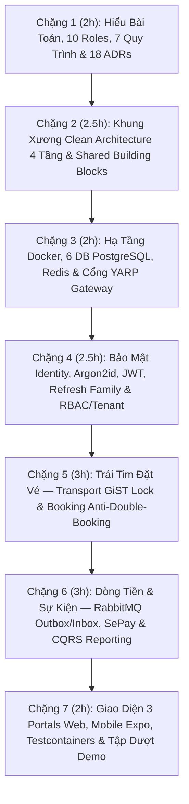

# Lộ Trình Đọc Hiểu Mã Nguồn Từng Bước Cho Người Mới (Từ Con Số 0 Đến Làm Chủ Toàn Dự Án)

> **Mục đích của tài liệu này**: Khi đứng trước một dự án Microservices có hơn **2.000 files** gồm 6 dịch vụ `.NET 10`, 1 cổng `YARP Gateway`, 6 cơ sở dữ liệu `PostgreSQL`, hệ thống hàng đợi `RabbitMQ`, 3 cổng `React 19 Web` và 1 ứng dụng `React Native Expo`, sai lầm lớn nhất là mở đại từng thư mục đọc từ trên xuống dưới. Bạn sẽ bị "ngợp" ngay ở giờ thứ hai.
>
> Tài liệu này thiết kế một **giáo trình tự học thực hành 7 Chặng (7 Buổi học)** theo nguyên lý **"Bóc vỏ hành từ ngoài vào trong, sau đó đi theo dòng chảy của một giao dịch thật"**. Mỗi chặng chỉ rõ cho bạn: **(1) Đọc bài lý thuyết nào trước**, **(2) Mở chính xác file code nào, đọc hàm nào trước, hàm nào sau**, **(3) Chạy lệnh gì trên Terminal để tận mắt thấy code chạy**, và **(4) Bộ câu hỏi tự kiểm tra có lời giải** trước khi qua chặng mới.

---

## 1. Bản Đồ Tư Duy Tổng Thể Lộ Trình 7 Chặng



### Quy tắc vàng khi đọc code dự án này
1. **Không bao giờ đọc tầng `Infrastructure` trước tầng `Application`**: Trong mỗi Microservice (`identity`, `transport`, `booking`, `payment`, `notification`, `reporting`), hãy luôn mở theo thứ tự:
   - Bước A: Đọc file SQL tạo bảng tại `docs/database/<ten-service>/001_initial.sql` để hình dung cấu trúc dữ liệu trong đầu.
   - Bước B: Đọc `*Endpoints.cs` / `Program.cs` tại project `*.Api` để biết người ngoài gọi vào đường dẫn URL nào.
   - Bước C: Đọc `*Service.cs` & `Contracts.cs` tại project `*.Application` để hiểu toàn bộ luật nghiệp vụ bằng C# thuần túy.
   - Bước D: Cuối cùng mới mở `*Repository.cs` & `*EventHandlers.cs` tại project `*.Infrastructure` để xem câu lệnh SQL `Npgsql` và RabbitMQ thực thi chi tiết ra sao.
2. **Đọc Integration Test song song với Code**: Khi thấy một hàm phức tạp (như đổi ghế giữ chỗ hay xử lý SePay IPN), hãy mở ngay file test tương ứng trong `workspace/src/tests/`. Đọc một bài test gồm `Arrange -> Act -> Assert` giúp bạn hiểu đầu vào và đầu ra kỳ vọng nhanh gấp 5 lần đọc code chay!

---

## 2. Chi Tiết Từng Chặng Học & Đọc Code

---

### CHẶNG 1: Nắm Vững Nghiệp Vụ Đặt Vé & Các Quyết Định Kiến Trúc (Thời lượng: ~2 giờ)

Trước khi đọc dù chỉ 1 dòng C#, bạn phải trả lời được câu hỏi: *"Hệ thống này bán cái gì, ai dùng, tiền chảy từ túi ai sang túi ai, và tại sao nhóm lại chọn kiến trúc này?"*

#### Bước 1.1 — Đọc bộ tài liệu Cẩm nang Chương 01 (45 phút)
Đọc tuần tự 4 file trong thư mục `../01-tong-quan-va-nghiep-vu/`:
1. `01-bai-toan-actors-va-3-kenh-giao-dien.md` $\rightarrow$ Nắm 5 nhóm người dùng, 10 mã vai trò (`CUSTOMER`, `DRIVER`, `OPERATOR_*`, `PLATFORM_*`) và tại sao Client chỉ là lớp hiển thị.
2. `02-7-quy-trinh-nghiep-vu-va-business-rules.md` $\rightarrow$ Thuộc lòng sự khác nhau giữa **`PREPAID`** (trả trước qua cổng, thu 10% phí sàn, có hoàn tiền cổng) và **`PAY_LATER`** (nhà xe tự thu trên xe, sàn không thu phí 10% và không hoàn tiền cổng), cùng 3 mốc phí hủy vé **`24h (10%) - 6h (20%) - 2h (30%)`**.
3. `03-7-may-trang-thai-state-machines.md` $\rightarrow$ Nhìn sơ đồ trạng thái của `TripSeat` (`AVAILABLE -> HELD -> BOOKED`), `SeatHold` (`ACTIVE -> CONSUMED / EXPIRED / RELEASED`), `Booking` và `Payment`.
4. `04-18-quyet-dinh-kien-truc-adr-va-so-sanh-tradeoffs.md` $\rightarrow$ Ghi nhớ **6 điểm khác biệt giữa ảnh `docs/SystemArchitecture.png` cũ và code thật** (đặc biệt là PostgreSQL + Raw Npgsql thay vì SQL Server + EF Core, và Redis theo ADR-008!).

#### Bước 1.2 — Đối chiếu với Tài liệu Đặc tả Gốc của Dự án (45 phút)
Mở xem trực tiếp các tài liệu chuẩn của dự án để biết vị trí dẫn chứng khi giảng viên hỏi:
- `docs/srs/v2/02-tong-quan-san-pham.md`
- `docs/srs/v2/03-quy-trinh-va-quy-tac-nghiep-vu.md` (xem bảng các mã quy tắc `BR-SEAT-*`, `BR-BOOK-*`, `BR-PAY-*`, `BR-CANCEL-*`)
- `docs/system-design/02-01-system-architecture/02-01-12-architecture-decisions.md` (đọc bảng tổng hợp `ADR-001` đến `ADR-018`)

#### Bước 1.3 — Bài tập Tự Kiểm Tra Chặng 1 (30 phút)
Hãy tự trả lời miệng (không nhìn tài liệu) 4 câu hỏi sau:
1. *Khách giữ ghế lúc `10:00:00` (`expiresAt = 10:10:00`). Lúc `10:06:00` khách bấm "Tạo Booking" chuyển sang màn hình chờ thanh toán. Hỏi đơn Booking đó hết hạn lúc `10:10:00` hay `10:16:00`?*
   - **Đáp án**: Đúng **`10:10:00`** (`BR-SEAT-006`, `BR-BOOK-007`)! Tạo Booking kế thừa nguyên vẹn `expiresAt` của `SeatHold`, tuyệt đối không gia hạn thêm 10 phút để ngăn kẻ xấu lạm dụng giữ ghế lâu gấp đôi.
2. *Nhà xe Phương Trang không bật cờ `allowPayLater`, nhưng một sinh viên dùng Postman gửi thẳng `paymentChannel: "PAY_LATER"` lên API tạo Booking. Chuyện gì xảy ra?*
   - **Đáp án**: `BookingService` kiểm tra `trip.AllowPayLater` từ bản chụp chuyến xe, từ chối ngay với lỗi `409 PAY_LATER_NOT_ALLOWED` và không làm mất phiên giữ ghế đang có của khách.
3. *Khách đặt vé `PREPAID` giá `300.000đ` (nhà xe hưởng `270.000đ`, sàn hưởng hoa hồng 10% là `30.000đ`). Trước giờ xe chạy `10 tiếng`, khách bấm hủy vé. Khách nhận về bao nhiêu tiền?*
   - **Đáp án**: Trước giờ đi từ `6h` đến dưới `24h` chịu phí hủy **20%** (`60.000đ`), khách được hoàn **`240.000đ`**.
4. *Nếu chính Nhà xe bấm Hủy chuyến xe đó vì xe hỏng, khách hàng trên nhận về bao nhiêu tiền?*
   - **Đáp án**: Hoàn **100% (`300.000đ`)** vì lỗi từ phía nhà xe (`BR-CANCEL-008`), không áp phí hủy khách hàng!

---

### CHẶNG 2: Giải Phẫu Khung Xương `.NET 10`, Clean Architecture & `BuildingBlocks` (Thời lượng: ~2.5 giờ)

Ở chặng này, bạn sẽ hiểu "ngôn ngữ chung" mà cả 6 Microservices và API Gateway đều sử dụng. Hiểu xong chặng này, khi mở bất kỳ service nào bạn cũng thấy quen thuộc ngay lập tức!

#### Bước 2.1 — Đọc Cẩm nang Chương 02 (45 phút)
Đọc trọn bộ 4 file tại `../02-kien-truc-clean-architecture-va-building-blocks/`:
1. `01-clean-architecture-4-tang-tu-ly-thuyet-den-code.md`
2. `02-dotnet10-minimal-api-di-va-cau-truc-solution.md`
3. `03-railway-oriented-programming-result-va-error-envelope.md`
4. `04-idempotency-key-chong-gui-lap-va-tien-ich-nen-tang.md`

#### Bước 2.2 — Mở Mã Nguồn Thực Tế Theo Thứ Tự (75 phút)
Mở lần lượt từng file code dưới đây trong trình soạn thảo:

1. **Cấu hình toàn cục của Solution**:
   - `workspace/global.json`: Xem dòng pin SDK `.NET 10.0.401`.
   - `workspace/Directory.Build.props`: Xem `<TargetFramework>net10.0</TargetFramework>`, `<TreatWarningsAsErrors>true</TreatWarningsAsErrors>`, `<ManagePackageVersionsCentrally>true</ManagePackageVersionsCentrally>`.
   - `workspace/Directory.Packages.props`: Nhìn lướt qua danh sách thư viện toàn dự án (`Yarp.ReverseProxy`, `Npgsql`, `RabbitMQ.Client`, `Konscious.Security.Cryptography.Argon2`, `NetArchTest.Rules`, `Testcontainers.*`). Nhận diện ngay: **Không có Entity Framework Core và không có StackExchange.Redis!**

2. **Đọc thư viện lõi `BusTicketPlatform.BuildingBlocks`**:
   - `workspace/src/building-blocks/BusTicketPlatform.BuildingBlocks/Results/Result.cs`: Chỉ dài ~30 dòng! Xem cách `Result` và `Result<T>` gói `IsSuccess`, `Value`, và `AppError? Error`.
   - `.../Errors/ErrorCodes.cs` & `AppError.cs` & `ErrorMapper.cs`: Xem cách mọi lỗi đều quy về một mã chuỗi bất biến (như `SEAT_UNAVAILABLE`, `IDEMPOTENCY_CONFLICT`) và cách `ErrorMapper.FromUnknown` giấu tiệt thông tin nhạy cảm của `Exception` khi trả lỗi `500 INTERNAL_ERROR`.
   - `.../Ids/UuidV7IdGenerator.cs`: Xem lệnh `Guid.CreateVersion7()`.
   - `.../Idempotency/IIdempotencyStore.cs`: Xem 4 trạng thái trả về của `IdempotencyOutcome` (`Started`, `Completed`, `InProgress`, `Conflict`).

3. **Đọc thư viện Web `BusTicketPlatform.BuildingBlocks.AspNetCore`**:
   - `.../HostingExtensions.cs`: Xem `AddBuildingBlocks()` đăng ký `IClock` + `IIdGenerator`, và `UseBuildingBlocks()` gắn 2 middleware theo đúng thứ tự: **`CorrelationMiddleware` đứng trước $\rightarrow$ `ErrorEnvelopeMiddleware` đứng sau** (tại sao? Để khi `ErrorEnvelopeMiddleware` bắt lỗi, nó đã có sẵn `CorrelationId` do `CorrelationMiddleware` sinh ra để nhét vào JSON lỗi!).
   - `.../Correlation/CorrelationMiddleware.cs`: Xem cách đọc header `X-Correlation-Id` hoặc tự sinh UUIDv7 mới.
   - `.../Http/ErrorEnvelopeMiddleware.cs`: Đọc kỹ khối `try { await next(context); ... } catch (Exception exception) { ... }`. Chú ý dòng kiểm tra `context.Response.StatusCode >= 400 && IsEmptyJsonResponse(context)` — nhờ đoạn này mà khi ASP.NET tự trả `401 Unauthorized` rỗng, khách hàng vẫn nhận được JSON `{ "error": { "code": "AUTHENTICATION_REQUIRED", ... } }` đồng nhất!
   - `.../Http/PlatformHttp.cs`: Đọc kỹ hàm `WithIdempotency` và `HashPayload`. Sau đó mở `workspace/src/services/booking/BusTicketPlatform.Booking.Infrastructure/Persistence/IdempotencyStore.cs` để thấy câu lệnh SQL `INSERT INTO idempotency_records ... ON CONFLICT ...` thực sự lưu kết quả vào PostgreSQL như thế nào!

4. **Chạy thử Unit Tests & Architecture Tests trên Terminal (30 phút)**:
   Mở PowerShell tại thư mục `workspace` và chạy:
   ```powershell
   cd workspace
   dotnet test src/tests/building-blocks/BusTicketPlatform.BuildingBlocks.UnitTests
   dotnet test src/tests/architecture/BusTicketPlatform.ArchitectureTests
   dotnet test src/tests/contracts/BusTicketPlatform.ContractTests
   ```
   *(Cả 3 bộ test này không cần bật Docker vẫn chạy xanh 100% trong vài giây! Hãy mở file `LayerDependencyTests.cs` thử đọc xem nó kiểm tra các tầng `Domain` và `Application` như thế nào).*

---

### CHẶNG 3: Làm Chủ Hạ Tầng Docker, 6 DB PostgreSQL & Cổng YARP Gateway (Thời lượng: ~2 giờ)

#### Bước 3.1 — Đọc Cẩm nang Chương 03 (40 phút)
Đọc 3 file trong `../03-api-gateway-va-yarp/`:
1. `01-ly-thuyet-api-gateway-reverse-proxy-va-yarp.md`
2. `02-giai-phau-code-gateway-middleware-cors-health-swagger.md`
3. `03-bang-dinh-tuyen-50-routes-va-chien-luoc-order-precedence.md`

#### Bước 3.2 — Đọc File Cấu Hình Hạ Tầng & Code Gateway (60 phút)
1. Mở `workspace/src/infra/docker-compose.yml` và `docker-compose.apps.yml`:
   - Quan sát cổng của từng dịch vụ: Gateway (`5080`), Identity (`5081`), Transport (`5082`), Booking (`5083`), Payment (`5084`), Notification (`5085`), Reporting (`5086`), Customer Web (`5173`), Operator Web (`5174`), Admin Web (`5175`), Postgres (`5432`), RabbitMQ (`5672` & UI `15672`), Redis (`6379`), Mailpit (`8025`).
   - Xem cách `gateway` trong `docker-compose.apps.yml` ghi đè địa chỉ `localhost:5081..5086` thành tên DNS nội bộ Docker `http://identity:8080/`, `http://booking:8080/`, ...
2. Mở `workspace/src/infra/postgres/init/00-create-databases.sql` và `bootstrap.sh`, cùng `docs/database/_shared/000_integration_tables.sql` (4 bảng kỹ thuật có mặt ở mọi DB: `outbox_messages`, `inbox_messages`, `idempotency_records`, `audit_logs`).
3. Mở `workspace/src/gateway/BusTicketPlatform.Gateway/Program.cs` (đọc trọn vẹn 173 dòng).
4. Mở `workspace/src/gateway/BusTicketPlatform.Gateway/appsettings.json` (309 dòng):
   - Dò bằng mắt 4 cặp xung đột URL thú vị nhất để hiểu tại sao phải có `Order` âm:
     - Cặp 1: `/api/v1/operator/staff` (`Order: -40` $\rightarrow$ `identity`) thắng `/api/v1/operator/{**catch-all}` (`Order: 10` $\rightarrow$ `transport`).
     - Cặp 2: `/api/v1/trips/{tripId}/seats` (`Order: -20` $\rightarrow$ `booking`) thắng `/api/v1/trips/{**catch-all}` (`Order: 10` $\rightarrow$ `transport`).
     - Cặp 3: `/api/v1/bookings/{bookingId}/payments` (`Order: -20` $\rightarrow$ `payment`) thắng `/api/v1/bookings/{**catch-all}` (`Order: 10` $\rightarrow$ `booking`).
     - Cặp 4: `/api/v1/admin/organizations/{organizationId}/members` (`Order: -20` $\rightarrow$ `identity`) thắng `/api/v1/admin/organizations/{**catch-all}` (`Order: 10` $\rightarrow$ `transport` — đúng tinh thần **ADR-013**!).

#### Bước 3.3 — Bài tập Tự Kiểm Tra Chặng 3 (20 phút)
- Chạy lệnh `dotnet test src/tests/gateway/BusTicketPlatform.Gateway.IntegrationTests` và mở đọc `GatewayHealthAndErrorTests.cs`: xem điều gì xảy ra khi Gateway đang chạy nhưng cả 6 Microservices phía sau đều tắt (`GET /live` của Gateway trả `200 OK`, nhưng gọi vào route nghiệp vụ thì trả `503 UPSTREAM_UNAVAILABLE`!).

---

### CHẶNG 4: Bảo Mật Toàn Diện — `Identity`, Argon2id, JWT, Refresh Rotation & RBAC (Thời lượng: ~2.5 giờ)

#### Bước 4.1 — Đọc Cẩm nang Chương 04 (50 phút)
Đọc tuần tự 4 file tại `../04-security-identity-jwt-rbac/`:
1. `01-mat-ma-hoc-argon2id-otp-challenge-va-chong-vet-can.md`
2. `02-kien-truc-jwt-access-token-va-refresh-token-family.md`
3. `03-rbac-10-roles-va-co-lap-da-thue-bao-multi-tenancy.md`
4. `04-bao-mat-webhook-qr-hmac-va-kiem-toan-owasp.md`

#### Bước 4.2 — Đọc Theo Dòng Chảy Code Thực Tế Của `Identity Service` (70 phút)
1. **Schema dữ liệu**: Mở `docs/database/identity/001_initial.sql` $\rightarrow$ xem cấu trúc 9 bảng chính (`users`, `roles`, `permissions`, `role_permissions`, `organization_memberships`, `user_roles`, `refresh_sessions`, `auth_challenges`, `security_audits`), sau đó xem `011_dev_login_seed.sql` để biết 4 tài khoản mẫu dùng để đăng nhập demo!
2. **Tầng Domain**: Mở `workspace/src/services/identity/BusTicketPlatform.Identity.Domain/`:
   - `PasswordPolicy.cs` (luật 10–128 ký tự, chữ + số).
   - `IdentityNormalizer.cs` (chuẩn hóa email viết hoa, số điện thoại E.164 `+84...`).
3. **Tầng Infrastructure Security**: Mở `workspace/src/services/identity/BusTicketPlatform.Identity.Infrastructure/Security/`:
   - `Argon2PasswordHasher.cs`: Xem hàm `Hash` và `Verify` (chú ý `FixedTimeEquals`).
   - `JwtTokenService.cs`: Xem cách đóng gói các claims `sub`, `jti`, `sid`, `ver`, `org`, `role` vào Access Token 15 phút.
   - `ChallengeNotifier.cs`: Xem cách gửi mail OTP qua SMTP/Mailpit và cơ chế `CapturingChallengeNotifier` phục vụ test tự động.
4. **Tầng Application — Trái tim xác thực**: Mở `.../Identity.Application/AuthService.cs`:
   - Đọc `RegisterAsync` $\rightarrow$ `IssueChallengeAsync` $\rightarrow$ `VerifyAsync` $\rightarrow$ `LoginAsync` (xem đếm `FailedLoginCount >= 5` khóa 15 phút).
   - **Đọc thật kỹ dòng 190–230 (`RefreshAsync`)**: Tận mắt nhìn khối lệnh `if (session.RevokedAt is not null) { await users.RevokeFamilyAsync(session.FamilyId, "REUSE", ...); }` — đây chính là lá chắn chống đánh cắp phiên Refresh Token!
5. **Đối chiếu kiểm tra Token tại API**:
   - Mở `workspace/src/services/identity/BusTicketPlatform.Identity.Api/Program.cs` (dòng 44–67): Xem `OnTokenValidated` kiểm tra `user.AuthorizationVersion == tokenVersion`.
   - Mở `workspace/src/building-blocks/BusTicketPlatform.BuildingBlocks.AspNetCore/Auth/PlatformJwtExtensions.cs`: So sánh để thấy 5 service còn lại xác thực chữ ký JWT stateless như thế nào.
6. **Báo cáo OWASP**: Đọc `docs/security/owasp-api-2026-11-16/README.md` và `docs/security/SECURITY-REMEDIATION-TASKS.md` (30 phút cuối).

---

### CHẶNG 5: Trái Tim Nghiệp Vụ — `Transport` & `Booking` (Chống Trùng Lịch & Chống Bán Trùng Ghế) (Thời lượng: ~3 giờ)

> **Lưu ý đặc biệt**: Đây là chặng quyết định 50% điểm số kỹ thuật của buổi bảo vệ! Hãy đọc thật chậm từng câu lệnh SQL.

#### Bước 5.1 — Đọc Cẩm nang Chương 05 (`01..03`) và Chương 07 (`02..03`) (60 phút)
- `../05-database-postgresql-concurrency-va-redis/01-database-per-service-migration-va-jsonb-snapshot.md`
- `../05-database-postgresql-concurrency-va-redis/02-postgresql-gist-exclusion-chong-trung-lich-xe-tai-xe.md`
- `../05-database-postgresql-concurrency-va-redis/03-anti-double-booking-row-locks-deadlock-va-deferred-fk.md`
- `../07-microservices-nghiep-vu-chi-tiet/02-transport-service-chi-tiet.md` & `03-booking-service-chi-tiet.md`

#### Bước 5.2 — Mổ Xẻ Code `Transport Service` (`Port 5082`) (45 phút)
1. Mở `docs/database/transport/001_initial.sql`:
   - Dừng lại ở dòng 190–192 (`ex_bus_schedule`) và dòng 217–219 (`ex_driver_schedule`): Hiểu cách `exclude using gist (bus_id with =, operating_window with &&)` chặn đứng 2 chuyến xe trùng giờ ngay ở tầng CSDL!
2. Mở `workspace/src/services/transport/BusTicketPlatform.Transport.Application/TransportService.cs`:
   - Đọc `TryTenant` (dòng 952) để thấy cách chặn truy cập chéo nhà xe.
   - Đọc `PrepareTripDraftAsync` (dòng 610) và `CreateRecurringTripsAsync` (dòng 529) — chú ý cách cộng đệm `-1 giờ` trước khởi hành và `+1 giờ` sau khi đến cho tài xế, đồng thời kiểm tra ngày hết hạn bằng lái `LicenseExpiresOn` so với chuyến cuối cùng trong chuỗi lặp!
   - Đọc `PublishTripAsync` (dòng 748): Xem cách chuyến xe được đóng băng thành 3 chuỗi JSON (`RouteSnapshot`, `BusSnapshot`, `FareSnapshot`), lưu với `sellable = false` và bắn sự kiện `TripPublished`.

#### Bước 5.3 — Mổ Xẻ Code `Booking Service` (`Port 5083`) (75 phút)
1. Mở `docs/database/booking/001_initial.sql`:
   - Xem bảng `trip_seats` (dòng 29–54) với ràng buộc `ck_trip_seat_owner` và cuối file (dòng 257–265) với 2 khóa ngoại `deferrable initially deferred`.
2. Mở `workspace/src/services/booking/BusTicketPlatform.Booking.Infrastructure/Persistence/BookingRepository.cs` — **Đọc kỹ 6 hàm vàng sau**:
   - **Hàm 1 (`ImportTripAsync` — dòng 10)**: Nhận `TripPublished`, tạo `trip_snapshots` và sinh danh sách ghế vào `trip_seats`.
   - **Hàm 2 (`ExpireHoldsAsync` — dòng 159)**: 2 khối CTE thu hồi đơn quá hạn và ghế giữ quá 10 phút về `AVAILABLE`.
   - **Hàm 3 (`CreateHoldAsync` — dòng 254)**: Câu lệnh `SELECT id, price FROM trip_seats WHERE trip_id = @trip AND id = ANY(@ids) AND status = 'AVAILABLE' FOR UPDATE;` và kiểm tra `if (prices.Count != seatIds.Count) { await tx.RollbackAsync(...); return null; }`.
   - **Hàm 4 (`ReplaceHoldAsync` — dòng 326)**: Câu lệnh `ORDER BY id FOR UPDATE` chống Deadlock khi đổi ghế giữ chỗ!
   - **Hàm 5 (`CreateBookingAsync` — dòng 411)**: Khóa `FOR SHARE` trên bảng `coupons` + `SET CONSTRAINTS ALL DEFERRED` + tiêu thụ `seat_holds` (`CONSUMED`) + chèn `bookings`, `booking_items`, `passengers` + chuyển `trip_seats` sang `BOOKED`!
   - **Hàm 6 (`ApplyPaidAsync` — dòng 559)**: Cập nhật `bookings` sang `PAID`, sinh từng bản ghi `tickets` và chèn luôn 2 sự kiện `BookingPaid` + `TicketIssued` vào `outbox_messages` trong cùng một giao dịch DB!
3. Mở `.../Booking.Application/BookingService.cs`:
   - Xem thuật toán chia tiền giảm giá Coupon không lệch 1 đồng lẻ nào ở dòng 313–320 (`cumulativeDiscount`).
   - Xem `PreviewAsync` & `CancelAsync` (dòng 382–479) áp dụng `CancellationPolicy` (24h/6h/2h).
   - Xem `TicketQr.cs` và `TicketLookupToken.cs` để hiểu chữ ký `HMAC-SHA256` trên vé.

---

### CHẶNG 6: Dòng Tiền, Sự Kiện Bất Đồng Bộ & Báo Cáo CQRS (`Payment`, `RabbitMQ`, `Notification`, `Reporting`) (Thời lượng: ~3 giờ)

#### Bước 6.1 — Đọc Cẩm nang Chương 05 (`04`), Chương 06 (`01..03`) và Chương 07 (`04..05`) (60 phút)
- `../05-database-postgresql-concurrency-va-redis/04-advisory-locks-payment-va-cau-chuyen-thuc-te-ve-redis.md`
- Trọn bộ 3 bài trong `../06-rabbitmq-outbox-inbox-va-saga/`
- `../07-microservices-nghiep-vu-chi-tiet/04-payment-service-sepay-va-vnpay-chi-tiet.md` & `05-notification-va-reporting-cqrs-chi-tiet.md`

#### Bước 6.2 — Đọc Hạ Tầng RabbitMQ Outbox/Inbox (45 phút)
1. Mở `workspace/src/infra/rabbitmq/definitions.json`: Nhìn 4 exchanges và 8 queues.
2. Mở toàn bộ thư mục `workspace/src/building-blocks/BusTicketPlatform.BuildingBlocks.Messaging/`:
   - `EventMessage.cs` & `OutboxRouting.cs` (18 sự kiện ánh xạ sang routing key).
   - `OutboxDispatchHostedService.cs` & `OutboxRelay.cs` (worker quét `outbox_messages` mỗi 2 giây).
   - `IntegrationEventConsumerHost.cs` & `InboxDeduper.cs` (worker nhận message từ queue, khử trùng qua `inbox_messages`, lỗi thì `RejectAsync(requeue: false)` đẩy vào DLQ).

#### Bước 6.3 — Đọc `Payment Service` (`SePay`) (45 phút)
1. Mở `workspace/src/services/payment/BusTicketPlatform.Payment.Infrastructure/PaymentEventHandlers.cs`: Xem cách Payment nhận `BookingCreated` để ghi vào `booking_quotes` (lấy giá chuẩn từ Booking sang mà không cần gọi HTTP!).
2. Mở `.../Payment.Application/SePayCheckout.cs` và `SePayIpn.cs`: Xem cách ký form thanh toán SePay và kiểm tra `X-Secret-Key` hằng thời gian.
3. Mở **`.../Payment.Infrastructure/Persistence/SePayPaymentStore.cs` (167 dòng cực kỳ tinh hoa!)**: Đọc từng dòng từ dòng 12 đến 122 để nắm trọn bộ: `pg_advisory_xact_lock`, chống dùng 1 mã giao dịch trả cho 2 đơn, khử trùng `webhook_receipts`, tính `booking_settlements` (hoa hồng 10%), xử lý `late` payment bù trừ tự động, và mở `reconciliation_cases` khi gặp `VOID_AFTER_CAPTURE`.
4. Mở `PaymentService.cs` và `SePayPaymentStore.cs` để lần theo báo giá, xác nhận IPN và gửi sự kiện sang Booking.

#### Bước 6.4 — Đọc `Notification` & `Reporting` (CQRS Read Model) (30 phút)
1. Mở `workspace/src/services/notification/BusTicketPlatform.Notification.Infrastructure/NotificationEventHandlers.cs` và `CustomerRequests.cs`.
2. Mở `workspace/src/services/reporting/BusTicketPlatform.Reporting.Infrastructure/Persistence/ReportingRepository.cs`: Đọc câu SQL `UpsertBookingAsync` (xem hàm `GREATEST(...)` bảo vệ dữ liệu khi sự kiện đến lộn xộn) và `ApplyRefundAsync` (cộng dồn hoàn tiền nguyên tử bằng CTE `FOR UPDATE`).

---

### CHẶNG 7: Frontend Đa Cổng, Mobile App, Kiểm Thử & Chạy Thử Toàn Hệ Thống (Thời lượng: ~2 giờ)

#### Bước 7.1 — Đọc Cẩm nang Chương 08 (`01..04`) (45 phút)
Đọc trọn bộ 4 file tại `../08-frontend-mobile-contracts-docker-testing/`.

#### Bước 7.2 — Mở Mã Nguồn Web & Mobile (45 phút)
1. Mở `workspace/src/apps/web/scripts/portal.mjs` và `workspace/src/apps/web/src/routes.ts`: Hiểu cách cờ `BLUE_APP_TARGET` cắt 1 codebase thành 3 cổng riêng biệt (`customer-web :5173`, `operator-web :5174`, `admin-web :5175`).
2. Mở `workspace/src/apps/web/src/app/enableMocking.ts` và đọc `workspace/src/apps/web/docs/technical/BACKEND_INTEGRATION.md`: Nắm rõ khi nào chạy MSW Mock, khi nào chạy Live API qua YARP `:5080`, và thuật toán Single-Flight 401 Refresh.
3. Mở `workspace/src/packages/api-client/src/index.ts`, `workspace/src/apps/mobile/src/session.ts` và `workspace/src/apps/mobile/App.tsx`: Xem cách Mobile lưu vé offline vào `expo-secure-store` và mở lại khi mất mạng.

#### Bước 7.3 — Thực Hành Khởi Động & Chạy Kiểm Thử Toàn Diện (30 phút)
Nếu máy đã bật Docker Desktop:
```powershell
# Cách 1: Chạy toàn bộ hệ thống chuẩn qua script có sẵn
pwsh ./workspace/scripts/dev-docker.ps1

# Hoặc Cách 2: Chạy chế độ tích hợp SePay Live + Cloudflare Tunnel
pwsh ./scripts/start-sepay-local.ps1

# Chạy toàn bộ Integration Tests trên Testcontainers (PostgreSQL & RabbitMQ thật)
cd workspace
dotnet test BusTicketPlatform.sln
```

---

## 3. Lộ Trình "Cấp Tốc 12 Giờ" (Dành Cho Trường Hợp Sát Ngày Bảo Vệ)

Nếu bạn chỉ còn đúng **1 ngày trước giờ lên thuyết trình**, hãy ưu tiên đọc **Top 10 file quyết định 85% câu hỏi của hội đồng** theo đúng thứ tự sau:

| Thứ tự | File cần đọc ngay | Thời gian | Lý do bắt buộc phải nắm |
|---:|---|---:|---|
| **1** | `../01-tong-quan-va-nghiep-vu/04-18-quyet-dinh-kien-truc-adr-va-so-sanh-tradeoffs.md` | 45p | Tránh toàn bộ bẫy mâu thuẫn giữa ảnh `SystemArchitecture.png` cũ (SQL Server/EF Core/Redis) và code thật! |
| **2** | `workspace/src/gateway/BusTicketPlatform.Gateway/appsettings.json` + bài `03` Chương 03 | 45p | Giải thích vì sao YARP có 50 routes với `Order: -40..-20, 10`. |
| **3** | `workspace/src/services/identity/.../AuthService.cs` + bài `02` Chương 04 | 60p | Giải thích Argon2id, JWT claims (`ver`, `org`) và phát hiện đánh cắp Refresh Token (`RevokeFamilyAsync`). |
| **4** | `docs/database/transport/001_initial.sql` + bài `02` Chương 05 | 40p | Giải thích `EXCLUDE USING gist` chống trùng lịch xe và tài xế. |
| **5** | `workspace/src/services/booking/.../BookingRepository.cs` + bài `03` Chương 05 | 90p | Giải thích `SELECT ... FOR UPDATE`, `ORDER BY id` chống Deadlock, `SET CONSTRAINTS ALL DEFERRED` chống Double-Booking! |
| **6** | `workspace/src/building-blocks/.../Messaging/OutboxRelay.cs` & `IntegrationEventConsumerHost.cs` + bài `02` Chương 06 | 60p | Giải thích Transactional Outbox + Idempotent Inbox + DLQ qua RabbitMQ. |
| **7** | `workspace/src/services/payment/.../SePayPaymentStore.cs` + bài `04` Chương 07 | 60p | Giải thích đối soát SePay IPN, `pg_advisory_xact_lock`, hoa hồng 10% và bù trừ thanh toán trễ. |
| **8** | `workspace/src/services/reporting/.../ReportingRepository.cs` + bài `05` Chương 07 | 45p | Giải thích CQRS Read Model không `JOIN` chéo DB và định hướng Power BI Embedded (`ADR-018`). |
| **9** | `./02-kich-ban-slide-va-loi-dan-thuyet-trinh-20-phut.md` | 60p | Nắm kịch bản nói từng slide và tập dượt các bước bấm chuột Live Demo. |
| **10** | `./03-ngan-hang-30-cau-hoi-phan-bien-hoi-dong-va-dap-an.md` | 90p | Đọc to thành tiếng đáp án của 30 câu hỏi xoáy thường gặp nhất của hội đồng! |

---

## 4. Bảng Tra Cứu Nhanh: "Hội Đồng Hỏi Tính Năng X $\rightarrow$ Mở Ngay File Nào Trên Máy Chiếu?"

Khi giảng viên nói: *"Em mở code đoạn xử lý ... cho thầy/cô xem"*, hãy tra bảng này để mở đúng file trong 3 giây:

| Chủ đề giảng viên yêu cầu xem code | Đường dẫn file mở ngay trên IDE | Dòng / Hàm cần trỏ chuột vào |
|---|---|---|
| Định tuyến YARP & xử lý sập service con | `workspace/src/gateway/BusTicketPlatform.Gateway/Program.cs` & `appsettings.json` | `UseBuildingBlocks()`, `MapReverseProxy()`, các route có `"Order": -40`, `-30`, `-20` |
| Băm mật khẩu Argon2id | `workspace/src/services/identity/BusTicketPlatform.Identity.Infrastructure/Security/Argon2PasswordHasher.cs` | `Hash(...)` và `Verify(...)` với `FixedTimeEquals` |
| Phát hiện dùng lại Refresh Token bị đánh cắp | `workspace/src/services/identity/BusTicketPlatform.Identity.Application/AuthService.cs` | `RefreshAsync` (`if (session.RevokedAt is not null)` $\rightarrow$ `RevokeFamilyAsync`) |
| Kiểm tra cô lập nhà xe (Multi-tenancy) | `workspace/src/services/transport/BusTicketPlatform.Transport.Application/TransportService.cs` | `TryTenant(...)` ở cuối file (dòng ~952) |
| Chặn trùng lịch xe và tài xế bằng GiST | `docs/database/transport/001_initial.sql` | `ex_bus_schedule` (dòng 190) & `ex_driver_schedule` (dòng 217) |
| Giữ ghế nguyên tử chống bán trùng & chống Deadlock | `workspace/src/services/booking/BusTicketPlatform.Booking.Infrastructure/Persistence/BookingRepository.cs` | `ExpireHoldsAsync` (dòng 159), `CreateHoldAsync` (dòng 254), `ReplaceHoldAsync` (`ORDER BY id FOR UPDATE` dòng 337) |
| Tính tiền giảm giá Coupon & khóa `FOR SHARE` | `BookingService.cs` (dòng 313) & `BookingRepository.cs` (dòng 420) | `CouponDiscount`, vòng lặp `cumulativeDiscount`, và `SELECT 1 FROM coupons ... FOR SHARE` |
| Ký và kiểm tra mã QR trên vé điện tử | `workspace/src/services/booking/BusTicketPlatform.Booking.Application/TicketQr.cs` | `Create` & `TryVerify` (`BT1.<id>.<HMACSHA256>`) |
| Xử lý Webhook SePay IPN, hoa hồng 10% & thanh toán trễ | `workspace/src/services/payment/BusTicketPlatform.Payment.Infrastructure/Persistence/SePayPaymentStore.cs` | `ApplySePayAsync` (`pg_advisory_xact_lock`, `webhook_receipts`, `booking_settlements`, `late`) |
| Worker gửi Outbox & Worker nhận Inbox RabbitMQ | `workspace/src/building-blocks/BusTicketPlatform.BuildingBlocks.Messaging/` | `OutboxRelay.cs`, `OutboxDispatchHostedService.cs`, `IntegrationEventConsumerHost.cs`, `InboxDeduper.cs` |
| Đồng bộ báo cáo doanh thu CQRS bất biến thứ tự | `workspace/src/services/reporting/BusTicketPlatform.Reporting.Infrastructure/Persistence/ReportingRepository.cs` | `UpsertBookingAsync` (`GREATEST(...)`) & `ApplyRefundAsync` |
| Kiểm tra tự động Clean Architecture bằng Unit Test | `workspace/src/tests/architecture/BusTicketPlatform.ArchitectureTests/` | `LayerDependencyTests.cs` & `ProjectReferenceTests.cs` |
