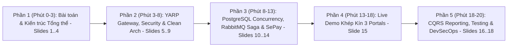

# Kịch Bản 18 Slides & Lời Dẫn Thuyết Trình Chi Tiết (20 Phút + Kịch Bản Live Demo 5 Phút)

> **Mục tiêu của tài liệu này**: Một đồ án xuất sắc về mặt kỹ thuật vẫn có thể bị điểm thấp nếu lên bục thuyết trình lan man, đọc chữ trên slide, hoặc demo luống cuống. Tài liệu này cung cấp cho bạn **bộ khung 18 Slides chuẩn bảo vệ đồ án kỹ sư (20 phút)** kèm **lời dẫn gợi ý từng câu (Speaker Notes)**, **phân bố thời gian cho nhóm 4 thành viên**, và **kịch bản bấm chuột Live Demo 5 phút không rủi ro**.

---

## 1. Chiến Lược Phân Bổ Thời Gian & Chia Vai Cho Nhóm 4 Người

Tổng thời gian chuẩn trước hội đồng: **20 phút trình bày** (15 phút Slide + 5 phút Live Demo) + **15–20 phút Hỏi Đáp Phản Biện**.



### Gợi ý phân vai khớp với `task-tracking/01-team-ownership.md`
- **Người 1 (`BE-1` — Platform & Operations)**: Trình bày **Slides 1–6** (Đặt vấn đề, Kiến trúc tổng thể `.NET 10`, Clean Architecture 4 tầng + `NetArchTest`, YARP Gateway 50 routes, Bảo mật Identity/JWT/RBAC/Multi-tenant) và **Slide 16** (CQRS Reporting & Power BI ADR-018).
- **Người 2 (`BE-2` — Transaction & Integration)**: Trình bày **Slides 7–14** (Database-per-Service, GiST Exclusion chống trùng lịch, Anti-Double-Booking PostgreSQL vs Redis ADR-008, RabbitMQ Transactional Outbox/Inbox, Saga Choreography 2 pha & Thanh toán thực tế SePay IPN / Hoàn tiền).
- **Người 3 (`FE` — Web Portals) & Người 4 (`MOBILE` — Expo App)**: Phối hợp thực hiện **Live Demo 5 phút (Slide 15)** trên 3 cổng Web + Mobile Offline Ticket, và trình bày **Slides 17–18** (Kiến trúc Multi-portal React 19 / MSW / Single-flight 401, Kim tự tháp kiểm thử Testcontainers / Playwright / OWASP Audit & Kết luận).
- *(Nếu bạn thuyết trình độc lập 1 mình, mạch 18 slides này vẫn liền mạch tuyệt đối từ đầu đến cuối!)*

---

## 2. Nội Dung & Lời Thoại Từng Slide (Slide 1 $\rightarrow$ Slide 18)

---

### Slide 1: Trang Bìa (0:00 – 0:30)
- **Trên Slide**:
  - Tên đề tài: **BLUE — Nền Tảng Đặt Vé & Điều Hành Xe Khách Trực Tuyến Đa Nhà Xe**
  - Phụ đề kỹ thuật: *Event-Driven Microservices trên .NET 10, YARP Gateway, PostgreSQL 17, RabbitMQ, React 19 & React Native*
  - Danh sách thành viên nhóm & Giảng viên hướng dẫn.
- **Lời dẫn gợi ý**:
  > *"Kính chào quý thầy cô trong hội đồng. Hôm nay nhóm chúng em xin trình bày đồ án PBL6: Hệ thống đặt vé và điều hành xe khách trực tuyến đa nhà xe mang tên BLUE. Thay vì dừng lại ở một ứng dụng CRUD đơn giản, nhóm đặt mục tiêu giải quyết trọn vẹn các bài toán hóc búa nhất của một sàn giao dịch vé thực tế: chống bán trùng ghế dưới tải đồng thời cao, đối soát dòng tiền bất đồng bộ đáng tin cậy, và cô lập dữ liệu đa thuê bao cho nhiều nhà xe."*

---

### Slide 2: Bài Toán Thực Tế & 3 Thách Thức Kỹ Thuật Cốt Lõi (0:30 – 1:30)
- **Trên Slide** (3 cột biểu tượng lớn, chữ cực gọn):
  1. **Tranh chấp tồn kho ghế (High Contention)**: Hàng trăm khách cùng chọn 1 ghế giường nằm đẹp vào dịp lễ $\rightarrow$ Cấm tuyệt đối Double-Booking hay giữ ghế nửa vời.
  2. **Giao dịch tài chính phân tán (Distributed Financial Integrity)**: Tích hợp cổng thanh toán ngoài (SePay VietQR), mạng có thể đứt, webhook có thể lặp hoặc đến trễ sau khi hết hạn giữ chỗ.
  3. **Đa nhà xe & Đa kênh (Multi-Tenant & Multi-Channel)**: 5 nhóm tác nhân (Guest, Customer, Driver, Operator Staff, Platform Admin) trên 3 cổng Web + Mobile dùng chung một nguồn sự thật duy nhất phía Server.
- **Lời dẫn gợi ý**:
  > *"Khi phân tích nghiệp vụ sàn vé liên tỉnh theo mô hình B2B2C, chúng em đối mặt với 3 thách thức lớn. Thứ nhất là tranh chấp ghế thời gian thực: hai khách bấm giữ cùng một ghế ở cùng mili-giây không bao giờ được phép cùng thành công. Thứ hai là độ tin cậy của dòng tiền qua bên thứ ba: trình duyệt có thể tắt ngang sau khi quét mã QR hoặc ngân hàng báo tiền về trễ khi ghế đã hết hạn giữ 10 phút. Thứ ba là bài toán Multi-tenancy: nhà xe A tuyệt đối không được đọc hay sửa chuyến xe, doanh thu của nhà xe B, và mọi tính toán giá vé, giảm giá phải do Server quyết định 100%."*

---

### Slide 3: Kiến Trúc Tổng Thể Hệ Thống Thực Thi (1:30 – 3:00)
- **Trên Slide**: Đặt sơ đồ kiến trúc thực tế (từ Chương 01 — **Lưu ý: KHÔNG dùng file `docs/SystemArchitecture.png` cũ ghi SQL Server/EF Core**, hãy xuất sơ đồ Mermaid chuẩn `.NET 10 + PostgreSQL 17 + Npgsql + RabbitMQ 4.1 + YARP + SePay` ra ảnh sắc nét!).
- **Lời dẫn gợi ý**:
  > *"Để giải quyết 3 thách thức đó, hệ thống được chia thành 6 Microservices theo đúng 6 Bounded Contexts nghiệp vụ chạy trên .NET 10 LTS: Identity (5081), Transport (5082), Booking (5083), Payment (5084), Notification (5085) và Reporting (5086). Phía trước là cổng YARP API Gateway (5080) tiếp nhận lưu lượng từ 3 cổng React 19 và ứng dụng di động Expo. Về dữ liệu, mỗi service sở hữu một cơ sở dữ liệu logic riêng trên PostgreSQL 17 không có khóa ngoại chéo, giao tiếp bất đồng bộ qua RabbitMQ theo mẫu Transactional Outbox và Idempotent Inbox."*

---

### Slide 4: Kỷ Luật Clean Architecture 4 Tầng & Contract-First Governance (3:00 – 4:15)
- **Trên Slide**:
  - Bên trái: Sơ đồ 4 vòng tròn/khối `Domain` $\leftarrow$ `Application` $\leftarrow$ `Infrastructure` + `Api (Minimal APIs)`.
  - Bên phải: Hộp kiểm tự động CI Gate:
    - `OpenAPI 3.1` (77+ operations) + `AsyncAPI 3.1` (20 kênh sự kiện) + `JSON Schema 2020-12`.
    - `NetArchTest` (`LayerDependencyTests` & `ProjectReferenceTests`): tự động fail build nếu vi phạm tầng hoặc tham chiếu chéo giữa các service!
    - `BuildingBlocks`: `Result<T>` (zero-exception business flow), `UUIDv7` (k-sortable B-tree PK), `ErrorEnvelope`, `Idempotency-Key`.
- **Lời dẫn gợi ý**:
  > *"Mỗi microservice đều tuân thủ chặt chẽ Clean Architecture 4 tầng, kết hợp các gói BuildingBlocks dùng chung như mẫu Result tránh ném Exception cho lỗi nghiệp vụ, định danh UUIDv7 giúp tối ưu cây chỉ mục B-tree của PostgreSQL, và kiểm tra Idempotency-Key chống gửi lặp lệnh. Điểm đặc biệt là nhóm không kiểm soát kiến trúc bằng lời nói, mà viết bộ Architecture Tests bằng NetArchTest và Contract Gate Tests: nếu một thành viên vô tình gọi Npgsql trong tầng Application hay tạo tham chiếu chéo giữa hai service, bộ test sẽ chặn ngay lúc build."*

---

### Slide 5: API Gateway YARP & Chiến Lược Định Tuyến Ưu Tiên (`Order`) (4:15 – 5:30)
- **Trên Slide**: Bảng minh họa cơ chế **"Domain-Unified URL Carving"** trên 50 routes của YARP:
  - `/api/v1/operator/staff/**` (`Order: -40`) $\rightarrow$ `Identity`
  - `/api/v1/operator/bookings` (`Order: -30`) $\rightarrow$ `Booking`
  - `/api/v1/operator/refunds/**` (`Order: -30`) $\rightarrow$ `Payment`
  - `/api/v1/operator/{**catch-all}` (`Order: 10`) $\rightarrow$ `Transport`
  - Chuẩn hóa lỗi khi sập service con: `502/503/504` $\rightarrow$ JSON `503 UPSTREAM_UNAVAILABLE` kèm `X-Correlation-Id`.
- **Lời dẫn gợi ý**:
  > *"Tại tầng cổng giao tiếp, nhóm sử dụng YARP của Microsoft. Thay vì ép Frontend phải nhớ URL rời rạc theo tên từng microservice, nhóm thiết kế mặt phẳng RESTful thống nhất theo tài nguyên và dùng cơ chế thứ tự ưu tiên Order của YARP để bóc tách từng nhánh con về đúng chủ sở hữu. Ví dụ cùng dưới nhánh `/api/v1/operator`, nhân sự có Order -40 đi về Identity, hoàn tiền Order -30 đi về Payment, danh sách vé đi về Booking, còn lại Order 10 mới rơi về Transport. Gateway cũng gắn Correlation ID xuyên suốt và bọc mọi lỗi sập kết nối phía sau thành phong bì JSON chuẩn UPSTREAM_UNAVAILABLE."*

---

### Slide 6: Bảo Mật Đa Lớp — Argon2id, Token Family Reuse Detection & Multi-Tenancy (5:30 – 7:00)
- **Trên Slide**:
  - **AuthN**: Mật khẩu băm `Argon2id` + so sánh hằng thời gian `FixedTimeEquals`; OTP 6 số lưu băm có muối; Khóa tài khoản 15 phút sau 5 lần sai.
  - **Session Security**: Sơ đồ nhỏ `Refresh Token R1 (ROTATED)` $\rightarrow$ Kẻ gian dùng lại `R1` $\rightarrow$ `RevokeFamilyAsync(family_id)` hủy lập tức cả `R2` (`401 SESSION_REUSE_DETECTED`)!
  - **AuthZ & Multi-Tenancy**: 10 Roles RBAC + Claim `"org"` ký trong JWT (tuyệt đối không tin `organizationId` từ request body) + Chữ ký `HMAC-SHA256` trên mã QR vé (`BT1.<id>.<MAC>`).
- **Lời dẫn gợi ý**:
  > *"Về bảo mật, mật khẩu được băm bằng Argon2id chống vét cạn bằng GPU. Phiên đăng nhập sử dụng cặp Access Token 15 phút kèm phiên bản quyền `ver` và Refresh Token xoay vòng theo gia đình phiên `family_id`. Nếu một Refresh Token cũ đã xoay vòng bị đánh cắp và gửi lại lên server, hệ thống lập tức phát hiện hành vi phát lại và thu hồi toàn bộ nhánh phiên đó để bảo vệ người dùng. Về phân quyền đa nhà xe, định danh tổ chức được trích xuất trực tiếp từ claim `org` đã ký trong JWT; riêng tài xế còn bị kiểm tra chéo bảng phân công chuyến xe, đảm bảo không rò rỉ dữ liệu chéo."*

---

### Slide 7: Database-per-Service & Chống Trùng Lịch Bằng PostgreSQL `btree_gist` (7:00 – 8:15)
- **Trên Slide**:
  - 6 Logical DBs độc lập + cơ chế **Immutable JSONB Snapshots** (`route_snapshot`, `bus_snapshot`, `fare_policy_snapshot`).
  - Đoạn code SQL ngắn gọn cực đắt giá từ `transport/001_initial.sql`:
    ```sql
    EXCLUDE USING gist (bus_id WITH =, operating_window WITH &&)
    EXCLUDE USING gist (driver_profile_id WITH =, assignment_window WITH &&)
    ```
  - Khoảng đệm an toàn: `[departure - 1h, arrival + 1h]`.
- **Lời dẫn gợi ý**:
  > *"Tại sao nhóm chọn viết SQL thuần với Npgsql trên PostgreSQL 17 thay vì dùng ORM EF Core? Đây là ví dụ đầu tiên: trong nghiệp vụ điều độ xe và tài xế, nếu chỉ dùng câu lệnh SELECT kiểm tra trùng giờ trong C#, hai điều độ viên bấm lưu cùng lúc sẽ vượt qua bước kiểm tra do hiện tượng Write Skew. Nhóm sử dụng trực tiếp chỉ mục không gian-thời gian btree_gist trên kiểu khoảng thời gian tstzrange kèm đệm 1 giờ trước và sau chuyến, chặn tuyệt đối mọi lịch chồng lấn ngay tại nhân cơ sở dữ liệu."*

---

### Slide 8: Chống Bán Trùng Ghế (Anti-Double-Booking) & Quyết Định ADR-008 Về Redis (8:15 – 9:45)
- **Trên Slide**:
  - **ADR-008**: Tại sao **KHÔNG** dùng Redis Distributed Lock làm nguồn quyết định giữ ghế? *(Rủi ro mất khóa khi failover / lệch TTL so với DB transaction)*.
  - **4 Lớp Khóa ACID trong `BookingRepository.cs`**:
    1. `ExpireHoldsAsync`: CTE nguyên tử thu hồi ghế giữ quá **10 phút** ngay trên đường dẫn đọc/ghi.
    2. `CreateHoldAsync`: `SELECT id, price FROM trip_seats ... AND status = 'AVAILABLE' FOR UPDATE` $\rightarrow$ Thiếu dù 1 ghế lập tức `Rollback` toàn bộ (All-or-Nothing).
    3. `ReplaceHoldAsync`: `ORDER BY id FOR UPDATE` $\rightarrow$ Ép thứ tự khóa tăng dần, **triệt tiêu 100% Deadlock** khi 2 khách hoán đổi ghế cùng lúc!
    4. `CreateBookingAsync`: `SELECT 1 FROM coupons ... FOR SHARE` + `SET CONSTRAINTS ALL DEFERRED` + `ck_trip_seat_owner`.
- **Lời dẫn gợi ý**:
  > *"Bài toán thứ hai và cũng quan trọng nhất là chống bán trùng ghế. Theo quyết định kiến trúc ADR-008, dù hạ tầng Docker có dựng sẵn Redis cho định hướng cache sau MVP, nhóm chủ đích không giao quyền giữ ghế cho Redis Lock để tránh rủi ro lệch trạng thái khi cache gặp sự cố. Toàn bộ quyền sở hữu ghế nằm trong giao dịch ACID của PostgreSQL: khóa dòng bi quan SELECT FOR UPDATE đảm bảo giữ nhiều ghế là thành công tất cả hoặc hủy tất cả; khi khách đổi ghế, mệnh đề ORDER BY id FOR UPDATE triệt tiêu hoàn toàn nguy cơ Deadlock; đồng thời khóa FOR SHARE giữ nguyên điều kiện mã giảm giá cho tới lúc đơn đặt vé commit thành công."*

---

### Slide 9: Giải Bài Toán Dual-Write Bằng RabbitMQ Transactional Outbox & Idempotent Inbox (9:45 – 11:00)
- **Trên Slide**:
  - Sơ đồ ngang: `[Business DB + outbox_messages]` $\xrightarrow{\text{OutboxRelay (2s)}}$ `[RabbitMQ Topic Exchange: platform.events]` $\xrightarrow{\text{Manual Ack / DLX}}$ `[inbox_messages UNIQUE(consumer, msg_id) + Handler]`.
  - Công thức vàng: **At-Least-Once Publish + At-Least-Once Broker + Idempotent Consumer = Effectively-Once Processing**.
- **Lời dẫn gợi ý**:
  > *"Khi tách 6 cơ sở dữ liệu độc lập, nếu vừa lưu DB xong lại gọi mạng bắn message lên RabbitMQ sẽ vướng bài toán Dual-Write: mất mạng giữa chừng là mất sự kiện vĩnh viễn. Nhóm giải quyết bằng cặp bài trùng Transactional Outbox và Idempotent Inbox. Sự kiện được ghi bền vững vào bảng outbox_messages ngay trong DB rồi mới được worker quét mỗi 2 giây đẩy lên RabbitMQ. Ở đầu nhận, bảng inbox_messages khử trùng theo cặp tên consumer và mã sự kiện, còn tin nhắn lỗi sẽ đi thẳng vào Dead-Letter Queue chứ không quay vòng gây nghẽn hàng đợi."*

---

### Slide 10: Saga Choreography Mở Bán Chuyến 2 Pha & Thanh Toán Thực Tế SePay IPN (11:00 – 12:30)
- **Trên Slide**:
  - **Saga 1 (Mở bán an toàn)**: `Transport (Publish, sellable=false)` $\xrightarrow{\text{TripPublished}}$ `Booking (Tạo TripSeats)` $\xrightarrow{\text{TripInventoryReady}}$ `Transport (sellable=true)`.
  - **Saga 2 (Thanh toán SePay VietQR & Bù trừ Giao dịch trễ)**:
    - Trình duyệt redirect **không bao giờ** được tin là đã trả tiền (`BR-PAY-010`).
    - Server nhận IPN `X-Secret-Key` $\rightarrow$ `pg_advisory_xact_lock` kép $\rightarrow$ Khử trùng `webhook_receipts` $\rightarrow$ Tách **10% hoa hồng sàn** vào `booking_settlements` $\rightarrow$ Phát `PaymentSucceeded` cấp vé QR.
    - **Compensation (Tiền về trễ sau 10 phút)**: Không cướp lại ghế! Tự động chuyển `REFUND_PENDING` và tạo lệnh hoàn tiền bù trừ (`LATE_PROVIDER_SUCCESS` / `PAYMENT_AFTER_BOOKING_CLOSED`).
- **Lời dẫn gợi ý**:
  > *"Trên nền tảng Outbox/Inbox đó, các quy trình liên miền vận hành theo mẫu Saga Choreography không cần khóa phân tán 2PC. Khi nhà xe mở bán chuyến, chuyến xe chỉ bật cờ sellable=true sau khi Booking xác nhận đã khởi tạo xong toàn bộ sơ đồ ghế. Đặc biệt ở luồng thanh toán thực tế với cổng SePay VietQR, hệ thống dùng khóa tư vấn pg_advisory_xact_lock kép để chống dùng 1 giao dịch ngân hàng cho 2 đơn, tự động hạch toán 10% phí sàn, và có cơ chế bù trừ hai lớp: nếu tiền chuyển khoản về trễ sau khi đơn đã hết hạn giữ ghế 10 phút, hệ thống tuyệt đối không chiếm lại ghế đã bán mà tự động xếp hàng hoàn tiền cho khách."*

---

### Slide 11: Hủy Vé Theo Bậc Thời Gian & Báo Cáo CQRS Read Model (`Reporting`) (12:30 – 13:15)
- **Trên Slide**:
  - Bậc phí hủy tự động (`Preview` 5 phút + `ExpectedVersion`): $\ge 24\text{h}$ (phí 10%), $6\text{h}..24\text{h}$ (20%), $2\text{h}..6\text{h}$ (30%), $< 2\text{h}$ (chặn tự hủy); Nhà xe hủy chuyến $\rightarrow$ Hoàn **100%**.
  - **CQRS Read Model (`Reporting Service`)**: Nhận sự kiện fan-out dựng bảng `booking_projections` & `revenue_projections` theo múi giờ `Asia/Ho_Chi_Minh`, dùng hàm `GREATEST(...)` chống ghi đè sai khi sự kiện đến ngược thứ tự, sẵn sàng nền móng cho **Power BI Embedded + Dynamic RLS (`ADR-018`)**.
- **Lời dẫn gợi ý**:
  > *"Khi hủy vé, hệ thống tính phí theo đúng bản chụp chính sách 24 giờ, 6 giờ, 2 giờ lúc đặt vé, hoặc hoàn 100% nếu lỗi do nhà xe hủy chuyến. Mọi biến động đặt chỗ, thanh toán, hoàn tiền đều được phát tán bất đồng bộ sang Notification và Reporting. Tại Reporting, nhóm áp dụng mẫu CQRS dựng sẵn các bảng tổng hợp doanh thu theo ngày mà không cần JOIN chéo sang bất kỳ database giao dịch nào, đồng thời dùng toán tử GREATEST để kết quả luôn hội tụ đúng ngay cả khi các sự kiện đến ngược thứ tự."*

---

### Slide 12: Kiến Trúc Đa Cổng React 19 (3 Portals) & Mobile Offline Ticket (13:15 – 14:00)
- **Trên Slide**:
  - **1 Codebase $\rightarrow$ 3 SPA Portals độc lập** qua `BLUE_APP_TARGET`: `customer-web (:5173)`, `operator-web (:5174)`, `admin-web (:5175)` (không lộ code Admin ra bundle Khách hàng).
  - **Single-Flight 401 Refresh**: Hàng loạt request hết hạn Access Token cùng đợi duy nhất 1 lệnh `/auth/refresh` (tránh kích hoạt nhầm `SESSION_REUSE_DETECTED`).
  - **Mobile Expo React Native**: Lưu JWT & bộ nhớ đệm vé (`TicketCache`) trong phần cứng mã hóa `expo-secure-store` $\rightarrow$ Mở được mã vé/QR ngay cả khi mất mạng ở bến xe!
- **Lời dẫn gợi ý**:
  > *"Ở phía giao diện, một mã nguồn React 19 duy nhất được cắt tuyến lúc build thành 3 cổng độc lập cho Khách hàng, Nhà xe và Quản trị viên, tích hợp cơ chế Single-Flight Refresh giúp các truy vấn đồng thời dùng chung một phiên làm mới token duy nhất. Trên ứng dụng di động React Native, vé điện tử đã phát hành được lưu an toàn trong vùng nhớ mã hóa expo-secure-store để hành khách vẫn xuất trình được vé khi ra bến xe mất kết nối Internet."*

---

### Slide 13: Màn Hình Chuyển Sang LIVE DEMO (14:00 – 19:00 — 5 Phút Vàng!)
*(Xem chi tiết kịch bản bấm chuột từng giây ở **Mục 3** ngay bên dưới!)*

---

### Slide 14: Kim Tự Tháp Kiểm Thử, Container Hardening & Tự Kiểm Toán OWASP (19:00 – 20:00)
- **Trên Slide**:
  - **6 Tầng Kiểm Thử Thực Chứng**:
    - `140+` Backend Unit, Architecture (`NetArchTest`), Contract Gate & **Testcontainers Integration Tests** (chạy PostgreSQL 17 & RabbitMQ thật, không mock DB!).
    - `1.466` Frontend Vitest tests + Playwright E2E đa màn hình (`1440px` & `360px`) + `@axe-core` Accessibility.
    - `72` Postman Collections (Round 2) + Đã kiểm thử giao dịch thật trên **SePay Sandbox qua HTTPS Cloudflare Tunnel**.
  - **Production Hardening & DevSecOps**: Container chạy `non-root`, `read_only: true`, `cap_drop: ALL`, diễn tập tự động `pg-backup` / `pg-restore-verify` 6 DBs, và báo cáo **Tự kiểm toán bảo mật OWASP API Top 10** kèm lộ trình khắc phục minh bạch.
- **Lời dẫn kết thúc**:
  > *"Để chứng minh độ tin cậy, toàn bộ giải pháp được bảo vệ bởi kim tự tháp kiểm thử 6 tầng từ kiểm tra kiến trúc, hợp đồng OpenAPI/AsyncAPI, hơn 1.400 bài test giao diện đến Integration Tests chạy trên PostgreSQL và RabbitMQ thật qua Testcontainers, cũng như đã xác minh thanh toán thực tế với cổng SePay Sandbox qua HTTPS Tunnel. Nhóm cũng đã hoàn tất cấu hình đóng gói container phi đặc quyền chuẩn Production và chủ động thực hiện kiểm toán bảo mật theo OWASP API Top 10 để định hình rõ các bước hoàn thiện tiếp theo. Nhóm xin chân thành cảm ơn quý thầy cô và rất mong nhận được các câu hỏi phản biện từ hội đồng!"*

---

## 3. Kịch Bản Bấm Chuột LIVE DEMO 5 Phút Không Rủi Ro

### 3.1. Chuẩn bị 15 phút trước giờ vào phòng bảo vệ (Pre-flight Checklist)
1. Khởi chạy sẵn toàn bộ stack Docker (`.\scripts\start-sepay-local.ps1 -NoBuild` hoặc `pwsh ./workspace/scripts/dev-docker.ps1`) và kiểm tra `http://localhost:5080/ready` trả về `{"status":"healthy"}`.
2. Mở sẵn **3 cửa sổ trình duyệt cạnh nhau** (đặt zoom `100%` hoặc `90%` cho gọn):
   - **Tab 1 (`http://localhost:5174` — Operator Web)**: Đăng nhập sẵn tài khoản nhà xe (`operator.seed@example.test` / `OperatorPass1`).
   - **Tab 2 (`http://localhost:5173` — Customer Web)**: Đăng nhập sẵn tài khoản khách hàng (`seed.customer@example.test` / `CustomerPass1`).
   - **Tab 3 (`http://localhost:5080/swagger` & RabbitMQ UI `http://localhost:15672`)**: Mở sẵn để nếu thầy cô muốn xem API hoặc hàng đợi nhảy số thì bật ra ngay trong 1 giây!
3. **Phương án dự phòng:** Nếu mạng hội trường không kết nối được SePay, mở video quay trước luồng Sandbox từ checkout đến phát hành vé. Có thể demo thêm luồng trả sau nếu nhà xe cho phép.

### 3.2. Kịch bản Thao tác 5 Phút Trên Sân Khấu

| Phút | Cửa sổ | Thao tác bấm chuột | Điểm nhấn thuyết minh miệng trong lúc tay bấm |
|---|---|---|---|
| **0:00 – 1:15** | **Operator Web (`:5174`)** | Vào **Lịch chuyến** $\rightarrow$ Tạo nhanh 1 chuyến xe (hoặc mở chuyến nháp) $\rightarrow$ Thử chọn trùng giờ xe đang chạy để hiện cảnh báo **Trùng lịch**, sau đó chọn giờ hợp lệ $\rightarrow$ Bấm **Mở bán (Publish)**. | *"Đầu tiên dưới vai trò Nhà xe, em tạo và mở bán chuyến xe. Hệ thống tự động đối chiếu xung đột lịch xe/tài xế gồm cả đệm 1 giờ. Khi bấm Mở bán, sự kiện TripPublished đi qua RabbitMQ sang Booking tạo sơ đồ ghế xong mới bật trạng thái cho phép bán."* |
| **1:15 – 2:30** | **Customer Web (`:5173`)** | Tìm chuyến vừa mở bán $\rightarrow$ Chọn **2 ghế** (ví dụ `1A, 1B`) $\rightarrow$ Chỉ tay vào đồng hồ đếm ngược **10:00 phút** $\rightarrow$ Nhập thông tin hành khách $\rightarrow$ Chọn áp dụng **Mã giảm giá (Coupon)** để thấy tổng tiền giảm ngay từ Server. | *"Chuyển sang cổng Khách hàng, chuyến xe vừa mở bán đã xuất hiện. Em chọn 2 ghế — lúc này PostgreSQL khóa nguyên tử cả 2 ghế trong cửa sổ 10 phút. Tại bước xác nhận, em áp mã giảm giá, Server tính lại tổng tiền chính xác và phân bổ chiết khấu xuống từng vé."* |
| **2:30 – 3:45** | **Customer Web $\rightarrow$ SePay Sandbox** | Bấm **Thanh toán** $\rightarrow$ Chuyển sang trang cổng thanh toán SePay Sandbox $\rightarrow$ Bấm xác nhận thanh toán $\rightarrow$ Trình duyệt quay về trang chờ, tự động polling và hiện **2 Vé Điện Tử kèm mã QR (`TK...`)**. | *"Em tiến hành thanh toán trả trước. Xin lưu ý là việc trình duyệt quay về chưa hề quyết định kết quả; chỉ khi Payment Service xác thực thành công Webhook IPN phía sau, hạch toán 10% phí sàn và phát sự kiện sang Booking thì 2 mã vé có chữ ký QR HMAC mới chính thức xuất hiện."* |
| **3:45 – 5:00** | **Operator Web (`:5174`)** | Quay lại tab Nhà xe $\rightarrow$ Mở chi tiết chuyến xe (Manifest) thấy ngay **2 hành khách vừa mua ghế `1A, 1B`** $\rightarrow$ Mở mục **Đối soát / Báo cáo** thấy doanh thu và khoản thực nhận (90%) đã được cập nhật bất đồng bộ qua CQRS! | *"Quay trở lại cổng Nhà xe mà không cần bất kỳ truy vấn JOIN chéo cơ sở dữ liệu nào: danh sách hành khách trên chuyến đã cập nhật tức thì 2 vé vừa xuất, đồng thời phân hệ đối soát và báo cáo CQRS cũng đã ghi nhận doanh thu gộp và phần thực nhận 90% của nhà xe."* |
