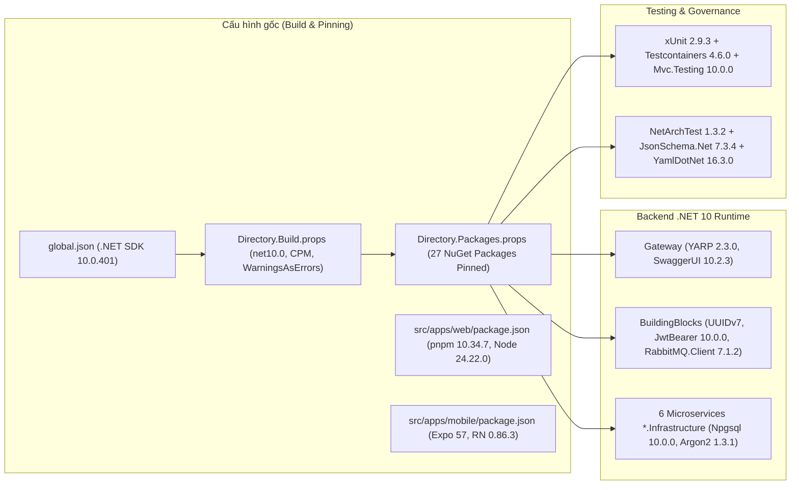

# 01. Bản Đồ Toàn Bộ Thư Viện, Công Nghệ & Vị Trí File Code (.NET 10 Full-Stack)

Tài liệu này cung cấp bản đồ tham chiếu kỹ thuật toàn diện từ **gói thư viện (NuGet / npm / Docker Image)** xuống tận **project, file mã nguồn, class, hàm thực thi và cơ chế hoạt động bên dưới CLR / Runtime / Socket** trong toàn bộ codebase `BusTicketPlatform`.

---

## 1. Kiến Trúc Quản Lý Gói Tập Trung (Central Package Management & Workspace)

Trước khi đi vào từng thư viện, hệ thống khóa chặt phiên bản SDK và gói phụ thuộc thông qua 3 chốt chặn cấu hình gốc:

1. **Khóa phiên bản .NET 10 SDK** tại [global.json](file:///C:/Users/minht/.gemini/antigravity/worktrees/PBL6/c_to_n_b/workspace/global.json#L1-L6): ép trình biên dịch `dotnet` sử dụng SDK `10.0.401` với chính sách `latestPatch`.
2. **Cấu hình biên dịch MSBuild toàn cục & Central Package Management (CPM)** tại [Directory.Build.props](file:///C:/Users/minht/.gemini/antigravity/worktrees/PBL6/c_to_n_b/workspace/Directory.Build.props#L1-L20):

```xml
<!-- workspace/Directory.Build.props:1-15 -->
<Project>
  <PropertyGroup>
    <TargetFramework>net10.0</TargetFramework>
    <Nullable>enable</Nullable>
    <ImplicitUsings>enable</ImplicitUsings>
    <LangVersion>latest</LangVersion>
    <TreatWarningsAsErrors>true</TreatWarningsAsErrors>
    <AnalysisLevel>latest</AnalysisLevel>
    <EnableNETAnalyzers>true</EnableNETAnalyzers>
    <EnforceCodeStyleInBuild>true</EnforceCodeStyleInBuild>
    <ManagePackageVersionsCentrally>true</ManagePackageVersionsCentrally>
    <Deterministic>true</Deterministic>
    <NeutralLanguage>en</NeutralLanguage>
    <CentralPackageTransitivePinningEnabled>true</CentralPackageTransitivePinningEnabled>
  </PropertyGroup>
```

- **`ManagePackageVersionsCentrally=true` & `CentralPackageTransitivePinningEnabled=true`**: Mọi file `.csproj` con (ví dụ `BusTicketPlatform.Booking.Infrastructure.csproj`) chỉ khai báo `<PackageReference Include="Npgsql" />` **không kèm số phiên bản**. Toàn bộ đồ thị phụ thuộc NuGet (kể cả gói bắc cầu - transitive dependencies) bị ghim cứng tại một nguồn sự thật duy nhất là [Directory.Packages.props](file:///C:/Users/minht/.gemini/antigravity/worktrees/PBL6/c_to_n_b/workspace/Directory.Packages.props#L1-L31), triệt tiêu hoàn toàn lỗi *Diamond Dependency Version Skew* giữa 6 microservices.
- **`TreatWarningsAsErrors=true` + `Nullable=enable` + `Deterministic=true`**: Mọi cảnh báo null-dereference (`CS8600`–`CS8625`) hoặc vi phạm Roslyn Analyzer đều làm gãy quá trình build ngay tức khắc; binary `.dll` sinh ra có byte-for-byte hash đồng nhất trên mọi máy CI/CD.



---

## 2. Bảng Ma Trận Tổng Hợp Toàn Bộ Công Nghệ & Thư Viện -> Vị Trí Code

Bảng dưới đây ánh xạ chính xác **100% công nghệ, gói thư viện và thành phần BCL/Runtime** sang vị trí project và dòng code thực tế đang gọi chúng.

### 2.1. Nhóm Backend .NET 10, Bảo Mật, CSDL & Messaging

| Tên công nghệ / Gói thư viện | Phiên bản | Giải quyết bài toán kỹ thuật cốt lõi | Project khai báo | File code & Class / Hàm cụ thể đang gọi |
| :--- | :--- | :--- | :--- | :--- |
| **`.NET SDK & CLR Runtime`** | `10.0.401` (`net10.0`) | Máy ảo thực thi RyuJIT, Tiered PGO, Server GC, Kestrel HTTP/1.1-2-3 socket engine | Toàn bộ `*.csproj` qua `Directory.Build.props` | Tất cả `Program.cs` (`WebApplication.CreateBuilder`) |
| **`Yarp.ReverseProxy`** | `2.3.0` | L7 HTTP Reverse Proxy hiệu năng cao dựa trên `SocketsHttpHandler`, khớp route theo độ ưu tiên `Order` và biến đổi URL (`PathRemovePrefix`) | `BusTicketPlatform.Gateway` | `src/gateway/BusTicketPlatform.Gateway/Program.cs` (`AddReverseProxy`, `LoadFromConfig`, `MapReverseProxy` dòng 15–17, 166) & `appsettings.json` (dòng 18–308) |
| **`Npgsql`** | `10.0.0` | ADO.NET Driver thuần C# giao tiếp trực tiếp PostgreSQL Wire Protocol v3 qua TCP Socket, quản lý Connection Pool, ánh xạ kiểu `uuid[]`, `jsonb`, `tstzrange` | `BuildingBlocks.Messaging` & cả 6 `*.Infrastructure` | `BookingRepository.cs` (`OpenAsync`, `CreateHoldAsync`, `CreateBookingAsync`), `TransportRepository.cs` (`PublishTripAsync`, `SearchSellableAsync`), `SePayPaymentStore.cs` (`ApplySePayAsync`), `OutboxRelay.cs`, `InboxDeduper.cs` |
| **`RabbitMQ.Client`** | `7.1.2` | Giao thức AMQP 0-9-1 thuần bất đồng bộ (`IConnection`, `IChannel`), khai báo Topic Exchange/DLX, publish bền vững và pull/ack/nack message zero-copy | `BusTicketPlatform.BuildingBlocks.Messaging` | `RabbitMqSmokeBus.cs` (`ConnectAsync`, `DeclareSmokeTopologyAsync`, `EnsureConsumerAsync`, `PublishAsync`, `GetAsync`, `AckAsync`, `RejectAsync` dòng 17–108) |
| **`Konscious.Security.Cryptography.Argon2`** | `1.3.1` | Băm mật khẩu kháng GPU/ASIC bằng thuật toán Memory-Hard `Argon2id` (`m=8192 KiB`, `t=1`, `p=1`, salt 128-bit, tag 256-bit) | `BusTicketPlatform.Identity.Infrastructure` | `Argon2PasswordHasher.cs` (`Argon2PasswordHasher.Hash`, `Verify`, `Derive` dùng `new Argon2id(...)` dòng 8–39) |
| **`Microsoft.AspNetCore.Authentication.JwtBearer`** | `10.0.0` | Middleware xác thực Bearer Token trên HTTP Header `Authorization`, kiểm tra chữ ký HMAC-SHA256, hạn dùng và hook kiểm tra thu hồi phiên (`OnTokenValidated`) | `BuildingBlocks.AspNetCore`, `Identity.Api` | `PlatformJwtExtensions.cs` (`AddPlatformJwt` dòng 11–39), `Identity.Api/Program.cs` (`AddJwtBearer` + `JwtBearerEvents.OnTokenValidated` dòng 25–68) |
| **`System.IdentityModel.Tokens.Jwt`** | `8.14.0` | Đóng gói claims (`sub`, `jti`, `sid`, `ver`, `org`, `role`), ký số bằng `SymmetricSecurityKey` (`HS256`) và xuất chuỗi JWS compact serialization | `BuildingBlocks.AspNetCore`, `Identity.Infrastructure` | `JwtTokenService.cs` (`JwtTokenService.Issue`, `JwtSecurityToken`, `JwtSecurityTokenHandler.WriteToken` dòng 23–57) |
| **`Microsoft.AspNetCore.OpenApi`** | `10.0.12` | Sinh tài liệu đặc tả OpenAPI JSON (`/openapi/v1.json`) trực tiếp từ metadata của Minimal API endpoints tại runtime | `BuildingBlocks.AspNetCore` | `OpenApiExtensions.cs` (`AddPlatformOpenApi` -> `AddOpenApi()`, `MapPlatformOpenApi` -> `MapOpenApi()` dòng 9–34) |
| **`Swashbuckle.AspNetCore.SwaggerUI`** | `10.2.3` | Giao diện cổng tra cứu API tập trung tại Gateway, gom 6 tài liệu `/openapi/v1.json` từ 6 microservices | `BusTicketPlatform.Gateway` | `Gateway/Program.cs` (`app.UseSwaggerUI(...)` dòng 99–124) |
| **`Microsoft.Extensions.Diagnostics.HealthChecks`** | `10.0.0` | Cơ chế thăm dò sức khỏe phân tách 3 cổng `/live`, `/ready` (chạy `SELECT 1` xuống Postgres) và `/startup` cho Docker/K8s orchestrator | `BuildingBlocks.AspNetCore`, Gateway & 6 Services | `HealthEndpointExtensions.cs` (`MapPlatformHealth`), `PostgresHealthCheck.cs` tại cả 6 `*.Infrastructure`, `Booking.Api/Program.cs` (dòng 21–23, 44) |
| **`Microsoft.Extensions.Hosting`** | `10.0.0` | Quản lý vòng đời tiến trình (`IHostedService` cho DB Migration tuần tự trước Kestrel; `BackgroundService` cho Outbox Dispatcher & Event Consumer) | `BuildingBlocks.Messaging` & 6 `*.Infrastructure` | `SqlBaselineHostedService.cs` (dòng 5–10), `OutboxDispatchHostedService.cs` (dòng 7–35), `IntegrationEventConsumerHost.cs` (dòng 35–101) |
| **`Microsoft.AspNetCore.RateLimiting`** *(Built-in .NET 10)* | `10.0.0` (Framework) | Thuật toán giới hạn tần suất cửa sổ cố định (`FixedWindowLimiter`) chống vét cạn mã đặt vé và spam form liên hệ, trả HTTP `429` | `Booking.Api`, `Notification.Api` | `Booking.Api/Program.cs` (`AddFixedWindowLimiter("ticket-lookup")` dòng 26–34), `BookingEndpoints.cs` (dòng 52), `Notification.Api/Program.cs` (`"customer-requests"` dòng 20–24, 33–34) |
| **`System.Security.Cryptography`** *(Built-in .NET 10)* | `10.0.0` (BCL) | Mật mã học cấp thấp không cấp phát đối tượng trung gian: `HMACSHA256`, `HMACSHA512`, `SHA256`, `RandomNumberGenerator`, `CryptographicOperations.FixedTimeEquals` | `BuildingBlocks`, `Identity`, `Booking`, `Payment` | `TicketLookupToken.cs` (dòng 15, 22, 34–35), `TicketQr.cs` (dòng 39, 43), `VnPayCheckout.cs` (dòng 78, 90), `PlatformHttp.cs` (dòng 71), `BookingService.cs` (dòng 125, 791) |
| **`System.Buffers.Binary.BinaryPrimitives`** *(Built-in .NET 10)* | `10.0.0` (BCL) | Đọc/ghi số nguyên 64-bit theo thứ tự byte mạng (Big-Endian) trực tiếp lên vùng nhớ `Span<byte>` không tạo mảng phụ | `BusTicketPlatform.Booking.Application` | `TicketLookupToken.cs` (`WriteInt64BigEndian` dòng 21, `ReadInt64BigEndian` dòng 36) |
| **`System.Guid.CreateVersion7`** *(Built-in .NET 10)* | `10.0.0` (BCL) | Sinh định danh 128-bit chuẩn RFC 9562 (48-bit Unix timestamp ms đầu + 74-bit CSPRNG) giúp khóa chính B-Tree PostgreSQL tăng tuần tự, chống phân mảnh trang | `BusTicketPlatform.BuildingBlocks` | `UuidV7IdGenerator.cs` (`NewUuidV7` dòng 5), `InboxDeduper.cs` (dòng 29), `SePayPaymentStore.cs` (dòng 87) |
| **`System.Net.Mail.SmtpClient`** *(Built-in .NET 10)* | `10.0.0` (BCL) | Gửi email mã xác thực OTP / đặt lại mật khẩu bất đồng bộ qua giao thức SMTP (`SendMailAsync`) tới Mailpit hoặc máy chủ SMTP thật | `BusTicketPlatform.Identity.Infrastructure` | `ChallengeNotifier.cs` (`ChallengeNotifier.NotifyAsync`, `MailMessage`, `SmtpClient` dòng 71–85) |
| **`System.Text.RegularExpressions` Source Generator** | `10.0.0` (Roslyn) | `[GeneratedRegex]` sinh mã C# kiểm tra biểu thức chính quy ngay lúc biên dịch (Compile-time), loại bỏ chi phí JIT Regex lúc runtime và chống ReDoS | `Identity.Domain`, `Notification.Api` | `IdentityNormalizer.cs` (`PhonePattern`, `EmailPattern` dòng 7–11), `CustomerRequests.cs` (`PhonePattern` dòng 38–39) |

### 2.2. Nhóm Kiểm Thử, Quản Trị Kiến Trúc, Frontend, Mobile & Hạ Tầng

| Tên công nghệ / Gói thư viện | Phiên bản | Giải quyết bài toán kỹ thuật cốt lõi | Project / Package khai báo | File code & Class / Hàm cụ thể đang gọi |
| :--- | :--- | :--- | :--- | :--- |
| **`NetArchTest.Rules`** | `1.3.2` | Kiểm định kiến trúc tự động bằng cách đọc bảng tham chiếu IL Metadata của `.dll` để chặn Domain/Application phụ thuộc ngược vào Infrastructure/ORM | `BusTicketPlatform.ArchitectureTests` | `LayerDependencyTests.cs` (`Types.InAssembly(...).ShouldNot().HaveDependencyOnAny(...)` dòng 19–101) |
| **`JsonSchema.Net`** | `7.3.4` | Thẩm định cấu trúc gói tin sự kiện tích hợp (`EventMessage`) tuân thủ nghiêm ngặt JSON Schema Draft 2020-12 | `ContractTests`, `Messaging.IntegrationTests` | `MessageSchemaTests.cs` (`JsonSchema.FromFile`, `schema.Evaluate` dòng 11–45), `MessagingSmokeTests.cs` (`AssertValidEnvelope` dòng 157–163) |
| **`YamlDotNet`** | `16.3.0` | Phân tích cú pháp cây DOM YAML (`YamlStream`, `YamlMappingNode`) để kiểm tra tự động hợp đồng OpenAPI 3.1 và AsyncAPI 3.1 | `BusTicketPlatform.ContractTests` | `ContractGateTests.cs` (`Every_http_operation_declares_the_safe_default_error_envelope`, `AsyncApi_has_twenty_send_operations` dòng 37–83) |
| **`Testcontainers.PostgreSql` & `Testcontainers.RabbitMq`** | `4.6.0` | Điều khiển Docker Engine API khởi chạy container `postgres:17-alpine` và `rabbitmq:4.1-management-alpine` cô lập cho từng bộ Integration Test | `Messaging.IntegrationTests` & 6 `*.Api.IntegrationTests` | `MessagingSmokeTests.cs` (`PostgreSqlBuilder`, `RabbitMqBuilder` dòng 17–36), `BookingFlowTests.cs` (`BookingPostgresFixture` dòng 20–41) |
| **`Microsoft.AspNetCore.Mvc.Testing`** | `10.0.0` | Dựng máy chủ `TestServer` in-memory từ `Program` / Marker class, ghi đè DI (`ConfigureTestServices`) và cấp `HttpClient` gọi thẳng qua bộ nhớ RAM | Gateway & 6 `*.Api.IntegrationTests` | `BookingFlowTests.cs` (`WebApplicationFactory<Program>` dòng 23–39), `PaymentFlowTests.cs` (`WebApplicationFactory<PaymentApiMarker>` dòng 23–27) |
| **`xunit` & `coverlet.collector`** | `2.9.3` / `6.0.4` | Khung thực thi Unit/Integration Test song song theo Collection (`ICollectionFixture`, `IAsyncLifetime`) và thu thập độ phủ nhánh mã IL | Toàn bộ `src/tests/**` | `MessagingSmokeTests.cs`, `LayerDependencyTests.cs`, `ContractGateTests.cs`, `BookingFlowTests.cs` |
| **`Microsoft.Extensions.TimeProvider.Testing` & `SSH.NET`** | `10.0.0` / `2026.0.0` | Ghim sẵn phiên bản tập trung trong CPM để giả lập đồng hồ hệ thống định tính và hỗ trợ kết nối quản trị/tunnel từ xa khi cần mở rộng | `Directory.Packages.props` | `workspace/Directory.Packages.props` (dòng 6, 21 — dự phòng quản trị phiên bản tập trung) |
| **`React` + `Vite` + `React Router`** | `19.3.1` / `8.3.4` / `8.4.0` | Kiến trúc SPA (`ssr: false`) tốc độ cao, đóng gói đa cổng (`customer`, `operator`, `admin`) từ cùng codebase, nạp lười route modules và proxy `/api/v1` | `src/apps/web/package.json` | `src/apps/web/vite.config.ts` (dòng 6–72), `src/apps/web/react-router.config.ts` (dòng 3–11) |
| **`@tanstack/react-query`** | `5.104.4` | Quản lý vòng đời bộ nhớ đệm dữ liệu máy chủ (Server State), tự động đánh dấu cũ (`staleTime: 30_000`), thử lại có kiểm soát và đồng bộ ngầm | `src/apps/web/package.json` | `src/apps/web/src/app/AppProviders.tsx` (`new QueryClient(...)`, `QueryClientProvider` dòng 41–58) |
| **`zustand` + `zod` + `react-hook-form`** | `5.0.15` / `4.6.7` / `7.90.0` | Lưu trữ trạng thái nháp phía trình duyệt (`persist` middleware) kết hợp kiểm duyệt kiểu dữ liệu runtime chặt chẽ (`safeParse`, `.strict()`) | `src/apps/web/package.json` | `bookingDraftStore.ts` (`create`, `persist`, `persistedDraftSchema` dòng 1–80), `auth.schema.ts` (`loginSchema`, `registerSchema` dòng 1–45) |
| **`msw` (Mock Service Worker)** | `3.0.3` | Đăng ký Service Worker chặn các lời gọi `fetch` ngay tầng mạng trình duyệt khi chạy chế độ `VITE_API_MODE=mock` | `src/apps/web/package.json` | `src/apps/web/src/app/enableMocking.ts` (`worker.start({ onUnhandledFrame: "bypass" })` dòng 2–7) |
| **`@playwright/test` + `@axe-core/playwright`** | `1.64.1` / `4.14.0` | Kiểm thử tự động trình duyệt đầu-cuối (E2E) kết hợp quét cây trợ năng WCAG (`AxeBuilder`) chặn lỗi `critical`/`serious` | `src/apps/web/package.json` | `src/apps/web/tests/e2e/accessibility.spec.ts` (`new AxeBuilder({ page }).analyze()` dòng 15–40) |
| **`Expo` + `React Native` + `expo-secure-store`** | `~57.0.31` / `0.86.3` / `~57.0.4` | Ứng dụng di động đa nền tảng lưu trữ JWT session và vé offline trong vùng mã hóa phần cứng (Keychain iOS / Keystore Android) | `src/apps/mobile/package.json` | `src/apps/mobile/src/session.ts` (`SecureStore.getItemAsync`, `setItemAsync`, `deleteItemAsync` dòng 2, 10–42) |
| **PostgreSQL 17 + `btree_gist` & RabbitMQ 4.1 & Docker** | `17-alpine` / `4.1-alpine` | CSDL quan hệ hỗ trợ chỉ mục không-thời gian GiST (`EXCLUDE USING gist`), Broker AMQP 0-9-1, đóng gói multi-stage container non-root (`$APP_UID`) | `src/infra/docker-compose.yml`, `docker/*.Dockerfile` | `docs/database/transport/001_initial.sql` (dòng 1, 190–219), `src/infra/docker/api.Dockerfile` (dòng 1–20) |

---

## 3. Mổ Xẻ Chuyên Sâu Từng Nhóm Thư Viện & Cơ Chế Hoạt Động Dưới Runtime

### 3.1. `Yarp.ReverseProxy 2.3.0` — L7 HTTP Reverse Proxy Trên Nền Kestrel & `SocketsHttpHandler`

Khác với việc dựng NGINX hay Kong tách rời khỏi hệ sinh thái .NET, dự án nhúng trực tiếp **YARP (Yet Another Reverse Proxy) 2.3.0** của Microsoft vào tiến trình `BusTicketPlatform.Gateway` chạy trên Kestrel:

```csharp
// workspace/src/gateway/BusTicketPlatform.Gateway/Program.cs:15-17, 166
builder.Services.AddReverseProxy()
    .LoadFromConfig(
        builder.Configuration.GetSection("ReverseProxy"));
// ...
app.MapReverseProxy();
```

Và bảng định tuyến khai báo trong [appsettings.json](file:///C:/Users/minht/.gemini/antigravity/worktrees/PBL6/c_to_n_b/workspace/src/gateway/BusTicketPlatform.Gateway/appsettings.json#L18-L308):

```json
// workspace/src/gateway/BusTicketPlatform.Gateway/appsettings.json:33-37, 268-272, 293-307
"ReverseProxy": {
  "Routes": {
    "identity-operator-staff": {
      "ClusterId": "identity",
      "Order": -40,
      "Match": { "Path": "/api/v1/operator/staff/{**catch-all}" }
    },
    "transport-trips": {
      "ClusterId": "transport",
      "Order": 10,
      "Match": { "Path": "/api/v1/trips/{**catch-all}" }
    },
    "identity-legacy": {
      "ClusterId": "identity",
      "Order": 20,
      "Match": { "Path": "/identity/{**catch-all}" },
      "Transforms": [{ "PathRemovePrefix": "/identity" }]
    }
  },
  "Clusters": {
    "identity":  { "Destinations": { "identity-local":  { "Address": "http://localhost:5081/" } } },
    "transport": { "Destinations": { "transport-local": { "Address": "http://localhost:5082/" } } },
    "booking":   { "Destinations": { "booking-local":   { "Address": "http://localhost:5083/" } } },
    "payment":   { "Destinations": { "payment-local":   { "Address": "http://localhost:5084/" } } }
  }
}
```

**Cơ chế thực thi bên dưới CLR & Socket khi một HTTP Request đi qua YARP:**
1. **Biên dịch bảng Route thành cây DFA (Deterministic Finite Automaton) của ASP.NET Core Endpoint Routing**: Khi `LoadFromConfig` nạp JSON, `IProxyConfigProvider` theo dõi thay đổi qua `IChangeToken` (cho phép hot-reload bảng route không cần khởi động lại Gateway). Mỗi mục trong `Routes` được đăng ký thành một `RouteEndpoint` thực thụ trong bảng định tuyến của ASP.NET Core.
2. **Giải quyết xung đột đường dẫn chồng lấn bằng trọng số `Order` âm/dương**: Vì cùng tiền tố `/api/v1/trips/...` vừa có endpoint của `Transport` (`/api/v1/trips/{tripId}`) vừa có endpoint của `Booking` (`/api/v1/trips/{tripId}/seats`, `/api/v1/trips/availability`), YARP xét khớp theo thứ tự số nguyên `Order` tăng dần:
   - `Order: -40` (`/api/v1/operator/staff/...` -> `identity`) thắng tuyệt đối trước `Order: 10` (`/api/v1/operator/{**catch-all}` -> `transport`).
   - `Order: -30` (`/api/v1/trips/availability` -> `booking`) và `Order: -20` (`/api/v1/trips/{tripId}/seats` -> `booking`) được khớp trước `Order: 10` (`/api/v1/trips/{**catch-all}` -> `transport`).
   - `Order: 20` (`/identity/{**catch-all}`) chạy bộ biến đổi `PathRemovePrefixTransform` cắt tiền tố `/identity` trên `PathString` trước khi đẩy xuống `localhost:5081`.
3. **Zero-Buffering Streaming qua `HttpForwarder` & `SocketsHttpHandler`**: YARP **không đọc toàn bộ request/response body vào `byte[]` trên Managed Heap**. Thay vào đó, `HttpForwarder` duy trì một `HttpMessageInvoker` riêng cho từng `Cluster`, bên dưới là `SocketsHttpHandler` giữ sẵn bể kết nối TCP Keep-Alive (`HttpConnectionPool`). Luồng byte từ `HttpContext.Request.BodyReader` (`PipeReader` của Kestrel) được bơm thẳng (stream copy bằng buffer mượn từ `ArrayPool<byte>.Shared`) sang socket kết nối tới microservice đích và ngược lại, đồng thời tự động gán các header `X-Forwarded-For`, `X-Forwarded-Proto`, `X-Forwarded-Host` và giữ nguyên `X-Correlation-Id` do `CorrelationMiddleware` (chạy trước `MapReverseProxy()` tại dòng 79) đã gắn vào.

---

### 3.2. `Npgsql 10.0.0` — Giao Tiếp Trực Tiếp PostgreSQL Wire Protocol v3 (Zero-ORM Overhead)

Toàn bộ 6 tầng `*.Infrastructure` và `BuildingBlocks.Messaging` sử dụng **`Npgsql 10.0.0`** thuần túy (Raw ADO.NET) mà không qua Entity Framework Core hay Dapper. Điều này loại bỏ hoàn toàn chi phí Change Tracker snapshot, biên dịch Expression Tree lúc runtime và cho phép khai thác trực tiếp các tính năng đặc thù cấp thấp của PostgreSQL 17:

```csharp
// workspace/src/services/payment/BusTicketPlatform.Payment.Infrastructure/Persistence/SePayPaymentStore.cs:14-28
await using var connection = await OpenAsync(cancellationToken);
await using var tx = await connection.BeginTransactionAsync(cancellationToken);
await using (var transactionLock = new NpgsqlCommand("SELECT pg_advisory_xact_lock(hashtext(@txn))", connection, tx))
{
    transactionLock.Parameters.AddWithValue("txn", notification.TransactionId);
    await transactionLock.ExecuteScalarAsync(cancellationToken);
}
PaymentRecord payment;
await using (var command = new NpgsqlCommand("SELECT " + PaymentCols + " FROM payments WHERE logical_reference = @ref FOR UPDATE", connection, tx))
{
    command.Parameters.AddWithValue("ref", notification.Invoice);
    await using var reader = await command.ExecuteReaderAsync(cancellationToken);
    if (!await reader.ReadAsync(cancellationToken)) return Result.Failure(PlatformErrors.NotFound());
    payment = ReadPayment(reader);
}
```

**Ba điểm nhấn kỹ thuật chỉ có thể đạt độ chính xác tối đa khi điều khiển trực tiếp `Npgsql 10.0.0`:**
- **Khóa cố vấn cấp giao dịch trên RAM của Postgres (`pg_advisory_xact_lock(hashtext(@txn))`)** tại `SePayPaymentStore.cs:16`: Khi cổng thanh toán SePay bắn đồng thời 2 webhook IPN cùng `TransactionId` (khi dòng chưa tồn tại trong `webhook_receipts` để khóa bằng `FOR UPDATE`), hàm `hashtext(@txn)` băm chuỗi mã giao dịch thành số nguyên 32-bit và xin khóa trực tiếp trên bảng khóa bộ nhớ trong của PostgreSQL gắn chặt với vòng đời `NpgsqlTransaction` (`tx`). Khóa tự động nhả ngay khi `tx.CommitAsync` hoặc `RollbackAsync` mà không bao giờ gây rò rỉ session lock.
- **Khóa bi quan cấp dòng (`SELECT ... FOR UPDATE` / `FOR SHARE`)** tại `BookingRepository.cs:258-262` (khóa các ghế `trip_seats` khi giữ chỗ) và `BookingRepository.cs:420-424` (`FOR SHARE` khóa quy tắc `coupons` ngăn Admin sửa mức giảm giá giữa chừng giao dịch đặt vé).
- **Truyền thông nhị phân (Binary Extended Query Protocol)**: Khi truyền `Guid`, `Guid[]`, `long`, `DateTime` qua `NpgsqlParameter`, `NpgsqlConnector` đóng gói gói tin `Parse` -> `Bind` -> `Execute` theo định dạng nhị phân gốc của PostgreSQL (ví dụ `Guid` đi thẳng 16 bytes nhị phân vào socket, `long` đi thẳng 8 bytes `int8` Big-Endian) thay vì phải chuyển đổi qua lại sang chuỗi ký tự ASCII tốn CPU. *(Chi tiết cơ chế Connection Pool và bắt `PostgresException.SqlState` được giải phẫu chuyên sâu tại File 03).*

---

### 3.3. `RabbitMQ.Client 7.1.2` — Giao Thức AMQP 0-9-1 Thuần Bất Đồng Bộ & Zero-Copy `ReadOnlyMemory<byte>`

Dự án nâng cấp lên **`RabbitMQ.Client 7.1.2`** — bản đại tu kiến trúc lớn nhất của driver RabbitMQ trên .NET (loại bỏ hoàn toàn interface đồng bộ `IModel` cũ của nhánh `6.x` vốn dễ gây chặn luồng ThreadPool, thay thế bằng `IConnection` và `IChannel` bất đồng bộ 100% từ tầng `Socket` và trả về `ValueTask` / `Task`):

```csharp
// workspace/src/building-blocks/BusTicketPlatform.BuildingBlocks.Messaging/RabbitMqSmokeBus.cs:17-23, 44-85, 87-108
public static async Task<RabbitMqSmokeBus> ConnectAsync(string amqpUri, CancellationToken cancellationToken)
{
    var factory = new ConnectionFactory { Uri = new Uri(amqpUri) };
    var connection = await factory.CreateConnectionAsync(cancellationToken);
    var channel = await connection.CreateChannelAsync(cancellationToken: cancellationToken);
    return new RabbitMqSmokeBus(connection, channel);
}

public async Task EnsureConsumerAsync(string queue, IReadOnlyList<string> routingKeys, CancellationToken cancellationToken)
{
    await _channel.ExchangeDeclareAsync(Topology.EventsExchange, ExchangeType.Topic, durable: true, cancellationToken: cancellationToken);
    await _channel.ExchangeDeclareAsync(Topology.DeadLetterExchange, ExchangeType.Topic, durable: true, cancellationToken: cancellationToken);
    await _channel.QueueDeclareAsync(
        queue,
        durable: true,
        exclusive: false,
        autoDelete: false,
        arguments: new Dictionary<string, object?>
        {
            ["x-dead-letter-exchange"] = Topology.DeadLetterExchange
        },
        cancellationToken: cancellationToken);
    foreach (var routingKey in routingKeys)
    {
        await _channel.QueueBindAsync(queue, Topology.EventsExchange, routingKey, cancellationToken: cancellationToken);
    }
}

public async Task PublishAsync(EventMessage message, string routingKey, CancellationToken cancellationToken)
{
    var body = JsonSerializer.SerializeToUtf8Bytes(message, EventMessageJson.Options);
    var properties = new BasicProperties
    {
        MessageId = message.EventId.ToString(),
        Type = message.EventType,
        ContentType = "application/json",
        ContentEncoding = "utf-8",
        DeliveryMode = DeliveryModes.Persistent,
        CorrelationId = message.CorrelationId.ToString(),
        Headers = new Dictionary<string, object?> { ["schema-version"] = message.Version }
    };

    await _channel.BasicPublishAsync(
        Topology.EventsExchange,
        routingKey,
        mandatory: true,
        basicProperties: properties,
        body: body,
        cancellationToken: cancellationToken);
}

public Task AckAsync(ulong deliveryTag, CancellationToken cancellationToken) =>
    _channel.BasicAckAsync(deliveryTag, multiple: false, cancellationToken).AsTask();

public Task RejectAsync(ulong deliveryTag, bool requeue, CancellationToken cancellationToken) =>
    _channel.BasicNackAsync(deliveryTag, multiple: false, requeue, cancellationToken).AsTask();
```

**Giải phẫu cơ chế AMQP 0-9-1 dưới tầng Socket & Bộ nhớ CLR:**
- **Ghép kênh ảo (`IChannel`) trên một kết nối TCP vật lý (`IConnection`)**: `factory.CreateConnectionAsync` thiết lập duy nhất 1 TCP socket tới cổng `5672`, thực hiện bắt tay khung hình `AMQP 0-9-1` (`connection.start` -> `connection.tune` -> `connection.open` trên vhost `bus-ticket`) và khởi chạy vòng lặp đọc/ghi frame nền kèm nhịp tim (`Heartbeat`). `connection.CreateChannelAsync` chỉ gửi một frame nhẹ `channel.open` mang `ChannelNumber` (16-bit integer) trên chính socket TCP đó mà không tốn thêm bất kỳ cổng mạng hệ điều hành nào.
- **Đảm bảo bền vững đĩa (`durable: true` + `DeliveryModes.Persistent`) & Mạng lưới Dead-Letter (`x-dead-letter-exchange`)**:
  - `ExchangeDeclareAsync` và `QueueDeclareAsync` bật `durable: true` giúp metadata của `platform.events`, `platform.dlx` và các queue được ghi xuống cơ sở dữ liệu Mnesia trên đĩa của RabbitMQ.
  - Khi `BasicPublishAsync` gắn `DeliveryMode = DeliveryModes.Persistent` (giá trị byte `2` trong AMQP Basic Header frame), RabbitMQ ghi nội dung gói tin xuống Message Store trên đĩa thay vì chỉ giữ trên RAM.
  - Tại `IntegrationEventConsumerHost.cs:89-93`, nếu quá trình xử lý message ném ngoại lệ, hệ thống gọi `await bus.RejectAsync(delivered.Value.DeliveryTag, requeue: false, stoppingToken)`. Do `requeue: false` kết hợp với đối số `["x-dead-letter-exchange"] = "platform.dlx"`, RabbitMQ không đẩy gói tin lỗi quay lại đầu hàng đợi gây lặp vô tận (*Poison Message Loop*), mà tự động chuyển tiếp nguyên vẹn gói tin sang sàn `platform.dlx` để lưu vết điều tra.
- **Zero-Copy Payload với `ReadOnlyMemory<byte>`**: Trong `RabbitMqSmokeBus.GetAsync` (dòng 87–96), `BasicGetAsync` trả về `result.Body` kiểu `ReadOnlyMemory<byte>` trỏ trực tiếp vào vùng đệm frame mạng đã đọc. Sang `IntegrationEventConsumerHost.cs:77-80`, consumer truyền thẳng `delivered.Value.Body.Span` (`ReadOnlySpan<byte>`) vào `JsonSerializer.Deserialize<EventMessage>(...)` và `SHA256.HashData(...)` — **không phát sinh bất kỳ bước cấp phát chuỗi `string` UTF-16 trung gian nào trên Heap**!

---

### 3.4. `Konscious.Security.Cryptography.Argon2 1.3.1` — Băm Mật Khẩu Memory-Hard Kháng GPU/ASIC

Thay vì dùng `SHA256` (bị GPU RTX 4090 dò hàng chục tỷ hash/giây) hay `PBKDF2`/`BCrypt` truyền thống, `Identity.Infrastructure` tích hợp gói **`Konscious.Security.Cryptography.Argon2 1.3.1`** thực thi thuật toán chiến thắng cuộc thi Password Hashing Competition (RFC 9106) — biến thể lai **`Argon2id`**:

```csharp
// workspace/src/services/identity/BusTicketPlatform.Identity.Infrastructure/Security/Argon2PasswordHasher.cs:8-40
public sealed class Argon2PasswordHasher : IPasswordHasher
{
    public string Hash(string password)
    {
        var salt = RandomNumberGenerator.GetBytes(16);
        var hash = Derive(password, salt);
        return $"argon2id$m=8192$t=1$p=1${Convert.ToBase64String(salt)}${Convert.ToBase64String(hash)}";
    }

    public bool Verify(string password, string hash)
    {
        var parts = hash.Split('$');
        if (parts.Length != 6 || parts[0] != "argon2id")
        {
            return false;
        }

        var salt = Convert.FromBase64String(parts[4]);
        var expected = Convert.FromBase64String(parts[5]);
        var actual = Derive(password, salt);
        return CryptographicOperations.FixedTimeEquals(expected, actual);
    }

    private static byte[] Derive(string password, byte[] salt)
    {
        using var argon2 = new Argon2id(Encoding.UTF8.GetBytes(password));
        argon2.Salt = salt;
        argon2.DegreeOfParallelism = 1;
        argon2.Iterations = 1;
        argon2.MemorySize = 8192;
        return argon2.GetBytes(32);
    }
}
```

**Cơ chế mật mã học và bộ nhớ khi `argon2.GetBytes(32)` chạy trên CLR:**
1. **Cấp phát ma trận bộ nhớ `MemorySize = 8192` (8 MiB RAM mỗi lần băm)**: Thư viện `Konscious` cấp phát mảng các khối nhớ 1024-byte liên tiếp tổng cộng **8.192 KiB (8 MiB)**. Để tính ra 32 bytes đầu ra, CPU bắt buộc phải điền đầy và đọc/ghi trộn lẫn (compression function `G` dựa trên Blake2b) qua toàn bộ 8.192 khối RAM này. Kẻ tấn công dùng dàn card đồ họa (GPU/ASIC) có hàng vạn nhân ALU nhưng băng thông bộ nhớ đệm trên mỗi nhân cực nhỏ sẽ bị nghẽn cổ chai băng thông bộ nhớ (*Memory-Bandwidth Bound*), vô hiệu hóa khả năng dò mật khẩu song song quy mô lớn.
2. **Cơ chế lai `Argon2id`**: Ở nửa đầu của lượt duyệt đầu tiên (`Iterations = 1`), địa chỉ khối RAM cần đọc được tính độc lập với mật khẩu (*Data-Independent Addressing* giống `Argon2i`), chống tấn công kênh kề bộ nhớ đệm CPU (*Cache-Timing Side-Channel*). Ở nửa sau, địa chỉ khối RAM phụ thuộc trực tiếp vào giá trị dữ liệu vừa tính (*Data-Dependent Addressing* giống `Argon2d`), chống triệt để tấn công đánh đổi Thời gian - Bộ nhớ (*Time-Memory Trade-Off - TMTO*).
3. **Salt ngẫu nhiên mật mã 128-bit & So sánh hằng thời gian**: Mỗi lần gọi `Hash()`, `RandomNumberGenerator.GetBytes(16)` rút 16 bytes từ bộ sinh số ngẫu nhiên phần cứng/kernel của OS (CNG `BCryptGenRandom` trên Windows hoặc `/dev/urandom` `getrandom` syscall trên Linux), khiến 2 người dùng trùng mật khẩu vẫn ra 2 chuỗi hash khác hẳn nhau (chống 100% Rainbow Table). Khi `Verify()`, hai mảng 32 bytes `expected` và `actual` được đối chiếu bằng `CryptographicOperations.FixedTimeEquals` (thực hiện phép `XOR` toàn bộ 32 bytes không rẽ nhánh sớm), ngăn chặn kẻ tấn công đo độ trễ micro-giây để đoán từng byte của hash.

---

### 3.5. `JwtBearer 10.0.0` & `System.IdentityModel.Tokens.Jwt 8.14.0` — Phát Hành JWS & Đối Chiếu Thu Hồi Tức Thời (`AuthorizationVersion`)

Hệ thống xác thực tách làm 2 nửa đối xứng rõ rệt giữa nơi cấp phát token (`Identity.Infrastructure`) và nơi thẩm định token (`BuildingBlocks.AspNetCore` + `Identity.Api`):

#### Nửa 1: Đóng gói và ký số JWS (`HS256`) tại `JwtTokenService.cs`

```csharp
// workspace/src/services/identity/BusTicketPlatform.Identity.Infrastructure/Security/JwtTokenService.cs:21-57
public sealed class JwtTokenService(IOptions<AuthenticationOptions> options) : ITokenService
{
    public (string AccessToken, string RefreshTokenPlain, string RefreshTokenHash, int ExpiresIn) Issue(
        UserRecord user,
        IReadOnlyList<string> roles,
        Guid sessionId,
        Guid? organizationId = null)
    {
        var settings = options.Value;
        var key = new SymmetricSecurityKey(Encoding.UTF8.GetBytes(settings.SigningKey));
        var credentials = new SigningCredentials(key, SecurityAlgorithms.HmacSha256);
        var claims = new List<Claim>
        {
            new(JwtRegisteredClaimNames.Sub, user.Id.ToString()),
            new(JwtRegisteredClaimNames.Jti, Guid.CreateVersion7().ToString()),
            new("sid", sessionId.ToString()),
            new("ver", user.AuthorizationVersion.ToString())
        };
        if (organizationId is not null)
        {
            claims.Add(new Claim("org", organizationId.Value.ToString()));
        }

        claims.AddRange(roles.Select(role => new Claim(ClaimTypes.Role, role)));

        var expires = DateTime.UtcNow.AddSeconds(settings.AccessTokenSeconds);
        var jwt = new JwtSecurityToken(settings.Issuer, settings.Audience, claims, DateTime.UtcNow, expires, credentials);
        var access = new JwtSecurityTokenHandler().WriteToken(jwt);
        var refresh = Convert.ToBase64String(RandomNumberGenerator.GetBytes(32));
        return (access, refresh, AuthService.HashSecret(refresh), settings.AccessTokenSeconds);
    }
}
```

#### Nửa 2: Xác thực chữ ký Stateless (`PlatformJwtExtensions`) kết hợp Kiểm tra thu hồi Stateful (`Identity.Api`)

Tại 5 microservices nghiệp vụ (`Transport`, `Booking`, `Payment`, `Notification`, `Reporting`), hàm mở rộng [PlatformJwtExtensions.AddPlatformJwt](file:///C:/Users/minht/.gemini/antigravity/worktrees/PBL6/c_to_n_b/workspace/src/building-blocks/BusTicketPlatform.BuildingBlocks.AspNetCore/Auth/PlatformJwtExtensions.cs#L11-L39) cấu hình `JwtBearerHandler` xác thực hoàn toàn trên RAM (kiểm tra `ValidIssuer`, `ValidAudience`, chữ ký `SymmetricSecurityKey`, hạn dùng `exp`/`nbf` với dung sai lệch đồng hồ `ClockSkew = TimeSpan.FromSeconds(30)` thay vì mặc định 5 phút quá lỏng lẻo của .NET!).

Riêng tại **`Identity.Api/Program.cs`**, pipeline gắn thêm sự kiện `JwtBearerEvents.OnTokenValidated` để chống kịch bản tài khoản vừa bị khóa hoặc đổi mật khẩu nhưng Access Token 15 phút vẫn còn hạn:

```csharp
// workspace/src/services/identity/BusTicketPlatform.Identity.Api/Program.cs:44-67
options.Events = new JwtBearerEvents
{
    OnTokenValidated = async context =>
    {
        var subject = context.Principal?.FindFirstValue("sub")
            ?? context.Principal?.FindFirstValue(ClaimTypes.NameIdentifier);
        var versionValue = context.Principal?.FindFirstValue("ver");
        if (!Guid.TryParse(subject, out var userId)
            || !long.TryParse(versionValue, out var tokenVersion))
        {
            context.Fail("The access token is missing required identity claims.");
            return;
        }

        var repository = context.HttpContext.RequestServices.GetRequiredService<IIdentityRepository>();
        var user = await repository.FindByIdAsync(userId, context.HttpContext.RequestAborted);
        if (user is null
            || user.Status != UserStatuses.Active
            || user.AuthorizationVersion != tokenVersion)
        {
            context.Fail("The access token has been revoked.");
        }
    }
};
```

Khi Admin khóa tài khoản hoặc người dùng đổi quyền/mật khẩu, cột `authorization_version` trong bảng `users` tăng thêm `1`. Ngay ở request kế tiếp tới `Identity.Api`, `user.AuthorizationVersion != tokenVersion` trả về `true` và gọi `context.Fail(...)`, biến token cũ thành HTTP `401 Unauthorized` ngay lập tức!

---

### 3.6. Built-in `.NET 10` BCL Stack: `RateLimiting`, `System.Security.Cryptography` & `SmtpClient`

Dự án tận dụng tối đa các thư viện chuẩn tích hợp sẵn trong `.NET 10` BCL để giảm thiểu bề mặt tấn công chuỗi cung ứng (Supply-Chain Attack Surface) từ các gói bên thứ ba không cần thiết:

#### A. `Microsoft.AspNetCore.RateLimiting` — Cửa sổ cố định (`FixedWindowLimiter`) trên bộ nhớ Kestrel

Được kích hoạt tại 2 bề mặt API công khai nhạy cảm nhất (không yêu cầu đăng nhập):
- **Chống dò quét mã vé công khai** tại [Booking.Api/Program.cs](file:///C:/Users/minht/.gemini/antigravity/worktrees/PBL6/c_to_n_b/workspace/src/services/booking/BusTicketPlatform.Booking.Api/Program.cs#L26-L34) và gắn vào endpoint `POST /api/v1/tickets/lookup` (`BookingEndpoints.cs:52`):

```csharp
// workspace/src/services/booking/BusTicketPlatform.Booking.Api/Program.cs:26-34
builder.Services.AddRateLimiter(options =>
{
    options.RejectionStatusCode = 429;
    options.AddFixedWindowLimiter("ticket-lookup", limiter =>
    {
        limiter.Window = TimeSpan.FromMinutes(1);
        limiter.PermitLimit = 40;
    });
});
```

- **Chống spam biểu mẫu hỗ trợ / đăng ký đối tác** tại [Notification.Api/Program.cs](file:///C:/Users/minht/.gemini/antigravity/worktrees/PBL6/c_to_n_b/workspace/src/services/notification/BusTicketPlatform.Notification.Api/Program.cs#L20-L35) (`PermitLimit = 30` mỗi phút trên chính sách `"customer-requests"`, gắn cho `/api/v1/customer-requests/support` và `/partner`).
- Bên dưới CLR, `FixedWindowRateLimiter` sử dụng bộ đếm nguyên tử (`Interlocked` / spin-lock cực ngắn) và `Timer` nội bộ để cấp phát thẻ bài (`RateLimitLease`) trong vài chục nano-giây mà không cần chạm xuống cơ sở dữ liệu.

#### B. Họ hàm mật mã One-Shot Static trong `System.Security.Cryptography`

Thay vì viết kiểu cũ `using var sha = SHA256.Create(); sha.ComputeHash(...)` (mỗi lần gọi phải cấp phát đối tượng managed trên Heap + handle native), toàn bộ dự án dùng các phương thức tĩnh **One-Shot API** của .NET hiện đại gọi thẳng xuống thư viện C/Assembly của hệ điều hành (`SymCrypt` / `CNG` trên Windows, `OpenSSL 3` trên Linux container):

| API tĩnh được gọi | Vị trí file & dòng code chính xác | Chức năng kỹ thuật cụ thể |
| :--- | :--- | :--- |
| `HMACSHA256.HashData(key, source, destination)` | `TicketLookupToken.cs:15, 22, 34` & `TicketQr.cs:43` | Dẫn xuất khóa con (`"blue-ticket-lookup-v1"u8`) và ký mã xác thực thông điệp 256-bit cho Token tra cứu vé không trạng thái & chuỗi mã QR vé `BT1.<ticketId>.<MAC>` |
| `HMACSHA512.HashData(key, data)` | `VnPayCheckout.cs:78` | Ký chuỗi tham số query đã sắp xếp theo bảng chữ cái ASCII (`StringComparer.Ordinal`) tạo chữ ký `vnp_SecureHash` 512-bit (128 ký tự hex) chuẩn cổng VNPAY 2.1.0 |
| `SHA256.HashData(...)` | `PlatformHttp.cs:71`, `BookingService.cs:791`, `IntegrationEventConsumerHost.cs:80`, `SePayPaymentStore.cs:46` | Băm body HTTP cho `Idempotency-Key` (`request_hash`), băm `HoldToken` trước khi lưu DB (chống lộ token nếu lộ bảng `seat_holds`), băm gói tin RabbitMQ cho `inbox_messages`, và giới hạn độ dài mã biên lai SePay |
| `RandomNumberGenerator.GetBytes(32)` | `BookingService.cs:125`, `JwtTokenService.cs:55`, `Argon2PasswordHasher.cs:12` | Sinh chuỗi entropy mật mã 256-bit cho `SeatHold` token, `RefreshToken` và 128-bit Salt cho `Argon2id` |
| `CryptographicOperations.FixedTimeEquals(a, b)` | `TicketLookupToken.cs:35`, `TicketQr.cs:39`, `VnPayCheckout.cs:90`, `Argon2PasswordHasher.cs:28` | Được đánh dấu `[MethodImpl(MethodImplOptions.NoInlining | MethodImplOptions.NoOptimization)]` bên trong BCL để trình biên dịch RyuJIT không bao giờ tối ưu hóa thành vòng lặp thoát sớm, triệt tiêu 100% Timing Side-Channel Attack |

#### C. `System.Net.Mail.SmtpClient` kết hợp Hộp thư chụp nội bộ (`CapturingChallengeNotifier`)

Trong [ChallengeNotifier.cs](file:///C:/Users/minht/.gemini/antigravity/worktrees/PBL6/c_to_n_b/workspace/src/services/identity/BusTicketPlatform.Identity.Infrastructure/Security/ChallengeNotifier.cs#L44-L90), lớp `ChallengeNotifier` giải quyết bài toán gửi mã OTP xác minh email / đặt lại mật khẩu ở cả 2 chế độ:
1. Nếu `CaptureChallenges = true`, lưu bản ghi `ChallengeNotice` vào 2 bảng băm đồng thời `ConcurrentDictionary<string, ChallengeNotice>` và `ConcurrentDictionary<Guid, ChallengeNotice>` để Integration Test có thể đọc mã OTP tức thì mà không cần dựng SMTP server giả.
2. Nếu `SmtpOptions.Host` được cấu hình (ví dụ container `axllent/mailpit:v1.27` cổng `1025` trong `docker-compose.yml`), khởi tạo `MailMessage` và gọi `await client.SendMailAsync(message, cancellationToken)` qua TCP socket bất đồng bộ, bọc trong khối `try/catch` ghi `LogWarning` để sự cố mạng SMTP bên ngoài không làm rollback thay đổi trạng thái nghiệp vụ trong DB.

---

### 3.7. Nhóm Thư Viện Kiểm Thử Tự Động & Quản Trị Hợp Đồng (Testing & Governance)

Dự án thiết lập hàng rào kiểm định tự động ở 3 cấp độ: **Kiến trúc mã máy (IL)** -> **Hợp đồng giao diện (YAML/JSON Schema)** -> **Tích hợp container thực tế (Docker + In-Memory Host)**.

#### 1. `NetArchTest.Rules 1.3.2` — Cổng kiểm soát phụ thuộc tầng Clean Architecture

```csharp
// workspace/src/tests/architecture/BusTicketPlatform.ArchitectureTests/LayerDependencyTests.cs:19-33
[Theory]
[MemberData(nameof(Services))]
public void Domain_does_not_reference_host_stack(Type domainMarker, string service)
{
    var result = Types.InAssembly(domainMarker.Assembly)
        .ShouldNot()
        .HaveDependencyOnAny(
            "Microsoft.AspNetCore",
            "Microsoft.EntityFrameworkCore",
            "Npgsql",
            "Yarp.ReverseProxy",
            $"BusTicketPlatform.{service}.Application",
            $"BusTicketPlatform.{service}.Infrastructure",
            $"BusTicketPlatform.{service}.Api")
        .GetResult();
    Assert.True(result.IsSuccessful, Format(result));
}
```

Bên dưới `Types.InAssembly(...)`, `NetArchTest` dùng thư viện `Mono.Cecil` giải mã trực tiếp bảng metadata nhị phân PE/COFF của file `.dll` (`ModuleDefinition.AssemblyReferences` và `TypeReferences` trong thân hàm CIL). Chỉ cần một lập trình viên vô tình `using Npgsql;` hoặc tham chiếu kiểu của `Infrastructure` bên trong `Domain` hay `Application`, bài test này sẽ bắt dính tên class vi phạm ngay cả khi biến đó chỉ xuất hiện cục bộ trong thân hàm!

#### 2. `YamlDotNet 16.3.0` & `JsonSchema.Net 7.3.4` — Kiểm định AST cho OpenAPI 3.1, AsyncAPI 3.1 & Event Envelope

- Tại [ContractGateTests.cs](file:///C:/Users/minht/.gemini/antigravity/worktrees/PBL6/c_to_n_b/workspace/src/tests/contracts/BusTicketPlatform.ContractTests/ContractGateTests.cs#L37-L83), `YamlDotNet` nạp toàn bộ đặc tả `platform-mvp.openapi.yaml` và `platform-mvp.asyncapi.yaml` lên cây đối tượng `YamlStream` -> `YamlMappingNode`, duyệt từng đường dẫn HTTP (`get`, `post`, `put`, `patch`, `delete`) để cưỡng chế 100% endpoint phải khai báo `responses.default.$ref == "#/components/responses/Error"`, đồng thời đảm bảo AsyncAPI có đúng 20 thao tác `send` hợp lệ.
- Tại [MessageSchemaTests.cs](file:///C:/Users/minht/.gemini/antigravity/worktrees/PBL6/c_to_n_b/workspace/src/tests/contracts/BusTicketPlatform.ContractTests/MessageSchemaTests.cs#L9-L46) và `MessagingSmokeTests.cs:157-163`, `JsonSchema.FromFile(".../platform-message.schema.json")` kết hợp `schema.Evaluate(node, new EvaluationOptions { OutputFormat = OutputFormat.List })` kiểm tra từng gói tin xuất ra từ `RabbitMqSmokeBus` phải khớp tuyệt đối với lược đồ JSON Schema chuẩn.

#### 3. `Testcontainers 4.6.0` + `Microsoft.AspNetCore.Mvc.Testing 10.0.0` — Kiểm thử tích hợp không Mock DB/Broker

```csharp
// workspace/src/tests/booking/BusTicketPlatform.Booking.Api.IntegrationTests/BookingFlowTests.cs:20-41
public sealed class BookingPostgresFixture : IAsyncLifetime
{
    public PostgreSqlContainer Container { get; } = new PostgreSqlBuilder()
        .WithImage("postgres:17-alpine").WithDatabase("booking")
        .WithUsername("platform").WithPassword("postgres").Build();
    public WebApplicationFactory<Program> Factory { get; private set; } = null!;

    public async Task InitializeAsync()
    {
        await Container.StartAsync();
        Factory = new WebApplicationFactory<Program>().WithWebHostBuilder(builder =>
        {
            builder.UseSetting("Authentication:SigningKey", TestJwt.SigningKey);
            builder.ConfigureTestServices(services =>
            {
                services.RemoveAll<BookingDatabaseOptions>();
                services.AddSingleton(new BookingDatabaseOptions { ConnectionString = Container.GetConnectionString() });
            });
        });
    }
}
```

Sự phối hợp giữa hai thư viện này giải quyết triệt để nghịch lý kiểm thử tích hợp:
- **`PostgreSqlBuilder` / `RabbitMqBuilder` (`Testcontainers 4.6.0`)**: Giao tiếp với Docker Daemon qua Unix Socket / Windows Named Pipe (`npipe://./pipe/docker_engine`), tự động ánh xạ cổng ngẫu nhiên trên host (`Container.GetConnectionString()`), bật container sidecar *Ryuk* tự dọn dẹp container mồ côi ngay cả khi tiến trình `dotnet test` bị tắt đột ngột. Nhờ đó mọi ràng buộc `EXCLUDE USING gist`, `FOR UPDATE`, `DEFERRED FK` của PostgreSQL 17 thật và Dead-Letter Exchange của RabbitMQ 4.1 thật đều được kiểm chứng 100% (xem thêm `MessagingSmokeTests.cs:15-43`).
- **`WebApplicationFactory<Program>` (`Mvc.Testing 10.0.0`)**: Khởi chạy toàn bộ pipeline `Program.cs` (bao gồm cả `SqlBaselineHostedService` tự chạy SQL migration vào container Postgres vừa bật!) trên `TestServer` trong RAM. Khi `client.PostAsJsonAsync(...)` được gọi, gói tin HTTP đi thẳng qua `HttpMessageHandler` nội bộ vào middleware pipeline mà không tốn chi phí mở/đóng cổng TCP loopback của hệ điều hành.

---

### 3.8. Hệ Sinh Thái Thư Viện Frontend Web (`React 19` + `Vite 8`) & Mobile (`Expo 57`)

#### 1. `React 19.3.1` + `Vite 8.3.4` + `React Router 8.4.0` (Chế độ SPA Đa Cổng)

Trong [react-router.config.ts](file:///C:/Users/minht/.gemini/antigravity/worktrees/PBL6/c_to_n_b/workspace/src/apps/web/react-router.config.ts#L3-L11) và [vite.config.ts](file:///C:/Users/minht/.gemini/antigravity/worktrees/PBL6/c_to_n_b/workspace/src/apps/web/vite.config.ts#L6-L72), ứng dụng cấu hình `ssr: false` để biên dịch thành Single-Page Application tĩnh gọn nhẹ, có thể đóng gói vào container `nginxinc/nginx-unprivileged:1.27-alpine` (`src/infra/docker/web.Dockerfile`). Biến môi trường lúc build `BLUE_APP_TARGET` được tiêm qua `define` của Vite thành hằng số tĩnh `import.meta.env.VITE_APP_TARGET`, cho phép Rollup/Rolldown của Vite 8 thực hiện *Dead-Code Elimination (Tree-Shaking)* tách riêng thư mục build cho `customer`, `operator` và `admin`, đồng thời `optimizeDeps.include` gom trước (pre-bundle) các icon `@phosphor-icons/react` và thư viện lõi để triệt tiêu hiện tượng thác nước request (request waterfall) khi chuyển trang lần đầu.

#### 2. Phân tách trạng thái: `@tanstack/react-query 5.104.4` vs `zustand 5.0.15` + `zod 4.6.7`

- **Trạng thái máy chủ (`@tanstack/react-query`)**: Cấu hình tại [AppProviders.tsx](file:///C:/Users/minht/.gemini/antigravity/worktrees/PBL6/c_to_n_b/workspace/src/apps/web/src/app/AppProviders.tsx#L41-L58) với `queries: { retry: 1, staleTime: 30_000 }` và `mutations: { retry: 0 }` (tắt tự động retry cho `POST/PUT/DELETE` ở tầng React Query để tránh bắn trùng thao tác ghi khi chưa kiểm soát khóa Idempotency).
- **Trạng thái nháp phía trình duyệt có kiểm duyệt lược đồ (`zustand` + `zod`)**: Tại [bookingDraftStore.ts](file:///C:/Users/minht/.gemini/antigravity/worktrees/PBL6/c_to_n_b/workspace/src/apps/web/src/features/booking/store/bookingDraftStore.ts#L39-L80), `zustand/middleware` (`persist`) lưu phiên chọn ghế nháp xuống Web Storage (`blue-booking-draft`). Điểm cực kỳ chặt chẽ về mặt kỹ thuật là khi nạp lại dữ liệu từ `localStorage`/`sessionStorage` (vốn có thể bị sửa tay hoặc lệch phiên bản code sau khi deploy), hàm `readPersistedDraft` dùng **`Zod 4.6.7`** (`persistedDraftSchema.safeParse(value)` kèm `z.iso.datetime({ offset: true })`) để thẩm định cấu trúc và kiểm tra hạn `Date.parse(parsed.data.draft.expiresAt) > Date.now()` trước khi cho phép hydrate vào store! Tương tự, [auth.schema.ts](file:///C:/Users/minht/.gemini/antigravity/worktrees/PBL6/c_to_n_b/workspace/src/apps/web/src/features/auth/schemas/auth.schema.ts#L24-L45) dùng `.strict()` của Zod 4 chặn mọi trường JSON lạ lọt vào form đăng nhập/đăng ký.

#### 3. Giả lập mạng bằng Service Worker (`msw 3.0.3`) & Kiểm thử trợ năng E2E (`@playwright/test 1.64.1` + `@axe-core/playwright 4.14.0`)

- Khi `VITE_API_MODE=mock`, [enableMocking.ts](file:///C:/Users/minht/.gemini/antigravity/worktrees/PBL6/c_to_n_b/workspace/src/apps/web/src/app/enableMocking.ts#L2-L7) nạp động (`await import("@/mocks/browser")`) — đảm bảo toàn bộ mã nguồn mock **không bao giờ bị đóng gói vào bundle production** khi `isMockApi == false` — và khởi chạy Service Worker chặn request ngay dưới tầng `window.fetch`.
- Trong kiểm thử E2E tại [accessibility.spec.ts](file:///C:/Users/minht/.gemini/antigravity/worktrees/PBL6/c_to_n_b/workspace/src/apps/web/tests/e2e/accessibility.spec.ts#L13-L31), Playwright điều khiển nhân trình duyệt thật qua giao thức CDP, chờ `page.waitForLoadState("networkidle")`, sau đó `new AxeBuilder({ page }).analyze()` bơm bộ quy tắc WCAG vào DOM trực tiếp và làm gãy bài test ngay nếu phát hiện bất kỳ vi phạm nào mang mức độ `critical` hoặc `serious`, đồng thời đính kèm báo cáo JSON chi tiết vào `testInfo.attach(...)`.

#### 4. Bảo mật lưu trữ phiên di động với `expo-secure-store ~57.0.4`

Trên ứng dụng di động React Native (`0.86.3` / Expo SDK `57`), thay vì lưu Access/Refresh Token ở dạng văn bản thuần trong `AsyncStorage` (dễ bị trích xuất qua bản sao lưu ADB hoặc thiết bị root), file [mobile/src/session.ts](file:///C:/Users/minht/.gemini/antigravity/worktrees/PBL6/c_to_n_b/workspace/src/apps/mobile/src/session.ts#L10-L42) xây dựng bộ lưu trữ hai tầng:

```typescript
// workspace/src/apps/mobile/src/session.ts:20-30, 44-50
export const secureSession: SessionStore = {
  read: () => cached,
  write: (session) => {
    cached = session;
    if (session) {
      void SecureStore.setItemAsync(SESSION_KEY, JSON.stringify(session));
    } else {
      void SecureStore.deleteItemAsync(SESSION_KEY);
    }
  },
};

export function gatewayUrl() {
  if (process.env.EXPO_PUBLIC_GATEWAY_URL) return process.env.EXPO_PUBLIC_GATEWAY_URL;
  if (Platform.OS === "android") return "http://10.0.2.2:5080";
  return "http://127.0.0.1:5080";
}
```

- Khi khởi động app, `hydrateSession()` gọi `SecureStore.getItemAsync("busticket.session.mobile")` giải mã chuỗi JSON từ **iOS Keychain Services** hoặc **Android Keystore (`EncryptedSharedPreferences` AES-256-GCM)** nạp lên biến RAM `cached` để mọi lời gọi đồng bộ `secureSession.read()` gắn header `Authorization` cho `@busticket/api-client` không bị trễ I/O Bridge.
- Đồng thời hàm `gatewayUrl()` xử lý chính xác khác biệt định tuyến mạng ảo hóa: trình giả lập Android Emulator ánh xạ loopback máy chủ host qua địa chỉ IP ảo đặc biệt `10.0.2.2:5080`, trong khi iOS Simulator chia sẻ network stack của máy host qua `127.0.0.1:5080`.
